
<a href="{{ '/subjects/CCNA/' | relative_url }}">← 返回 CCNA 目录</a>

第二卷 · 网络自动化

<nav class="ccna-chapter-nav" aria-label="章节导航"><a href="v2-23.html">← 上一章</a></nav>



<section data-epub-type="chapter">

<h2 class="h2" id="ch24">第 24 章</h2>

<h2 class="h2a">理解 Ansible 和 Terraform</h2>

本章涵盖以下考试主题：

6.0 自动化和可编程性

6.6 识别 Ansible 和 Terraform 配置机制的能力

到现在为止，你已经了解如何使用 IOS CLI 配置路由器和交换机。通过 CLI 配置时，先进入配置模式，输入配置命令（修改 running-config 文件），最后退出配置模式。如果决定保留变更，就使用 <strong>copy running-config startup-config</strong> 命令将配置保存到 startup-config 文件。路由器或交换机下次启动时，会将 startup-config 文件加载到 RAM 中，作为 running-config。这个过程并不复杂。

本章讨论可替代这种逐台设备配置过程的配置管理工具。要理解这些工具的作用，首先需要设想中大型企业网络工程师的日常工作。实际网络中，管理大量网络设备的配置会带来挑战。沿用“在每台设备上使用配置模式”的方法，再加上努力工作、关注细节和良好的运维实践，也能够应对这些挑战。不过，由于种种原因，手工逐台配置会变得越来越困难，因此企业最终会转向自动化配置管理工具，以获得更好的结果。

本章第一节从总体上介绍大规模配置管理的问题，以及其中一些解决方案。第二大节详细介绍 Ansible 和 Terraform 两种配置管理工具，解释各自的功能和术语。读完本章，你应能理解这些自动化配置管理工具为什么在现代网络中发挥作用，并具备足够的背景知识，以选择其中一种继续深入学习。

<section>

<h3 class="h3" id="ch24lev1sec1">自测</h3>

如果你希望根据得分决定在本章投入多少时间，可以完成这组自测题（在此作答，或使用 PTP 软件）。各题答案的选项字母列在自测题之后的页面底部。书末和配套网站上的<a href="#ref-appc">附录 C</a>都包含答案及解析。你也可以在 PTP 测试软件中找到答案及解析。

<figure class="table" id="ch24tab01" tabindex="0">

<figcaption>

<strong>表24-1</strong> 基础主题与问题对应关系

</figcaption>

<table class="all">

<tbody>

<tr>

<th class="th">
基础知识小节
</th>

<th class="th">
题目
</th>

</tr>

<tr>

<td class="border">
设备配置挑战和解决方案
</td>

<td class="border">
1–3
</td>

</tr>

<tr>

<td class="border">
Ansible 和 Terraform 基础
</td>

<td class="border">
4, 5
</td>

</tr>

</tbody>

</table>

</figure>

<strong><a id="quess24_1" href="#ques24_1a">1</a>.</strong>哪个答案最能描述这个词的含义<em>配置漂移</em>?

<ol class="lower-alpha">

<li>
对单个设备的配置随时间推移而变化,与该单个设备的原始配置相对应
</li>

<li>
设备中不必要配置的更大和更大的部分
</li>

<li>
随着时间的推移,改变单个设备的配置与具有相同作用的其他设备
</li>

<li>
设备配置与中央备份副本的差异
</li>

</ol>

<strong><a id="quess24_2" href="#ques24_2a">2</a>.</strong>企业脱离了手动配置方法,通过编辑集中配置文件来进行修改. 哪些答案列出一个通过使用带有这些集中文件的版本控制系统来解决的问题? (取出二个答.

<ol class="lower-alpha">

<li>
找到哪个工程师在日期/时间改变中央配置文件的能力
</li>

<li>
查找配置文件中随时间推移而变化的细节的能力
</li>

<li>
使用带有每个设备变量的模板来创建配置的能力
</li>

<li>
识别设备中的配置漂移并通知工作人员的能力
</li>

</ol>

<strong><a id="quess24_3" href="#ques24_3a">3</a>.</strong>配置管理工具的配置监测(也叫配置执行)一般能解决哪个问题?

<ol class="lower-alpha">

<li>
跟踪更改文件的个人身份,连同他们更改的文件
</li>

<li>
列出前配置和当前配置之间的差异
</li>

<li>
测试一个配置更改以确定执行时是否被拒绝
</li>

<li>
查找配置漂移实例
</li>

</ol>

<strong><a id="quess24_4" href="#ques24_4a">4</a>.</strong>下列哪些配置管理工具默认使用一个推力模型来配置网络设备? (取出二个答.

<ol class="lower-alpha">

<li>
Ansible
</li>

<li>
两者都用拉出型号
</li>

<li>
Terraform
</li>

<li>
也不用推车模型
</li>

</ol>

<strong><a id="quess24_5" href="#ques24_5a">5</a>.</strong>下列哪一个答案列出了配置管理工具的正确组合,以及用于其主配置文件之一的名词? (取出二个答.

<ol class="lower-alpha">

<li>
可解析配置
</li>

<li>
地平面配置
</li>

<li>
Ansible 游戏本
</li>

<li>
三角形游戏本
</li>

</ol>

自测答案：

<strong><a id="ques24_1a" href="#ref-ques24_1">1</a></strong> C

<strong><a id="ques24_2a" href="#ref-ques24_2">2</a></strong> A, B

<strong><a id="ques24_3a" href="#ref-ques24_3">3</a></strong> D

<strong><a id="ques24_4a" href="#ref-ques24_4">4</a></strong> A, C

<strong><a id="ques24_5a" href="#ref-ques24_5">5</a></strong> B、C

</section>

<section>

<h3 class="h3box" id="ch24lev1sec2">基础知识</h3>

</section>

<section>

<h3 class="h3" id="ch24lev1sec3">设备配置的挑战与解决方案</h3>

想一想任何生产网. 什么定义了生产网络中每个设备的确切预期配置? 是现在存在的运行配置, 还是在最近任何修改之前的启动配置, 还是上个月的启动配置? 一个工程师能否改变设备的配置,使它偏离那个理想,而其他工作人员却不知道呢? 如果有的话,什么过程可以发现配置漂移? 即使大家同意改变, 你怎么知道是谁改变了配置,什么时候,具体来说是什么改变了?

传统上，CCNA 教授如何使用 <strong>configure</strong> terminal 命令进入配置模式来配置一台设备，从而修改 running-config 文件，以及如何将该 running-config 文件保存到 startup-config 文件。这种手工过程无法回答第一段提出的任何合理问题；然而，对许多企业而言，这些问题以及其他问题都需要一致且准确的答案。

并非每个公司都达到规模,想在配置管理上做更多事情. 拥有一个网络工程师的公司可能做得足够多的管理设备配置,特别是在网络设备配置不经常改变的情况下. 然而,随着公司向多个网络工程师移动并增加设备数量和设备类型,配置变化率较高,手动配置管理存在问题.

本节首先讨论其中几类配置管理问题,以便你开始理解企业在处理设备配置时需要的不只是好人和好做法。 其余部分详细介绍您在自动操作中可以找到的一些功能<a id="key_355" href="#ref-gloss_085">配置管理工具</a>.

<section>

<h4 class="h4" id="ch24lev2sec1">配置漂移</h4>

考虑一个规模的企业的故事,需要两个网络工程师,爱丽丝和鲍勃. 他们都有经验,合作得很好。 但是,网络配置已经发展出超越了任何人从记忆中所能知道的,有了两位网络工程师,他们可能偶尔会记住不同的细节甚至有分歧.

一个晚上 1 早上,鲍勃接到一个关于一个问题的电话,他从他的笔记本电脑进入网络,用一个小的配置改变到分支办公路由器BR22来解决问题. Alice,高级工程师,得到一个不同的 4 上午打电话问另一个问题,并更改分支办公路由器BR33.

第二天就忙了,爱丽丝和鲍勃都没有提到他们所做的改变. 他们既遵循程序,又记录其变更管理系统中的变更,其中列出了每次变更的细节. 因为他们都忙了,话题从不出现,几个月里也没有提到每个话题的变化.

故事展现了<a id="key_354" href="#ref-gloss_083">配置漂移</a>可以发生——一种效果,即配置随时间推移而偏离预定配置。 爱丽丝和鲍勃可能同意标准分行路由器配置的外观,但他们都为修复问题而例外,导致配置漂移.<a href="#ch24fig01">图24-1</a>显示基本的想法,现在这两个分支路由器的配置与其它分支路由站略有不同.

<figure class="image-c" id="ch24fig01">

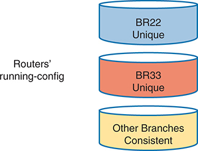

<figcaption>

<aside class="hidden" id="a24fig01">

图中有三个横向放置、垂直堆叠的圆柱形。顶部圆柱为蓝色，标为“BR22 Unique”，表示分支路由器 BR22 的运行配置是独特的。中间圆柱为橙色，标为“BR33 Unique”，表示分支路由器 BR33 的运行配置也是独特的。底部圆柱为黄色，标为“Other Branches Consistent”，说明其他分支路由器的运行配置彼此一致。圆柱左侧显示“Routers' running-config”，说明图示关注路由器的运行配置。此图突出展示 BR22 和 BR33 相对于其他分支路由器的配置偏差。

</aside>

<strong>图24-1</strong> <em>BR22和BR33分支路由器中的配置</em>

</figcaption>

</figure>

如果只使用传统的手动配置工具,配置漂移就成为一个更大的问题. 举例来说:

<ul class="sq">

<li>
即时设备手动配置流程不跟踪更改历史:哪行更改了,每行更改了哪些,去掉了哪些旧配置,谁改变了配置,何时做了每次更改.
</li>

<li>
良好的系统管理流程所使用的外部系统,如故障罚单和变更管理软件,可能记录细节. 然而,这些变化在配置之外,需要进行分析,以了解情况的变化。 他们也依靠人类一致和正确地跟踪操作过程;否则,工程师无法找到改变配置的整个历史.
</li>

<li>
如果一个设备在一段时间内经历了多个配置变化,则提及变革管理系统的历史数据效果不佳。
</li>

</ul>

</section>

<section>

<h4 class="h4" id="ch24lev2sec2">集中存储的配置文件与版本控制</h4>

人工每台设备的配置模型对于一个人管理一个设备来说很有道理. 有了这个模型,一个网络工程师可以使用安装起动配置作为预期的理想配置. 如果需要更改,工程师会进入配置模式并更新运行配置,直到对更改满意. 然后工程师将一个副本保存到起动配置中,作为设备目前的理想配置.

每台设备的手动配置模型对于更大的网络来说效果不尽如人意,拥有上百个甚至上千个网络设备,拥有多个网络工程师. 例如,如果团队认为每个设备的起动配置是理想的配置,如果一个团队成员改变配置(如早期故事中的爱丽丝和鲍勃各自改变),则不存在关于改变的记录. 配置文件没有显示什么变化,何时改变,或者是谁改变,过程也没有将改变通知整个团队.

作为改善配置管理的第一步,许多中大型企业将配置存储在中央位置. 首先,集中存储文件可能只是保存每个设备配置的备份副本。 当然,他们将把文件放在一个共享的文件夹中,供整个网络小组使用,详情如下:<a href="#ch24fig02">图24-2</a>.

<figure class="image-c" id="ch24fig02">

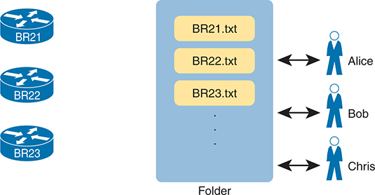

<figcaption>

<aside class="hidden" id="a24fig02">

图中左侧有3个路由器设备被标注为:B R21,B R22,和B R23. 每个设备都显示一个文件,分别被命名为 B R +21 dot txt, B R +22 dot txt,和 B R →23 dot txt, 转移到一个中央文件夹. 在文件夹的右侧,有三个人分别被标注为"爱丽丝","鲍勃"和"克莉丝". 箭头表示这些个体和中央文件夹之间的双向交互.

</aside>

<strong>图24-2</strong> <em>复制设备配置到中心位置</em>

</figcaption>

</figure>

此模型中哪一个配置文件是真实的单一来源? 配置文件仍然存在于每个设备上,但现在它们也存在于一个集中式服务器上,工程师可以改变设备上的配置以及服务器上的文本文件. 例如,如果设备上BR21配置的复制件与集中服务器上的文件不同,而文件应该被认为是正确,理想的,那么团队打算为这个设备做什么的真相呢?

在实践中,公司采取这两种做法。 在某些情况下,公司继续使用在线设备配置文件作为真理的来源,中央配置文件作为备份副本处理,以防设备出故障并必须被替换. 然而,其他企业进行过渡,将服务器上的文件作为每个设备配置的单一真相来源来对待. 当使用集中文件作为真理的来源时,工程师可以利用许多配置管理工具,并且实际管理配置更方便,更准确.

例如,配置管理工具使用版本控制软件来跟踪对集中配置文件的更改,同时注意到谁修改了文件,哪些行和具体字符在变化发生后发生了变化等. 这些工具还允许您比较不同版本的文件在时间上的差异,例如:<a href="#ch24fig03">图24-3</a>.

该图显示了一个配置文件两个版本的比较样本. 上两条有减号的突出线显示被更改的行,而下两条有加号的突出道显示每个行的新版本.

版本控制软件解决了许多设备内部缺乏变化跟踪的问题.<a href="#ch24fig03">图24-3</a>显示一个名为 GitHub 的受欢迎的 Software as- a- Service 站点的输出(<a href="http://www.github.com">www.github.com</a>) GitHub 提供免费和付费的账户,它使用开源软件(<a id="key_359" href="#ref-gloss_153">吉特语Name</a>)来履行版本控制功能.

<figure class="image-c" id="ch24fig03">

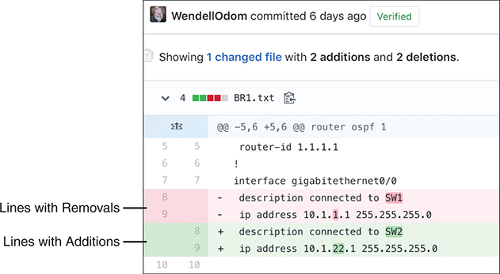

<figcaption>

<aside class="hidden" id="a24fig03">

这些修改由名为“WendellOdom”的用户在 6 天前提交。文件显示两处新增和两处删除。新增内容为“+ description connected to SWE”和“+ ip address 10.1.1.1 255.255.255.0”；删除内容为“- interface gigabitethernet 0/0”和“- ip address connected to SW1”。新增行和删除行被突出显示，指向这些行的注释分别标为“包含新增内容的行”和“包含删除内容的行”。

</aside>

<strong>图24-3</strong> <em>以 GitHub 显示文件差异</em>

</figcaption>

</figure>

</section>

<section>

<h4 class="h4" id="ch24lev2sec3">配置监视与强制实施</h4>

有了版本控制系统和将配置文件存储在一个中心位置的常规,一个网络团队可以做一个更好的工作,跟踪变化,并回答谁,什么,当知道每个设备的配置有什么变化时. 然而,使用这一模式则带来了其他挑战——最好通过使用自动化配置管理工具来解决挑战。

有了这个新模式,工程师们应该通过编辑集中仓库中的相关配置文件来进行修改. 然后可以指示配置管理工具复制或应用配置到设备上,如<a href="#ch24fig04">图24-4</a>。在此过程完成后,中央配置文件与设备的运行配置(和启动配置)应该完全相同.

<figure class="image-c" id="ch24fig04">

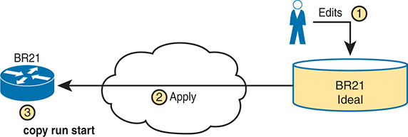

<figcaption>

<aside class="hidden" id="a24fig04">

过程从一个被标记为"B R 21理想"的圆柱形数据库存储开始,它持有理想的配置设置. 从这个数据库,修改或更新到配置,标签为"Edits",标记为动作1. 这些编辑后被发回左侧被标记为"B R 21"的网络设备上,它通过以中心一个网络云为代表的动作2,持有被标记为动作3的"复制运行启动"命令,表示这些更新设置的处理或应用.

</aside>

<strong>图24-4</strong> <em>将中央化配置推进到远程设备</em>

</figcaption>

</figure>

使用显示的模型<a href="#ch24fig04">图24-4</a>还是有危险。 例如,网络工程师应该通过使用配置管理工具来进行修改,但他们仍然有能力登录到每个设备,并对每个设备进行手动修改. 因此,虽然使用配置管理工具并集中存储配置文件的想法听起来很吸引人,但最终有人会直接改变设备. 以前的正确配置修改可能因未来的修改而被覆盖,而且不正确。 换句话说,最终会出现一些配置漂移.

配置管理工具可以监控设备配置,以发现设备配置与预期的理想配置有差异时,然后任意一种重新配置设备或通知网络工程人员进行更改. 这个功能可以被叫作:<a id="key_356" href="#ref-gloss_086">配置监测</a>或者说<em>配置执行</em>,特别是当工具自动改变设备配置时。

<a href="#ch24fig05">图24-5</a>显示配置监测背后的一般想法。 自动配置管理软件要求复制设备的运行配置文件,如步骤1和2所显示. 一步3,配置管理软件将最理想的配置文件与刚到达的运行配置文件进行比较,以检查它们是否有任何差异(配置漂移). 根据工具的配置,它要么修正配置,要么将配置漂移的情况通知工作人员.

<figure class="image-c" id="ch24fig05">

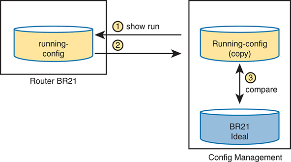

<figcaption>

<aside class="hidden" id="a24fig05">

该图被解为代表配置的两个区块. 左块被标记为"路由器 BR 21",它包含一个带有"running-config"文字的圆柱形,表示路由器目前的活性配置. 左块被标为"配置管理"(Config Management),包含有"运行-配置 (副本)"文字的两个圆柱形,暗示已复制运行的配置,而"B R 21 Ideal"代表理想或基线配置. 双圆柱形之间标有"3"的箭头,并有相邻指令"相比",表示当前运行配置与理想基线的比较. 一个被标记为"1"的箭头从右块到左端点出一个命令"显示跑". 另一个被标记为"2"的箭头点从运行配置块到运行配置复制块.

</aside>

<strong>图24-5</strong> <em>配置监测</em>

</figcaption>

</figure>

</section>

<section>

<h4 class="h4" id="ch24lev2sec4">配置部署</h4>

<a id="key_357" href="#ref-gloss_087">配置提供</a>指在配置管理系统中通过修改文件对配置进行修改后,如何提供或部署修改. 在配置管理工具的主要功能中,你可能会看到这样的功能:

<ul class="sq">

<li>
在某个设备编辑了中央配置文件后执行一个设备配置变化的核心职能
</li>

<li>
能够根据属性和逻辑选择设备的哪一个子集配置:所有设备,具有给定属性(如特定角色的属性)的类型,或者只有一个设备
</li>

<li>
能够确定每项修改是否被接受,并使用逻辑根据结果对每种情况作出不同反应
</li>

<li>
对于每次更改, 如果设备上连一个配置命令都被拒绝的话, 恢复到原始配置的能力
</li>

<li>
现在验证更改的能力(不实际作出更改),以确定更改是否在尝试时有效
</li>

<li>
进程完成后检查配置的能力,以确认配置管理工具的预期配置与设备的配置相符
</li>

<li>
是否使用逻辑来选择是否保存启动配置的运行配置
</li>

<li>
能够将配置文件作为模板和变量来表示,以便具有类似作用的设备可以使用相同的模板,但价值不同
</li>

<li>
将逻辑步骤存储到文件的能力, 计划执行, 这样这些更改就可以在工程师不在场的情况下由自动化工具执行 。
</li>

</ul>

该清单可以更进一步,但它概述了本章所讨论所有配置管理工具所包含的一些主要特点。 列表中的大部分项目都围绕一个设备的中央配置文件进行编辑. 然而,这些工具还有许多更多的特点,所以你需要做更多的工作来计划和实施它们的工作方式. 接下来的几页着重就清单上的最后两个项目提供更多的细节。

<section>

<h5 class="h5" id="ch24lev3sec1">配置模板与变量</h5>

想想企业的网络设备所充斥的角色. 以路由器为一瞬间的重点,路由器经常连接到WAN和一个或多个局域网. 你可能会有少量更大的路由器 在大站点连接到广域网, 有足够的力量处理更大的包速率。 更小的站点,如分所,可能有小路由器,也许有单一的WAN接口和单一的局域网接口;然而,你可能在网络中拥有大量这些小的分所路由器.

对于任何一组具有同一种作用的设备,配置可能类似. 例如,一组分支办公路由器可能都对一些IP服务有完全相同的配置,比如NTP或SNMP. 如果使用OSPF接口配置,那么同一OSPF区域的路由器和具有相同接口ID的路由器可以具有相同的OSPF配置.

比如说,<a href="#exa24_1">示例24-1</a>显示一个分支路由器的配置节选,并突出显示该配置的独特部分。 所有未突出的部分在相同型号的所有其他分支办公路由器(接口编号相同)上都可能相同. 企业可能拥有几十个或数百个配置几乎相同的分行路由器.

<strong>示例24-1</strong> <em>路由器 BR1 配置, 有 独有 的 值突出显示</em>

<a href="#code-f0559-01" id="f0559-01a">点击此处查看代码原图</a>

<pre class="pre-ex" tabindex="0"><code>hostname BR1

!

interface GigabitEthernet0/0

 ip address 10.1.1.1 255.255.255.0

 ip ospf 1 area 11

!

interface GigabitEthernet0/1

!

interface GigabitEthernet0/1/0

 ip address 10.1.12.1 255.255.255.0

 ip ospf 1 area 11

!

router ospf 1

 router-id 1.1.1.1</code></pre>

配置管理工具可以将一个配置的组件分入该角色中所有设备的共同部分(模板)与任何一个设备独有的部分(变量). 然后工程师可以编辑一个设备角色的标准模板文件作为单独的文件,而不是每个设备的变量文件. 配置管理工具可以处理模板和变量,为每个设备创建理想的配置文件,如下文所示:<a href="#ch24fig06">图24-6</a>,它显示了正在为分支路由器BR21,BR22,和BR23所构建的配置文件.

<figure class="image-c" id="ch24fig06">

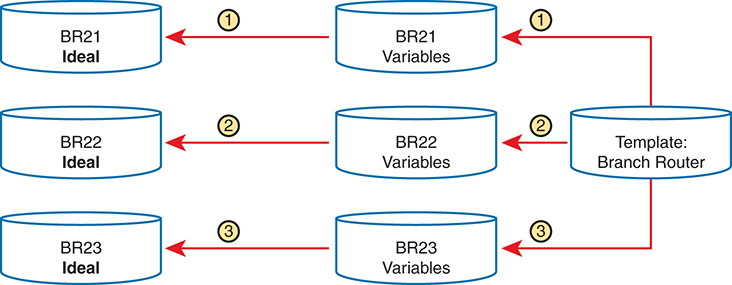

<figcaption>

<aside class="hidden" id="a24fig06">

RAM 即随机存取存储器，作为工作存储器，在设备运行期间保存运行配置。闪存存储 Cisco IOS 软件，即交换机操作系统。ROM 即只读存储器，包含启动交换机所必需的引导程序。NVRAM 即非易失性 RAM，保存启动配置，确保重新启动后配置设置仍然保留。

</aside>

<strong>图24-6</strong> <em>概念: 配置模板和变量</em>

</figcaption>

</figure>

为了让大家多了解一点<a href="#exa24_2">示例24-2</a>显示一个可以被 Ansible 用于配置的模板文件<a href="#exa24_1">示例24-1</a>。每个工具都指定每类文件使用何种语言,Ansible使用Jinja2语言作为模板. 模板模仿配置在<a href="#exa24_1">示例24-1</a>,但将变量名称放入双花括号的套内。

<strong>示例24-2</strong> <em>Jinja2 有变量的模板基于<a href="#exa24_1">示例24-1</a></em>

<a href="#code-f0560-01" id="f0560-01a">点击此处查看代码原图</a>

<pre class="pre-ex" tabindex="0"><code>hostname {{hostname}}

!

interface GigabitEthernet0/0

 ip address {{address1}} {{mask1}}

 ip ospf {{OSPF_PID}} area {{area}}

!

interface GigabitEthernet0/1

!

interface GigabitEthernet0/1/0

 ip address {{address2}} {{mask2}}

 ip ospf {{OSPF_PID}} area {{area}}

!

router ospf {{OSPF_PID}}

 router-id {{RID}}</code></pre>

要提供设备的值, Ansible 要求使用 YAML 定义变量文件, 如<a href="#exa24_3">示例24-3</a>。文件显示了用于定义完整配置中显示的变量的语法 。<a href="#exa24_1">示例24-1</a>,但现在定义为变量。

<strong>示例24-3</strong> <em>基于 YAML 变量文件<a href="#exa24_2">示例24-2</a></em>

<pre class="pre-ex" tabindex="0"><code>---

hostname: BR1

address1: 10.1.1.1

mask1: 255.255.255.0

address2: 10.1.12.1

mask2: 255.255.255.0

RID: 1.1.1.1

area: '11'

OSPF_PID: '1'</code></pre>

配置管理系统处理一个模板和所有相关变量,以生成一个设备的预定配置. 例如,工程师会创建和编辑一个模版文件,看起来像<a href="#exa24_2">示例24-2</a>然后创建和编辑一个变量文件,如<a href="#exa24_3">示例24-3</a>每个分支办公路由器。 Ansible 将处理文件, 以创建完整的配置文件, 如显示的文本<a href="#exa24_1">示例24-1</a>.

将配置分离成一个模板和变量可能看起来是额外的工作,但使用模板有一些很大的优势. 特别是:

<ul class="sq">

<li>
模板增加了对每个设备角色的标准配置的关注,有助于避免雪花(独特的配置设备).
</li>

<li>
具有已存在角色的新设备可以很容易地通过简单地复制已存在的每个设备的变量文件并更改值来部署.
</li>

<li>
模板允许更容易地分解出出故障,因为用一个标准模板分解出故障的问题应该用所有使用同一模板的设备来查找并固定出问题.
</li>

<li>
跟踪模板的文件版本和变量文件,也便于排除出故障。 可以调查设备的问题, 以发现设备设置中与标准分开的更改<a id="key_358" href="#ref-gloss_088">配置模板</a>.
</li>

</ul>

</section>

<section>

<h5 class="h5" id="ch24lev3sec2">控制配置自动化的文件</h5>

配置管理工具还提供了不同的方法来定义逻辑和过程,这些方法可以告诉工具要做出什么变化,对什么设备,以及何时. 例如,工程师可以指导一种工具,在周末的更换窗口中作出改变。 同样的逻辑可以指定设备的一个子集. 它还可以详细说明在试图改变之前和之后核实变化的步骤,以及如何在出现问题时通知工程师。

有趣的是,你可以做很多的逻辑 而不懂得如何编程。 每个工具都使用某种工程师用来定义动作步骤的语言,通常是由该公司定义的语言(一种特定域的语言). 但是,它们使语言变得直截了当,它们一般比编程语言更容易学习. 配置管理工具还使您能够通过使用通用编程语言,将动作步骤扩展到工具集所能完成的工作之外.<a href="#ch24fig07">图24-7</a>总结您在任何配置管理工具中可以看到的文件。

<figure class="image-c" id="ch24fig07">

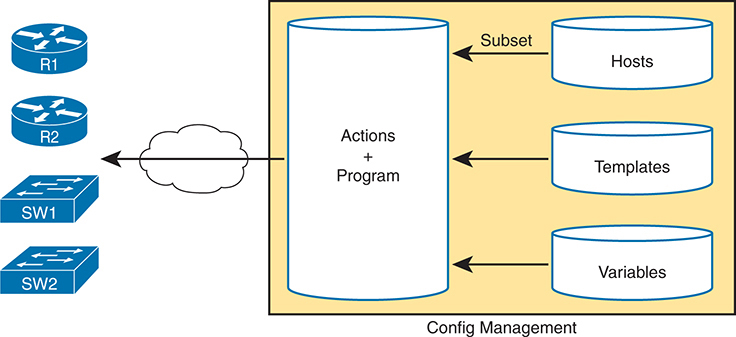

<figcaption>

<aside class="hidden" id="a24fig07">

用户以用户模式运行. 通过执行启用命令,用户进入Eull Mode,也叫Privileged Mode,允许访问更高级的配置命令. 在"启用模式"内,用户可以使用配置终端命令进入"配置模式",允许直接配置设备设置. 退出配置模式可以通过输入端口或按下 Ctrl-Z,返回用户以启用模式来实现.

</aside>

<strong>图24-7</strong> <em>配置管理工具使用的重要文件</em>

</figcaption>

</figure>

</section>

</section>

</section>

<section>

<h3 class="h3" id="ch24lev1sec4">Ansible 和 Terraform 基础</h3>

本章主要探讨一个考试话题,询问两个配置管理工具的能力:Ansible和Terraform. 该章的第一部分主要介绍了(和其他)配置管理工具的能力。 本节主要审查每个工具的几个特点,重点是术语和主要能力。

Ansible和Terraform是软件包. 您可以购买每个工具, 在每个软件包上都有变化 。 然而,他们也有不同的免费选项,允许您下载并了解工具,虽然由于一些工具没有在Windows OS中运行,您可能需要运行一个Linux来宾.

至于名字,大多数人都用这个词<em>Ansible</em>和<em>Terraform</em>指公司及其主要配置管理产品。 两者都作为从以硬件为基础的服务器向虚拟化服务器过渡的一部分而出现,这大大增加了服务器的数量并导致软件自动化需要创建,配置并去除VM. 两者还都生产出一种或多种配置管理软件产品,这些产品在许多方面都与他们的公司成为同义词. (本章沿用该公约,大部分忽略了确切的产品名称,只将产品和软件称为Ansible和Terraform。 )

<section>

<h4 class="h4" id="ch24lev2sec5">Ansible</h4>

用于<a id="key_352" href="#ref-gloss_034">Ansible</a> (<a href="http://www.ansible.com">www.ansible.com</a>),您需要在某些计算机上安装Ansible:Mac,Linux,或者在Windows主机上安装Linux VM. 您可以使用免费的开源版本,也可以使用付费的Ansible Tower服务器版本.

一旦安装, 您将创建多个文本文件, 许多文本文件都使用 YAML( Yet Another Markup Language) , 包括

<ul class="sq">

<li>
<strong>游戏本 :</strong>这些文件提供了Ansible应该做什么的动作和逻辑.
</li>

<li>
<strong>库存:</strong>这些文件提供了设备主机名和每个设备的信息,比如设备角色,因此Ansible可以为目录的子集执行函数.
</li>

<li>
<strong>模板 :</strong>使用 Jinja2 语言,模板代表一个设备的配置,但带有变量(参见<a href="#exa24_2">示例24-2</a>).
</li>

<li>
<strong>变量 :</strong>使用 YAML , 文件可以列出 Ansible 将替换为模板的变量( 见<a href="#exa24_3">示例24-3</a>).
</li>

</ul>

Ansible 使用一个<a id="key_351" href="#ref-gloss_031">无代理架构</a>。这意味着Ansible不依赖于任何在网络设备上运行的代码(代理). 相反,Ansible依赖于网络设备中典型的特征,特别是SSH和NETCONF,来进行修改并提取信息. 在使用SSH时,Ansible控制节点会像任何其他SSH用户一样改变设备,在配置模式中记录和使用;然而,Ansible代码进行工作而不是人类用户.

默认情况下, Ansible 使用 a<a id="key_361" href="#ref-gloss_274">推送模型</a>(每笔)<a href="#ch24fig08">图24-8</a>) 但是,它也能够使用一种<a id="key_360" href="#ref-gloss_273">拉取模型</a>有个叫做Ansible-pull的程序 如果你想要这种能力的话 安装 Ansible 后,工程师必须创建和编辑各种 Ansible 文件,包括<a id="key_353" href="#ref-gloss_034">Ansible 剧本</a>。剧本详细介绍了工程师想采取的行动,作为一个程序,在不同的条件下采取了步骤. 然后由工程师负责游戏本,而Ansible则执行步法. 这些步骤可以包括每个文件配置一个或多个设备(step 3),控制节点被视为将配置推向设备.

<figure class="image-c" id="ch24fig08">

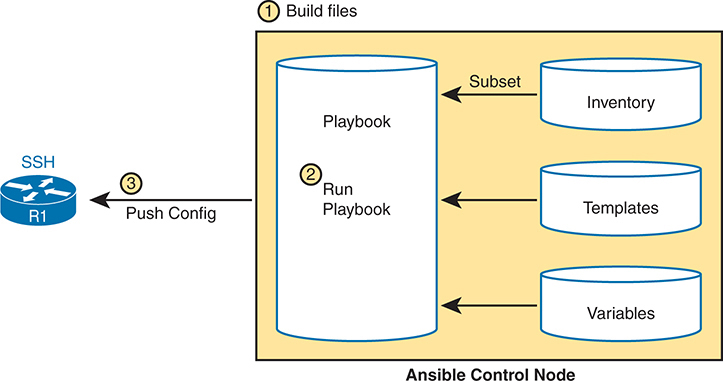

<figcaption>

<aside class="hidden" id="a24fig08">

用户输入 Eull Mode,允许访问更高级的配置命令. 从"启用模式",用户可以使用配置终端命令进入"全球配置模式",为全局设备配置提供方便. 退出全局配置模式可以通过输入端口或按下 Ctrl-Z,返回用户以启用模式来实现. 此外,从Global配置模式,用户可以使用相应的命令输入特定的接口,V LAN,控制台行,或VTY行模式,允许在相应的级别进行配置. 退出这些模式后, 用户返回全局配置模式 。

</aside>

<strong>图24-8</strong> <em>Ansible Push 模式</em>

</figcaption>

</figure>

Ansible可以进行配置提供(根据文件的更改配置设备)和配置监测(检查设备配置是否与控制节点上的理想配置相匹配). 然而,Ansible的建筑更自然地适合配置提供,如图中所示. 要进行配置监测,Ansible使用能检测并列出配置差异的逻辑模块,之后剧本会定义要采取的行动(重新配置或通知).

</section>

<section>

<h4 class="h4" id="ch24lev2sec6">Terraform</h4>

<a id="key_362" href="#ref-gloss_340">Terraform</a>由HashiCorp公司(<a href="http://www.terraform.io">www.terraform.io</a>)是一个作为代码(IaC)工具的基础设施,它通过利用易读配置文件,使您既创建了云资源,也创建了地上资源. 这些文件使用配置版本控制,可以被再利用,以及可以与其他开发者或代码贡献者共享. Terraform为提供和管理你的整个生命周期的基础设施提供了直接的工作流程,使日常业务更容易管理。 Terraform还可以处理诸如计算,存储和联网等组件,以及诸如DNS等组件和软件作为服务(SaaS)应用程序的特性. 以下清单突出了Terraform的一些主要组成部分及其在管理基础设施方面的相关作用:

<ul class="sq">

<li>
<strong>配置文件 :</strong>描述所期望的基础设施状态并指定资源及其配置的文件。
</li>

<li>
<strong>供应商:</strong>能够与不同的基础设施平台(AWS, Azure, Google Cloud)进行互动的插件.
</li>

<li>
<strong>资源:</strong>您想要创建和管理的组件,例如虚拟机,网络,或数据库.
</li>

<li>
<strong>数据来源:</strong>关于您配置中现有基础设施的参考细节 。
</li>

<li>
<strong>变量 :</strong>一种再用代码和使配置更加灵活的方法.
</li>

<li>
<strong>国家文件 :</strong>记录基础设施的当前状态和轨道配置变化。
</li>

<li>
<strong>模块 :</strong>组织和再利用Terraform代码. 模块囊括了一组资源和配置,可以作为一个单单元处理. 模块促进代码可重复性和模块性.
</li>

</ul>

Terraform与云供应商和其他服务机构合作,利用它们相关的API. 这是通过使用上文提到的供应商实现的。 这使得Terraform能够与几乎所有的服务或平台相接,因此它已被广泛用作IaC的一种共同方法.

Terraform有自己的语言叫"HashiCorp配置语言"(HCL). 语言像Ansible一样可以读取,而且相当容易理解;然而,Ansibil最适合设备配置,而Terraform则更常用于基础设施的提供.

Terraform的核心工作流程有三个阶段:

<ol class="number">

<li>
<strong>写入 :</strong>这里您定义了多个云提供商或服务方将使用的资源。
</li>

<li>
<strong>计划:</strong>制订了一项执行计划,说明根据目前的配置和基础设施将建立、更新或摧毁的基础设施。
</li>

<li>
<strong>应用 :</strong>计划一经批准,将按适当顺序完成拟议业务.
</li>

</ol>

所谓“一幅画值千言万语”非常适合这一技术。<a href="#ch24fig09">图24-9</a>描绘了Terraform的高层次架构,其核心工作流程,以及它如何与各种云提供商和其他基础设施互动.

<figure class="image-c" id="ch24fig09">

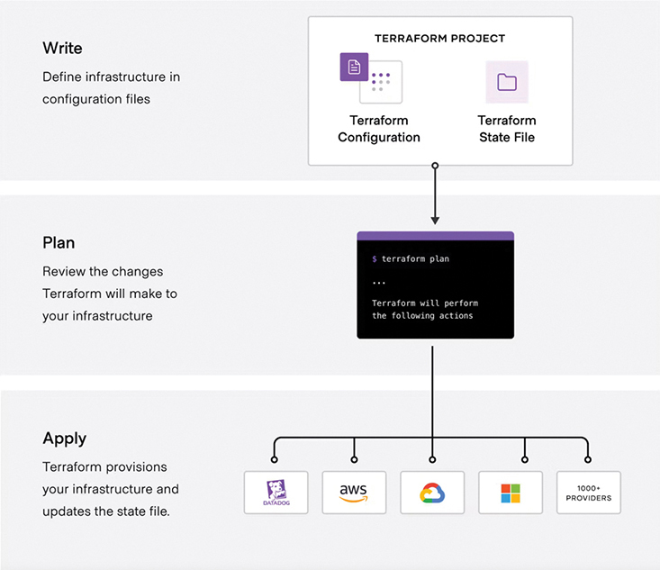

<figcaption>

<aside class="hidden" id="a24fig09">

在"管理选项"菜单中,可看到命令行接口(CLI)部分. 检查 Exec 圆,显示当前选择 。 有几个按钮可供使用,包括运行命令,清除接口,复制内容和导出数据等选项. 此外,菜单下方部分会显示代码行,以便直接从Switch Web 服务器接口访问CLI.

</aside>

<strong>图24-9</strong> <em>高层地貌建筑</em>

</figcaption>

</figure>

</section>

<section>

<h4 class="h4" id="ch24lev2sec7">配置管理工具小结</h4>

本章所讨论配置管理工具有不同的长处. 在考虑其中一个工具时,最好首先从设计的角度来理解你正在试图完成什么. 例如,如果您或您的团队在CLI中非常流利并想在许多设备上实现设备配置自动化,Ansible可能由于游戏本与实际CLI的相似性而成为您的首要选择.

然而,如果你想要领导IaC, 做更高级的自动化能力, 需要一个方法来跟踪配置, 并且提供 无论是在前提上还是云基础设施, 你可以考虑Terraform。 有时候,你可能两者都有。 这就是可编程性和自动化的优美之处——有许多方法可以通过利用不同的方法来解决业务需要。 技能设置、偏好和成本通常决定贵组织将采用何种工具。

<a href="#ch24tab02">表24-2</a>总结了对每个自动化配置管理工具的一些最常见的想法.

<figure class="table" id="ch24tab02" tabindex="0">

<figcaption>

<strong>表24-2</strong>Ansible 和 地平面比较

</figcaption>

<table class="all">

<tbody>

<tr>

<th class="th">
属性
</th>

<th class="th">
Ansible
</th>

<th class="th">
Terraform
</th>

</tr>

<tr>

<td class="border">
用于动作或配置的文件类型
</td>

<td class="border">
剧本
</td>

<td class="border">
配置
</td>

</tr>

<tr>

<td class="border">
网络设备协议
</td>

<td class="border">
SSH, NETCONF
</td>

<td class="border">
API
</td>

</tr>

<tr>

<td class="border">
执行模式
</td>

<td class="border">
无代理
</td>

<td class="border">
客户端/服务器模型
</td>

</tr>

<tr>

<td class="border">
推送或拉取模型
</td>

<td class="border">
推送（默认）

使用 Ansible-pull 程序拉取
</td>

<td class="border">
推送
</td>

</tr>

<tr>

<td class="border">
建模语言
</td>

<td class="border">
YAML
</td>

<td class="border">
HashiCorp 配置语言( HCL)
</td>

</tr>

</tbody>

</table>

</figure>

</section>

</section>

</section>

<section class="ccna-source ccna-appendix" aria-label="答案解析与术语表">
<section data-epub-type="chapter">

<h2 class="h2" id="ref-appc">附录C</h2>

<h2 class="h2a">对“我早就知道了吗?” 的回答。</h2>

<section>

<h3 class="h3" id="ref-appclev1sec24">第24章</h3>

<strong><a id="ref-ques24_1" href="#quess24_1">1</a>。</strong> C。企业中承担相同角色的设备应具有相似的配置。当工程师对个别设备作出独特修改，而同一角色的大多数设备没有进行这些修改时，这些设备的配置就会偏离该角色设备预期的理想配置。这种现象称为配置漂移。配置管理工具可以将设备配置与记录该角色设备预期理想配置的文件进行比较，并在设备配置偏离理想状态时发现这种变化。

<strong><a id="ref-ques24_2" href="#quess24_2">2</a>。</strong> A 和 B。对集中保存设备配置的文本文件使用版本控制系统，可以自动跟踪变更。也就是说，系统能够记录哪个用户在何时编辑了文件、具体修改了什么，并能够比较文件的不同版本。

两个错误选项列出的都是配置管理工具的实用功能，但它们通常由配置管理工具自身提供，而非版本控制工具提供。

<strong><a id="ref-ques24_3" href="#quess24_3">3</a>。</strong> D。配置监控（一个通用描述）指将设备实际配置与配置管理系统中该设备的预期配置进行比较的过程。如果实际配置偏离预期配置，即发生配置漂移，配置监控功能可以重新配置设备，也可以通知工程人员。

对于其他选项，其中两个涉及通常与配置管理工具配合使用的版本控制软件的功能。版本控制软件会跟踪每位修改文件的用户身份，以及文件随时间发生的变化。另一个错误选项是许多配置管理工具的实用功能：在尝试应用配置之前，验证设备是否会接受该配置。不过，这项功能不属于配置监控。

<strong><a id="ref-ques24_4" href="#quess24_4">4</a>。</strong> A 和 C。Ansible 和 Terraform 都可以使用推送模型。Ansible 控制节点根据 playbook 中的指令决定何时配置设备。虽然 Ansible 默认使用推送模型，但也可以通过名为 Ansible-pull 的程序使用拉取模型。

<strong><a id="ref-ques24_5" href="#quess24_5">5</a>。</strong> B 和 C。这些文件分别称为 <em>Ansible Playbook</em> 和 <em>Terraform Configuration</em>。

</section>

</section>

<section id="ref-glossary"><h2 class="h2a">词汇表</h2>
<strong>无代理架构</strong>有了配置管理工具,一个不需要作为管理配置功能的一部分在设备内部管理的软件代理的架构,而是使用其他主流方法,如SSH和NETCONF.

<strong>Ansible</strong>一个受欢迎的配置管理应用程序,可以使用或不使用服务器,使用推力模型将配置移入设备,具有很强的网络设备配置管理能力.

<strong>配置漂移</strong>一个开始于类似角色的设备可以并且应该有类似标准配置的想法的现象,因此当一个设备的配置被改变为不同时,其配置被认为已经从该角色中一个设备的标准配置中移出(去除)了.

<strong>配置管理工具</strong>管理服务器配置,网络设备等计算节点的数据的一类应用,提供连贯的描述配置的方法,将配置移入设备中,注意对配置的意外更改,通过方便识别一段时间后配置文件的更改来排除出故障.

<strong>配置监测</strong>使用 Ansible 这样的配置管理工具,可以将设备的安装配置(running-config)与显示工具集中配置库中列出的理想设备配置的文本文件进行比较。 如果不同, 进程可以改变设备的配置或报告问题 。

<strong>配置提供</strong>以Ansible等配置管理工具,配置设备以匹配配置管理工具所持有的配置的过程.

<strong>配置模板</strong>拥有像Ansible这样的配置管理工具,一个带有变量的文件,目的是让该工具取代不同的可变值来创建设备的配置.

<strong>吉特语Name</strong>一个开源版本控制应用程序,在软件开发中广泛流行用于版本控制和其他用途,如管理网络设备配置.

<strong>拉取模型</strong>有了配置管理工具,一个代表设备的代理请求从集中配置管理工具得到配置数据的做法,实际上是将配置拉入设备.

<strong>推送模型</strong>通过配置管理工具,中央配置管理工具软件启动配置从该节点移动到将要配置的设备的做法,实际上将配置推向了设备.

<strong>Terraform</strong>开源基础设施作为代码工具,用于通过声明配置文件提供和管理云,上前提和混合基础设施资源.

</section>
</section>

<section class="ccna-source ccna-appendix" aria-label="代码原图">
<section data-epub-type="chapter">

<a href="#f0559-01a" id="code-f0559-01">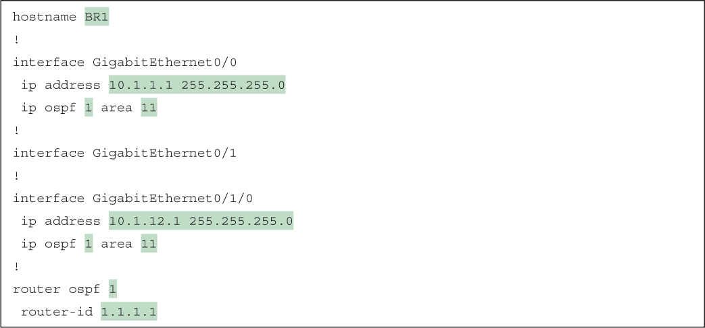</a>

<a href="#f0560-01a" id="code-f0560-01">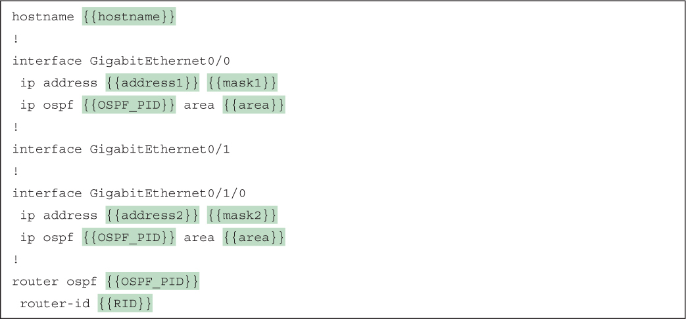</a>

</section>

</section>


<nav class="ccna-chapter-nav" aria-label="章节导航"><a href="v2-23.html">← 上一章</a></nav>
