[← 返回Docker 容器技术目录]({{ '/subjects/Docker/' | relative_url }})



# 01 Docker 介绍

## 1. 从集装箱理解容器

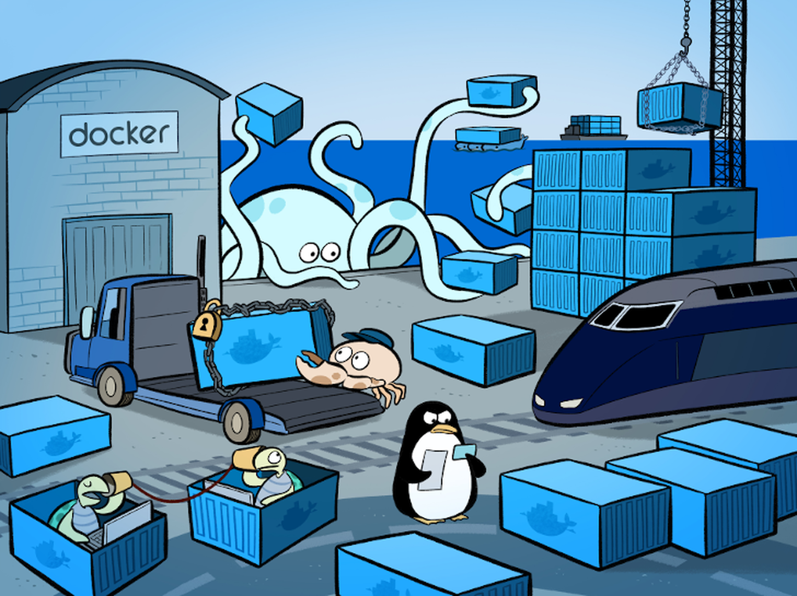

运输业的集装箱把不同货物放进规格统一的箱体，减少了装卸时反复拆装的成本。Docker 借用这个比喻：应用及其运行所需文件被封装为镜像，在具备相应容器运行环境的主机上以一致方式启动。标准化的是**交付与运行接口**，不是说任何镜像都能无条件运行在任意 CPU 架构或操作系统内核上。

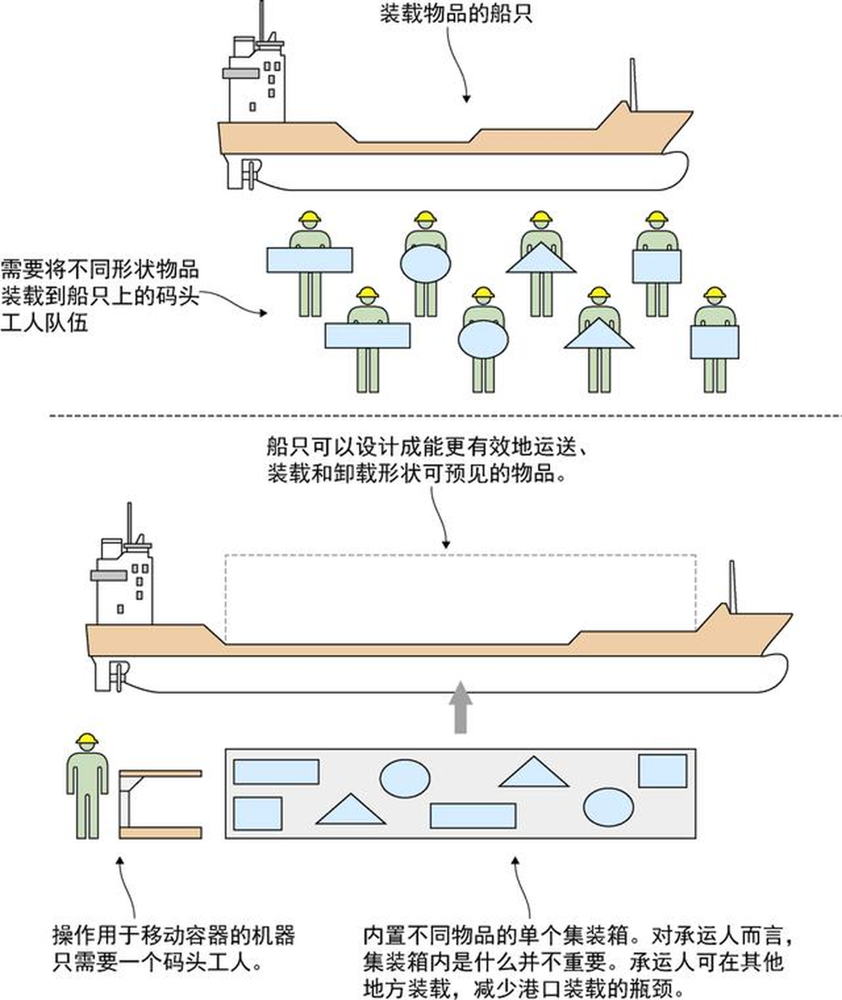

容器化解决的常见问题是“开发环境能运行，部署环境却缺依赖”。把应用、依赖及启动方式写入构建配置后，团队可以反复构建和分发同一镜像，再用环境变量、卷和网络配置区分不同环境。可重复构建、版本管理与健康检查，比单纯把程序装进容器更重要。

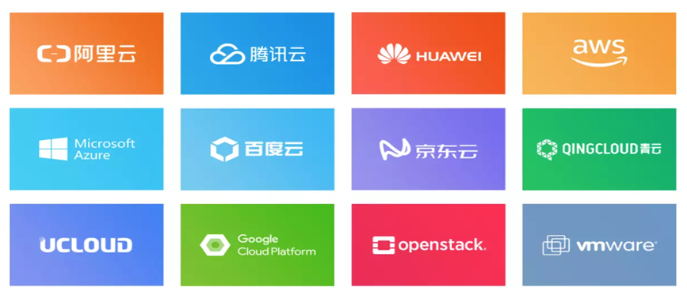

### 1.1 容器技术与 Docker

进程隔离的实践早于 Docker：Unix/Linux 的 `chroot` 限定文件系统视图，FreeBSD Jail、Solaris Zones 和 Linux 容器（LXC）进一步组合了进程与资源隔离能力。Docker 于 2013 年推出后，把镜像构建、分发和运行流程整合成易用的工具链。Docker 并非第一个容器实现，也不等于容器技术的全部。

Docker 的常见工作流可以概括为 **构建（Build）→ 分发（Ship）→ 运行（Run）**。开发者根据 Dockerfile 构建镜像，推送到镜像仓库；部署端拉取指定版本的镜像，再创建容器。镜像应作为不可变交付物；运行中的配置和持久数据则分别通过环境变量、密钥管理与卷处理。

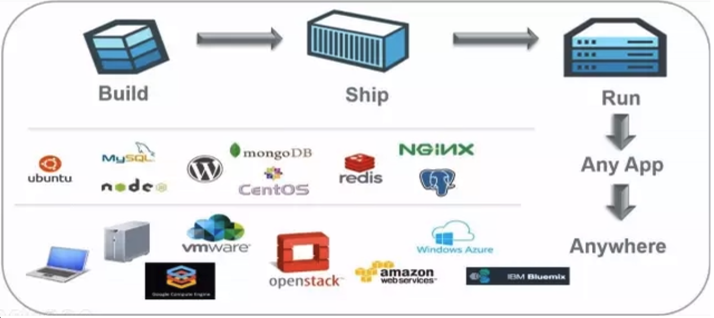

### 1.2 容器与虚拟机如何选择

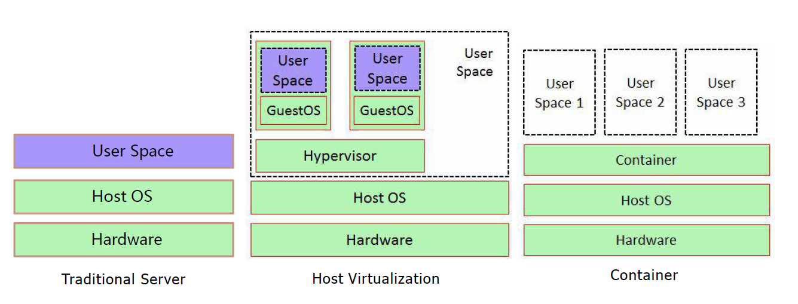

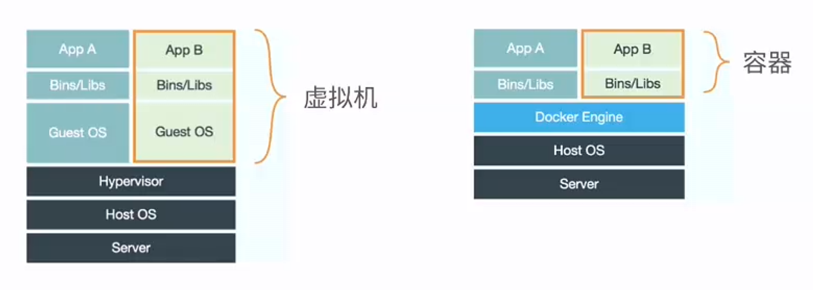

| 维度 | 容器 | 虚拟机 |
| --- | --- | --- |
| 内核 | 与宿主机共享内核；镜像不自带独立内核。 | 每台虚拟机运行自己的客户机内核。 |
| 隔离边界 | 主要依靠命名空间、cgroups 和安全策略隔离进程。 | 借助虚拟化层隔离完整的客户机系统。 |
| 交付内容 | 通常封装应用与其用户态依赖。 | 包含完整客户机操作系统及应用。 |
| 适用情形 | 需要快速交付、弹性扩缩和一致运行环境。 | 需要独立内核、不同操作系统或更强系统级隔离。 |

容器往往启动快、基础开销较小，但并不能保证“零损耗”或固定比虚拟机节省一半硬件。性能受应用类型、存储、网络和资源限制影响，应在目标环境中测量。容器与虚拟机也可以组合：在虚拟机中运行容器是常见部署方式。

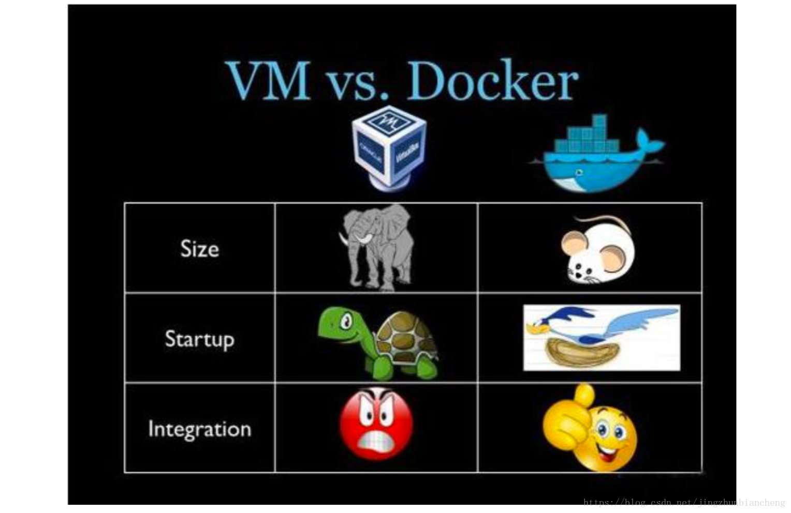

### 1.3 Docker 的组成

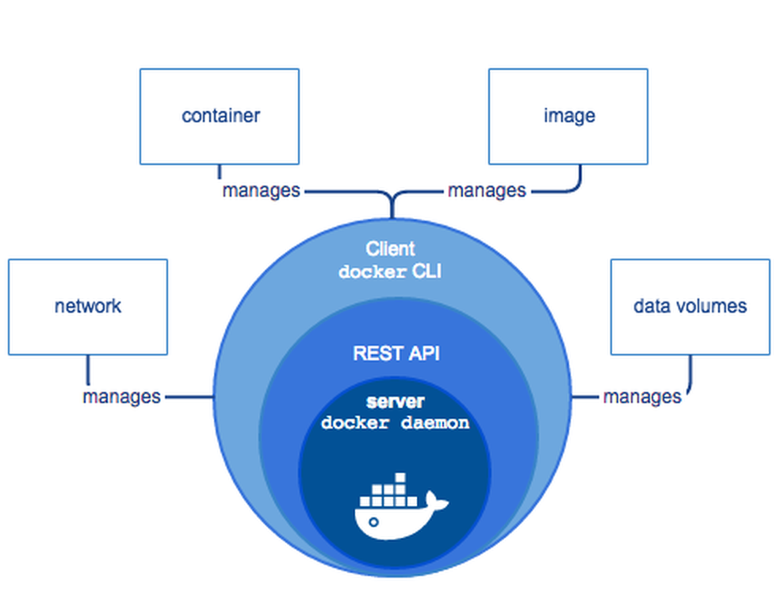

| 组件 | 职责 |
| --- | --- |
| Docker CLI | 接受 `docker` 命令，通过 Docker API 与 Engine 通信。 |
| Docker Engine / `dockerd` | 管理镜像、网络、卷和容器生命周期。 |
| 镜像（Image） | 分层、只读的应用交付内容及启动元数据。 |
| 容器（Container） | 基于镜像创建的运行实例；删除容器可能丢失未持久化的数据。 |
| 镜像仓库（Registry） | 按仓库名与标签存放、分发镜像，例如 Docker Hub 或私有仓库。 |

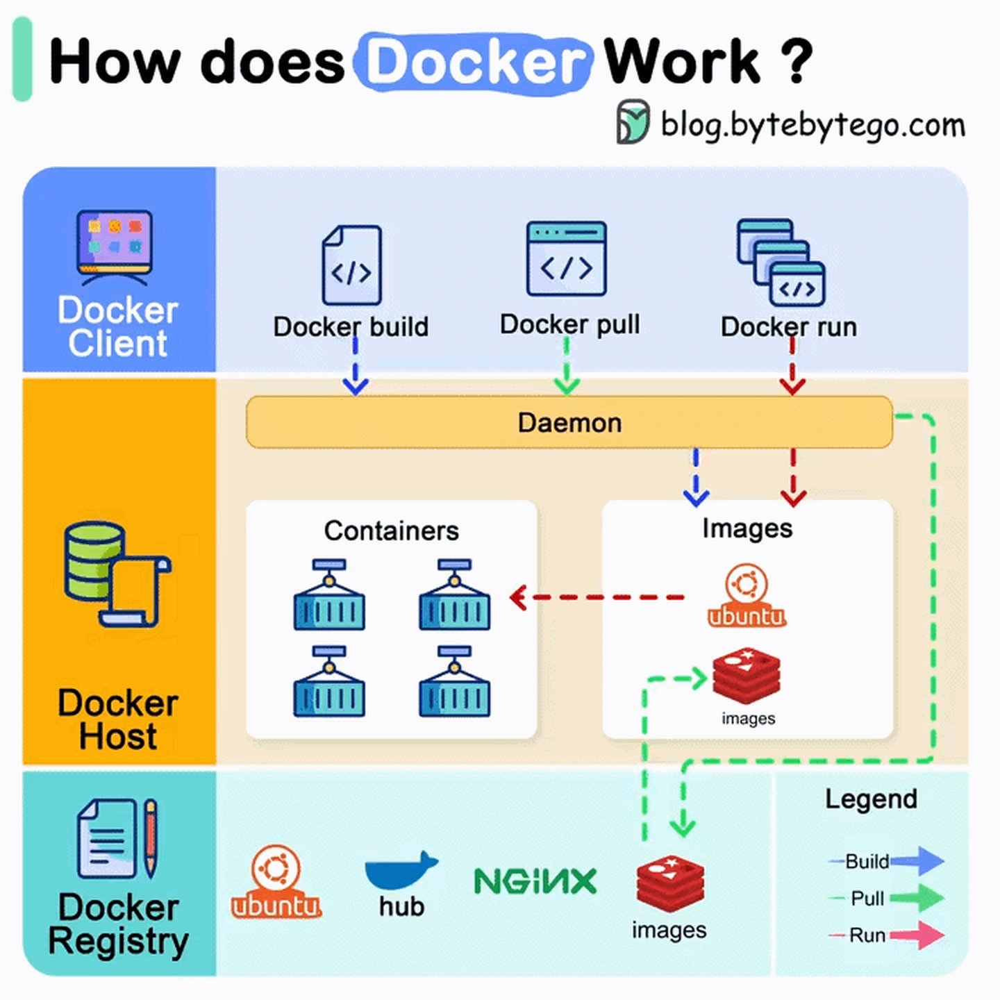

镜像层通常只读，容器运行时在其上增加可写层。可写层适合临时状态，不适合保存必须保留的数据；数据库等持久数据应使用卷，并制定备份策略。一个镜像可以创建多个容器，不等于多个容器共享同一个可写层。

## 2. 容器为什么能够隔离

### 2.1 Linux 命名空间

[Linux namespaces 手册](https://man7.org/linux/man-pages/man7/namespaces.7.html)说明了各类命名空间。它们让进程看到不同的系统资源视图；并非 Docker 守护进程里的所有容器都是“同一个进程的子进程”，也不能认为命名空间单独就足以保障宿主机安全。

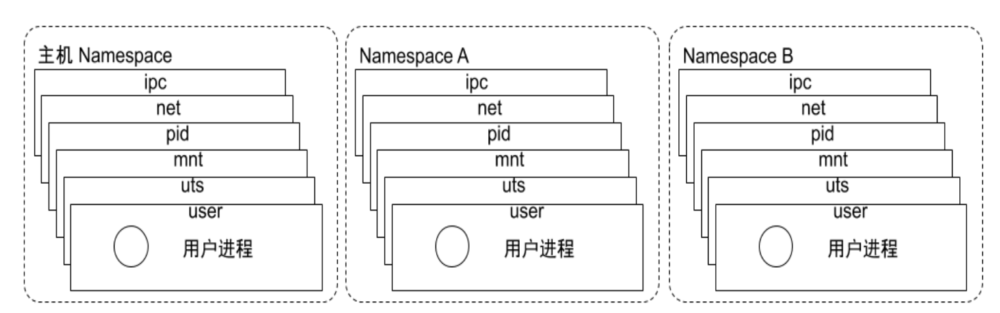

| 命名空间 | 隔离的主要视图 |
| --- | --- |
| Mount（mnt） | 挂载点和文件系统树。 |
| PID | 进程编号；同一进程在不同 PID 命名空间中可有不同编号。 |
| Network（net） | 网络设备、地址、路由表和端口空间。 |
| IPC | System V IPC 与 POSIX 消息队列等资源。 |
| UTS | 主机名和域名。 |
| User | 用户和组 ID 映射；容器内的 root 不必等同于宿主机 root。 |
| Cgroup / Time | 分别隔离 cgroup 视图及部分时钟视图；支持情况取决于内核和运行时。 |

检查宿主机支持的命名空间可使用 `lsns`。若要查看某个容器进程的网络视图，可先获取其宿主机 PID，再在具备相应权限时使用 `nsenter -t PID -n ip addr`。这里的 `PID` 必须替换为实际进程 ID；进入命名空间不是普通应用排障的首选操作，通常先用 `docker exec`。

### 2.2 cgroups 与资源限制

cgroups 用于组织进程并控制或统计 CPU、内存、进程数等资源。没有设置限制时，容器可能与宿主机其他负载争用资源；设置限制也不能代替监控和容量规划。cgroup v1 与 v2 的接口不同，不能只根据旧版 `/boot/config-*` 列表判断当前限制是否真正生效。具体的 `docker run --memory`、`--cpus` 等参数将在后面的资源限制章节讲解。

### 2.3 容器工具与运行时

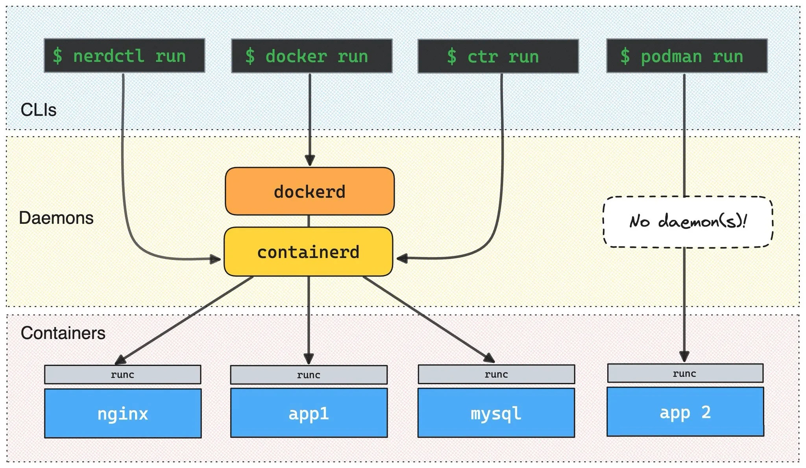

命名空间和 cgroups 是内核能力，仍需要用户态工具来准备文件系统、网络、进程和生命周期。LXC 是较早的一组 Linux 容器工具；Docker 则把镜像、仓库和容器操作整合为完整工作流。

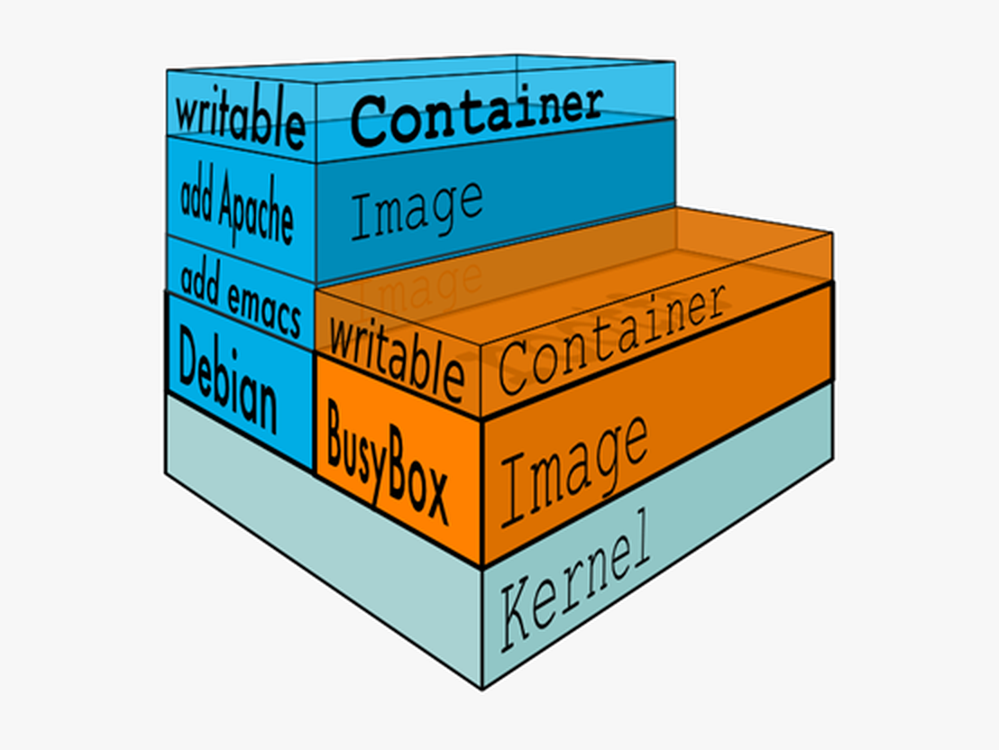

Docker Engine 常通过 containerd 管理容器生命周期，再由符合 OCI 规范的低层运行时（如 `runc`）创建容器进程。`docker info` 可查看当前机器的 `Runtimes` 与 `Default Runtime`，但示例版本号和输出字段不应当成所有环境的固定结果。

Podman 是另一个容器管理工具，不依赖长期运行的 Docker 守护进程，也支持无根模式；它与 Docker CLI 有许多相似命令，但参数、网络和 Compose 兼容性不应简单视为完全相同。`nerdctl` 是面向 containerd 的 CLI。Pouch、rkt 等项目可作为容器生态的历史或特定场景案例，不应写成现代部署的默认选择。

## 3. 标准、仓库与编排

### 3.1 OCI 标准与运行时接口

[Open Container Initiative（OCI）](https://opencontainers.org/)定义镜像与运行时相关规范，使不同工具能够围绕通用格式协作。OCI 镜像规范、运行时规范与 Kubernetes 的 CRI 是不同层次的接口；`runc` 属低层 OCI 运行时，containerd 和 CRI-O 则是面向更高层容器管理需求的实现。已移除的 Kubernetes `dockershim` 不应列为当前可部署的运行时。

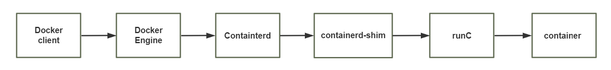

### 3.2 镜像仓库

仓库保存镜像的不同版本。完整镜像引用通常写作 `仓库主机/命名空间/镜像名:标签`，例如 `docker.io/library/alpine:3.20`。标签方便管理但可能被重新指向；需要强一致性时可用镜像摘要固定内容。私有仓库应配置认证与 TLS，不应把不安全仓库作为连接问题的通用解决方法。

### 3.3 容器编排

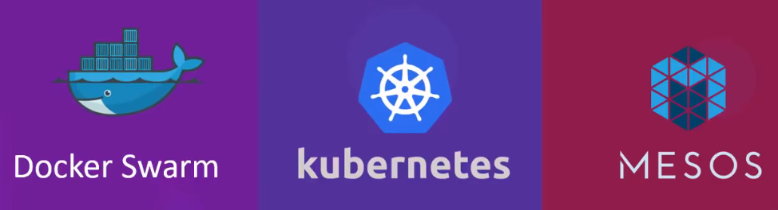

当服务由多个容器组成时，需要统一描述网络、卷、依赖和启动参数。**Docker Compose** 适合单机多容器应用；**Kubernetes** 面向集群调度、自愈和声明式运维；Docker Swarm 等方案也有各自的适用环境。Compose 本身不会在宿主机故障后自动把容器迁移到另一台主机，不能与集群编排能力混为一谈。

接下来的章节从安装 Docker 和基本命令开始，逐步学习镜像、容器、网络、数据卷及 Compose 的实际操作。



<nav class="article-end" aria-label="章节导航">
  <a href="{{ '/subjects/Docker/' | relative_url }}">返回 Docker 容器技术目录</a>
  <a href="{{ '/subjects/Docker/02-installing-docker-and-basic-commands.html' | relative_url }}">下一篇：安装 Docker 与基本命令 →</a>
</nav>
