[← Back to Docker Container Technology Index]({{ '/subjects/Docker/' | relative_url }})



# 01 Introduction to Docker
## 1 Docker 介绍和基础管理


Container 即容器，平时生活中指的是可以容纳其它物品的工具， 以方便人类归纳放置物品 、存储和异地运输 ，比如人们使用的衣柜 、行李箱、 背包等

Container 还有另一个意思是集装箱, 很多码头工人将很多装有不同物品但却有标准尺寸的整齐划一的集装箱装载到停靠在岸边大船，然后方便的运来运去。

早期海运成本远远高于铁路运输的，因为装卸的成本相当高，自从1946年美国人麦克莱恩发明了集装箱，大大降低了成本，仅当于原来的百分五而已，成为当前成本最低的运输方式

```text
价格链：公路运输>>铁路运输>>海运>>内河航运，而内河航运的价格，可能只有海运的三分之一都不到。
```


为什么集装箱成本这么低？因为集装箱可以很方便的运来运去，它们大小一致标准化尺寸的箱子，并且可以安全的隔离开,所以当我们使用 Container 来形容容器的时候，就是我们想要让容器达到一个可以打包，符合标准的状态。

集装箱标准尺寸重量

类型大小内长m 内宽

内高

门高

门宽

容积

载

皮

m

m

m

m

m³

重T

重T

普通箱 20GP 5.898 2.352 2.385 2.280 2.343 28.00 18 2.3

普通箱 40GP 12.032 2.352 2.385 2.280 2.343 57.00 28 3.4

高箱 40HC 12.032 352 2.690 2.585 2.343 67.00 28 4.0

集装箱历史

```text
早年搞运输特别麻烦，先要把各种货物，由经验丰富的老师傅，先估好尺寸，再尽可能地，把它们用最不占空
间的办法，地塞进卡车车厢。
货物到码头后，再由码头工人把货卸下来，然后让另一个经验丰富的老师傅，认真估好尺寸后，再用最不占空
间的办法，塞进船里。
船遇到其它港口后，卸货时，得再经过这么一个流程；之后卡车来装货，又得再经这么一个流程……怎么说呢？
整个过程不但烦死人，还时间特别长，费用特别高！到什么程度呢？
美国当时向巴西运无缝钢管，到巴西的价格，运费占了87%，只有13%才是造这种钢管的费用！
就在这时，有个人出现了，他是美国人，名叫麦克莱恩，搞运输出身的。他就琢磨着：干嘛要这么麻烦呢？
我把所有的东西，都装进一个箱子，运输前直接装上，在港口直接塞进船里，到港时直接卸下，然后放卡车直
接拖走，不就行了？
这东西叫什么呢？集装箱！
然后他就开始搞集装箱，还拼命推广它。
到1965年3月，机会来了：越南战争升级！
当时美国人的宣传机器，搞得挺牛叉：在越南岘港，美军第9海军陆战队远征军的士兵们，跳下登陆舰，然后带
着武器，涉水上岸。
一副重现二战胜利的架势！实际上呢？
当时这批登陆后的美军，其实背地里吵成一团：有的部队发现，他们的枪支到了，但弹药却不知道在哪里，而
按照命令，第二天他们就要开赴前线；还有的部队发现，他们的枪支没到，弹药到来了两份……怎么说呢？
到处都是乱糟糟，到处都是人在骂！
然后麦克莱恩就站出来了：这事我在行啊，我来承包啊，让我来运输，保证肯定不会发生这种事啊！怎么保证
呢？
就用他的集装箱，把一支部队要用的所有东西，统统都打好包，装进一个个集装箱，船运到越南后，用卡车直
接拉进营地，再打开再分！
果然效率大增！美军反响很好！
然后集装箱的名气就打响了，有些港口就尝试着，搞集装箱码头，船运公司则是搞集装箱专线。这一搞，就带
来了经济模式的转型：在出现大规模搞集装箱运输前，全世界的工业是分散的，一般来说，制造工厂和它的消
费市场之间，距离差不多在25英里，也就是40公里范围内。因为距离如果太长，在运输上，要不断地倒来倒
去，中间肯定会丢失、弄坏，还浪费时间，大大增加成本之类的一大堆，一般产品超过这个距离，就变得不划
算了！但搞了集装箱后，一切都变了！
人们可以在几千公里甚至上万公里之外，把东西造出来，然后装进集装箱，再运到发达国家的市场去卖！运输
成本很低！
于是一种新的经济模式就冒出来了：出口导向型经济！全世界最先搞这种经济模式的国家，是日本！
很少有人知道：在集装箱运输这种模式被采用前，搞出口导向型经济，因为成本太高，其实一点都不赚钱！
大家有空可以去看看日本1950到1960年代的贸易，会发现除了朝鲜战争那几年，日本是贸易顺差，其它年份
日本几乎全是逆差。
但日本没啥资源，就算是逆差，也得咬牙顶着。
当时甚至到了这种程度：1960年代初，有段时间，日本国内的白糖价格，远远高于国际市场价格，当时日本政
府公布政策，说哪家造船厂如果出口创汇多，政府就会按照比例，多给它免税进口白糖的配额！
造船厂接国外订单多，就有资格多进口白糖，挺搞笑的。
但随着集装箱运输的推广，日本经济开始快速膨胀：1966年超过法国；1967年超过英国；1968年超过联邦德
国，GDP成世界第二。
前面两次超越，大家都预测到了，但日本1968年就超过德国，有点出乎大家预料，因为很多人还觉得可能要到
1969年，或者1970年，日本才会超过德国。
但在当年9月，日本港口通向美国西海岸的集装箱联运开通，几乎一夜间，日本造的电视机、音响和微波炉，就
出现在美国超市的货架上，美国这方面的企业也几乎在一夜间，就溃不成军。
因为这条集装箱联线，是在当年9月才开的嘛，所以1968年日本对美国，贸易逆差还有1600万美元，但到了第
二年，日本就有了10亿美元的顺差。
之后更是一发而不可收拾，到1980年代，连美国国会议员们，都因为日本产品大举涌入，都公开掀桌子，当众
砸日本录音机了。
日本之后，东亚其它国家也都搞起出口导向型经济，甚至到了有段时间，“做外贸”成了“赚大钱”的另一个意
思！
```

但今天我们所说的容器是一种 IT 技术。容器其实是一种沙盒技术。顾名思义，沙盒就是能够像一个集装箱一样，把你的应用装起来。这样，应用与应用之间就有了边界而不会相互干扰;同时装在沙盒里面的应用，也可以很方便的被搬来搬去，这也是 PaaS 想要的最理想的状态(可移植性,标准化,隔离性)。

容器是软件工业上的集装箱的技术，集装箱的标准化，减少了包装成本，大大提高货物运输和装卸效率，是传统运输行业的重大变革。早期的软件项目中软件更新，发布低效，开发测试发布周期很长，很难敏捷。有了容器技术，就可以利用其标准化的特点，大幅提高生产效率。

容器技术是虚拟化、云计算、大数据之后的一门新兴的并且是炙手可热的新技术， 容器技术提高了硬件资源利用率、 方便了企业的业务快速横向扩容（可以达到秒级快速扩容）、 实现了业务宕机自愈功能 （配合K8S可以实现，但OpenStack无此功能），因此未来数年会是一个容器愈发流行的时代 ，这是 一个对于 IT 行业来说非常有影响和价值的技术，而对于IT行业的从业者来说， 熟练掌握容器技术无疑是一个很有前景的行业工作机会。

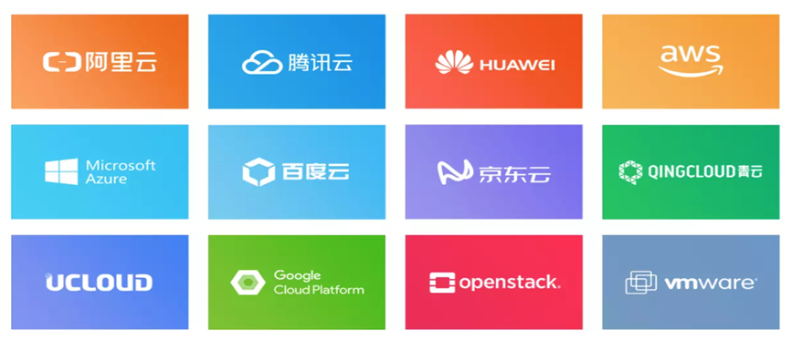

### 1.1 Docker 介绍

### 容器历史

虽然 docker 把容器技术推向了巅峰，但容器技术却不是从 docker 诞生的。实际上，容器技术连新技术都算不上，因为它的诞生和使用确实有些年头了。下面的一串名称可能有的你都没有听说过，但它们的确都是容器技术的应用:

1、Chroot Jail 就是我们常见的 chroot 命令的用法。它在 1979 年的时候就出现了，被认为是最早的容器化技术之一。 它可以把一个进程的文件系统隔离起来。

2、The FreeBSD Jail Freebsd Jail (监狱)实现了操作系统级别的虚拟化，它是操作系统级别虚拟化技术的先驱之一。2000年， 伴随FreeBSD4.0版的发布

3、Linux VServer 使用添加到 Linux 内核的系统级别的虚拟化功能实现的专用虚拟服务器。允许创建许多独立的虚拟专用服务器（VPS），这些虚拟专用服务器在单个物理服务器上全速同时运行，从而有效地共享硬件资源。 VPS提供与传统Linux服务器几乎相同的操作环境。可以在这样的VPS上启动所有服务（例如ssh，邮件， Web和数据库服务器），而无需（或者在特殊情况下只需进行很少的修改），就像在任何真实服务器上一样。

每个VPS都有自己的用户帐户数据库和root密码，并且与其他虚拟服务器隔离，但它们共享相同的硬件资源 2003年11月1日 VServer 1.0 发布

官网:http://linux-vserver.org/

4、Solaris Containers 它也是操作系统级别的虚拟化技术，专为 X86 和 SPARC 系统设计。Solaris 容器是系统资源控制和通过 "区域" 提供边界隔离的组合。

5、OpenVZ OpenVZ 是一种 Linux 中操作系统级别的虚拟化技术。 它允许创建多个安全隔离的 Linux 容器，即 VPS。

6、Process Containers Process 容器由 Google 的工程师开发，一般被称为 cgroups。

7、LXC LXC为Linux Container的简写。可以提供轻量级的虚拟化，以便隔离进程和资源，而且不需要提供指令解释机制以及全虚拟化的其他复杂性。容器有效地将由单个操作系统管理的资源划分到孤立的组中，以更好地在孤立的组之间平衡有冲突的资源使用需求

Linux Container提供了在单一可控主机节点上支持多个相互隔离的server container同时执行的机制。 Linux Container有点像chroot，提供了一个拥有自己进程和网络空间的虚拟环境，但又有别于虚拟机， 因为lxc是一种操作系统层次上的资源的虚拟化。

8、Warden 在最初阶段，Warden 使用 LXC 作为容器运行时。 如今已被 CloudFoundy 取代。

9、LMCTFY LMCTY 是 Let me contain that for you 的缩写。它是 Google 的容器技术栈的开源版本。 Google 的工程师一直在与 docker 的 libertainer 团队合作，并将 libertainer 的核心概念进行抽象并移植到此项目中。该项目的进展不明，估计会被 libcontainer 取代。

10、Docker

2013年出现 Docker （码头工人）是一个可以将应用程序及其依赖打包到几乎可以在任何服务器上运行的容器的工具。

11、RKT RKT 是 Rocket 的缩写，它是一个专注于安全和开放标准的应用程序容器引擎。

综上所述正如我们所看到的，docker 并不是第一个容器化技术，但它的确是最知名的一个。

### Docker 是什么


2010年，Solomon Hykes(Docker CTO)和几个年轻人在美国旧金山成立了一家 PaaS 平台的dotCloud 公司 , 此公司主要基于PaaS平台为开发者提供技术服务。

Docker(码头工人) 是一个开源项目，诞生于 2013 年3月27日，最初是 dotCloud 公司（后由于 Docker 开源后大受欢迎在2013年10月就将公司改名为 Docker Inc ，总部位于美国加州的旧金山）内部的一个开源的 PAAS 服务 (Platform as a ServiceService )的业余项目。它基于 Google 公司推出的 Go 语言实现。 项目后来加入了 Linux 基金会，遵从了 Apache 2.0 协议，项目代码在 GitHub 上进行维护。

Docker 是基于 Linux 内核实现，Docker 最早采用 LXC 技术 ，LXC 是 Linux 原生支持的容器技术 ，可以提供轻量级的虚拟化 ，可以说 docker 就是基于 LXC 发展起来 的，提供 LXC 的高级封装，标准的配置方法，在LXC的基础之上，docker提供了一系列更强大的功能。而虚拟化技术 KVM(KernelKernelbased Virtual Machine Machine) 基于模块实现， 后来Docker 改为自己研发并开源的 runc 技术运行容器，彻底抛弃了LXC。

Docker 相比虚拟机的交付速度更快，资源消耗更低，Docker 采用客户端/服务端架构，使用远程API来管理和创建容器，其可以轻松的创建一个轻量级的、可移植的、自给自足的容器，docker 的三大理念是 build(构建)、ship(运输)、 run(运行)，Docker遵从apache 2.0协议，并通过（namespace及cgroup 等）来提供容器的资源隔离与安全保障等，所以Docke容器在运行时不需要类似虚拟机（空运行的虚拟机占用物理机6-8%性能）的额外资源开销，因此可以大幅提高资源利用率,总而言之Docker是一种用了新颖方式实现的轻量级虚拟机.类似于VM但是在原理和应用上和VM的差别还是很大的，并且docker的专业叫法是应用容器(Application Container)。

Docker 的主要目标

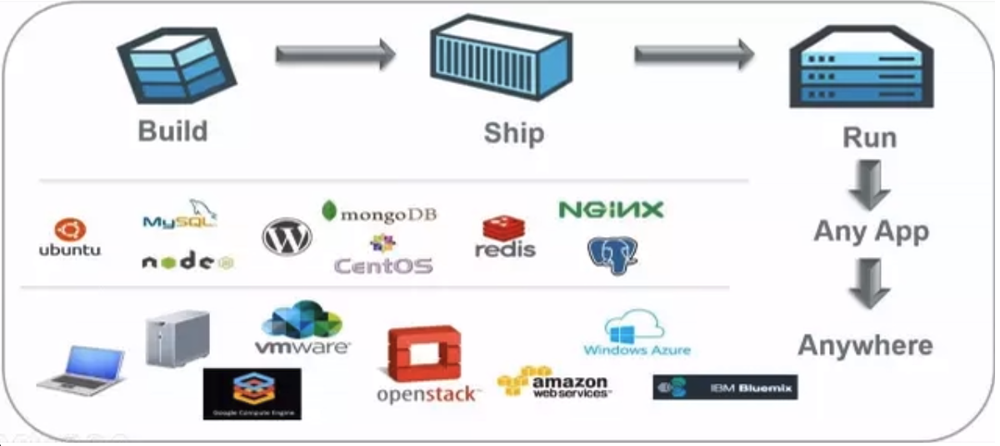

Build, Ship and Run Any App, Anywhere，即通过对应用组件的封装（Packaging）、分发 （Distribution）、部署（Deployment）、运行（Runtime）等生命周期的管理，达到应用组件级别的 “一次封装，到处运行”。这里的应用组件，既可以是一个Web应用，也可以是一套数据库服务，甚至是一个操作系统。将应用运行在Docker 容器上，可以实现跨平台，跨服务器，只需一次配置准备好相关的应用环境，即可实现到处运行，保证研发和生产环境的一致性，解决了应用和运行环境的兼容性问题， 从而极大提升了部署效率，减少故障的可能性

使用Docker 容器化封装应用程序的意义:

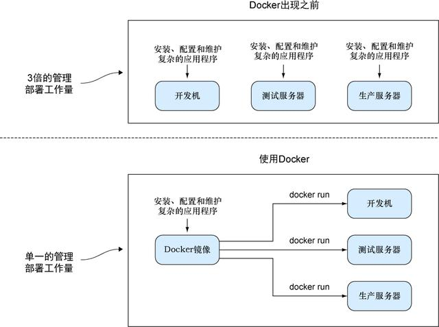

统一基础设施环境-docker环境

硬件的组成配置操作系统的版本运行时环境的异构

统一程序打包（装箱）方式-docker镜像

java程序 python程序 nodejs程序

统一程序部署（运行）方式-docker容器

java -jar...→ docker run... python manage.py runserver... → docker run... npm run dev ... → docker run...

### Docker 和虚拟机，物理主机

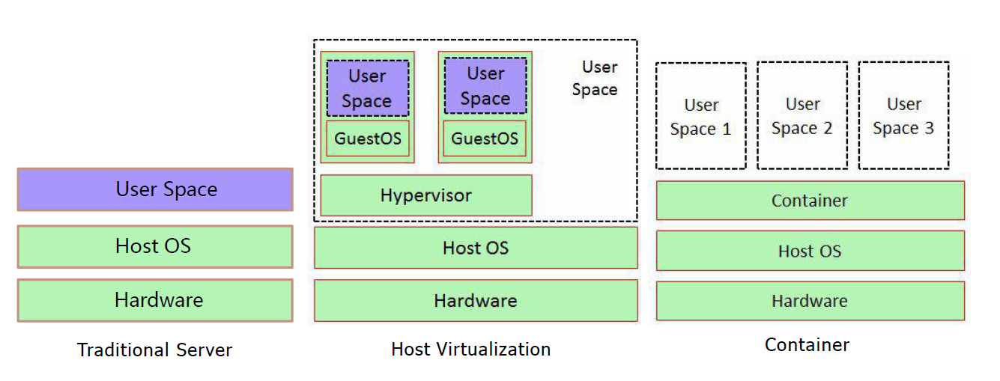

容器和虚拟机技术比较

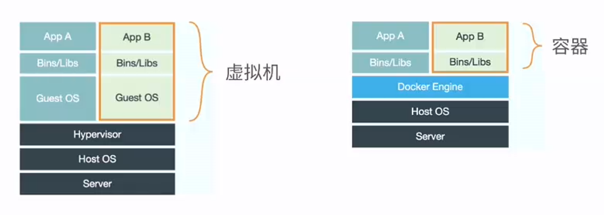

传统虚拟机是虚拟出一个主机硬件,并且运行一个完整的操作系统 ,然后在这个系统上安装和运行软件容器内的应用直接运行在宿主机的内核之上,容器并没有自己的内核,也不需要虚拟硬件,相当轻量化每个容器间是互相隔离,每个容器内都有一个属于自己的独立文件系统,独立的进程空间,网络空间,用户空间等,所以在同一个宿主机上的多个容器之间彼此不会相互影响

容器和虚拟机比较

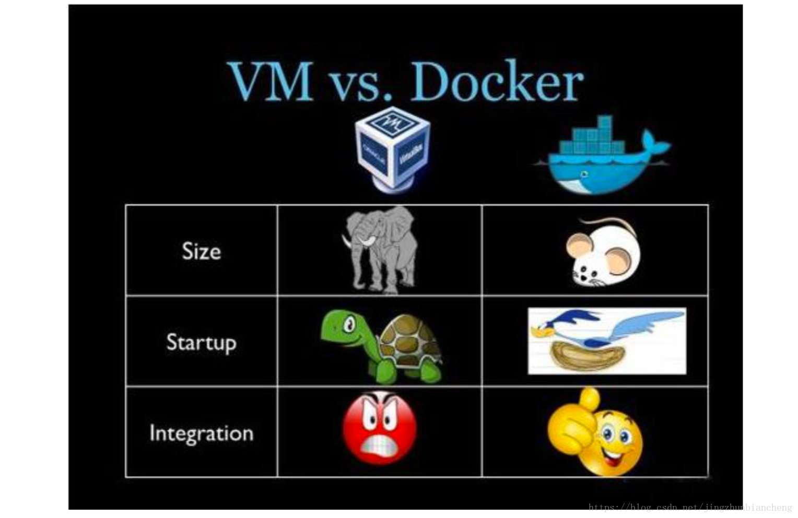

资源利用率更高:  开销更小,不需要启动单独的虚拟机OS内核占用硬件资源,可以将服务器性能压榨至极致.虚拟机一般会有5-20%的损耗,容器运行基本无损耗,所以生产中一台物理机只能运行数十个虚拟机，但是一般可以运行数百个容器启动速度更快:  可以在数秒内完成启动占用空间更小: 容器一般占用的磁盘空间以MB为单位,而虚拟机以GB 集成性更好:  和 CI/CD（持续集成/持续部署）相关技术结合性更好，实现打包镜像发布测试可以一键运行,做到自动化并快速的部署管理,实现高效的开发生命周期

使用虚拟机是为了更好的实现服务运行环境隔离，每个虚拟机都有独立的内核，虚拟化可以实现不同操作系统的虚拟机，但是通常一个虚拟机只运行一个服务，很明显资源利用率比较低且造成不必要的性能损耗，我们创建虚拟机的目的是为了运行应用程序，比如Nginx、PHP、Tomcat等web程序，使用虚拟机无疑带来了一些不必要的资源开销，而容器技术则基于减少中间运行环节带来较大的性能提升。

根据实验，一个运行着CentOS的KVM虚拟机启动后，在不做优化的情况下，虚拟机自己就需要占用 100~200 MB内存。此外，用户应用运行在虚拟机里面，它对宿主机操作系统的调用就不可避免地要经过虚拟化软件的拦截和处理，这本身又是一层性能损耗，尤其对计算资源、网络和磁盘I/O的损耗非常大。

比如:  一台96G内存的物理服务器，为了运行java程序的虚拟机一般需要分配8G内存/4核的资源，只能运行13台左右虚拟机，但是改为在docker容器上运行Java程序,每个容器只需要分配4G内存即可，同样的物理服务器就可以运行25个左右容器，运行数量相当于提高一倍，可以大幅节省IT支出，通常情况下至少可节约一半以上的物理设备

### Docker 的组成

Docker 官网:  http://www.docker.com

帮助文档链接:  https://docs.docker.com/

Docker 镜像:    https://hub.docker.com/

Docker 中文网站:  http://www.docker.org.cn/


Docker 主机(Host):  一个物理机或虚拟机，用于运行Docker服务进程和容器，也称为宿主机， node节点 Docker 服务端(Server):  Docker守护进程，运行docker容器 docker engine Docker 客户端(Client):  客户端使用 docker 命令或其他工具调用docker API Docker 镜像(Images):  镜像可以理解为创建实例使用的模板,本质上就是一些程序文件的集合 Docker 仓库(Registry): 保存镜像的仓库，官方仓库: https://hub.docker.com/，可以搭建私有仓库 harbor Docker 容器(Container): 容器是从镜像生成对外提供服务的一个或一组服务,其本质就是将镜像中的程序启动后生成的进程


### Namespace

<https://man7.org/linux/man-pages/man7/namespaces.7.html>

<https://en.wikipedia.org/wiki/Linux_namespaces>

一个宿主机运行了N个容器，多个容器共用一个 OS，必然带来的以下问题:

怎么样保证每个容器都有不同的文件系统并且能互不影响？ 一个docker主进程内的各个容器都是其子进程，那么如果实现同一个主进程下不同类型的子进程？ 各个容器子进程间能相互通信(内存数据)吗？ 每个容器怎么解决IP及端口分配的问题？ 多个容器的主机名能一样吗？ 每个容器都要不要有root用户？怎么解决账户重名问题？

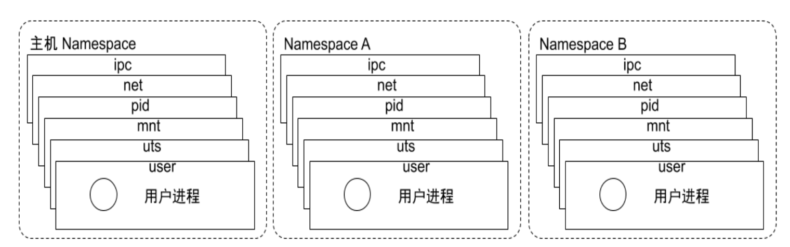

namespace是Linux系统的底层概念，在LInux内核层实现，即有一些不同类型的命名空间被部署在内核，各个docker容器运行在同一个docker主进程并且共用同一个宿主机系统内核，各docker容器运行在宿主机的用户空间，每个容器都要有类似于虚拟机一样的相互隔离的运行空间，但是容器技术是在一个进程内实现运行指定服务的运行环境，并且还可以保护宿主机内核不受其他进程的干扰和影响，如文件系统空间、网络空间、进程空间等，目前主要通过以下技术实现容器运行空间的相互隔离:

隔离类型功能系统调用参数内核

版本

MNT Namespace(mount) 提供磁盘挂载点和文件系统的

隔离能力 CLONE_NEWNS 2.4.19

PID Namespace(Process Identification) 提供进程隔离能力 CLONE_NEWPID 2.6.24

提供进程间通信的隔离能力,

IPC Namespace(Inter-

包括信号量,消息队列和共享

CLONE_NEWIPC 2.6.19

Process Communication)

内存

Net Namespace(network) 提供网络隔离能力,包括网络

设备,网络栈,端口等 CLONE_NEWNET 2.6.29

UTS Namespace(UNIX

提供内核,主机名和域名隔离能力 CLONE_NEWUTS 2.6.19

Timesharing System)

User Namespace(user) 提供用户隔离能力,包括用户

和组 CLONE_NEWUSER 3.8

Pid namespace

不同用户的进程就是通过Pid namespace 隔离开的，且不同namespace 中可以有相同Pid。 有了Pid namespace, 每个namespace 中的Pid 能够相互隔离。

net namespace

网络隔离是通过net namespace 实现的， 每个net namespace 有独立的network devices, IP addresses, IP routing tables, /proc/net 目录。 Docker 默认采用veth 的方式将container 中的虚拟网卡同host 上的一个docker bridge: docker0 连接在一起。

ipc namespace

Container 中进程交互还是采用linux 常见的进程间交互方法（interprocess communication – IPC）, 包括常见的信号量、消息队列和共享内存。 container 的进程间交互实际上还是host上具有相同Pid namespace 中的进程间交互，因此需要在 IPC 资源申请时加入namespace 信息- 每个IPC 资源有一个唯一的32 位ID。

mnt namespace

mnt namespace 允许不同namespace 的进程看到的文件结构不同，这样每个namespace 中的进程所看到的文件目录就被隔离开了

uts namespace

UTS(“UNIX Time-sharing System”) namespace允许每个container 拥有独立的hostname 和 domain name, 使其在网络上可以被视作一个独立的节点而非Host 上的一个进程。

user namespace

每个container 可以有不同的user 和group id, 也就是说可以在container 内部用container 内部的用户执行程序而非Host 上的用户。

范例：内核的 namespace

```bash
[root@ubuntu2204 ~]#uname -r
5.15.0-79-generic
[root@ubuntu2204 ~]#grep -A10  CONFIG_NAMESPACES /boot/config-5.15.0-52-generic
CONFIG_NAMESPACES=y
CONFIG_UTS_NS=y
CONFIG_TIME_NS=y
CONFIG_IPC_NS=y
CONFIG_USER_NS=y
CONFIG_PID_NS=y
CONFIG_NET_NS=y
CONFIG_CHECKPOINT_RESTORE=y
CONFIG_SCHED_AUTOGROUP=y
# CONFIG_SYSFS_DEPRECATED is not set
CONFIG_RELAY=y
```

```bash
[root@rocky8 ~]#uname -r
4.18.0-372.9.1.el8.x86_64
[root@rocky8 ~]#grep -A10  CONFIG_NAMESPACES /boot/config-4.18.0-
372.9.1.el8.x86_64
CONFIG_NAMESPACES=y
CONFIG_UTS_NS=y
CONFIG_TIME_NS=y
CONFIG_IPC_NS=y
CONFIG_USER_NS=y
CONFIG_PID_NS=y
CONFIG_NET_NS=y
CONFIG_CHECKPOINT_RESTORE=y
CONFIG_SCHED_AUTOGROUP=y
# CONFIG_SYSFS_DEPRECATED is not set
CONFIG_RELAY=y
```

范例: namespace

```bash
[root@master1 ~]#lsns --help
用法：
lsns [选项] [<名字空间>]
列出系统名字空间。
选项：
-J, --json              使用 JSON 输出格式
-l, --list             使用列表格式的输出
-n, --noheadings       不打印标题
-o, --output <list>    定义使用哪个输出列
--output-all       output all columns
-p, --task <pid>       打印进程名字空间
-r, --raw              使用原生输出格式
-u, --notruncate       不截断列中的文本
-W, --nowrap           don't use multi-line representation
-t, --type <name>      namespace type (mnt, net, ipc, user, pid, uts, cgroup,
time)
-h, --help             display this help
-V, --version          display version
Available output columns:
NS  名字空间标识符 (inode 号)
TYPE  名字空间类型
PATH  名字空间路径
NPROCS  名字空间中的进程数
PID  名字空间中的最低 PID
PPID  PID 的 PPID
COMMAND  PID 的命令行
UID  PID 的 UID
USER  PID 的用户名
NETNSID  namespace ID as used by network subsystem
NSFS  nsfs mountpoint (usually used network subsystem)
PNS  parent namespace identifier (inode number)
ONS  owner namespace identifier (inode number)
更多信息请参阅 lsns(8)。
[root@ubuntu2204 ~]#nsenter --help
用法：
nsenter [选项] [<程序> [<参数>...]]
以其他程序的名字空间运行某个程序。
选项：
-a, --all              enter all namespaces
-t, --target <pid>     要获取名字空间的目标进程
-m, --mount[=<文件>]   进入 mount 名字空间
-u, --uts[=<文件>]     进入 UTS 名字空间(主机名等)
-i, --ipc[=<文件>]     进入 System V IPC 名字空间
-n, --net[=<文件>]     进入网络名字空间
-p, --pid[=<文件>]     进入 pid 名字空间
-C, --cgroup[=<文件>]  进入 cgroup 名字空间
-U, --user[=<文件>]    进入用户名字空间
-T, --time[=<file>]    enter time namespace
-S, --setuid <uid>     设置进入空间中的 uid
-G, --setgid <gid>     设置进入名字空间中的 gid
--preserve-credentials 不干涉 uid 或 gid
-r, --root[=<目录>]     设置根目录
-w, --wd[=<dir>]       设置工作目录
-F, --no-fork          执行 <程序> 前不 fork
-Z, --follow-context  根据 --target PID 设置 SELinux 环境
-h, --help             display this help
-V, --version          display version
更多信息请参阅 nsenter(1)。
[root@ubuntu2204 ~]#lsns -l
NS TYPE   NPROCS   PID USER             COMMAND
4026531834 time      203     1 root             /sbin/init
4026531835 cgroup    203     1 root             /sbin/init
4026531836 pid       203     1 root             /sbin/init
4026531837 user      203     1 root             /sbin/init
4026531838 uts       200     1 root             /sbin/init
4026531839 ipc       203     1 root             /sbin/init
4026531840 net       203     1 root             /sbin/init
4026531841 mnt       195     1 root             /sbin/init
4026531862 mnt         1    25 root             kdevtmpfs
4026532552 mnt         1   553 root             /lib/systemd/systemd-udevd
4026532553 uts         1   553 root             /lib/systemd/systemd-udevd
4026532598 mnt         1   714 systemd-timesync /lib/systemd/systemd-timesyncd
4026532599 uts         1   714 systemd-timesync /lib/systemd/systemd-timesyncd
4026532634 mnt         1   796 systemd-network  /lib/systemd/systemd-networkd
4026532644 mnt         1   798 systemd-resolve  /lib/systemd/systemd-resolved
4026532645 mnt         1   857 root             /usr/sbin/ModemManager
4026532699 uts         1   838 root             /lib/systemd/systemd-logind
4026532700 mnt         1   838 root             /lib/systemd/systemd-logind
4026532701 mnt         1   824 root             /usr/sbin/irqbalance --
foreground
```

```bash
[root@ubuntu2204 ~]#lsns -t net
NS TYPE NPROCS   PID USER     NETNSID NSFS
COMMAND
4026531840 net     229     1 root  unassigned /run/docker/netns/default
/sbin/init
4026532691 net       2  4136 65535          1 /run/docker/netns/5090da825e77
/pause
4026532770 net       2  4140 65535          0 /run/docker/netns/cb903a9d63e0
/pause
[root@ubuntu2204 ~]#ls -l /proc/4140/ns
总用量 0
lrwxrwxrwx 1 65535 65535 0 11月 12 18:47 cgroup -> 'cgroup:[4026532838]'
lrwxrwxrwx 1 65535 65535 0 11月 12 18:35 ipc -> 'ipc:[4026532768]'
lrwxrwxrwx 1 65535 65535 0 11月 12 18:47 mnt -> 'mnt:[4026532766]'
lrwxrwxrwx 1 65535 65535 0 11月 12 18:35 net -> 'net:[4026532770]'
lrwxrwxrwx 1 65535 65535 0 11月 12 18:35 pid -> 'pid:[4026532769]'
lrwxrwxrwx 1 65535 65535 0 11月 12 18:47 pid_for_children -> 'pid:[4026532769]'
lrwxrwxrwx 1 65535 65535 0 11月 12 18:47 time -> 'time:[4026531834]'
lrwxrwxrwx 1 65535 65535 0 11月 12 18:47 time_for_children -> 'time:[4026531834]'
lrwxrwxrwx 1 65535 65535 0 11月 12 18:47 user -> 'user:[4026531837]'
lrwxrwxrwx 1 65535 65535 0 11月 12 18:47 uts -> 'uts:[4026532767]'
#说明:4136为容器在宿主机的Pid,下面表示进入4136容器的对应网络名称空间执行命令
[root@ubuntu2204 ~]#nsenter -t 4136 -n ip a
1: lo: <LOOPBACK,UP,LOWER_UP> mtu 65536 qdisc noqueue state UNKNOWN group
default qlen 1000
link/loopback 00:00:00:00:00:00 brd 00:00:00:00:00:00
inet 127.0.0.1/8 scope host lo
valid_lft forever preferred_lft forever
3: eth0@if7: <BROADCAST,MULTICAST,UP,LOWER_UP> mtu 1450 qdisc noqueue state UP
group default
link/ether 42:73:2e:34:e3:91 brd ff:ff:ff:ff:ff:ff link-netnsid 0
inet 10.244.0.11/24 brd 10.244.0.255 scope global eth0
valid_lft forever preferred_lft forever
[root@ubuntu2204 ~]#nsenter -t 4140 -n ip a
1: lo: <LOOPBACK,UP,LOWER_UP> mtu 65536 qdisc noqueue state UNKNOWN group
default qlen 1000
link/loopback 00:00:00:00:00:00 brd 00:00:00:00:00:00
inet 127.0.0.1/8 scope host lo
valid_lft forever preferred_lft forever
3: eth0@if6: <BROADCAST,MULTICAST,UP,LOWER_UP> mtu 1450 qdisc noqueue state UP
group default
link/ether f6:20:4e:63:e9:0a brd ff:ff:ff:ff:ff:ff link-netnsid 0
inet 10.244.0.10/24 brd 10.244.0.255 scope global eth0
valid_lft forever preferred_lft forever
```

### Control groups

Linux Cgroups的全称是Linux Control Groups,是Linux内核的一个功能.最早是由Google的工程师（主要是Paul Menage和Rohit Seth）在2006年发起，最早的名称为进程容器（process containers）。

在2007年时，因为在Linux内核中，容器（container）这个名词有许多不同的意义，为避免混乱，被重命名为cgroup，并且被合并到2.6.24版的内核中去。自那以后，又添加了很多功能。

如果不对一个容器做任何资源限制，则宿主机会允许其占用无限大的内存空间，有时候会因为代码bug 程序会一直申请内存，直到把宿主机内存占完，为了避免此类的问题出现，宿主机有必要对容器进行资源分配限制，比如CPU、内存等

Cgroups 最主要的作用，就是限制一个进程组能够使用的资源上限，包括CPU、内存、磁盘、网络带宽等等。此外，还能够对进程进行优先级设置，资源的计量以及资源的控制(比如:将进程挂起和恢复等操作)。

Cgroups在内核层默认已经开启，从CentOS 和 Ubuntu 不同版本对比，显然内核较新的支持的功能更多。

Centos 8.1 cgroups:

```bash
[root@centos8 ~]#cat /etc/redhat-release
CentOS Linux release 8.1.1911 (Core)
[root@centos8 ~]#grep CGROUP /boot/config-4.18.0-147.el8.x86_64
CONFIG_CGROUPS=y
CONFIG_BLK_CGROUP=y
# CONFIG_DEBUG_BLK_CGROUP is not set
CONFIG_CGROUP_WRITEBACK=y
CONFIG_CGROUP_SCHED=y
CONFIG_CGROUP_PIDS=y
CONFIG_CGROUP_RDMA=y
CONFIG_CGROUP_FREEZER=y
CONFIG_CGROUP_HUGETLB=y
CONFIG_CGROUP_DEVICE=y
CONFIG_CGROUP_CPUACCT=y
CONFIG_CGROUP_PERF=y
CONFIG_CGROUP_BPF=y
# CONFIG_CGROUP_DEBUG is not set
CONFIG_SOCK_CGROUP_DATA=y
# CONFIG_BLK_CGROUP_IOLATENCY is not set
CONFIG_NETFILTER_XT_MATCH_CGROUP=m
CONFIG_NET_CLS_CGROUP=y
CONFIG_CGROUP_NET_PRIO=y
CONFIG_CGROUP_NET_CLASSID=y
[root@centos8 ~]#
```

Centos 7.6 cgroups:

```bash
[root@centos7 ~]#cat /etc/redhat-release
CentOS Linux release 7.6.1810 (Core)
[root@centos7 ~]#grep CGROUP /boot/config-3.10.0-957.el7.x86_64
CONFIG_CGROUPS=y
# CONFIG_CGROUP_DEBUG is not set
CONFIG_CGROUP_FREEZER=y
CONFIG_CGROUP_PIDS=y
CONFIG_CGROUP_DEVICE=y
CONFIG_CGROUP_CPUACCT=y
CONFIG_CGROUP_HUGETLB=y
CONFIG_CGROUP_PERF=y
CONFIG_CGROUP_SCHED=y
CONFIG_BLK_CGROUP=y
# CONFIG_DEBUG_BLK_CGROUP is not set
CONFIG_NETFILTER_XT_MATCH_CGROUP=m
CONFIG_NET_CLS_CGROUP=y
CONFIG_NETPRIO_CGROUP=y
```

ubuntu cgroups:

```bash
[root@ubuntu1804 ~]#grep CGROUP  /boot/config-4.15.0-29-generic
CONFIG_CGROUPS=y
CONFIG_BLK_CGROUP=y
# CONFIG_DEBUG_BLK_CGROUP is not set
CONFIG_CGROUP_WRITEBACK=y
CONFIG_CGROUP_SCHED=y
CONFIG_CGROUP_PIDS=y
CONFIG_CGROUP_RDMA=y
CONFIG_CGROUP_FREEZER=y
CONFIG_CGROUP_HUGETLB=y
CONFIG_CGROUP_DEVICE=y
CONFIG_CGROUP_CPUACCT=y
CONFIG_CGROUP_PERF=y
CONFIG_CGROUP_BPF=y
# CONFIG_CGROUP_DEBUG is not set
CONFIG_SOCK_CGROUP_DATA=y
CONFIG_NETFILTER_XT_MATCH_CGROUP=m
CONFIG_NET_CLS_CGROUP=m
CONFIG_CGROUP_NET_PRIO=y
CONFIG_CGROUP_NET_CLASSID=y
```

cgroups 中内存模块:

```bash
[root@ubuntu1804 ~]#grep MEMCG  /boot/config-4.15.0-29-generic
CONFIG_MEMCG=y
CONFIG_MEMCG_SWAP=y
# CONFIG_MEMCG_SWAP_ENABLED is not set
CONFIG_SLUB_MEMCG_SYSFS_ON=y
```

### 容器管理工具

有了以上的namespace、cgroups就具备了基础的容器运行环境，但是还需要有相应的容器创建与删除的管理工具、以及怎么样把容器运行起来、容器数据怎么处理、怎么进行启动与关闭等问题需要解决， 于是容器管理技术出现了。目前主要是使用docker，containerd等，早期使用 LXC

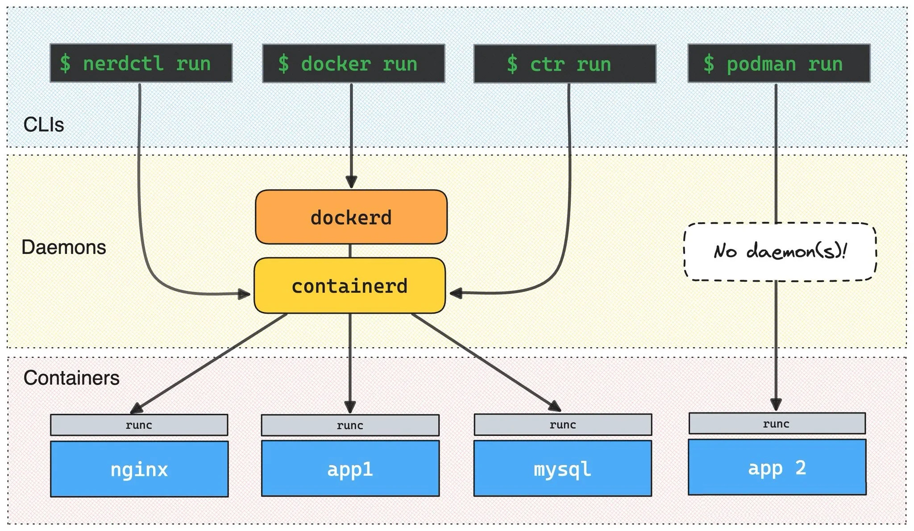

### LXC

LXC:  Linux Container。可以提供轻量级的虚拟化功能,以便隔离进程和资源,包括一系列容器的管理工具软件,如，lxc-create,lxc-start,lxc-attach等,但这技术功能不完善,目前较少使用

官方网站:  https://linuxcontainers.org/

案例:  Ubuntu安装 和使用 LXC

```bash
[root@ubuntu1804 ~]#apt install lxc lxd
Reading package lists... Done
Building dependency tree
Reading state information... Done
lxd is already the newest version (3.0.3-0ubuntu1~18.04.1).
lxc is already the newest version (3.0.3-0ubuntu1~18.04.1).
......
[root@ubuntu1804 ~]#lxc-checkconfig   #检查内核对lcx的支持状况，必须全部为lcx
Kernel configuration not found at /proc/config.gz; searching...
Kernel configuration found at /boot/config-4.15.0-29-generic
--- Namespaces ---
Namespaces: enabled
Utsname namespace: enabled
Ipc namespace: enabled
Pid namespace: enabled
User namespace: enabled
Network namespace: enabled
......
```

```bash
[root@ubuntu1804 ~]#lxc-create -t download --name alpine1 --  --dist alpine  --
release 3.9 --arch amd64
Setting up the GPG keyring
Downloading the image index
Downloading the rootfs
Downloading the metadata
The image cache is now ready
Unpacking the rootfs
---
You just created an Alpinelinux 3.9 x86_64 (20200121_13:00) container.
[root@ubuntu1804 ~]#lxc-start alpine1    #启动lxc容器
[root@ubuntu1804 ~]#lxc-attach alpine1   #进入lxc容器
~ # ifconfig
eth0      Link encap:Ethernet  HWaddr 00:16:3E:DF:9E:45
inet addr:10.0.1.51  Bcast:10.0.1.255  Mask:255.255.255.0
inet6 addr: fe80::216:3eff:fedf:9e45/64 Scope:Link
UP BROADCAST RUNNING MULTICAST  MTU:1500  Metric:1
RX packets:23 errors:0 dropped:0 overruns:0 frame:0
TX packets:12 errors:0 dropped:0 overruns:0 carrier:0
collisions:0 txqueuelen:1000
RX bytes:2484 (2.4 KiB)  TX bytes:1726 (1.6 KiB)
lo        Link encap:Local Loopback
inet addr:127.0.0.1  Mask:255.0.0.0
inet6 addr: ::1/128 Scope:Host
UP LOOPBACK RUNNING  MTU:65536  Metric:1
RX packets:0 errors:0 dropped:0 overruns:0 frame:0
TX packets:0 errors:0 dropped:0 overruns:0 carrier:0
collisions:0 txqueuelen:1000
RX bytes:0 (0.0 B)  TX bytes:0 (0.0 B)
~ # uname -r
4.15.0-29-generic
~ # uname -a
Linux alpine12 4.15.0-29-generic #31-Ubuntu SMP Tue Jul 17 15:39:52 UTC 2018
x86_64 Linux
~ # cat /etc/issue
Welcome to Alpine Linux 9
Kernel \r on an \m (\l)
~ # exit
[root@ubuntu1804 ~]#
```

命令选项说明:

```text
-t 模板: -t 选项后面跟的是模板，模式可以认为是一个原型，用来说明需要一个什么样的容器(比如容器里
面需不需要有vim, apache等软件)．模板实际上就是一个脚本文件(位于/usr/share/lxc/templates目
录)，我们这里指定download模板(lxc-create会调用lxc-download脚本，该脚本位于刚说的模板目录
中)是说明我们目前没有自己模板，需要下载官方的模板
--name 容器名称:   为创建的容器命名
-- : --用来说明后面的参数是传递给download脚本的，告诉脚本需要下载什么样的模板
--dist 操作系统名称:  指定操作系统
--release 操作系统: 指定操作系统，可以是各种Linux的变种
--arch 架构:  指定架构，是x86还是arm，是32位还是64位
```

lxc启动容器依赖于模板，清华模板源:  https://mirrors.tuna.tsinghua.edu.cn/help/lxc-images/，但是做模板相对较难，需要手动一步步创构建文件系统、准备基础目录及可执行程序等，而且在大规模使用容器的场景很难横向扩展，另外后期代码升级也需要重新从头构建模板，基于以上种种原因便有了 docker

### docker

Docker 相当于增强版的LXC,功能更为强大和易用,也是当前最主流的容器前端管理工具

Docker 先启动一个容器也需要一个外部模板，也称为镜像，docke的镜像可以保存在一个公共的地方共享使用，只要把镜像下载下来就可以使用，最主要的是可以在镜像基础之上做自定义配置并且可以再把其提交为一个镜像，一个镜像可以被启动为多个容器。


Docker的镜像是分层的，镜像底层为库文件且只读层即不能写入也不能删除数据，从镜像加载启动为一个容器后会生成一个可写层，其写入的数据会复制到宿主机上对应容器的目录，但是容器内的数据在删除容器后也会被随之删除。

### pouch

项目网点:  https://github.com/alibaba/pouch

Pouch （小袋子）起源于 2011 年，并于2017年11月19日上午，在中国开源年会现场，阿里巴巴正式开源了基于 Apache 2.0 协议的容器技术 Pouch。Pouch 是一款轻量级的容器技术，拥有快速高效、可移植性高、资源占用少等特性，主要帮助阿里更快的做到内部业务的交付，同时提高超大规模下数据中心的物理资源利用率

目前的容器方案大多基于 Linux 内核提供的 cgroup 和 namespace 来实现隔离，然后这样轻量级方案存在弊端:

容器间，容器与宿主间，共享同一个内核内核实现的隔离资源，维度不足

面对如此的内核现状，阿里巴巴采取了三个方面的工作，来解决容器的安全问题:

用户态增强容器的隔离维度，比如网络带宽、磁盘使用量等给内核提交 patch，修复容器的资源可见性问题，cgroup 方面的 bug 实现基于 Hypervisor 的容器，通过创建新内核来实现容器隔离

### Podman

虽然目前 Docker 是管理 Linux 容器最好的工具，注意没有之一，但是podman的横空出现即将改变这一点

什么是Podman？

Podman即Pod Manager tool，从名称上可以看出和kubernets的pod的密切联系，不过就其功能来说，简而言之:  alias docker = podman ,是CentOS 8 新集成的功能，或许不久的未来会代替docker

Podman是一个 为 Kubernetes 而生的开源的容器管理工具，原来是 CRI-O（即容器运行时接口CRI 和开放容器计划OCI） 项目的一部分，后来被分离成一个单独的项目叫 libpod。其可在大多数Linux平台上使用，它是一种无守护程序的容器引擎，用于在Linux系统上开发，管理和运行任何符合Open Container Initiative（OCI）标准的容器和容器镜像。

Podman 提供了一个与Docker兼容的命令行前端，Podman 里面87%的指令都和Docker CLI 相同，因此可以简单地为Docker CLI别名，即“ alias docker = podman”，事实上，podman使用的一些库也是 docker的一部分。

```text
CRI-O is an implementation of the Kubernetes CRI (Container Runtime Interface) to
enable using OCI (Open Container Initiative) compatible runtimes
```

官网地址:  https://podman.io/

项目地址:  https://github.com/containers/libpod

Podman 和docker不同之处

docker 需要在系统上运行一个守护进程(docker daemon)，这会产生一定的开销，而podman 不需要启动容器的方式不同: docker cli 命令通过API跟 Docker Engine(引擎) 交互告诉它我想创建一个container，然后 docker Engine 才会调用OCI container runtime(runc) 来启动一个container。这代表 container的process(进程)不会是Docker CLI 的child process(子进程) ，而是Docker Engine 的child process 。 Podman 是直接给OCI containner runtime(runc) 进行交互来创建container的，所以 container process 直接是podman 的child process 。 因为docke有docker daemon，所以docker启动的容器支持--restart 策略，但是podman不支持 docker需要使用root用户来创建容器。 这可能会产生安全风险，尤其是当用户知道docker run命令的--privileged选项时。podman既可以由root用户运行，也可以由非特权用户运行 docker在Linux上作为守护进程运行扼杀了容器社区的创新。 如果要更改容器的工作方式，则需要更改docker守护程序并将这些更改推送到上游。 没有守护进程，容器基础结构更加模块化，更容易进行更改。 podman的无守护进程架构更加灵活和安全。

### Containerd 工具

ctr 是由 containerd 提供的一个客户端工具

nerdctl 是 与 Docker 兼容的CLI for Containerd，其支持Compose

nerdctl 和 docker命令行语法很相似，学习比较容易

项目地址：https://github.com/containerd/nerdctl

### Docker 的优势

快速部署:  短时间内可以部署成百上千个应用，更快速交付到线上高效虚拟化:  不需要额外hypervisor支持，基于linux内核实现应用虚拟化，相比虚拟机大幅提高性能和效率节省开支:  提高服务器利用率，降低IT支出简化配置:  将运行环境打包保存至容器，使用时直接启动即可环境统一:  将开发，测试，生产的应用运行环境进行标准化和统一，减少环境不一样带来的各种问题快速迁移和扩展:  可实现跨平台运行在物理机、虚拟机、公有云等环境，良好的兼容性可以方便将应用从A宿主机迁移到B宿主机，甚至是A平台迁移到B平台更好的实现面向服务的架构,推荐一个容器只运行一个应用,实现分布的应用模型,可以方便的进行横向扩展,符合开发中高内聚,低耦合的要求,减少不同服务之间的相互影响

### Docker 的缺点

多个容器共用宿主机的内核，各应用之间的隔离不如虚拟机彻底由于和宿主机之间的进程也是隔离的,需要进入容器查看和调试容器内进程等资源,变得比较困难和繁琐如果容器内进程需要查看和调试,需要在每个容器内都需要安装相应的工具,这也造成存储空间的重复浪费

### 容器的相关技术

### 容器规范


OCI 官网:https://opencontainers.org/

容器技术除了的docker之外，还有coreOS的rkt，还有阿里的Pouch等等

为了保证容器生态的标准性和健康可持续发展，包括Linux 基金会、Docker、微软、红帽、谷歌和IBM 等公司在2015年6月共同成立了一个叫Open Container Initiative（OCI）的组织，其目的就是制定开放的标准的容器规范

目前OCI一共发布了两个规范，分别是runtime spec和 image format spec，有了这两个规范，不同的容器公司开发的容器只要兼容这两个规范，就可以保证容器的可移植性和相互可操作性。

### 容器 runtime

runtime是真正运行容器的地方，因此为了运行不同的容器runtime需要和操作系统内核紧密合作相互在支持，以便为容器提供相应的运行环境

对于容器运行时主要有两个级别：Low Level(使用接近内核层) 和 High Level(使用接近用户层)目前，市面上常用的容器引擎有很多，主要有下图的那几种。

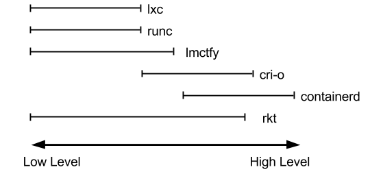

dockershim, containerd 和cri-o都是遵循CRI的容器运行时，我们称他们为高层级运行时（High-level Runtime）

其他的容器运营厂商最底层的runc仍然是Docker在维护的。

Google,CoreOS,RedHat都推出自已的运行时:lmctfy,rkt,cri-o,但到目前Docker仍然是最主流的容器引擎技术。

runtime 类型:

Lxc:  linux上早期的runtime，在 2013 年 Docker 刚发布的时候,就是采用lxc作为runtime, Docker 把 LXC 复杂的容器创建与使用方式简化为 Docker 自己的一套命令体系。随着Docker的发展，原有的LXC不能满足Docker的需求,比如跨平台功能 Libcontainer: 随着 Docker 的不断发展，重新定义容器的实现标准，将底层实现都抽象化到 Libcontainer 的接口。这就意味着，底层容器的实现方式变成了一种可变的方案，无论是使用 namespace、cgroups 技术抑或是使用 systemd 等其他方案，只要实现了 Libcontainer 定义的一组接口，Docker 都可以运行。这也为 Docker 实现全面的跨平台带来了可能。 runc:  早期libcontainer是Docker公司控制的一个开源项目，OCI的成立后,Docker把libcontainer 项目移交给了OCI组织,runC就是在libcontainer的基础上进化而来,目前Docker默认的runtime， runc遵守OCI规范 rkt:  是CoreOS开发的容器runtime，也符合OCI规范，所以使用rktruntime也可以运行Docker容器

Docker 的运行机制

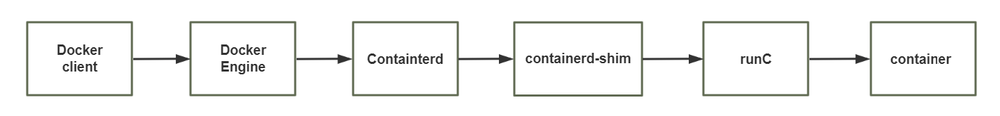

范例:  查看docker的 runtime

```bash
[root@ubuntu1804 ~]#docker info
Client:
Debug Mode: false
Server:
Containers: 0
Running: 0
Paused: 0
Stopped: 0
Images: 1
Server Version: 19.03.5
Storage Driver: overlay2
Backing Filesystem: extfs
Supports d_type: true
Native Overlay Diff: true
Logging Driver: json-file
Cgroup Driver: cgroupfs
Plugins:
Volume: local
Network: bridge host ipvlan macvlan null overlay
Log: awslogs fluentd gcplogs gelf journald json-file local logentries splunk
syslog
Swarm: inactive
Runtimes: runc         #Runtimes
Default Runtime: runc  #runtime
Init Binary: docker-init
containerd version: b34a5c8af56e510852c35414db4c1f4fa6172339
runc version: 3e425f80a8c931f88e6d94a8c831b9d5aa481657
init version: fec3683
Security Options:
apparmor
seccomp
Profile: default
Kernel Version: 4.15.0-29-generic
Operating System: Ubuntu 18.04.1 LTS
OSType: linux
Architecture: x86_64
CPUs: 1
Total Memory: 962MiB
Name: ubuntu1804.bowen.org
ID: G2JQ:M4DG:CW74:EETR:GU5U:OROC:ZN2F:RKSA:YQY2:XJYX:OHG7:SSVE
Docker Root Dir: /var/lib/docker
Debug Mode: false
Registry: https://index.docker.io/v1/
Labels:
Experimental: false
Insecure Registries:
127.0.0.0/8
Live Restore Enabled: false
WARNING: No swap limit support
```

### 镜像仓库 Registry

统一保存镜像而且是多个不同镜像版本的地方，叫做镜像仓库

Docker hub:  docker官方的公共仓库，已经保存了大量的常用镜像，可以方便大家直接使用阿里云，网易等第三方镜像的公共仓库 Image registry:  docker 官方提供的私有仓库部署工具，无web管理界面，目前使用较少 Harbor:  vmware 提供的自带web界面自带认证功能的镜像私有仓库，目前有很多公司使用

范例:  镜像地址格式

```text
docker.io/library/alpine
harbor.bowen.org/project/centos:7.2.1511
registry.cn-hangzhou.aliyuncs.com/bowenxiaochun/busybox:v1.0
172.18.200.101/project/centos: latest
172.18.200.101/project/java-7.0.59:v1
```

### 容器编排工具

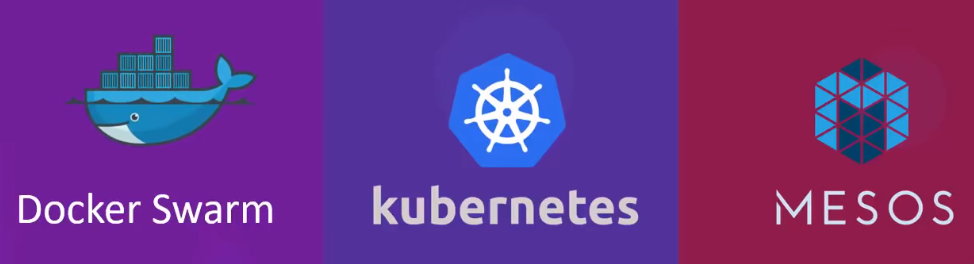

当多个容器在多个主机运行的时候，单独管理容器是相当复杂而且很容易出错，而且也无法实现某一台主机宕机后容器自动迁移到其他主机从而实现高可用的目的，也无法实现动态伸缩的功能，因此需要有一种工具可以实现统一管理、动态伸缩、故障自愈、批量执行等功能，这就是容器编排引擎

容器编排通常包括容器管理、调度、集群定义和服务发现等功能

Docker compose : docker 官方实现单机的容器的编排工具 Docker swarm:  docker 官方开发的容器编排引擎,支持overlay network Mesos+Marathon:  Mesos是Apache下的开源分布式资源管理框架，它被称为是分布式系统的内核。Mesos最初是由加州大学伯克利分校的AMPLab开发的，后在Twitter得到广泛使用。通用的集群组员调度平台，mesos(资源分配)与marathon(容器编排平台)一起提供容器编排引擎功能 Kubernetes:  google领导开发的容器编排引擎，内部项目为Borg，且其同时支持 docker 和 CoreOS,当前已成为容器编排工具事实上的标准



<nav class="article-end" aria-label="章节导航">
  <a href="{{ '/subjects/Docker/' | relative_url }}">Back to Docker Container Technology Index</a>
  <a href="{{ '/subjects/Docker/02-installing-docker-and-basic-commands.html' | relative_url }}">Next: Installing Docker and Basic Commands →</a>
</nav>
