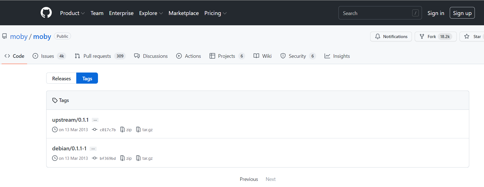
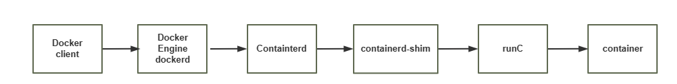
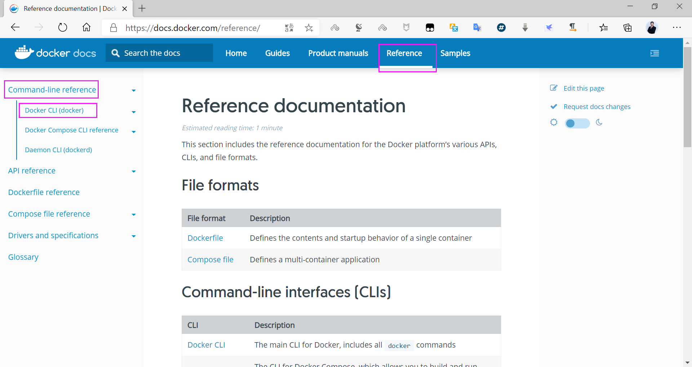

[← Back to Docker Container Technology Index]({{ '/subjects/Docker/' | relative_url }})



# 02 Installing Docker and Basic Commands
### 1.2 Docker 安装及基础命令介绍

### Docker 版本说明

官方网址:  https://www.docker.com/

OS系统版本选择:

Docker 目前已经支持多种操作系统的安装运行，比如Ubuntu、CentOS、Redhat、Debian、Fedora， 甚至是还支持了Mac和Windows，在linux系统上需要内核版本在3.10或以上

Docker 版本选择:

```text
github地址:  https://github.com/moby/moby
```



Docker版本号之前一直是0.X版本或1.X版本，从2013年3月13日发布第一个版本0.1.1-1开始一直到2017 年02月08日发布1.13.1版

从2017年3月1号开始改为每个季度发布一次稳定版，其版本号规则也统一变更为YY.MM.xx，第一个版本为17.03.0, 例如17.09表示是2017年9月份发布的

Docker之前没有区分版本，但是2017年推出(将docker更名为)新的项目Moby，Moby项目属于Docker 项目的全新上游，Docker将是一个隶属于的Moby的子产品，而且之后的版本之后开始区分为 CE（Docker Community Edition，社区版本）和 EE（Docker Enterprise Edition，企业收费版），CE 社区版本和EE企业版本都是每个季度发布一个新版本，但是EE版本提供后期安全维护1年，而CE版本是4 个月，以下为官方原文:

https://blog.docker.com/2017/03/docker-enterprise-edition/

```text
Docker CE and EE are released quarterly, and CE also has a monthly “Edge” option.
Each Docker EE release is supported and maintained for one year and receives
security and critical bugfixes during that period. We are also improving Docker
CE maintainability by maintaining each quarterly CE release for 4 months. That
gets Docker CE users a new 1-month window to update from one version to the
next.
Docker CE和EE每季度发布一次，CE也有每月一次的“Edge”选项。每个Docker EE版本都支持和维护一
年，并在此期间接受安全和关键错误修复。我们还通过将每个季度的CE发布保持4个月来提高Docker CE的可
维护性。这为Docker CE用户提供了一个新的1个月窗口，可以从一个版本更新到下一个版本。
```

如果要布署到 kubernetes上，需要查看相关kubernetes对docker版本要求的说明，比如:

<https://github.com/kubernetes/kubernetes/blob/v1.17.2/CHANGELOG-1.17.md>

### 安装和删除

官方文档 : https://docs.docker.com/engine/install/

阿里云文档: https://developer.aliyun.com/mirror/docker-ce?spm=a2c6h.13651102.0.0.3e221b11gu HCWE

安装方法

内置仓库官方仓库（国内镜像） 二进制安装（离线） 官方脚本

### Ubuntu 包安装和删除Docker

官方文档:  https://docs.docker.com/install/linux/docker-ce/ubuntu/

Ubuntu 14.04/16.04/18.04/20.04 安装docker

<https://developer.aliyun.com/mirror/docker-ce?spm=a2c6h.13651102.0.0.57e31b11p4BMmx>

```text
# step 1: 安装必要的一些系统工具
sudo apt-get update
sudo apt-get -y install apt-transport-https ca-certificates curl software-
properties-common
# step 2: 安装GPG证书
curl -fsSL https://mirrors.aliyun.com/docker-ce/linux/ubuntu/gpg | sudo apt-key
add -
# Step 3: 写入软件源信息
sudo add-apt-repository "deb [arch=amd64] https://mirrors.aliyun.com/docker-
ce/linux/ubuntu $(lsb_release -cs) stable"
# Step 4: 更新并安装Docker-CE
sudo apt-get -y update
sudo apt-get -y install docker-ce
# 安装指定版本的Docker-CE:
# Step 1: 查找Docker-CE的版本:
apt-cache madison docker-ce
docker-ce | 5:19.03.5~3-0~ubuntu-bionic | https://mirrors.aliyun.com/docker-
ce/linux/ubuntu bionic/stable amd64 Packages
docker-ce | 5:19.03.4~3-0~ubuntu-bionic | https://mirrors.aliyun.com/docker-
ce/linux/ubuntu bionic/stable amd64 Packages
docker-ce | 5:19.03.3~3-0~ubuntu-bionic | https://mirrors.aliyun.com/docker-
ce/linux/ubuntu bionic/stable amd64 Packages
docker-ce | 5:19.03.2~3-0~ubuntu-bionic | https://mirrors.aliyun.com/docker-
ce/linux/ubuntu bionic/stable amd64 Packages
docker-ce | 5:19.03.1~3-0~ubuntu-bionic | https://mirrors.aliyun.com/docker-
ce/linux/ubuntu bionic/stable amd64 Packages
docker-ce | 5:19.03.0~3-0~ubuntu-bionic | https://mirrors.aliyun.com/docker-
ce/linux/ubuntu bionic/stable amd64 Packages
docker-ce | 5:18.09.9~3-0~ubuntu-bionic | https://mirrors.aliyun.com/docker-
ce/linux/ubuntu bionic/stable amd64 Packages
docker-ce | 5:18.09.8~3-0~ubuntu-bionic | https://mirrors.aliyun.com/docker-
ce/linux/ubuntu bionic/stable amd64 Packages
docker-ce | 5:18.09.7~3-0~ubuntu-bionic | https://mirrors.aliyun.com/docker-
ce/linux/ubuntu bionic/stable amd64 Packages
docker-ce | 5:18.09.6~3-0~ubuntu-bionic | https://mirrors.aliyun.com/docker-
ce/linux/ubuntu bionic/stable amd64 Packages
docker-ce | 5:18.09.5~3-0~ubuntu-bionic | https://mirrors.aliyun.com/docker-
ce/linux/ubuntu bionic/stable amd64 Packages
docker-ce | 5:18.09.4~3-0~ubuntu-bionic | https://mirrors.aliyun.com/docker-
ce/linux/ubuntu bionic/stable amd64 Packages
docker-ce | 5:18.09.3~3-0~ubuntu-bionic | https://mirrors.aliyun.com/docker-
ce/linux/ubuntu bionic/stable amd64 Packages
docker-ce | 5:18.09.2~3-0~ubuntu-bionic | https://mirrors.aliyun.com/docker-
ce/linux/ubuntu bionic/stable amd64 Packages
docker-ce | 5:18.09.1~3-0~ubuntu-bionic | https://mirrors.aliyun.com/docker-
ce/linux/ubuntu bionic/stable amd64 Packages
docker-ce | 5:18.09.0~3-0~ubuntu-bionic | https://mirrors.aliyun.com/docker-
ce/linux/ubuntu bionic/stable amd64 Packages
docker-ce | 18.06.3~ce~3-0~ubuntu | https://mirrors.aliyun.com/docker-
ce/linux/ubuntu bionic/stable amd64 Packages
docker-ce | 18.06.2~ce~3-0~ubuntu | https://mirrors.aliyun.com/docker-
ce/linux/ubuntu bionic/stable amd64 Packages
docker-ce | 18.06.1~ce~3-0~ubuntu | https://mirrors.aliyun.com/docker-
ce/linux/ubuntu bionic/stable amd64 Packages
docker-ce | 18.06.0~ce~3-0~ubuntu | https://mirrors.aliyun.com/docker-
ce/linux/ubuntu bionic/stable amd64 Packages
docker-ce | 18.03.1~ce~3-0~ubuntu | https://mirrors.aliyun.com/docker-
ce/linux/ubuntu bionic/stable amd64 Packages
# Step 2: 安装指定版本的Docker-CE: (VERSION例如上面的5:17.03.1~ce-0~ubuntu-xenial)
sudo apt-get -y install docker-ce=[VERSION] docker-ce-cli=[VERSION]
#示例:指定版本安装
apt-get -y install docker-ce=5:18.09.9~3-0~ubuntu-bionic  docker-ce-
cli=5:18.09.9~3-0~ubuntu-bionic
#Ubuntu22.04安装指定版本
apt -y install  docker-ce=5:24.0.6-1~ubuntu.22.04~jammy docker-ce-cli=5:24.0.6-
1~ubuntu.22.04~jammy
```

删除 docker

```bash
[root@ubuntu ~]#apt purge docker-ce
[root@ubuntu ~]#rm -rf /var/lib/docker
```

范例: 内置仓库安装docker

```bash
[root@ubuntu2004 ~]#apt -y install docker.io
[root@ubuntu2004 ~]#docker version
Client:
Version:           20.10.12
API version:       1.41
Go version:        go1.16.2
Git commit:        20.10.12-0ubuntu2~20.04.1
Built:             Wed Apr  6 02:14:38 2022
OS/Arch:           linux/amd64
Context:           default
Experimental:      true
Server:
Engine:
Version:          20.10.12
API version:      1.41 (minimum version 1.12)
Go version:       go1.16.2
Git commit:       20.10.12-0ubuntu2~20.04.1
Built:            Thu Feb 10 15:03:35 2022
OS/Arch:          linux/amd64
Experimental:     false
containerd:
Version:          1.5.9-0ubuntu1~20.04.4
GitCommit:
runc:
Version:          1.1.0-0ubuntu1~20.04.1
GitCommit:
docker-init:
Version:          0.19.0
GitCommit:
[root@ubuntu2004 ~]#docker info
Client:
Context:    default
Debug Mode: false
Server:
Containers: 0
Running: 0
Paused: 0
Stopped: 0
Images: 0
Server Version: 20.10.12
Storage Driver: overlay2
Backing Filesystem: extfs
Supports d_type: true
Native Overlay Diff: true
userxattr: false
Logging Driver: json-file
Cgroup Driver: cgroupfs
Cgroup Version: 1
Plugins:
Volume: local
Network: bridge host ipvlan macvlan null overlay
Log: awslogs fluentd gcplogs gelf journald json-file local logentries splunk
syslog
Swarm: inactive
Runtimes: io.containerd.runtime.v1.linux runc io.containerd.runc.v2
Default Runtime: runc
Init Binary: docker-init
containerd version:
runc version:
init version:
Security Options:
apparmor
seccomp
Profile: default
Kernel Version: 5.4.0-89-generic
Operating System: Ubuntu 20.04.3 LTS
OSType: linux
Architecture: x86_64
CPUs: 2
Total Memory: 1.913GiB
Name: ubuntu2004.bowen.org
ID: UF2A:GX7G:OIWE:W35O:EFSB:5WBH:AYCZ:N37P:YCIF:4AXD:D3IL:NCI4
Docker Root Dir: /var/lib/docker
Debug Mode: false
Registry: https://index.docker.io/v1/
Labels:
Experimental: false
Insecure Registries:
127.0.0.0/8
Live Restore Enabled: false
WARNING: No swap limit support
```

范例： 安装指定版本

```bash
# step 1: 安装必要的一些系统工具
[root@ubuntu2004 ~]#sudo apt-get update
[root@ubuntu2004 ~]#sudo apt-get -y install apt-transport-https ca-certificates
curl software-properties-common
# step 2: 安装GPG证书
[root@ubuntu2004 ~]#curl -fsSL https://mirrors.aliyun.com/docker-
ce/linux/ubuntu/gpg | sudo apt-key add -
# Step 3: 写入软件源信息
[root@ubuntu2004 ~]#sudo add-apt-repository "deb [arch=amd64]
https://mirrors.aliyun.com/docker-ce/linux/ubuntu $(lsb_release -cs) stable"
# Step 4: 更新并安装Docker-CE
[root@ubuntu2004 ~]#sudo apt-get -y update
# 安装指定版本的Docker-CE:
# Step 1: 查找Docker-CE的版本:
[root@ubuntu2004 ~]#apt-cache madison docker-ce
#   docker-ce | 17.03.1~ce-0~ubuntu-xenial | https://mirrors.aliyun.com/docker-
ce/linux/ubuntu xenial/stable amd64 Packages
#   docker-ce | 17.03.0~ce-0~ubuntu-xenial | https://mirrors.aliyun.com/docker-
ce/linux/ubuntu xenial/stable amd64 Packages
# Step 2: 安装指定版本的Docker-CE: (VERSION例如上面的17.03.1~ce-0~ubuntu-xenial)
# sudo apt-get -y install docker-ce=[VERSION]
[root@ubuntu2004 ~]#apt-cache madison docker-ce
docker-ce | 5:20.10.17~3-0~ubuntu-focal | https://mirrors.aliyun.com/docker-
ce/linux/ubuntu focal/stable amd64 Packages
docker-ce | 5:20.10.16~3-0~ubuntu-focal | https://mirrors.aliyun.com/docker-
ce/linux/ubuntu focal/stable amd64 Packages
docker-ce | 5:20.10.15~3-0~ubuntu-focal | https://mirrors.aliyun.com/docker-
ce/linux/ubuntu focal/stable amd64 Packages
docker-ce | 5:20.10.14~3-0~ubuntu-focal | https://mirrors.aliyun.com/docker-
ce/linux/ubuntu focal/stable amd64 Packages
docker-ce | 5:20.10.13~3-0~ubuntu-focal | https://mirrors.aliyun.com/docker-
ce/linux/ubuntu focal/stable amd64 Packages
docker-ce | 5:20.10.12~3-0~ubuntu-focal | https://mirrors.aliyun.com/docker-
ce/linux/ubuntu focal/stable amd64 Packages
docker-ce | 5:20.10.11~3-0~ubuntu-focal | https://mirrors.aliyun.com/docker-
ce/linux/ubuntu focal/stable amd64 Packages
[root@ubuntu2004 ~]#apt install docker-ce=5:20.10.10~3-0~ubuntu-focal docker-ce-
cli=5:20.10.10~3-0~ubuntu-focal
[root@ubuntu2004 ~]#docker version
Client: Docker Engine - Community
Version:           20.10.10
API version:       1.41
Go version:        go1.16.9
Git commit:        b485636
Built:             Mon Oct 25 07:42:59 2021
OS/Arch:           linux/amd64
Context:           default
Experimental:      true
Server: Docker Engine - Community
Engine:
Version:          20.10.10
API version:      1.41 (minimum version 1.12)
Go version:       go1.16.9
Git commit:       e2f740d
Built:            Mon Oct 25 07:41:08 2021
OS/Arch:          linux/amd64
Experimental:     false
containerd:
Version:          1.6.6
GitCommit:        10c12954828e7c7c9b6e0ea9b0c02b01407d3ae1
runc:
Version:          1.1.2
GitCommit:        v1.1.2-0-ga916309
docker-init:
Version:          0.19.0
GitCommit:        de40ad0
```

### CentOS 包安装和删除Docker

官方文档:  https://docs.docker.com/install/linux/docker-ce/centos/

CentOS 6 因内核太旧，即使支持安装docker，但会有各种问题，不建议安装

CentOS 7 的 extras 源虽然可以安装docker，但包比较旧，建议从官方源或镜像源站点下载安装docker

CentOS 8 有新技术 podman 代替 docker

因此建议在CentOS 7 上安装 docker

```bash
#extras 源中包名为docker
[root@centos7 ~]#yum list docker
Loaded plugins: fastestmirror
Repository base is listed more than once in the configuration
Repository extras is listed more than once in the configuration
Loading mirror speeds from cached hostfile
* base: mirrors.tuna.tsinghua.edu.cn
* extras: mirrors.tuna.tsinghua.edu.cn
* updates: mirrors.tuna.tsinghua.edu.cn
Available Packages
docker.x86_64      2:1.13.1-103.git7f2769b.el7.centos
extras
```

下载rpm包安装:

官方rpm包下载地址:

https://download.docker.com/linux/centos/7/x86_64/stable/Packages/

阿里镜像下载地址:

https://mirrors.aliyun.com/docker-ce/linux/centos/7/x86_64/stable/Packages/

通过yum源安装:

由于官网的yum源太慢，下面使用阿里云的Yum源进行安装

```text
rm -rf /etc/yum.repos.d/*
#CentOS 7 安装docker依赖三个yum源:Base,Extras,docker-ce
wget -O /etc/yum.repos.d/CentOS-Base.repo http://mirrors.aliyun.com/repo/Centos-
7.repo
wget -O /etc/yum.repos.d/epel.repo http://mirrors.aliyun.com/repo/epel-7.repo
wget -O /etc/yum.repos.d/docker-ce.repo https://mirrors.aliyun.com/docker-
ce/linux/centos/docker-ce.repo
```

```text
yum clean all
yum -y install docker-ce
systemctl enable --now docker
```

删除 docker

```bash
[root@centos7 ~]#yum remove docker-ce
#删除docker资源存放的相关文件
[root@centos7 ~]#rm -rf /var/lib/docker
```

范例： 安装指定版本

```bash
[root@rocky8 ~]#cat /etc/yum.repos.d/docker.repo
[docker-ce]
name=docker-ce
baseurl=https://mirrors.aliyun.com/docker-ce/linux/centos/8/x86_64/stable/
gpgcheck=0
[root@rocky8 ~]#yum list docker-ce --showduplicates
Last metadata expiration check: 0:07:05 ago on Fri 01 Jul 2022 11:11:54 AM CST.
Installed Packages
docker-ce.x86_64                                              3:20.10.10-3.el8
@docker-ce
Available Packages
docker-ce.x86_64                                              3:19.03.13-3.el8
docker-ce
docker-ce.x86_64                                              3:19.03.14-3.el8
docker-ce
docker-ce.x86_64                                              3:19.03.15-3.el8
docker-ce
docker-ce.x86_64                                              3:20.10.0-3.el8
docker-ce
docker-ce.x86_64                                              3:20.10.1-3.el8
docker-ce
docker-ce.x86_64                                              3:20.10.2-3.el8
docker-ce
docker-ce.x86_64                                              3:20.10.3-3.el8
docker-ce
docker-ce.x86_64                                              3:20.10.4-3.el8
docker-ce
docker-ce.x86_64                                              3:20.10.5-3.el8
docker-ce
docker-ce.x86_64                                              3:20.10.6-3.el8
docker-ce
docker-ce.x86_64                                              3:20.10.7-3.el8
docker-ce
docker-ce.x86_64                                              3:20.10.8-3.el8
docker-ce
docker-ce.x86_64                                              3:20.10.9-3.el8
docker-ce
docker-ce.x86_64                                              3:20.10.10-3.el8
docker-ce
docker-ce.x86_64                                              3:20.10.11-3.el8
docker-ce
docker-ce.x86_64                                              3:20.10.12-3.el8
docker-ce
docker-ce.x86_64                                              3:20.10.13-3.el8
docker-ce
docker-ce.x86_64                                              3:20.10.14-3.el8
docker-ce
docker-ce.x86_64                                              3:20.10.15-3.el8
docker-ce
docker-ce.x86_64                                              3:20.10.16-3.el8
docker-ce
docker-ce.x86_64                                              3:20.10.17-3.el8
docker-ce
[root@rocky8 ~]#
```

```bash
#新版
[root@rocky8 ~]#yum -y install docker-ce-3:24.0.6-1.el8 docker-ce-cli-1:24.0.6-
1.el8
#旧版
[root@rocky8 ~]#yum -y install docker-ce-3:20.10.10-3.el8 docker-ce-cli-
1:20.10.10-3.el8
[root@rocky8 ~]#docker version
Client: Docker Engine - Community
Version:           20.10.10
API version:       1.41
Go version:        go1.16.9
Git commit:        b485636
Built:             Mon Oct 25 07:42:56 2021
OS/Arch:           linux/amd64
Context:           default
Experimental:      true
Cannot connect to the Docker daemon at unix:///var/run/docker.sock. Is the docker
daemon running?
[root@rocky8 ~]#systemctl enable --now docker.service
Created symlink /etc/systemd/system/multi-user.target.wants/docker.service →
/usr/lib/systemd/system/docker.service.
```

范例:   CentOS 7 基于阿里云的安装docker方法

阿里云说明: https://developer.aliyun.com/mirror/docker-ce?spm=a2c6h.13651102.0.0.3e221b11s UMKNV

```bash
# step 1: 安装必要的一些系统工具
yum install -y yum-utils device-mapper-persistent-data lvm2
# Step 2: 添加软件源信息
yum-config-manager --add-repo https://mirrors.aliyun.com/docker-
ce/linux/centos/docker-ce.repo
# Step 3: 更新并安装Docker-CE
yum makecache fast
yum -y install docker-ce
# Step 4: 开启Docker服务
service docker start
# 注意:
# 官方软件源默认启用了最新的软件，您可以通过编辑软件源的方式获取各个版本的软件包。例如官方并没有
将测试版本的软件源置为可用，您可以通过以下方式开启。同理可以开启各种测试版本等。
# vim /etc/yum.repos.d/docker-ee.repo
#   将[docker-ce-test]下方的enabled=0修改为enabled=1
#
# 安装指定版本的Docker-CE:
# Step 1: 查找Docker-CE的版本:
# yum list docker-ce.x86_64 --showduplicates | sort -r
#   Loading mirror speeds from cached hostfile
#   Loaded plugins: branch, fastestmirror, langpacks
#   docker-ce.x86_64            17.03.1.ce-1.el7.centos            docker-ce-
stable
#   docker-ce.x86_64            17.03.1.ce-1.el7.centos            @docker-ce-
stable
#   docker-ce.x86_64            17.03.0.ce-1.el7.centos            docker-ce-
stable
#   Available Packages
# Step2: 安装指定版本的Docker-CE: (VERSION例如上面的17.03.0.ce.1-1.el7.centos)
yum -y install docker-ce-[VERSION]
#示例
[root@centos7 ~]#yum -y install docker-ce-19.03.12-3.el7
```

范例:  在CentOS 7上安装指定版本的docker

```bash
[root@centos7 ~]#cat /etc/redhat-release
CentOS Linux release 7.6.1810 (Core)
[root@centos7 ~]#ls /etc/yum.repos.d/
backup  base.repo
[root@centos7 ~]#wget -P /etc/yum.repos.d/ https://mirrors.aliyun.com/docker-
ce/linux/centos/docker-ce.repo
Saving to: ‘/etc/yum.repos.d/docker-ce.repo’
100%[====================================================================>]
2,640       --.-K/s   in 0s
2020-01-23 21:56:21 (505 MB/s) - ‘/etc/yum.repos.d/docker-ce.repo’ saved
[2640/2640]
[root@centos7 ~]#ls /etc/yum.repos.d/
backup  base.repo  docker-ce.repo
[root@centos7 ~]#yum clean all
Loaded plugins: fastestmirror
Cleaning repos: base docker-ce-stable epel extras
Cleaning up list of fastest mirrors
[root@centos7 ~]#yum repolist
repo id                    repo name
status
base                       CentOS
10,019
docker-ce-stable/x86_64    Docker CE Stable - x86_64
63
epel/7/x86_64              EPEL
13,513
extras/7/x86_64            extras
307
repolist: 23,902
[root@centos7 ~]#yum list docker-ce* --showduplicates | sort -r
Loading mirror speeds from cached hostfile
Loaded plugins: fastestmirror
docker-ce.x86_64                3:19.03.5-3.el7                 docker-ce-stable
docker-ce.x86_64                3:19.03.4-3.el7                 docker-ce-stable
docker-ce.x86_64                3:19.03.3-3.el7                 docker-ce-stable
docker-ce.x86_64                3:19.03.2-3.el7                 docker-ce-stable
docker-ce.x86_64                3:19.03.1-3.el7                 docker-ce-stable
docker-ce.x86_64                3:19.03.0-3.el7                 docker-ce-stable
docker-ce.x86_64                3:18.09.9-3.el7                 docker-ce-stable
docker-ce.x86_64                3:18.09.8-3.el7                 docker-ce-stable
docker-ce.x86_64                3:18.09.7-3.el7                 docker-ce-stable
docker-ce.x86_64                3:18.09.6-3.el7                 docker-ce-stable
docker-ce.x86_64                3:18.09.5-3.el7                 docker-ce-stable
docker-ce.x86_64                3:18.09.4-3.el7                 docker-ce-stable
docker-ce.x86_64                3:18.09.3-3.el7                 docker-ce-stable
docker-ce.x86_64                3:18.09.2-3.el7                 docker-ce-stable
docker-ce.x86_64                3:18.09.1-3.el7                 docker-ce-stable
docker-ce.x86_64                3:18.09.0-3.el7                 docker-ce-stable
docker-ce.x86_64                18.06.3.ce-3.el7                docker-ce-stable
docker-ce.x86_64                18.06.2.ce-3.el7                docker-ce-stable
docker-ce.x86_64                18.06.1.ce-3.el7                docker-ce-stable
docker-ce.x86_64                18.06.0.ce-3.el7                docker-ce-stable
docker-ce.x86_64                18.03.1.ce-1.el7.centos         docker-ce-stable
docker-ce.x86_64                18.03.0.ce-1.el7.centos         docker-ce-stable
docker-ce.x86_64                17.12.1.ce-1.el7.centos         docker-ce-stable
docker-ce.x86_64                17.12.0.ce-1.el7.centos         docker-ce-stable
docker-ce.x86_64                17.09.1.ce-1.el7.centos         docker-ce-stable
docker-ce.x86_64                17.09.0.ce-1.el7.centos         docker-ce-stable
docker-ce.x86_64                17.06.2.ce-1.el7.centos         docker-ce-stable
docker-ce.x86_64                17.06.1.ce-1.el7.centos         docker-ce-stable
docker-ce.x86_64                17.06.0.ce-1.el7.centos         docker-ce-stable
docker-ce.x86_64                17.03.3.ce-1.el7                docker-ce-stable
docker-ce.x86_64                17.03.2.ce-1.el7.centos         docker-ce-stable
docker-ce.x86_64                17.03.1.ce-1.el7.centos         docker-ce-stable
docker-ce.x86_64                17.03.0.ce-1.el7.centos         docker-ce-stable
docker-ce-selinux.noarch        17.03.3.ce-1.el7                docker-ce-stable
docker-ce-selinux.noarch        17.03.2.ce-1.el7.centos         docker-ce-stable
docker-ce-selinux.noarch        17.03.1.ce-1.el7.centos         docker-ce-stable
docker-ce-selinux.noarch        17.03.0.ce-1.el7.centos         docker-ce-stable
docker-ce-cli.x86_64            1:19.03.5-3.el7                 docker-ce-stable
docker-ce-cli.x86_64            1:19.03.4-3.el7                 docker-ce-stable
docker-ce-cli.x86_64            1:19.03.3-3.el7                 docker-ce-stable
docker-ce-cli.x86_64            1:19.03.2-3.el7                 docker-ce-stable
docker-ce-cli.x86_64            1:19.03.1-3.el7                 docker-ce-stable
docker-ce-cli.x86_64            1:19.03.0-3.el7                 docker-ce-stable
docker-ce-cli.x86_64            1:18.09.9-3.el7                 docker-ce-stable
docker-ce-cli.x86_64            1:18.09.8-3.el7                 docker-ce-stable
docker-ce-cli.x86_64            1:18.09.7-3.el7                 docker-ce-stable
docker-ce-cli.x86_64            1:18.09.6-3.el7                 docker-ce-stable
docker-ce-cli.x86_64            1:18.09.5-3.el7                 docker-ce-stable
docker-ce-cli.x86_64            1:18.09.4-3.el7                 docker-ce-stable
docker-ce-cli.x86_64            1:18.09.3-3.el7                 docker-ce-stable
docker-ce-cli.x86_64            1:18.09.2-3.el7                 docker-ce-stable
docker-ce-cli.x86_64            1:18.09.1-3.el7                 docker-ce-stable
docker-ce-cli.x86_64            1:18.09.0-3.el7                 docker-ce-stable
Available Packages
[root@centos7 ~]#yum -y install docker-ce-18.09.9-3.el7 docker-ce-cli-18.09.9-
3.el7
Dependencies Resolved
================================================================================
=========
Package                          Arch             Version
Repository                  Size
================================================================================
=========
Installing:
docker-ce                        x86_64           3:18.09.9-3.el7
docker-ce-stable            21 M
docker-ce-cli                    x86_64           1:18.09.9-3.el7
docker-ce-stable            16 M
Installing for dependencies:
audit-libs-python                x86_64           2.8.4-4.el7
base                        76 k
checkpolicy                      x86_64           2.5-8.el7
base                       295 k
container-selinux                noarch           2:2.107-3.el7
extras                      39 k
containerd.io                    x86_64           1.2.10-3.2.el7
docker-ce-stable            23 M
libcgroup                        x86_64           0.41-20.el7
base                        66 k
libsemanage-python               x86_64           2.5-14.el7
base                       113 k
policycoreutils-python           x86_64           2.5-29.el7
base                       456 k
python-IPy                       noarch           0.75-6.el7
base                        32 k
setools-libs                     x86_64           3.3.8-4.el7
base                       620 k
Transaction Summary
================================================================================
==============================
Install  2 Packages (+9 Dependent packages)
Total download size: 62 M
Installed size: 258 M
Downloading packages:
(1/4): container-selinux-2.107-3.el7.noarch.rpm
|  39 kB  00:00:00
warning: /var/cache/yum/x86_64/7/docker-ce-stable/packages/containerd.io-1.2.10-
3.2.el7.x86_64.rpm: Header V4 RSA/SHA512 Signature, key ID 621e9f35: NOKEY
Public key for containerd.io-1.2.10-3.2.el7.x86_64.rpm is not installed
(2/4): containerd.io-1.2.10-3.2.el7.x86_64.rpm
|  23 MB  00:00:03
(3/4): docker-ce-18.09.9-3.el7.x86_64.rpm
|  21 MB  00:00:04
(4/4): docker-ce-cli-18.09.9-3.el7.x86_64.rpm
|  16 MB  00:00:01
Complete!
[root@centos7 ~]#docker version
Client:
Version:           18.09.9
API version:       1.39
Go version:        go1.11.13
Git commit:        039a7df9ba
Built:             Wed Sep  4 16:51:21 2019
OS/Arch:           linux/amd64
Experimental:      false
Cannot connect to the Docker daemon at unix:///var/run/docker.sock. Is the docker
daemon running?
[root@centos7 ~]#systemctl enable --now docker
[root@centos7 ~]#docker version
Client:
Version:           18.09.9
API version:       1.39
Go version:        go1.11.13
Git commit:        039a7df9ba
Built:             Wed Sep  4 16:51:21 2019
OS/Arch:           linux/amd64
Experimental:      false
Server: Docker Engine - Community
Engine:
Version:          18.09.9
API version:      1.39 (minimum version 1.12)
Go version:       go1.11.13
Git commit:       039a7df
Built:            Wed Sep  4 16:22:32 2019
OS/Arch:          linux/amd64
Experimental:     false
[root@centos7 ~]#
```

范例: 在CentOS8安装docker

```bash
[root@centos8 ~]#tee  /etc/yum.repos.d/docker.repo  <<EOF
[docker]
name=docker
gpgcheck=0
baseurl=https://mirrors.aliyun.com/docker-ce/linux/centos/8/x86_64/stable/
EOF
[root@centos8 ~]#dnf -y install docker-ce
```

### Linux 二进制离线安装

本方法适用于无法上网或无法通过包安装方式安装的主机上安装docker

安装文档:  https://docs.docker.com/install/linux/docker-ce/binaries/

二进制安装下载路径

https://download.docker.com/linux/

https://mirrors.aliyun.com/docker-ce/linux/static/stable/x86_64/

范例:  在CentOS8上实现二进制安装docker

```bash
[root@centos8 ~]#wget
https://download.docker.com/linux/static/stable/x86_64/docker-19.03.5.tgz
[root@centos8 ~]#tar xvf docker-19.03.5.tgz
docker/
docker/docker-init
docker/docker
docker/dockerd
docker/runc
docker/ctr
docker/docker-proxy
docker/containerd
docker/containerd-shim
[root@centos8 ~]#cp docker/* /usr/local/bin/
```

```bash
#启动dockerd服务
[root@centos8 ~]#dockerd &>/dev/null &
```

```bash
[root@centos8 ~]#docker version
Client: Docker Engine - Community
Version:           19.03.5
API version:       1.40
Go version:        go1.12.12
Git commit:        633a0ea838
Built:             Wed Nov 13 07:22:05 2019
OS/Arch:           linux/amd64
Experimental:      false
Server: Docker Engine - Community
Engine:
Version:          19.03.5
API version:      1.40 (minimum version 1.12)
Go version:       go1.12.12
Git commit:       633a0ea838
Built:            Wed Nov 13 07:28:45 2019
OS/Arch:          linux/amd64
Experimental:     false
containerd:
Version:          v1.2.10
GitCommit:        b34a5c8af56e510852c35414db4c1f4fa6172339
runc:
Version:          1.0.0-rc8+dev
GitCommit:        3e425f80a8c931f88e6d94a8c831b9d5aa481657
docker-init:
Version:          0.18.0
GitCommit:        fec3683
[root@centos8 ~]#docker run hello-world
Unable to find image 'hello-world:latest' locally
latest: Pulling from library/hello-world
1b930d010525: Pull complete
Digest: sha256:9572f7cdcee8591948c2963463447a53466950b3fc15a247fcad1917ca215a2f
Status: Downloaded newer image for hello-world:latest
Hello from Docker!
This message shows that your installation appears to be working correctly.
To generate this message, Docker took the following steps:
1. The Docker client contacted the Docker daemon.
2. The Docker daemon pulled the "hello-world" image from the Docker Hub.
(amd64)
3. The Docker daemon created a new container from that image which runs the
executable that produces the output you are currently reading.
4. The Docker daemon streamed that output to the Docker client, which sent it
to your terminal.
To try something more ambitious, you can run an Ubuntu container with:
$ docker run -it ubuntu bash
Share images, automate workflows, and more with a free Docker ID:
https://hub.docker.com/
For more examples and ideas, visit:
https://docs.docker.com/get-started/
[root@centos8 ~]#pstree -p
systemd(1)─┬─NetworkManager(660)─┬─{NetworkManager}(669)
│                     └─{NetworkManager}(671)
├─VGAuthService(662)
├─agetty(718)
├─atd(712)
├─auditd(625)───{auditd}(627)
├─automount(905)─┬─{automount}(912)
│                ├─{automount}(913)
│                ├─{automount}(930)
│                └─{automount}(937)
├─containerd(679)─┬─{containerd}(693)
│                 ├─{containerd}(694)
│                 ├─{containerd}(696)
│                 ├─{containerd}(704)
│                 ├─{containerd}(705)
│                 ├─{containerd}(707)
│                 └─{containerd}(708)
├─crond(713)
├─dbus-daemon(658)
├─dockerd(908)─┬─{dockerd}(922)
│              ├─{dockerd}(923)
│              ├─{dockerd}(925)
│              ├─{dockerd}(944)
│              ├─{dockerd}(1028)
│              ├─{dockerd}(1100)
│              └─{dockerd}(1114)
├─polkitd(659)─┬─{polkitd}(670)
│              ├─{polkitd}(672)
│              ├─{polkitd}(677)
│              ├─{polkitd}(678)
│              └─{polkitd}(701)
├─rngd(664)───{rngd}(666)
├─rsyslogd(906)─┬─{rsyslogd}(911)
│               └─{rsyslogd}(914)
├─sshd(675)───sshd(1370)───sshd(1382)───bash(1383)───pstree(1441)
├─sssd(661)─┬─sssd_be(688)
│           └─sssd_nss(703)
├─systemd(1373)───(sd-pam)(1376)
├─systemd-journal(551)
├─systemd-logind(709)
├─systemd-udevd(580)
├─tuned(674)─┬─{tuned}(915)
│            ├─{tuned}(934)
│            └─{tuned}(948)
└─vmtoolsd(663)
```

范例: 创建 service文件

```bash
[root@centos8 ~]#cat > /lib/systemd/system/docker.service <<-EOF
[Unit]
Description=Docker Application Container Engine
Documentation=https://docs.docker.com
After=network-online.target firewalld.service
Wants=network-online.target
[Service]
Type=notify
# the default is not to use systemd for cgroups because the delegate issues
still
# exists and systemd currently does not support the cgroup feature set required
# for containers run by docker
ExecStart=/usr/local/bin/dockerd -H unix://var/run/docker.sock
ExecReload=/bin/kill -s HUP \$MAINPID
# Having non-zero Limit*s causes performance problems due to accounting overhead
# in the kernel. We recommend using cgroups to do container-local accounting.
LimitNOFILE=infinity
LimitNPROC=infinity
LimitCORE=infinity
# Uncomment TasksMax if your systemd version supports it.
# Only systemd 226 and above support this version.
#TasksMax=infinity
TimeoutStartSec=0
# set delegate yes so that systemd does not reset the cgroups of docker
containers
Delegate=yes
# kill only the docker process, not all processes in the cgroup
KillMode=process
# restart the docker process if it exits prematurely
Restart=on-failure
StartLimitBurst=3
StartLimitInterval=60s
[Install]
WantedBy=multi-user.target
EOF
[root@centos8 ~]#systemctl daemon-reload
[root@centos8 ~]#systemctl enable --now docker
```

范例：自动补全

```bash
# For Bash users
[root@ubuntu2404 ~]#curl -L
https://raw.githubusercontent.com/docker/cli/master/contrib/completion/bash/dock
er -o /etc/bash_completion.d/docker.sh
[root@ubuntu2404 ~]#wc -l /etc/bash_completion.d/docker.sh
5601 /etc/bash_completion.d/docker.sh
[root@ubuntu2404 ~]#exit #重新登录生效
# For Zsh users
[root@ubuntu2404 ~]#curl -L
https://raw.githubusercontent.com/docker/cli/master/contrib/completion/zsh/_dock
er -o /usr/local/share/zsh/site-functions/_docker
```

范例: 创建相关的service文件,此方式新版有问题

```bash
#创建相关的service文件,此方式新版有问题
[root@centos8 ~]#groupadd -r docker
#将Ubuntu1804或CentOS7基于包方式安装的相关文件复制到相应目录下
[root@ubuntu1804 ~]#ll /lib/systemd/system/docker.*
-rw-r--r-- 1 root root 1683 Jun 22 23:44 /lib/systemd/system/docker.service
-rw-r--r-- 1 root root  197 Jun 22 23:44 /lib/systemd/system/docker.socket
[root@ubuntu1804 ~]#ll /lib/systemd/system/containerd.service
-rw-r--r-- 1 root root 1085 May  2  2020 /lib/systemd/system/containerd.service
[root@ubuntu1804 ~]#cat /lib/systemd/system/docker.socket
[Unit]
Description=Docker Socket for the API
PartOf=docker.service
[Socket]
ListenStream=/var/run/docker.sock
SocketMode=0660
SocketUser=root
SocketGroup=docker
[Install]
WantedBy=sockets.target
[root@ubuntu1804 ~]#cat /lib/systemd/system/docker.service
[Unit]
Description=Docker Application Container Engine
Documentation=https://docs.docker.com
BindsTo=containerd.service
After=network-online.target firewalld.service containerd.service
Wants=network-online.target
Requires=docker.socket
[Service]
Type=notify
# the default is not to use systemd for cgroups because the delegate issues
still
# exists and systemd currently does not support the cgroup feature set required
# for containers run by docker
ExecStart=/usr/local/bin/dockerd -H fd:// --
containerd=/run/containerd/containerd.sock
ExecReload=/bin/kill -s HUP $MAINPID
TimeoutSec=0
RestartSec=2
Restart=always
# Note that StartLimit* options were moved from "Service" to "Unit" in systemd
229.
# Both the old, and new location are accepted by systemd 229 and up, so using the
old location
# to make them work for either version of systemd.
StartLimitBurst=3
# Note that StartLimitInterval was renamed to StartLimitIntervalSec in systemd
230.
# Both the old, and new name are accepted by systemd 230 and up, so using the old
name to make
# this option work for either version of systemd.
StartLimitInterval=60s
# Having non-zero Limit*s causes performance problems due to accounting overhead
# in the kernel. We recommend using cgroups to do container-local accounting.
LimitNOFILE=infinity
LimitNPROC=infinity
LimitCORE=infinity
# Comment TasksMax if your systemd version does not support it.
# Only systemd 226 and above support this option.
TasksMax=infinity
# set delegate yes so that systemd does not reset the cgroups of docker
containers
Delegate=yes
# kill only the docker process, not all processes in the cgroup
KillMode=process
[Install]
WantedBy=multi-user.target
[root@ubuntu1804 ~]#cat  /lib/systemd/system/containerd.service
#   Copyright 2018-2020 Docker Inc.
#   Licensed under the Apache License, Version 2.0 (the "License");
#   you may not use this file except in compliance with the License.
#   You may obtain a copy of the License at
#       http://www.apache.org/licenses/LICENSE-2.0
#   Unless required by applicable law or agreed to in writing, software
#   distributed under the License is distributed on an "AS IS" BASIS,
#   WITHOUT WARRANTIES OR CONDITIONS OF ANY KIND, either express or implied.
#   See the License for the specific language governing permissions and
#   limitations under the License.
[Unit]
Description=containerd container runtime
Documentation=https://containerd.io
After=network.target
[Service]
ExecStartPre=-/sbin/modprobe overlay
ExecStart=/usr/bin/containerd
KillMode=process
Delegate=yes
LimitNOFILE=1048576
# Having non-zero Limit*s causes performance problems due to accounting overhead
# in the kernel. We recommend using cgroups to do container-local accounting.
LimitNPROC=infinity
LimitCORE=infinity
TasksMax=infinity
[Install]
WantedBy=multi-user.target
```

```bash
[root@ubuntu1804 ~]#scp /lib/systemd/system/docker.*
/lib/systemd/system/containerd.service  10.0.0.8:/lib/systemd/system/
The authenticity of host '10.0.0.8 (10.0.0.8)' can't be established.
ECDSA key fingerprint is SHA256:8mUO3Wy13Ktt5pRBKaOU40avmw1x0gH5XTPK48CEWoM.
Are you sure you want to continue connecting (yes/no)? yes
Warning: Permanently added '10.0.0.8' (ECDSA) to the list of known hosts.
root@10.0.0.8's password:
docker.service                                             100% 1683   650.8KB/s
00:00  docker.socket                                              100%  197
303.3KB/s   00:00
containerd.service                                         100%  487   516.6KB/s
00:00
[root@centos8 ~]#systemctl daemon-reload
[root@centos8 ~]#systemctl enable --now docker
```

范例： 一键离线安装二进制 docker

```bash
#!/bin/bash
#
#FileName:          install_docker_offline.sh
#Description:       The test script
#支持在线和离线安装
DOCKER_VERSION=26.1.4
#DOCKER_VERSION=26.0.0
#DOCKER_VERSION=24.0.7
#DOCKER_VERSION=24.0.5
#DOCKER_VERSION=23.0.3
#DOCKER_VERSION=20.10.19
URL=https://mirrors.tuna.tsinghua.edu.cn
#URL=https://mirrors.aliyun.com
#URL=https://download.docker.com
color () {
RES_COL=60
MOVE_TO_COL="echo -en \\033[${RES_COL}G"
SETCOLOR_SUCCESS="echo -en \\033[1;32m"
SETCOLOR_FAILURE="echo -en \\033[1;31m"
SETCOLOR_WARNING="echo -en \\033[1;33m"
SETCOLOR_NORMAL="echo -en \E[0m"
echo -n "$1" && $MOVE_TO_COL
echo -n "["
if [ $2 = "success" -o $2 = "0" ] ;then
${SETCOLOR_SUCCESS}
echo -n $"  OK  "
elif [ $2 = "failure" -o $2 = "1"  ] ;then
${SETCOLOR_FAILURE}
echo -n $"FAILED"
else
${SETCOLOR_WARNING}
echo -n $"WARNING"
fi
${SETCOLOR_NORMAL}
echo -n "]"
echo
}
prepare () {
if [ ! -e docker-${DOCKER_VERSION}.tgz ];then
#wget ${URL}/docker-
ce/linux/static/stable/x86_64/docker-${DOCKER_VERSION}.tgz
wget ${URL}/docker-
ce/linux/static/stable/x86_64/docker-${DOCKER_VERSION}.tgz
fi
[ $? -ne 0  ] && { echo "文件下载失败"; exit; }
}
install_docker () {
tar xf docker-${DOCKER_VERSION}.tgz -C /usr/local/
cp /usr/local/docker/* /usr/local/bin/
cat > /lib/systemd/system/docker.service <<-EOF
[Unit]
Description=Docker Application Container Engine
Documentation=https://docs.docker.com
After=network-online.target firewalld.service
Wants=network-online.target
[Service]
Type=notify
# the default is not to use systemd for cgroups because the delegate issues
still
# exists and systemd currently does not support the cgroup feature set required
# for containers run by docker
ExecStart=/usr/local/bin/dockerd -H unix://var/run/docker.sock
ExecReload=/bin/kill -s HUP \$MAINPID
# Having non-zero Limit*s causes performance problems due to accounting overhead
# in the kernel. We recommend using cgroups to do container-local accounting.
LimitNOFILE=infinity
LimitNPROC=infinity
LimitCORE=infinity
# Uncomment TasksMax if your systemd version supports it.
# Only systemd 226 and above support this version.
#TasksMax=infinity
TimeoutStartSec=0
# set delegate yes so that systemd does not reset the cgroups of docker
containers
Delegate=yes
# kill only the docker process, not all processes in the cgroup
KillMode=process
# restart the docker process if it exits prematurely
Restart=on-failure
StartLimitBurst=3
StartLimitInterval=60s
[Install]
WantedBy=multi-user.target
EOF
systemctl daemon-reload
}
config_docker () {
mkdir -p /etc/docker
tee /etc/docker/daemon.json <<-'EOF'
{
"registry-mirrors": ["https://si7y70hh.mirror.aliyuncs.com"]
}
EOF
#systemctl restart docker
}
start_docker (){
systemctl enable --now docker
docker version && color "Docker 安装成功" 0 ||  color "Docker 安装失败" 1
}
```

```text
config_docker_completion () {
wget -P /etc/bash_completion.d
http://www.bowenxiaochun.com:8888/testdir/docker/docker_completion
#source /etc/bash_completion.d/docker_completion
}
```

```text
prepare
install_docker
config_docker
start_docker
config_docker_completion
```

范例：二进制安装相关文件

```bash
[root@ubuntu2204 ~]#tar tvf docker-23.0.3.tgz
drwxrwxr-x ubuntu/ubuntu     0 2023-04-05 06:11 docker/
-rwxr-xr-x ubuntu/ubuntu 1945273 2023-04-05 06:11 docker/docker-proxy
-rwxr-xr-x ubuntu/ubuntu 9752576 2023-04-05 06:11 docker/containerd-shim-runc-v2
-rwxr-xr-x ubuntu/ubuntu 19181568 2023-04-05 06:11 docker/ctr
-rwxr-xr-x ubuntu/ubuntu 34525800 2023-04-05 06:11 docker/docker
-rwxr-xr-x ubuntu/ubuntu   765808 2023-04-05 06:11 docker/docker-init
-rwxr-xr-x ubuntu/ubuntu 14214624 2023-04-05 06:11 docker/runc
-rwxr-xr-x ubuntu/ubuntu 65060600 2023-04-05 06:11 docker/dockerd
-rwxr-xr-x ubuntu/ubuntu 38379520 2023-04-05 06:11 docker/containerd
[root@ubuntu2204 ~]#tar tvf docker-23.0.3.tgz  -C /usr/local/docker/
[root@ubuntu2204 ~]#ls /usr/local/docker/
containerd  containerd-shim-runc-v2  ctr  docker  dockerd  docker-init  docker-
proxy  runc
[root@ubuntu2204 ~]#ldd /usr/local/docker/*
/usr/local/docker/containerd:
不是动态可执行文件
/usr/local/docker/containerd-shim-runc-v2:
不是动态可执行文件
/usr/local/docker/ctr:
不是动态可执行文件
/usr/local/docker/docker:
不是动态可执行文件
/usr/local/docker/dockerd:
不是动态可执行文件
/usr/local/docker/docker-init:
不是动态可执行文件
/usr/local/docker/docker-proxy:
不是动态可执行文件
/usr/local/docker/runc:
不是动态可执行文件
```

### 安装 podman

范例:  在CentOS8上安装podman

```bash
#在CentOS8上安装docker会自动安装podman,docker工具只是一个脚本，调用了Podman
[root@centos8 ~]#dnf install docker
[root@centos8 ~]#rpm -ql podman-docker
/usr/bin/docker
[root@centos8 ~]#cat /usr/bin/docker
#!/bin/sh
[ -f /etc/containers/nodocker ] || \
echo "Emulate Docker CLI using podman. Create /etc/containers/nodocker to quiet
msg." >&2
exec /usr/bin/podman "$@"
[root@centos8 ~]#podman version
Version:            1.4.2-stable2
RemoteAPI Version:  1
Go Version:         go1.12.8
OS/Arch:            linux/amd64
#修改拉取镜像的地址的顺序，提高速度
[root@centos8 ~]#vim /etc/containers/registries.conf
[registries.search]
registries = ['docker.io'，'quay.io'，'registry.redhat.io',
'registry.access.redhat.com']
```

### 在不同系统上实现一键安装 docker 脚本

1.2.2.5.1 基于 ubuntu 18.04和20.04 的 一键安装 docker 脚本

```bash
[root@ubuntu1804 ~]#cat install_docker_ubuntu.sh
#!/bin/bash
#Description: Install docker on Ubuntu18.04 and 20.04
#Version:1.0
COLOR="echo -e \\033[1;31m"
END="\033[m"
DOCKER_VERSION="5:19.03.5~3-0~ubuntu-bionic"
install_docker(){
dpkg -s docker-ce &> /dev/null && ${COLOR}"Docker已安装，退出"${END} && exit
apt update
apt  -y install apt-transport-https ca-certificates curl software-properties-
common
#curl -fsSL https://mirrors.aliyun.com/docker-ce/linux/ubuntu/gpg | sudo apt-key
add -
#add-apt-repository "deb [arch=amd64] https://mirrors.aliyun.com/docker-
ce/linux/ubuntu $(lsb_release -cs) stable"
curl -fsSL https://mirrors.tuna.tsinghua.edu.cn/docker-ce/linux/ubuntu/gpg |
sudo apt-key add -
add-apt-repository "deb [arch=amd64]
https://mirrors.tuna.tsinghua.edu.cn/docker-ce/linux/ubuntu $(lsb_release -cs)
stable"
```

```json
apt update
${COLOR}"Docker有以下版本"${END}
apt-cache madison docker-ce
${COLOR}"5秒后即将安装: docker-"${DOCKER_VERSION}" 版本....."${END}
${COLOR}"如果想安装其它Docker版本，请按ctrl+c键退出，修改版本再执行"${END}
sleep 5
apt -y  install docker-ce=${DOCKER_VERSION} docker-ce-cli=${DOCKER_VERSION}
mkdir -p /etc/docker
tee /etc/docker/daemon.json <<-'EOF'
{
"registry-mirrors": ["https://si7y70hh.mirror.aliyuncs.com"]
}
EOF
systemctl daemon-reload
systemctl enable --now docker
docker version && ${COLOR}"Docker 安装成功"${END} ||  ${COLOR}"Docker 安装失
败"${END}
}
install_docker
```

1.2.2.5.2 基于 CentOS 8 实现一键安装 docker 脚本

1.2.2.5.2.1 脚本1

利用阿里云的基于CentOS8的docker yum源实现

```bash
#!/bin/bash
#
#FileName：      install_docker_for_centos8.sh
#Description：       The test script
. /etc/init.d/functions
COLOR="echo -e \\E[1;32m"
END="\\E[0m"
DOCKER_VERSION="-19.03.13-3.el8"
```

```json
install_docker() {
rpm -q docker-ce &> /dev/null && action "Docker已安装" && exit
${COLOR}"开始安装 Docker....."${END}
sleep 1
cat >  /etc/yum.repos.d/docker.repo  <<EOF
[docker]
name=docker
gpgcheck=0
baseurl=https://mirrors.tuna.tsinghua.edu.cn/docker-
ce/linux/centos/8/x86_64/stable/
#baseurl=https://mirrors.aliyun.com/docker-ce/linux/centos/8/x86_64/stable/
EOF
yum clean all
yum -y install docker-ce$DOCKER_VERSION docker-ce-cli$DOCKER_VERSION  \
|| { ${COLOR}"Base,Extras的yum源失败,请检查yum源配置"${END};exit; }
mkdir -p /etc/docker
cat > /etc/docker/daemon.json <<EOF
{
"registry-mirrors": ["https://si7y70hh.mirror.aliyuncs.com"]
}
EOF
systemctl enable --now docker
docker version && ${COLOR}"Docker安装成功"${END} || ${COLOR}"Docker安装失
败"${END}
}
install_docker
```

1.2.2.5.2.2 脚本2

早期CentOS8无yum仓库,可以利用下面脚本安装docker

```bash
#!/bin/bash
#
#FileName:          install_docker_for_centos8.sh
#Description:       The test script
. /etc/init.d/functions
COLOR="echo -e \\E[1;32m"
END="\\E[0m"
DOCKER_VERSION="-19.03.8-3.el7"
```

```json
install_docker() {
${COLOR}"开始安装 Docker....."${END}
sleep 1
#wget -P /etc/yum.repos.d/ https://mirrors.aliyun.com/docker-
ce/linux/centos/docker-ce.repo  || { ${COLOR}"互联网连接失败，请检查网络配
置!"${END};exit; }
wget -P /etc/yum.repos.d/ https://mirrors.tuna.tsinghua.edu.cn/docker-
ce/linux/centos/docker-ce.repo  || { ${COLOR}"互联网连接失败，请检查网络配
置!"${END};exit; }
yum clean all
dnf -y install https://mirrors.aliyun.com/docker-
ce/linux/centos/7/x86_64/stable/Packages/containerd.io-1.2.13-3.1.el7.x86_64.rpm
yum -y install docker-ce$DOCKER_VERSION docker-ce-cli$DOCKER_VERSION  \
|| { ${COLOR}"Base,Extras的yum源失败,请检查yum源配置"${END};exit; }
mkdir -p /etc/docker
cat > /etc/docker/daemon.json <<EOF
{
"registry-mirrors": ["https://si7y70hh.mirror.aliyuncs.com"]
}
EOF
systemctl enable --now docker
docker version && ${COLOR}"Docker安装成功"${END} || ${COLOR}"Docker安装失
败"${END}
}
rpm -q docker &> /dev/null && action "Docker已安装" || install_docker
```

1.2.2.5.3 基于 CentOS 7 实现一键安装docker 脚本

```bash
[root@centos7 ~]#cat install_docker_for_centos7.sh
#!/bin/bash
#
#FileName:          install_docker_for_centos7.sh
#Description:       The test script
. /etc/init.d/functions
COLOR="echo -e \\033[1;31m"
END="\033[m"
VERSION="19.03.5-3.el7"
rpm -q docker-ce &> /dev/null && action "Docker已安装" && exit
wget -P /etc/yum.repos.d/ https://mirrors.tuna.tsinghua.edu.cn/docker-
ce/linux/centos/docker-ce.repo  || { ${COLOR}"互联网连接失败，请检查网络配
置!"${END};exit; }
#wget -P /etc/yum.repos.d/ https://mirrors.aliyun.com/docker-
ce/linux/centos/docker-ce.repo  || { ${COLOR}"互联网连接失败，请检查网络配
置!"${END};exit; }
yum clean all
yum -y install docker-ce-$VERSION docker-ce-cli-$VERSION || {
${COLOR}"Base,Extras的yum源失败,请检查yum源配置"${END};exit; }
#使用阿里做镜像加速
mkdir -p /etc/docker
cat > /etc/docker/daemon.json <<EOF
{
"registry-mirrors": ["https://si7y70hh.mirror.aliyuncs.com"]
}
EOF
systemctl enable --now docker
docker version && ${COLOR}"Docker安装成功"${END} || ${COLOR}"Docker安装失败"${END}
```

1.2.2.5.4 官方通用安装Docker脚本

从Docker官方下载通用安装脚本

注意： 此脚本当前不支持 Rocky Linux

```bash
#如果是Rocky,修改os-release文件如下，即可支持安装
[root@rocky8 ~]#vim /etc/os-release
ID="centos"
[root@rocky8 ~]#curl -fsSL get.docker.com -o get-docker.sh
[root@rocky8 ~]#sh get-docker.sh --mirror Aliyun
```

### Docker 程序环境



环境配置文件:

```text
/etc/sysconfig/docker-network
/etc/sysconfig/docker-storage
/etc/sysconfig/docker
```

Unit File:

```text
/usr/lib/systemd/system/docker.service
```

docker-ce 配置文件:

```text
/etc/docker/daemon.json
```

Docker Registry配置文件:

```text
/etc/containers/registries.conf
```

范例:  ubuntu 查看docker相关文件

```bash
#服务器端相关文件
[root@ubuntu1804 ~]#dpkg -L docker-ce
/.
/etc
/etc/default
/etc/default/docker
/etc/init
/etc/init/docker.conf
/etc/init.d
/etc/init.d/docker
/lib
/lib/systemd
/lib/systemd/system
/lib/systemd/system/docker.service
/lib/systemd/system/docker.socket
/usr
/usr/bin
/usr/bin/docker-init
/usr/bin/docker-proxy
/usr/bin/dockerd
/usr/share
/usr/share/doc
/usr/share/doc/docker-ce
/usr/share/doc/docker-ce/README.md
/usr/share/doc/docker-ce/changelog.Debian.gz
/var
/var/lib
/var/lib/docker-engine
/var/lib/docker-engine/distribution_based_engine.json
```

```bash
#客户端相关文件
[root@ubuntu1804 ~]#dpkg -L docker-ce-cli
/.
/usr
/usr/bin
/usr/bin/docker
/usr/libexec
/usr/libexec/docker
/usr/libexec/docker/cli-plugins
/usr/libexec/docker/cli-plugins/docker-app
/usr/libexec/docker/cli-plugins/docker-buildx
/usr/share
/usr/share/bash-completion
/usr/share/bash-completion/completions
/usr/share/bash-completion/completions/docker
/usr/share/doc
/usr/share/doc/docker-ce-cli
/usr/share/doc/docker-ce-cli/changelog.Debian.gz
/usr/share/fish
/usr/share/fish/vendor_completions.d
/usr/share/fish/vendor_completions.d/docker.fish
/usr/share/man
/usr/share/man/man1
/usr/share/man/man1/docker-attach.1.gz
/usr/share/man/man1/docker-build.1.gz
/usr/share/man/man1/docker-builder-build.1.gz
/usr/share/man/man1/docker-builder-prune.1.gz
/usr/share/man/man1/docker-builder.1.gz
/usr/share/man/man1/docker-checkpoint-create.1.gz
/usr/share/man/man1/docker-checkpoint-ls.1.gz
/usr/share/man/man1/docker-checkpoint-rm.1.gz
/usr/share/man/man1/docker-checkpoint.1.gz
/usr/share/man/man1/docker-commit.1.gz
/usr/share/man/man1/docker-config-create.1.gz
/usr/share/man/man1/docker-config-inspect.1.gz
/usr/share/man/man1/docker-config-ls.1.gz
/usr/share/man/man1/docker-config-rm.1.gz
/usr/share/man/man1/docker-config.1.gz
/usr/share/man/man1/docker-container-attach.1.gz
/usr/share/man/man1/docker-container-commit.1.gz
/usr/share/man/man1/docker-container-cp.1.gz
/usr/share/man/man1/docker-container-create.1.gz
/usr/share/man/man1/docker-container-diff.1.gz
/usr/share/man/man1/docker-container-exec.1.gz
/usr/share/man/man1/docker-container-export.1.gz
/usr/share/man/man1/docker-container-inspect.1.gz
/usr/share/man/man1/docker-container-kill.1.gz
/usr/share/man/man1/docker-container-logs.1.gz
/usr/share/man/man1/docker-container-ls.1.gz
/usr/share/man/man1/docker-container-pause.1.gz
/usr/share/man/man1/docker-container-port.1.gz
/usr/share/man/man1/docker-container-prune.1.gz
/usr/share/man/man1/docker-container-rename.1.gz
/usr/share/man/man1/docker-container-restart.1.gz
/usr/share/man/man1/docker-container-rm.1.gz
/usr/share/man/man1/docker-container-run.1.gz
/usr/share/man/man1/docker-container-start.1.gz
/usr/share/man/man1/docker-container-stats.1.gz
/usr/share/man/man1/docker-container-stop.1.gz
/usr/share/man/man1/docker-container-top.1.gz
/usr/share/man/man1/docker-container-unpause.1.gz
/usr/share/man/man1/docker-container-update.1.gz
/usr/share/man/man1/docker-container-wait.1.gz
/usr/share/man/man1/docker-container.1.gz
/usr/share/man/man1/docker-context-create.1.gz
/usr/share/man/man1/docker-context-export.1.gz
/usr/share/man/man1/docker-context-import.1.gz
/usr/share/man/man1/docker-context-inspect.1.gz
/usr/share/man/man1/docker-context-ls.1.gz
/usr/share/man/man1/docker-context-rm.1.gz
/usr/share/man/man1/docker-context-update.1.gz
/usr/share/man/man1/docker-context-use.1.gz
/usr/share/man/man1/docker-context.1.gz
/usr/share/man/man1/docker-cp.1.gz
/usr/share/man/man1/docker-create.1.gz
/usr/share/man/man1/docker-deploy.1.gz
/usr/share/man/man1/docker-diff.1.gz
/usr/share/man/man1/docker-engine-activate.1.gz
/usr/share/man/man1/docker-engine-check.1.gz
/usr/share/man/man1/docker-engine-update.1.gz
/usr/share/man/man1/docker-engine.1.gz
/usr/share/man/man1/docker-events.1.gz
/usr/share/man/man1/docker-exec.1.gz
/usr/share/man/man1/docker-export.1.gz
/usr/share/man/man1/docker-history.1.gz
/usr/share/man/man1/docker-image-build.1.gz
/usr/share/man/man1/docker-image-history.1.gz
/usr/share/man/man1/docker-image-import.1.gz
/usr/share/man/man1/docker-image-inspect.1.gz
/usr/share/man/man1/docker-image-load.1.gz
/usr/share/man/man1/docker-image-ls.1.gz
/usr/share/man/man1/docker-image-prune.1.gz
/usr/share/man/man1/docker-image-pull.1.gz
/usr/share/man/man1/docker-image-push.1.gz
/usr/share/man/man1/docker-image-rm.1.gz
/usr/share/man/man1/docker-image-save.1.gz
/usr/share/man/man1/docker-image-tag.1.gz
/usr/share/man/man1/docker-image.1.gz
/usr/share/man/man1/docker-images.1.gz
/usr/share/man/man1/docker-import.1.gz
/usr/share/man/man1/docker-info.1.gz
/usr/share/man/man1/docker-inspect.1.gz
/usr/share/man/man1/docker-kill.1.gz
/usr/share/man/man1/docker-load.1.gz
/usr/share/man/man1/docker-login.1.gz
/usr/share/man/man1/docker-logout.1.gz
/usr/share/man/man1/docker-logs.1.gz
/usr/share/man/man1/docker-manifest-annotate.1.gz
/usr/share/man/man1/docker-manifest-create.1.gz
/usr/share/man/man1/docker-manifest-inspect.1.gz
/usr/share/man/man1/docker-manifest-push.1.gz
/usr/share/man/man1/docker-manifest.1.gz
/usr/share/man/man1/docker-network-connect.1.gz
/usr/share/man/man1/docker-network-create.1.gz
/usr/share/man/man1/docker-network-disconnect.1.gz
/usr/share/man/man1/docker-network-inspect.1.gz
/usr/share/man/man1/docker-network-ls.1.gz
/usr/share/man/man1/docker-network-prune.1.gz
/usr/share/man/man1/docker-network-rm.1.gz
/usr/share/man/man1/docker-network.1.gz
/usr/share/man/man1/docker-node-demote.1.gz
/usr/share/man/man1/docker-node-inspect.1.gz
/usr/share/man/man1/docker-node-ls.1.gz
/usr/share/man/man1/docker-node-promote.1.gz
/usr/share/man/man1/docker-node-ps.1.gz
/usr/share/man/man1/docker-node-rm.1.gz
/usr/share/man/man1/docker-node-update.1.gz
/usr/share/man/man1/docker-node.1.gz
/usr/share/man/man1/docker-pause.1.gz
/usr/share/man/man1/docker-plugin-create.1.gz
/usr/share/man/man1/docker-plugin-disable.1.gz
/usr/share/man/man1/docker-plugin-enable.1.gz
/usr/share/man/man1/docker-plugin-inspect.1.gz
/usr/share/man/man1/docker-plugin-install.1.gz
/usr/share/man/man1/docker-plugin-ls.1.gz
/usr/share/man/man1/docker-plugin-push.1.gz
/usr/share/man/man1/docker-plugin-rm.1.gz
/usr/share/man/man1/docker-plugin-set.1.gz
/usr/share/man/man1/docker-plugin-upgrade.1.gz
/usr/share/man/man1/docker-plugin.1.gz
/usr/share/man/man1/docker-port.1.gz
/usr/share/man/man1/docker-ps.1.gz
/usr/share/man/man1/docker-pull.1.gz
/usr/share/man/man1/docker-push.1.gz
/usr/share/man/man1/docker-rename.1.gz
/usr/share/man/man1/docker-restart.1.gz
/usr/share/man/man1/docker-rm.1.gz
/usr/share/man/man1/docker-rmi.1.gz
/usr/share/man/man1/docker-run.1.gz
/usr/share/man/man1/docker-save.1.gz
/usr/share/man/man1/docker-search.1.gz
/usr/share/man/man1/docker-secret-create.1.gz
/usr/share/man/man1/docker-secret-inspect.1.gz
/usr/share/man/man1/docker-secret-ls.1.gz
/usr/share/man/man1/docker-secret-rm.1.gz
/usr/share/man/man1/docker-secret.1.gz
/usr/share/man/man1/docker-service-create.1.gz
/usr/share/man/man1/docker-service-inspect.1.gz
/usr/share/man/man1/docker-service-logs.1.gz
/usr/share/man/man1/docker-service-ls.1.gz
/usr/share/man/man1/docker-service-ps.1.gz
/usr/share/man/man1/docker-service-rm.1.gz
/usr/share/man/man1/docker-service-rollback.1.gz
/usr/share/man/man1/docker-service-scale.1.gz
/usr/share/man/man1/docker-service-update.1.gz
/usr/share/man/man1/docker-service.1.gz
/usr/share/man/man1/docker-stack-deploy.1.gz
/usr/share/man/man1/docker-stack-ls.1.gz
/usr/share/man/man1/docker-stack-ps.1.gz
/usr/share/man/man1/docker-stack-rm.1.gz
/usr/share/man/man1/docker-stack-services.1.gz
/usr/share/man/man1/docker-stack.1.gz
/usr/share/man/man1/docker-start.1.gz
/usr/share/man/man1/docker-stats.1.gz
/usr/share/man/man1/docker-stop.1.gz
/usr/share/man/man1/docker-swarm-ca.1.gz
/usr/share/man/man1/docker-swarm-init.1.gz
/usr/share/man/man1/docker-swarm-join-token.1.gz
/usr/share/man/man1/docker-swarm-join.1.gz
/usr/share/man/man1/docker-swarm-leave.1.gz
/usr/share/man/man1/docker-swarm-unlock-key.1.gz
/usr/share/man/man1/docker-swarm-unlock.1.gz
/usr/share/man/man1/docker-swarm-update.1.gz
/usr/share/man/man1/docker-swarm.1.gz
/usr/share/man/man1/docker-system-df.1.gz
/usr/share/man/man1/docker-system-events.1.gz
/usr/share/man/man1/docker-system-info.1.gz
/usr/share/man/man1/docker-system-prune.1.gz
/usr/share/man/man1/docker-system.1.gz
/usr/share/man/man1/docker-tag.1.gz
/usr/share/man/man1/docker-top.1.gz
/usr/share/man/man1/docker-trust-inspect.1.gz
/usr/share/man/man1/docker-trust-key-generate.1.gz
/usr/share/man/man1/docker-trust-key-load.1.gz
/usr/share/man/man1/docker-trust-key.1.gz
/usr/share/man/man1/docker-trust-revoke.1.gz
/usr/share/man/man1/docker-trust-sign.1.gz
/usr/share/man/man1/docker-trust-signer-add.1.gz
/usr/share/man/man1/docker-trust-signer-remove.1.gz
/usr/share/man/man1/docker-trust-signer.1.gz
/usr/share/man/man1/docker-trust.1.gz
/usr/share/man/man1/docker-unpause.1.gz
/usr/share/man/man1/docker-update.1.gz
/usr/share/man/man1/docker-version.1.gz
/usr/share/man/man1/docker-volume-create.1.gz
/usr/share/man/man1/docker-volume-inspect.1.gz
/usr/share/man/man1/docker-volume-ls.1.gz
/usr/share/man/man1/docker-volume-prune.1.gz
/usr/share/man/man1/docker-volume-rm.1.gz
/usr/share/man/man1/docker-volume.1.gz
/usr/share/man/man1/docker-wait.1.gz
/usr/share/man/man1/docker.1.gz
/usr/share/man/man5
/usr/share/man/man5/Dockerfile.5.gz
/usr/share/man/man5/docker-config-json.5.gz
/usr/share/man/man8
/usr/share/man/man8/dockerd.8.gz
/usr/share/zsh
/usr/share/zsh/vendor-completions
/usr/share/zsh/vendor-completions/_docker
```

范例: CentOS7 查看docker相关文件

```bash
[root@centos7 ~]#rpm -ql docker-ce
/usr/bin/docker-init
/usr/bin/docker-proxy
/usr/bin/dockerd
/usr/lib/systemd/system/docker.service
/usr/lib/systemd/system/docker.socket
[root@centos7 ~]#rpm -ql docker-ce-cli
/usr/bin/docker
/usr/libexec/docker/cli-plugins/docker-app
/usr/libexec/docker/cli-plugins/docker-buildx
/usr/share/bash-completion/completions/docker
/usr/share/doc/docker-ce-cli-19.03.12
/usr/share/doc/docker-ce-cli-19.03.12/LICENSE
/usr/share/doc/docker-ce-cli-19.03.12/MAINTAINERS
/usr/share/doc/docker-ce-cli-19.03.12/NOTICE
/usr/share/doc/docker-ce-cli-19.03.12/README.md
/usr/share/fish/vendor_completions.d/docker.fish
/usr/share/man/man1/docker-attach.1.gz
/usr/share/man/man1/docker-build.1.gz
/usr/share/man/man1/docker-builder-build.1.gz
/usr/share/man/man1/docker-builder-prune.1.gz
/usr/share/man/man1/docker-builder.1.gz
/usr/share/man/man1/docker-checkpoint-create.1.gz
/usr/share/man/man1/docker-checkpoint-ls.1.gz
/usr/share/man/man1/docker-checkpoint-rm.1.gz
/usr/share/man/man1/docker-checkpoint.1.gz
/usr/share/man/man1/docker-commit.1.gz
/usr/share/man/man1/docker-config-create.1.gz
/usr/share/man/man1/docker-config-inspect.1.gz
/usr/share/man/man1/docker-config-ls.1.gz
/usr/share/man/man1/docker-config-rm.1.gz
/usr/share/man/man1/docker-config.1.gz
/usr/share/man/man1/docker-container-attach.1.gz
/usr/share/man/man1/docker-container-commit.1.gz
/usr/share/man/man1/docker-container-cp.1.gz
/usr/share/man/man1/docker-container-create.1.gz
/usr/share/man/man1/docker-container-diff.1.gz
/usr/share/man/man1/docker-container-exec.1.gz
/usr/share/man/man1/docker-container-export.1.gz
/usr/share/man/man1/docker-container-inspect.1.gz
/usr/share/man/man1/docker-container-kill.1.gz
/usr/share/man/man1/docker-container-logs.1.gz
/usr/share/man/man1/docker-container-ls.1.gz
/usr/share/man/man1/docker-container-pause.1.gz
/usr/share/man/man1/docker-container-port.1.gz
/usr/share/man/man1/docker-container-prune.1.gz
/usr/share/man/man1/docker-container-rename.1.gz
/usr/share/man/man1/docker-container-restart.1.gz
/usr/share/man/man1/docker-container-rm.1.gz
/usr/share/man/man1/docker-container-run.1.gz
/usr/share/man/man1/docker-container-start.1.gz
/usr/share/man/man1/docker-container-stats.1.gz
/usr/share/man/man1/docker-container-stop.1.gz
/usr/share/man/man1/docker-container-top.1.gz
/usr/share/man/man1/docker-container-unpause.1.gz
/usr/share/man/man1/docker-container-update.1.gz
/usr/share/man/man1/docker-container-wait.1.gz
/usr/share/man/man1/docker-container.1.gz
/usr/share/man/man1/docker-context-create.1.gz
/usr/share/man/man1/docker-context-export.1.gz
/usr/share/man/man1/docker-context-import.1.gz
/usr/share/man/man1/docker-context-inspect.1.gz
/usr/share/man/man1/docker-context-ls.1.gz
/usr/share/man/man1/docker-context-rm.1.gz
/usr/share/man/man1/docker-context-update.1.gz
/usr/share/man/man1/docker-context-use.1.gz
/usr/share/man/man1/docker-context.1.gz
/usr/share/man/man1/docker-cp.1.gz
/usr/share/man/man1/docker-create.1.gz
/usr/share/man/man1/docker-deploy.1.gz
/usr/share/man/man1/docker-diff.1.gz
/usr/share/man/man1/docker-engine-activate.1.gz
/usr/share/man/man1/docker-engine-check.1.gz
/usr/share/man/man1/docker-engine-update.1.gz
/usr/share/man/man1/docker-engine.1.gz
/usr/share/man/man1/docker-events.1.gz
/usr/share/man/man1/docker-exec.1.gz
/usr/share/man/man1/docker-export.1.gz
/usr/share/man/man1/docker-history.1.gz
/usr/share/man/man1/docker-image-build.1.gz
/usr/share/man/man1/docker-image-history.1.gz
/usr/share/man/man1/docker-image-import.1.gz
/usr/share/man/man1/docker-image-inspect.1.gz
/usr/share/man/man1/docker-image-load.1.gz
/usr/share/man/man1/docker-image-ls.1.gz
/usr/share/man/man1/docker-image-prune.1.gz
/usr/share/man/man1/docker-image-pull.1.gz
/usr/share/man/man1/docker-image-push.1.gz
/usr/share/man/man1/docker-image-rm.1.gz
/usr/share/man/man1/docker-image-save.1.gz
/usr/share/man/man1/docker-image-tag.1.gz
/usr/share/man/man1/docker-image.1.gz
/usr/share/man/man1/docker-images.1.gz
/usr/share/man/man1/docker-import.1.gz
/usr/share/man/man1/docker-info.1.gz
/usr/share/man/man1/docker-inspect.1.gz
/usr/share/man/man1/docker-kill.1.gz
/usr/share/man/man1/docker-load.1.gz
/usr/share/man/man1/docker-login.1.gz
/usr/share/man/man1/docker-logout.1.gz
/usr/share/man/man1/docker-logs.1.gz
/usr/share/man/man1/docker-manifest-annotate.1.gz
/usr/share/man/man1/docker-manifest-create.1.gz
/usr/share/man/man1/docker-manifest-inspect.1.gz
/usr/share/man/man1/docker-manifest-push.1.gz
/usr/share/man/man1/docker-manifest.1.gz
/usr/share/man/man1/docker-network-connect.1.gz
/usr/share/man/man1/docker-network-create.1.gz
/usr/share/man/man1/docker-network-disconnect.1.gz
/usr/share/man/man1/docker-network-inspect.1.gz
/usr/share/man/man1/docker-network-ls.1.gz
/usr/share/man/man1/docker-network-prune.1.gz
/usr/share/man/man1/docker-network-rm.1.gz
/usr/share/man/man1/docker-network.1.gz
/usr/share/man/man1/docker-node-demote.1.gz
/usr/share/man/man1/docker-node-inspect.1.gz
/usr/share/man/man1/docker-node-ls.1.gz
/usr/share/man/man1/docker-node-promote.1.gz
/usr/share/man/man1/docker-node-ps.1.gz
/usr/share/man/man1/docker-node-rm.1.gz
/usr/share/man/man1/docker-node-update.1.gz
/usr/share/man/man1/docker-node.1.gz
/usr/share/man/man1/docker-pause.1.gz
/usr/share/man/man1/docker-plugin-create.1.gz
/usr/share/man/man1/docker-plugin-disable.1.gz
/usr/share/man/man1/docker-plugin-enable.1.gz
/usr/share/man/man1/docker-plugin-inspect.1.gz
/usr/share/man/man1/docker-plugin-install.1.gz
/usr/share/man/man1/docker-plugin-ls.1.gz
/usr/share/man/man1/docker-plugin-push.1.gz
/usr/share/man/man1/docker-plugin-rm.1.gz
/usr/share/man/man1/docker-plugin-set.1.gz
/usr/share/man/man1/docker-plugin-upgrade.1.gz
/usr/share/man/man1/docker-plugin.1.gz
/usr/share/man/man1/docker-port.1.gz
/usr/share/man/man1/docker-ps.1.gz
/usr/share/man/man1/docker-pull.1.gz
/usr/share/man/man1/docker-push.1.gz
/usr/share/man/man1/docker-rename.1.gz
/usr/share/man/man1/docker-restart.1.gz
/usr/share/man/man1/docker-rm.1.gz
/usr/share/man/man1/docker-rmi.1.gz
/usr/share/man/man1/docker-run.1.gz
/usr/share/man/man1/docker-save.1.gz
/usr/share/man/man1/docker-search.1.gz
/usr/share/man/man1/docker-secret-create.1.gz
/usr/share/man/man1/docker-secret-inspect.1.gz
/usr/share/man/man1/docker-secret-ls.1.gz
/usr/share/man/man1/docker-secret-rm.1.gz
/usr/share/man/man1/docker-secret.1.gz
/usr/share/man/man1/docker-service-create.1.gz
/usr/share/man/man1/docker-service-inspect.1.gz
/usr/share/man/man1/docker-service-logs.1.gz
/usr/share/man/man1/docker-service-ls.1.gz
/usr/share/man/man1/docker-service-ps.1.gz
/usr/share/man/man1/docker-service-rm.1.gz
/usr/share/man/man1/docker-service-rollback.1.gz
/usr/share/man/man1/docker-service-scale.1.gz
/usr/share/man/man1/docker-service-update.1.gz
/usr/share/man/man1/docker-service.1.gz
/usr/share/man/man1/docker-stack-deploy.1.gz
/usr/share/man/man1/docker-stack-ls.1.gz
/usr/share/man/man1/docker-stack-ps.1.gz
/usr/share/man/man1/docker-stack-rm.1.gz
/usr/share/man/man1/docker-stack-services.1.gz
/usr/share/man/man1/docker-stack.1.gz
/usr/share/man/man1/docker-start.1.gz
/usr/share/man/man1/docker-stats.1.gz
/usr/share/man/man1/docker-stop.1.gz
/usr/share/man/man1/docker-swarm-ca.1.gz
/usr/share/man/man1/docker-swarm-init.1.gz
/usr/share/man/man1/docker-swarm-join-token.1.gz
/usr/share/man/man1/docker-swarm-join.1.gz
/usr/share/man/man1/docker-swarm-leave.1.gz
/usr/share/man/man1/docker-swarm-unlock-key.1.gz
/usr/share/man/man1/docker-swarm-unlock.1.gz
/usr/share/man/man1/docker-swarm-update.1.gz
/usr/share/man/man1/docker-swarm.1.gz
/usr/share/man/man1/docker-system-df.1.gz
/usr/share/man/man1/docker-system-events.1.gz
/usr/share/man/man1/docker-system-info.1.gz
/usr/share/man/man1/docker-system-prune.1.gz
/usr/share/man/man1/docker-system.1.gz
/usr/share/man/man1/docker-tag.1.gz
/usr/share/man/man1/docker-top.1.gz
/usr/share/man/man1/docker-trust-inspect.1.gz
/usr/share/man/man1/docker-trust-key-generate.1.gz
/usr/share/man/man1/docker-trust-key-load.1.gz
/usr/share/man/man1/docker-trust-key.1.gz
/usr/share/man/man1/docker-trust-revoke.1.gz
/usr/share/man/man1/docker-trust-sign.1.gz
/usr/share/man/man1/docker-trust-signer-add.1.gz
/usr/share/man/man1/docker-trust-signer-remove.1.gz
/usr/share/man/man1/docker-trust-signer.1.gz
/usr/share/man/man1/docker-trust.1.gz
/usr/share/man/man1/docker-unpause.1.gz
/usr/share/man/man1/docker-update.1.gz
/usr/share/man/man1/docker-version.1.gz
/usr/share/man/man1/docker-volume-create.1.gz
/usr/share/man/man1/docker-volume-inspect.1.gz
/usr/share/man/man1/docker-volume-ls.1.gz
/usr/share/man/man1/docker-volume-prune.1.gz
/usr/share/man/man1/docker-volume-rm.1.gz
/usr/share/man/man1/docker-volume.1.gz
/usr/share/man/man1/docker-wait.1.gz
/usr/share/man/man1/docker.1.gz
/usr/share/man/man5/Dockerfile.5.gz
/usr/share/man/man5/docker-config-json.5.gz
/usr/share/man/man8/dockerd.8.gz
/usr/share/zsh/vendor-completions/_docker
```

### Docker 命令帮助

docker 命令是最常使用的 docker 客户端命令，其后面可以加不同的参数以实现不同的功能

docker 命令格式

```text
docker [OPTIONS] COMMAND
COMMAND分为
Management Commands  #指定管理的资源对象类型,较新的命令用法,将命令按资源类型进行分类,方便使
用
Commands             #对不同资源操作的命令不分类,使用容易产生混乱
```

docker 命令有很多子命令，可以用下面方法查看帮助

```bash
#docker 命令帮助
man docker
docker
docker  --help
#docker  子命令帮助
man docker-COMMAND
docker COMMAND --help
```

官方文档:

<https://docs.docker.com/reference/>

<https://docs.docker.com/engine/reference/commandline/cli/>



范例: 查看docker命令帮助

```bash
[root@ubuntu1804 ~]#docker --help
Usage:  docker [OPTIONS] COMMAND
A self-sufficient runtime for containers
Options:
--config string      Location of client config files (default
"/root/.docker")
-c, --context string     Name of the context to use to connect to the daemon
(overrides DOCKER_HOST env var and default
context set with "docker context use")
-D, --debug              Enable debug mode
-H, --host list          Daemon socket(s) to connect to
-l, --log-level string   Set the logging level
("debug"|"info"|"warn"|"error"|"fatal") (default "info")
--tls                Use TLS; implied by --tlsverify
--tlscacert string   Trust certs signed only by this CA (default
"/root/.docker/ca.pem")
--tlscert string     Path to TLS certificate file (default
"/root/.docker/cert.pem")
--tlskey string      Path to TLS key file (default
"/root/.docker/key.pem")
--tlsverify          Use TLS and verify the remote
-v, --version            Print version information and quit
Management Commands:
builder     Manage builds
config      Manage Docker configs
container   Manage containers
context     Manage contexts
engine      Manage the docker engine
image       Manage images
network     Manage networks
node        Manage Swarm nodes
plugin      Manage plugins
secret      Manage Docker secrets
service     Manage services
stack       Manage Docker stacks
swarm       Manage Swarm
system      Manage Docker
trust       Manage trust on Docker images
volume      Manage volumes
Commands:
attach      Attach local standard input, output, and error streams to a running
container
build       Build an image from a Dockerfile
commit      Create a new image from a container's changes
cp          Copy files/folders between a container and the local filesystem
create      Create a new container
diff        Inspect changes to files or directories on a container's
filesystem
events      Get real time events from the server
exec        Run a command in a running container
export      Export a container's filesystem as a tar archive
history     Show the history of an image
images      List images
import      Import the contents from a tarball to create a filesystem image
info        Display system-wide information
inspect     Return low-level information on Docker objects
kill        Kill one or more running containers
load        Load an image from a tar archive or STDIN
login       Log in to a Docker registry
logout      Log out from a Docker registry
logs        Fetch the logs of a container
pause       Pause all processes within one or more containers
port        List port mappings or a specific mapping for the container
ps          List containers
pull        Pull an image or a repository from a registry
push        Push an image or a repository to a registry
rename      Rename a container
restart     Restart one or more containers
rm          Remove one or more containers
rmi         Remove one or more images
run         Run a command in a new container
save        Save one or more images to a tar archive (streamed to STDOUT by
default)
search      Search the Docker Hub for images
start       Start one or more stopped containers
stats       Display a live stream of container(s) resource usage statistics
stop        Stop one or more running containers
tag         Create a tag TARGET_IMAGE that refers to SOURCE_IMAGE
top         Display the running processes of a container
unpause     Unpause all processes within one or more containers
update      Update configuration of one or more containers
version     Show the Docker version information
wait        Block until one or more containers stop, then print their exit
codes
Run 'docker COMMAND --help' for more information on a command.
```

范例:  docker 命令自动补全

```bash
[root@ubuntu2404 ~]#apt update && apt-get install bash-completion -y
[root@ubuntu2404 ~]#curl https://raw.githubusercontent.com/docker/docker-
ce/master/components/cli/contrib/completion/bash/docker -o
/etc/bash_completion.d/docker.sh
[root@ubuntu2404 ~]#exit
```

### Docker 相关信息和优化配置

### 查看 docker 版本

```bash
[root@ubuntu1804 ~]#docker version
Client: Docker Engine - Community
Version:           19.03.5
API version:       1.40
Go version:        go1.12.12
Git commit:        633a0ea838
Built:             Wed Nov 13 07:29:52 2019
OS/Arch:           linux/amd64
Experimental:      false
Server: Docker Engine - Community
Engine:
Version:          19.03.5
API version:      1.40 (minimum version 1.12)
Go version:       go1.12.12
Git commit:       633a0ea838
Built:            Wed Nov 13 07:28:22 2019
OS/Arch:          linux/amd64
Experimental:     false
containerd:
Version:          1.2.10
GitCommit:        b34a5c8af56e510852c35414db4c1f4fa6172339
runc:
Version:          1.0.0-rc8+dev
GitCommit:        3e425f80a8c931f88e6d94a8c831b9d5aa481657
docker-init:
Version:          0.18.0
GitCommit:        fec3683
```

### 查看 docker 详解信息

```bash
[root@ubuntu1804 ~]#docker info
Client:
Debug Mode: false     #client 端是否开启 debug
Server:
Containers: 2   #当前主机运行的容器总数
Running: 0     #有几个容器是正在运行的
Paused: 0      #有几个容器是暂停的
Stopped: 2     #有几个容器是停止的
Images: 4       #当前服务器的镜像数
Server Version: 19.03.5   #服务端版本
Storage Driver: overlay2  #正在使用的存储引擎
Backing Filesystem: extfs   #后端文件系统，即服务器的磁盘文件系统
Supports d_type: true  #是否支持 d_type
Native Overlay Diff: true  #是否支持差异数据存储
Logging Driver: json-file #日志类型,每个容器的标准输出以日志存放
在/var/lib/docker/containers/<CONTAINER ID>/<CONTAINER ID>-json.log
Cgroup Driver: cgroupfs  #Cgroups 类型
Plugins:                  #插件
Volume: local            #卷
Network: bridge host ipvlan macvlan null overlay # overlay 跨主机通信
Log: awslogs fluentd gcplogs gelf journald json-file local logentries splunk
syslog  # 日志类型
Swarm: inactive    #是否支持 swarm
Runtimes: runc     #已安装的容器运行时
Default Runtime: runc   #默认使用的容器运行时
Init Binary: docker-init   #初始化容器的守护进程，即 pid 为 1 的进程
containerd version: b34a5c8af56e510852c35414db4c1f4fa6172339 #版本
runc version: 3e425f80a8c931f88e6d94a8c831b9d5aa481657  #runc 版本
init version: fec3683  #init 版本
Security Options:   #安全选项
apparmor     #安全模块，https://docs.docker.com/engine/security/apparmor/
seccomp  #安全计算模块，即制容器操作，
https://docs.docker.com/engine/security/seccomp/
Profile: default  #默认的配置文件
Kernel Version: 4.15.0-29-generic  #宿主机内核版本
Operating System: Ubuntu 18.04.1 LTS  #宿主机操作系统
OSType: linux    #宿主机操作系统类型
Architecture: x86_64   #宿主机架构
CPUs: 1    #宿主机 CPU 数量
Total Memory: 962MiB   #宿主机总内存
Name: ubuntu1804.bowen.org #宿主机 hostname
ID: IZHJ:WPIN:BRMC:XQUI:VVVR:UVGK:NZBM:YQXT:JDWB:33RS:45V7:SQWJ #宿主机 ID
Docker Root Dir: /var/lib/docker   #宿主机关于docker数据的保存目录,建议使用独立SSD的磁
盘,保证性能和空间
Debug Mode: false   #server 端是否开启 debug
Registry: https://index.docker.io/v1/  #仓库路径
Labels:
Experimental: false  #是否测试版
Insecure Registries:
127.0.0.0/8  : #非安全的镜像仓库
Registry Mirrors:
https://si7y70hh.mirror.aliyuncs.com/   #镜像仓库
Live Restore Enabled: false  #是否开启活动重启 (重启docker-daemon 不关闭容器 )
WARNING: No swap limit support  #系统警告信息 (没有开启 swap 资源限制 )
```

范例: 解决上述SWAP报警提示

官方文档:  https://docs.docker.com/install/linux/linux-postinstall/#your-kernel-does-not-support-c group-swap-limit-capabilities

```bash
[root@ubuntu1804 ~]#docker info
......
WARNING: No swap limit support
[root@ubuntu1804 ~]# vim /etc/default/grub
GRUB_DEFAULT=0
GRUB_TIMEOUT_STYLE=hidden
GRUB_TIMEOUT=2
GRUB_DISTRIBUTOR=`lsb_ release -i -s 2> /dev/null || echo Debian`
GRUB_CMDLINE_LINUX_DEFAULT=""
GRUB_CMDLINE_LINUX="net.ifnames=0 biosdevname=0 swapaccount=1"  #修改此行
[root@ubuntu1804 ~]# update-grub
[root@ubuntu1804 ~]# reboot
```

### 查看 docker0 网卡

在docker安装启动之后，默认会生成一个名称为docker0的网卡并且默认IP地址为172.17.0.1的网卡

```bash
#ubuntu18.04安装docker后网卡配置
[root@ubuntu1804 ~]#ip a
1: lo: <LOOPBACK,UP,LOWER_UP> mtu 65536 qdisc noqueue state UNKNOWN group
default qlen 1000
link/loopback 00:00:00:00:00:00 brd 00:00:00:00:00:00
inet 127.0.0.1/8 scope host lo
valid_lft forever preferred_lft forever
inet6 ::1/128 scope host
valid_lft forever preferred_lft forever
2: eth0: <BROADCAST,MULTICAST,UP,LOWER_UP> mtu 1500 qdisc fq_codel state UP
group default qlen 1000
link/ether 00:0c:29:34:df:91 brd ff:ff:ff:ff:ff:ff
inet 10.0.0.100/24 brd 10.0.0.255 scope global eth0
valid_lft forever preferred_lft forever
inet6 fe80::20c:29ff:fe34:df91/64 scope link
valid_lft forever preferred_lft forever
4: docker0: <BROADCAST,MULTICAST,UP,LOWER_UP> mtu 1500 qdisc noqueue state UP
group default
link/ether 02:42:d3:26:ed:4e brd ff:ff:ff:ff:ff:ff
inet 172.17.0.1/16 brd 172.17.255.255 scope global docker0
valid_lft forever preferred_lft forever
inet6 fe80::42:d3ff:fe26:ed4e/64 scope link
valid_lft forever preferred_lft forever
#CentOS 7.6 安装docker后网卡配置
[root@centos7 ~]#ip a
1: lo: <LOOPBACK,UP,LOWER_UP> mtu 65536 qdisc noqueue state UNKNOWN group
default qlen 1000
link/loopback 00:00:00:00:00:00 brd 00:00:00:00:00:00
inet 127.0.0.1/8 scope host lo
valid_lft forever preferred_lft forever
inet6 ::1/128 scope host
valid_lft forever preferred_lft forever
2: eth0: <BROADCAST,MULTICAST,UP,LOWER_UP> mtu 1500 qdisc pfifo_fast state UP
group default qlen 1000
link/ether 00:0c:29:ca:00:e4 brd ff:ff:ff:ff:ff:ff
inet 10.0.0.7/24 brd 10.0.0.255 scope global noprefixroute eth0
valid_lft forever preferred_lft forever
inet6 fe80::20c:29ff:feca:e4/64 scope link
valid_lft forever preferred_lft forever
3: docker0: <NO-CARRIER,BROADCAST,MULTICAST,UP> mtu 1500 qdisc noqueue state
DOWN group default
link/ether 02:42:d2:81:c2:e0 brd ff:ff:ff:ff:ff:ff
inet 172.17.0.1/16 brd 172.17.255.255 scope global docker0
valid_lft forever preferred_lft forever
#CentOS 8.1 安装docker后网卡配置
[root@centos8 ~]#ip a
1: lo: <LOOPBACK,UP,LOWER_UP> mtu 65536 qdisc noqueue state UNKNOWN group
default qlen 1000
link/loopback 00:00:00:00:00:00 brd 00:00:00:00:00:00
inet 127.0.0.1/8 scope host lo
valid_lft forever preferred_lft forever
inet6 ::1/128 scope host
valid_lft forever preferred_lft forever
2: eth0: <BROADCAST,MULTICAST,UP,LOWER_UP> mtu 1500 qdisc fq_codel state UP
group default qlen 1000
link/ether 00:0c:29:4d:ef:3e brd ff:ff:ff:ff:ff:ff
inet 10.0.0.18/24 brd 10.0.0.255 scope global noprefixroute eth0
valid_lft forever preferred_lft forever
inet6 fe80::20c:29ff:fe4d:ef3e/64 scope link
valid_lft forever preferred_lft forever
3: docker0: <NO-CARRIER,BROADCAST,MULTICAST,UP> mtu 1500 qdisc noqueue state
DOWN group default
link/ether 02:42:f5:3e:65:b6 brd ff:ff:ff:ff:ff:ff
inet 172.17.0.1/16 brd 172.17.255.255 scope global docker0
valid_lft forever preferred_lft forever
[root@centos8 ~]#route -n
Kernel IP routing table
Destination     Gateway         Genmask         Flags Metric Ref    Use Iface
0.0.0.0         10.0.0.2        0.0.0.0         UG    100    0        0 eth0
10.0.0.0        0.0.0.0         255.255.255.0   U     100    0        0 eth0
172.17.0.0      0.0.0.0         255.255.0.0     U     0      0        0 docker0
```

### docker 存储引擎

官方文档关于存储引擎的相关文档:

https://docs.docker.com/storage/storagedriver/

https://docs.docker.com/storage/storagedriver/select-storage-driver/

AUFS:  （Advanced Mult-Layered Unification Filesystem，版本2之前旧称AnotherUnionFS）是一种 Union FS ，是文件级的存储驱动。Aufs是之前的UnionFS的重新实现，2006年由Junjiro Okajima开发所谓 UnionFS就是把不同物理位置的目录合并 mount 到同一个目录中。简单来说就是支持将不同目录挂载到一个虚拟文件系统下的。这种可以层层地叠加修改文件。无论底下有多少都是只读的， 最上系统可写的。当需要修改一个文件时， AUFS 创建该文件的一个副本，使用 CoW 将文件从只读层复制到可写进行修改，结果也保存在Docker 中，底下的只读层就是 image，可写层就是 Container

aufs 被拒绝合并到主线 Linux 。其代码被批评为"dense, unreadable, uncommented 密集、不可读、未注释"。 相反，OverlayFS被合并到 Linux 内核中。在多次尝试将 aufs 合并到主线内核失败后，作者放弃了

AUFS 是 Docker 18.06 及更早版本的首选存储驱动程序，在内核 3.13 上运行 Ubuntu 14.04 时不支持 overlay2

Overlay:  一种 Union FS 文件系统， Linux 内核 3.18 后支持

Overlay2: 是Linux 内核中的一种联合文件系统（UnionFS），属于 OverlayFS 的演进版本，专为容器场景设计，

到目前为止，所有 Linux 发行版推荐使用的存储类型，也是docker默认使用的存储引擎为 overlay2，需要磁盘分区支持d-type功能，因此需要系统磁盘的额外支持,相对AUFS来说Overlay2 有以下优势:  更简单地设计； 从3.18开始就进入了Linux内核主线；资源消耗更少

它依赖并建立在其他文件系统之上，并不参与磁盘空间结构的划分，仅是将底层文件系统中的不同目录进行“合并”，然后向用户呈现。

用户看到的overlay文件系统根目录下内容是挂载overlay文件系统时指定的不同目录的合集

Overlay2可以有多个lower层，但只有1个upper层。上层会覆盖下层相同的内容，用户看到的是 Merged层

用户只能操作Merged层，操作的变化会记录在upper层里

lower层的内容是只读的

devicemapper:  因为CentOS 7.2和RHEL 7.2 的之前版本内核版本不支持 overlay2，默认使用的存储驱动程序，最大数据容量只支持100GB且性能不佳，当前较新版本的CentOS 已经支持 overlay2， 因此推荐使用 overlay2,另外此存储引擎已在Docker Engine 18.09中弃用

ZFS(Sun -2005)/btrfs(Oracle-2007):  目前没有广泛使用

vfs:  用于测试环境，适用于无法使用 copy-on -writewrite 时的情况。 此存储驱动程序的性能很差，通常不建议用于生产

修改存储引擎参考文档:

https://docs.docker.com/storage/storagedriver/overlayfs-driver/

范例: 在CentOS7.2修改存储引擎

```bash
[root@centos7 ~]#vim /lib/systemd/system/docker.service
.....
ExecStart=/usr/bin/dockerd -s overlay2 -H fd:// --
containerd=/run/containerd/containerd.sock
......
#创建新的xfs分区,添加ftype特性,否则默认无法启动docker服务
[root@centos7 ~]#mkfs.xfs  -n ftype=1 /dev/sdb
[root@centos7 ~]#mount /dev/sdb /var/lib/docker
[root@centos7 ~]#systemctl daemon-reload
[root@centos7 ~]#systemctl restart docker
```

注意:修改存储引擎会导致所有容器丢失,所以先备份再修改

```bash
#查看Ubuntu1804的默认存储引擎
[root@ubuntu1804 ~]#docker info |grep Storage
WARNING: No swap limit support
Storage Driver: overlay2
#查看CentOS7.6的默认存储引擎
[root@centos7 ~]#docker info |grep Storage
WARNING: bridge-nf-call-iptables is disabled
WARNING: bridge-nf-call-ip6tables is disabled
Storage Driver: overlay2
```

Docker官方推荐首选存储引擎为overlay2

devicemapper存在使用空间方面存在限制，虽然可以通过配置解决，当前官方依然推荐使用overlay2

范例：基于Overlay文件系统实现联合文件系统挂载

```bash
#查看是否支持Overlay
[root@ubuntu2404 ~]#grep -i overlay /boot/config-6.8.0-31-generic
CONFIG_EFI_CUSTOM_SSDT_OVERLAYS=y
CONFIG_OVERLAY_FS=m
# CONFIG_OVERLAY_FS_REDIRECT_DIR is not set
CONFIG_OVERLAY_FS_REDIRECT_ALWAYS_FOLLOW=y
# CONFIG_OVERLAY_FS_INDEX is not set
CONFIG_OVERLAY_FS_XINO_AUTO=y
# CONFIG_OVERLAY_FS_METACOPY is not set
# CONFIG_OVERLAY_FS_DEBUG is not set
#加载overlay内核模块
[root@ubuntu2404 ~]#modinfo -d overlay
Overlay filesystem
[root@ubuntu2404 ~]#modinfo -n overlay
/lib/modules/6.8.0-31-generic/kernel/fs/overlayfs/overlay.ko.zst
[root@ubuntu2404 ~]#lsmod | grep overlay
overlay               212992  2
#如果没有，可以执行下面加载模块
[root@ubuntu2404 ~]#modprobe overlay
#准备目录和文件
[root@ubuntu2404 ~]#mkdir -p /data/overlay/{lower1,lower2,merged,upper,work}
[root@ubuntu2404 ~]#echo lower1 file f1 > /data/overlay/lower1/f1
[root@ubuntu2404 ~]#echo lower1 file f2 > /data/overlay/lower1/f2
[root@ubuntu2404 ~]#echo lower2 file f1 > /data/overlay/lower2/f1
[root@ubuntu2404 ~]#echo lower2 file f3 > /data/overlay/lower2/f3
[root@ubuntu2404 ~]#tree /data/overlay/
/data/overlay/
├── lower1
│   ├── f1
│   └── f2
├── lower2
│   ├── f1
│   └── f3
├── merged
├── upper
└── work
6 directories, 4 files
[root@ubuntu2404 ~]#cd /data/overlay/
[root@ubuntu2404 overlay]#tree
.
├── lower1
│   ├── f1
│   └── f2
├── lower2
│   ├── f1
│   └── f3
├── merged
├── upper
└── work
6 directories, 4 files
#挂载
[root@ubuntu2404 overlay]#mount -t overlay overlay -o
lowerdir=./lower2:./lower1,upperdir=./upper,workdir=./work  ./merged
#验证
[root@ubuntu2404 overlay]#tree ./merged/
./merged/
├── f1
├── f2
└── f3
1 directory, 3 files
[root@ubuntu2404 overlay]#cat ./merged/f1
lower2 file f1
[root@ubuntu2404 overlay]#cat ./merged/f2
lower1 file f2
[root@ubuntu2404 overlay]#cat ./merged/f3
lower2 file f3
[root@ubuntu2404 overlay]#echo merged file f4 >  merged/f4
[root@ubuntu2404 overlay]#ls upper/
f4
[root@ubuntu2404 overlay]#cat upper/f4
merged file f4
[root@ubuntu2404 overlay]#cat merged/f1
lower2 file f1
[root@ubuntu2404 overlay]#echo merged file f1 > merged/f1
[root@ubuntu2404 overlay]#ls upper/
f1  f4
[root@ubuntu2404 overlay]#cat upper/f1
merged file f1
```

范例:  aufs 实现联合文件系统挂载

```bash
[root@ubuntu1804 ~]#cat /proc/filesystems
nodev   sysfs
nodev   rootfs
nodev   ramfs
nodev   bdev
nodev   proc
nodev   cpuset
nodev   cgroup
nodev   cgroup2
nodev   tmpfs
nodev   devtmpfs
nodev   configfs
nodev   debugfs
nodev   tracefs
nodev   securityfs
nodev   sockfs
nodev   dax
nodev   bpf
nodev   pipefs
nodev   hugetlbfs
nodev   devpts
ext3
ext2
ext4
squashfs
vfat
nodev   ecryptfs
fuseblk
nodev   fuse
nodev   fusectl
nodev   pstore
nodev   mqueue
btrfs
nodev   autofs
nodev   rpc_pipefs
nodev   nfsd
nodev   overlay
nodev   aufs
[root@ubuntu1804 ~]#grep -i aufs /boot/config-4.15.0-29-generic
CONFIG_AUFS_FS=m
CONFIG_AUFS_BRANCH_MAX_127=y
# CONFIG_AUFS_BRANCH_MAX_511 is not set
# CONFIG_AUFS_BRANCH_MAX_1023 is not set
# CONFIG_AUFS_BRANCH_MAX_32767 is not set
CONFIG_AUFS_SBILIST=y
# CONFIG_AUFS_HNOTIFY is not set
CONFIG_AUFS_EXPORT=y
CONFIG_AUFS_INO_T_64=y
CONFIG_AUFS_XATTR=y
# CONFIG_AUFS_FHSM is not set
# CONFIG_AUFS_RDU is not set
CONFIG_AUFS_DIRREN=y
# CONFIG_AUFS_SHWH is not set
# CONFIG_AUFS_BR_RAMFS is not set
# CONFIG_AUFS_BR_FUSE is not set
CONFIG_AUFS_BR_HFSPLUS=y
CONFIG_AUFS_BDEV_LOOP=y
# CONFIG_AUFS_DEBUG is not set
[root@ubuntu1804 ~]#mkdir dir{1,2}
[root@ubuntu1804 ~]#echo here is dir1 > dir1/file1
[root@ubuntu1804 ~]#echo here is dir2 > dir2/file2
[root@ubuntu1804 ~]#mkdir /data/aufs
[root@ubuntu1804 ~]#mount -t aufs -o br=/root/dir1=ro:/root/dir2=rw none
/data/aufs
[root@ubuntu1804 ~]#ll /data/aufs/
total 16
drwxr-xr-x 4 root root 4096 Jan 25 16:22 ./
drwxr-xr-x 4 root root 4096 Jan 25 16:22 ../
-rw-r--r-- 1 root root   13 Jan 25 16:22 file1
-rw-r--r-- 1 root root   13 Jan 25 16:22 file2
[root@ubuntu1804 ~]#cat /data/aufs/file1
here is dir1
[root@ubuntu1804 ~]#cat /data/aufs/file2
here is dir2
[root@ubuntu1804 ~]#df -T
Filesystem     Type     1K-blocks    Used Available Use% Mounted on
udev           devtmpfs    462560       0    462560   0% /dev
tmpfs          tmpfs        98512   10296     88216  11% /run
/dev/sda2      ext4      47799020 2770244  42570972   7% /
tmpfs          tmpfs       492552       0    492552   0% /dev/shm
tmpfs          tmpfs         5120       0      5120   0% /run/lock
tmpfs          tmpfs       492552       0    492552   0% /sys/fs/cgroup
/dev/sda3      ext4      19091540   45084  18053588   1% /data
/dev/sda1      ext4        944120   77112    801832   9% /boot
tmpfs          tmpfs        98508       0     98508   0% /run/user/0
none           aufs      47799020 2770244  42570972   7% /data/aufs
[root@ubuntu1804 ~]#echo write to file1 >> /data/aufs/file1
-bash: /data/aufs/file1: Read-only file system
[root@ubuntu1804 ~]#echo write to file2 >> /data/aufs/file2
[root@ubuntu1804 ~]#cat /data/aufs/file1
here is dir1
[root@ubuntu1804 ~]#cat /data/aufs/file2
here is dir2
write to file2
[root@ubuntu1804 ~]#umount /data/aufs
[root@ubuntu1804 ~]#mv dir1/file1 dir1/file2
[root@ubuntu1804 ~]#cat dir1/file2
here is dir1
[root@ubuntu1804 ~]#cat dir2/file2
here is dir2
write to file2
[root@ubuntu1804 ~]#mount -t aufs -o br=/root/dir1=ro:/root/dir2=rw none
/data/aufs
[root@ubuntu1804 ~]#ls /data/aufs -l
total 4
-rw-r--r-- 1 root root 13 Jan 25 16:22 file2
[root@ubuntu1804 ~]#cat /data/aufs/file2
here is dir1
[root@ubuntu1804 ~]#
```

### Docker 配置和优化

<https://docs.docker.com/reference/cli/dockerd/#daemon-configuration-file>

注意：这种方式只对新建的容器有效的，之前的容器不生效

范例: 支持官方仓库和私有仓库镜像下载

```json
[root@ubuntu2004 ~]#cat /etc/docker/daemon.json
{
"registry-mirrors": [  #只支持docker官方镜像
"https://docker.m.daocloud.io",
"https://docker.1panel.live",
"https://docker.1ms.run",
"https://docker.xuanyuan.me"
],
"insecure-registries": ["harbor.bowen.org"]
}
```

范例: Docker 优化

```json
[root@ubuntu2004 ~]#vim /etc/docker/daemon.json
{
"registry-mirrors": [   #早期官方镜像加速
"https://registry.docker-cn.com",
"http://hub-mirror.c.163.com",
"https://docker.mirrors.ustc.edu.cn",
"https://si7y70hh.mirror.aliyuncs.com/"
],
#开启远程:https://docs.docker.com/config/daemon/remote-access/
#方法1:docker.service文件中ExecStart=/usr/bin/dockerd -H tcp://0.0.0.0:2375 -H
fd://
#方法2: 注意:新版不支持下面此方式
"hosts": ["unix:///var/run/docker.sock", "tcp://0.0.0.0:2375"],
"insecure-registries": ["harbor.bowen.org"],
"exec-opts": ["native.cgroupdriver=systemd"],
"data-root": "/data/docker", #方法1:指定docker数据目录,方法2：
ExecStart=/usr/bin/dockerd --data-root=/data/docker
#"graph": "/data/docker",  #旧版写法，指定docker数据目录,新版24.0.0不支持
"max-concurrent-downloads": 10,
"max-concurrent-uploads": 5,
"log-opts": {
"max-size": "300m",   #指定容器日志文件的最大值
"max-file": "2"       #指定容器日志文件的个数，循环写入日志文件，即一个日志满，会写入第二
个文件
},
"live-restore": true,   #docker.service重启，不影响容器的运行
"proxies": {           #代理 https://docs.docker.com/network/proxy/
"default": {
"httpProxy": "http://proxy.example.com:3128",
"httpsProxy": "https://proxy.example.com:3129",
"noProxy": "*.test.example.com,.example.org,127.0.0.0/8"
}
"tcp://docker-daemon1.example.com": {
"noProxy": "*.internal.example.net"
}
}
}
[root@ubuntu2004 ~]#systemctl daemon-reload && systemctl restart docker.service
```

范例：Docker 实现代理功能

```bash
#无法直接下载指定镜像
[root@ubuntu2204 ~]#docker pull registry.k8s.io/ingress-nginx/controller:v1.7.1
Error response from daemon: Head "https://us-west2-docker.pkg.dev/v2/k8s-
artifacts-prod/images/ingress-nginx/controller/manifests/v1.7.1": dial tcp
142.251.170.82:443: connect: connection refused
#先安装科学上网软件，开启局域网连接
略
[root@ubuntu2204 ~]#mkdir -p /etc/systemd/system/docker.service.d
[root@ubuntu2204 ~]#cat >> /etc/systemd/system/docker.service.d/http-proxy.conf
<<EOF
[Service]
Environment="HTTP_PROXY=http://${PROXY_SERVER_IP}:${PROXY_PORT}/"
Environment="HTTPS_PROXY=http://${PROXY_SERVER_IP}:${PROXY_PORT}/"
Environment="NO_PROXY=127.0.0.0/8,172.17.0.0/16,10.0.0.0/24,10.244.0.0/16,192.16
8.0.0/16,bowen.org,cluster.local"
EOF
[root@ubuntu2204 ~]#systemctl daemon-reload && systemctl restart docker.service
#重新拉取成功
[root@ubuntu2204 ~]#docker pull registry.k8s.io/ingress-nginx/controller:v1.7.1
```

范例：Containerd 实现代理功能

```bash
[root@ubuntu2204 ~]#mkdir -p /etc/systemd/system/containerd.service.d
[root@ubuntu2204 ~]#cat >> /etc/systemd/system/containerd.service.d/http-
proxy.conf <<EOF
[Service]
Environment="HTTP_PROXY=http://${PROXY_SERVER_IP}:${PROXY_PORT}/"
Environment="HTTPS_PROXY=http://${PROXY_SERVER_IP}:${PROXY_PORT}/"
Environment="NO_PROXY=127.0.0.0/8,172.17.0.0/16,10.0.0.0/24,10.244.0.0/16,192.16
8.0.0/16,bowen.org,cluster.local"
EOF
[root@ubuntu2204 ~]#systemctl daemon-reload && systemctl restart
containerd.service
```

范例：开启远程连接

```bash
#在docker服务端主机开启远程网络连接功能
[root@ubuntu2204 ~]#vim /lib/systemd/system/docker.service
[Service]
.....
ExecStart=/usr/local/bin/dockerd -H unix://var/run/docker.sock -H
tcp://0.0.0.0:2375
.......
[root@ubuntu2204 ~]#systemctl daemon-reload
[root@ubuntu2204 ~]#systemctl restart docker.service
#确认端口打开
[root@ubuntu2204 ~]#ss -ntlp|grep dockerd
LISTEN 0      4096               *:2375            *:*    users:
(("dockerd",pid=1937,fd=3))
[root@ubuntu2204 ~]#docker info
.......
127.0.0.0/8
Live Restore Enabled: false
Product License: Community Engine
#显示下面提示
WARNING: API is accessible on http://0.0.0.0:2375 without encryption.
Access to the remote API is equivalent to root access on the host.
Refer
to the 'Docker daemon attack surface' section in the documentation for
more information: https://docs.docker.com/go/attack-surface/
#在另一台docker客户端主机远程连接服务器
[root@ubuntu2204 ~]#docker -H <docker服务器IP>:2375 version
Client: Docker Engine - Community
Version:           24.0.6  #本机docker客户端的版本
......
Server: Docker Engine - Community
Engine:
Version:          24.0.7  #此处可以看到远程docker服务器的版本,和客户端版本不同
```

范例：通过ssh 协议远程连接

```bash
[root@ubuntu2204 ~]#ssh-keygen
[root@ubuntu2204 ~]#ssh-copy-id 10.0.0.100
[root@ubuntu2204 ~]#docker -H ssh://root@10.0.0.100 version
Client: Docker Engine - Community
Version:           26.1.3
API version:       1.45
Go version:        go1.21.10
Git commit:        b72abbb
Built:             Thu May 16 08:33:29 2024
OS/Arch:           linux/amd64
Context:           default
Server: Docker Engine - Community
Engine:
Version:          26.1.4
API version:      1.45 (minimum version 1.24)
Go version:       go1.21.11
Git commit:       de5c9cf
Built:            Wed Jun  5 11:28:57 2024
OS/Arch:          linux/amd64
Experimental:     false
containerd:
Version:          1.6.33
GitCommit:        d2d58213f83a351ca8f528a95fbd145f5654e957
runc:
Version:          1.1.12
GitCommit:        v1.1.12-0-g51d5e94
docker-init:
Version:          0.19.0
GitCommit:        de40ad0
```

```bash
[root@ubuntu2204 ~]#ssh 10.0.0.100 docker images
REPOSITORY                        TAG           IMAGE ID       CREATED
SIZE
harbor.bowen.org/library/ubuntu    22.04         67c845845b7d   5 months ago
77.9MB
172.24.0.253/library/rockylinux   8.9-minimal   f63d8d2889fd   11 months ago
93.3MB
```



<nav class="article-end" aria-label="章节导航">
  <a href="{{ '/subjects/Docker/01-introduction-to-docker.html' | relative_url }}">← Previous: Introduction to Docker</a>
  <a href="{{ '/subjects/Docker/' | relative_url }}">Back to Docker Container Technology Index</a>
  <a href="{{ '/subjects/Docker/03-managing-container-images.html' | relative_url }}">Next: Managing Container Images →</a>
</nav>
