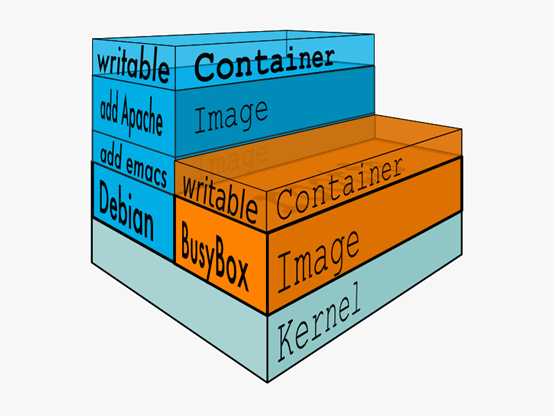
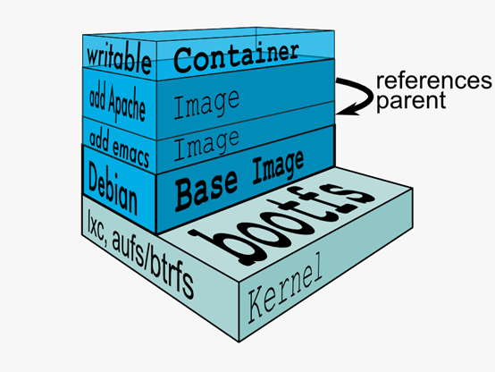
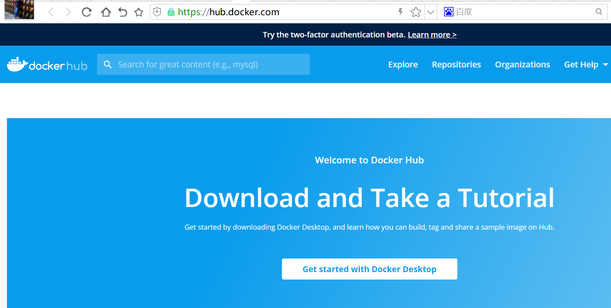
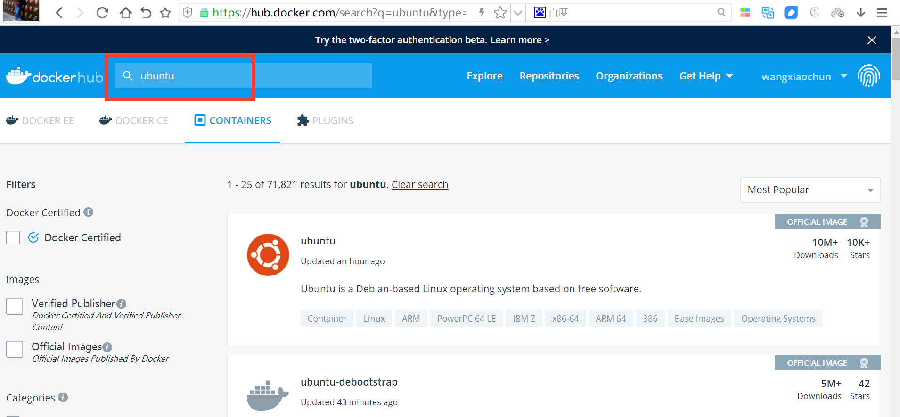
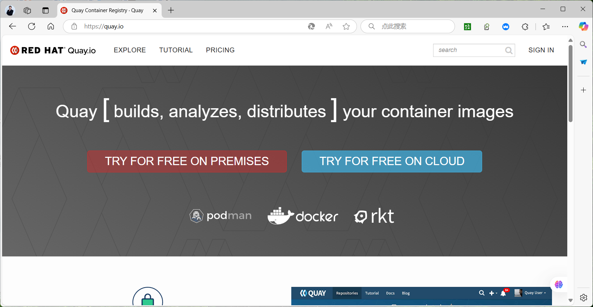
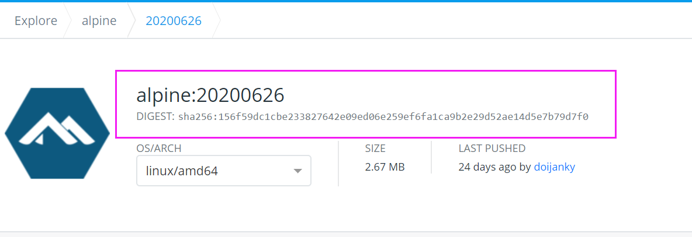
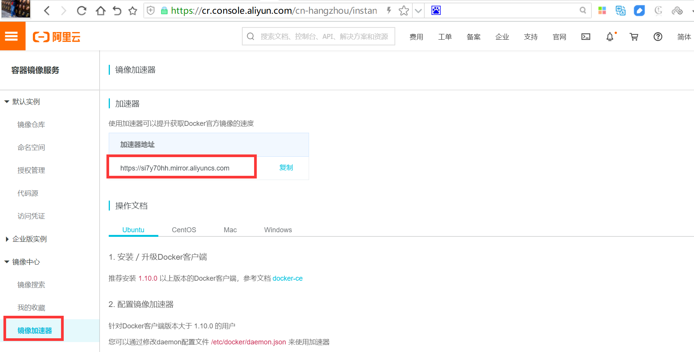
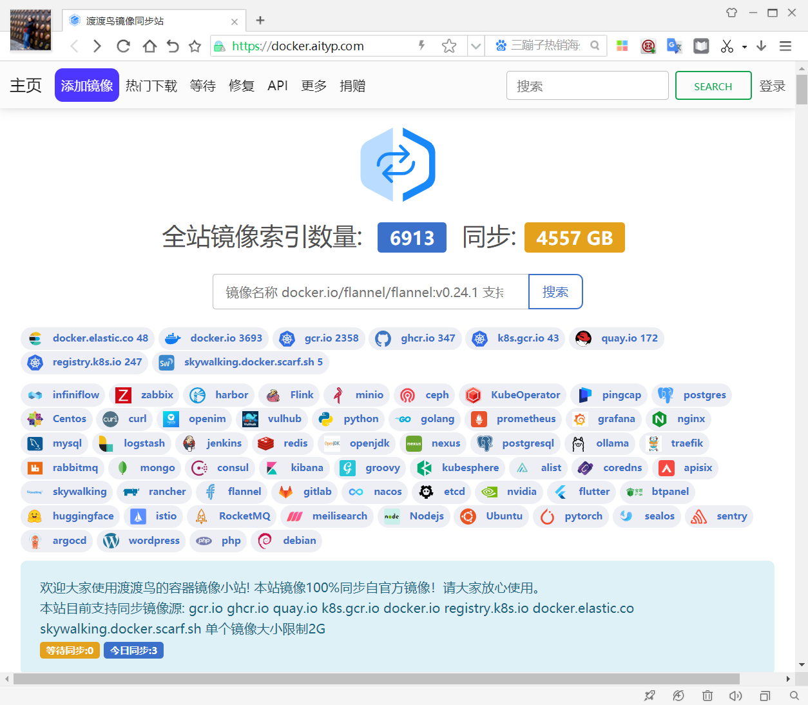
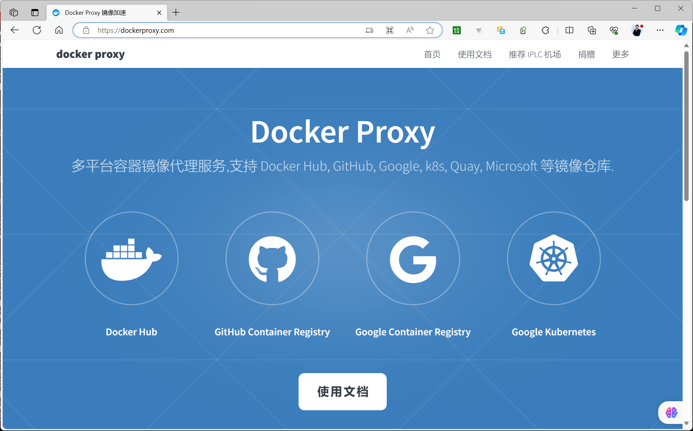
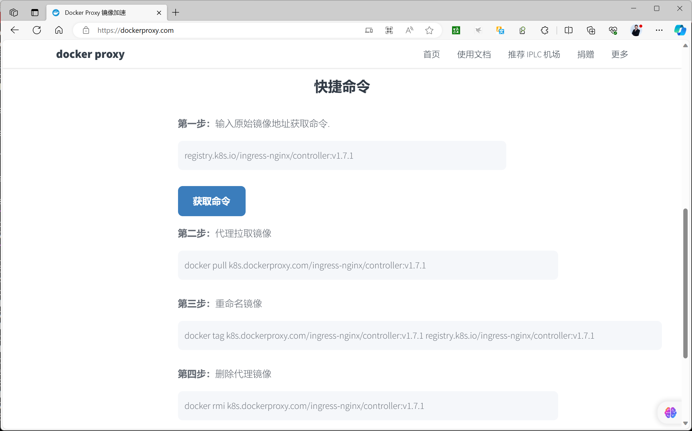

[← 返回Docker 容器技术目录]({{ '/subjects/Docker/' | relative_url }})



# 03 容器镜像管理
### 1.3 容器镜像管理

### 镜像结构和原理


镜像即创建容器的模版，含有启动容器所需要的文件系统及所需要的内容，因此镜像主要用于方便和快速的创建并启动容器

镜像含里面是一层层的文件系统,叫做 Union FS（联合文件系统）,联合文件系统，可以将几层目录挂载到一起（就像千层饼，洋葱头，俄罗斯套娃一样），形成一个虚拟文件系统,虚拟文件系统的目录结构就像普通 linux 的目录结构一样，镜像通过这些文件再加上宿主机的内核共同提供了一个 linux 的虚拟环境，每一层文件系统叫做一层 layer，联合文件系统可以对每一层文件系统设置三种权限，只读 （readonly）、读写（readwrite）和写出（whiteout-able），但是镜像中每一层文件系统都是只读的, 构建镜像的时候，从一个最基本的操作系统开始，每个构建提交的操作都相当于做一层的修改，增加了一层文件系统，一层层往上叠加，上层的修改会覆盖底层该位置的可见性，这也很容易理解，就像上层把底层遮住了一样，当使用镜像的时候，我们只会看到一个完全的整体，不知道里面有几层,实际上也不需要知道里面有几层，结构如下:



一个典型的 Linux文件系统由 bootfs 和 rootfs 两部分组成

bootfs(boot file system) 主要包含bootloader和kernel，bootloader主要用于引导加载 kernel，Linux 刚启动时会加载bootfs文件系统,当boot加载完成后,kernel 被加载到内存中后接管系统的控制权,bootfs 会被 umount 掉

rootfs (root file system) 包含的就是典型 Linux 系统中的/dev，/proc，/bin，/etc 等标准目录和文件， 不同的 linux 发行版（如 ubuntu 和 CentOS ) 主要在 rootfs 这一层会有所区别。

一般的镜像通常都比较小，官方提供的Ubuntu镜像只有60MB多点，而 CentOS 基础镜像也只有200MB 左右，一些其他版本的镜像甚至只有几MB，比如:  busybox 才1.22MB，alpine镜像也只有5M左右。镜像直接调用宿主机的内核，镜像中只提供 rootfs，也就是只需要包括最基本的命令,配置文件和程序库等相关文件就可以了。

下图就是有两个不同的镜像在一个宿主机内核上实现不同的rootfs。


容器、镜像和父镜像关系:



范例:  查看镜像的分层结构

```xml
[root@ubuntu1804 ~]#docker pull nginx
Using default tag: latest
latest: Pulling from library/nginx
8ec398bc0356: Pull complete
a53c868fbde7: Pull complete
79daf9dd140d: Pull complete
Digest: sha256:70821e443be75ea38bdf52a974fd2271babd5875b2b1964f05025981c75a6717
Status: Downloaded newer image for nginx:latest
docker.io/library/nginx:latest
#查看镜像分层历史
[root@ubuntu1804 ~]#docker image  history nginx
IMAGE               CREATED             CREATED BY
SIZE                COMMENT
0901fa9da894        9 days ago          /bin/sh -c #(nop)  CMD ["nginx" "-g"
"daemon…   0B
<missing>           9 days ago          /bin/sh -c #(nop)  STOPSIGNAL SIGTERM
0B
<missing>           9 days ago          /bin/sh -c #(nop)  EXPOSE 80
0B
<missing>           9 days ago          /bin/sh -c #(nop)  ENTRYPOINT ["/docker-
entr…   0B
<missing>           9 days ago          /bin/sh -c #(nop) COPY
file:0fd5fca330dcd6a7…   1.04kB
<missing>           9 days ago          /bin/sh -c #(nop) COPY
file:1d0a4127e78a26c1…   1.96kB
<missing>           9 days ago          /bin/sh -c #(nop) COPY
file:e7e183879c35719c…   1.2kB
<missing>           9 days ago          /bin/sh -c set -x     && addgroup --
system -…   63.3MB
<missing>           9 days ago          /bin/sh -c #(nop)  ENV
PKG_RELEASE=1~buster     0B
<missing>           9 days ago          /bin/sh -c #(nop)  ENV NJS_VERSION=0.4.2
0B
<missing>           9 days ago          /bin/sh -c #(nop)  ENV
NGINX_VERSION=1.19.1     0B
<missing>           5 weeks ago         /bin/sh -c #(nop)  LABEL
maintainer=NGINX Do…   0B
<missing>           5 weeks ago         /bin/sh -c #(nop)  CMD ["bash"]
0B
<missing>           5 weeks ago         /bin/sh -c #(nop) ADD
file:4d35f6c8bbbe6801c…   69.2MB
[root@ubuntu1804 ~]#docker inspect nginx
[
{
"Id":
"sha256:0901fa9da894a8e9de5cb26d6749eaffb67b373dc1ff8a26c46b23b1175c913a",
"RepoTags": [
"nginx:latest"
],
"RepoDigests": [
"nginx@sha256:a93c8a0b0974c967aebe868a186e5c205f4d3bcb5423a56559f2f9599074bbcd"
],
"Parent": "",
"Comment": "",
"Created": "2020-07-10T20:26:44.624785651Z",
"Container":
"348c3ade7f4bdc0366f3f390ea4cfaebfb355ad7d621547eaf73728136d3bd2d",
"ContainerConfig": {
"Hostname": "348c3ade7f4b",
"Domainname": "",
"User": "",
"AttachStdin": false,
"AttachStdout": false,
"AttachStderr": false,
"ExposedPorts": {
"80/tcp": {}
},
"Tty": false,
"OpenStdin": false,
"StdinOnce": false,
"Env": [
"PATH=/usr/local/sbin:/usr/local/bin:/usr/sbin:/usr/bin:/sbin:/bin",
"NGINX_VERSION=1.19.1",
"NJS_VERSION=0.4.2",
"PKG_RELEASE=1~buster"
],
"Cmd": [
"/bin/sh",
"-c",
"#(nop) ",
"CMD [\"nginx\" \"-g\" \"daemon off;\"]"
],
"ArgsEscaped": true,
"Image":
"sha256:8a6dfc8c21a1b3f3679b7755fc7869a22b5f8583778cf7835b5ee5387a73ae5e",
"Volumes": null,
"WorkingDir": "",
"Entrypoint": [
"/docker-entrypoint.sh"
],
"OnBuild": null,
"Labels": {
"maintainer": "NGINX Docker Maintainers <docker-
maint@nginx.com>"
},
"StopSignal": "SIGTERM"
},
"DockerVersion": "18.09.7",
"Author": "",
"Config": {
"Hostname": "",
"Domainname": "",
"User": "",
"AttachStdin": false,
"AttachStdout": false,
"AttachStderr": false,
"ExposedPorts": {
"80/tcp": {}
},
"Tty": false,
"OpenStdin": false,
"StdinOnce": false,
"Env": [
"PATH=/usr/local/sbin:/usr/local/bin:/usr/sbin:/usr/bin:/sbin:/bin",
"NGINX_VERSION=1.19.1",
"NJS_VERSION=0.4.2",
"PKG_RELEASE=1~buster"
],
"Cmd": [
"nginx",
"-g",
"daemon off;"
],
"ArgsEscaped": true,
"Image":
"sha256:8a6dfc8c21a1b3f3679b7755fc7869a22b5f8583778cf7835b5ee5387a73ae5e",
"Volumes": null,
"WorkingDir": "",
"Entrypoint": [
"/docker-entrypoint.sh"
],
"OnBuild": null,
"Labels": {
"maintainer": "NGINX Docker Maintainers <docker-
maint@nginx.com>"
},
"StopSignal": "SIGTERM"
},
"Architecture": "amd64",
"Os": "linux",
"Size": 132484492,
"VirtualSize": 132484492,
"GraphDriver": {
"Data": {
"LowerDir":
"/var/lib/docker/overlay2/87dfa2bbff4f392e64e8a2fce11e2d9b8c3fffcfd51c6721ef0103
f7d6b525aa/diff:/var/lib/docker/overlay2/925c1a9c01939d111b3f0576608ad02a09bceea
fb6cad8dd616c24a59151bb25/diff:/var/lib/docker/overlay2/b9fd33e18d7bb7bb29b51ee3
99dfe3f21654fa4a9a086e02dcbc23f34f140c09/diff:/var/lib/docker/overlay2/35c6b8c39
68cdc21b78d4bcd6c192683b47db788db612dee04c5110037eed7af/diff",
"MergedDir":
"/var/lib/docker/overlay2/23d3c6ecee136afe7137528b0e6997a488b1f277e86c794fa9a70b
5638a5d3f9/merged",
"UpperDir":
"/var/lib/docker/overlay2/23d3c6ecee136afe7137528b0e6997a488b1f277e86c794fa9a70b
5638a5d3f9/diff",
"WorkDir":
"/var/lib/docker/overlay2/23d3c6ecee136afe7137528b0e6997a488b1f277e86c794fa9a70b
5638a5d3f9/work"
},
"Name": "overlay2"
},
"RootFS": {
"Type": "layers",
"Layers": [
"sha256:13cb14c2acd34e45446a50af25cb05095a17624678dbafbcc9e26086547c1d74",
"sha256:0e32546a8af0cd04ad451d6a9d22e650e500e5da3636a32648c9f5aca96a0ff7",
"sha256:7ef35766ef7d5d3d958022405b308d5c105b41190e1b63b2037c4055c6950c9e",
"sha256:4856db5e4f59384c413c20c46cd5403a860e1b07c8fdbad24df1ffd9209d44e7",
"sha256:2808ec4a8ea71c2660284d06cf7e25354b70b58504edb46ac3e705fb7e6ea519"
]
},
"Metadata": {
"LastTagTime": "0001-01-01T00:00:00Z"
}
}
]
```

```bash
[root@ubuntu1804 ~]#docker save nginx -o nginx.tar
[root@ubuntu1804 ~]#docker images
REPOSITORY          TAG                 IMAGE ID            CREATED
SIZE
nginx               latest              0901fa9da894        3 days ago
127MB
alpine              3.11.3              e7d92cdc71fe        7 days ago
5.59MB
centos              centos8.1.1911      470671670cac        7 days ago
237MB
busybox             latest              6d5fcfe5ff17        4 weeks ago
1.22MB
hello-world         latest              fce289e99eb9        12 months ago
1.84kB
[root@ubuntu1804 ~]#ll -h nginx.tar
-rw------- 1 root root 131M Jul 20 22:33 nginx.tar
[root@ubuntu1804 ~]#tar xf nginx.tar  -C /data
[root@ubuntu1804 ~]#ll /data
total 60
drwxr-xr-x  8 root root  4096 Jul 20 22:34 ./
drwxr-xr-x 24 root root  4096 Jul 20 16:23 ../
-rw-r--r--  1 root root  7510 Jul 11 04:26
0901fa9da894a8e9de5cb26d6749eaffb67b373dc1ff8a26c46b23b1175c913a.json
drwxr-xr-x  2 root root  4096 Jul 11 04:26
0bb74fcd4b686412f7993916e58c26abd155fa10b10a4dc09a778e7c324c39a2/
drwxr-xr-x  2 root root  4096 Jul 11 04:26
517e3239147277447b60191907bc66168963e0ce8707a6a33532f7c63a0d2f12/
drwxr-xr-x  2 root root  4096 Jul 11 04:26
68c9e9da52d5a57ee196829ce4a461cc9425b0b920689da9ad547f1da13dbc9d/
drwxr-xr-x  2 root root  4096 Jul 11 04:26
d2cf0fc540bb3be33ee7340498c41fd4fc82c6bb02b9955fca2109e599301dbd/
drwxr-xr-x  2 root root  4096 Jul 11 04:26
f4bf863ecdbb8bddb4b3bb271bdd97b067dcb6c95c56f720018abec6af190c6e/
drwx------  2 root root 16384 Mar 18 09:49 lost+found/
-rw-r--r--  1 root root   509 Jan  1  1970 manifest.json
-rw-r--r--  1 root root    88 Jan  1  1970 repositories
```

```bash
[root@ubuntu1804 ~]#cat /data/manifest.json
[{"Config":"0901fa9da894a8e9de5cb26d6749eaffb67b373dc1ff8a26c46b23b1175c913a.jso
n","RepoTags":["nginx:latest"],"Layers":
["d2cf0fc540bb3be33ee7340498c41fd4fc82c6bb02b9955fca2109e599301dbd/layer.tar","f
4bf863ecdbb8bddb4b3bb271bdd97b067dcb6c95c56f720018abec6af190c6e/layer.tar","517e
3239147277447b60191907bc66168963e0ce8707a6a33532f7c63a0d2f12/layer.tar","0bb74fc
d4b686412f7993916e58c26abd155fa10b10a4dc09a778e7c324c39a2/layer.tar","68c9e9da52
d5a57ee196829ce4a461cc9425b0b920689da9ad547f1da13dbc9d/layer.tar"]}]
[root@ubuntu1804 ~]#du -sh /data/*
8.0K
/data/0901fa9da894a8e9de5cb26d6749eaffb67b373dc1ff8a26c46b23b1175c913a.json
16K /data/0bb74fcd4b686412f7993916e58c26abd155fa10b10a4dc09a778e7c324c39a2
16K /data/517e3239147277447b60191907bc66168963e0ce8707a6a33532f7c63a0d2f12
16K /data/68c9e9da52d5a57ee196829ce4a461cc9425b0b920689da9ad547f1da13dbc9d
70M /data/d2cf0fc540bb3be33ee7340498c41fd4fc82c6bb02b9955fca2109e599301dbd
62M /data/f4bf863ecdbb8bddb4b3bb271bdd97b067dcb6c95c56f720018abec6af190c6e
16K /data/lost+found
4.0K    /data/manifest.json
4.0K    /data/repositories
[root@ubuntu1804 ~]#cd
/data/d2cf0fc540bb3be33ee7340498c41fd4fc82c6bb02b9955fca2109e599301dbd/
[root@ubuntu1804
d2cf0fc540bb3be33ee7340498c41fd4fc82c6bb02b9955fca2109e599301dbd]#ls
json  layer.tar  VERSION
[root@ubuntu1804
d2cf0fc540bb3be33ee7340498c41fd4fc82c6bb02b9955fca2109e599301dbd]#tar xf
layer.tar
[root@ubuntu1804
d2cf0fc540bb3be33ee7340498c41fd4fc82c6bb02b9955fca2109e599301dbd]#ls
bin   dev  home  layer.tar  lib64  mnt  proc  run   srv  tmp  var
boot  etc  json  lib        media  opt  root  sbin  sys  usr  VERSION
[root@ubuntu1804
d2cf0fc540bb3be33ee7340498c41fd4fc82c6bb02b9955fca2109e599301dbd]#cat etc/i
init.d/    issue      issue.net
[root@ubuntu1804
d2cf0fc540bb3be33ee7340498c41fd4fc82c6bb02b9955fca2109e599301dbd]#cat etc/issue
Debian GNU/Linux 10 \n \l
```

### 搜索镜像

### 搜索镜像

1.3.2.1.1 官方网站进行镜像的搜索

docker 官网:

<http://hub.docker.com>

<http://dockerhub.com>

<https://hub-stage.docker.com/>





在官方的docker 仓库中搜索指定名称的docker镜像，也会有很多三方镜像。

第三方仓库

```text
https://quay.io/ #红帽公司维护
https://registry.k8s.io  #kubernetes 仓库
http://cr.console.aliyun.com #阿里云仓库
```



1.3.2.2.2 执行docker search命令进行搜索

格式如下:

```text
Usage:  docker search [OPTIONS] TERM
Options:
-f, --filter filter   Filter output based on conditions provided
--format string   Pretty-print search using a Go template
--limit int       Max number of search results (default 25)
--no-trunc        Don't truncate output
说明:
OFFICIAL:  官方
AUTOMATED:  使用第三方docker服务来帮助编译镜像，可以在互联网上面直接拉取到镜像，减少了繁琐的
编译过程
```

范例:

```bash
[root@ubuntu1804 ~]#docker search centos
NAME                               DESCRIPTION
STARS               OFFICIAL            AUTOMATED
centos                             The official build of CentOS.
5786                [OK]
ansible/centos7-ansible            Ansible on Centos7
126                                     [OK]
jdeathe/centos-ssh                 OpenSSH / Supervisor / EPEL/IUS/SCL Repos - …
114                                     [OK]
consol/centos-xfce-vnc             Centos container with "headless" VNC session…
108                                     [OK]
centos/mysql-57-centos7            MySQL 5.7 SQL database server
67
imagine10255/centos6-lnmp-php56    centos6-lnmp-php56
57                                      [OK]
tutum/centos                       Simple CentOS docker image with SSH access
44
centos/postgresql-96-centos7       PostgreSQL is an advanced Object-Relational …
40
centos/httpd-24-centos7            Platform for running Apache httpd 2.4 or bui…
29
kinogmt/centos-ssh                 CentOS with SSH
29                                      [OK]
pivotaldata/centos-gpdb-dev        CentOS image for GPDB development. Tag names…
10
drecom/centos-ruby                 centos ruby
6                                       [OK]
centos/tools                       Docker image that has systems administration…
5                                       [OK]
mamohr/centos-java                 Oracle Java 8 Docker image based on Centos 7
3                                       [OK]
darksheer/centos                   Base Centos Image -- Updated hourly
3                                       [OK]
pivotaldata/centos                 Base centos, freshened up a little with a Do…
3
pivotaldata/centos-mingw           Using the mingw toolchain to cross-compile t…
2
miko2u/centos6                     CentOS6 日本??境
2                                       [OK]
pivotaldata/centos-gcc-toolchain   CentOS with a toolchain, but unaffiliated wi…
2
indigo/centos-maven                Vanilla CentOS 7 with Oracle Java Developmen…
1                                       [OK]
mcnaughton/centos-base             centos base image
1                                       [OK]
blacklabelops/centos               CentOS Base Image! Built and Updates Daily!
1                                       [OK]
pivotaldata/centos6.8-dev          CentosOS 6.8 image for GPDB development
0
pivotaldata/centos7-dev            CentosOS 7 image for GPDB development
0
smartentry/centos                  centos with smartentry
0                                       [OK]
[root@ubuntu1804 ~]#
```

范例:  选择性的查找镜像

```bash
#搜索点赞100个以上的镜像
#旧语法
[root@ubuntu1804 ~]#docker search -s 100  centos
Flag --stars has been deprecated, use --filter=stars=3 instead
......
#新语法
[root@ubuntu1804 ~]#docker  search --filter=stars=100 centos
NAME                      DESCRIPTION                                     STARS
OFFICIAL            AUTOMATED
centos                    The official build of CentOS.                   6096
[OK]
ansible/centos7-ansible   Ansible on Centos7                              132
[OK]
consol/centos-xfce-vnc    Centos container with "headless" VNC session…   117
[OK]
jdeathe/centos-ssh        OpenSSH / Supervisor / EPEL/IUS/SCL Repos - …   115
[OK]
```

### Alpine 介绍


Alpine 操作系统是一个面向安全的轻型 Linux 发行版。它不同于通常 Linux 发行版，Alpine 采用了 musl libc 和 busybox 以减小系统的体积和运行时资源消耗，但功能上比 busybox 又完善的多，因此得到开源社区越来越多的青睐。在保持瘦身的同时，Alpine 还提供了自己的包管理工具 apk，可以通过 ht tps://pkgs.alpinelinux.org/packages 网站上查询包信息，也可以直接通过 apk 命令直接查询和安装各种软件。

Alpine 由非商业组织维护的，支持广泛场景的 Linux发行版，它特别为资深/重度Linux用户而优化，关注安全，性能和资源效能。Alpine 镜像可以适用于更多常用场景，并且是一个优秀的可以适用于生产的基础系统/环境。

Alpine Docker 镜像也继承了 Alpine Linux 发行版的这些优势。相比于其他 Docker 镜像，它的容量非常小，仅仅只有 5 MB 左右（对比 Ubuntu 系列镜像接近 200 MB），且拥有非常友好的包管理机制。 官方镜像来自 docker-alpine 项目。

目前 Docker 官方已开始推荐使用 Alpine 替代之前的 Ubuntu 做为基础镜像环境。这样会带来多个好处。包括镜像下载速度加快，镜像安全性提高，主机之间的切换更方便，占用更少磁盘空间等。

下表是官方镜像的大小比较:

```text
REPOSITORY          TAG           IMAGE ID          VIRTUAL SIZE
busybox             latest        beae173ccac6      1.24MB
alpine              latest        4e38e38c8ce0      4.799 MB
debian              latest        4d6ce913b130      84.98 MB
ubuntu              latest        b39b81afc8ca      188.3 MB
centos              latest        8efe422e6104      210 MB
```

Alpine 官网:  https://www.alpinelinux.org/Alpine 官方仓库:  https://github.com/alpinelinux Alpine 官方镜像:  https://hub.docker.com/_/alpine/Alpine 官方镜像仓库:  https://github.com/gliderlabs/docker-alpine Alpine 阿里云的镜像仓库:  https://mirrors.aliyun.com/alpine/

范例:  alpine 管理软件

```bash
/ # cat /etc/apk/repositories
https://dl-cdn.alpinelinux.org/alpine/v3.15/main
https://dl-cdn.alpinelinux.org/alpine/v3.15/community
[root@ubuntu2204 ~]#sed -i 's/dl-cdn.alpinelinux.org/mirrors.ustc.edu.cn/'
/etc/apk/repositories
#修改源替换成阿里源，将里面 dl-cdn.alpinelinux.org 的 改成 mirrors.aliyun.com
vi /etc/apk/repositories
https://mirrors.ustc.edu.cn/alpine/v3.16/main
https://mirrors.ustc.edu.cn/alpine/v3.16/community
http://mirrors.aliyun.com/alpine/v3.8/main/
http://mirrors.aliyun.com/alpine/v3.8/community/
```

```bash
[root@ubuntu2204 ~]#sed -i 's/mirrors.aliyun.com/mirrors.ustc.edu.cn/'
repositories
[root@ubuntu2204 ~]#docker cp repositories  alpine-image-
3.16.2:/etc/apk/repositories
#更新源
apk update = apt update
#安装软件
apk add vim = apt install vim
#删除软件
apk del openssh openntp vim = apt remove openssh
#安装常见软件
apk update && apk --no-cache add bash curl telnet  wget net-tools pstree  zip
unzip
#安装常用编译工具
apk update && apk --no-cache add gcc make curl zip unzip net-tools pstree wget
libgcc libc-dev libcurl libc-utils pcre-dev zlib-dev  libnfs  pcre pcre2 libevent
libevent-dev iproute2
#修改时区
apk update && apk --no-cache add tzdata  && ln -s
/usr/share/zoneinfo/Asia/Shanghai /etc/localtime && echo "Asia/Shanghai" >
/etc/timezone
```

范例:

```sql
/ # apk --help
apk-tools 2.10.4, compiled for x86_64.
Installing and removing packages:
add       Add PACKAGEs to 'world' and install (or upgrade) them, while
ensuring that all dependencies are met
del       Remove PACKAGEs from 'world' and uninstall them
System maintenance:
fix       Repair package or upgrade it without modifying main dependencies
update    Update repository indexes from all remote repositories
upgrade   Upgrade currently installed packages to match repositories
cache     Download missing PACKAGEs to cache and/or delete unneeded files from
cache
Querying information about packages:
info      Give detailed information about PACKAGEs or repositories
list      List packages by PATTERN and other criteria
dot       Generate graphviz graphs
policy    Show repository policy for packages
Repository maintenance:
index     Create repository index file from FILEs
fetch     Download PACKAGEs from global repositories to a local directory
verify    Verify package integrity and signature
manifest  Show checksums of package contents
Use apk <command> --help for command-specific help.
Use apk --help --verbose for a full command listing.
This apk has coffee making abilities.
/ # apk add  nginx
/ # apk info nginx
nginx-1.16.1-r6 description:
HTTP and reverse proxy server (stable version)
nginx-1.16.1-r6 webpage:
https://www.nginx.org/
nginx-1.16.1-r6 installed size:
1126400
~ # apk manifest nginx
sha1:d21a96358a10b731f8847e6d32799efdc2a7f421  etc/logrotate.d/nginx
sha1:50bd6d3b4f3e6b577d852f12cd6939719d2c2db5  etc/init.d/nginx
sha1:379c1e2a2a5ffb8c91a07328d4c9be2bc58799fd  etc/nginx/scgi_params
sha1:da38e2a0dded838afbe0eade6cb837ac30fd8046  etc/nginx/fastcgi_params
sha1:cc2fcdb4605dcac23d59f667889ccbdfdc6e3668  etc/nginx/uwsgi_params
sha1:cbf596ddb3433a8e0d325f3c188bec9c1bb746b3  etc/nginx/fastcgi.conf
sha1:e39dbc36680b717ec902fadc805a302f1cf62245  etc/nginx/mime.types
sha1:e9dddf20f1196bb67eef28107438b60c4060f4d3  etc/nginx/nginx.conf
sha1:7b2a4da1a14166442c10cbf9e357fa9fb53542ca  etc/nginx/conf.d/default.conf
sha1:cd7f5dc8ccdc838a2d0107511c90adfe318a81e7  etc/conf.d/nginx
sha1:05f050f6ed86c5e6b48c2d2328e81583315431be  usr/sbin/nginx
sha1:c3f02ca81f7f2c6bde3f878b3176f225c7781c7d  var/lib/nginx/modules
sha1:0510312d465b86769136983657df98c1854f0b60  var/lib/nginx/run
sha1:35db17c18ce0b9f84a3cc113c8a9e94e19f632b1  var/lib/nginx/logs
sha1:7dd71afcfb14e105e80b0c0d7fce370a28a41f0a  var/lib/nginx/html/index.html
sha1:95de71d58b37f9f74bede0e91bc381d6059fc2d7  var/lib/nginx/html/50x.html
~ # ls -l /bin
total 824
lrwxrwxrwx    1 root     root            12 Jan 16 21:52 arch -> /bin/busybox
lrwxrwxrwx    1 root     root            12 Jan 16 21:52 ash -> /bin/busybox
lrwxrwxrwx    1 root     root            12 Jan 16 21:52 base64 -> /bin/busybox
lrwxrwxrwx    1 root     root            12 Jan 16 21:52 bbconfig ->
/bin/busybox
-rwxr-xr-x    1 root     root        841288 Jan 15 10:36 busybox
lrwxrwxrwx    1 root     root            12 Jan 16 21:52 cat -> /bin/busybox
lrwxrwxrwx    1 root     root            12 Jan 16 21:52 chgrp -> /bin/busybox
lrwxrwxrwx    1 root     root            12 Jan 16 21:52 chmod -> /bin/busybox
lrwxrwxrwx    1 root     root            12 Jan 16 21:52 chown -> /bin/busybox
```

### Debian(ubuntu)系统建议安装的基础包

在很多软件官方提供的镜像都使用的是Debian(ubuntu)的系统,比如:nginx,tomcat,mysql,httpd 等,但镜像内缺少很多常用的调试工具.当需要进入容器内进行调试管理时,可以安装以下常用工具包

```bash
# apt update                #安装软件前需要先更新索引
# apt install procps        #提供top,ps,free等命令
# apt install psmisc        #提供pstree,killall等命令
# apt install iputils-ping  #提供ping命令
# apt install net-tools     #提供netstat网络工具等
```

### 下载镜像

从 docker 仓库将镜像下载到本地，命令格式如下:

```text
docker pull [OPTIONS] NAME[:TAG|@DIGEST]
Options:
-a, --all-tags                Download all tagged images in the repository
--disable-content-trust   Skip image verification (default true)
--platform string         Set platform if server is multi-platform capable
-q, --quiet                   Suppress verbose output
```

```text
NAME: 是镜像名,格式:仓库服务器:端口/项目名称/镜像名称，仓库服务器:端口/项目名称/可以省略，默认
docker.io/library/
TAG: 即版本号,如果不指定:TAG,则下载最新版镜像,即latest
```

镜像下载说明

```bash
[root@ubuntu1804 ~]#docker pull hello-world
Using default tag: latest   #默认下载最新版本
latest: Pulling from library/hello-world
1b930d010525: Pull complete  #分层下载
Digest: sha256:9572f7cdcee8591948c2963463447a53466950b3fc15a247fcad1917ca215a2f
#摘要
Status: Downloaded newer image for hello-world:latest
docker.io/library/hello-world:latest  #下载的完整地址
```

镜像下载保存的路径:

```text
/var/lib/docker/overlay2/镜像ID
```

注意:  镜像下载完成后，会自动解压缩，比官网显示的可能会大很多，如:   centos8.1.1911下载时只有 70MB，下载完后显示237MB

范例:  从docker官网下载镜像

```text
docker pull hello-world
docker pull alpine
docker pull busybox
docker pull nginx
docker pull centos
docker pull centos:centos7.7.1908
docker pull docker.io/library/mysql:5.7.30
docker pull mysql:5.6.47
```

范例:  下载镜像 alpine,busybox等镜像,查看下载的存放目录

```bash
[root@ubuntu1804 ~]#ls /var/lib/docker/overlay2/
l
[root@ubuntu1804 ~]#du -sh /var/lib/docker/overlay2
8.0K    /var/lib/docker/overlay2
[root@ubuntu1804 ~]#ls /var/lib/docker/overlay2/l
[root@ubuntu1804 ~]#docker pull hello-world
[root@ubuntu1804 ~]#docker pull alpine:3.11.3
3.11.3: Pulling from library/alpine
c9b1b535fdd9: Pull complete
Digest: sha256:ab00606a42621fb68f2ed6ad3c88be54397f981a7b70a79db3d1172b11c4367d
Status: Downloaded newer image for alpine:3.11.3
docker.io/library/alpine:3.11.3
[root@ubuntu1804 ~]#docker pull busybox
Using default tag: latest
latest: Pulling from library/busybox
bdbbaa22dec6: Pull complete
Digest: sha256:6915be4043561d64e0ab0f8f098dc2ac48e077fe23f488ac24b665166898115a
Status: Downloaded newer image for busybox:latest
docker.io/library/busybox:latest
[root@ubuntu1804 ~]#docker pull centos:centos8.1.1911
centos8.1.1911: Pulling from library/centos
8a29a15cefae: Pull complete
Digest: sha256:fe8d824220415eed5477b63addf40fb06c3b049404242b31982106ac204f6700
Status: Downloaded newer image for centos:centos8.1.1911
docker.io/library/centos:centos8.1.1911
[root@ubuntu1804 ~]#du -sh /var/lib/docker/overlay2/*
5.9M
/var/lib/docker/overlay2/1802616f4c8e0a0b52c839431b6faa8ac21f4bd831548dcbd46943d
3f60061fa
16K
/var/lib/docker/overlay2/5773b92e1351da5e589d0573d9f22d1ec3be1e0e98edbfcddba4b83
0f12c7be2
1.3M
/var/lib/docker/overlay2/de31641b8d2207de7f08eabb5240474a1aaccfef08b6034dcee02b9
623f8d9dc
252M
/var/lib/docker/overlay2/f41df336075611f9e358e5eaf2ebd5089920a90ba68760cdec8da03
edff362f7
20K /var/lib/docker/overlay2/l
[root@ubuntu1804 ~]#docker images
REPOSITORY          TAG                 IMAGE ID            CREATED
SIZE
alpine              3.11.3              e7d92cdc71fe        7 days ago
5.59MB
centos              centos8.1.1911      470671670cac        7 days ago
237MB
busybox             latest              6d5fcfe5ff17        4 weeks ago
1.22MB
hello-world         latest              fce289e99eb9        12 months ago
1.84kB
[root@ubuntu1804 ~]#ls -l  /var/lib/docker/overlay2/l
total 16
lrwxrwxrwx 1 root root 72 Jan 25 19:51 C5ZTDYHYDTO7BQG6HX36MU6X5K ->
../de31641b8d2207de7f08eabb5240474a1aaccfef08b6034dcee02b9623f8d9dc/diff
lrwxrwxrwx 1 root root 72 Jan 25 19:57 DEXHVNUGFLFJCSJAKISOHQG7JY ->
../f41df336075611f9e358e5eaf2ebd5089920a90ba68760cdec8da03edff362f7/diff
lrwxrwxrwx 1 root root 72 Jan 25 19:51 KJ5IA5AUHFUEQXFKJA7UDUIA7A ->
../1802616f4c8e0a0b52c839431b6faa8ac21f4bd831548dcbd46943d3f60061fa/diff
lrwxrwxrwx 1 root root 72 Jan 25 19:51 ZM3U4WDNHGJJX5DXHA5M4ZWAIW ->
../5773b92e1351da5e589d0573d9f22d1ec3be1e0e98edbfcddba4b830f12c7be2/diff
```

范例:   指定 TAG下载特定版本的镜像

```bash
[root@ubuntu1804 ~]#docker pull docker.io/library/mysql:5.7.30
5.7.29: Pulling from library/mysql
804555ee0376: Pull complete
c53bab458734: Pull complete
ca9d72777f90: Pull complete
2d7aad6cb96e: Pull complete
8d6ca35c7908: Pull complete
6ddae009e760: Pull complete
327ae67bbe7b: Pull complete
9e05241b7707: Pull complete
e822978df8f0: Pull complete
14ca71ed53be: Pull complete
026afe6fd35e: Pull complete
Digest: sha256:2ca675966612f34b4036bbcfa68cb049c03e34b561fba0f88954b03931823d29
Status: Downloaded newer image for mysql:5.7.30
docker.io/library/mysql:5.7.30
[root@ubuntu1804 ~]#docker pull mysql:5.6.47
```

范例： 下载公有云的镜像

```bash
[root@ubuntu2204 ~]#docker pull registry.cn-
beijing.aliyuncs.com/bowenxiaochun/alpine:3.20.
```

范例: 指定DIGEST下载特定版本的镜像

先到 hub.docker.com查到指定版本的DIGEST



```bash
[root@ubuntu1804 ~]#docker pull
alpine@sha256:156f59dc1cbe233827642e09ed06e259ef6fa1ca9b2e29d52ae14d5e7b79d7f0
sha256:156f59dc1cbe233827642e09ed06e259ef6fa1ca9b2e29d52ae14d5e7b79d7f0: Pulling
from library/alpine
5d2415897100: Pull complete
Digest: sha256:156f59dc1cbe233827642e09ed06e259ef6fa1ca9b2e29d52ae14d5e7b79d7f0
Status: Downloaded newer image for
alpine@sha256:156f59dc1cbe233827642e09ed06e259ef6fa1ca9b2e29d52ae14d5e7b79d7f0
docker.io/library/alpine@sha256:156f59dc1cbe233827642e09ed06e259ef6fa1ca9b2e29d5
2ae14d5e7b79d7f0
[root@ubuntu1804 ~]#docker images
REPOSITORY          TAG                 IMAGE ID            CREATED
SIZE
alpine              <none>              3c791e92a856        3 weeks ago
5.57MB
```

### 镜像加速配置和优化

docker 镜像官方的下载站点是:  https://hub.docker.com/


从国内下载官方的镜像站点有时候会很慢，因此可以更改docker配置文件添加一个加速器，可以通过加速器达到加速下载镜像的目的

国内有许多公司都提供了docker 加速镜像，比如:  阿里云，腾讯云，网易云，以下以阿里云为例

### 阿里云获取加速地址

浏览器打开http://cr.console.aliyun.com，注册或登录阿里云账号，点击左侧的镜像加速器，将会得到一个专属的加速地址，而且下面有使用配置说明:



### Docker 镜像加速配置

```json
1. 安装／升级Docker客户端
推荐安装1.10.0以上版本的Docker客户端，参考文档 docker-ce
2. 配置镜像加速器
修改daemon配置文件/etc/docker/daemon.json来使用加速器
mkdir -p /etc/docker
tee /etc/docker/daemon.json <<-'EOF'
{
"registry-mirrors": ["https://docker.mirrors.ustc.edu.cn",
"http://hub-mirror.c.163.com/","https://si7y70hh.mirror.aliyuncs.com"],
"live-restore": true, #docker服务重启,不会重启容器,
"graph": "/data/docker"，  #指定docker数据目录
"insecure-registries": ["harbor.bowen.org"]
}
EOF
#网易云:  http://hub-mirror.c.163.com/
#中科大:  https://docker.mirrors.ustc.edu.cn
#腾讯云:  https://mirror.ccs.tencentyun.com
#七牛云:  https://reg-mirror.qiniu.com
systemctl daemon-reload
systemctl restart docker
```

范例:   利用阿里云实现镜像加速

```json
[root@ubuntu1804 ~]#docker info |tail
WARNING: the overlay storage-driver is deprecated, and will be removed in a
future release.
ID: IZHJ:WPIN:BRMC:XQUI:VVVR:UVGK:NZBM:YQXT:JDWB:33RS:45V7:SQWJ
Docker Root Dir: /var/lib/docker
Debug Mode: false
Registry: https://index.docker.io/v1/
Labels:
Experimental: false
Insecure Registries:
127.0.0.0/8
Live Restore Enabled: false
[root@ubuntu1804 ~]#vim /etc/docker/daemon.json
[root@ubuntu1804 ~]#cat /etc/docker/daemon.json
{
"storage-driver": "overlay",
"registry-mirrors": ["https://si7y70hh.mirror.aliyuncs.com"]
}
[root@ubuntu1804 ~]#systemctl daemon-reload
[root@ubuntu1804 ~]#systemctl restart docker
[root@ubuntu1804 ~]#docker info |tail
WARNING: the overlay storage-driver is deprecated, and will be removed in a
future release.
Debug Mode: false
Registry: https://index.docker.io/v1/
Labels:
Experimental: false
Insecure Registries:
127.0.0.0/8
Registry Mirrors:
https://si7y70hh.mirror.aliyuncs.com/
Live Restore Enabled: false
[root@ubuntu1804 ~]
```

范例： 镜像加速器

```json
[root@ubuntu1804 ~]vim /etc/docker/daemon.json
{
"registry-mirrors" : [
"http://registry.docker-cn.com",
"http://docker.mirrors.ustc.edu.cn",
"http://hub-mirror.c.163.com"
],
"insecure-registries" : [
"registry.docker-cn.com",
"docker.mirrors.ustc.edu.cn"
],
"debug" : true,
"experimental" : true
}
```

### 查看本地镜像

docker images 可以查看下载至本地的镜像

<https://docs.docker.com/engine/reference/commandline/images/>

格式:

```text
docker images [OPTIONS] [REPOSITORY[:TAG]]
docker image ls [OPTIONS] [REPOSITORY[:TAG]]
#常用选项:
-q, --quiet         Only show numeric IDs
-a, --all           Show all images (default hides intermediate images)
--digests       Show digests
--no-trunc      Don't truncate output
-f, --filter filter   Filter output based on conditions provided
--format string   Pretty-print images using a Go template
```

执行结果的显示信息说明:

```text
REPOSITORY      #镜像所属的仓库名称
TAG             #镜像版本号（标识符），默认为latest
IMAGE ID        #镜像唯一ID标识,如果ID相同,说明是同一个镜像有多个名称
CREATED         #镜像在仓库中被创建时间
VIRTUAL SIZE    #镜像的大小
```

docker images --format命令用于指定在输出中显示映像信息的格式。格式字符串由多个占位符组成， 每个占位符代表映像的特定属性。

```text
#常用的格式占位符：Golang的模
{{.Repository}}：映像的仓库名称。
{{.Tag}}：映像的标签。
{{.ID}}：映像的ID。
{{.Digest}}：映像的摘要值。
{{.CreatedAt}}：映像的创建时间。
{{.Size}}：映像的大小。
#示例
docker images --format "{{.Repository}}\t{{.Tag}}\t{{.Size}}"
docker images --format "{{.CreatedAt}}\t{{.Repository}}:{{.Tag}}" | sort -k 1 -r
```

Repository仓库

由某特定的docker镜像的所有迭代版本组成的镜像仓库一个Registry中可以存在多个Repository Repository可分为“顶层仓库”和“用户仓库” Repository用户仓库名称一般格式为“用户名/仓库名” 每个Repository仓库可以包含多个Tag(标签),每个标签对应一个镜像

范例:

```bash
[root@ubuntu1804 ~]#docker images
REPOSITORY          TAG                 IMAGE ID            CREATED
SIZE
alpine              3.11.3              e7d92cdc71fe        7 days ago
5.59MB
centos              centos8.1.1911      470671670cac        7 days ago
237MB
busybox             latest              6d5fcfe5ff17        4 weeks ago
1.22MB
hello-world         latest              fce289e99eb9        12 months ago
1.84kB
[root@ubuntu1804 ~]#docker images -q
e7d92cdc71fe
470671670cac
6d5fcfe5ff17
fce289e99eb9
#显示完整的ImageID
[root@ubuntu1804 ~]#docker images --no-trunc
REPOSITORY          TAG                 IMAGE ID
CREATED             SIZE
tomcat              9.0.37-v1
sha256:b8d669ebf99e65d5ed69378d0d53f054e7de4865d335ab7aa0a7a5508e1369f7   47
hours ago        652MB
tomcat              latest
sha256:df72227b40e1985fa5ad529b9ca6582612a41d8f1ddf3a1bea1aa2cfcfa8fb07   5 days
ago          647MB
nginx               latest
sha256:0901fa9da894a8e9de5cb26d6749eaffb67b373dc1ff8a26c46b23b1175c913a   11
days ago         132MB
ubuntu              latest
sha256:adafef2e596ef06ec2112bc5a9663c6a4f59a3dfd4243c9cabe06c8748e7f288   2
weeks ago         73.9MB
busybox             latest
sha256:c7c37e472d31c1685b48f7004fd6a64361c95965587a951692c5f298c6685998   3
weeks ago         1.22MB
alpine              latest
sha256:a24bb4013296f61e89ba57005a7b3e52274d8edd3ae2077d04395f806b63d83e   7
weeks ago         5.57MB
redis               5.0.9-alpine3.11
sha256:3661c84ee9d0f6312a076b69eb2bd112674cadb70ef7e1594c4f00193f8df08e   2
months ago        29.8MB
#只查看指定REPOSITORY的镜像
[root@ubuntu1804 ~]#docker images tomcat
REPOSITORY          TAG                 IMAGE ID            CREATED
SIZE
tomcat              9.0.37-v1           b8d669ebf99e        47 hours ago
652MB
tomcat              latest              df72227b40e1        5 days ago
647MB
#只查看镜像的REPOSITORY和TAG
[root@ubuntu2204 ~]#docker image ls --format "{{.Repository}}:{{.Tag}}"
alpine:3.16.2
nginx:latest
ubuntu:jammy
hello-world:latest
registry.cn-beijing.aliyuncs.com/bowenxiaochun/alpine:3.11-v1
```

范例：查看dangling状态的镜像

dangling images表示TAG为的镜像

```xml
[root@ubuntu2204 ~]#docker images
REPOSITORY   TAG       IMAGE ID       CREATED         SIZE
alpine       latest    9ed4aefc74f6   3 weeks ago     7.05MB
<none>       <none>    0584b370e957   11 months ago   141MB
[root@ubuntu2204 ~]#docker images  -f dangling=true
REPOSITORY   TAG       IMAGE ID       CREATED         SIZE
<none>       <none>    0584b370e957   11 months ago   141MB
```

范例: 查看指定镜像的详细信息

```json
[root@ubuntu2204 ~]#docker inspect alpine:3.16.2
[root@centos8 ~]#podman image inspect alpine
[
{
"Id":
"e7d92cdc71feacf90708cb59182d0df1b911f8ae022d29e8e95d75ca6a99776a",
"Digest":
"sha256:ddba4d27a7ffc3f86dd6c2f92041af252a1f23a8e742c90e6e1297bfa1bc0c45",
"RepoTags": [
"docker.io/library/alpine:latest"
],
"RepoDigests": [
"docker.io/library/alpine@sha256:ddba4d27a7ffc3f86dd6c2f92041af252a1f23a8e742c9
0e6e1297bfa1bc0c45"
],
"Parent": "",
"Comment": "",
"Created": "2020-01-18T01:19:37.187497623Z",
"Config": {
"Env": [
"PATH=/usr/local/sbin:/usr/local/bin:/usr/sbin:/usr/bin:/sbin:/bin"
],
"Cmd": [
"/bin/sh"
]
},
"Version": "18.06.1-ce",
"Author": "",
"Architecture": "amd64",
"Os": "linux",
"Size": 5859847,
"VirtualSize": 5859847,
"GraphDriver": {
"Name": "overlay",
"Data": {
"MergedDir":
"/var/lib/containers/storage/overlay/5216338b40a7b96416b8b9858974bbe4acc3096ee60
acbc4dfb1ee02aecceb10/merged",
"UpperDir":
"/var/lib/containers/storage/overlay/5216338b40a7b96416b8b9858974bbe4acc3096ee60
acbc4dfb1ee02aecceb10/diff",
"WorkDir":
"/var/lib/containers/storage/overlay/5216338b40a7b96416b8b9858974bbe4acc3096ee60
acbc4dfb1ee02aecceb10/work"
}
},
"RootFS": {
"Type": "layers",
"Layers": [
"sha256:5216338b40a7b96416b8b9858974bbe4acc3096ee60acbc4dfb1ee02aecceb10"
]
},
"Labels": null,
"Annotations": {},
"ManifestType": "application/vnd.docker.distribution.manifest.v2+json",
"User": "",
"History": [
{
"created": "2020-01-18T01:19:37.02673981Z",
"created_by": "/bin/sh -c #(nop) ADD
file:e69d441d729412d24675dcd33e04580885df99981cec43de8c9b24015313ff8e in / "
},
{
"created": "2020-01-18T01:19:37.187497623Z",
"created_by": "/bin/sh -c #(nop)  CMD [\"/bin/sh\"]",
"empty_layer": true
}
]
}
]
```

### 镜像导出

利用docker save命令可以将从本地镜像导出为一个打包 tar文件，然后复制到其他服务器进行导入使用

注意：镜像导出支持多个镜像导出

格式:

```text
docker save [OPTIONS] IMAGE [IMAGE...]
选项:
-o, --output string   Write to a file, instead of STDOUT
#说明:
Docker save 使用IMAGE ID导出，在导入后的镜像没有REPOSITORY和TAG,显示为<none>
```

常见用法:

```text
#导出为tar格式
docker save -o /path/file.tar IMAGE1 IMAGE2 ...
docker save IMAGE1 IMAGE2 ... > /path/file.tar
#导出为压缩格式
docker save IMAGE1 IMAGE2 ... | gzip > /path/file.tar.gz
```

范例:  导出指定镜像

```bash
[root@ubuntu1804 ~]#docker images
REPOSITORY          TAG                 IMAGE ID            CREATED
SIZE
nginx               latest              5ad3bd0e67a9        3 days ago
127MB
alpine              3.11.3              e7d92cdc71fe        7 days ago
5.59MB
centos              centos8.1.1911      470671670cac        7 days ago
237MB
centos              latest              470671670cac        7 days ago
237MB
mysql               5.6.47              742f7d5a4104        10 days ago
302MB
mysql               5.7.29              b598110d0fff        10 days ago
435MB
busybox             latest              6d5fcfe5ff17        4 weeks ago
1.22MB
hello-world         latest              fce289e99eb9        12 months ago
1.84kB
[root@ubuntu1804 ~]#docker save mysql:5.7.30 alpine:3.11.3 -o /data/myimages.tar
#或者
[root@ubuntu1804 ~]#docker save mysql:5.7.30 alpine:3.11.3 > /data/myimages.tar
[root@ubuntu1804 ~]#scp /data/myimages.tar   10.0.0.7:/data
```

范例：导出镜像并压缩

```bash
[root@ubuntu2204 ~]#docker save rockylinux:9.1-minimal | gzip - > rockylinux-
9.1-minimal.tar.gz
[root@ubuntu2204 ~]#ll rockylinux-9.1-minimal.tar.gz -h
-rw------- 1 root root 44M 12月 30 09:33 rockylinux-9.1-minimal.tar.gz
```

范例: 导出所有镜像至不同的文件中

```bash
[root@centos8 ~]#docker images | awk 'NR!=1{print $1,$2}' | while read repo tag
;do docker save   $repo:$tag -o /opt/$repo-$tag.tar ;done
[root@centos8 ~]#ls /opt/*.tar
/opt/alpine-3.13.5.tar  /opt/busybox-latest.tar  /opt/centos-centos8.3.2011.tar
/opt/centos-latest.tar  /opt/ubuntu-latest.tar
```

范例:导出所有镜像到一个打包文件

```bash
#方法1: 使用image ID导出镜像,在导入后的镜像没有REPOSITORY和TAG,显示为<none>
[root@ubuntu1804 ~]#docker save `docker images -qa` -o all.tar
#方法2:将所有镜像导入到一个文件中,此方法导入后可以看REPOSITORY和TAG
[root@ubuntu1804 ~]#docker save `docker images | awk 'NR!=1{print $1":"$2}'` -o
all.tar
[root@ubuntu1804 ~]#docker save `docker images | awk 'NR!=1{print $1":"$2}'` |
gzip >  all.tar.gz
#方法3:将所有镜像导入到一个文件中,此方法导入后可以看REPOSITORY和TAG
[root@centos8 ~]#docker image save `docker image ls --format "{{.Repository}}:
{{.Tag}}"` -o all.tar
[root@centos8 ~]#docker image save `docker image ls --format "{{.Repository}}:
{{.Tag}}"` | gzip > all.tar.gz
#方法4:
[root@ubuntu2404 ~]#docker images --format "{{.Repository}}:{{.Tag}}" | xargs
docker save -o all.tar
[root@ubuntu2404 ~]#docker images --format "{{.Repository}}:{{.Tag}}" | xargs
docker save > all.tar
```

### 镜像导入

利用docker load命令可以将镜像导出的打包或压缩文件再导入

注意：镜像导入只能支持单个镜像导入，不支持多个镜像导入

格式:

```text
docker load [OPTIONS]
#选项
-i, --input string   Read from tar archive file, instead of STDIN
-q, --quiet          Suppress the load output
```

常见用法:

```text
docker load -i /path/file.tar
docker load < /path/file.tar.gz
```

范例:  镜像导入

```bash
[root@centos7 ~]#docker images
REPOSITORY          TAG                 IMAGE ID            CREATED
SIZE
[root@centos7 ~]#docker load -i /data/myimages.tar
#或者
[root@centos7 ~]#docker load < /data/myimages.tar
[root@centos7 ~]#docker images
REPOSITORY          TAG                 IMAGE ID            CREATED
SIZE
alpine              3.11.3              e7d92cdc71fe        7 days ago
5.59MB
mysql               5.7.29              b598110d0fff        10 days ago
435MB
```

范例:  一次导出多个镜像

```bash
[root@ubuntu1804 ~]#docker images
REPOSITORY          TAG                 IMAGE ID            CREATED
SIZE
alpine              latest              e7d92cdc71fe        7 days ago
5.59MB
busybox             latest              6d5fcfe5ff17        4 weeks ago
1.22MB
[root@ubuntu1804 ~]#docker save busybox alpine > /all.tar
[root@ubuntu1804 ~]#ll -h /opt/all.tar
-rw-r--r-- 1 root root 7.0M Jan 25 22:12 /opt/all.tar
[root@ubuntu1804 ~]#docker rmi -f `docker images -q`
Untagged: alpine:latest
Deleted: sha256:e7d92cdc71feacf90708cb59182d0df1b911f8ae022d29e8e95d75ca6a99776a
Deleted: sha256:5216338b40a7b96416b8b9858974bbe4acc3096ee60acbc4dfb1ee02aecceb10
Untagged: busybox:latest
Deleted: sha256:6d5fcfe5ff170471fcc3c8b47631d6d71202a1fd44cf3c147e50c8de21cf0648
Deleted: sha256:195be5f8be1df6709dafbba7ce48f2eee785ab7775b88e0c115d8205407265c5
[root@ubuntu1804 ~]#docker images
REPOSITORY          TAG                 IMAGE ID            CREATED
SIZE
[root@ubuntu1804 ~]#docker load -i /opt/all.tar
5216338b40a7: Loading layer
[==================================================>]  5.857MB/5.857MB
Loaded image: alpine:latest
195be5f8be1d: Loading layer
[==================================================>]  1.437MB/1.437MB
Loaded image: busybox:latest
[root@ubuntu1804 ~]#docker images
REPOSITORY          TAG                 IMAGE ID            CREATED
SIZE
alpine              latest              e7d92cdc71fe        7 days ago
5.59MB
busybox             latest              6d5fcfe5ff17        4 weeks ago
1.22MB
```

面试题: 将一台主机的所有镜像传到另一台主机

```xml
#方法1: 使用image ID导出镜像,在导入后的镜像没有REPOSITORY和TAG,显示为<none>
[root@ubuntu1804 ~]#docker save `docker images -qa` -o all.tar
[root@ubuntu1804 ~]#scp all.tar 10.0.0.7:
[root@centos7 ~]#docker load -i all.tar
[root@centos7 ~]#docker images
REPOSITORY          TAG                 IMAGE ID            CREATED
SIZE
<none>              <none>              a77dce18d0ec        10 days ago
1.24MB
<none>              <none>              389fef711851        3 weeks ago
5.58MB
<none>              <none>              300e315adb2f        4 weeks ago
209MB
<none>              <none>              f643c72bc252        6 weeks ago
72.9MB
#方法2:将所有镜像导入到一个文件中,此方法导入后可以看REPOSITORY和TAG
[root@ubuntu1804 ~]#docker save `docker images | awk 'NR!=1{print $1":"$2}'` -o
backup.tar
[root@ubuntu1804 ~]#scp backup.tar 10.0.0.200:
root@ubuntu2004:~# docker load -i backup.tar
root@ubuntu2004:~# docker images
REPOSITORY   TAG       IMAGE ID       CREATED       SIZE
busybox      uclibc    a77dce18d0ec   10 days ago   1.24MB
alpine       latest    389fef711851   3 weeks ago   5.58MB
centos       latest    300e315adb2f   4 weeks ago   209MB
ubuntu       latest    f643c72bc252   6 weeks ago   72.9MB
#方法3:将所有镜像导入到一个文件中,此方法导入后可以看REPOSITORY和TAG
[root@centos8 ~]#docker image save `docker image ls --format "{{.Repository}}:
{{.Tag}}"` -o all.tar
[root@centos8 ~]#scp all.tar  10.0.0.100:/data
[root@ubuntu1804 ~]#docker load -i /data/all.tar
[root@ubuntu1804 ~]#docker images
REPOSITORY   TAG       IMAGE ID       CREATED       SIZE
busybox      uclibc    a77dce18d0ec   10 days ago   1.24MB
alpine       latest    389fef711851   3 weeks ago   5.58MB
centos       latest    300e315adb2f   4 weeks ago   209MB
ubuntu       latest    f643c72bc252   6 weeks ago   72.9MB
```

### 删除镜像

docker rmi 命令可以删除本地镜像

格式

```text
docker rmi [OPTIONS] IMAGE [IMAGE...]
docker image rm [OPTIONS] IMAGE [IMAGE...]
#选项:
-f, --force      Force removal of the image
--no-prune   Do not delete untagged parents
```

范例:

```bash
[root@centos7 ~]#docker images
REPOSITORY          TAG                 IMAGE ID            CREATED
SIZE
alpine              3.11.3              e7d92cdc71fe        7 days ago
5.59MB
mysql               5.7.29              b598110d0fff        10 days ago
435MB
[root@centos7 ~]#docker rmi b59811
Untagged: mysql:5.7.30
Deleted: sha256:b598110d0fffc42862269a25d8767dd95764d0740f318fd6c0a097f8a22de5bf
Deleted: sha256:908aaab4c4b8d0cbbc68c96a0e3820aa74fd1dee5499e2ca326bc8fd7312f689
Deleted: sha256:e2f2e83f295186b00e3c0d119ef3204b509d552972694e34cee7c1675d157b8a
Deleted: sha256:99b4e48b1be76f50741db02a38c783bf698b1b76808cc6bb5e3fdd65ee2897c6
Deleted: sha256:79c1efa7bde3ac754af64779452ca913fa1f281b44c9dbad25cc322a51ac69b1
Deleted: sha256:5f7c68324b959d2c806db18d02f153bc810f9842722415e077351bc834cc8578
Deleted: sha256:338fc0cd3fb4b87a2b83d274e8fbf475fbde19947c4ac5c5eb6e981a6fb0e8f0
Deleted: sha256:f7a4ccab931f1d1e861961eb951a7806d91ccb375e737fe1f84282f6bbafd2be
Deleted: sha256:f388e1092f8fb931a3cd07a7381bd9707d19526ff81f8b624e932f4919c27a3e
Deleted: sha256:e209b7a884b4d2e9d56bbac40ced48f2caa6a19e7ad6eb6dd20ff754f3af2c5d
Deleted: sha256:2401cf11c5455d505ef49657afcc709197ffcdfc9bd732508e9b62578a30b3a5
Deleted: sha256:814c70fdae62bc26c603bfae861f00fb1c77fc0b1ee8d565717846f4df24ae5d
[root@centos7 ~]#docker rmi alpine:3.11.3
Untagged: alpine:3.11.3
Deleted: sha256:e7d92cdc71feacf90708cb59182d0df1b911f8ae022d29e8e95d75ca6a99776a
Deleted: sha256:5216338b40a7b96416b8b9858974bbe4acc3096ee60acbc4dfb1ee02aecceb10
[root@centos7 ~]#docker images
REPOSITORY          TAG                 IMAGE ID            CREATED
SIZE
```

范例:  旧版本强制删除正在使用的镜像，也会删除对应的容器，新版本不允许删除正在运行的容器对应的镜像

```bash
[root@ubuntu1804 ~]#docker ps -a
CONTAINER ID        IMAGE                   COMMAND                  CREATED
STATUS                        PORTS                     NAMES
b5a0d2e1e1d0        centos:centos8.1.1911   "bash"                   41 minutes
ago      Up 41 minutes                                           jolly_burnell
[root@ubuntu1804 ~]#docker rmi centos:centos8.1.1911
Error response from daemon: conflict: unable to remove repository reference
"centos:centos8.1.1911" (must force) - container b5a0d2e1e1d0 is using its
referenced image 470671670cac
[root@ubuntu1804 ~]#docker rmi -f centos:centos8.1.1911
Untagged: centos:centos8.1.1911
Untagged:
centos@sha256:fe8d824220415eed5477b63addf40fb06c3b049404242b31982106ac204f6700
[root@ubuntu1804 ~]#docker ps -a
CONTAINER ID        IMAGE               COMMAND                  CREATED
STATUS                        PORTS                     NAMES
[root@ubuntu1804 ~]#
#新版docker不能删除正在使用的镜像
[root@ubuntu2204 ~]#docker rmi -f  88db8eea1453
Error response from daemon: conflict: unable to delete 88db8eea1453 (cannot be
forced) - image is being used by running container 29fca5485e6c
#如果容器停止，则可以删除镜像，但只是逻辑删除，即删除了镜像名称无法再使用，但实际不会释放镜像的空
间
```

范例: 删除多个镜像

```bash
[root@ubuntu1804 ~]#docker rmi nginx tomcat
```

范例:  删除所有镜像

```xml
[root@ubuntu1804 ~]#docker images
REPOSITORY          TAG                 IMAGE ID            CREATED
SIZE
<none>              <none>              470671670cac        7 days ago
237MB
mysql               5.6.47              742f7d5a4104        10 days ago
302MB
[root@ubuntu1804 ~]#docker rmi  -f `docker images -q`
Deleted: sha256:470671670cac686c7cf0081e0b37da2e9f4f768ddc5f6a26102ccd1c6954c1ee
Deleted: sha256:0683de2821778aa9546bf3d3e6944df779daba1582631b7ea3517bb36f9e4007
Untagged: mysql:5.6.47
Untagged:
mysql@sha256:9527bae58991a173ad7d41c8309887a69cb8bd178234386acb28b51169d0b30e
Deleted: sha256:742f7d5a4104969fcac8054cf9201f5656096f0a58d10947a4a41a8e1d7d9f91
Deleted: sha256:62530ddc9fe5f85609da4397d9e0a88b422d15dbc42664d7477d1deccb51a0d9
Deleted: sha256:41309d62590858b6375bd3c4e9d07bd73e4ea5062343a81641453033424e7aba
Deleted: sha256:43cb5cbfcce71f7fdd80b121aa4d0c5eea9ed0bfcf4a2a0e55a8c5ddb78d4368
Deleted: sha256:56806995b55c0e80ee0daec20f32f8293a3d8ccf151895cd1767a1d27eab1977
Deleted: sha256:7dab204c1f667de5090d809019fab7d6e2323e371407b38e8d311ba458009234
Deleted: sha256:1a7c2d06fdee90c4b06a55793f9e45120a82ff476e0fea5618efd8a268f7d303
Deleted: sha256:f7a4ccab931f1d1e861961eb951a7806d91ccb375e737fe1f84282f6bbafd2be
Deleted: sha256:f388e1092f8fb931a3cd07a7381bd9707d19526ff81f8b624e932f4919c27a3e
Deleted: sha256:e209b7a884b4d2e9d56bbac40ced48f2caa6a19e7ad6eb6dd20ff754f3af2c5d
Deleted: sha256:2401cf11c5455d505ef49657afcc709197ffcdfc9bd732508e9b62578a30b3a5
Deleted: sha256:814c70fdae62bc26c603bfae861f00fb1c77fc0b1ee8d565717846f4df24ae5d
[root@ubuntu1804 ~]#docker images
REPOSITORY          TAG                 IMAGE ID            CREATED
SIZE
```

### 清理dangling状态的镜像

dangling images表示TAG为的镜像

范例：删除dangling状态的镜像

```xml
#dangling images表示TAG为<none>的镜像
[root@ubuntu2204 ~]#docker images
REPOSITORY   TAG       IMAGE ID       CREATED         SIZE
alpine       latest    9ed4aefc74f6   3 weeks ago     7.05MB
<none>       <none>    0584b370e957   11 months ago   141MB
[root@ubuntu2204 ~]#docker images -q -f dangling=true
0584b370e957
[root@ubuntu2204 ~]#docker rmi -f `docker images -q -f dangling=true`
[root@ubuntu2204 ~]#docker images
REPOSITORY   TAG       IMAGE ID       CREATED       SIZE
alpine       latest    9ed4aefc74f6   3 weeks ago   7.05MB
```

范例: 清除dangling和不再使用的镜像

```bash
[root@ubuntu1804 ~]#docker image prune -a -f
```

### 镜像打标签

docker tag 可以给镜像打标签，类似于起别名,但通常要遵守一定的命名规范,才可以上传到指定的仓库

格式

```text
docker tag SOURCE_IMAGE[:TAG] TARGET_IMAGE[:TAG]
#TARGET_IMAGE[:TAG]格式一般形式
仓库主机FQDN或IP[:端口]/项目名(或用户名)/image名字:版本
```

TAG默认为latest

范例:

```bash
[root@ubuntu1804 ~]#docker images
REPOSITORY          TAG                 IMAGE ID            CREATED
SIZE
alpine              latest              e7d92cdc71fe        11 days ago
5.59MB
centos              centos7.7.1908      08d05d1d5859        2 months ago
204MB
[root@ubuntu1804 ~]#docker tag  alpine alpine:3.11
[root@ubuntu1804 ~]#docker images
REPOSITORY          TAG                 IMAGE ID            CREATED
SIZE
alpine              3.11                e7d92cdc71fe        11 days ago
5.59MB
alpine              latest              e7d92cdc71fe        11 days ago
5.59MB
centos              centos7.7.1908      08d05d1d5859        2 months ago
204MB
```

### 拉取不可描述的镜像

利用下面网站做代理，可以实现拉取原本从国内可能无法直接访问的镜像

<https://docker.aityp.com/>

<https://dockerproxy.com/>

<https://github.com/DaoCloud/public-image-mirror>

<https://github.com/kubesre/docker-registry-mirrors/>





```text
#输入无法拉取的镜像路径，生成代理拉取镜像的命令
registry.k8s.io/ingress-nginx/controller:v1.7.1
```



```bash
#无法直接下载指定镜像
[root@ubuntu2204 ~]#docker pull registry.k8s.io/ingress-nginx/controller:v1.7.1
Error response from daemon: Head "https://us-west2-docker.pkg.dev/v2/k8s-
artifacts-prod/images/ingress-nginx/controller/manifests/v1.7.1": dial tcp
142.251.170.82:443: connect: connection refused
#执行上面网站生成代理拉取镜像命令，拉取成功
[root@ubuntu22040 ~]#docker pull k8s.dockerproxy.com/ingress-
nginx/controller:v1.7.1
v1.7.1: Pulling from ingress-nginx/controller
63b65145d645: Pull complete
c61852a1d454: Pull complete
de1befb33c35: Pull complete
36aeb843eff8: Pull complete
3af847ca67b5: Pull complete
4f4fb700ef54: Pull complete
f6792653db2c: Pull complete
ca7797e1dfc5: Pull complete
dd05e355bb76: Pull complete
6df75ccbca0b: Pull complete
6eeb15bc73f7: Pull complete
b2dec14bbfcb: Pull complete
794377b137ab: Pull complete
6ce556c836df: Pull complete
Digest: sha256:7244b95ea47bddcb8267c1e625fb163fc183ef55448855e3ac52a7b260a60407
Status: Downloaded newer image for k8s.dockerproxy.com/ingress-
nginx/controller:v1.7.1
k8s.dockerproxy.com/ingress-nginx/controller:v1.7.1
#确认拉取成功
[root@ubuntu2204-100 ~]#docker images
REPOSITORY                                     TAG       IMAGE ID       CREATED
SIZE
k8s.dockerproxy.com/ingress-nginx/controller   v1.7.1    2db0b57c8712   6 months
ago   289MB
#重新打上原来的标签
[root@ubuntu2204-100 ~]#docker tag k8s.dockerproxy.com/ingress-
nginx/controller:v1.7.1 registry.k8s.io/ingress-nginx/controller:v1.7.1
#确认标签
[root@ubuntu2204-100 ~]#docker images
REPOSITORY                                     TAG       IMAGE ID       CREATED
SIZE
registry.k8s.io/ingress-nginx/controller       v1.7.1    2db0b57c8712   6 months
ago   289MB
k8s.dockerproxy.com/ingress-nginx/controller   v1.7.1    2db0b57c8712   6 months
ago   289MB
#删除代理的标签，只保留原有标签
[root@ubuntu2204-100 ~]#docker rmi k8s.dockerproxy.com/ingress-
nginx/controller:v1.7.1
Untagged: k8s.dockerproxy.com/ingress-nginx/controller:v1.7.1
Untagged: k8s.dockerproxy.com/ingress-
nginx/controller@sha256:7244b95ea47bddcb8267c1e625fb163fc183ef55448855e3ac52a7b2
60a60407
#确认只有原有标签
[root@ubuntu2204-100 ~]#docker images
REPOSITORY                                 TAG       IMAGE ID       CREATED
SIZE
registry.k8s.io/ingress-nginx/controller   v1.7.1    2db0b57c8712   6 months ago
289MB
```

总结:  企业使用镜像及常见操作:  搜索、下载、导出、导入、删除

命令总结:

```text
docker search centos
docker pull alpine
docker images
docker save > /opt/centos.tar #centos #导出镜像
docker load -i /opt/centos.tar  #导入本地镜像
docker rmi 镜像ID/镜像名称  #删除指定ID的镜像，此镜像对应容器正启动镜像不能被删除，除非将容器
全部关闭
```



<nav class="article-end" aria-label="章节导航">
  <a href="{{ '/subjects/Docker/02-installing-docker-and-basic-commands.html' | relative_url }}">← Previous: Installing Docker and Basic Commands</a>
  <a href="{{ '/subjects/Docker/' | relative_url }}">Back to Docker Container Technology Index</a>
  <a href="{{ '/subjects/Docker/04-basic-container-commands.html' | relative_url }}">Next: Basic Container Commands →</a>
</nav>
