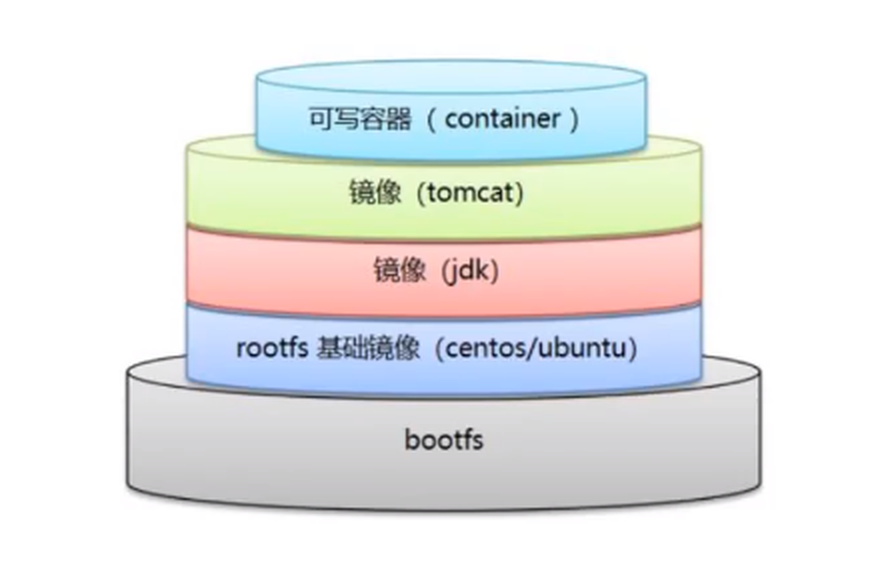

[← 返回 Docker 目录]({{ '/subjects/Docker/' | relative_url }})



# 03 容器镜像管理

镜像是创建容器的只读模板。管理镜像时要分清三个概念：**仓库地址**决定从哪里获取，**标签（tag）**是可变的人类可读名称，**摘要（digest）**标识具体内容。下面按“理解层 → 选择镜像 → 拉取与检查 → 离线转移 → 清理”整理原笔记中的操作。

## 3.1 镜像层与容器层

镜像由有序的只读层和元数据组成。构建时的文件变化会形成新层；运行容器时，运行时在其上增加可写层。多个容器可以共享只读镜像层，但各自的可写层互不相同。删除容器会失去该可写层中的数据，所以业务数据应放在卷或外部服务。容器使用宿主机内核，基础镜像通常只包含所需的用户空间文件，并不自带一个完整的独立内核。



可用 `docker image history IMAGE` 看构建历史，`docker image inspect IMAGE` 看架构、入口、标签与层摘要。`history` 的“大小”不等于压缩后下载量，`docker image ls` 的大小也不能简单相加求磁盘占用：不同镜像可能共享层。对更准确的空间判断使用 `docker system df -v`。

## 3.2 选择基础镜像与来源

先在仓库页面核对维护者、支持架构、更新频率、版本标签和安全说明，再用 `docker search` 作辅助搜索。搜索结果中有大量第三方镜像，“官方”“热门”都不等于符合当前软件版本或可信要求。公开仓库、企业私有仓库以及镜像代理解决的是不同问题，拉取地址要写清来源。

Alpine 使用 musl libc、BusyBox 与 `apk`，体积通常较小，适合与其 ABI 兼容的程序；但不能把它当作所有应用的默认最优选择。依赖 glibc、原生扩展或特定调试工具时，Debian/Ubuntu slim 等基础镜像可能更稳妥。镜像大小也随版本和架构变化，不宜引用旧截图中的固定 MB 数值。调试工具尽量只放在调试镜像或构建阶段，而不是为了 `ps`、`ping` 把生产镜像长期膨胀。

```bash
docker search nginx --limit 5
docker pull nginx:1.27
docker pull alpine:3.20
docker image inspect nginx:1.27
docker image history nginx:1.27
```

`latest` 只是一个普通的、可被仓库维护者更新的标签，并非“最新稳定版”的保证。生产部署优先固定经过测试的版本；要求内容不可漂移时可按 digest 拉取，例如 `docker pull nginx@sha256:DIGEST`。digest 需从可信仓库页面或工具获得，不能把示例中的 `DIGEST` 直接执行。

## 3.3 拉取、查看与加速

```bash
docker image ls
docker image ls --digests
docker image inspect nginx:1.27 --format '{{.Id}} {{.Architecture}}'
docker system df -v
```

下载层会解压并与本地已有层复用，因此网页展示的下载包大小与本地占用不相等。不要直接进入 `/var/lib/docker` 手动删除层文件。镜像下载缓慢时，优先确认 DNS、代理、仓库可达性及账号限额；确需配置镜像加速器时，只使用当前可验证、可信的地址，并查看其对源镜像、tag 和 digest 的同步策略。第三方代理不能替代来源校验。

在 `/etc/docker/daemon.json` 中配置加速器时可用：

```json
{
  "registry-mirrors": ["https://MIRROR_HOST"]
}
```

将 `MIRROR_HOST` 换成实际可信地址。若已有 `daemon.json`，应合并键值而不是覆盖整个文件；检查 JSON 后重启 Docker，用 `docker info` 确认 Registry Mirrors。镜像加速器只影响适用的拉取路径，不会自动代理任意私有仓库。

## 3.4 命名、标签与推送

一个镜像 ID 可以有多个仓库名与 tag；`docker tag` 只是新增引用，不会复制全部层。推送前使用目标仓库的完整路径：

```bash
docker tag nginx:1.27 registry.example.com/team/nginx:1.27
docker login registry.example.com
docker push registry.example.com/team/nginx:1.27
```

仓库名、项目名和权限必须与服务端一致。不要把用户名和密码写入文章或脚本参数；交互登录或使用 `--password-stdin`。推送完成后核对远端 tag/digest，再让部署环境拉取。

## 3.5 离线传输：`save` / `load`

需要把镜像带到离线机器时，`docker image save` 保留镜像层、元数据和指定的标签，`docker image load` 从归档恢复。一次归档可以包含**多个镜像**，原笔记“load 只能导入单个镜像”的说法不准确。

```bash
docker image save -o app-images.tar nginx:1.27 alpine:3.20
sha256sum app-images.tar
# 在目标主机核对校验值后：
docker image load -i app-images.tar
docker image ls
```

大文件可通过管道压缩，但传输前后仍要校验。`docker container export` / `docker image import` 处理的是容器文件系统快照，不保留原镜像构建历史、所有标签及完整运行元数据，不能与 `save` / `load` 混用。若需要迁移数据库等业务数据，还应单独备份卷。

## 3.6 删除与清理

```bash
docker image rm nginx:1.27
docker image ls --filter dangling=true
docker image prune
docker image prune -a
docker system df
```

删除某个 tag 不一定释放层空间：仍有其他 tag 或容器引用时数据会保留。`image prune` 默认清理悬空镜像；`-a` 会进一步删除未被容器引用的镜像，执行前先确认哪些镜像仍用于回滚或离线部署。不要把“删除所有镜像”当作常规优化，也不要直接清理 Docker 数据目录。

一次完整的镜像交付可按如下顺序验证：选择可信来源和版本 → 拉取并核对 digest/架构 → 运行测试容器 → 为目标仓库打标签并推送，或 `save` 后校验归档 → 在目标主机 `load`/`pull` 并再次检查。这样镜像名称、实际内容和运行环境不会在步骤之间断开。



<nav class="article-end" aria-label="章节导航">
  <a href="{{ '/subjects/Docker/02-installing-docker-and-basic-commands.html' | relative_url }}">← 上一章：Docker 安装及基础命令</a>
  <a href="{{ '/subjects/Docker/' | relative_url }}">返回 Docker 目录</a>
  <a href="{{ '/subjects/Docker/04-basic-container-commands.html' | relative_url }}">下一章：容器操作基础命令 →</a>
</nav>
