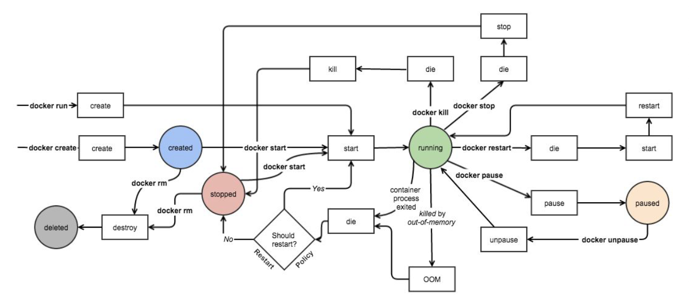
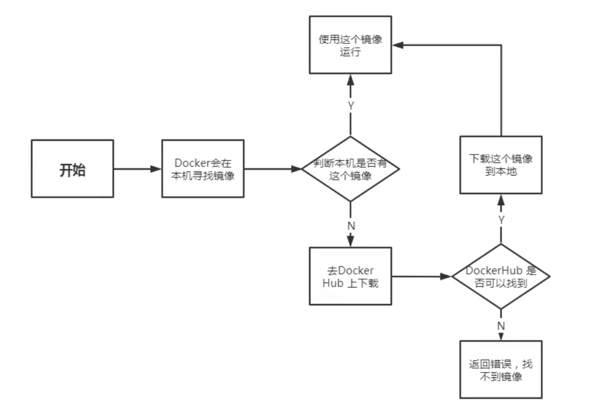
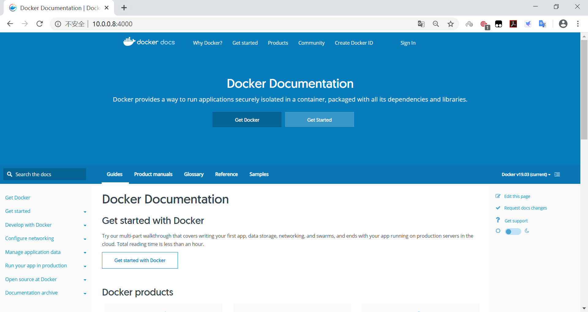

[← 返回Docker 容器技术目录]({{ '/subjects/Docker/' | relative_url }})



# 04 容器操作基础命令
### 1.4 容器操作基础命令

容器生命周期



容器相关命令

```bash
[root@ubuntu1804 ~]#docker container
Usage:  docker container COMMAND
Manage containers
Commands:
attach      Attach local standard input, output, and error streams to a running
container
commit      Create a new image from a container's changes
cp          Copy files/folders between a container and the local filesystem
create      Create a new container
diff        Inspect changes to files or directories on a container's
filesystem
exec        Run a command in a running container
export      Export a container's filesystem as a tar archive
inspect     Display detailed information on one or more containers
kill        Kill one or more running containers
logs        Fetch the logs of a container
ls          List containers
pause       Pause all processes within one or more containers
port        List port mappings or a specific mapping for the container
prune       Remove all stopped containers
rename      Rename a container
restart     Restart one or more containers
rm          Remove one or more containers
run         Run a command in a new container
start       Start one or more stopped containers
stats       Display a live stream of container(s) resource usage statistics
stop        Stop one or more running containers
top         Display the running processes of a container
unpause     Unpause all processes within one or more containers
update      Update configuration of one or more containers
wait        Block until one or more containers stop, then print their exit
codes
Run 'docker container COMMAND --help' for more information on a command.
```

### 启动容器

docker run 可以启动容器，进入到容器，并随机生成容器ID和名称

### 启动第一个容器

范例:  运行docker 的 hello world

```bash
[root@centos8 ~]# docker run hello-world
Unable to find image 'hello-world:latest' locally
latest: Pulling from library/hello-world
1b930d010525: Pull complete
Digest: sha256:9572f7cdcee8591948c2963463447a53466950b3fc15a247fcad1917ca215a2f
Status: Downloaded newer image for hello-world:latest
Hello from Docker!
This message shows that your installation appears to be working correctly.
To generate this message, Docker took the following steps:
1. The Docker client contacted the Docker daemon.
2. The Docker daemon pulled the "hello-world" image from the Docker Hub.
(amd64)
3. The Docker daemon created a new container from that image which runs the
executable that produces the output you are currently reading.
4. The Docker daemon streamed that output to the Docker client, which sent it
to your terminal.
To try something more ambitious, you can run an Ubuntu container with:
$ docker run -it ubuntu bash
Share images, automate workflows, and more with a free Docker ID:
https://hub.docker.com/
For more examples and ideas, visit:
https://docs.docker.com/get-started/
[root@centos8 ~]#docker images
REPOSITORY          TAG                 IMAGE ID            CREATED
SIZE
hello-world         latest              fce289e99eb9        12 months ago
1.84kB
[root@centos8 ~]#docker ps -a
CONTAINER ID        IMAGE               COMMAND             CREATED
STATUS                      PORTS               NAMES
7f53a2a74edc        hello-world         "/hello"            21 seconds ago
Exited (0) 19 seconds ago                     nifty_yalow
```

### 启动容器的流程



### 启动容器用法

帮助:  man docker-run

命令格式:

```text
docker run [选项]  [镜像名]  [shell命令] [参数]
#选项:
-i, --interactive    Keep STDIN open even if not attached，通常和-t一起使用
-t, --tty            分配pseudo-TTY，通常和-i一起使用,注意对应的容器必须运行shell才支持进
入
-d, --detach         Run container in background and print container ID,台后运行，
默认前台
--name string        Assign a name to the container
--h, --hostname string  Container host name
--rm                 Automatically remove the container when it exits,注意:此选项会
自动删除匿名卷
-p, --publish list   Publish a container's port(s) to the host
-P, --publish-all    Publish all exposed ports to random ports
--dns list           Set custom DNS servers
--entrypoint string  Overwrite the default ENTRYPOINT of the image
--restart policy
--privileged         Give extended privileges to container
-e, --env=[]         Set environment variables
--env-file=[]        Read in a line delimited file of environment variables
--sysctl net.ipv4.ip_unprivileged_port_start=0 #指定容器的内核参数,但不修改宿主机内核
--ulimit ulimit #指定ulimit限制配置，比如： --ulimit nofile=10240:10240
[shell命令] [参数]   #使用指定的命令和参数，替换容器默认的命令
```

--restart 可以指定四种不同的policy

policy 说明

no Default is no，Do not automatically restart the container when it exits.注

意：除此值外，以下三值都和--rm冲突

on-

on-failure[:max-retries] Restart only if the container exits with a non-zero

failure[:max-

exit status. Optionally, limit the number of restart retries the Docker

retries]

daemon attempts.

Always restart the container regardless of the exit status. When you specify always, the Docker daemon will try to restart the container indefinitely. The

always

container will also always start on daemon startup, regardless of the current state of the container.利用此项可以确保实现开机自动启动容器

unless-

Always restart the container regardless of the exit status, but do not start it

stopped

on daemon startup if the container has been put to a stopped state before.

如果 docker stop 停止容器后重启宿主机，always选项以外的其它选项的容器都不会随着宿主机启动而自动启动

注意: 容器启动后,如果容器内没有前台运行的进程,将自动退出停止

从容器内退出,并停止容器

```text
exit
```

从容器内退出,且容器不停止

```text
同时按三个键，ctrl+p+q
```

范例:  运行容器

```bash
#启动容器时会自动随机字符作为容器名
[root@ubuntu1804 ~]#docker run  registry.cn-
beijing.aliyuncs.com/bowenxiaochun/alpine:3.20.0
[root@ubuntu1804 ~]#docker ps -a
CONTAINER ID        IMAGE               COMMAND             CREATED
STATUS                     PORTS               NAMES
95967eaefd6a        alpine              "/bin/sh"           8 seconds ago
Exited (0) 6 seconds ago                       confident_elion
```

范例: 一次性运行容器中命令

```bash
#启动的容器在执行完shell命令就退出，用于测试
[root@ubuntu1804 ~]#docker run  busybox echo "Hello bowen"
Unable to find image 'busybox:latest' locally
latest: Pulling from library/busybox
91f30d776fb2: Pull complete
Digest: sha256:9ddee63a712cea977267342e8750ecbc60d3aab25f04ceacfa795e6fce341793
Status: Downloaded newer image for busybox:latest
Hello bowen
[root@ubuntu1804 ~]#docker ps
CONTAINER ID        IMAGE               COMMAND             CREATED
STATUS              PORTS               NAMES
[root@ubuntu1804 ~]#docker ps -a
CONTAINER ID        IMAGE               COMMAND                  CREATED
STATUS                      PORTS               NAMES
7873aed1b5dd        busybox             "echo 'Hello bowen'"   19 seconds ago
Exited (0) 18 seconds ago                       pedantic_varahamihira
```

范例: 指定容器名称

```bash
#注意每个容器的名称要唯一
[root@ubuntu1804 ~]#docker run --name a1 registry.cn-
beijing.aliyuncs.com/bowenxiaochun/busybox:1.32.0
[root@ubuntu1804 ~]#docker ps -a
CONTAINER ID        IMAGE               COMMAND             CREATED
STATUS                     PORTS               NAMES
dd06368a4f56        alpine              "/bin/sh"           2 minutes ago
Exited (0) 8 seconds ago                       a1
```

范例:  运行交互式容器并退出

```bash
[root@ubuntu1804 ~]#docker run -it busybox  sh
Unable to find image 'busybox:latest' locally
latest: Pulling from library/busybox
bdbbaa22dec6: Pull complete
Digest: sha256:6915be4043561d64e0ab0f8f098dc2ac48e077fe23f488ac24b665166898115a
Status: Downloaded newer image for busybox:latest
/ # exit
#用exit退出后容器也停止
[root@ubuntu1804 ~]#docker ps -l
CONTAINER ID        IMAGE               COMMAND             CREATED
STATUS                    PORTS               NAMES
cd8c2a7f39d5        busybox             "sh"                8 seconds ago
Exited (0) 1 second ago                       vigorous_leakey
```

```bash
[root@ubuntu1804 ~]#docker run -it busybox  sh
Unable to find image 'busybox:latest' locally
latest: Pulling from library/busybox
bdbbaa22dec6: Pull complete
Digest: sha256:6915be4043561d64e0ab0f8f098dc2ac48e077fe23f488ac24b665166898115a
Status: Downloaded newer image for busybox:latest
/ #同时按三个键:ctrl+p+q
```

```bash
#用同时按三个键ctrl+p+q退出后容器不会停止
[root@ubuntu1804 ~]#docker ps -l
CONTAINER ID        IMAGE               COMMAND             CREATED
STATUS                    PORTS               NAMES
cd8c2a7f39d5        busybox             "sh"                8 seconds ago
Up 10 seconds       silly_villani
```

范例: 设置容器内的主机名

```bash
[root@ubuntu1804 ~]#docker run -it --name a1 -h a1.bowen.org alpine
/ # hostname
a1.bowen.org
/ # cat /etc/hosts
127.0.0.1   localhost
::1 localhost ip6-localhost ip6-loopback
fe00::0 ip6-localnet
ff00::0 ip6-mcastprefix
ff02::1 ip6-allnodes
ff02::2 ip6-allrouters
172.17.0.2  a1.bowen.org a1
/ # cat /etc/resolv.conf
# This file is managed by man:systemd-resolved(8). Do not edit.
#
# This is a dynamic resolv.conf file for connecting local clients directly to
# all known uplink DNS servers. This file lists all configured search domains.
#
# Third party programs must not access this file directly, but only through the
# symlink at /etc/resolv.conf. To manage man:resolv.conf(5) in a different way,
# replace this symlink by a static file or a different symlink.
#
# See man:systemd-resolved.service(8) for details about the supported modes of
# operation for /etc/resolv.conf.
nameserver 180.76.76.76
nameserver 223.6.6.6
search bowen.com bowen.org
```

范例:  一次性运行容器，退出后立即删除，用于测试

```bash
[root@ubuntu1804 ~]#docker run  --rm  alpine cat /etc/issue
Welcome to Alpine Linux 3.11
Kernel \r on an \m (\l)
[root@ubuntu1804 ~]#docker ps -a
CONTAINER ID        IMAGE               COMMAND             CREATED
STATUS              PORTS               NAMES
```

范例: 创建容器后直接进入并退出

退出两种方式:

exit  容器也停止按ctrl+p+q  容器不停止

```bash
#，执行exit退出后容器关闭
[root@ubuntu1804 ~]#docker run -it --name alpine2 alpine
/ # cat /etc/issue
Welcome to Alpine Linux 3.11
Kernel \r on an \m (\l)
```

```bash
/ # exit  #退出容器,容器也停止运行
[root@ubuntu1804 ~]#docker ps -a
CONTAINER ID        IMAGE               COMMAND             CREATED
STATUS                      PORTS               NAMES
6d64f47a83e6        alpine              "/bin/sh"           13 seconds ago
Exited (0) 6 seconds ago                        alpine2
edd2ac2690e6        alpine              "/bin/sh"           52 seconds ago
Exited (0) 51 seconds ago                       alpine1
[root@ubuntu1804 ~]#docker run -it --name alpine3 alpine
#同时按ctrl+p+q 三个键退出后,容器不停止
/ # [root@ubuntu1804 ~]#docker ps -a
CONTAINER ID        IMAGE               COMMAND             CREATED
STATUS                          PORTS               NAMES
df428caf7128        alpine              "/bin/sh"           8 seconds ago
Up 7 seconds                                        alpine3
6d64f47a83e6        alpine              "/bin/sh"           26 seconds ago
Exited (0) 20 seconds ago                           alpine2
edd2ac2690e6        alpine              "/bin/sh"           About a minute ago
Exited (0) About a minute ago                       alpine1
```

什么是守护式（持续运行）容器:

能够长期运行无需交互式会话适合运行应用程序和服务

范例: 启动前台守护式容器

```bash
[root@ubuntu1804 ~]#docker run nginx
Unable to find image 'nginx:latest' locally
latest: Pulling from library/nginx
6ec8c9369e08: Pull complete
d3cb09a117e5: Pull complete
7ef2f1459687: Pull complete
e4d1bf8c9482: Pull complete
795301d236d7: Pull complete
Digest: sha256:0e188877aa60537d1a1c6484b8c3929cfe09988145327ee47e8e91ddf6f76f5c
Status: Downloaded newer image for nginx:latest
/docker-entrypoint.sh: /docker-entrypoint.d/ is not empty, will attempt to
perform configuration
/docker-entrypoint.sh: Looking for shell scripts in /docker-entrypoint.d/
/docker-entrypoint.sh: Launching /docker-entrypoint.d/10-listen-on-ipv6-by-
default.sh
10-listen-on-ipv6-by-default.sh: Getting the checksum of
/etc/nginx/conf.d/default.conf
10-listen-on-ipv6-by-default.sh: Enabled listen on IPv6 in
/etc/nginx/conf.d/default.conf
/docker-entrypoint.sh: Launching /docker-entrypoint.d/20-envsubst-on-
templates.sh
/docker-entrypoint.sh: Configuration complete; ready for start up
172.17.0.1 - - [28/Jul/2020:13:09:19 +0000] "GET / HTTP/1.1" 200 612 "-"
"curl/7.58.0" "-"
172.17.0.4 - - [28/Jul/2020:13:12:49 +0000] "GET / HTTP/1.1" 200 612 "-" "Wget"
"-"
[root@ubuntu1804 ~]#docker run --rm --name b1 busybox  wget -qO - 172.17.0.3
<!DOCTYPE html>
<html>
<head>
<title>Welcome to nginx!</title>
<style>
body {
width: 35em;
margin: 0 auto;
font-family: Tahoma, Verdana, Arial, sans-serif;
}
</style>
</head>
<body>
<h1>Welcome to nginx!</h1>
<p>If you see this page, the nginx web server is successfully installed and
working. Further configuration is required.</p>
<p>For online documentation and support please refer to
<a href="http://nginx.org/">nginx.org</a>.<br/>
Commercial support is available at
<a href="http://nginx.com/">nginx.com</a>.</p>
<p><em>Thank you for using nginx.</em></p>
</body>
</html>
```

范例: 启动后台守护式容器

```bash
[root@ubuntu1804 ~]#docker run -d nginx
888685a2487cf8150d264cb3086f78d0c3bddeb07b8ea9786aa3a564157a4cb8
[root@ubuntu1804 ~]#docker ps -l
CONTAINER ID        IMAGE               COMMAND                  CREATED
STATUS              PORTS               NAMES
888685a2487c        nginx               "/docker-entrypoint.…"   8 seconds ago
Up 6 seconds        80/tcp              busy_goodall
#有些容器后台启动不会持续运行
[root@ubuntu1804 ~]#docker run -d --name alpine4 alpine
3a05bbf66dac8a6ac9829c876bdb5fcb70832bf4a2898d68f6979cd8e8c517cb
[root@ubuntu1804 ~]#docker ps -a
CONTAINER ID        IMAGE               COMMAND             CREATED
STATUS                          PORTS               NAMES
3a05bbf66dac        alpine              "/bin/sh"           3 seconds ago
Exited (0) 2 seconds ago                            alpine4
df428caf7128        alpine              "/bin/sh"           30 seconds ago
Up 28 seconds                                       alpine3
6d64f47a83e6        alpine              "/bin/sh"           48 seconds ago
Exited (0) 41 seconds ago                           alpine2
edd2ac2690e6        alpine              "/bin/sh"           About a minute ago
Exited (0) About a minute ago                       alpine1
[root@ubuntu1804 ~]#docker run -td --name alpine5 alpine
868b33da850cfcc7db8b84150fb9c7686b577889f10425bb4c5e17f28cf68a29
[root@ubuntu1804 ~]#docker ps -a
CONTAINER ID        IMAGE               COMMAND             CREATED
STATUS                          PORTS               NAMES
868b33da850c        alpine              "/bin/sh"           2 seconds ago
Up 1 second                                         alpine5
3a05bbf66dac        alpine              "/bin/sh"           23 seconds ago
Exited (0) 23 seconds ago                           alpine4
df428caf7128        alpine              "/bin/sh"           50 seconds ago
Up 49 seconds                                       alpine3
6d64f47a83e6        alpine              "/bin/sh"           About a minute ago
Exited (0) About a minute ago                       alpine2
edd2ac2690e6        alpine              "/bin/sh"           About a minute ago
Exited (0) About a minute ago                       alpine1
[root@ubuntu1804 ~]#
```

范例:  开机自动运行容器

```bash
#默认容器不会自动启动
[root@ubuntu1804 ~]#docker run -d --name nginx  -p 80:80  nginx
bce473b8b1d2f728847cdc32b664cca1bd7578bf7bdac850b501e2e5557a718a
[root@ubuntu1804 ~]#docker ps
CONTAINER ID        IMAGE                 COMMAND                  CREATED
STATUS              PORTS                                            NAMES
bce473b8b1d2        nginx                 "nginx -g 'daemon of…"   3 seconds ago
Up 2 seconds        0.0.0.0:80->80/tcp
[root@ubuntu1804 ~]#reboot
[root@ubuntu1804 ~]#docker ps
CONTAINER ID        IMAGE       COMMAND     CREATED    STATUS       PORTS
NAMES
#设置容器总是运行
[root@ubuntu1804 ~]#docker run -d --name nginx --restart=always -p 80:80  nginx
[root@ubuntu1804 ~]#reboot
[root@ubuntu1804 ~]#docker ps
CONTAINER ID   IMAGE        COMMAND     CREATED        STATUS      PORTS
NAMES
dbdba90076e1 nginx"nginx -g 'daemon of…"  About a minute agoUp 49
seconds0.0.0.0:80->80/tcp   nginx
```

--privileged 选项

大约在0.6版，--privileged 选项被引入docker。使用该参数，container内的root拥有真正的root权限。

否则，container内的root只是外部的一个普通用户权限。privileged启动的容器，可以看到很多host上的设备，并且可以执行mount。甚至允许你在docker容器中启动docker容器。

范例：使用--privileged 让容器获取 root 权限

```bash
[root@ubuntu2204 ~]#docker run --name pod-test -d bowenxiaochun/pod-test:v0.1
[root@ubuntu2204 ~]#docker exec -it pod-test sh
#提示权限不足
[root@08cfefa34a87 /]# iptables -vnL
iptables v1.8.3 (legacy): can't initialize iptables table `filter': Permission
denied (you must be root)
Perhaps iptables or your kernel needs to be upgraded.
[root@08cfefa34a87 /]# sysctl -w net.ipv4.ip_forward=0
sysctl: error setting key 'net.ipv4.ip_forward': Read-only file system
[root@08cfefa34a87 /]# exit
[root@ubuntu2204 ~]#docker rm -f pod-test
#加--privileged选项再创建容器
[root@ubuntu2204 ~]#docker run --name pod-test --privileged -d bowenxiaochun/pod-
test:v0.1
#进入容器
[root@ubuntu2204 ~]#docker exec -it pod-test sh
[root@aff0e93675db /]# iptables -vnL
Chain INPUT (policy ACCEPT 0 packets, 0 bytes)
pkts bytes target     prot opt in     out     source               destination
```

```text
Chain FORWARD (policy ACCEPT 0 packets, 0 bytes)
pkts bytes target     prot opt in     out     source               destination
```

```bash
Chain OUTPUT (policy ACCEPT 0 packets, 0 bytes)
pkts bytes target     prot opt in     out     source               destination
[root@aff0e93675db /]# sysctl -w net.ipv4.ip_forward=0
net.ipv4.ip_forward = 0
```

范例:  使用--privileged 让容器获取 root 权限

```bash
[root@centos8 ~]#podman run -it   centos
[root@382ab09932a7 /]#cat /etc/redhat-release
CentOS Linux release 8.1.1911 (Core)
[root@382ab09932a7 /]# lsblk
NAME   MAJ:MIN RM  SIZE RO TYPE MOUNTPOINT
sda      8:0    0  200G  0 disk
|-sda1   8:1    0    1G  0 part
|-sda2   8:2    0  100G  0 part
|-sda3   8:3    0   50G  0 part
|-sda4   8:4    0    1K  0 part
`-sda5   8:5    0    2G  0 part [SWAP]
sr0     11:0    1    7G  0 rom
[root@382ab09932a7 /]# mount /dev/sda3 /mnt
mount: /mnt: permission denied.
[root@382ab09932a7 /]# exit
exit
#利用--privileged 选项运行容器
[root@centos8 ~]#podman run -it --privileged   centos
#可以看到宿主机的设备
[root@a6391a8f82e3 /]# lsblk
NAME   MAJ:MIN RM  SIZE RO TYPE MOUNTPOINT
sda      8:0    0  200G  0 disk
|-sda1   8:1    0    1G  0 part
|-sda2   8:2    0  100G  0 part
|-sda3   8:3    0   50G  0 part
|-sda4   8:4    0    1K  0 part
`-sda5   8:5    0    2G  0 part [SWAP]
sr0     11:0    1    7G  0 rom
[root@a6391a8f82e3 /]# df
Filesystem     1K-blocks    Used Available Use% Mounted on
overlay        104806400 2754832 102051568   3% /
tmpfs              65536       0     65536   0% /dev
tmpfs             408092    5892    402200   2% /etc/hosts
shm                64000       0     64000   0% /dev/shm
tmpfs             408092       0    408092   0% /sys/fs/cgroup
[root@a6391a8f82e3 /]# mount /dev/sda3 /mnt
[root@a6391a8f82e3 /]# df
Filesystem     1K-blocks    Used Available Use% Mounted on
overlay        104806400 2754632 102051768   3% /
tmpfs              65536       0     65536   0% /dev
tmpfs             408092    5892    402200   2% /etc/hosts
shm                64000       0     64000   0% /dev/shm
tmpfs             408092       0    408092   0% /sys/fs/cgroup
/dev/sda3       52403200  619068  51784132   2% /mnt
[root@a6391a8f82e3 /]# touch /mnt/containter.txt
[root@a6391a8f82e3 /]# echo container data > /mnt/containter.txt
[root@a6391a8f82e3 /]# cat  /mnt/containter.txt
container data
[root@a6391a8f82e3 /]#
#在宿主机查看是否生成文件
[root@centos8 ~]#lsblk
NAME   MAJ:MIN RM  SIZE RO TYPE MOUNTPOINT
sda      8:0    0  200G  0 disk
├─sda1   8:1    0    1G  0 part /boot
├─sda2   8:2    0  100G  0 part /
├─sda3   8:3    0   50G  0 part /data
├─sda4   8:4    0    1K  0 part
└─sda5   8:5    0    2G  0 part [SWAP]
sr0     11:0    1    7G  0 rom
[root@centos8 ~]#ll /data/containter.txt
-rw-r--r-- 1 root root 25 Feb 29 12:26 /data/containter.txt
[root@centos8 ~]#cat /data/containter.txt
container data
[root@centos8 ~]#echo host data >> /data/containter.txt
[root@centos8 ~]#cat /data/containter.txt
container data
host data
#在容器内可看文件是否发生变化
[root@a6391a8f82e3 /]# cat  /mnt/containter.txt
container data
host data
```

范例：修改容器的内核参数

```bash
[root@ubuntu2204 ~]#docker run --name pod-test  -d bowenxiaochun/pod-test:v0.1
[root@ubuntu2204 ~]#docker exec  pod-test sysctl net.ipv4.icmp_echo_ignore_all
net.ipv4.icmp_echo_ignore_all = 0
[root@ubuntu2204 ~]#docker rm -f pod-test
pod-test
[root@ubuntu2204 ~]#docker run --name pod-test  --sysctl
net.ipv4.icmp_echo_ignore_all=1 -d bowenxiaochun/pod-test:v0.1
[root@ubuntu2204 ~]#docker exec  pod-test sysctl net.ipv4.icmp_echo_ignore_all
net.ipv4.icmp_echo_ignore_all = 1
```

范例：指定 ulimit 配置

```bash
#默认容器使用dockerd的资源限制值
[root@ubuntu2204 ~]#cat /proc/`pidof dockerd`/limits
Limit                     Soft Limit           Hard Limit           Units
Max cpu time              unlimited            unlimited            seconds
Max file size             unlimited            unlimited            bytes
Max data size             unlimited            unlimited            bytes
Max stack size            8388608              unlimited            bytes
Max core file size        unlimited            unlimited            bytes
Max resident set          unlimited            unlimited            bytes
Max processes             unlimited            unlimited            processes
Max open files            1048576              1048576              files
Max locked memory         65536                65536                bytes
Max address space         unlimited            unlimited            bytes
Max file locks            unlimited            unlimited            locks
Max pending signals       7322                 7322                 signals
Max msgqueue size         819200               819200               bytes
Max nice priority         0                    0
Max realtime priority     0                    0
Max realtime timeout      unlimited            unlimited            us
[root@ubuntu2204 ~]#docker run   --rm alpine:3.19 sh -c "ulimit -a"
core file size (blocks)         (-c) unlimited
data seg size (kb)              (-d) unlimited
scheduling priority             (-e) 0
file size (blocks)              (-f) unlimited
pending signals                 (-i) 7322
max locked memory (kb)          (-l) 64
max memory size (kb)            (-m) unlimited
open files                      (-n) 1048576
POSIX message queues (bytes)    (-q) 819200
real-time priority              (-r) 0
stack size (kb)                 (-s) 8192
cpu time (seconds)              (-t) unlimited
max user processes              (-u) unlimited
virtual memory (kb)             (-v) unlimited
file locks                      (-x) unlimited
#10000为soft,10240为hard,注意：ulimit soft limit must be less than or equal to
hard limit
[root@ubuntu2204 ~]#docker run --ulimit nofile=10000:10240 --rm debian sh -c
"ulimit -a"
time(seconds)        unlimited
file(blocks)         unlimited
data(kbytes)         unlimited
stack(kbytes)        8192
coredump(blocks)     unlimited
memory(kbytes)       unlimited
locked memory(kbytes) 64
process              unlimited
nofiles              10000
vmemory(kbytes)      unlimited
locks                unlimited
rtprio               0
```

范例:  运行docker官方文档容器

```bash
[root@centos8 ~]#podman run -d -p 4000:4000 docs/docker.github.io:latest
[root@centos8 ~]#podman images docs/docker.github.io
REPOSITORY                        TAG      IMAGE ID       CREATED      SIZE
docker.io/docs/docker.github.io   latest   ffd9131eeee7   2 days ago   1.99 GB
#用浏览器访问http://localhost:4000/可以看到下面docker文档资料
```



### 查看容器信息

### 显示当前存在容器

<https://docs.docker.com/engine/reference/commandline/ps/>

格式

```text
docker ps [OPTIONS]
docker container ls [OPTIONS]
选项:
-a, --all             Show all containers (default shows just running)
-q, --quiet           Only display numeric IDs
-s, --size            Display total file sizes
-f, --filter filter   Filter output based on conditions provided
-l, --latest          Show the latest created container (includes all states)
-n, --last int        Show n last created containers (includes all states)
(default -1)
--format              按格式输出信息
```

docker ps --format 命令中，你可以使用不同的占位符来指定要在输出中显示的容器信息。

```text
#以下是一些常用的占位符：
{{.ID}}：容器的ID。
{{.Image}}：容器使用的映像名称。
{{.Command}}：容器的启动命令。
{{.CreatedAt}}：容器的创建时间。
{{.RunningFor}}：容器运行的时间。
{{.Ports}}：容器的端口映射信息。
{{.Status}}：容器的状态。
{{.Size}}：容器的大小。
{{.Names}}：容器的名称。
{{.Label}}：容器的标签。
#示例
docker ps --format "{{.ID}}\t{{.Image}}\t{{.Status}}"
```

范例:

```bash
#显示运行的容器
[root@ubuntu1804 ~]#docker ps
CONTAINER ID        IMAGE               COMMAND             CREATED
STATUS              PORTS               NAMES
d7ece7f62532        centos              "/bin/bash"         23 seconds ago
Up 22 seconds                           ecstatic_franklin
#显示全部容器，包括退出状态的容器
[root@ubuntu1804 ~]#docker ps  -a
CONTAINER ID        IMAGE               COMMAND                  CREATED
STATUS                     PORTS               NAMES
d7ece7f62532        centos              "/bin/bash"              27 seconds ago
Up 26 seconds                                  ecstatic_franklin
dcdf71d17177        busybox             "/bin/echo 'hello wo…"   8 minutes ago
Exited (0) 8 minutes ago                       cool_jepsen
#只显示容器ID
[root@ubuntu1804 ~]#docker ps  -a -q
d7ece7f62532
dcdf71d17177
#显示容器大小
[root@ubuntu1804 ~]#docker ps  -a -s
CONTAINER ID        IMAGE               COMMAND                  CREATED
STATUS                     PORTS               NAMES               SIZE
d7ece7f62532        centos              "/bin/bash"              51 seconds ago
Up 50 seconds                                  ecstatic_franklin   0B
(virtual 237MB)
dcdf71d17177        busybox             "/bin/echo 'hello wo…"   8 minutes ago
Exited (0) 8 minutes ago                       cool_jepsen         0B
(virtual 1.22MB)
[root@ubuntu1804 ~]
#显示最新创建的容器(停止的容器也能显示)
[root@ubuntu1804 ~]#docker ps  -l
```

范例:  显示指定状态的容器

```bash
[root@ubuntu1804 ~]#docker ps -a
CONTAINER ID        IMAGE               COMMAND                  CREATED
STATUS                        PORTS               NAMES
dd002f947cbe        nginx               "nginx -g 'daemon of…"   19 minutes ago
Exited (137) 11 minutes ago                       nginx2
1f3f82995e05        nginx               "nginx -g 'daemon of…"   19 minutes ago
Up 2 minutes                  80/tcp              nginx1
[root@ubuntu1804 ~]#docker ps
CONTAINER ID        IMAGE               COMMAND                  CREATED
STATUS              PORTS               NAMES
1f3f82995e05        nginx               "nginx -g 'daemon of…"   19 minutes ago
Up 2 minutes        80/tcp              nginx1
#查看退出状态的容器
[root@ubuntu1804 ~]#docker ps  -f 'status=exited'
CONTAINER ID        IMAGE               COMMAND                  CREATED
STATUS                        PORTS               NAMES
dd002f947cbe        nginx               "nginx -g 'daemon of…"   19 minutes ago
Exited (137) 11 minutes ago                       nginx2
```

```bash
[root@ubuntu2204 ~]#docker ps  -f 'status=running'
CONTAINER ID   IMAGE        COMMAND                   CREATED          STATUS
PORTS     NAMES
18f6108adfdc   nginx:1.22   "/docker-entrypoint.…"   47 minutes ago   Up 45
minutes   80/tcp    web01
```

### 查看容器内的进程

```text
docker top CONTAINER [ps OPTIONS]
```

范例:

```bash
[root@ubuntu1804 ~]#docker run -d  httpd
db144f1978148242dc20bd0be951628f1c00371b2c69dee53d84469c52995d8f
[root@ubuntu1804 ~]#docker top db144f19
UID       PID   PPID  C   STIME TTY   TIME     CMD
root      9821  9797  3   22:02 ?     00:00:00 httpd -DFOREGROUND
daemon    9872  9821  0   22:02 ?     00:00:00 httpd -DFOREGROUND
daemon    9873  9821  0   22:02 ?     00:00:00 httpd -DFOREGROUND
daemon    9874  9821  0   22:02 ?     00:00:00 httpd -DFOREGROUND
[root@ubuntu1804 ~]#docker run -d  registry.cn-
beijing.aliyuncs.com/bowenxiaochun/alpine:3.20.0 /bin/sh -c 'i=1;while true;do
echo hello$i;let i++;sleep 1;done'
9997053f9766d4adf709d46161d7ec6739eacafbe8d4721133874b89112ad1a6
[root@ubuntu1804 ~]#docker top 9997
UID                 PID                 PPID                C
STIME               TTY                 TIME                CMD
root                10023               9997                3
22:03               ?                   00:00:00            /bin/sh -c i=1;while
true;do echo hello$i;let i++;sleep 1;done
root                10074               10023               0
22:03               ?                   00:00:00            sleep 1
```

### 查看容器资源使用情况

```text
docker stats [OPTIONS] [CONTAINER...]
Display a live stream of container(s) resource usage statistics
Options:
-a, --all             Show all containers (default shows just running)
--format string   Pretty-print images using a Go template
--no-stream       Disable streaming stats and only pull the first result
--no-trunc        Do not truncate output
```

范例:

```json
[root@ubuntu1804 ~]#docker stats 251c7c7cf2aa
CONTAINER ID  NAME  CPU %  MEM USAGE / LIMIT     MEM %  NET I/O    BLOCK I/O
PIDS
251c7c7cf2aa  busy_l0.00%  3.742MiB / 1.924GiB   0.19%  1.29kB / 0B0B / 8.19kB
2
CONTAINER ID  NAME  CPU %  MEM USAGE / LIMIT     MEM %  NET I/O    BLOCK I/O
PIDS
251c7c7cf2aa  busy_l0.00%  3.742MiB / 1.924GiB   0.19%  1.29kB / 0B0B / 8.19kB
2
#默认启动elasticsearch会使用较多的内存
[root@ubuntu1804 ~]#docker run -d --name elasticsearch -p 9200:9200 -p 9300:9300
-e "discovery.type=single-node" elasticsearch:7.6.2
[root@ubuntu1804 ~]#curl 10.0.0.100:9200
{
"name" : "29282e91d773",
"cluster_name" : "docker-cluster",
"cluster_uuid" : "w5lp_XmITliWa2Yc-XwJFw",
"version" : {
"number" : "7.6.2",
"build_flavor" : "default",
"build_type" : "docker",
"build_hash" : "ef48eb35cf30adf4db14086e8aabd07ef6fb113f",
"build_date" : "2020-03-26T06:34:37.794943Z",
"build_snapshot" : false,
"lucene_version" : "8.4.0",
"minimum_wire_compatibility_version" : "6.8.0",
"minimum_index_compatibility_version" : "6.0.0-beta1"
},
"tagline" : "You Know, for Search"
}
```

```bash
#查看所有容器
[root@ubuntu1804 ~]#docker stats
CONTAINER ID NAME   CPU %   MEM USAGE / LIMIT MEM % NET I/O  BLOCK I/O      PIDS
5e470e7970f6 suspi  0.00%   3.992MiB / 1.924Gi0.20% 656B / 0B9.2MB / 8.19kB    2
829bcebbc9f6 elast  0.58%   1.24GiB / 1.924GiB64.43%2.97kB / 512kB / 729kB    47
#限制内存使用大小
[root@ubuntu1804 ~]#docker run -d --name elasticsearch -p 9200:9200 -p 9300:9300
-e "discovery.type=single-node" -e ES_JAVA_OPTS="-Xms64m -Xmx128m"
elasticsearch:7.6.2
[root@ubuntu1804 ~]#docker stats
CONTAINER ID NAME  CPU % MEM USAGE / LIMIT     MEM %  NET I/O   BLOCK     PIDS
29282e91d773 elasti254.23310.5MiB / 1.924GiB   15.76% 766B / 0B 766kB /46kB 22
```

### 查看容器的详细信息

<https://docs.docker.com/engine/reference/commandline/inspect/>

docker inspect 可以查看docker各种对象的详细信息,包括:镜像,容器,网络等

```text
docker inspect [OPTIONS] NAME|ID [NAME|ID...]
Options:
-f, --format string   Format the output using the given Go template
-s, --size            Display total file sizes if the type is container
```

范例:

```json
[root@ubuntu1804 ~]#docker inspect 9997
[
{
"Id":
"9997053f9766d4adf709d46161d7ec6739eacafbe8d4721133874b89112ad1a6",
"Created": "2020-02-25T14:03:00.790597711Z",
"Path": "/bin/sh",
"Args": [
"-c",
"i=1;while true;do echo hello$i;let i++;sleep 1;done"
],
"State": {
"Status": "running",
"Running": true,
"Paused": false,
"Restarting": false,
"OOMKilled": false,
"Dead": false,
"Pid": 10023,
"ExitCode": 0,
"Error": "",
"StartedAt": "2020-02-25T14:03:01.407282144Z",
"FinishedAt": "0001-01-01T00:00:00Z"
},
"Image":
"sha256:e7d92cdc71feacf90708cb59182d0df1b911f8ae022d29e8e95d75ca6a99776a",
"ResolvConfPath":
"/var/lib/docker/containers/9997053f9766d4adf709d46161d7ec6739eacafbe8d472113387
4b89112ad1a6/resolv.conf",
"HostnamePath":
"/var/lib/docker/containers/9997053f9766d4adf709d46161d7ec6739eacafbe8d472113387
4b89112ad1a6/hostname",
"HostsPath":
"/var/lib/docker/containers/9997053f9766d4adf709d46161d7ec6739eacafbe8d472113387
4b89112ad1a6/hosts",
"LogPath":
"/var/lib/docker/containers/9997053f9766d4adf709d46161d7ec6739eacafbe8d472113387
4b89112ad1a6/9997053f9766d4adf709d46161d7ec6739eacafbe8d4721133874b89112ad1a6-
json.log",
"Name": "/gracious_wescoff",
"RestartCount": 0,
"Driver": "overlay2",
"Platform": "linux",
"MountLabel": "",
"ProcessLabel": "",
"AppArmorProfile": "docker-default",
"ExecIDs": null,
"HostConfig": {
"Binds": null,
"ContainerIDFile": "",
"LogConfig": {
"Type": "json-file",
"Config": {}
},
"NetworkMode": "default",
"PortBindings": {},
"RestartPolicy": {
"Name": "no",
"MaximumRetryCount": 0
},
"AutoRemove": false,
"VolumeDriver": "",
"VolumesFrom": null,
"CapAdd": null,
"CapDrop": null,
"Capabilities": null,
"Dns": [],
"DnsOptions": [],
"DnsSearch": [],
"ExtraHosts": null,
"GroupAdd": null,
"IpcMode": "private",
"Cgroup": "",
"Links": null,
"OomScoreAdj": 0,
"PidMode": "",
"Privileged": false,
"PublishAllPorts": false,
"ReadonlyRootfs": false,
"SecurityOpt": null,
"UTSMode": "",
"UsernsMode": "",
"ShmSize": 67108864,
"Runtime": "runc",
"ConsoleSize": [
0,
0
],
"Isolation": "",
"CpuShares": 0,
"Memory": 0,
"NanoCpus": 0,
"CgroupParent": "",
"BlkioWeight": 0,
"BlkioWeightDevice": [],
"BlkioDeviceReadBps": null,
"BlkioDeviceWriteBps": null,
"BlkioDeviceReadIOps": null,
"BlkioDeviceWriteIOps": null,
"CpuPeriod": 0,
"CpuQuota": 0,
"CpuRealtimePeriod": 0,
"CpuRealtimeRuntime": 0,
"CpusetCpus": "",
"CpusetMems": "",
"Devices": [],
"DeviceCgroupRules": null,
"DeviceRequests": null,
"KernelMemory": 0,
"KernelMemoryTCP": 0,
"MemoryReservation": 0,
"MemorySwap": 0,
"MemorySwappiness": null,
"OomKillDisable": false,
"PidsLimit": null,
"Ulimits": null,
"CpuCount": 0,
"CpuPercent": 0,
"IOMaximumIOps": 0,
"IOMaximumBandwidth": 0,
"MaskedPaths": [
"/proc/asound",
"/proc/acpi",
"/proc/kcore",
"/proc/keys",
"/proc/latency_stats",
"/proc/timer_list",
"/proc/timer_stats",
"/proc/sched_debug",
"/proc/scsi",
"/sys/firmware"
],
"ReadonlyPaths": [
"/proc/bus",
"/proc/fs",
"/proc/irq",
"/proc/sys",
"/proc/sysrq-trigger"
]
},
"GraphDriver": {
"Data": {
"LowerDir":
"/var/lib/docker/overlay2/27f7bf9c29a0303e2526bd7fa7d61fcc3a2ef400e6948b5d9487b5
b30f506853-
init/diff:/var/lib/docker/overlay2/cb3f60a3d09e0555d06525b70cc30975a3cb70e23c87e
7e46bd44b6cfffbcda0/diff",
"MergedDir":
"/var/lib/docker/overlay2/27f7bf9c29a0303e2526bd7fa7d61fcc3a2ef400e6948b5d9487b5
b30f506853/merged",
"UpperDir":
"/var/lib/docker/overlay2/27f7bf9c29a0303e2526bd7fa7d61fcc3a2ef400e6948b5d9487b5
b30f506853/diff",
"WorkDir":
"/var/lib/docker/overlay2/27f7bf9c29a0303e2526bd7fa7d61fcc3a2ef400e6948b5d9487b5
b30f506853/work"
},
"Name": "overlay2"
},
"Mounts": [],
"Config": {
"Hostname": "9997053f9766",
"Domainname": "",
"User": "",
"AttachStdin": false,
"AttachStdout": false,
"AttachStderr": false,
"Tty": false,
"OpenStdin": false,
"StdinOnce": false,
"Env": [
"PATH=/usr/local/sbin:/usr/local/bin:/usr/sbin:/usr/bin:/sbin:/bin"
],
"Cmd": [
"/bin/sh",
"-c",
"i=1;while true;do echo hello$i;let i++;sleep 1;done"
],
"Image": "alpine",
"Volumes": null,
"WorkingDir": "",
"Entrypoint": null,
"OnBuild": null,
"Labels": {}
},
"NetworkSettings": {
"Bridge": "",
"SandboxID":
"4823297a262eaad3b63778c2fe04a74e38ce401c22404f05f3cf54ab7dc188e2",
"HairpinMode": false,
"LinkLocalIPv6Address": "",
"LinkLocalIPv6PrefixLen": 0,
"Ports": {},
"SandboxKey": "/var/run/docker/netns/4823297a262e",
"SecondaryIPAddresses": null,
"SecondaryIPv6Addresses": null,
"EndpointID":
"019896bd99c9e158ef9f97b1617f1638fee94c7f92c9250e1ac1bfe58c97c911",
"Gateway": "172.17.0.1",
"GlobalIPv6Address": "",
"GlobalIPv6PrefixLen": 0,
"IPAddress": "172.17.0.3",
"IPPrefixLen": 16,
"IPv6Gateway": "",
"MacAddress": "02:42:ac:11:00:03",
"Networks": {
"bridge": {
"IPAMConfig": null,
"Links": null,
"Aliases": null,
"NetworkID":
"d407310ec8ff57a6623ae2fa01ba860ab0615135585a00b19f0751561c99ab16",
"EndpointID":
"019896bd99c9e158ef9f97b1617f1638fee94c7f92c9250e1ac1bfe58c97c911",
"Gateway": "172.17.0.1",
"IPAddress": "172.17.0.3",
"IPPrefixLen": 16,
"IPv6Gateway": "",
"GlobalIPv6Address": "",
"GlobalIPv6PrefixLen": 0,
"MacAddress": "02:42:ac:11:00:03",
"DriverOpts": null
}
}
}
}
]
[root@ubuntu2404 ~]#docker inspect --format "{{.Created}}" web01
2025-02-08T10:02:03.930607395Z
```

```bash
#选择性查看，最新版本不支持
[root@ubuntu1804 ~]#docker inspect -f "{{.Metadata}}" test:v1.0
{2020-07-24 21:56:42.247448035 +0800 CST}
```

```bash
[root@ubuntu2204 ~]#docker inspect --format "{{.State.Status}}" elasticsearch
running
#查看容器IP
[root@ubuntu2204 ~]#docker inspect --format "
{{.NetworkSettings.Networks.bridge.IPAddress}}" elasticsearch
172.17.0.4
[root@ubuntu1804 ~]#docker inspect -f "{{.Created}}" c1
2020-07-24T13:37:11.006574248Z
[root@ubuntu1804 ~]#docker inspect --format "{{.Created}}" c1
2020-07-24T13:37:11.006574248Z
```

### 查看容器的日志

docker logs 可以查看容器中运行的进程在控制台的标准输出和标准错误，一般对应是日志信息

docker 日志是存放在宿主机的 /var/lib/docker/containers/<container_id>/<container_id>-json.log文件中

格式

```text
docker logs [OPTIONS] CONTAINER
选项:
--details        Show extra details provided to logs
-f, --follow     Follow log output
--since string   Show logs since timestamp (e.g. 2013-01-02T13:23:37) or
relative (e.g. 42m for   42 minutes)
--tail string    Number of lines to show from the end of the logs (default
"all")
-t, --timestamps     Show timestamps
--until string   Show logs before a timestamp (e.g. 2013-01-02T13:23:37) or
relative (e.g. 42m     for 42 minutes)
```

范例:  查看容器日志

```bash
[root@ubuntu1804 ~]#docker run  --name test01 registry.cn-
beijing.aliyuncs.com/bowenxiaochun/alpine:3.20.0 /bin/sh -c 'i=1;while true;do
echo hello$i;let i++;sleep 2;done'
Unable to find image 'alpine:latest' locally
latest: Pulling from library/alpine
188c0c94c7c5: Pull complete
Digest: sha256:c0e9560cda118f9ec63ddefb4a173a2b2a0347082d7dff7dc14272e7841a5b5a
Status: Downloaded newer image for alpine:latest
hello1
hello2
hello3
hello4
hello5
^C[root@ubuntu1804 ~]#
[root@ubuntu1804 ~]#docker run -d --name alpine01 alpine /bin/sh -c 'i=1;while
true;do echo hello$i;let i++;sleep 2;done'
512622b006c05673630eb04f081f8475400b1cda786b0a8a5d1c1c2fd6dc56a7
[root@ubuntu1804 ~]#docker logs  5126
hello1
hello2
hello3
hello4
hello5
hello6
[root@ubuntu1804 ~]#docker logs --tail 3 5126
hello8
hello9
hello10
```

```bash
#显示时间
[root@ubuntu1804 ~]#docker logs --tail 0 -t 5126
2020-02-25T13:30:07.321390731Z hello17
#持续跟踪
[root@ubuntu1804 ~]#docker logs -f 5126
hello1
hello2
hello3
hello4
hello5
hello6
hello7
hello8
hello9
hello10
hello11
hello12
hello13
hello14
hello15
hello16
hello17
hello18
.....
[root@ubuntu2404 ~]#grep -r hello50 /var/lib/docker/*
/var/lib/docker/containers/8748a59d3192541c9b61da2fab7dbf400190e1d7382bccadd265a
693d2997f27/8748a59d3192541c9b61da2fab7dbf400190e1d7382bccadd265a693d2997f27-
json.log:{"log":"hello50\n","stream":"stdout","time":"2025-04-
09T07:19:55.065893543Z"}
[root@ubuntu2404 ~]#tail -f
/var/lib/docker/containers/8748a59d3192541c9b61da2fab7dbf400190e1d7382bccadd265a
693d2997f27/8748a59d3192541c9b61da2fab7dbf400190e1d7382bccadd265a693d2997f27-
json.log
{"log":"hello48\n","stream":"stdout","time":"2025-04-09T07:19:51.063524169Z"}
{"log":"hello49\n","stream":"stdout","time":"2025-04-09T07:19:53.06451392Z"}
{"log":"hello50\n","stream":"stdout","time":"2025-04-09T07:19:55.065893543Z"}
```

范例: 查看httpd服务日志

```bash
[root@ubuntu1804 ~]#docker pull httpd
Using default tag: latest
latest: Pulling from library/httpd
bb79b6b2107f: Pull complete
26694ef5449a: Pull complete
7b85101950dd: Pull complete
da919f2696f2: Pull complete
3ae86ea9f1b9: Pull complete
Digest: sha256:b82fb56847fcbcca9f8f162a3232acb4a302af96b1b2af1c4c3ac45ef0c9b968
Status: Downloaded newer image for httpd:latest
docker.io/library/httpd:latest
[root@ubuntu1804 ~]#docker run -d -p 80:80 --name web1  httpd
9f55b2216f0d65fe010166a78f07f45a47379bb0efa38c4f81f2034a7401907b
[root@ubuntu1804 ~]#docker logs web1
AH00558: httpd: Could not reliably determine the server's fully qualified domain
name, using 172.17.0.3. Set the 'ServerName' directive globally to suppress this
message
AH00558: httpd: Could not reliably determine the server's fully qualified domain
name, using 172.17.0.3. Set the 'ServerName' directive globally to suppress this
message
[Mon Nov 16 01:07:53.780025 2020] [mpm_event:notice] [pid 1:tid 140363582039168]
AH00489: Apache/2.4.46 (Unix) configured -- resuming normal operations
[Mon Nov 16 01:07:53.780218 2020] [core:notice] [pid 1:tid 140363582039168]
AH00094: Command line: 'httpd -D FOREGROUND'
[root@ubuntu1804 ~]#docker logs -f web1
AH00558: httpd: Could not reliably determine the server's fully qualified domain
name, using 172.17.0.3. Set the 'ServerName' directive globally to suppress this
message
AH00558: httpd: Could not reliably determine the server's fully qualified domain
name, using 172.17.0.3. Set the 'ServerName' directive globally to suppress this
message
[Mon Nov 16 01:07:53.780025 2020] [mpm_event:notice] [pid 1:tid 140363582039168]
AH00489: Apache/2.4.46 (Unix) configured -- resuming normal operations
[Mon Nov 16 01:07:53.780218 2020] [core:notice] [pid 1:tid 140363582039168]
AH00094: Command line: 'httpd -D FOREGROUND'
10.0.0.8 - - [16/Nov/2020:01:08:23 +0000] "GET / HTTP/1.1" 200 45
```

范例: 查看nginx服务访问日志

```bash
#查看一次
[root@centos7 ~]#docker logs nginx-test-port1
10.0.0.1 - - [26/Jan/2020:07:17:16 +0000] "GET /favicon.ico HTTP/1.1" 404 555 "-
" "Mozilla/5.0 (Windows NT 10.0; WOW64) AppleWebKit/537.36 (KHTML, like Gecko)
Chrome/63.0.3239.132 Safari/537.36" "-"
2020/01/26 07:17:16 [error] 6#6: *1 open() "/usr/share/nginx/html/favicon.ico"
failed (2: No such file or directory), client: 10.0.0.1, server: localhost,
request: "GET /favicon.ico HTTP/1.1", host: "10.0.0.7:32769"
10.0.0.1 - - [26/Jan/2020:07:17:17 +0000] "GET / HTTP/1.1" 200 612 "-"
"Mozilla/5.0 (Windows NT 10.0; WOW64; Trident/7.0; rv:11.0) like Gecko" "-"
#持续查看
[root@centos7 ~]#docker logs -f nginx-test-port1
10.0.0.1 - - [26/Jan/2020:07:17:16 +0000] "GET /favicon.ico HTTP/1.1" 404 555 "-
" "Mozilla/5.0 (Windows NT 10.0; WOW64) AppleWebKit/537.36 (KHTML, like Gecko)
Chrome/63.0.3239.132 Safari/537.36" "-"
2020/01/26 07:17:16 [error] 6#6: *1 open() "/usr/share/nginx/html/favicon.ico"
failed (2: No such file or directory), client: 10.0.0.1, server: localhost,
request: "GET /favicon.ico HTTP/1.1", host: "10.0.0.7:32769"
10.0.0.1 - - [26/Jan/2020:07:17:17 +0000] "GET / HTTP/1.1" 200 612 "-"
"Mozilla/5.0 (Windows NT 10.0; WOW64; Trident/7.0; rv:11.0) like Gecko" "-"
```

### 删除容器

<https://docs.docker.com/engine/reference/commandline/rm/>

docker rm 可以删除容器，即使容器正在运行当中，也可以被强制删除掉

格式

```text
docker rm [OPTIONS] CONTAINER [CONTAINER...]
docker container rm [OPTIONS] CONTAINER [CONTAINER...]
```

```text
#选项:
-f, --force     Force the removal of a running container (uses SIGKILL)
-v, --volumes   Remove the volumes associated with the container
#删除停止的容器
docker container prune [OPTIONS]
Options:
--filter filter   Provide filter values (e.g. 'until=<timestamp>')
-f, --force           Do not prompt for confirmation
```

范例:

```bash
[root@ubuntu1804 ~]#docker ps -a
CONTAINER ID        IMAGE               COMMAND             CREATED
STATUS                     PORTS               NAMES
868b33da850c        alpine              "/bin/sh"           2 minutes ago
Up 2 minutes                                   alpine5
3a05bbf66dac        alpine              "/bin/sh"           3 minutes ago
Exited (0) 3 minutes ago                       alpine4
df428caf7128        alpine              "/bin/sh"           3 minutes ago
Up 3 minutes                                   alpine3
6d64f47a83e6        alpine              "/bin/sh"           3 minutes ago
Exited (0) 3 minutes ago                       alpine2
edd2ac2690e6        alpine              "/bin/sh"           4 minutes ago
Exited (0) 4 minutes ago                       alpine1
[root@ubuntu1804 ~]#docker rm 3a05bbf66dac
3a05bbf66dac
[root@ubuntu1804 ~]#docker rm alpine5
Error response from daemon: You cannot remove a running container
868b33da850cfcc7db8b84150fb9c7686b577889f10425bb4c5e17f28cf68a29. Stop the
container before attempting removal or force remove
[root@ubuntu1804 ~]#docker rm -f  alpine5
alpine5
```

范例:  删除所有容器

```bash
[root@ubuntu1804 ~]#docker ps -a
CONTAINER ID        IMAGE               COMMAND             CREATED
STATUS                     PORTS               NAMES
df428caf7128        alpine              "/bin/sh"           4 minutes ago
Up 4 minutes                                   alpine3
6d64f47a83e6        alpine              "/bin/sh"           4 minutes ago
Exited (0) 4 minutes ago                       alpine2
edd2ac2690e6        alpine              "/bin/sh"           5 minutes ago
Exited (0) 5 minutes ago                       alpine1
[root@ubuntu1804 ~]#docker rm -f `docker ps -a -q`
df428caf7128
6d64f47a83e6
edd2ac2690e6
[root@ubuntu1804 ~]#docker ps -a
CONTAINER ID        IMAGE               COMMAND             CREATED
STATUS              PORTS               NAMES
[root@ubuntu1804 ~]#docker ps -a -q | xargs docker rm -f
```

范例:  删除指定状态的容器

```bash
[root@ubuntu1804 ~]#docker ps -a
CONTAINER ID        IMAGE               COMMAND                  CREATED
STATUS                        PORTS               NAMES
dd002f947cbe        nginx               "nginx -g 'daemon of…"   22 minutes ago
Exited (137) 14 minutes ago                       nginx2
1f3f82995e05        nginx               "nginx -g 'daemon of…"   22 minutes ago
Up 4 minutes                  80/tcp              nginx1
```

```bash
[root@ubuntu2204 ~]#docker rm -f `docker ps -q  -f status=running`
[root@ubuntu1804 ~]#docker rm `docker ps -qf status=exited`
dd002f947cbe
[root@ubuntu1804 ~]#docker ps -a
CONTAINER ID        IMAGE               COMMAND                  CREATED
STATUS              PORTS               NAMES
1f3f82995e05        nginx               "nginx -g 'daemon of…"   22 minutes ago
Up 4 minutes        80/tcp              nginx1
[root@ubuntu1804 ~]#
```

范例: 删除所有停止的容器

```bash
[root@ubuntu1804 ~]#docker rm `docker ps -qf status=exited`
[root@ubuntu1804 ~]#docker ps -f status=exited -q  | xargs docker rm -f
[root@ubuntu1804 ~]#docker container prune  -f
Deleted Containers:
37ba6ef81e33102a9cf4547ed10095d2298e29c8d67991b31390d5db8001dbcf
6c674c7ced422c7c29f218118c8b5da734ccebb9da31cdd3f64e7c658d2882a4
Total reclaimed space: 0B
```

### 容器的启动和停止

格式

```text
docker start|stop|restart|pause|unpause 容器ID
```

批量正常启动或关闭所有容器

```text
docker start $(docker ps -a -q)
docker stop $(docker ps -a -q)
```

范例:

```bash
[root@ubuntu1804 ~]#docker run -d  --name nginx1 nginx
8d9342b35589b72c3f7f01f4d9fe8797e974cda8ba28d2bac69ee578aa592ca2
[root@ubuntu1804 ~]#docker ps -a
CONTAINER ID        IMAGE               COMMAND                  CREATED
STATUS              PORTS               NAMES
8d9342b35589        nginx               "nginx -g 'daemon of…"   5 seconds ago
Up 4 seconds        80/tcp              nginx1
[root@ubuntu1804 ~]#docker stop nginx1
nginx1
[root@ubuntu1804 ~]#docker ps -a
CONTAINER ID        IMAGE               COMMAND                  CREATED
STATUS                     PORTS               NAMES
8d9342b35589        nginx               "nginx -g 'daemon of…"   15 seconds ago
Exited (0) 2 seconds ago                       nginx1
[root@ubuntu1804 ~]#docker start nginx1
nginx1
[root@ubuntu1804 ~]#docker ps -a
CONTAINER ID        IMAGE               COMMAND                  CREATED
STATUS              PORTS               NAMES
8d9342b35589        nginx               "nginx -g 'daemon of…"   21 seconds ago
Up 1 second         80/tcp              nginx1
[root@ubuntu1804 ~]#docker restart nginx1
nginx1
[root@ubuntu1804 ~]#docker ps -a
CONTAINER ID        IMAGE               COMMAND                  CREATED
STATUS              PORTS               NAMES
8d9342b35589        nginx               "nginx -g 'daemon of…"   30 seconds ago
Up 1 second         80/tcp              nginx1
[root@ubuntu1804 ~]#
```

范例: 启动并进入容器

```bash
[root@ubuntu1804 ~]#docker run --name=c1 -it ubuntu bash
root@539722b55b76:/# exit
exit
[root@ubuntu1804 ~]#docker ps -l
CONTAINER ID        IMAGE               COMMAND             CREATED
STATUS                    PORTS               NAMES
539722b55b76        ubuntu              "bash"              4 seconds ago
Exited (0) 1 second ago                       c1
[root@ubuntu1804 ~]#docker start c1
c1
[root@ubuntu1804 ~]#docker ps -l
CONTAINER ID        IMAGE               COMMAND                  CREATED
STATUS                          PORTS               NAMES
539722b55b76        ubuntu              "bash"                   18 seconds ago
Up 2 seconds                                        c1
[root@ubuntu1804 ~]#docker stop c1
c1
[root@ubuntu1804 ~]#docker ps -l
CONTAINER ID        IMAGE               COMMAND                  CREATED
STATUS                     PORTS               NAMES
539722b55b76        ubuntu              "bash"                   43 seconds ago
Exited (0) 1 second ago                        c1
#启动并进入容器
[root@ubuntu1804 ~]#docker start -i c1
root@539722b55b76:/# exit
exit
[root@ubuntu1804 ~]#docker ps -l
CONTAINER ID        IMAGE               COMMAND             CREATED
STATUS                     PORTS               NAMES
539722b55b76        ubuntu              "bash"              4 minutes ago
Exited (0) 5 seconds ago                       c1
```

范例:  启动和停止所有容器

```bash
[root@ubuntu1804 ~]#docker rm -f `docker ps -a -q`
b722c745406c
8d9342b35589
[root@ubuntu1804 ~]#docker run -d  --name nginx1 nginx
1f3f82995e052647678fd27bfa27a5b5615efc129270698cbaac3120544d6609
[root@ubuntu1804 ~]#docker run -d  --name nginx2 nginx
dd002f947cbe786ac0e834e06744337556f82d5850f4b16e01f12b9b3759f83e
[root@ubuntu1804 ~]#docker ps -a
CONTAINER ID        IMAGE               COMMAND                  CREATED
STATUS              PORTS               NAMES
dd002f947cbe        nginx               "nginx -g 'daemon of…"   4 seconds ago
Up 3 seconds        80/tcp              nginx2
1f3f82995e05        nginx               "nginx -g 'daemon of…"   7 seconds ago
Up 6 seconds        80/tcp              nginx1
[root@ubuntu1804 ~]#docker stop `docker ps -a -q`
dd002f947cbe
1f3f82995e05
[root@ubuntu1804 ~]#docker ps -a
CONTAINER ID        IMAGE               COMMAND                  CREATED
STATUS                     PORTS               NAMES
dd002f947cbe        nginx               "nginx -g 'daemon of…"   22 seconds ago
Exited (0) 2 seconds ago                       nginx2
1f3f82995e05        nginx               "nginx -g 'daemon of…"   25 seconds ago
Exited (0) 2 seconds ago                       nginx1
[root@ubuntu1804 ~]#docker start `docker ps -a -q`
dd002f947cbe
1f3f82995e05
[root@ubuntu1804 ~]#docker ps -a
CONTAINER ID        IMAGE               COMMAND                  CREATED
STATUS              PORTS               NAMES
dd002f947cbe        nginx               "nginx -g 'daemon of…"   2 minutes ago
Up 1 second         80/tcp              nginx2
1f3f82995e05        nginx               "nginx -g 'daemon of…"   2 minutes ago
Up 1 second         80/tcp              nginx1
```

范例:  暂停和恢复容器

```bash
[root@ubuntu1804 ~]#docker run -d --name n1 nginx
48a8278f5df1d0b0c2c42c01d4e53d335df7e3e866fc7b68563cc2ac545fc07d
[root@ubuntu1804 ~]#docker top n1
UID                 PID                 PPID                C
STIME               TTY                 TIME                CMD
root                2104                2076                0
22:51               ?                   00:00:00            nginx: master
process nginx -g daemon off;
systemd+            2168                2104                0
22:51               ?                   00:00:00            nginx: worker
process
[root@ubuntu1804 ~]#ps aux|grep nginx
root       2104  0.3  0.2  10628  5324 ?        Ss   22:51   0:00 nginx: master
process nginx -g daemon off;
systemd+   2168  0.0  0.1  11056  2580 ?        S    22:51   0:00 nginx: worker
process
root       2188  0.0  0.0  14428  1040 pts/0    S+   22:51   0:00 grep --
color=auto nginx
[root@ubuntu1804 ~]#docker pause n1
n1
[root@ubuntu1804 ~]#docker ps
CONTAINER ID        IMAGE               COMMAND                  CREATED
STATUS                  PORTS               NAMES
48a8278f5df1        nginx               "/docker-entrypoint.…"   3 minutes ago
Up 3 minutes (Paused)   80/tcp              n1
[root@ubuntu1804 ~]#ps aux|grep nginx
root       2104  0.0  0.2  10628  5324 ?        Ds   22:51   0:00 nginx: master
process nginx -g daemon off;
systemd+   2168  0.0  0.1  11056  2580 ?        D    22:51   0:00 nginx: worker
process
root       2494  0.0  0.0  14428  1004 pts/0    R+   22:54   0:00 grep --
color=auto nginx
[root@ubuntu1804 ~]#docker unpause n1
n1
[root@ubuntu1804 ~]#ps aux|grep nginx
root       2104  0.0  0.2  10628  5324 ?        Ss   22:51   0:00 nginx: master
process nginx -g daemon off;
systemd+   2168  0.0  0.1  11056  2580 ?        S    22:51   0:00 nginx: worker
process
root       2521  0.0  0.0  14428  1028 pts/0    S+   22:55   0:00 grep --
color=auto nginx
```

范例: 容器的暂停和恢复

```bash
[root@ubuntu1804 ~]#docker run -itd centos
708bedcbd31be0ecac11aa21a7d15718d440e4bf65e3e6a8670f7391de21f301
[root@ubuntu1804 ~]#docker ps -a
CONTAINER ID        IMAGE               COMMAND             CREATED
STATUS              PORTS               NAMES
708bedcbd31b        centos              "/bin/bash"         4 seconds ago
Up 1 second                             blissful_payne
[root@ubuntu1804 ~]#docker pause   blissful_payne
blissful_payne
[root@ubuntu1804 ~]#docker ps -a
CONTAINER ID        IMAGE               COMMAND             CREATED
STATUS                   PORTS               NAMES
708bedcbd31b        centos              "/bin/bash"         19 seconds ago
Up 17 seconds (Paused)                       blissful_payne
[root@ubuntu1804 ~]#docker unpause  blissful_payne
blissful_payne
[root@ubuntu1804 ~]#docker ps -a
CONTAINER ID        IMAGE               COMMAND             CREATED
STATUS              PORTS               NAMES
708bedcbd31b        centos              "/bin/bash"         33 seconds ago
Up 31 seconds                           blissful_payne
```

### 给正在运行的容器发信号

docker kill  可以给容器发信号,默认号SIGKILL,即9信号

格式

```text
docker kill [OPTIONS] CONTAINER [CONTAINER...]
#选项:
-s, --signal string   Signal to send to the container (default "KILL")
```

```bash
[root@ubuntu1804 ~]#docker ps -a
CONTAINER ID        IMAGE               COMMAND                  CREATED
STATUS              PORTS               NAMES
dd002f947cbe        nginx               "nginx -g 'daemon of…"   2 minutes ago
Up 1 second         80/tcp              nginx2
1f3f82995e05        nginx               "nginx -g 'daemon of…"   2 minutes ago
Up 1 second         80/tcp              nginx1
[root@ubuntu1804 ~]#docker  kill nginx1
nginx1
[root@ubuntu1804 ~]#docker ps -a
CONTAINER ID        IMAGE               COMMAND                  CREATED
STATUS                       PORTS               NAMES
dd002f947cbe        nginx               "nginx -g 'daemon of…"   5 minutes ago
Up 3 minutes                 80/tcp              nginx2
1f3f82995e05        nginx               "nginx -g 'daemon of…"   5 minutes ago
Exited (137) 2 seconds ago                       nginx1
[root@ubuntu1804 ~]#
#重新加载配置
[root@ubuntu2204 ~]#docker kill -s 1  web01
web01
```

范例:  关闭所有容器

```bash
[root@ubuntu1804 ~]#docker ps -a
CONTAINER ID        IMAGE               COMMAND                  CREATED
STATUS              PORTS               NAMES
dd002f947cbe        nginx               "nginx -g 'daemon of…"   7 minutes ago
Up 2 seconds        80/tcp              nginx2
1f3f82995e05        nginx               "nginx -g 'daemon of…"   7 minutes ago
Up 3 seconds        80/tcp              nginx1
#强制关闭所有运行中的容器
[root@ubuntu1804 ~]#docker  kill `docker ps -a -q`
dd002f947cbe
1f3f82995e05
```

### 进入正在运行的容器

注意：容器只有正在运行状态时，才能进入

### 使用 attach命令

docker attach 容器名，attach 类似于vnc，操作会在同一个容器的多个会话界面同步显示，所有使用此方式进入容器的操作都是同步显示的，且使用exit退出后容器自动关闭，不推荐使用，需要进入到有 shell环境的容器

格式:

```text
docker attach [OPTIONS] CONTAINER
```

范例:

```bash
[root@ubuntu1804 ~]#docker run -it centos
[root@94a5c5c69b14 /]# cat /etc/redhat-release
CentOS Linux release 8.1.1911 (Core) #ctrl+p+q 退出
[root@94a5c5c69b14 /]# [root@ubuntu1804 ~]#docker ps
CONTAINER ID        IMAGE               COMMAND             CREATED
STATUS              PORTS               NAMES
94a5c5c69b14        centos              "/bin/bash"         14 seconds ago
Up 14 seconds                           unruffled_ellis
[root@ubuntu1804 ~]#docker attach  94a5
[root@94a5c5c69b14 /]#cat /etc/redhat-release
#同时在第二个终端attach到同一个容器，执行命令，可以在前一终端看到显示图面是同步的
[root@ubuntu1804 ~]#docker attach  94a5
[root@94a5c5c69b14 /]#cat /etc/redhat-release
CentOS Linux release 8.1.1911 (Core)
[root@92a8279611a9 /]# exit  #两个终端都同时退出
exit
[root@ubuntu1804 ~]#docker ps -a
CONTAINER ID        IMAGE               COMMAND             CREATED
STATUS                      PORTS               NAMES
92a8279611a9        centos              "/bin/bash"         4 minutes ago
Exited (0) 39 seconds ago                       agitated_tesla
```

### 使用 exec 命令

在运行中的容器启动新进程,可以执行单次命令，以及进入容器

测试环境使用此方式，使用exit退出,但容器还在运行，此为推荐方式

格式:

```text
docker exec [OPTIONS] CONTAINER COMMAND [ARG...]
常用选项:
-d, --detach               Detached mode: run command in the background
-e, --env list             Set environment variables
-i, --interactive          Keep STDIN open even if not attached
-t, --tty                  Allocate a pseudo-TTY
#常见用法
docker exec -it 容器ID sh|bash
```

范例:

```bash
[root@ubuntu1804 ~]#docker run -itd centos
24788f69cec65e1f511387c1bae354a66e5b7ae29261e68957bc6dcc4818af6b
[root@ubuntu1804 ~]#docker ps
CONTAINER ID        IMAGE               COMMAND             CREATED
STATUS              PORTS               NAMES
24788f69cec6        centos              "/bin/bash"         3 seconds ago
Up 1 second                             keen_jennings
#执行一次性命令
[root@ubuntu1804 ~]#docker exec 2478 cat /etc/redhat-release
CentOS Linux release 8.1.1911 (Core)
#进入容器，执行命令，exit退出但容器不停止
[root@ubuntu1804 ~]#docker exec  -it 2478  bash
[root@24788f69cec6 /]# cat /etc/redhat-release
CentOS Linux release 8.1.1911 (Core)
[root@24788f69cec6 /]# exit
exit
[root@ubuntu1804 ~]#docker ps
CONTAINER ID        IMAGE               COMMAND             CREATED
STATUS              PORTS               NAMES
24788f69cec6        centos              "/bin/bash"         4 minutes ago
Up 4 minutes                            keen_jennings
[root@ubuntu1804 ~]#
```

### 传递环境变量

有些容器运行时，需要传递变量，可以使用 -e <参数> 或 --env-file <参数文件> 实现

范例：指定环境变量给 wordpress 和MySQL

```bash
[root@ubuntu2404 ~]#docker run -p 3306:3306 -e MYSQL_ROOT_PASSWORD=123456 -e
MYSQL_DATABASE=wordpress -e MYSQL_USER=wordpress -e MYSQL_PASSWORD=123456 --name
mysql -d  --restart=always registry.cn-
beijing.aliyuncs.com/bowenxiaochun/mysql:8.0.29-oracle
[root@ubuntu2404 ~]#docker run -d -p 80:80 --name wordpress  -e
WORDPRESS_DB_HOST=10.0.0.200 -e WORDPRESS_DB_USER=wordpress -e
WORDPRESS_DB_PASSWORD=123456 -e WORDPRESS_DB_NAME=wordpress  --restart=always
registry.cn-beijing.aliyuncs.com/bowenxiaochun/wordpress:php8.2-apache
```

范例:  传递变量创建MySQL

变量参考链接:  https://hub.docker.com/_/mysql

```bash
#MySQL容器运行时需要指定root的口令
[root@ubuntu1804 ~]#docker run  --name mysql01 registry.cn-
beijing.aliyuncs.com/bowenxiaochun/mysql:8.0.29-oracle
2020-11-16 01:43:13+00:00 [Note] [Entrypoint]: Entrypoint script for MySQL
Server 5.7.32-1debian10 started.
2020-11-16 01:43:13+00:00 [Note] [Entrypoint]: Switching to dedicated user
'mysql'
2020-11-16 01:43:13+00:00 [Note] [Entrypoint]: Entrypoint script for MySQL
Server 5.7.32-1debian10 started.
2020-11-16 01:43:13+00:00 [ERROR] [Entrypoint]: Database is uninitialized and
password option is not specified
You need to specify one of MYSQL_ROOT_PASSWORD, MYSQL_ALLOW_EMPTY_PASSWORD
and MYSQL_RANDOM_ROOT_PASSWORD
#示例1:指定环境变量
[root@ubuntu2404 ~]#docker run -d --name mysql -e MYSQL_ALLOW_EMPTY_PASSWORD=yes
-e  TZ=Asia/Shanghai registry.cn-beijing.aliyuncs.com/bowenxiaochun/mysql:8.0.29-
oracle
c94d5da4a80c084f2c4c369348cbbaeb1b19767aa05b9f12def7daa329f81ff4
#确认变量生效
[root@ubuntu2404 ~]#docker exec -it mysql sh
sh-4.4# date
Tue Dec 24 10:58:28 CST 2024
sh-4.4# mysql
Welcome to the MySQL monitor.  Commands end with ; or \g.
Your MySQL connection id is 8
Server version: 8.0.29 MySQL Community Server - GPL
Copyright (c) 2000, 2022, Oracle and/or its affiliates.
Oracle is a registered trademark of Oracle Corporation and/or its
affiliates. Other names may be trademarks of their respective
owners.
Type 'help;' or '\h' for help. Type '\c' to clear the current input statement.
mysql> exit
Bye
#示例2
[root@ubuntu1804 ~]#docker run --name mysql-test1  -e MYSQL_ROOT_PASSWORD=123456
-e MYSQL_DATABASE=wordpress -e MYSQL_USER=wpuser -e MYSQL_PASSWORD=123456 -d -p
3306:3306 registry.cn-beijing.aliyuncs.com/bowenxiaochun/mysql:8.0.29-oracle
[root@ubuntu1804 ~]#docker run --name mysql-test2  --env-file=env.list -d -p
3307:3306 registry.cn-beijing.aliyuncs.com/bowenxiaochun/mysql:8.0.29-oracle
[root@ubuntu1804 ~]#cat mysql/mysql-test.cnf
[mysqld]
server-id=100
log-bin=mysql-bin
[root@ubuntu1804 ~]#cat env.list
MYSQL_ROOT_PASSWORD=123456
MYSQL_DATABASE=wordpress
MYSQL_USER=wpuser
MYSQL_PASSWORD=wppass
```

范例：指定字符集

```text
docker run --name mysql  -p 3306:3306  -e MYSQL_ROOT_PASSWORD=123456 -e
MYSQL_DATABASE=wordpress -e MYSQL_USER=wpuser -e MYSQL_PASSWORD=123456 -d
registry.cn-beijing.aliyuncs.com/bowenxiaochun/mysql:8.0.29-oracle --character-
set-server=utf8mb4 --collatioin-server=utf8mb4_unicode_ci
docker run --name mysql -e MYSQL_ROOT_PASSWORD=123456 -e
MYSQL_DATABASE=wordpress -e MYSQL_USER=wpuser -e MYSQL_PASSWORD=123456 -e
MYSQL_CHARACTER_SET_SERVER=utf8mb4 -e MYSQL_COLLATION_SERVER=utf8mb4_unicode_ci
-d registry.cn-beijing.aliyuncs.com/bowenxiaochun/mysql:8.0.29-oracle
```

### 暴露所有容器端口

容器启动后,默认处于预定义的NAT网络中,所以外部网络的主机无法直接访问容器中网络服务

docker run -P  可以将事先容器预定义的所有端口映射宿主机的网卡的随机端口，默认从32768开始

使用随机端口 时,当停止容器后再启动可能会导致端口发生变化

```text
-P , --publish-all= true | false默认为false
#示例:
docker run -P docker.io/nginx  #映射容器所有暴露端口至随机本地端口
```

docker port 可以查看容器的端口映射关系

格式

```text
docker port CONTAINER [PRIVATE_PORT[/PROTO]]
```

范例:

```bash
[root@centos7 ~]#docker port nginx-c1
443/tcp -> 0.0.0.0:8443
53/udp -> 0.0.0.0:8053
80/tcp -> 0.0.0.0:8080
```

```bash
[root@centos7 ~]#docker port nginx-c1 53/udp
0.0.0.0:8053
```

范例:

```bash
[root@centos7 ~]#docker pull nginx
Using default tag: latest
latest: Pulling from library/nginx
8ec398bc0356: Pull complete
a53c868fbde7: Pull complete
79daf9dd140d: Pull complete
Digest: sha256:70821e443be75ea38bdf52a974fd2271babd5875b2b1964f05025981c75a6717
Status: Downloaded newer image for nginx:latest
docker.io/library/nginx:latest
[root@centos7 ~]#docker ps -a
CONTAINER ID        IMAGE               COMMAND             CREATED
STATUS              PORTS               NAMES
[root@centos7 ~]#ss -ntl
State      Recv-Q Send-Q          Local Address:Port                         Peer
Address:Port
LISTEN     0      128                         *:22
*:*
LISTEN     0      100                 127.0.0.1:25
*:*
LISTEN     0      128                        :::22
:::*
LISTEN     0      100                       ::1:25
:::*
#前台启动的会话窗口无法进行其他操作，除非退出，但是退出后容器也会退出
[root@centos7 ~]#docker run -P nginx
172.17.0.1 - - [26/Jan/2020:06:44:56 +0000] "GET / HTTP/1.1" 200 612 "-"
"curl/7.29.0" "-"
#另开一个窗口执行下面命令
[root@centos7 ~]#ss -ntl
State      Recv-Q Send-Q          Local Address:Port                         Peer
Address:Port
LISTEN     0      128                         *:22
*:*
LISTEN     0      100                 127.0.0.1:25
*:*
LISTEN     0      128                        :::22
:::*
LISTEN     0      100                       ::1:25
:::*
LISTEN     0      128                        :::32768
:::*
[root@centos7 ~]#docker ps
CONTAINER ID        IMAGE               COMMAND                  CREATED
STATUS              PORTS                   NAMES
78086069642b        nginx               "nginx -g 'daemon of…"   23 seconds ago
Up 21 seconds       0.0.0.0:32768->80/tcp   gallant_austin
[root@centos7 ~]#curl 127.0.0.1:32768
<!DOCTYPE html>
<html>
<head>
<title>Welcome to nginx!</title>
<style>
body {
width: 35em;
margin: 0 auto;
font-family: Tahoma, Verdana, Arial, sans-serif;
}
</style>
</head>
<body>
<h1>Welcome to nginx!</h1>
<p>If you see this page, the nginx web server is successfully installed and
working. Further configuration is required.</p>
<p>For online documentation and support please refer to
<a href="http://nginx.org/">nginx.org</a>.<br/>
Commercial support is available at
<a href="http://nginx.com/">nginx.com</a>.</p>
<p><em>Thank you for using nginx.</em></p>
</body>
</html>
[root@centos7 ~]#
#自动生成Iptables规则
[root@centos7 ~]#iptables -vnL -t nat
Chain PREROUTING (policy ACCEPT 0 packets, 0 bytes)
pkts bytes target     prot opt in     out     source               destination
19  1012 DOCKER     all  --  *      *       0.0.0.0/0            0.0.0.0/0
ADDRTYPE match dst-type LOCAL
Chain INPUT (policy ACCEPT 0 packets, 0 bytes)
pkts bytes target     prot opt in     out     source               destination
```

```bash
Chain OUTPUT (policy ACCEPT 1 packets, 76 bytes)
pkts bytes target     prot opt in     out     source               destination
0     0 DOCKER     all  --  *      *       0.0.0.0/0           !127.0.0.0/8
ADDRTYPE match dst-type LOCAL
Chain POSTROUTING (policy ACCEPT 1 packets, 76 bytes)
pkts bytes target     prot opt in     out     source               destination
0     0 MASQUERADE  all  --  *      !docker0  172.17.0.0/16        0.0.0.0/0
0     0 MASQUERADE  tcp  --  *      *       172.17.0.2           172.17.0.2
tcp dpt:80
0     0 MASQUERADE  tcp  --  *      *       172.17.0.4           172.17.0.4
tcp dpt:80
Chain DOCKER (2 references)
pkts bytes target     prot opt in     out     source               destination
0     0 RETURN     all  --  docker0 *       0.0.0.0/0            0.0.0.0/0
0     0 DNAT       tcp  --  !docker0 *       0.0.0.0/0            10.0.0.7
tcp dpt:32768 to:172.17.0.2:80
#回到之前的会话窗口，同时按两个键 ctrl+c 退出容器
[root@centos7 ~]#docker run -P nginx
172.17.0.1 - - [26/Jan/2020:06:44:56 +0000] "GET / HTTP/1.1" 200 612 "-"
"curl/7.29.0" "-"
^C[root@centos7 ~]#docker ps -a
CONTAINER ID        IMAGE               COMMAND                  CREATED
STATUS                     PORTS               NAMES
78086069642b        nginx               "nginx -g 'daemon of…"   3 minutes ago
Exited (0) 5 seconds ago                       gallant_austin
[root@centos7 ~]#
```

端口映射的本质就是利用NAT技术实现的

范例: 端口映射和iptables

```bash
#端口映射前的iptables规则
[root@ubuntu1804 ~]#iptables -S
-P INPUT ACCEPT
-P FORWARD DROP
-P OUTPUT ACCEPT
-N DOCKER
-N DOCKER-ISOLATION-STAGE-1
-N DOCKER-ISOLATION-STAGE-2
-N DOCKER-USER
-A FORWARD -j DOCKER-USER
-A FORWARD -j DOCKER-ISOLATION-STAGE-1
-A FORWARD -o docker0 -m conntrack --ctstate RELATED,ESTABLISHED -j ACCEPT
-A FORWARD -o docker0 -j DOCKER
-A FORWARD -i docker0 ! -o docker0 -j ACCEPT
-A FORWARD -i docker0 -o docker0 -j ACCEPT
-A DOCKER-ISOLATION-STAGE-1 -i docker0 ! -o docker0 -j DOCKER-ISOLATION-STAGE-2
-A DOCKER-ISOLATION-STAGE-1 -j RETURN
-A DOCKER-ISOLATION-STAGE-2 -o docker0 -j DROP
-A DOCKER-ISOLATION-STAGE-2 -j RETURN
-A DOCKER-USER -j RETURN
[root@ubuntu1804 ~]#iptables -S -t nat
-P PREROUTING ACCEPT
-P INPUT ACCEPT
-P OUTPUT ACCEPT
-P POSTROUTING ACCEPT
-N DOCKER
-A PREROUTING -m addrtype --dst-type LOCAL -j DOCKER
-A OUTPUT ! -d 127.0.0.0/8 -m addrtype --dst-type LOCAL -j DOCKER
-A POSTROUTING -s 172.17.0.0/16 ! -o docker0 -j MASQUERADE
-A DOCKER -i docker0 -j RETURN
[root@ubuntu1804 ~]#iptables -S > pre.filter
[root@ubuntu1804 ~]#iptables -S -t nat > pre.nat
#实现端口映射
[root@ubuntu1804 ~]#docker run -d -P --name nginx1 nginx
286a3dedf159fbf0a4b895741a9d95562c87b44782ea85c8d172474da8860c36
[root@ubuntu1804 ~]#docker exec -it nginx1 hostname -i
172.17.0.2
[root@ubuntu1804 ~]#docker port nginx1
80/tcp -> 0.0.0.0:32769
```

```bash
#端口映射后的iptables规则
[root@ubuntu1804 ~]#iptables -S
-P INPUT ACCEPT
-P FORWARD DROP
-P OUTPUT ACCEPT
-N DOCKER
-N DOCKER-ISOLATION-STAGE-1
-N DOCKER-ISOLATION-STAGE-2
-N DOCKER-USER
-A FORWARD -j DOCKER-USER
-A FORWARD -j DOCKER-ISOLATION-STAGE-1
-A FORWARD -o docker0 -m conntrack --ctstate RELATED,ESTABLISHED -j ACCEPT
-A FORWARD -o docker0 -j DOCKER
-A FORWARD -i docker0 ! -o docker0 -j ACCEPT
-A FORWARD -i docker0 -o docker0 -j ACCEPT
-A DOCKER -d 172.17.0.2/32 ! -i docker0 -o docker0 -p tcp -m tcp --dport 80 -j
ACCEPT
-A DOCKER-ISOLATION-STAGE-1 -i docker0 ! -o docker0 -j DOCKER-ISOLATION-STAGE-2
-A DOCKER-ISOLATION-STAGE-1 -j RETURN
-A DOCKER-ISOLATION-STAGE-2 -o docker0 -j DROP
-A DOCKER-ISOLATION-STAGE-2 -j RETURN
-A DOCKER-USER -j RETURN
[root@ubuntu1804 ~]#iptables -S -t nat
-P PREROUTING ACCEPT
-P INPUT ACCEPT
-P OUTPUT ACCEPT
-P POSTROUTING ACCEPT
-N DOCKER
-A PREROUTING -m addrtype --dst-type LOCAL -j DOCKER
-A OUTPUT ! -d 127.0.0.0/8 -m addrtype --dst-type LOCAL -j DOCKER
-A POSTROUTING -s 172.17.0.0/16 ! -o docker0 -j MASQUERADE
-A POSTROUTING -s 172.17.0.2/32 -d 172.17.0.2/32 -p tcp -m tcp --dport 80 -j
MASQUERADE
-A DOCKER -i docker0 -j RETURN
-A DOCKER ! -i docker0 -p tcp -m tcp --dport 32769 -j DNAT --to-destination
172.17.0.2:80
#对比端口映射前后的变化
[root@ubuntu1804 ~]#iptables -S > post.filter
[root@ubuntu1804 ~]#iptables -S -t nat > post.nat
[root@ubuntu1804 ~]#diff pre.filter post.filter
13a14
> -A DOCKER -d 172.17.0.2/32 ! -i docker0 -o docker0 -p tcp -m tcp --dport 80 -j
ACCEPT
[root@ubuntu1804 ~]#diff pre.nat post.nat
8a9
> -A POSTROUTING -s 172.17.0.2/32 -d 172.17.0.2/32 -p tcp -m tcp --dport 80 -j
MASQUERADE
9a11
> -A DOCKER ! -i docker0 -p tcp -m tcp --dport 32769 -j DNAT --to-destination
172.17.0.2:80
```

```xml
#本地和选程都可以访问
[root@ubuntu1804 ~]#curl 127.0.0.1:32769
<!DOCTYPE html>
<html>
<head>
<title>Welcome to nginx!</title>
<style>
body {
width: 35em;
margin: 0 auto;
font-family: Tahoma, Verdana, Arial, sans-serif;
}
</style>
</head>
<body>
<h1>Welcome to nginx!</h1>
<p>If you see this page, the nginx web server is successfully installed and
working. Further configuration is required.</p>
<p>For online documentation and support please refer to
<a href="http://nginx.org/">nginx.org</a>.<br/>
Commercial support is available at
<a href="http://nginx.com/">nginx.com</a>.</p>
<p><em>Thank you for using nginx.</em></p>
</body>
</html>
[root@centos8 ~]#curl 10.0.0.100:32769
<!DOCTYPE html>
<html>
<head>
<title>Welcome to nginx!</title>
<style>
body {
width: 35em;
margin: 0 auto;
font-family: Tahoma, Verdana, Arial, sans-serif;
}
</style>
</head>
<body>
<h1>Welcome to nginx!</h1>
<p>If you see this page, the nginx web server is successfully installed and
working. Further configuration is required.</p>
<p>For online documentation and support please refer to
<a href="http://nginx.org/">nginx.org</a>.<br/>
Commercial support is available at
<a href="http://nginx.com/">nginx.com</a>.</p>
<p><em>Thank you for using nginx.</em></p>
</body>
</html>
```

```bash
#利用iptables 阻止同一个宿主机的其它容器CentOS8的访问
[root@ubuntu1804 ~]#iptables -I DOCKER -s 10.0.0.8 -d 172.17.0.2 -p tcp --dport
80 -j REJECT
[root@ubuntu1804 ~]#iptables -S
-P INPUT ACCEPT
-P FORWARD DROP
-P OUTPUT ACCEPT
-N DOCKER
-N DOCKER-ISOLATION-STAGE-1
-N DOCKER-ISOLATION-STAGE-2
-N DOCKER-USER
-A FORWARD -j DOCKER-USER
-A FORWARD -j DOCKER-ISOLATION-STAGE-1
-A FORWARD -o docker0 -m conntrack --ctstate RELATED,ESTABLISHED -j ACCEPT
-A FORWARD -o docker0 -j DOCKER
-A FORWARD -i docker0 ! -o docker0 -j ACCEPT
-A FORWARD -i docker0 -o docker0 -j ACCEPT
-A DOCKER -s 10.0.0.8/32 -d 172.17.0.2/32 -p tcp -m tcp --dport 80 -j REJECT --
reject-with icmp-port-unreachable
-A DOCKER -d 172.17.0.2/32 ! -i docker0 -o docker0 -p tcp -m tcp --dport 80 -j
ACCEPT
-A DOCKER-ISOLATION-STAGE-1 -i docker0 ! -o docker0 -j DOCKER-ISOLATION-STAGE-2
-A DOCKER-ISOLATION-STAGE-1 -j RETURN
-A DOCKER-ISOLATION-STAGE-2 -o docker0 -j DROP
-A DOCKER-ISOLATION-STAGE-2 -j RETURN
-A DOCKER-USER -j RETURN
```

```bash
#测试访问
[root@centos8 ~]#curl 10.0.0.100:32769
curl: (7) Failed to connect to 10.0.0.100 port 32769: Connection refused
[root@centos7 ~]#curl -I 10.0.0.100:32769
HTTP/1.1 200 OK
Server: nginx/1.19.1
Date: Thu, 23 Jul 2020 05:14:01 GMT
Content-Type: text/html
Content-Length: 612
Last-Modified: Tue, 07 Jul 2020 15:52:25 GMT
Connection: keep-alive
ETag: "5f049a39-264"
Accept-Ranges: bytes
```

### 指定端口映射

docker run -p 可以将容器的预定义的指定端口映射到宿主机的相应端口

注意:  多个容器映射到宿主机的端口不能冲突，但容器内使用的端口可以相同

方式1:  容器80端口映射宿主机本地随机端口

```text
docker run  -p 80 --name nginx-test-port1 nginx
```

方式2:  容器80端口映射到宿主机本地端口81

```text
docker run  -p 81:80 --name nginx-test-port2 nginx
```

方式3:  宿主机本地IP:宿主机本地端口:容器端口

```text
docker run  -p 10.0.0.100:82:80 --name nginx-test-port3 docker.io/nginx
```

方式4:  宿主机本地IP:宿主机本地随机端口:容器端口，默认从32768开始

```text
docker run -p 10.0.0.100::80 --name nginx-test-port4 docker.io/nginx
```

方式5:  宿主机本机ip:宿主机本地端口:容器端口/协议，默认为tcp协议

```text
docker run  -p 10.0.0.100:83:80/udp --name nginx-test-port5 docker.io/nginx
```

方式6:  一次性映射多个端口+协议

```text
docker run  -p 8080:80/tcp -p 8443:443/tcp -p 53:53/udp --name nginx-test-port6
nginx
```

范例:

```bash
[root@centos7 ~]#docker run -d  -p 8080:80 -p 8443:443 -p 8053:53/udp nginx
a902b177bb7135ad8a8a179dbf8ce02dcc4806a1136475e59c2310833d7434ab
[root@centos7 ~]#docker ps
CONTAINER ID        IMAGE               COMMAND                  CREATED
STATUS              PORTS
NAMES
a902b177bb71        nginx               "nginx -g 'daemon of…"   5 seconds ago
Up 4 seconds        0.0.0.0:8053->53/udp, 0.0.0.0:8080->80/tcp,
0.0.0.0:8443->443/tcp   affectionate_aryabhata
[root@centos7 ~]#ss -ntpul
Netid  State      Recv-Q Send-Q       Local Address:Port
Peer Address:Port
udp    UNCONN     0      0                127.0.0.1:323
*:*                   users:(("chronyd",pid=6292,fd=1))
udp    UNCONN     0      0                      ::1:323
:::*                   users:(("chronyd",pid=6292,fd=2))
udp    UNCONN     0      0                       :::8053
:::*                   users:(("docker-proxy",pid=32671,fd=4))
tcp    LISTEN     0      128                      *:22
*:*                   users:(("sshd",pid=6623,fd=3))
tcp    LISTEN     0      100              127.0.0.1:25
*:*                   users:(("master",pid=6748,fd=13))
tcp    LISTEN     0      128                     :::8080
:::*                   users:(("docker-proxy",pid=32659,fd=4))
tcp    LISTEN     0      128                     :::22
:::*                   users:(("sshd",pid=6623,fd=4))
tcp    LISTEN     0      100                    ::1:25
:::*                   users:(("master",pid=6748,fd=14))
tcp    LISTEN     0      128                     :::8443
:::*                   users:(("docker-proxy",pid=32646,fd=4))
[root@centos7 ~]#iptables -vnL -t nat
Chain PREROUTING (policy ACCEPT 0 packets, 0 bytes)
pkts bytes target     prot opt in     out     source               destination
19  1012 DOCKER     all  --  *      *       0.0.0.0/0            0.0.0.0/0
ADDRTYPE match dst-type LOCAL
Chain INPUT (policy ACCEPT 0 packets, 0 bytes)
pkts bytes target     prot opt in     out     source               destination
```

```text
Chain OUTPUT (policy ACCEPT 0 packets, 0 bytes)
pkts bytes target     prot opt in     out     source               destination
0     0 DOCKER     all  --  *      *       0.0.0.0/0           !127.0.0.0/8
ADDRTYPE match dst-type LOCAL
Chain POSTROUTING (policy ACCEPT 0 packets, 0 bytes)
pkts bytes target     prot opt in     out     source               destination
0     0 MASQUERADE  all  --  *      !docker0  172.17.0.0/16        0.0.0.0/0
0     0 MASQUERADE  tcp  --  *      *       172.17.0.2           172.17.0.2
tcp dpt:443
0     0 MASQUERADE  tcp  --  *      *       172.17.0.2           172.17.0.2
tcp dpt:80
0     0 MASQUERADE  udp  --  *      *       172.17.0.2           172.17.0.2
udp dpt:53
Chain DOCKER (2 references)
pkts bytes target     prot opt in     out     source               destination
0     0 RETURN     all  --  docker0 *       0.0.0.0/0            0.0.0.0/0
0     0 DNAT       tcp  --  !docker0 *       0.0.0.0/0            0.0.0.0/0
tcp dpt:8443 to:172.17.0.2:443
0     0 DNAT       tcp  --  !docker0 *       0.0.0.0/0            0.0.0.0/0
tcp dpt:8080 to:172.17.0.2:80
0     0 DNAT       udp  --  !docker0 *       0.0.0.0/0            0.0.0.0/0
udp dpt:8053 to:172.17.0.2:53
#杀死nginx进程，nginx将关闭，相应端口也会关闭
[root@centos7 ~]#kill  <NGINXPID>
```

范例：查看端口映射关系

```bash
[root@ubuntu2204 ~]#docker run --name nginx01 -P -d nginx:1.20
[root@ubuntu2204 ~]#docker ps
CONTAINER ID   IMAGE        COMMAND                  CREATED          STATUS
PORTS                                     NAMES
63d61635e8a4   nginx:1.20   "/docker-entrypoint.…"   10 seconds ago   Up 9
seconds   0.0.0.0:49153->80/tcp, :::49153->80/tcp   nginx01
[root@ubuntu2204 ~]#docker port nginx01
80/tcp -> 0.0.0.0:49153
80/tcp -> :::49153
```

范例：实现 wordpress 应用

```bash
[root@ubuntu2004 ~]#docker run -p 3306:3306 -e MYSQL_ROOT_PASSWORD=123456 -e
MYSQL_DATABASE=wordpress -e MYSQL_USER=wordpress -e MYSQL_PASSWORD=123456 --name
mysql -d  --restart=always registry.cn-
beijing.aliyuncs.com/bowenxiaochun/mysql:8.0.29-oracle
[root@ubuntu2004 ~]#docker run -d -p 80:80 --name wordpress --restart=always
registry.cn-beijing.aliyuncs.com/bowenxiaochun/wordpress:php8.2-apache
```

实战案例: 修改已经创建的容器的端口映射关系

```bash
[root@ubuntu1804 ~]#docker run -d -p 80:80 --name nginx01 nginx
dc5d7c1029e582a3e05890fd18565367482232c151bba09ca27e195d39dbcc24
[root@ubuntu1804 ~]#docker port nginx01
80/tcp -> 0.0.0.0:80
[root@ubuntu1804 ~]#lsof -i:80
COMMAND    PID USER   FD   TYPE DEVICE SIZE/OFF NODE NAME
docker-pr 2364 root    4u  IPv6  35929      0t0  TCP *:http (LISTEN)
#查看容器的ID
[root@ubuntu1804 ~]#docker inspect nginx01 --format "{{.Id}}"
[root@ubuntu1804 ~]#docker ps  --no-trunc --format "{{.ID}}\t{{.Names}}" |grep
nginx01
#dc5d7c1029e582a3e05890fd18565367482232c151bba09ca27e195d39dbcc24是容器的ID
[root@ubuntu1804 ~]#ls
/var/lib/docker/containers/dc5d7c1029e582a3e05890fd18565367482232c151bba09ca27e1
95d39dbcc24/
checkpoints
hostconfig.json  mounts
config.v2.json
hostname         resolv.conf
dc5d7c1029e582a3e05890fd18565367482232c151bba09ca27e195d39dbcc24-json.log  hosts
resolv.conf.hash
[root@ubuntu1804 ~]#systemctl stop docker
[root@ubuntu1804 ~]#vim
/var/lib/docker/containers/dc5d7c1029e582a3e05890fd18565367482232c151bba09ca27e1
95d39dbcc24/hostconfig.json
"PortBindings":{"80/tcp":[{"HostIp":"","HostPort":"80"}]}
#PortBindings后80/tcp对应的是容器内部的80端口，HostPort对应的是映射到宿主机的端口80 修改此
处为8000
"PortBindings":{"80/tcp":[{"HostIp":"","HostPort":"8000"}]}
[root@ubuntu1804 ~]#systemctl start docker
[root@ubuntu1804 ~]#docker start nginx01
[root@ubuntu1804 ~]#docker port nginx01
80/tcp -> 0.0.0.0:8000
```

### 传递运行命令

容器需要有一个前台运行的进程才能保持容器的运行，可以在构建镜像的时候指定容器启动时运行的前台命令，也可以通过启动容器时传递运行参数实现

容器里的PID为1的守护进程的实现方式

服务类:  如:  Nginx，Tomcat，Apache ，但服务不能停命令类:  如:  tail -f  /etc/hosts ，主要用于测试环境，注意:  不要tail -f <服务访问日志>  会产生不必要的磁盘IO

范例:

```bash
[root@ubuntu1804 ~]#docker run -d alpine
6ec8989f572a41d2d0c7d2cb12ac31de14de38af0a01af405f81dbfcf534b716
[root@ubuntu1804 ~]#docker ps -a
CONTAINER ID        IMAGE               COMMAND             CREATED
STATUS                     PORTS               NAMES
6ec8989f572a        alpine              "/bin/sh"           3 seconds ago
Exited (0) 2 seconds ago                       gallant_albattani
[root@ubuntu1804 ~]#docker run -d alpine tail -f /etc/hosts
2bc9fa486769a2335f7e9aa67c7d3e7f091ba9b76d38dff868b8fd648251b576
[root@ubuntu1804 ~]#docker ps -a
CONTAINER ID        IMAGE               COMMAND                CREATED
STATUS                      PORTS               NAMES
2bc9fa486769        alpine              "tail -f /etc/hosts"   3 seconds ago
Up 2 seconds                                    stupefied_keldysh
6ec8989f572a        alpine              "/bin/sh"              23 seconds ago
Exited (0) 22 seconds ago                       gallant_albattani
[root@ubuntu1804 ~]#docker exec -it 2bc9fa486769 sh
/ # ps aux
PID   USER     TIME  COMMAND
1 root      0:00 tail -f /etc/hosts
11 root      0:00 sh
17 root      0:00 ps aux
/ # exit
[root@ubuntu1804 ~]#docker ps -a
CONTAINER ID        IMAGE               COMMAND                CREATED
STATUS              PORTS               NAMES
1e30dfc283da        alpine              "tail -f /etc/hosts"   About a minute
ago   Up About a minute                       kind_mcclintock
```

### 容器内部的hosts文件

容器会自动将容器的ID加入自已的/etc/hosts文件中，并解析成容器的IP

```bash
[root@ubuntu1804 ~]#docker run -it centos /bin/bash
[root@598262a87c46 /]# cat /etc/hosts
127.0.0.1   localhost
::1 localhost ip6-localhost ip6-loopback
fe00::0 ip6-localnet
ff00::0 ip6-mcastprefix
ff02::1 ip6-allnodes
ff02::2 ip6-allrouters
172.17.0.2  598262a87c46  #默认会将实例的ID 添加到自己的hosts文件
[root@598262a87c46 /]# hostname
598262a87c46
[root@598262a87c46 /]# ping 598262a87c46
PING 598262a87c46 (172.17.0.2) 56(84) bytes of data.
64 bytes from 598262a87c46 (172.17.0.2): icmp_seq=1 ttl=64 time=0.118 ms
64 bytes from 598262a87c46 (172.17.0.2): icmp_seq=2 ttl=64 time=0.085 ms
^C
--- 598262a87c46 ping statistics ---
2 packets transmitted, 2 received, 0% packet loss, time 3ms
rtt min/avg/max/mdev = 0.085/0.101/0.118/0.019 ms
#在另一个会话执行
[root@ubuntu1804 ~]#docker ps
CONTAINER ID        IMAGE               COMMAND             CREATED
STATUS              PORTS               NAMES
598262a87c46        centos              "/bin/bash"         14 seconds ago
Up 12 seconds                           optimistic_wiles
```

范例: 修改容器的 hosts文件

```bash
[root@ubuntu1804 ~]#docker run -it --rm --add-host www.bowenxiaochun.com:6.6.6.6
--add-host www.bowen.org:8.8.8.8   busybox
/ # cat /etc/hosts
127.0.0.1   localhost
::1 localhost ip6-localhost ip6-loopback
fe00::0 ip6-localnet
ff00::0 ip6-mcastprefix
ff02::1 ip6-allnodes
ff02::2 ip6-allrouters
6.6.6.6 www.bowenxiaochun.com
8.8.8.8 www.bowen.org
172.17.0.2  449bf0468efd
```

### 指定容器 DNS

容器的dns服务器，默认采用宿主机的dns 地址，

注意:如果当前主机为DNS服务器,则网卡配置指向本机的IP而非127.0.0.1,否则会造成此主机的上的 Docker 容器无法获取宿主机的DNS地址配置

可以用下面方式指定其它的DNS地址

修改宿主机的DNS地址址配置在容器启动时加选项 --dns=x.x.x.x 在/etc/docker/daemon.json 文件中指定修改service文件中 dockerd --dns

范例:  容器的DNS默认从宿主机的DNS获取

```bash
#查看宿主机DNS配置
[root@ubuntu2204 ~]#resolvectl status
[root@ubuntu1804 ~]#systemd-resolve --status|grep -A1 -i "DNS Servers"
DNS Servers: 180.76.76.76
223.6.6.6
[root@ubuntu1804 ~]#docker run -it --rm   centos bash
[root@1364f98c4227 /]# cat /etc/resolv.conf
nameserver 180.76.76.76
nameserver 223.6.6.6
search bowen.com bowen.org
[root@1364f98c4227 /]# exit
exit
[root@ubuntu1804 ~]#
```

范例:  指定DNS地址

```bash
[root@ubuntu1804 ~]#docker run -it --rm --dns 1.1.1.1 --dns 8.8.8.8  centos bash
[root@ef9cacc74b58 /]# cat /etc/resolv.conf
search bowen.com bowen.org
nameserver 1.1.1.1
nameserver 8.8.8.8
[root@ef9cacc74b58 /]# exit
exit
[root@ubuntu1804 ~]#
```

范例: 指定domain名

```bash
[root@ubuntu1804 ~]#docker run -it --rm --dns 1.1.1.1 --dns 8.8.8.8 --dns-search
a.com --dns-search b.com  busybox
/ # cat /etc/resolv.conf
search a.com b.com
nameserver 1.1.1.1
nameserver 8.8.8.8
/ #
```

范例:  配置文件指定DNS和搜索domain名

```json
[root@ubuntu1804 ~]#vim /etc/docker/daemon.json
[root@ubuntu1804 ~]#cat /etc/docker/daemon.json
{
"storage-driver": "overlay2",
"registry-mirrors": ["https://si7y70hh.mirror.aliyuncs.com"],
"dns" : [  "114.114.114.114", "119.29.29.29"],
"dns-search": [ "bowen.com", "bowen.org"]
}
[root@ubuntu1804 ~]#systemctl restart docker
[root@ubuntu1804 ~]#docker run -it --rm   centos bash
[root@7a2d8fac6f6b /]# cat /etc/resolv.conf
search bowen.com bowen.org
nameserver 114.114.114.114
nameserver 119.29.29.29
[root@7a2d8fac6f6b /]# exit
exit
#用--dns指定优先级更高
[root@ubuntu1804 ~]#docker run -it --rm  --dns 8.8.8.8 --dns 8.8.4.4 centos bash
[root@80ffe3547b87 /]# cat /etc/resolv.conf
search bowen.com bowen.org
nameserver 8.8.8.8
nameserver 8.8.4.4
[root@80ffe3547b87 /]# exit
exit
```

### 容器内和宿主机之间复制文件

不论容器的状态是否运行，复制都可以实现

```text
docker cp [OPTIONS] CONTAINER:SRC_PATH DEST_PATH|-
docker cp [OPTIONS] SRC_PATH|- CONTAINER:DEST_PATH
Options:
-a, --archive       Archive mode (copy all uid/gid information)
-L, --follow-link   Always follow symbol link in SRC_PATH
```

范例： 复制容器的文件至宿主机

```bash
[root@ubuntu2004 ~]#docker run -it --name b1  busybox sh
[root@ubuntu2004 ~]#docker cp  b1:/bin/busybox /usr/local/bin/
[root@ubuntu2004 ~]#busybox ls
```

范例:

```bash
[root@ubuntu1804 ~]#docker run -itd centos
1311fe67e6708dac71c01f7d1752a6dcb5e85c2f1fa4ac2efcef9edfe4fb6bb5
[root@ubuntu1804 ~]#docker ps
CONTAINER ID        IMAGE               COMMAND             CREATED
STATUS              PORTS               NAMES
1311fe67e670        centos              "/bin/bash"         2 seconds ago
Up 2 seconds                            elegant_khorana
#将容器内文件复制到宿主机
[root@ubuntu1804 ~]#docker cp -a 1311:/etc/centos-release .
[root@ubuntu1804 ~]#cat centos-release
CentOS Linux release 8.1.1911 (Core)
#将宿主机文件复制到容器内
[root@ubuntu1804 ~]#docker cp /etc/issue  1311:/root/
[root@ubuntu1804 ~]#docker exec 1311 cat /root/issue
Ubuntu 18.04.1 LTS \n \l
[root@ubuntu1804 ~]#
```

### 清除不再使用的数据

```bash
#dangling images表示TAG为<none>的镜像
[root@ubuntu1804 ~]#docker system  prune
WARNING! This will remove:
- all stopped containers
- all networks not used by at least one container
- all dangling images
- all dangling build cache
Are you sure you want to continue? [y/N] y
Deleted Containers:
408ee2891b50221c5ee6b70fcaa3053c95468d046e472212bca63a99d1e04bb2
547d1c1a43e4a72fe50f3905a96f8e47e0cea13c3f23c77f3b9bd0a2b05f3181
f0c2cb6901bfe6c1c3333a34c933a7383a13461c866874b1b7b24d00b95e1afa
74b66bf6fb5f1849f4f8200b428b84a600c32ed7539148bdc7c478fe77aad531
89b047c9b0985167401094dbbc506cfc3e0af48f03b8f420adb236fc55ee6973
9e6872b80a1feb8888622f28154b8bdc58a73afb9c4dde5e74510fa44c78234b
e9027e6be037ee05ca2b9e3210b1d4b3383941903a6357cf05cbb1462fccaf48
81c453b64200eb97390f700b2fb6eab9a27c6044b517e312bf029c3050ae9f4b
ae690adb63f916a3f06ee59fe9b9c736145a0d5cd8007d06253b5cfa00df0c78
83c9ca684d2c61cba8d89526e8dc06cedd954842262513d0042f30f925694dee
4f8892f079660d74e15107e59b3a8698cf75a023cd4c28e0ecde0a32ca30e2f8
679c17d943fec9c3a46ad9e25cdb1c2dfc5e4e1b1816c558c5cbb8bb99c64b8d
e4e76c0c2ddf86e9741e4564845acefe3887d1773226dfa9cffcb5bcebca9c79
09f0c6a59c417e753a1021340cf80ab3ef3369a7809e7da3d3789549490c1b9f
Total reclaimed space: 336B
#清除不再使用的镜像
[root@ubuntu1804 ~]#docker system  prune -f -a
[root@ubuntu2204 ~]#docker system df
TYPE            TOTAL     ACTIVE    SIZE      RECLAIMABLE
Images          6         3         1.049GB   277.8MB (26%)
Containers      4         1         1.095kB   0B (0%)
Local Volumes   4         1         614.6MB   418.7MB (68%)
Build Cache     0         0         0B        0B
[root@ubuntu2204 ~]#docker system  info
Client: Docker Engine - Community
Version:    24.0.5
Context:    default
Debug Mode: false
Plugins:
buildx: Docker Buildx (Docker Inc.)
Version:  v0.11.2
Path:     /usr/libexec/docker/cli-plugins/docker-buildx
compose: Docker Compose (Docker Inc.)
Version:  v2.20.2
Path:     /usr/libexec/docker/cli-plugins/docker-compose
.......
```

### 导出和导出容器文件系统

docker export 和 docker save 都可以用于将 Docker 的容器/镜像导出到本地文件系统，但是它们用途和效果是不同的：

docker export：

此命令是用于将一个运行的或者停止的容器的文件系统导出为一个 tar 归档文件。需要注意的是， docker export 不会包含该容器的历史（也就是每个层的变更），并且也不会包含容器的环境变量、 元数据和其他相关的配置信息。这意味着如果你导入一个用 docker export 导出的 tar 文件并运行， 你得到的将是一个新的、干净的容器，没有之前容器的运行历史和配置(比如:默认的启动命令会丢失)。

docker export 操作的源是容器,结果一个tar文件

使用 docker import 将 docker export 导出的文件再导入，生成新的镜像

docker save：

此命令用于将一个或多个镜像导出为一个 tar 归档文件。与 docker export 不同，docker save 会完整地保存镜像的所有内容，包括每一层的变更、所有的元数据、所有的标签等。这意味着如果你导入一个用 docker save 导出的 tar 文件并运行，你得到的将是一个与原镜像完全一样的新镜像，包括所有的历史和配置。

docker export 操作的源是镜像,结果一个tar文件

使用 docker  load  将 docker save 导出的文件再导入，生成新的镜像

总结来说，docker export 是用来导出容器的文件系统，而 docker save 是用来导出镜像的全部内容。

范例:

```bash
[root@ubuntu2204 ~]#docker export nginx -o nginx.tar
[root@ubuntu2204 ~]#tar tvf nginx.tar |head
-rwxr-xr-x 0/0               0 2022-07-06 17:45 .dockerenv
drwxr-xr-x 0/0               0 2021-12-20 08:00 bin/
-rwxr-xr-x 0/0         1234376 2021-08-05 04:25 bin/bash
-rwxr-xr-x 0/0           43936 2020-09-24 16:36 bin/cat
-rwxr-xr-x 0/0           72672 2020-09-24 16:36 bin/chgrp
-rwxr-xr-x 0/0           64448 2020-09-24 16:36 bin/chmod
-rwxr-xr-x 0/0           72672 2020-09-24 16:36 bin/chown
-rwxr-xr-x 0/0          151168 2020-09-24 16:36 bin/cp
-rwxr-xr-x 0/0          125560 2020-12-10 21:23 bin/dash
-rwxr-xr-x 0/0          113664 2020-09-24 16:36 bin/date
#import 实现将容器文件生成镜像
[root@ubuntu2204 ~]#docker import nginx.tar nginx:v1.22
[root@ubuntu2204 ~]#docker images nginx:v1.22
REPOSITORY   TAG       IMAGE ID       CREATED         SIZE
nginx        test      ca611fd77d08   6 minutes ago   140MB
```



<nav class="article-end" aria-label="章节导航">
  <a href="{{ '/subjects/Docker/03-managing-container-images.html' | relative_url }}">← Previous: Managing Container Images</a>
  <a href="{{ '/subjects/Docker/' | relative_url }}">Back to Docker Container Technology Index</a>
  <a href="{{ '/subjects/Docker/05-practical-examples.html' | relative_url }}">Next: Practical Examples →</a>
</nav>
