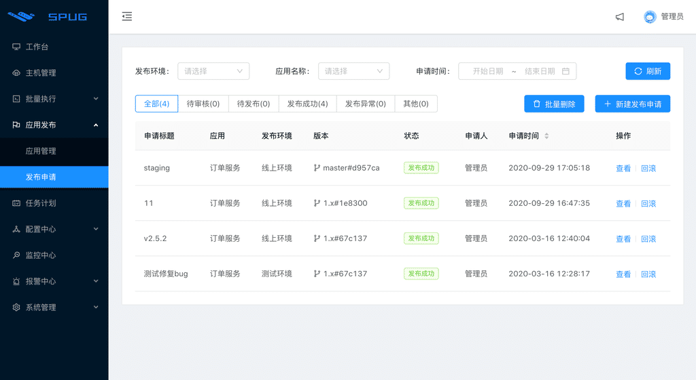
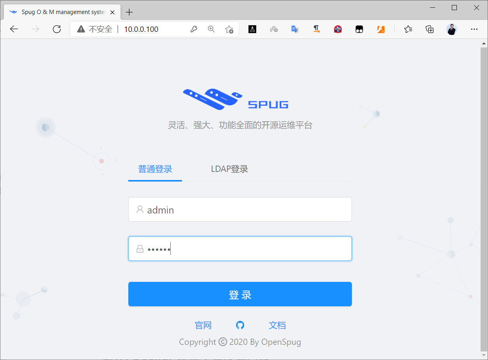
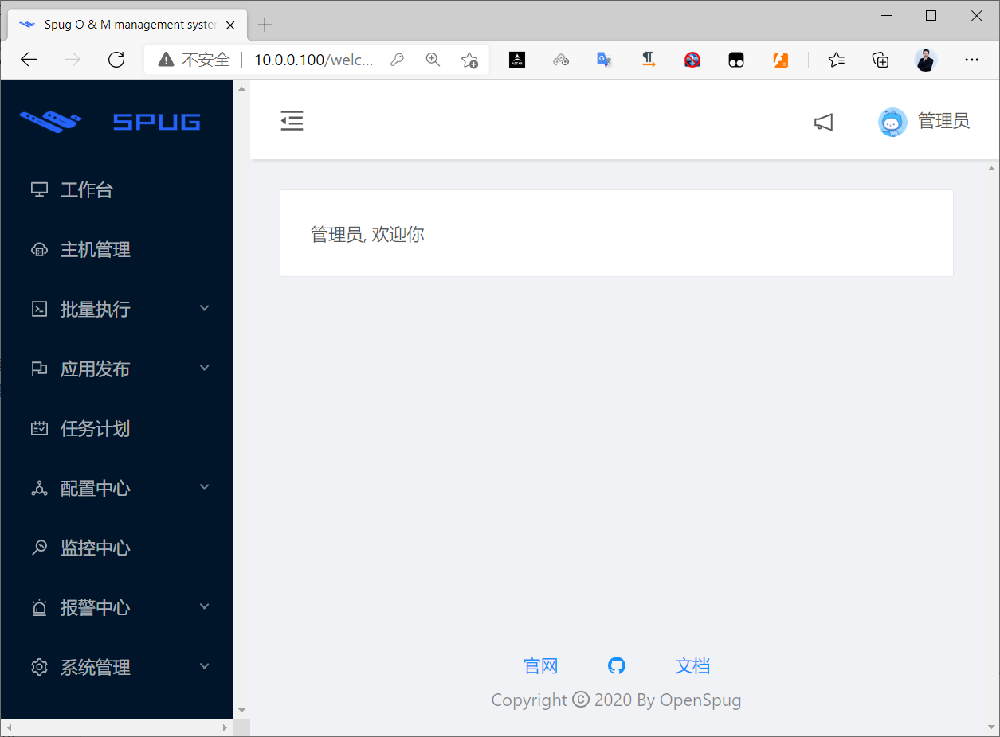

[← 返回Docker 容器技术目录]({{ '/subjects/Docker/' | relative_url }})



# 05 实战案例
### 1.5 实战案例

本篇用两个小案例串起前面学过的镜像、容器、网络和卷。示例重在理解部署关系；正式环境还需确定镜像版本、密钥管理、备份与访问控制。

### 案例一：Spug 运维平台



Spug 提供主机管理、批量执行、应用发布、任务计划与告警等功能。它不是“启动一个镜像就可以忽略数据”的无状态应用：部署时至少要考虑数据库、应用数据持久化、管理员初始化与入口安全。

可先阅读[Spug 官方 Docker 部署文档](https://spug.cc/docs/install-docker)，核对当前版本的镜像、环境变量和初始化命令。本专题第 23 篇给出了 Compose 多服务部署示例。旧资料中用单条 `docker run` 命令启动不同年代的 Spug 镜像，且把初始化密码写成固定的 `123456`；这些内容不适合直接复制到新环境。

建议按以下顺序验证：

1. 准备独立的数据目录与数据库，确认可写权限和备份位置。
2. 选定经过验证的镜像版本，使用 Compose 管理 Spug 与数据库的连接。
3. 启动后查看容器日志，再按当前版本文档创建管理员账户，使用独立强密码。
4. 从浏览器访问服务，确认登录、持久化与重启恢复均正常，再接入 HTTPS。





### 案例二：MySQL 与 WordPress 分容器运行

WordPress 需要连接数据库。不要读取 MySQL 容器在默认 bridge 网络中的临时 IP：创建用户自定义网络后，WordPress 可通过数据库容器名 `wp-db` 访问它。数据库文件和上传内容分别放入卷，避免删除容器时丢失。

```bash
docker network create wp-net
docker volume create wp-db-data
docker volume create wp-content

docker run -d --name wp-db --network wp-net \
  -e MYSQL_ROOT_PASSWORD='<数据库管理员密码>' \
  -e MYSQL_DATABASE=wordpress \
  -e MYSQL_USER=wordpress \
  -e MYSQL_PASSWORD='<应用数据库密码>' \
  -v wp-db-data:/var/lib/mysql \
  mysql:8.0

docker run -d --name wordpress --network wp-net \
  -p 8080:80 \
  -e WORDPRESS_DB_HOST=wp-db:3306 \
  -e WORDPRESS_DB_USER=wordpress \
  -e WORDPRESS_DB_PASSWORD='<应用数据库密码>' \
  -e WORDPRESS_DB_NAME=wordpress \
  -v wp-content:/var/www/html \
  wordpress:php8.2-apache
```

两处 `<应用数据库密码>` 必须相同，尖括号及说明文字应替换为实际值。这里故意不把 MySQL 的 3306 端口发布到宿主机；同一 Docker 网络内的 WordPress 已可访问数据库。生产环境应使用专门的密钥管理方式，避免明文密码留在终端历史中。

用 `docker ps` 确认两个容器已启动，再查看 `docker logs wp-db` 与 `docker logs wordpress`。数据库首次初始化可能需要时间；确认就绪后访问 `http://localhost:8080/` 完成 WordPress 安装。后续若要声明式管理两个服务，可转到本专题的 Compose 章节。



<nav class="article-end" aria-label="章节导航">
  <a href="{{ '/subjects/Docker/04-basic-container-commands.html' | relative_url }}">← 上一篇：容器操作基础命令</a>
  <a href="{{ '/subjects/Docker/' | relative_url }}">返回 Docker 容器技术目录</a>
  <a href="{{ '/subjects/Docker/06-docker-run-parameters.html' | relative_url }}">下一篇：查看 docker run 启动参数命令 →</a>
</nav>
