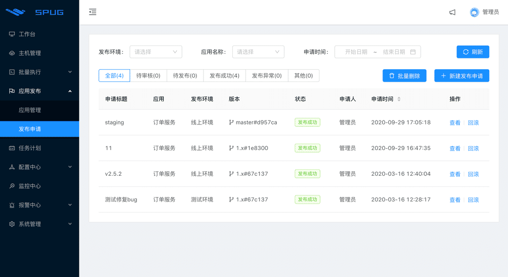
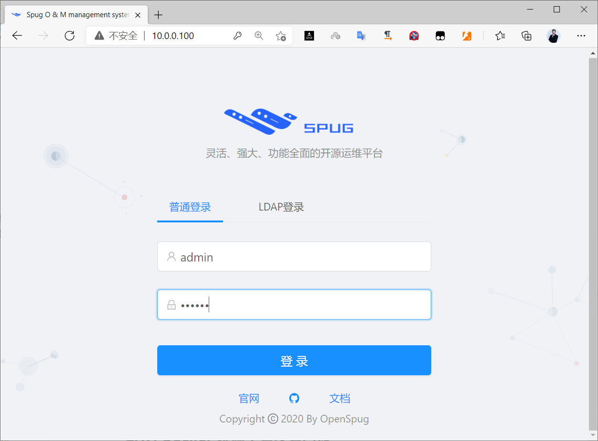
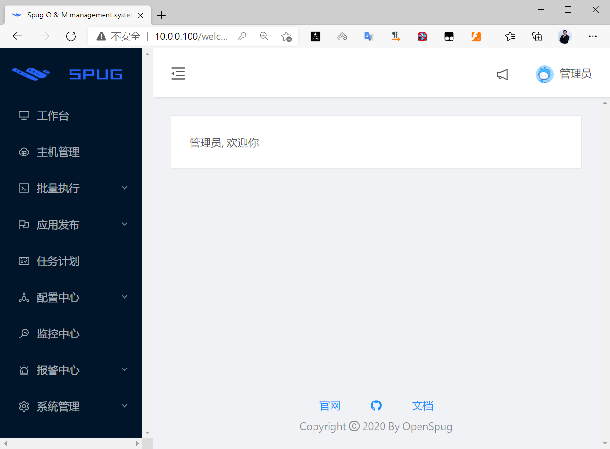

[← 返回Docker 容器技术目录]({{ '/subjects/Docker/' | relative_url }})



# 05 实战案例
### 1.5 实战案例

### 实战案例: 利用 Docker 快速部署自动化运维平台



### 项目说明

Spug （家麻雀）面向中小型企业设计的轻量级无 Agent 的自动化运维平台，整合了主机管理、主机批量执行、主机在线终端、文件在线上传下载、应用发布部署、在线任务计划、配置中心、监控、报警等一系列功能

特性

批量执行: 主机命令在线批量执行在线终端: 主机支持浏览器在线终端登录文件管理: 主机文件在线上传下载任务计划: 灵活的在线任务计划发布部署: 支持自定义发布部署流程配置中心: 支持 KV、文本、json 等格式的配置监控中心: 支持站点、端口、进程、自定义等监控报警中心: 支持短信、邮件、钉钉、微信等报警方式优雅美观: 基于 Ant Design 的 UI 界面开源免费: 前后端代码完全开源

官网地址:

```text
https://www.spug.cc
https://www.spug.dev/ #旧域名
```

使用文档：

```text
https://spug.cc/docs/about-spug/
https://www.spug.dev/docs/about-spug/    #旧域名
```

GitHub 链接：https://github.com/openspug/spug

gitee链接:  https://gitee.com/openspug/spug

### 部署过程

官方说明:

```text
https://www.spug.cc/docs/install-docker/
https://www.spug.dev/docs/install-docker/ #旧域名
```

1.5.1.2.1 安装docker

略

1.5.1.2.2 拉取镜像

```bash
[root@ubuntu1804 ~]# docker pull registry.aliyuncs.com/openspug/spug
#注意：官方镜像无法重置用户密码
[root@ubuntu1804 ~]# docker pull openspug/spug-service
```

1.5.1.2.3 启动容器

```bash
[root@ubuntu1804 ~]#docker run -d --restart=always --name=spug -p 80:80
registry.aliyuncs.com/openspug/spug
# 持久化存储启动命令：
# mydata指的是本地磁盘路径，也可以是其他目录，但需要保证映射的本地磁盘路径已经存在，/data是容
器内代码和数据初始化存储的路径
$ docker run -d --restart=always --name=spug -p 80:80 -v /mydata/:/data
registry.aliyuncs.com/openspug/spug
```

1.5.1.2.4 初始化

以下操作会创建一个用户名为 admin 密码为 123456 的管理员账户，可自行替换管理员账户。

```bash
[root@ubuntu1804 ~]#docker exec spug init_spug admin 123456
Migrations for 'account':
data/spug/spug_api/apps/account/migrations/0001_initial.py
- Create model Role
- Create model User
- Add field created_by to role
- Create model History
Migrations for 'alarm':
data/spug/spug_api/apps/alarm/migrations/0001_initial.py
- Create model Alarm
- Create model Group
- Create model Contact
Migrations for 'config':
data/spug/spug_api/apps/config/migrations/0001_initial.py
- Create model Service
- Create model Environment
- Create model ConfigHistory
- Create model Config
Migrations for 'exec':
data/spug/spug_api/apps/exec/migrations/0001_initial.py
- Create model ExecTemplate
Migrations for 'host':
data/spug/spug_api/apps/host/migrations/0001_initial.py
- Create model Host
Migrations for 'monitor':
data/spug/spug_api/apps/monitor/migrations/0001_initial.py
- Create model Detection
Migrations for 'notify':
data/spug/spug_api/apps/notify/migrations/0001_initial.py
- Create model Notify
Migrations for 'schedule':
data/spug/spug_api/apps/schedule/migrations/0001_initial.py
- Create model History
- Create model Task
Migrations for 'setting':
data/spug/spug_api/apps/setting/migrations/0001_initial.py
- Create model Setting
Migrations for 'app':
data/spug/spug_api/apps/app/migrations/0001_initial.py
- Create model App
- Create model Deploy
- Create model DeployExtend1
- Create model DeployExtend2
Migrations for 'deploy':
data/spug/spug_api/apps/deploy/migrations/0001_initial.py
- Create model DeployRequest
Operations to perform:
Apply all migrations: account, alarm, app, config, deploy, exec, host, monitor,
notify, schedule, setting
Running migrations:
Applying account.0001_initial... OK
Applying alarm.0001_initial... OK
Applying config.0001_initial... OK
Applying app.0001_initial... OK
Applying deploy.0001_initial... OK
Applying exec.0001_initial... OK
Applying host.0001_initial... OK
Applying monitor.0001_initial... OK
Applying notify.0001_initial... OK
Applying schedule.0001_initial... OK
Applying setting.0001_initial... OK
初始化/更新成功
创建用户成功
[root@ubuntu1804 ~]#
```

1.5.1.2.5 访问测试

在浏览器中输入 http://localhost:80 访问。

```text
用户名： admin  密码： 123456
```





### 实战案例：两个容器运行Wordpress博客系统

```text
#方法1
docker run -d --name mysql -e MYSQL_ROOT_PASSWORD=123456 -e
MYSQL_DATABASE=wordpress -e MYSQL_USER=wordpress -e MYSQL_PASSWORD=123456
registry.cn-beijing.aliyuncs.com/bowenxiaochun/mysql:8.0.29-oracle
#连接数据库的信息通过环境变量指定，MySQL容器重启IP可能会发生变化
docker run -d --name wordpress -p 80:80 -e WORDPRESS_DB_HOST=`docker inspect
mysql --format "{{.NetworkSettings.Networks.bridge.IPAddress}}"` -e
WORDPRESS_DB_USER=wordpress -e WORDPRESS_DB_PASSWORD=123456 -e
WORDPRESS_DB_NAME=wordpress registry.cn-
beijing.aliyuncs.com/bowenxiaochun/wordpress:php8.2-apache
#方法2：需要初始化人为输入连接数据库信息
docker run -d --name mysql -p 3306:3306 -e MYSQL_ROOT_PASSWORD=123456 -e
MYSQL_DATABASE=wordpress -e MYSQL_USER=wordpress -e MYSQL_PASSWORD=123456
registry.cn-beijing.aliyuncs.com/bowenxiaochun/mysql:8.0.29-oracle
#连接数据库的主机：宿主机的IP
docker run -d -p 80:80 --name wordpress -e WORDPRESS_DB_HOST=<宿主机的IP>  -e
WORDPRESS_DB_USER=wordpress -e WORDPRESS_DB_PASSWORD=123456 -e
WORDPRESS_DB_NAME=wordpress registry.cn-
beijing.aliyuncs.com/bowenxiaochun/wordpress:php8.2-apache
docker run -d --name wordpress -p 80:80 registry.cn-
beijing.aliyuncs.com/bowenxiaochun/wordpress:php8.2-apache
```



<nav class="article-end" aria-label="章节导航">
  <a href="{{ '/subjects/Docker/04-basic-container-commands.html' | relative_url }}">← Previous: Basic Container Commands</a>
  <a href="{{ '/subjects/Docker/' | relative_url }}">Back to Docker Container Technology Index</a>
  <a href="{{ '/subjects/Docker/06-docker-run-parameters.html' | relative_url }}">Next: Docker Run Parameters →</a>
</nav>
