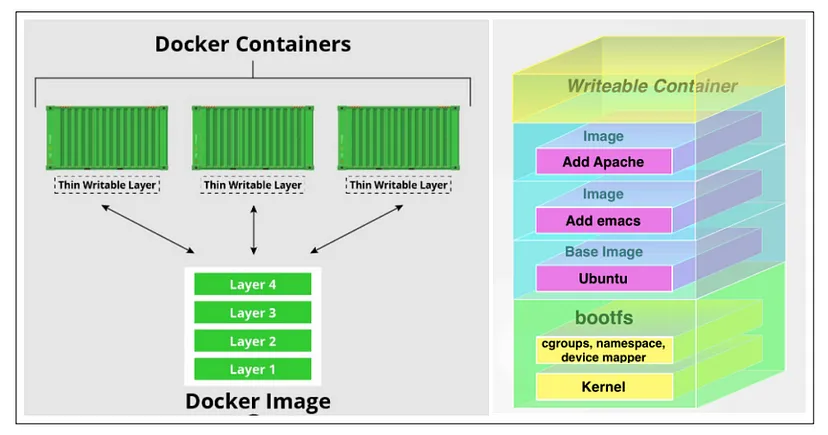

[← Back to Docker Container Technology Index]({{ '/subjects/Docker/' | relative_url }})



# 08 Docker Image Fundamentals
## 2 Docker 镜像制作

### 2.1 Docker 镜像说明



### 镜像中有没有内核

镜像为了更小和运行效率，镜像中是不包含内核的，而使用宿主机的内核

镜像本身则只提供应用所依赖的根文件系统和相关文件，即系统运行所必要的文件目录，比如: /sys, /dev/，/proc，/bin，/etc等目录

基于内核的名称空间实现容器的各种资源隔离

### 容器中的程序后台运行会导致此容器启动后立即退出

当容器启动时，它会运行一个指定的初始化主程序，通常是容器的PID 1。如果这个主进程退出或停止， 容器也会相应地退出和停止。

在Docker容器中的初始化进程可以被Dockerfile中的CMD或ENTRYPOINT指令所指明；也可以被docker run命令的启动参数所覆盖。

如果主进程以后台方式运行，因为容器认为主进程已经完成，它就会停止整个容器。

Docker容器如果希望启动后能持续运行,就必须有一个能前台并持续运行的进程

此进程可以为PID为1的主进程，也可以是PID为1的主进程的子进程，

即一个容器要持续运行，必需有一个进程是前台执行的进程，如果此前台的进程或者PID为1的主进程被停止，容器将退出

如果在容器中启动传统的服务，如:httpd,php-fpm等均为后台进程模式运行,就导致 docker 在前台没有运行的应用,这样的容器启动后会立即退出。所以一般会将服务程序以前台方式运行

对于有一些可能不知道怎么实现前台运行的程序,只需要在启动该程序之后添加类似于 tail ，top 这种可以前台运行的程序即可.

比较常用的方法，如 tail  -f  /etc/hosts 。

范例:

```bash
#httpd
ENTRYPOINT [ "/usr/sbin/apache2" ]
CMD ["-D", "FOREGROUND"]
#nginx
ENTRYPOINT [ "/usr/sbin/nginx", "-g", "daemon off;" ]
#用脚本运行容器
cat run_haproxy.sh
#!/bin/bash
haproxy -f /etc/haproxy/haproxy.cfg
tail -f /etc/hosts
tail -n1 Dockerfile
CMD ["run_haproxy.sh"]
```

### Docker 镜像生命周期


### 制作镜像方式

Docker 镜像制作类似于虚拟机的镜像（模版）制作，即按照公司的实际业务需求将需要安装的软件、相关配置等基础环境配置完成，然后将其做成镜像，最后再批量从镜像批量生成容器实例，这样可以极大的简化相同环境的部署工作.

Docker的镜像制作分为手动制作（基于容器）和自动制作(基于DockerFile)，企业通常都是基于 Dockerfile制作镜像

```text
#通过修改现有容器,将之手动构建为新镜像
docker commit
#通过Dockerfile文件,批量构建为镜像
docker build
#从tar文件生成镜像,tar文件可以通过docker export 容器 -o tar文件，此方式会丢失如源镜像中
CMD，EXPOSE等属性，很少使用
docker import 容器tar文件  REPOSITORY[:TAG]
```



<nav class="article-end" aria-label="章节导航">
  <a href="{{ '/subjects/Docker/07-container-live-migration-with-criu.html' | relative_url }}">← Previous: Container Live Migration with CRIU</a>
  <a href="{{ '/subjects/Docker/' | relative_url }}">Back to Docker Container Technology Index</a>
  <a href="{{ '/subjects/Docker/09-building-images-with-docker-commit.html' | relative_url }}">Next: Building Images with Docker Commit →</a>
</nav>
