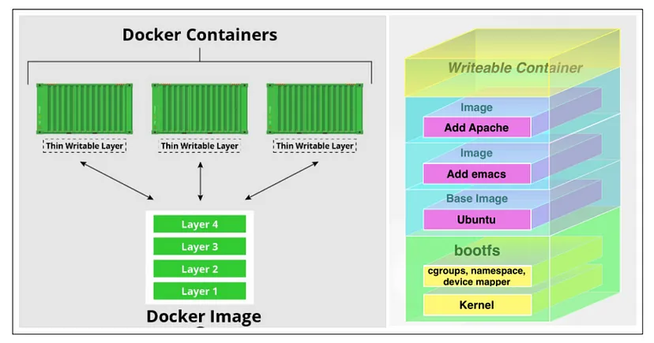
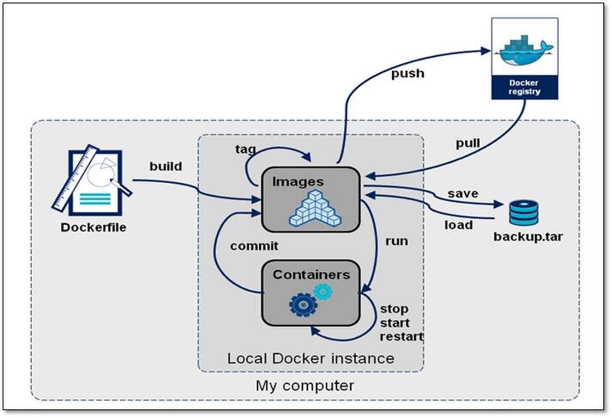

[← 返回Docker 容器技术目录]({{ '/subjects/Docker/' | relative_url }})



# 08 Docker 镜像说明
## 2 Docker 镜像制作

### 2.1 Docker 镜像说明



### 镜像中有没有内核

Docker 镜像通常包含应用程序、依赖以及运行所需的根文件系统，但**不包含独立的操作系统内核**。容器运行时共享宿主机内核，通过命名空间隔离进程、网络等视图，并通过 cgroups 管理资源。

镜像中的 `/bin`、`/etc` 等目录来自镜像层；`/proc`、`/sys`、`/dev` 等特殊文件系统通常由容器运行时在启动时挂载，不能简单视为镜像自带的普通文件。

### 容器中的程序后台运行会导致此容器启动后立即退出

容器的生命周期取决于其主进程（容器内的 PID 1）：主进程退出，容器就停止。这个进程由 Dockerfile 中的 `ENTRYPOINT`、`CMD` 或 `docker run` 的命令参数确定。

因此，如果启动脚本把服务放到后台后立即退出，容器也会停止。应优先使用服务程序提供的前台运行选项，或在启动脚本末尾用 `exec` 运行服务，让它接管 PID 1。用 `tail -f` 勉强维持容器运行会掩盖服务退出，不能作为生产部署的健康检查方案。

范例:

```dockerfile
# Apache 保持前台运行
ENTRYPOINT [ "/usr/sbin/apache2" ]
CMD ["-D", "FOREGROUND"]

# Nginx 保持前台运行（与上面的 Apache 示例二选一）
ENTRYPOINT [ "/usr/sbin/nginx", "-g", "daemon off;" ]
```

若使用启动脚本，脚本末行可写成 `exec haproxy -db -f /etc/haproxy/haproxy.cfg`；`-db` 使 HAProxy 保持前台运行。

### Docker 镜像生命周期



### 制作镜像方式

镜像把应用及其依赖封装为可复用的交付物，同一镜像可以创建多个容器。常见制作方式如下：

| 方式 | 命令 | 适用场景 |
| --- | --- | --- |
| 声明式构建 | `docker build` | 根据 Dockerfile 重复构建，便于版本管理和自动化，通常是首选。 |
| 保存容器改动 | `docker commit` | 临时实验或排查；操作过程不易复现，不宜代替 Dockerfile。 |
| 导入文件系统 | `docker import` | 从 `docker export` 得到的 tar 包创建镜像；不会保留原镜像的 `CMD`、`EXPOSE` 等配置。 |

`docker save` / `docker load` 用于完整导出、导入镜像，与 `export` / `import` 导出容器文件系统不同。



<nav class="article-end" aria-label="章节导航">
  <a href="{{ '/subjects/Docker/07-container-live-migration-with-criu.html' | relative_url }}">← 上一篇：使用 CRIU 迁移容器</a>
  <a href="{{ '/subjects/Docker/' | relative_url }}">返回 Docker 容器技术目录</a>
  <a href="{{ '/subjects/Docker/09-building-images-with-docker-commit.html' | relative_url }}">下一篇：使用 docker commit 构建镜像 →</a>
</nav>
