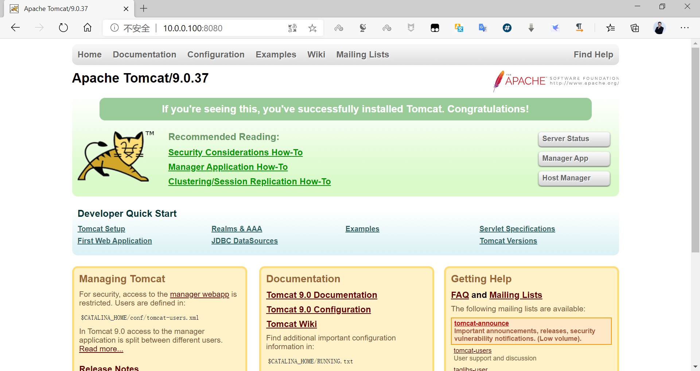

[← Back to Docker Container Technology Index]({{ '/subjects/Docker/' | relative_url }})



# 09 Building Images with Docker Commit
### 2.2 将现有容器通过 docker commit 手动构建镜像

### 基于容器手动制作镜像步骤

docker commit 格式

```text
docker commit [OPTIONS] CONTAINER [REPOSITORY[:TAG]]
#选项
-a, --author string    Author (e.g., "John Hannibal Smith <hannibal@a-
team.com>")
-c, --change list      Apply Dockerfile instruction to the created image
-m, --message string   Commit message
-p, --pause            Pause container during commit (default true)
#说明:
制作镜像和CONTAINER状态无关,停止状态也可以制作镜像
如果没有指定[REPOSITORY[:TAG]],REPOSITORY和TAG都为<none>
提交的时候标记TAG号:  生产当中常用，后期可以根据TAG标记创建不同版本的镜像以及创建不同版本的容器
```

基于容器手动制作镜像步骤具体如下:

1. 下载一个系统的官方基础镜像，如:  CentOS 或 Ubuntu

2. 基于基础镜像启动一个容器,并进入到容器

3. 在容器里面做配置操作

安装基础命令配置运行环境安装服务和配置服务放业务程序代码

4. 提交为一个新镜像 docker commit

5. 基于自己的的镜像创建容器并测试访问

### 实战案例: 基于 busybox 制作 httpd 镜像

```bash
[root@ubuntu1804 ~]#docker run -it --name b1 busybox
/ # ls
bin   dev   etc   home  proc  root  sys   tmp   usr   var
/ # mkdir /data/html -p
/ # echo httpd website in busybox > /data/html/index.html
/ # httpd --help
BusyBox v1.32.0 (2020-06-27 00:20:57 UTC) multi-call binary
Usage: httpd [-ifv[v]] [-c CONFFILE] [-p [IP:]PORT] [-u USER[:GRP]] [-r REALM] [-
h HOME]
or httpd -d/-e/-m STRING
Listen for incoming HTTP requests
-i      Inetd mode
-f      Don't daemonize
-v[v]       Verbose 显示访问日志
-p [IP:]PORT    Bind to IP:PORT (default *:80)
-u USER[:GRP]   Set uid/gid after binding to port
-r REALM    Authentication Realm for Basic Authentication
-h HOME     Home directory (default .)
-c FILE     Configuration file (default {/etc,HOME}/httpd.conf)
-m STRING   MD5 crypt STRING
-e STRING   HTML encode STRING
-d STRING   URL decode STRING
/ # exit
```

```bash
#格式1
[root@ubuntu1804 ~]#docker commit -a "bowen<root@bowenxiaochun.com>" -c 'CMD
/bin/httpd -fv -h /data/html' -c "EXPOSE 80" b1 httpd-busybox:v1.0
#格式2
[root@ubuntu1804 ~]#docker commit -a "bowen<root@bowenxiaochun.com>" -c 'CMD
["/bin/httpd", "-f", "-v","-h", "/data/html"]' -c "EXPOSE 80" b1 httpd-
busybox:v1.0
[root@ubuntu1804 ~]#docker images
REPOSITORY          TAG                 IMAGE ID            CREATED
SIZE
httpd-busybox       v1.0                e7883146c119        6 minutes ago
1.22MB
[root@ubuntu1804 ~]#docker run  -d -P --name httpd01 httpd-busybox:v1.0
ce95174c6385392b9699d12d1a86d7f81bc4dde1400a071ce17d9c78d905cb12
[root@ubuntu1804 ~]#docker port httpd01
80/tcp -> 0.0.0.0:32783
[root@ubuntu1804 ~]#docker inspect -f "
{{.NetworkSettings.Networks.bridge.IPAddress}}" httpd01
172.17.0.2
#对应格式1
[root@ubuntu1804 ~]#docker inspect -f "{{.Config.Cmd}}" httpd01
[/bin/sh -c /bin/httpd -f -h /data/html]
#对应格式2
[root@ubuntu1804 ~]#docker inspect -f "{{.Config.Cmd}}" httpd01
[/bin/httpd -f -h /data/html]
[root@ubuntu1804 ~]#docker exec -it httpd01 sh
/ # pstree -p
httpd(1)
/ # ps aux
PID   USER     TIME  COMMAND
1 root      0:00 /bin/httpd -fv -h /data/html
7 root      0:00 sh
13 root      0:00 ps aux
/ #
[root@ubuntu1804 ~]#curl 172.17.0.2
httpd website in busybox
[root@ubuntu1804 ~]#curl 127.0.0.1:32783
httpd website in busybox
#再次制作镜像v2.0版
[root@ubuntu1804 ~]#docker commit -a "bowen<root@bowenxiaochun.com>" b1  httpd-
busybox:v2.0
[root@ubuntu1804 ~]#docker run -d --name web2 -p 81:80   httpd-busybox:v2.0
/bin/httpd -fv -h /data/html
c47bce0de75dcdf88266467accbe0a119190999c23cec32d6af8b8500aed96d4
```

### 实战案例: 基于官方镜像生成的容器制作 tomcat 镜像

### 下载官方的tomcat镜像并运行

```bash
[root@ubuntu1804 ~]#docker images
REPOSITORY          TAG                 IMAGE ID            CREATED
SIZE
[root@ubuntu1804 ~]#docker run -d -p 8080:8080 tomcat
Unable to find image 'tomcat:latest' locally
latest: Pulling from library/tomcat
e9afc4f90ab0: Pull complete
989e6b19a265: Pull complete
af14b6c2f878: Pull complete
5573c4b30949: Pull complete
fb1a405f128d: Pull complete
612a9f566fdc: Pull complete
4226f9b63dac: Pull complete
cb8bfe875d7f: Pull complete
5aa366608b6d: Pull complete
4b7c9018ca5f: Pull complete
Digest: sha256:46456ccf216f2fde198844d5c7d511f60e3ffc2ea3828e0cce9a2eed566e48e2
Status: Downloaded newer image for tomcat:latest
6fcc5f7c1c7ce7be0b12007e310fc044e1077d489e1292b22621de55e302c455
[root@ubuntu1804 ~]#docker ps
CONTAINER ID        IMAGE               COMMAND             CREATED
STATUS              PORTS                    NAMES
6fcc5f7c1c7c        tomcat              "catalina.sh run"   42 seconds ago
Up 40 seconds       0.0.0.0:8080->8080/tcp   focused_wilbur
[root@ubuntu1804 ~]#curl -I 127.0.0.1:8080
HTTP/1.1 404
Content-Type: text/html;charset=utf-8
Content-Language: en
Transfer-Encoding: chunked
Date: Mon, 20 Jul 2020 15:33:21 GMT
```

### 修改容器

```bash
[root@ubuntu1804 ~]#docker exec -it 6fcc5f7c1c7c bash
root@6fcc5f7c1c7c:/usr/local/tomcat# ls
BUILDING.txt     LICENSE  README.md  RUNNING.txt  conf  logs        temp
webapps.dist
CONTRIBUTING.md  NOTICE   RELEASE-NOTES  bin          lib   native-jni-lib
webapps  work
root@6fcc5f7c1c7c:/usr/local/tomcat# ls webapps
root@6fcc5f7c1c7c:/usr/local/tomcat# ls webapps.dist/
ROOT  docs  examples  host-manager  manager
root@6fcc5f7c1c7c:/usr/local/tomcat# cp -a webapps.dist/* webapps/
root@6fcc5f7c1c7c:/usr/local/tomcat# ls webapps/
ROOT  docs  examples  host-manager  manager
root@6fcc5f7c1c7c:/usr/local/tomcat# exit
exit
[root@ubuntu1804 ~]#curl -I 127.0.0.1:8080
HTTP/1.1 200
Content-Type: text/html;charset=UTF-8
Transfer-Encoding: chunked
Date: Mon, 20 Jul 2020 15:34:24 GMT
```

### 提交新镜像

```xml
[root@ubuntu1804 ~]#docker commit -m "add webapps app" -a "bowenxiaochun"
6fcc5f7c1c7c tomcat:9.0.37-v1
sha256:b8d669ebf99e65d5ed69378d0d53f054e7de4865d335ab7aa0a7a5508e1369f7
[root@ubuntu1804 ~]#docker images
REPOSITORY          TAG                 IMAGE ID            CREATED
SIZE
tomcat              9.0.37-v1           b8d669ebf99e        4 seconds ago
652MB
tomcat              latest              df72227b40e1        3 days ago
647MB
[root@ubuntu1804 ~]#docker history tomcat:9.0.37-v1
IMAGE               CREATED             CREATED BY
SIZE                COMMENT
b8d669ebf99e        14 minutes ago      catalina.sh run
4.84MB              add webapps app
df72227b40e1        3 days ago          /bin/sh -c #(nop)  CMD ["catalina.sh"
"run"]    0B
<missing>           3 days ago          /bin/sh -c #(nop)  EXPOSE 8080
0B
<missing>           3 days ago          /bin/sh -c set -e  &&
nativeLines="$(catalin…   0B
<missing>           3 days ago          /bin/sh -c set -eux;
savedAptMark="$(apt-m…   20MB
<missing>           3 days ago          /bin/sh -c #(nop)  ENV
TOMCAT_SHA512=077c3e6…   0B
<missing>           3 days ago          /bin/sh -c #(nop)  ENV
TOMCAT_VERSION=9.0.37    0B
<missing>           3 days ago          /bin/sh -c #(nop)  ENV TOMCAT_MAJOR=9
0B
<missing>           3 days ago          /bin/sh -c #(nop)  ENV
GPG_KEYS=05AB33110949…   0B
<missing>           3 days ago          /bin/sh -c #(nop)  ENV
LD_LIBRARY_PATH=/usr/…   0B
<missing>           3 days ago          /bin/sh -c #(nop)  ENV
TOMCAT_NATIVE_LIBDIR=…   0B
<missing>           3 days ago          /bin/sh -c #(nop) WORKDIR
/usr/local/tomcat     0B
<missing>           3 days ago          /bin/sh -c mkdir -p "$CATALINA_HOME"
0B
<missing>           3 days ago          /bin/sh -c #(nop)  ENV
PATH=/usr/local/tomca…   0B
<missing>           3 days ago          /bin/sh -c #(nop)  ENV
CATALINA_HOME=/usr/lo…   0B
<missing>           3 days ago          /bin/sh -c #(nop)  CMD ["jshell"]
0B
<missing>           3 days ago          /bin/sh -c set -eux;   dpkgArch="$(dpkg
--pr…   323MB
<missing>           3 days ago          /bin/sh -c #(nop)  ENV
JAVA_URL_VERSION=11.0…   0B
<missing>           3 days ago          /bin/sh -c #(nop)  ENV
JAVA_BASE_URL=https:/…   0B
<missing>           3 days ago          /bin/sh -c #(nop)  ENV
JAVA_VERSION=11.0.8      0B
<missing>           5 weeks ago         /bin/sh -c { echo '#/bin/sh'; echo 'echo
"$J…   27B
<missing>           5 weeks ago         /bin/sh -c #(nop)  ENV
PATH=/usr/local/openj…   0B
<missing>           5 weeks ago         /bin/sh -c #(nop)  ENV
JAVA_HOME=/usr/local/…   0B
<missing>           5 weeks ago         /bin/sh -c #(nop)  ENV LANG=C.UTF-8
0B
<missing>           5 weeks ago         /bin/sh -c set -eux;  apt-get update;
apt-g…   11.1MB
<missing>           5 weeks ago         /bin/sh -c apt-get update && apt-get
install…   146MB
<missing>           5 weeks ago         /bin/sh -c set -ex;  if ! command -v gpg
> /…   17.5MB
<missing>           5 weeks ago         /bin/sh -c apt-get update && apt-get
install…   16.5MB
<missing>           5 weeks ago         /bin/sh -c #(nop)  CMD ["bash"]
0B
<missing>           5 weeks ago         /bin/sh -c #(nop) ADD
file:1ab357efe422cfed5…   114MB
```

```json
[root@ubuntu1804 ~]#docker inspect tomcat:9.0.37-v1 |tail -n20
"Type": "layers",
"Layers": [
"sha256:8803ef42039dcbe936755e9baae4bb7b19cb0fb6a438eb3992950cd0afef8e4f",
"sha256:c2c789d2d3c5fc15428921b5316a63907d8c312c5508cbac9a704bd30bcc740d",
"sha256:527ade4639e08d1b2ba9d0d46f3b43433310a2e8674ae808aeef5502b099ff3c",
"sha256:2e5b4ca91984c19a75bad687aedebf02609511a033aa0d3d15ac915593279718",
"sha256:f5181c7ef9028578eb0040a0051ce940c3f9ba62a51d3eb02ad52c3724db3e9b",
"sha256:f73b2345c404b2a65abc66ab68af6b112aafb9d2583416d2eb84a47139e4626e",
"sha256:afa12e842ed4e07340351e64318d3149b3ec8430f631d9bbe8e0d3ac24046cff",
"sha256:31d7eb4c72a987dd8742add724562e0e800998cb7a57f7ed0c6dffa0587b5af4",
"sha256:4b1785e8102bdcc4f7bb759d084e1f03b2b26c19fa42aa91c879ce26f36381d7",
"sha256:aca03caac7b1c380545a00f970a42079bbc8928c9785492e9e289f60206b01e1",
"sha256:860b0f130267d185ed8328a5fcd3ecd040a7afec64b63f7551c5f3af80709db5"
]
},
"Metadata": {
"LastTagTime": "2020-07-20T23:42:00.403415564+08:00"
}
}
]
#删除当前的容器
[root@ubuntu1804 ~]#docker rm -f 6fcc5f7c1c7c
6fcc5f7c1c7c
[root@ubuntu1804 ~]#docker ps
CONTAINER ID        IMAGE               COMMAND             CREATED
STATUS              PORTS               NAMES
```

### 利用新镜像启动容器

```bash
[root@ubuntu1804 ~]#docker run  -d -p 8080:8080 --name tomcat tomcat:9.0.37-v1
97688b4c835da4b222f3ca15af36b8c27d4e60ff33480c314daf3f123b1cb50c
[root@ubuntu1804 ~]#docker ps
CONTAINER ID        IMAGE               COMMAND             CREATED
STATUS              PORTS                    NAMES
97688b4c835d        tomcat:9.0.37-v1    "catalina.sh run"   6 seconds ago
Up 5 seconds        0.0.0.0:8080->8080/tcp   tomcat
```

### 测试新镜像启动的容器

浏览器访问http://10.0.0.100:8080/ 可以看到下面显示



### 实战案例: 基于Ubuntu的基础镜像利用 apt 安装手动制作 nginx 的镜像

### 启动Ubuntu基础镜像并实现相关的配置

```bash
[root@ubuntu1804 ~]#docker run -it -p 80 --name nginx_ubuntu ubuntu bash
root@705148273eac:/# cat /etc/os-release
NAME="Ubuntu"
VERSION="20.04 LTS (Focal Fossa)"
ID=ubuntu
ID_LIKE=debian
PRETTY_NAME="Ubuntu 20.04 LTS"
VERSION_ID="20.04"
HOME_URL="https://www.ubuntu.com/"
SUPPORT_URL="https://help.ubuntu.com/"
BUG_REPORT_URL="https://bugs.launchpad.net/ubuntu/"
PRIVACY_POLICY_URL="https://www.ubuntu.com/legal/terms-and-policies/privacy-
policy"
VERSION_CODENAME=focal
UBUNTU_CODENAME=focal
root@705148273eac:/# ll /etc/apt/sources.list
-rw-r--r-- 1 root root 2743 Jul  3 02:00 /etc/apt/sources.list
#修改仓库源
#方法1
root@705148273eac:/# sed -i 's/cn.archive.ubuntu.com/mirrors.ustc.edu.cn/'
/etc/apt/sources.list
#方法2
root@705148273eac:/# cat > /etc/apt/sources.list
deb http://mirrors.aliyun.com/ubuntu/ focal main restricted universe multiverse
deb-src http://mirrors.aliyun.com/ubuntu/ focal main restricted universe
multiverse
deb http://mirrors.aliyun.com/ubuntu/ focal-security main restricted universe
multiverse
deb-src http://mirrors.aliyun.com/ubuntu/ focal-security main restricted universe
multiverse
deb http://mirrors.aliyun.com/ubuntu/ focal-updates main restricted universe
multiverse
deb-src http://mirrors.aliyun.com/ubuntu/ focal-updates main restricted universe
multiverse
deb http://mirrors.aliyun.com/ubuntu/ focal-proposed main restricted universe
multiverse
deb-src http://mirrors.aliyun.com/ubuntu/ focal-proposed main restricted universe
multiverse
deb http://mirrors.aliyun.com/ubuntu/ focal-backports main restricted universe
multiverse
deb-src http://mirrors.aliyun.com/ubuntu/ focal-backports main restricted
universe multiverse
^C
root@705148273eac:/# apt update
Get:1 http://mirrors.aliyun.com/ubuntu focal InRelease [265 kB]
Get:2 http://mirrors.aliyun.com/ubuntu focal-security InRelease [107 kB]
Get:3 http://mirrors.aliyun.com/ubuntu focal-updates InRelease [111 kB]
Get:4 http://mirrors.aliyun.com/ubuntu focal-proposed InRelease [265 kB]
Get:5 http://mirrors.aliyun.com/ubuntu focal-backports InRelease [98.3 kB]
Get:6 http://mirrors.aliyun.com/ubuntu focal/restricted Sources [7198 B]
Get:7 http://mirrors.aliyun.com/ubuntu focal/multiverse Sources [208 kB]
......
Fetched 28.7 MB in 6s (4651 kB/s)
Reading package lists... Done
Building dependency tree
Reading state information... Done
8 packages can be upgraded. Run 'apt list --upgradable' to see them.
root@705148273eac:/# apt -y install nginx
Reading package lists... Done
Building dependency tree
Reading state information... Done
The following additional packages will be installed:
........
Configuring tzdata
------------------
Please select the geographic area in which you live. Subsequent configuration
questions will narrow this down
by presenting a list of cities, representing the time zones in which they are
located.
1. Africa   3. Antarctica  5. Arctic  7. Atlantic  9. Indian    11. SystemV
13. Etc
2. America  4. Australia   6. Asia    8. Europe    10. Pacific  12. US
Geographic area: 6
Please select the city or region corresponding to your time zone.
1. Aden      16. Brunei       31. Hong_Kong    46. Kuala_Lumpur  61. Pyongyang
76. Tehran
2. Almaty    17. Chita        32. Hovd         47. Kuching       62. Qatar
77. Tel_Aviv
3. Amman     18. Choibalsan   33. Irkutsk      48. Kuwait        63. Qostanay
78. Thimphu
4. Anadyr    19. Chongqing    34. Istanbul     49. Macau         64. Qyzylorda
79. Tokyo
5. Aqtau     20. Colombo      35. Jakarta      50. Magadan       65. Rangoon
80. Tomsk
6. Aqtobe    21. Damascus     36. Jayapura     51. Makassar      66. Riyadh
81. Ujung_Pandang
7. Ashgabat  22. Dhaka        37. Jerusalem    52. Manila        67. Sakhalin
82. Ulaanbaatar
8. Atyrau    23. Dili         38. Kabul        53. Muscat        68. Samarkand
83. Urumqi
9. Baghdad   24. Dubai        39. Kamchatka    54. Nicosia       69. Seoul
84. Ust-Nera
10. Bahrain  25. Dushanbe     40. Karachi      55. Novokuznetsk  70. Shanghai
85. Vientiane
11. Baku     26. Famagusta    41. Kashgar      56. Novosibirsk   71. Singapore
86. Vladivostok
12. Bangkok  27. Gaza         42. Kathmandu    57. Omsk          72.
Srednekolymsk  87. Yakutsk
13. Barnaul  28. Harbin       43. Khandyga     58. Oral          73. Taipei
88. Yangon
14. Beirut   29. Hebron       44. Kolkata      59. Phnom_Penh    74. Tashkent
89. Yekaterinburg
15. Bishkek  30. Ho_Chi_Minh  45. Krasnoyarsk  60. Pontianak     75. Tbilisi
90. Yerevan
Time zone: 70   #配置时区
......
Setting up nginx-core (1.18.0-0ubuntu1) ...
invoke-rc.d: could not determine current runlevel
invoke-rc.d: policy-rc.d denied execution of start.
Setting up nginx (1.18.0-0ubuntu1) ...
Processing triggers for libc-bin (2.31-0ubuntu9) ...
root@705148273eac:/# nginx -v
nginx version: nginx/1.18.0 (Ubuntu)
root@705148273eac:~# grep include /etc/nginx/nginx.conf
include /etc/nginx/modules-enabled/*.conf;
include /etc/nginx/mime.types;
include /etc/nginx/conf.d/*.conf;
include /etc/nginx/sites-enabled/*;
root@705148273eac:~# grep root /etc/nginx/sites-enabled/default
root /var/www/html;
# deny access to .htaccess files, if Apache's document root
#   root /var/www/example.com;
root@705148273eac:/# echo Nginx Website in Docker >  /var/www/html/index.html
root@705148273eac:/# exit
exit
```

### 提交为镜像

```bash
[root@ubuntu1804 ~]#docker commit -a 'bowenxiaochun' -m 'nginx-ubuntu:20.04'
nginx_ubuntu nginx_ubuntu20.04:v1.18.0
sha256:2c789ec21d2545c9bfc4af6d4380878153d52fcc03890aac755d09112631742a
[root@ubuntu1804 ~]#docker images
REPOSITORY             TAG                 IMAGE ID            CREATED
SIZE
nginx_ubuntu20.04      v1.18.0             2c789ec21d25        22 seconds ago
179MB
```

### 从制作的新镜像启动容器并测试访问

```bash
[root@ubuntu1804 ~]#docker run -d -p 80 --name nginx-web
nginx_ubuntu20.04:v1.18.0 nginx -g 'daemon off;'
b0c8496a497ba60f7b5bc430b075b00d40c7ace24068e71decac625e84df40de
[root@ubuntu1804 ~]#docker ps
CONTAINER ID        IMAGE                       COMMAND                  CREATED
STATUS              PORTS                   NAMES
b0c8496a497b        nginx_ubuntu20.04:v1.18.0   "nginx -g 'daemon of…"   7
seconds ago       Up 5 seconds        0.0.0.0:32771->80/tcp   nginx-web
[root@ubuntu1804 ~]#docker port nginx-web
80/tcp -> 0.0.0.0:32771
[root@ubuntu1804 ~]#curl http://127.0.0.1:32771
Nginx Website in Docker
```

### 实战案例: 基于CentOS的基础镜像利用 yum 安装手动制作 nginx 的镜像

### 下载基础镜像并初始化系统

基于某个基础镜像之上重新制作，因此需要先有一个基础镜像，本次使用官方提供的centos镜像为基础

```bash
[root@ubuntu1804 ~]#docker pull centos:centos7.7.1908
[root@ubuntu1804 ~]#docker images
REPOSITORY          TAG                 IMAGE ID            CREATED
SIZE
centos              centos7.7.1908      08d05d1d5859        2 months ago
204MB
[root@ubuntu1804 ~]#docker run -it centos:centos7.7.1908 bash
#修改时区
[root@9caa8742e6ce /]#rm -f /etc/localtime
[root@9caa8742e6ce /]#ln -s ../usr/share/zoneinfo/Asia/Shanghai /etc/localtime
[root@9caa8742e6ce /]#yum -y install wget
[root@9caa8742e6ce /]#rm -rf /etc/yum.repos.d/*
#更改yum 源
[root@9caa8742e6ce /]# wget -P /etc/yum.repos.d/
http://mirrors.aliyun.com/repo/Centos-7.repo
[root@9caa8742e6ce /]# wget -P /etc/yum.repos.d/
http://mirrors.aliyun.com/repo/epel-7.repo
```

### 安装相关软件和工具

```bash
#yum安装nginx
[root@9caa8742e6ce /]# yum install nginx –y
#安装常用命令
[root@9caa8742e6ce /]# yum install -y vim curl iproute net-tools
#清理yum缓存
[root@9caa8742e6ce /]# rm -rf /var/cache/yum/*
```

### 修改服务的配置信息关闭服务后台运行

```bash
#关闭nginx后台运行
[root@9caa8742e6ce /]# vim /etc/nginx/nginx.conf
user nginx;
daemon off; #关闭后台运行
```

### 准备程序和数据

```bash
#自定义web界面
[root@9caa8742e6ce ~]# rm -f /usr/share/nginx/html/index.html
[root@9caa8742e6ce ~]# echo "Nginx Page in Docker" >
/usr/share/nginx/html/index.html
```

### 提交为镜像

docker commit 命令在宿主机基于容器ID 提交为镜像

```bash
#不关闭容器的情况,将容器提交为镜像
[root@ubuntu1804 ~]#docker commit -a "root@bowenxiaochun.com" -m "nginx yum v1" -
c "EXPOSE 80 443" 9caa8742e6ce bowen/centos7-nginx:1.16.1.v1
sha256:e9d09cc585ed8ee1544b1e68de326ea6dcbe99577fc9b2edad9ab481b7a7e7ec
[root@ubuntu1804 ~]#docker images
REPOSITORY           TAG                 IMAGE ID            CREATED
SIZE
bowen/centos7-nginx   1.16.1.v1           e9d09cc585ed        4 seconds ago
442MB
centos               centos7.7.1908      08d05d1d5859        2 months ago
204MB
```

### 从制作的镜像启动容器

```bash
[root@ubuntu1804 ~]#docker run -d -p 8080:80 --name my-centos-nginx
bowen/centos7-nginx:1.16.1.v1 /usr/sbin/nginx
c60f8373a14210bb3aa06ce03c2258a4b912033b0650ef690f9245fc3afc5bf1
[root@ubuntu1804 ~]#docker ps
CONTAINER ID        IMAGE                          COMMAND             CREATED
STATUS              PORTS                           NAMES
c60f8373a142        bowen/centos7-nginx:1.16.1.v1   "/usr/sbin/nginx"   6 seconds
ago       Up 5 seconds        443/tcp, 0.0.0.0:8080->80/tcp   my-centos-nginx
9caa8742e6ce        centos:centos7.7.1908          "bash"              35
minutes ago      Up 35 minutes
thirsty_hypatia
[root@ubuntu1804 ~]#
```

### 访问测试镜像

```bash
[root@ubuntu1804 ~]#curl 127.0.0.1:8080
Nginx Page in Docker
[root@ubuntu1804 ~]#
```

### 实战案例: 基于CentOS 基础镜像手动制作编译版本 nginx 镜像

在CentOS 基础镜像的容器之上手动编译安装nginx，然后再将此容器提交为镜像

### 下载镜像并初始化系统

```bash
[root@ubuntu1804 ~]#docker pull centos:centos7.7.1908
[root@ubuntu1804 ~]#docker images
REPOSITORY          TAG                 IMAGE ID            CREATED
SIZE
centos              centos7.7.1908      08d05d1d5859        2 months ago
204MB
[root@ubuntu1804 ~]#docker run -it centos:centos7.7.1908 /bin/bash
#生成yum源配置
[root@86a48908bb97 /]# yum -y install wget
[root@64944257fa88 /]# rm -rf /etc/yum.repos.d/*
[root@64944257fa88 /]# wget -P /etc/yum.repos.d/
http://mirrors.aliyun.com/repo/Centos-7.repo http://mirrors.aliyun.com/repo/epel-
7.repo
```

### 编译安装 nginx

```bash
[root@64944257fa88 /]# useradd -r -s /sbin/nologin nginx
#安装基础包
[root@64944257fa88 /]# yum -y install gcc gcc-c++ automake pcre pcre-devel zlib
zlib-devel openssl openssl-devel
[root@64944257fa88 /]# cd /usr/local/src
[root@64944257fa88 src]# wget http://nginx.org/download/nginx-1.16.1.tar.gz
[root@64944257fa88 src]# tar xf nginx-1.16.1.tar.gz
[root@64944257fa88 src]# cd nginx-1.16.1
[root@64944257fa88 nginx-1.16.1]# ./configure  --prefix=/apps/nginx
[root@64944257fa88 nginx-1.16.1]# make && make install
[root@64944257fa88 nginx-1.16.1]# rm -rf nginx*
[root@64944257fa88 nginx-1.16.1]# rm -rf /var/cache/yum/*
```

### 关闭 nginx 后台运行

```bash
[root@64944257fa88 nginx-1.16.1]# cd /apps/nginx/
[root@64944257fa88 nginx]# ls
conf  html  logs  sbin
[root@64944257fa88 nginx]# vi conf/nginx.conf
user nginx;
daemon off;
[root@64944257fa88 nginx]# ln -s /apps/nginx/sbin/nginx  /usr/sbin/
[root@64944257fa88 nginx]# ll /usr/sbin/nginx
lrwxrwxrwx 1 root root 22 Jan 28 05:29 /usr/sbin/nginx -> /apps/nginx/sbin/nginx
```

### 准备相关数据自定义web界面

```bash
[root@64944257fa88 nginx]# echo "Nginx Test Page in Docker" >
/apps/nginx/html/index.html
```

### 提交为镜像

```bash
#不要退出容器，在另一个终端窗口执行以下命令
[root@ubuntu1804 ~]#docker images
REPOSITORY          TAG                 IMAGE ID            CREATED
SIZE
centos              centos7.7.1908      08d05d1d5859        2 months ago
204MB
[root@ubuntu1804 ~]#docker ps
CONTAINER ID        IMAGE                   COMMAND             CREATED
STATUS              PORTS               NAMES
64944257fa88        centos:centos7.7.1908   "/bin/bash"         18 seconds ago
Up 17 seconds                           stupefied_albattani
[root@ubuntu1804 ~]#docker commit -m "nginx1.6.1"  -c "CMD nginx" 64944257fa88
centos7-nginx:1.6.1
sha256:d86d957bb00f35fe09ae38230e1e2d12916f4406e997146c68e34dae7526c079
[root@ubuntu1804 ~]#docker images
REPOSITORY          TAG                 IMAGE ID            CREATED
SIZE
centos7-nginx       1.6.1               d86d957bb00f        2 minutes ago
486MB
centos              centos7.7.1908      08d05d1d5859        2 months ago
204MB
```

### 从自己的镜像启动容器

```bash
[root@ubuntu1804 ~]#docker run -d -p 80:80 centos7-nginx:1.6.1 nginx
ae90b1abf374138a21f7ed104d14c88f1af23c0b2027c3fe099722fd7fbad3a4
[root@ubuntu1804 ~]#docker ps
CONTAINER ID        IMAGE                 COMMAND             CREATED
STATUS              PORTS                NAMES
ae90b1abf374        centos7-nginx:1.6.1   "nginx"             About a minute ago
Up About a minute   0.0.0.0:80->80/tcp   naughty_thompson
```

备注:  最后面的nginx是运行的命令，即镜像里面要运行一个nginx命令，所以前面软链接到/usr/sbin/nginx，目的为了让系统不需要指定路径就可以执行此命令

### 访问测试

```bash
[root@ubuntu1804 ~]#curl 127.0.0.1
Nginx Test Page in Docker
```

### 查看Nginx访问日志和进程

```bash
[root@ubuntu1804 ~]#docker exec -it ae90b1abf374 bash
[root@ae90b1abf374 /]# cat /apps/nginx/logs/access.log
172.17.0.1 - - [28/Jan/2020:05:40:51 +0000] "GET / HTTP/1.1" 200 26 "-"
"curl/7.58.0"
[root@ae90b1abf374 /]# ps aux
USER        PID %CPU %MEM    VSZ   RSS TTY      STAT START   TIME COMMAND
root          1  0.0  0.2  20572  2468 ?        Ss   05:40   0:00 nginx: master
process nginx
nginx         6  0.0  0.3  21024  3104 ?        S    05:40   0:00 nginx: worker
process
root          7  0.3  0.2  11840  2928 pts/0    Ss   05:45   0:00 bash
root         21  0.0  0.3  51764  3344 pts/0    R+   05:46   0:00 ps aux
```

### 范例： 基于 alpine 定制新的镜像（练习）

```bash
[root@ubuntu2404 ~]#docker run -it --name test01 registry.cn-
beijing.aliyuncs.com/bowenxiaochun/alpine:3.20.0 sh
#缺少工具
/ # curl
sh: curl: not found
#时区不是当地地区
/ # date
Wed Jun 25 03:38:40 UTC 2025
#优化配置
/ # cat /etc/apk/repositories
https://dl-cdn.alpinelinux.org/alpine/v3.20/main
https://dl-cdn.alpinelinux.org/alpine/v3.20/community
/ # sed -i 's@dl-cdn.alpinelinux.org@mirrors.tuna.tsinghua.edu.cn@'
/etc/apk/repositories
/ # apk update && apk --no-cache add tzdata curl  && ln -s
/usr/share/zoneinfo/Asia/Shanghai /etc/localtime && echo "Asia/Shanghai" >
/etc/timezone
/ # date
Wed Jun 25 11:39:57 CST 2025
/ # exit
#手动制作镜像
[root@ubuntu2404 ~]#docker commit test01 alpine:3.20.0-`date +%F`
[root@ubuntu2404 ~]#docker images
REPOSITORY                                              TAG                 IMAGE
ID       CREATED         SIZE
alpine                                                  3.20.0-2025-06-25
90222bd98ac3   2 hours ago     16MB
registry.cn-beijing.aliyuncs.com/bowenxiaochun/alpine    3.20.0
1d34ffeaf190   13 months ago   7.79MB
#基于新镜像启动容器
[root@ubuntu2404 ~]#docker run -it --name test02 alpine:3.20.0-2025-06-25 sh
/ # curl --version
curl 8.12.1 (x86_64-alpine-linux-musl) libcurl/8.12.1 OpenSSL/3.3.0 zlib/1.3.1
brotli/1.1.0 zstd/1.5.6 c-ares/1.33.1 libidn2/2.3.7 libpsl/0.21.5 nghttp2/1.62.1
Release-Date: 2025-02-13
Protocols: dict file ftp ftps gopher gophers http https imap imaps ipfs ipns mqtt
pop3 pop3s rtsp smb smbs smtp smtps telnet tftp ws wss
Features: alt-svc AsynchDNS brotli HSTS HTTP2 HTTPS-proxy IDN IPv6 Largefile libz
NTLM PSL SSL threadsafe TLS-SRP UnixSockets zstd
/ # date
Wed Jun 25 14:00:01 CST 2025
```



<nav class="article-end" aria-label="章节导航">
  <a href="{{ '/subjects/Docker/08-docker-image-fundamentals.html' | relative_url }}">← Previous: Docker Image Fundamentals</a>
  <a href="{{ '/subjects/Docker/' | relative_url }}">Back to Docker Container Technology Index</a>
  <a href="{{ '/subjects/Docker/10-building-images-with-dockerfile.html' | relative_url }}">Next: Building Images with Dockerfile →</a>
</nav>
