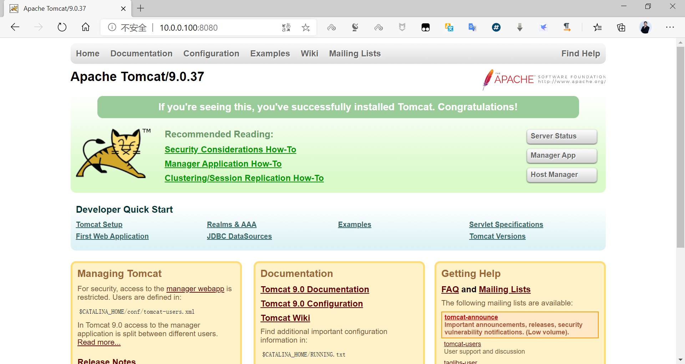

[← 返回 Docker 容器技术目录]({{ '/subjects/Docker/' | relative_url }})



# 09 使用 docker commit 手动制作镜像

前一篇解释了镜像层与容器可写层。容器运行后，对其文件系统所做的修改主要落在可写层；`docker commit` 会把这些修改提交为一个新镜像层，并可调整部分镜像元数据。因此它适合**快速保存探索结果、复现实验现场**，却不适合作为长期、可审计的构建流程。下一篇的 Dockerfile 才是日常构建的首选。

```text
docker commit [OPTIONS] CONTAINER [REPOSITORY[:TAG]]
```

常用选项包括 `-m`（提交说明）、`-a`（作者）、`-c`（修改镜像配置，如 `CMD`、`EXPOSE`）和 `-p`（提交时暂停容器，默认开启）。运行中或已停止的容器都可以提交；不写镜像名会得到悬空镜像，不便于后续引用。

要特别分清两类数据：**容器可写层中的文件会进入新镜像，挂载卷或 bind mount 中的数据不会**。`docker commit` 也不会自动记录“安装过什么包、为何修改配置”的操作历史，更不该用来固化运行时密码或私钥。

## 最小实验：BusyBox 的 httpd

BusyBox 内置简易 `httpd`。先启动用于编辑的容器，在里面创建站点文件，再提交为有明确启动命令的镜像。这里让编辑容器持续运行，避免交互 shell 退出后容器立即停止。

```bash
docker run -d --name busybox-edit busybox:1.36 sleep 3600
docker exec busybox-edit sh -c 'mkdir -p /data/html && echo "httpd website in busybox" > /data/html/index.html'
docker commit -m "加入示例首页" \
  -c 'CMD ["/bin/httpd","-f","-h","/data/html"]' \
  -c 'EXPOSE 80' \
  busybox-edit httpd-busybox:v1
docker run -d --name busybox-web -p 8080:80 httpd-busybox:v1
curl http://127.0.0.1:8080/
```

预期返回 `httpd website in busybox`。`httpd -f` 保持前台运行，作为容器主进程；如果服务自行转入后台，主进程退出后容器也会退出。`EXPOSE 80` 只是镜像端口元数据，真正把宿主机 8080 映射到容器 80 的是 `docker run -p 8080:80`。

```bash
docker image inspect httpd-busybox:v1 --format '{{json .Config.Cmd}}'
docker history httpd-busybox:v1
docker ps --filter name=busybox-web
```

原资料同时演示了 shell 形式与 JSON 数组形式的 `CMD`。JSON 数组形式不会额外经 `/bin/sh -c` 包装，参数边界清楚，也更适合容器主进程接收终止信号。本例只保留这条更清晰的路径。

## 案例：给 Tomcat 镜像补充默认 Web 应用

原资料使用旧版官方 Tomcat 镜像：当时 `webapps` 目录为空、示例应用位于 `webapps.dist`，直接访问根路径会得到 404。**404 不代表 Tomcat 没启动**，而是该路径没有部署应用。先检查当前镜像是否仍采用这种布局，再决定是否复制。

```bash
docker run -d --name tomcat-edit -p 8081:8080 tomcat:9.0
docker exec tomcat-edit ls -ld /usr/local/tomcat/webapps /usr/local/tomcat/webapps.dist
docker exec tomcat-edit sh -c 'cp -a /usr/local/tomcat/webapps.dist/. /usr/local/tomcat/webapps/'
curl -I http://127.0.0.1:8081/
docker commit -m "加入 Tomcat 默认 Web 应用" tomcat-edit tomcat-with-webapps:v1
docker rm -f tomcat-edit
docker run -d --name tomcat-test -p 8081:8080 tomcat-with-webapps:v1
curl -I http://127.0.0.1:8081/
```

若当前标签已不包含 `webapps.dist`，应根据镜像实际目录部署自己的 WAR 包，不必机械复制。提交后从**新容器**再次得到 HTTP 200，才能验证更改真正进入镜像；只测试原容器无法证明这一点。



## 案例：在 Ubuntu 中安装 Nginx

这个例子说明 `docker commit` 可保存软件包与站点文件，但必须补上前台启动命令。原教程把软件源、安装交互记录和几十行终端输出都粘在一起，实际操作只需关注“安装 → 修改 → 提交 → 新容器验证”。

```bash
docker run -d --name nginx-edit ubuntu:20.04 sleep infinity
docker exec nginx-edit sh -c 'apt-get update && DEBIAN_FRONTEND=noninteractive apt-get install -y nginx'
docker exec nginx-edit sh -c 'echo "Nginx Website in Docker" > /var/www/html/index.html'
docker commit -m "Ubuntu Nginx 示例" \
  -c 'CMD ["nginx","-g","daemon off;"]' \
  -c 'EXPOSE 80' \
  nginx-edit nginx-ubuntu:demo
docker run -d --name nginx-test -p 8082:80 nginx-ubuntu:demo
curl http://127.0.0.1:8082/
```

若 `apt-get update` 失败，先检查镜像版本的软件源是否仍可访问，不要把另一发行版的源文件直接替换进去。示例选用历史版本以对应原资料；新项目应选择仍在维护的基础镜像。

## CentOS 与源码编译案例应如何理解

原资料还有两条基于 **CentOS 7** 的 Nginx 路径：一种通过 yum 安装，另一种安装编译依赖、下载 Nginx 源码并执行 `./configure && make && make install`。它们要说明的是同一个构建模型：在容器可写层中准备程序、配置和站点文件，再通过 `docker commit` 保存；运行新镜像时必须让 Nginx 前台执行。

CentOS 7 已停止维护，旧版 yum 仓库、镜像地址和 Nginx 下载地址可能不可用。原示例中换源命令跨行折断、`yum install nginx –y` 使用了错误的长横线，源码编译案例还在源码目录执行 `rm -rf nginx*`，容易误导读者。因此不宜直接复制整段旧终端记录。若要复现编译思路，应选受支持的基础镜像，明确锁定源码版本、校验下载文件，并将依赖安装与构建步骤写入 Dockerfile；构建完成后可用 `nginx -g 'daemon off;'` 作为容器主进程。

## 练习：在 Alpine 中加入工具与时区数据

原资料最后展示了为 Alpine 安装 `curl`、`tzdata` 并设置时区。它适合观察“新增软件包使镜像变大”“环境修改可随镜像保存”，但不必使用原文中被换行拆开的云仓库地址。

```bash
docker run -d --name alpine-edit alpine:3.20 sleep 3600
docker exec alpine-edit sh -c 'apk add --no-cache curl tzdata && ln -snf /usr/share/zoneinfo/Asia/Shanghai /etc/localtime && echo Asia/Shanghai > /etc/timezone'
docker commit -m "加入 curl 和时区数据" alpine-edit alpine-tools:3.20
docker run --rm alpine-tools:3.20 sh -c 'curl --version | head -n 1; date'
```

完成实验后可删除临时容器：`docker rm -f busybox-edit busybox-web tomcat-test nginx-edit nginx-test alpine-edit`。**决定性的验证**始终是从新镜像创建全新容器，而不是继续观察被修改过的旧容器。若这个结果需要长期维护，就把成功的手工操作转写成 Dockerfile 并纳入版本控制。



<nav class="article-end" aria-label="章节导航">
  <a href="{{ '/subjects/Docker/08-docker-image-fundamentals.html' | relative_url }}">← 上一篇：Docker 镜像基础</a>
  <a href="{{ '/subjects/Docker/' | relative_url }}">返回 Docker 容器技术目录</a>
  <a href="{{ '/subjects/Docker/10-building-images-with-dockerfile.html' | relative_url }}">下一篇：使用 Dockerfile 构建镜像 →</a>
</nav>
