[← 返回Docker 容器技术目录]({{ '/subjects/Docker/' | relative_url }})



# 10 利用 DockerFile 文件执行 docker build 自动构建镜像
### 2.3 利用 DockerFile 文件执行 docker build 自动构建镜像

### Dockerfile 使用详解

### Dockerfile 介绍

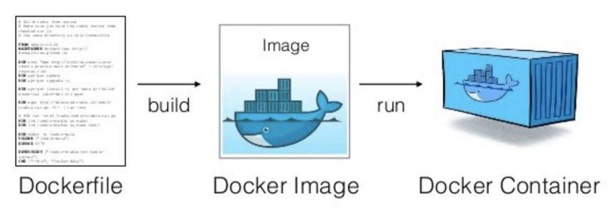

DockerFile 是一种被Docker程序解释执行的脚本，由一条条的命令组成的，每条命令对应linux下面的一条命令，Docker程序将这些DockerFile指令再翻译成真正的linux命令，其有自己的书写方式和支持的命令，Docker程序读取DockerFile并根据指令生成Docker镜像，相比手动制作镜像的方式，DockerFile 更能直观的展示镜像是怎么产生的，有了DockerFile，当后期有额外的需求时，只要在之前的 DockerFile添加或者修改响应的命令即可重新生成新的Docker镜像，避免了重复手动制作镜像的麻烦,类似与shell脚本一样,可以方便高效的制作镜像

Docker守护程序Dockerfile 逐一运行指令，如有必要，将每个指令的结果提交到新镜像，然后最终输出新镜像的ID。

Docker守护程序将自动清理之前发送的上下文

请注意，每条指令都是独立运行的，并会导致创建新镜像，比如RUN cd /tmp 对下一条指令不会有任何影响。

Docker将尽可能重用中间镜像层（缓存），以显著加速docker build 命令的执行过程，这由Using cache 控制台输出中的消息指示

### Dockerfile 镜像制作和使用流程


### Dockerfile文件的制作镜像的分层结构

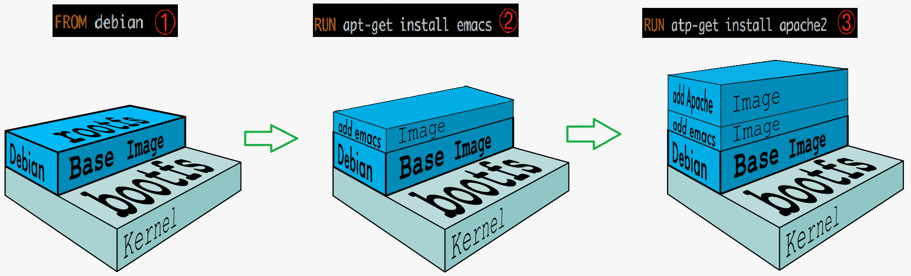

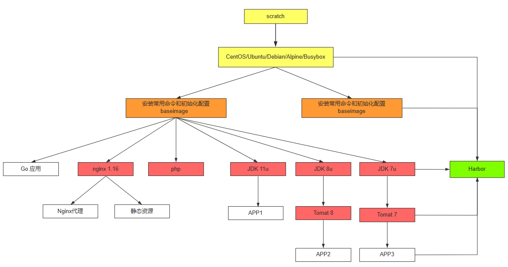

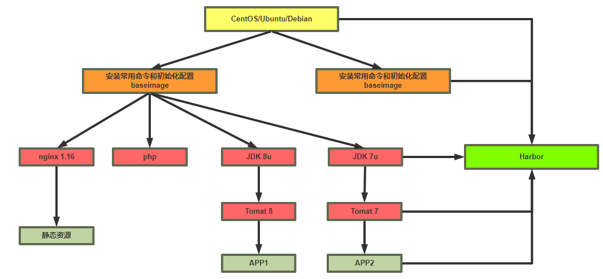

范例:

```bash
#按照业务类型或系统类型等方式划分创建目录环境，方便后期镜像比较多的时候进行分类
[root@ubuntu1804 ~]#mkdir
/data/dockerfile/{web/{nginx,apache,tomcat,jdk},system/{centos,ubuntu,alpine,deb
ian}} -p
[root@ubuntu1804 ~]#tree /data/dockerfile/
/data/dockerfile/
├── system
│   ├── alpine
│   ├── centos
│   ├── debian
│   └── ubuntu
└── web
├── apache
├── jdk
├── nginx
└── tomcat
10 directories, 0 files
[root@ubuntu1804 ~]#
```

### Dockerfile 文件格式

Dockerfile 是一个有特定语法格式的文本文件

dockerfile 官方说明:  https://docs.docker.com/engine/reference/builder/

帮助:   man 5 dockerfile

Dockerfile 文件说明

每一行以Dockerfile的指令开头，指令不区分大小写，但是惯例使用大写使用 # 开始作为注释每一行只支持一条指令，每条指令可以携带多个参数指令按文件的顺序从上至下进行执行每个指令的执行会生成一个新的镜像层，为了减少分层和镜像大小，尽可能将多条指令合并成一条指令制作镜像一般可能需要反复多次，每次执行dockfile都按顺序执行，从头开始，已经执行过的指令已经缓存，不需要再执行，如果后续有一行新的指令没执行过，其往后的指令将会重新执行，所以为加速镜像制作，将最常变化的内容放下dockerfile的文件的后面

### Dockerfile 相关指令

<https://docs.docker.com/reference/dockerfile/>

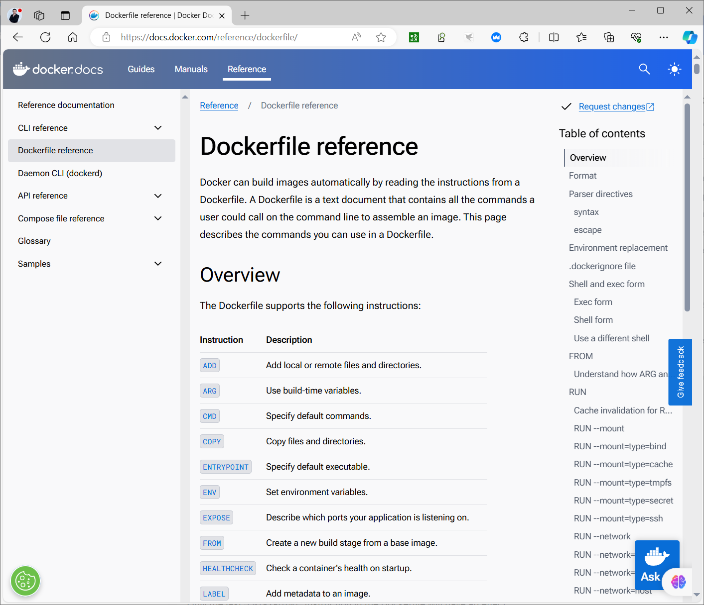

Instruction Description

ADD Add local or remote files and directories.

ARG Use build-time variables.

CMD Specify default commands.

COPY Copy files and directories.

ENTRYPOINT Specify default executable.

ENV Set environment variables.

EXPOSE Describe which ports your application is listening on.

FROM Create a new build stage from a base image.

HEALTHCHECK Check a container's health on startup.

LABEL Add metadata to an image.

MAINTAINER Specify the author of an image.

ONBUILD Specify instructions for when the image is used in a build.

RUN Execute build commands.

SHELL Set the default shell of an image.

STOPSIGNAL Specify the system call signal for exiting a container.

USER Set user and group ID.

VOLUME Create volume mounts.

WORKDIR Change working directory.

dockerfile 文件中的有18个指令,但最常见指令:

```dockerfile
FROM
LABEL
RUN
ADD
COPY
CMD
ENTRYPOINT
ENV
EXPOSE
USER
VOLUME
WORKDIR
```

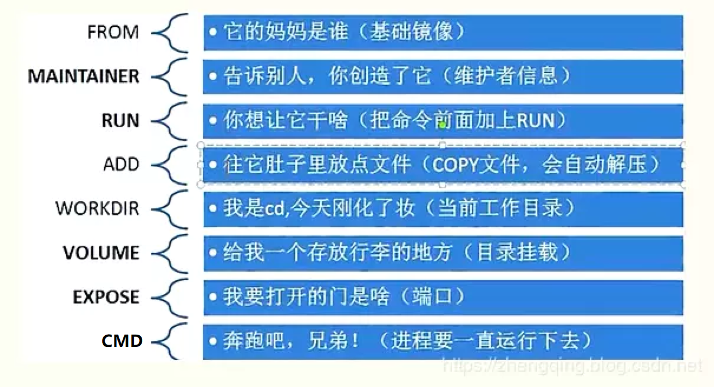

2.3.1.5.1 FROM: 指定基础镜像

定制镜像，需要先有一个基础镜像，在这个基础镜像上进行定制。

FROM 就是指定基础镜像，此指令通常必需放在Dockerfile文件第一个非注释行。后续的指令都是运行于此基准镜像所提供的运行环境

基础镜像可以是任何可用镜像文件，默认情况下，docker build会在docker主机上查找指定的镜像文件，在其不存在时，则会从Docker Hub Registry上拉取所需的镜像文件.如果找不到指定的镜像文件， docker build会返回一个错误信息

如何选择合适的镜像呢？

对于不同的软件官方都提供了相关的docker镜像，比如:  nginx、redis、mysql、httpd、tomcat等服务类的镜像，也有操作系统类，如:  centos、ubuntu、debian等。建议使用官方镜像，比较安全。

格式:

```dockerfile
FROM [--platform=<platform>] <image> [AS <name>]
FROM [--platform=<platform>] <image>[:<tag>] [AS <name>]
FROM [--platform=<platform>] <image>[@<digest>] [AS <name>]
#说明:
--platform 指定镜像的平台，比如:  linux/amd64, linux/arm64, or windows/amd64
tag 和 digest是可选项，如果不指定，默认为latest
```

说明: 关于scratch 镜像

```dockerfile
FROM scratch
参考链接:
https://hub.docker.com/_/scratch?tab=description
https://docs.docker.com/develop/develop-images/baseimages/
该镜像是一个空的镜像，可以用于构建busybox等超小镜像，可以说是真正的从零开始构建属于自己的镜像
该镜像在构建基础镜像（例如debian和busybox）或超最小镜像（仅包含一个二进制文件及其所需内容，例
如:hello-world）的上下文中最有用。
```

范例:

```dockerfile
FROM scratch #所有镜像的起源镜像，相当于JAVA中Object类
FROM ubuntu
FROM ubuntu:bionic
FROM debian:buster-slim
```

2.3.1.5.2 LABEL: 指定镜像元数据

可以指定镜像元数据，如:  镜像作者等

```text
LABEL <key>=<value> <key>=<value> <key>=<value> ...
```

范例:

```text
LABEL "com.example.vendor"="ACME Incorporated"
LABEL com.example.label-with-value="foo"
LABEL version="1.0"
LABEL description="This text illustrates \
that label-values can span multiple lines."
```

一个镜像可以有多个label ,还可以写在一行中,即多标签写法,可以减少镜像的层数

范例:  多标签写法

```text
#一行格式
LABEL multi.label1="value1" multi.label2="value2" other="value3"
#多行格式
LABEL multi.label1="value1" \
multi.label2="value2" \
other="value3"
```

docker inspect 命令可以查看LABEL

范例:

```json
"Labels": {
"com.example.vendor": "ACME Incorporated"
"com.example.label-with-value": "foo",
"version": "1.0",
"description": "This text illustrates that label-values can span multiple
lines.",
"multi.label1": "value1",
"multi.label2": "value2",
"other": "value3"
},
```

MAINTAINER: 指定维护者信息

此指令已过时，用LABEL代替

```text
MAINTAINER <name>
```

范例:

```text
MAINTAINER bowenxiaochun <root@bowenxiaochun.com>
#用LABEL代替
LABEL maintainer="bowenxiaochun <root@bowenxiaochun.com>"
```

2.3.1.5.3 RUN: 执行 shell 命令

RUN 指令用来在构建镜像阶段需要执行 FROM 指定镜像所支持的Shell命令。

通常各种基础镜像一般都支持丰富的shell命令

注意:  RUN 可以写多个，每一个RUN指令都会建立一个镜像层，所以尽可能合并成一条指令,比如将多个 shell命令通过 && 连接一起成为在一条指令

每个RUN都是独立运行的,和前一个RUN无关

```dockerfile
#shell 格式: 相当于 /bin/sh -c  <命令>  此种形式支持环境变量
RUN <命令>
#如果想使用其它shell,可以用SHELL指令指定不同的shell
SHELL ["/bin/bash", "-c"]
RUN <命令>
#exec 格式: 此种形式不支持环境变量,注意:是双引号,不能是单引号
RUN ["executable","param1","param2"...]
#exec格式可以指定其它shell
RUN ["/bin/bash","-c","echo hello bowen"]
```

说明:

```dockerfile
shell格式中，<command>通常是一个shell命令，且以"/bin/sh -c”来运行它，这意味着此进程在容器中
的PID不为1，不能接收Unix信号，因此，当使用docker stop <container>命令停止容器时，此进程接收
不到SIGTERM信号
exec格式中的参数是一个JSON格式的数组，其中<executable>为要运行的命令，后面的<paramN>为传递
给命令的选项或参数;然而，此种格式指定的命令不会以"/bin/sh -c"来发起，因此常见的shell操作如变
量替换以及通配符(?,*等)替换将不会进行;不过，如果要运行的命令依赖于此shell特性的话，可以将其替换
为类似下面的格式。
RUN ["/bin/bash", "-c", "<executable>", "<param1>"]
```

关于 shell 和 exec 形式

Shell解释：

Shell形式：命令通过Shell解释，这意味着可以使用Shell特性，例如环境变量替换、管道和重定向。 Exec形式：命令直接执行，不经过Shell。因此，没有Shell特性支持。

可移植性和安全性：

Shell形式：由于依赖Shell解释，可能会受到Shell注入攻击或其他Shell相关的问题。 Exec形式：更安全和可移植，因为命令直接执行，不依赖Shell。

性能：

Shell形式：需要额外启动一个Shell进程，可能略有性能开销。 Exec形式：直接执行命令，通常更高效。

复杂命令：

Shell形式：适合编写复杂的命令或使用Shell特性的场景。 Exec形式：适合简单的命令或不需要Shell功能的场景。

范例：shell 和 exec 格式比较

```bash
[root@ubuntu2204 alpine]#cat Dockerfile
FROM registry.cn-beijing.aliyuncs.com/bowenxiaochun/alpine:3.20.0
LABEL maintainer="bowenxiaochun<root@bowenxiaochun.com>"
RUN sed -i 's@dl-cdn.alpinelinux.org@mirrors.tuna.tsinghua.edu.cn@'
/etc/apk/repositories
RUN apk add bash
RUN echo {1..10} > a.txt
RUN ["bash","-c","echo {1..10} > b.txt"]
[root@ubuntu2204 alpine]#docker run --rm -it alpine:3.20.0-2024-06-14_1718345655
cat b.txt
1 2 3 4 5 6 7 8 9 10
[root@ubuntu2204 alpine]#docker run --rm -it alpine:3.20.0-2024-06-14_1718345655
cat a.txt
{1..10}
```

范例:

```dockerfile
RUN echo '<h1>Hello, Docker!</h1>' > /usr/share/nginx/html/index.html
RUN ["/bin/bash", "-c", "echo hello world"]
RUN yum -y install epel-release \
&& yum -y install nginx \
&& rm -rf /usr/share/nginx/html/*
&& echo "<h1> docker test nginx </h1>" > /usr/share/nginx/html/index.html
```

范例: 调整时区

```dockerfile
FROM alpine:3.19.1
LABEL author=bowen class=m57
RUN sed -i 's/dl-cdn.alpinelinux.org/mirrors.tuna.tsinghua.edu.cn/'
/etc/apk/repositories &&   apk update &&  apk  --no-cache add curl bash tzdata
&& ln -s  /usr/share/zoneinfo/Asia/Shanghai /etc/localtime
```

范例:  多个 前后RUN 命令独立无关和shell命令不同

```dockerfile
#world.txt并不存放在/app内
RUN cd /app
RUN echo "hello" > world.txt
#下面写法可以实现关联关系
RUN cd /app &&  echo "hello" > world.txt
```

2.3.1.5.4 ENV: 设置环境变量

ENV 可以定义环境变量和值，会被后续指令(如:ENV,ADD,COPY,RUN等)通过$KEY或${KEY}进行引用， 并在容器运行时保持

```xml
#变量赋值格式1
ENV <key> <value>   #此格式只能对一个key赋值,<key>之后的所有内容均会被视作其<value>的组成
部分
#变量赋值格式2
ENV <key1>=<value1> <key2>=<value2> \  #此格式可以支持多个key赋值,定义多个变量建议使用,
减少镜像层
<key3>=<value3> ...
#如果<value>中包含空格，可以以反斜线\进行转义，也可通过对<value>加引号进行标识;另外，反斜线也
可用于续行
```

```dockerfile
#只使用一次变量
RUN <key>=<value> <command>
#引用变量
RUN $key .....
```

如果运行容器时如果需要修改变量,可以执行下面通过基于exec 机制实现

注意: 下面方式只影响容器运行时环境,而不影响构建镜像的过程,即只能覆盖docker run时的环境变量,而不会影响docker build时环境变量的值

```text
docker run -e|--env <key>=<value>
#说明
-e, --env list          #Set environment variables
--env-file filename     #Read in a file of environment variables
```

示例:  两种格式功能相同

```text
#格式1
ENV myName="John Doe" myDog=Rex\ The\ Dog \
myCat=fluffy
#格式2
ENV myName John Doe
ENV myDog Rex The  Dog
ENV myCat fluffy
```

范例:

```dockerfile
ENV VERSION=1.0 DEBUG=on NAME="Happy Feet"
ENV PG_MAJOR 9.3
ENV PG_VERSION 9.3.4
RUN curl -SL http://example.com/postgres-$PG_VERSION.tar.xz | tar -xJC
/usr/src/postgress && …
ENV PATH /usr/local/postgres-$PG_MAJOR/bin:$PATH
```

范例:

```bash
[root@ubuntu1804 dockerfile]#cat Dockerfile
FROM busybox
LABEL maintainer="bowenxiaochun <root@bowenxiaochun.com>"
ENV NAME bowen xiao chun
RUN touch $NAME.txt
[root@ubuntu1804 dockerfile]#cat build.sh
#!/bin/bash
#
TAG=$1
docker build -t test:$TAG .
[root@ubuntu1804 dockerfile]#./build.sh v5.0
[root@ubuntu1804 dockerfile]#docker run  --rm  --name c1 test:v5.0 env
PATH=/usr/local/sbin:/usr/local/bin:/usr/sbin:/usr/bin:/sbin:/bin
HOSTNAME=d4e1f89aca71
NAME=bowen xiao chun
HOME=/root
[root@ubuntu1804 dockerfile]#docker run  --rm -e NAME=mage --name c1 test:v5.0
env
PATH=/usr/local/sbin:/usr/local/bin:/usr/sbin:/usr/bin:/sbin:/bin
HOSTNAME=b23500aa100d
NAME=mage
HOME=/root
[root@ubuntu1804 dockerfile]#docker run  --rm -e NAME=mage --name c1 test:v5.0
ls -l
total 36
drwxr-xr-x    2 root     root         12288 Jun 27 00:21 bin
-rw-r--r--    1 root     root             0 Jul 24 10:05 chun.txt
drwxr-xr-x    5 root     root           340 Jul 24 10:05 dev
drwxr-xr-x    1 root     root          4096 Jul 24 10:05 etc
drwxr-xr-x    2 nobody   nogroup       4096 Jun 27 00:21 home
dr-xr-xr-x  222 root     root             0 Jul 24 10:05 proc
drwx------    2 root     root          4096 Jun 27 00:21 root
dr-xr-xr-x   13 root     root             0 Jul 24 10:05 sys
drwxrwxrwt    2 root     root          4096 Jun 27 00:21 tmp
drwxr-xr-x    3 root     root          4096 Jun 27 00:21 usr
drwxr-xr-x    4 root     root          4096 Jun 27 00:21 var
-rw-r--r--    1 root     root             0 Jul 24 10:05 bowen
-rw-r--r--    1 root     root             0 Jul 24 10:05 xiao
[root@ubuntu1804 dockerfile]#cat  env.txt
NAME=bowen
TITLE=cto
[root@ubuntu1804 dockerfile]#docker run  --rm --env-file env.txt --name c1
test:v5.0 env
PATH=/usr/local/sbin:/usr/local/bin:/usr/sbin:/usr/bin:/sbin:/bin
HOSTNAME=88ddf5b73a6b
NAME=bowen
TITLE=cto
HOME=/root
```

2.3.1.5.5 COPY: 复制文本

复制本地宿主机的 到容器中的 。

```dockerfile
COPY [OPTIONS] [--chown=<user>:<group>] <src>... <dest>
COPY [OPTIONS] [--chown=<user>:<group>] ["<src>",... "<dest>"] #路径中有空白字符时,
建议使用此格式
```

说明:

可以是多个,可以使用通配符，通配符规则满足Go的filepath.Match 规则

filepath.Match 参考链接: https://golang.org/pkg/path/filepath/#Match

必须是build上下文中的相对路径(为 Dockerfile 所在目录的相对路径），不能是其父目录中的文件

如果是目录，则其内部文件或子目录会被递归复制，但目录自身不会被复制

如果指定了多个, 或在中使用了通配符，则必须是一个目 录，且必须以 / 结尾

可以是绝对路径或者是WORKDIR 指定的相对路径

使用 COPY 指令，源文件的各种元数据都会保留。比如读、写、执行权限、文件变更时间等

如果事先不存在，它将会被自动创建，这包括其父目录路径,即递归创建目录

范例:

```dockerfile
COPY hom* /mydir/
COPY hom?.txt /mydir/
#多阶段构建
COPY --from=build /myapp /usr/bin/
```

2.3.1.5.6 ADD: 复制和解包文件

ADD 指令具备 COPY 的基本复制功能，此外还增加了一些特殊特性。

ADD 指令的特殊之处在于：

源路径可以是远程 URL，它会自动下载文件并复制到镜像中。 如果源路径是一个压缩文件（如 tar、gzip、bzip2 等），它会自动解压后再复制到镜像中。

COPY 和 ADD 具体差异对比

特性 COPY ADD

复制本地文件 ✅ ✅

设置文件所有者 ✅ ✅

处理远程 URL ❌ ✅

自动解压压缩文件 ❌ ✅

保持文件元数据 ✅ ❌（解压时会丢失）

推荐使用场景单纯的文件复制处理远程 URL 或者压缩文件

ADD 的格式和 COPY 类似：

```dockerfile
ADD [--chown=<user>:<group>] <src>... <dest>
ADD [--chown=<user>:<group>] ["<src>",... "<dest>"]
```

说明:

可以是Dockerfile所在目录的一个相对路径；也可是一个 URL；还可是一个 tar 文件（自动解压） 可以是绝对路径或者是WORKDIR 指定的相对路径如果是目录，只复制目录中的内容，而非目录本身如果是一个 URL ，下载后的文件权限自动设置为 600 如果为URL且不以/结尾，则指定的文件将被下载并直接被创建为,如果以 / 结尾，则文件名URL指定的文件将被直接下载并保存为/< filename> 如果是一个本地文件系统上的打包文件,如: gz, bz2 ,xz ，它将被解包 ，其行为类似于"tar -x"命令, 但是通过URL获取到的tar文件将不会自动展开如果有多个，或其间接或直接使用了通配符，则必须是一个以/结尾的目录路径;如果不以/结尾，则其被视作一个普通文件，的内容将被直接写入到

范例:

```dockerfile
ADD test relativeDir/          # adds "test" to `WORKDIR`/relativeDir/
ADD test /absoluteDir/         # adds "test" to /absoluteDir/
ADD --chown=55:mygroup files* /somedir/
ADD --chown=bin files* /somedir/
ADD --chown=1 files* /somedir/
ADD --chown=10:11 files* /somedir/
ADD ubuntu-xenial-core-cloudimg-amd64-root.tar.gz /
```

范例

```dockerfile
ADD nginx-1.26.2.tar.gz /usr/local/src
RUN apk --no-cache add gcc make  libgcc libc-dev libcurl libc-utils pcre-dev
zlib-dev  libnfs  pcre pcre2 libevent libevent-dev && cd /usr/local/src/nginx-
1.26.2 && ./configure --prefix=/apps/nginx && make && make install && rm -rf
/usr/local/src/nginx-1.26.2
```

2.3.1.5.7 CMD: 容器启动命令

<https://docs.docker.com/reference/dockerfile/#cmd>


一个容器中通常需要一个持续运行的业务主进程

CMD 用来指定启动容器时默认执行的一个初始命令

如果容器内没有一个持续运行的前台进程,容器会停止

所以一般CMD 指定的命令为持续运行且为前台命令,如果有多个命令,需要保证有一个命令是前台并持续运行的

如果docker run没有指定任何的执行命令或者dockerfile里面也没有ENTRYPOINT命令，那么开启容器时就会使用执行CMD指定的默认的命令 RUN 命令是在构建镜像时执行的命令每个 Dockerfile 只能有一条 CMD 命令。如指定了多条，只有最后一条被执行如果用户启动容器时用 docker run xxx 指定运行的命令，则会覆盖 CMD 指定的命令

```dockerfile
#https://docs.docker.com/reference/dockerfile/#shell-and-exec-form
#格式1:使用exec形式，推荐方式，第一个参数必须是命令的全路径,此种形式不支持环境变量,注意:是双引
号,不能是单引号
CMD ["executable","param1","param2"]
#格式2:shell形式,默认/bin/sh 中执行，提供给需要交互的应用；此种形式支持环境变量,相当于执行
/bin/sh -c "command param1 param2"
CMD command param1 param2
#指定不同的shell
#方法1
SHELL ["/bin/bash", "-c"]
CMD command param1 param2
#方法2
CMD ["/bin/bash", "-c","executable","param1","param2"]
#格式3:使用exec形式,提供给 ENTRYPOINT 命令的充当其参数
CMD ["param1","param2"]
```

范例:

```dockerfile
CMD ["nginx", "-g", "daemon off;"]
CMD ["/apps/nginx/sbin/nginx", "-g","daemon off;"]
#如下格式报错
CMD /apps/nginx/sbin/nginx -g ”daemon off;"
```

范例：通过CMD基于alpine编译安装Nginx并结合脚本实现启动容器时的定制功能

```bash
[root@ubuntu2204 nginx]#ls
Dockerfile  mynginx.sh  nginx-1.24.0.tar.gz  nginx.conf
#nginx.conf可以从nginx-1.24.0.tar.gz解压缩后获得
[root@ubuntu2204 nginx]#vim nginx.conf
user nginx;
.....
include  conf.d/*.conf; #在文件倒第二行加此行内容
}
[root@ubuntu2204 nginx]#cat Dockerfile
FROM alpine:3.18.4
LABEL author=bowen version=1.0 mail=root@bowenxiaochun.com
RUN sed -i 's/dl-cdn.alpinelinux.org/mirrors.ustc.edu.cn/' /etc/apk/repositories
&& \
apk update && apk --no-cache add tzdata   gcc make curl zip unzip net-tools
pstree wget libgcc libc-dev libcurl \
libc-utils pcre-dev zlib-dev  libnfs  pcre pcre2 libevent libevent-dev
iproute2   && \
ln -s  /usr/share/zoneinfo/Asia/Shanghai /etc/localtime && echo
"Asia/Shanghai" > /etc/timezone && \
addgroup  -g 888 -S nginx && adduser  -s /sbin/nologin -S -D  -u 888 -G
nginx nginx
ADD nginx-1.24.0.tar.gz /usr/local/src
RUN cd /usr/local/src/nginx-1.24.0 && ./configure --prefix=/usr/local/nginx &&
make && make install && \
ln -s /usr/local/nginx/sbin/nginx  /usr/local/bin/nginx && \
chown -R nginx:nginx /usr/local/nginx/ && rm -rf /usr/local/src/nginx-1.24.0
ADD nginx.conf /usr/local/nginx/conf/nginx.conf
#ADD www.bowen.org.conf /usr/local/nginx/conf/conf.d/www.bowen.org.conf
#ADD index.html /data/website/index.html
COPY mynginx.sh /usr/local/bin/mynginx.sh
#USER nginx
CMD ["mynginx.sh"]
[root@ubuntu2204 nginx]#cat mynginx.sh
#!/bin/sh
#注意：alpine镜像默认没有bash，此处使用sh
#FileName:          mynginx.sh
#Description:       The test script
mkdir -p /usr/local/nginx/conf/conf.d /data/website
cat  > /usr/local/nginx/conf/conf.d/www.conf <<EOF
server {
listen ${PORT:-80};
server_name ${SERVER:-www.bowen.org};
root /data/website;
}
EOF
echo  ${SERVER:-www.bowen.org} > /data/website/index.html
nginx -g 'daemon off;'
```

范例:

```bash
[root@ubuntu1804 dockerfile]#cat Dockerfile
FROM ubuntu:18.04
LABEL maintainer="bowenxiaochun <root@bowenxiaochun.com>"
RUN apt update \
&& apt -y install  curl \
&& rm -rf /var/lib/apt/lists/*
CMD [ "curl", "-s","https://ip.cn"]
[root@centos8 ubuntu]#podman  run  9b
{"ip": "111.199.187.36", "country": "北京市", "city": "联通"}
#cat /etc/etc/issue覆盖了curl命令
[root@centos8 ubuntu]#podman  run  9b cat /etc/issue
Ubuntu 18.04.4 LTS \n \l
```

范例:

```bash
[root@ubuntu1804 dockerfile]#pwd
/data/dockerfile
[root@ubuntu1804 dockerfile]#cat Dockerfile
FROM busybox
LABEL maintainer="bowenxiaochun <root@bowenxiaochun.com>"
ENV ROOT /data/website
COPY index.html ${ROOT}/index.html
CMD /bin/httpd -f -h ${ROOT}
EXPOSE 80
[root@ubuntu1804 dockerfile]#cat index.html
Website in Dockerfile
```

```bash
[root@ubuntu1804 dockerfile]#cat build.sh
#!/bin/bash
#
TAG=$1
docker build -t test:$TAG .
[root@ubuntu1804 dockerfile]#./build.sh v1.0
[root@ubuntu1804 dockerfile]#docker run  -d  --rm -P  --name c1  test:v1.0
[root@ubuntu1804 ~]#docker port c1
80/tcp -> 0.0.0.0:32781
[root@ubuntu1804 ~]#curl 127.0.0.1:32781
Website in Dockerfile
[root@ubuntu1804 ~]#
```

范例:

```bash
[root@ubuntu1804 dockerfile]#pwd
/data/dockerfile
[root@ubuntu1804 dockerfile]#cat Dockerfile
FROM busybox
LABEL maintainer="bowenxiaochun <root@bowenxiaochun.com>"
ENV ROOT /data/website
RUN mkdir -p ${ROOT} && echo '<h1> Busybox httpd server in Dockerfile</h1>' >
${ROOT}/index.html
#COPY index.html ${ROOT}/index.html
CMD ["/bin/sh","-c","/bin/httpd -f -h ${ROOT}"]
#CMD /bin/httpd -f -h ${ROOT}
EXPOSE 80
[root@ubuntu1804 dockerfile]#cat build.sh
#!/bin/bash
#
TAG=$1
docker build -t test:$TAG .
[root@ubuntu1804 dockerfile]#ls
build.sh  Dockerfile
[root@ubuntu1804 dockerfile]#./build.sh v2.0
Sending build context to Docker daemon  4.096kB
Step 1/5 : FROM busybox
---> c7c37e472d31
Step 2/5 : ENV ROOT /data/website
---> Using cache
---> ad654b3213c7
Step 3/5 : RUN mkdir -p ${ROOT} && echo '<h1> Busybox httpd server in
Dockerfile</h1>' > ${ROOT}/index.html
---> Running in c7c2b920ccb0
Removing intermediate container c7c2b920ccb0
---> d40ce17d4e85
Step 4/5 : CMD ["/bin/sh","-c","/bin/httpd -f -h ${ROOT}"]
---> Running in 52be24840eee
Removing intermediate container 52be24840eee
---> d22731d921df
Step 5/5 : EXPOSE 80
---> Running in 4a50d8d9aa83
Removing intermediate container 4a50d8d9aa83
---> 85d6547a3168
Successfully built 85d6547a3168
Successfully tagged test:v2.0
[root@ubuntu1804 dockerfile]#docker run  -d  --rm -P  --name c2  test:v2.0
cf5fea09ce1362f18a90f4fcdffa3000de26b4919927e1cdce0cce6243f5dd24
[root@ubuntu1804 dockerfile]#docker port c2
80/tcp -> 0.0.0.0:32785
[root@ubuntu1804 dockerfile]#curl 127.0.0.1:32785
<h1> Busybox httpd server in Dockerfile</h1>
```

```bash
[root@ubuntu1804 dockerfile]#docker inspect -f "{{.Config}}" test:v2.0
{   false false false map[80/tcp:{}] false false false
[PATH=/usr/local/sbin:/usr/local/bin:/usr/sbin:/usr/bin:/sbin:/bin
ROOT=/data/website] [/bin/sh -c /bin/httpd -f -h ${ROOT}] <nil> false
sha256:d22731d921df65f9da7452e714cf35ef345529ffa1bd5b92c0024d1d1bd8e714 map[]  []
false  [] map[]  <nil> []}
#查看进程关系
[root@ubuntu1804 ~]#docker exec -it c2 sh
/ # ps
PID   USER     TIME  COMMAND
1 root      0:00 /bin/httpd -f -h /data/website
8 root      0:00 sh
13 root      0:00 ps
```

范例:  shell和exec 比较

```bash
[root@ubuntu2204 ~]#cat Dockerfile-shell
FROM ubuntu:22.04
RUN apt-get update && apt-get -y install redis-server && rm -rf
/var/lib/apt/lists/*
EXPOSE 6379
CMD "/usr/bin/redis-server"
[root@ubuntu2204 ~]#cat Dockerfile-exec
FROM ubuntu:22.04
RUN apt-get update && apt-get -y install redis-server && rm -rf
/var/lib/apt/lists/*
EXPOSE 6379
CMD ["/usr/bin/redis-server"]
```

```bash
[root@ubuntu2204 ~]#docker build -t redis:shell -f Dockerfile-shell .
[root@ubuntu2204 ~]#docker build -t redis:exec  -f Dockerfile-exec  .
[root@ubuntu2204 ~]#docker images
REPOSITORY           TAG       IMAGE ID       CREATED          SIZE
redis                shell     0e30d4377d9f   15 seconds ago   84.3MB
redis                exec      d623693be0d9   4 minutes ago    84.3MB
ubuntu               22.04     52882761a72a   3 weeks ago      77.9MB
[root@ubuntu2204 ~]#docker run -d  --name redis-shell redis:shell
[root@ubuntu2204 ~]#docker run -d  --name redis-exec  redis:exec
[root@ubuntu2204 ~]#docker exec redis-shell ps -ef
UID          PID    PPID  C STIME TTY          TIME CMD
root           1       0  0 01:55 ?        00:00:00 /bin/sh -c "/usr/bin/redis-
server"
root           7       1  0 01:55 ?        00:00:00 /usr/bin/redis-server *:6379
root          12       0  0 02:00 ?        00:00:00 ps -ef
[root@ubuntu2204 ~]#docker exec redis-exec  ps -ef
UID          PID    PPID  C STIME TTY          TIME CMD
root           1       0  0 01:55 ?        00:00:00 /usr/bin/redis-server *:6379
root          11       0  0 02:00 ?        00:00:00 ps -ef
```

2.3.1.5.8 ENTRYPOINT: 入口点

<https://docs.docker.com/reference/dockerfile/#entrypoint>

功能类似于CMD，配置容器启动后执行的命令及参数

```dockerfile
# 使用 exec 执行,注意:是双引号,不能是单引号
ENTRYPOINT ["executable", "param1", "param2"...]
# shell中执行
ENTRYPOINT  command param1 param2
#在脚本中结常使用变量的高级赋值格式
${key:-word}
${key:+word}
```

ENTRYPOINT 不能被 docker run 提供的参数覆盖，而是追加,即如果docker run 命令有参数，那么参数全部都会作为ENTRYPOINT的参数如果docker run 后面没有额外参数，但是dockerfile中有CMD命令（即上面CMD的第三种用法），即Dockerfile中即有CMD也有ENTRYPOINT,那么CMD的全部内容会作为ENTRYPOINT的参数如果docker run 后面有额外参数，同时Dockerfile中即有CMD也有ENTRYPOINT,那么docker run 后面的参数覆盖掉CMD参数内容,最终作为ENTRYPOINT的参数可以通过docker run --entrypoint string 参数在运行时替换,注意string不要加空格使用CMD要在运行时重新写命令本身,然后在后面才能追加运行参数，ENTRYPOINT则可以运行时无需重写命令就可以直接接受新参数每个 Dockerfile 中只能有一个 ENTRYPOINT，当指定多个时，只有最后一个生效通常ENTRYPOINT指令配合脚本,主要用于为CMD指令提供环境配置

范例:

```bash
[root@centos8 ~]#cat /data/dockerfile/web/nginx/nginx-1.18/Dockerfile
FROM centos:centos7.9-v10.0
LABEL maintainer="bowenxiaochun <root@bowenxiaochun.com>"
ENV version=1.18.0
ADD nginx-$version.tar.gz /usr/local/
RUN cd /usr/local/nginx-$version && ./configure --prefix=/apps/nginx && make &&
make install && rm -rf /usr/local/nginx* && sed -i 's/.*nobody.*/user nginx;/'
/apps/nginx/conf/nginx.conf && useradd -r nginx
COPY index.html /apps/nginx/html
VOLUME ["/apps/nginx/html"]
EXPOSE 80 443
CMD ["-g","daemon off;"]
ENTRYPOINT ["/apps/nginx/sbin/nginx"]
#上面两条指令相当于ENTRYPOINT ["/apps/nginx/sbin/nginx","-g","daemon off;"]
HEALTHCHECK --interval=5s --timeout=3s CMD curl -fs http://127.0.0.1/
```

范例:

```bash
[root@ubuntu1804 ~]#docker run -it  --entrypoint cat alpine /etc/issue
Welcome to Alpine Linux 3.12
Kernel \r on an \m (\l)
```

范例:

```bash
[root@ubuntu1804 dockerfile]#cat Dockerfile
FROM ubuntu:18.04
RUN apt update \
&& apt -y install  curl \
&& rm -rf /var/lib/apt/lists/*
ENTRYPOINT [ "curl", "-s","https://ip.cn"]
```

```bash
[root@centos8 dockerfile]#docker run -it --rm f68e006
{"ip": "111.199.187.36", "docker": "北京市", "city": "联通"}
#追加-i参数
[root@centos8 dockerfile]#podman run -it --rm f68e006  -i
HTTP/2 200
date: Sun, 23 Feb 2020 08:05:19 GMT
content-type: application/json; charset=UTF-8
set-cookie: __cfduid=d4a22496ea6f3b2861763354f8ca600711582445119; expires=Tue,
24-Mar-20 08:05:19 GMT; path=/; domain=.ip.cn; HttpOnly; SameSite=Lax
cf-cache-status: DYNAMIC
expect-ct: max-age=604800, report-uri="https://report-uri.cloudflare.com/cdn-
cgi/beacon/expect-ct"
alt-svc: h3-25=":443"; ma=86400, h3-24=":443"; ma=86400, h3-23=":443"; ma=86400
server: cloudflare
cf-ray: 5697b1ac1862eb41-LAX
{"ip": "111.199.187.36", "country": "北京市", "city": "联通"}
```

范例: 利用脚本实现指定环境变量动态生成配置文件内容

```bash
[root@ubuntu1804 ~]#echo 'Nginx Website in Dockerfile' > index.html
[root@ubuntu1804 ~]#cat Dockerfile
FROM nginx:1.16-alpine
LABEL maintainer="bowenxiaochun <root@bowenxiaochun.com>"
ENV DOC_ROOT='/data/website/'
ADD index.html ${DOC_ROOT}
ADD entrypoint.sh /bin/
EXPOSE 80/tcp 8080
#HEALTHCHECK --start-period=3s CMD wget -0 - -q http://${IP:-0.0.0.0}:
{PORT:-80}/
ENTRYPOINT [ "/bin/entrypoint.sh"]
#CMD指令的内容都成为了ENTRYPOINT的参数
CMD ["/usr/sbin/nginx","-g", "daemon off;"]
[root@ubuntu1804 ~]#cat entrypoint.sh
#!/bin/sh
#注意：alpine镜像没有bash，此处使用sh
cat > /etc/nginx/conf.d/www.conf <<EOF
server {
server_name ${HOSTNAME:-"www.bowenxiaochun.com"};
listen ${IP:-0.0.0.0}:${PORT:-80};
root   ${DOC_ROOT:-/usr/share/nginx/html};
}
EOF
#"$@" 此方式容器启动后运行sh进程，nginx成为sh子进程
exec "$@" #容器启动后没有sh，只有nginx的进程，此方式更加优化
[root@ubuntu1804 ~]#chmod +x entrypoint.sh
[root@ubuntu1804 ~]#docker build -t nginx:v1.0 .
[root@ubuntu1804 ~]#docker run --name n1 --rm -P -e "PORT=8080" -e
"HOSTNAME=www.bowen.org" nginx:v1.0
```

范例：利用脚本实现指定环境变量动态生成配置文件内容

```bash
[root@ubuntu2204 nginx-web-entrypint]#cat Dockerfile
FROM nginx-alpine:1.24.0-v4.0
LABEL maintainer="bowenxiaochun <root@bowenxiaochun.com>"
RUN mkdir -p /data/website
#COPY index.html  /data/website
COPY entrypoint.sh /
CMD ["nginx","-g","daemon off;"]
ENTRYPOINT ["/entrypoint.sh"]
[root@ubuntu2204 nginx-web-entrypint]#cat entrypoint.sh
#!/bin/sh
#
#FileName:          entrypiont.sh
#Description:       The test script
#注意：alpine镜像没有bash，此处使用sh
cat > /apps/nginx/conf/conf.d/www.conf <<EOF
server {
server_name ${HOST:-"www.bowenxiaochun.com"};
listen ${IP:-0.0.0.0}:${PORT:-80};
root   ${DOC_ROOT:-/apps/nginx/html};
}
EOF
echo ${HOST:-"www.bowenxiaochun.com"}  >
${DOC_ROOT:-/apps/nginx/html}/index.html
#nginx -g "daemon off;"
exec "$@"
```

2.3.1.5.9 SHELL: 指定 Shell 类型

```text
SHELL ["executable", "parameters"]
```

该指令允许默认 shell 用于 shell 形式的 要覆盖的命令。

Linux 上的默认 shell 是 ["/bin/sh", "-c"]

Windows 上的默认 shell 是["cmd", "/S", "/C"]``

该指令可以多次出现。每条指令都覆盖 所有先前的指令，并影响所有后续指令。

```dockerfile
SHELL ["bash", "-c"]
CMD test.sh
#相当于实现： bash -c test.sh
```

2.3.1.5.10 ARG: 构建参数

ARG指令在build 阶段指定变量

和ENV不同的是，容器运行时并不存在ARG定义的环境变量

```text
ARG <name>[=<default value>]
```

如果和ENV同名，ENV覆盖ARG变量

可以用  docker build --build-arg <参数名>=<值>   来覆盖

范例: 指定构建变量

```bash
[root@ubuntu1804 ~]#cat Dockerfile
FROM openjdk:8-jdk-alpine
ARG JAR_FILE
COPY ${JAR_FILE} app.jar
EXPOSE 8000
ENTRYPOINT["java","-jar","/app.jar"]
[root@ubuntu1804 ~]#docker build --build-arg JAR_FILE=myapp1.jar -t myapp1:v1.0
.
[root@ubuntu1804 ~]#docker build --build-arg JAR_FILE=myapp2.jar -t myapp2:v1.0
.
```

范例:

```bash
[root@ubuntu1804 ~]#cat Dockerfile
FROM busybox
ARG author="bowen <root@bowenxiaochun.com>"
LABEL maintainer="${author}"
[root@ubuntu1804 ~]#docker build --build-arg author="29308620@qq.com"  -t
busybox:v1.0 .
```

说明: ARG 和 FROM

```dockerfile
#FROM指令支持ARG指令放在第一个FROM之前声明变量
#示例:
ARG  CODE_VERSION=latest
FROM base:${CODE_VERSION}
CMD  /code/run-app
FROM extras:${CODE_VERSION}
CMD  /code/run-extras
```

```dockerfile
#在FROM之前声明的ARG在构建阶段之外，所以它不能在FROM之后的任何指令中使用。 要使用在第一个FROM
之前声明的ARG的默认值，请在构建阶段内使用没有值的ARG指令
#示例:
ARG VERSION=latest
FROM busybox:$VERSION
ARG VERSION
RUN echo $VERSION > image_version
```

2.3.1.5.11 VOLUME: 匿名卷

在容器中创建一个可以从本地主机或其他容器挂载的挂载点，一般用来存放数据库和需要保持的数据等，默认会将宿主机上的目录挂载至VOLUME 指令指定的容器目录。即使容器后期被删除，此宿主机的目录仍会保留，从而实现容器数据的持久保存。

宿主机目录为

```text
/var/lib/docker/volumes/<volume_id>/_data
```

语法:

```xml
VOLUME <容器内路径>
VOLUME ["<容器内路径1>", "<容器内路径2>"...]
注意:
<容器内路径>如果在容器内不存在,在创建容器时会自动创建
<容器内路径>如果是存在的,同时目录内有内容,将会把此目录的内容复制到宿主机的实际目录
```

注意:

Dockerfile中的VOLUME实现的是匿名数据卷,无法指定宿主机路径和容器目录的挂载关系通过docker rm -fv <容器ID> 可以删除容器的同时删除VOLUME指定的卷

范例:  在容器创建两个/data/ ,/data2的挂载点

```text
VOLUME [ "/data1","/data2" ]
```

范例:

```bash
[root@centos8 ~]#cat /data/dockerfile/system/alpine/Dockerfile
FROM alpine:3.11
LABEL maintainer="bowenxiaochun <root@bowenxiaochun.com>"
COPY repositories /etc/apk/repositories
VOLUME [ "/testdata","/testdata2" ]
[root@centos8 alpine]#podman run -it --rm 8ef61dd3959da3f sh
/ # df
Filesystem           1K-blocks      Used Available Use% Mounted on
overlay              104806400   3656380 101150020   3% /
tmpfs                    65536         0     65536   0% /dev
/dev/sda2            104806400   3656380 101150020   3% /testdata2
/dev/sda2            104806400   3656380 101150020   3% /testdata
/ # cp /etc/issue  /testdata/f1.txt
/ # cp /etc/issue  /testdata2/f2.txt
[root@centos8 ~]#tree /var/lib/containers/storage/volumes/
/var/lib/containers/storage/volumes/
├── 725f0f67921bdbffbe0aaf9b015d663a6e3ddd24674990d492025dfcf878529b
│   └── _data
│       └── f1.txt
└── fbd13e5253deb375e0dea917df832d2322e96b04ab43bae061584dcdbe7e89f2
└── _data
└── f2.txt
4 directories, 2 files
```

2.3.1.5.12 EXPOSE: 暴露端口

指定服务端的容器需要对外暴露(监听)的端口号，以实现容器与外部通信。

EXPOSE 仅仅是声明容器打算使用什么端口而已,并不会真正暴露端口,即不会自动在宿主进行端口映射

因此，在启动容器时需要通过 -P 或 -p ，Docker 主机才会真正分配一个端口转发到指定暴露的端口才可使用

注意: 即使 Dockerfile 没有 EXPOSE 端口指令,也可以通过docker run -p  临时暴露容器内程序真正监听的端口,所以EXPOSE 相当于指定默认的暴露端口,可以通过docker run -P 进行真正暴露

```xml
EXPOSE <port>[/ <protocol>] [<port>[/ <protocol>] ..]
#说明
<protocol>用于指定传输层协议，可为tcp或udp二者之一，默认为TCP协议
```

范例:

```text
EXPOSE 80 443
EXPOSE 11211/udp 11211/tcp
```

范例:

```bash
[root@ubuntu1804 dockerfile]#pwd
/data/dockerfile
[root@ubuntu1804 dockerfile]#echo Website in Dockerfile > index.html
[root@ubuntu1804 dockerfile]#vim Dockerfile
FROM busybox
LABEL maintainer="bowenxiaochun <root@bowenxiaochun.com>"
COPY index.html /data/website/
EXPOSE 80
[root@ubuntu1804 dockerfile]#cat build.sh
#!/bin/bash
#
TAG=$1
docker build -t test:$TAG .
[root@ubuntu1804 dockerfile]#chmod +x build.sh
[root@ubuntu1804 dockerfile]#./build.sh v1.0
[root@ubuntu1804 dockerfile]#ls
build.sh  Dockerfile  index.html
[root@ubuntu1804 dockerfile]#docker run  --rm -P --name c1 test:v1.0  /bin/httpd
-f  -h /data/website
[root@ubuntu1804 ~]#docker port c1
80/tcp -> 0.0.0.0:32773
[root@ubuntu1804 ~]#curl 127.0.0.1:32773
Website in Dockerfile
[root@ubuntu1804 ~]#docker kill c1
c1
```

2.3.1.5.13 WORKDIR: 指定工作目录

为后续的 RUN、CMD、ENTRYPOINT 指令配置工作目录，当容器运行后，进入容器内WORKDIR指定的默认目录

WORKDIR 指定工作目录（或称当前目录），以后各层的当前目录就被改为指定的目录，如该目录不存在，WORKDIR 会自行创建

注意: 在RUN可以生效,在CMD、ENTRYPOINT可能会有问题

```dockerfile
WORKDIR /path/to/workdir
```

范例:

```dockerfile
#两次RUN独立运行,不在同一个目录
RUN cd /app
RUN echo "hello" > world.txt
#如果想实现相同目录
RUN cd /app && echo "hello" > world.txt
#可以使用WORKDIR
WORKDIR /app
RUN echo "hello" > world.tx
```

可以使用多个 WORKDIR 指令，后续命令如果参数是相对路径，则会基于之前命令指定的路径。例如

```dockerfile
WORKDIR /a
WORKDIR b
WORKDIR c
RUN pwd
#则最终路径为 /a/b/c
```

2.3.1.5.14 ONBUILD: 子镜像引用父镜像的指令

可以用来配置当构建当前镜像的子镜像时，会自动触发执行的指令,但在当前镜像构建时,并不会执行,即延迟到子镜像构建时才执行

```text
ONBUILD [INSTRUCTION]
```

例如，Dockerfile 使用如下的内容创建了镜像 image-A。

```text
...
ONBUILD ADD http://www.bowen.com/wp-content/uploads/2017/09/logo.png /data/
ONBUILD RUN rm -rf /*
ONBUILD RUN /usr/local/bin/python-build --dir /app/src...
```

如果基于 image-A 创建新的镜像image-B时，新的Dockerfile中使用 FROM image-A指定基础镜像时， 会自动执行ONBUILD 指令内容，等价于在后面添加了两条指令。

```dockerfile
FROM image-A
#Automatically run the following
ADD http://www.bowen.com/wp-content/uploads/2017/09/logo.png /data
RUN /usr/local/bin/python-build --dir /app/src
```

说明:

尽管任何指令都可注册成为触发器指令，但ONBUILD不能自我能套，且不会触发FROM和 MAINTAINER指令使用 ONBUILD 指令的镜像，推荐在标签中注明，例如 ruby:1.9-onbuild

2.3.1.5.15 USER: 指定当前用户

指定运行容器的用户名或 UID，在后续dockerfile中的 RUN ，CMD和ENTRYPOINT指令时使用此用户

当服务不需要管理员权限时，可以通过该命令指定运行用户

这个用户必须是事先建立好的，否则无法切换

如果没有指定 USER,默认是 root 身份执行

注意: 使用USER指令,需要注意后面相关指令的权限

```text
USER <user>[:<group>]
USER <UID>[:<GID>]
```

范例:

```dockerfile
RUN groupadd -r mysql && useradd -r -g mysql mysql
USER mysql
```

2.3.1.5.16 HEALTHCHECK: 健康检查

<https://docs.docker.com/engine/reference/builder/#healthcheck>

检查容器的健康性

```text
HEALTHCHECK [选项] CMD <命令> #设置检查容器健康状况的命令,如果命令执行失败,则返回1,即
unhealthy
HEALTHCHECK NONE #如果基础镜像有健康检查指令，使用这行可以屏蔽掉其健康检查指令
HEALTHCHECK 支持下列选项:
--interval=<间隔>   #两次健康检查的间隔，默认为 30 秒
--timeout=<时长>    #健康检查命令运行超时时间，如果超过这个时间，本次健康检查就被视为失败，默
认 30 秒
--retries=<次数>    #当连续失败指定次数后，则将容器状态视为 unhealthy，默认3次
--start-period=<FDURATION> #容器启动后多久进行健康性检查，default: 0s
#检查结果返回值:
0  #success    the container is healthy and ready for use
1  #unhealthy   the container is not working correctly
2  #reserved   do not use this exit code
```

范例

```dockerfile
FROM nginx
RUN apt-get update && apt-get install -y curl && rm -rf /var/lib/apt/lists/*
HEALTHCHECK --interval=5s --timeout=3s CMD curl -fs http://localhost/
```

范例:

```bash
#如果健康性检查成功,STATUS会显示 (healthy)
[root@centos8 nginx-1.18]#docker ps
CONTAINER ID        IMAGE                      COMMAND                  CREATED
STATUS                   PORTS                         NAMES
fad976015cad        nginx-centos7.9:v1.18-11   "/apps/nginx/sbin/ng…"   6
seconds ago       Up 5 seconds (healthy)   0.0.0.0:80->80/tcp, 443/tcp   n1
#如果健康性检查不通过,STATUS会显示(unhealthy)
[root@centos8 nginx-1.18]#docker ps
CONTAINER ID        IMAGE                      COMMAND                  CREATED
STATUS                          PORTS                         NAMES
fad976015cad        nginx-centos7.9:v1.18-11   "/apps/nginx/sbin/ng…"   About a
minute ago   Up About a minute (unhealthy)   0.0.0.0:80->80/tcp, 443/tcp   n1
#查看健康状态
[root@centos8 ~]#docker inspect -f '{{.State.Health.Status}}' n1
unhealthy
#以json格式显示
[root@centos8 ~]#docker inspect -f '{{json .State.Health}}' n1
{"Status":"unhealthy","FailingStreak":120,"Log":[{"Start":"2021-01-
12T23:26:55.897317224+08:00","End":"2021-01-
12T23:26:56.117988749+08:00","ExitCode":22,"Output":""},{"Start":"2021-01-
12T23:27:01.121614252+08:00","End":"2021-01-
12T23:27:01.358263627+08:00","ExitCode":22,"Output":""},{"Start":"2021-01-
12T23:27:06.362034898+08:00","End":"2021-01-
12T23:27:06.596203379+08:00","ExitCode":22,"Output":""},{"Start":"2021-01-
12T23:27:11.597954624+08:00","End":"2021-01-
12T23:27:11.857543947+08:00","ExitCode":22,"Output":""},{"Start":"2021-01-
12T23:27:16.861453605+08:00","End":"2021-01-
12T23:27:17.115885101+08:00","ExitCode":22,"Output":""}]}
```

```json
[root@centos8 ~]#docker inspect -f '{{json .State.Health}}' n1 | python3 -m
json.tool
{
"Status": "unhealthy",
"FailingStreak": 136,
"Log": [
{
"Start": "2021-01-12T23:28:19.950974202+08:00",
"End": "2021-01-12T23:28:20.204912349+08:00",
"ExitCode": 22,
"Output": ""
},
{
"Start": "2021-01-12T23:28:25.208822104+08:00",
"End": "2021-01-12T23:28:25.491441522+08:00",
"ExitCode": 22,
"Output": ""
},
{
"Start": "2021-01-12T23:28:30.495419338+08:00",
"End": "2021-01-12T23:28:30.714133496+08:00",
"ExitCode": 22,
"Output": ""
},
{
"Start": "2021-01-12T23:28:35.718450539+08:00",
"End": "2021-01-12T23:28:35.988073766+08:00",
"ExitCode": 22,
"Output": ""
},
{
"Start": "2021-01-12T23:28:40.993098183+08:00",
"End": "2021-01-12T23:28:41.260442962+08:00",
"ExitCode": 22,
"Output": ""
}
]
}
```

2.3.1.5.17 STOPSIGNAL: 退出容器的信号

该STOPSIGNAL 指令设置将被发送到容器退出的系统调用信号。它指定在docker stop 停止容器时发送给主进程的信号。

默认情况下，Docker 在停止容器时会发送 SIGTERM 信号来终止容器中的主进程，但你可以通过 STOPSIGNAL 指令来更改这个行为。

该信号可以是与内核syscall表中的位置匹配的有效无符号数字（例如9），也可以是SIGNAME格式的信号名称（例如SIGKILL）

主要功能：

指定停止信号：通过在 Dockerfile 中使用 STOPSIGNAL 指令，你可以指定在执行 docker stop 命令时发送给主进程的信号。例如，如果你希望使用 SIGINT 信号而不是默认的 SIGTERM ，可以在 Dockerfile 中这样写：

```text
STOPSIGNAL SIGINT
```

优雅停止容器：有些进程在接收到特定的信号（如 SIGTERM ）时可能不会立刻终止，而是会进行一些清理工作。在这种情况下，选择合适的停止信号可以确保应用程序有足够的时间进行清理操作并优雅地停止。

配置方法

```dockerfile
STOPSIGNAL signal
#Nginx的镜像
#https://github.com/nginxinc/docker-
nginx/blob/e78cf70ce7b73a0c9ea734c9cf8aaaa283c1cc5a/mainline/debian/Dockerfile
......
STOPSIGNAL SIGQUIT
ENTRYPOINT ["/docker-entrypoint.sh"]
EXPOSE 80
CMD ["nginx", "-g", "daemon off;"]
```

使用示例：

假设你有一个应用程序，它在收到 SIGQUIT 信号时会立即终止，而在收到 SIGTERM 信号时则会执行一些清理工作。你可以在 Dockerfile 中指定 STOPSIGNAL 为 SIGQUIT ，以确保容器能快速终止：

```text
Dockerfile
复制代码
STOPSIGNAL SIGQUIT
```

这样，在你运行 docker stop 时，Docker 会发送 SIGQUIT 信号，而不是默认的 SIGTERM 信号

2.3.1.5.18 .dockerignore文件

官方文档:  https://docs.docker.com/engine/reference/builder/#dockerignore-file

与.gitignore文件类似，生成构建上下文时Docker客户端应忽略的文件和文件夹指定模式

.dockerignore 使用 Go 的文件路径规则 filepath.Match

参考链接: https://golang.org/pkg/path/filepath/#Match 完整的语法

```text
#     #以#开头的行为注释
*     #匹配任何非分隔符字符序列
?     #匹配任何单个非分隔符
\\    #表示  \
**    #匹配任意数量的目录（包括零）例如，**/*.go将排除在所有目录中以.go结尾的所有文件，包括构
建上下文的根。
!     #表示取反，可用于排除例外情况
```

Rule Behavior

# comment Ignored.

Exclude files and directories whose names start with temp in any immediate subdirectory of the root. For example, the plain file

```text
*/temp*
```

/somedir/temporary.txt is excluded, as is the directory /somedir/temp .

Exclude files and directories starting with temp from any subdirectory that is two levels below the root. For example, /somedir/subdir/temporary.txt is

```text
*/*/temp*
```

excluded.

Exclude files and directories in the root directory whose names are a onecharacter extension of temp . For example, /tempa and /tempb are

```text
temp?
```

excluded.

范例:

```text
#排除 test 目录下的所有文件
test/*
#排除 md 目录下的 xttblog.md 文件
md/xttblog.md
#排除 xttblog 目录下的所有 .md 的文件
xttblog/*.md
#排除以 xttblog 为前缀的文件和文件夹
xttblog?
#排除所有目录下的 .sql 文件夹
**/*.sql
```

范例:

```text
#除了README的md不排外，排除所有md文件，但不排除README-secret.md
*.md
!README*.md
README-secret.md
```

```text
#除了所有README的md文件以外的md都排除
*.md
README-secret.md
!README*.md
```

2.3.1.5.19 Dockerfile 构建过程和指令总结

Dockerfile 构建过程

从基础镜像运行一个容器执行一条指令，对容器做出修改执行类似docker commit的操作，提交一个新的中间镜像层(可以利用中间层镜像创建容器进行调试和排错) 再基于刚提交的镜像运行一个新容器执行Dockerfile中的下一条指令，直至所有指令执行完毕

Dockerfile 指令总结

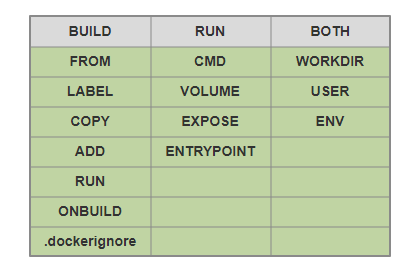

### 构建镜像docker build 命令

docker build命令使用Dockerfile文件创建镜像

```text
docker build [OPTIONS] PATH | URL | -
说明:
PATH | URL | -     #可以使是本地路径，也可以是URL路径。若设置为 - ，则从标准输入获取
Dockerfile的内容
-f, --file string  #Dockerfile文件名,默认为 PATH/Dockerfile
--force-rm         #总是删除中间层容器,创建镜像失败时，删除临时容器
--no-cache         #不使用之前构建中创建的缓存
-q  --quiet=false  #不显示Dockerfile的RUN运行的输出结果
--rm=true          #创建镜像成功时，删除临时容器
-t --tag list      #设置注册名称、镜像名称、标签。格式为 <注册名称>/<镜像名称>:<标签>（标签
默认为latest）
```

范例: 查看帮助

```bash
[root@ubuntu2204 ~]#man docker-build
DOCKER(1)                                               Docker User Manuals
NAME
docker-build - Build an image from a Dockerfile
SYNOPSIS
docker  build  [--add-host[=[]]] [--build-arg[=[]]] [--cache-from[=[]]]
```

[-c|--cpu-shares[=0]] [--cgroup-parent[=CGROUP-PAR-

```text
ENT]] [--help] [--iidfile[=CIDFILE]] [-f|--file[=PATH/Dockerfile]] [-
```

squash]  Experimental  [--force-rm]  [--isolation[=de-

```text
fault]] [--label[=[]]] [--no-cache] [--pull] [--compress] [-q|--quiet] [-
-rm[=true]] [-t|--tag[=[]]] [-m|--memory[=MEMORY]]
[--memory-swap[=LIMIT]] [--network[="default"]]  [--shm-size[=SHM-SIZE]]
[--cpu-period[=0]]  [--cpu-quota[=0]]  [--cpuset-
cpus[=CPUSET-CPUS]] [--cpuset-mems[=CPUSET-MEMS]] [--target[=[]]] [--
ulimit[=[]]] PATH | URL | -
DESCRIPTION
This will read the Dockerfile from the directory specified in PATH.  It
also sends any other files and directories found in
the current directory to the Docker daemon. The contents of this directory
would be used by ADD commands found  within  the
Dockerfile.
Warning, this will send a lot of data to the Docker daemon depending on
the contents of the current directory. The build is
run by the Docker daemon, not by the CLI, so the whole context must be
transferred to the daemon.  The Docker  CLI  reports
"Sending build context to Docker daemon" when the context is sent to the
daemon.
When the URL to a tarball archive or to a single Dockerfile is given, no
```

context is sent from the client to the Docker dae-

```text
mon. In this case, the Dockerfile at the root of the archive and the rest
of the archive will get used as  the  context  of
the build.  When a Git repository is set as the URL, the repository is
cloned locally and then sent as the context.
OPTIONS
-f, --file PATH/Dockerfile
```

范例:

```text
docker build .
docker build /usr/local/src/nginx
docker build -f /path/to/a/Dockerfile .
docker build -t shykes/myapp .
docker build -t shykes/myapp:1.0.2 -t shykes/myapp:latest .
docker build -t test/myapp .
docker build -t nginx:v1 /usr/local/src/nginx
```

查看镜像的构建历史:

```text
docker history 镜像ID
```

范例:

```xml
[root@centos8 ~]#podman history  90201858b1fc
ID             CREATED          CREATED BY
SIZE      COMMENT
90201858b1fc   17 minutes ago   /bin/sh -c #(nop) CMD ["tail" ,"-f","/etc/...
0B
<missing>      2 hours ago      /bin/sh -c apt-get update && apt-get insta...
14.83MB
<missing>      35 hours ago     /bin/sh -c #(nop) CMD ["/bin/bash"]
14.83MB
<missing>      35 hours ago     /bin/sh -c mkdir -p /run/systemd && echo '...
3.072kB
<missing>      35 hours ago     /bin/sh -c set -xe && echo '#!/bin/sh' > /...
15.87kB
<missing>      35 hours ago     /bin/sh -c [ -z "$(apt-get indextargets)" ]
991.2kB
<missing>      35 hours ago     /bin/sh -c #(nop) ADD file:91a750fb184711f...
65.58MB
```

范例:  利用Dockerfile构建基于CentOS的nginx镜像

```bash
[root@ubuntu1804 ~]#vim /data/Dockerfile
[root@ubuntu1804 ~]#cat /data/Dockerfile
FROM centos
LABEL maintainer="bowenxiaochun <root@bowenxiaochun.com>"
RUN yum install -y nginx && echo Nginx Website in Docker >
/usr/share/nginx/html/index.html
EXPOSE 80
CMD ["nginx", "-g", "daemon off;"]
#ENTRYPOINT ["nginx", "-g", "daemon off;"]
[root@ubuntu1804 ~]#docker build -t nginx_centos8.2:v1.14.1 /data/
Sending build context to Docker daemon  209.2MB
Step 1/6 : FROM centos
---> 831691599b88
Step 2/6 : LABEL maintainer="bowenxiaochun <root@bowenxiaochun.com>"
---> Running in 3fc4487e80f9
Removing intermediate container 3fc4487e80f9
---> 598318841b8a
Step 3/6 : RUN yum install -y nginx
---> Running in 8a6d9866e4ae
CentOS-8 - AppStream                            2.1 MB/s | 5.8 MB     00:02
CentOS-8 - Base                                 1.8 MB/s | 2.2 MB     00:01
CentOS-8 - Extras                               8.6 kB/s | 7.0 kB     00:00
.......
Complete!
Removing intermediate container 8a6d9866e4ae
---> 8963fb608c33
Step 4/6 : RUN echo Nginx Website in Docker > /usr/share/nginx/html/index.html
---> Running in 04d4287aac49
Removing intermediate container 04d4287aac49
---> 9a95e56b9bc0
Step 5/6 : EXPOSE 80
---> Running in 8534523d8aa6
Removing intermediate container 8534523d8aa6
---> 23cca5737903
Step 6/6 : CMD ["nginx", "-g", "daemon off;"]
---> Running in d52fcc21444f
Removing intermediate container d52fcc21444f
---> afdaec99eb35
Successfully built afdaec99eb35
Successfully tagged nginx_centos8.2:v1.14.1
[root@ubuntu1804 ~]#docker run -d -P --name nginx-web nginx_centos8.2:v1.14.1
3faba5a49f63ab3a1b031da5e4940303b10ddf349069184597e703c572d257d8
[root@ubuntu1804 ~]#docker ps
CONTAINER ID        IMAGE                     COMMAND                  CREATED
STATUS              PORTS                   NAMES
3faba5a49f63        nginx_centos8.2:v1.14.1   "nginx -g 'daemon of…"   4 seconds
ago       Up 3 seconds        0.0.0.0:32775->80/tcp   nginx-web
[root@ubuntu1804 ~]#curl http://127.0.0.1/32775
curl: (7) Failed to connect to 127.0.0.1 port 80: Connection refused
[root@ubuntu1804 ~]#curl http://127.0.0.1:32775
Nginx Website in Docker
[root@ubuntu1804 ~]#curl -I http://127.0.0.1:32775
HTTP/1.1 200 OK
Server: nginx/1.14.1
Date: Wed, 22 Jul 2020 17:09:15 GMT
Content-Type: text/html
Content-Length: 24
Last-Modified: Wed, 22 Jul 2020 17:04:40 GMT
Connection: keep-alive
ETag: "5f1871a8-18"
Accept-Ranges: bytes
```

范例: 刷新镜像缓存重新构建新镜像

```bash
[root@ubuntu1804 ~]#cat /data/Dockerfile
FROM centos
LABEL maintainer="bowenxiaochun <root@bowenxiaochun.com>"
RUN yum install -y nginx
RUN echo Nginx Website in Docker > /usr/share/nginx/html/index.html
#修改下面行,从下面行开始不再使用缓存
ENV REFRESH_DATA 2020-01-01
EXPOSE 80
CMD ["nginx", "-g", "daemon off;"]
[root@ubuntu1804 ~]#docker build   -t nginx_centos8.2:v1.14.1 /data/
Sending build context to Docker daemon  209.2MB
Step 1/7 : FROM centos
---> 831691599b88
Step 2/7 : LABEL maintainer="bowenxiaochun <root@bowenxiaochun.com>"
---> Using cache
---> 598318841b8a
Step 3/7 : RUN yum install -y nginx
---> Using cache
---> 8963fb608c33
Step 4/7 : RUN echo Nginx Website in Docker > /usr/share/nginx/html/index.html
---> Using cache
---> 9a95e56b9bc0
Step 5/7 : ENV REFRESH_DATA 2020-01-01  #从此行开始不再利用缓存
---> Running in 4607ee0d0e77
Removing intermediate container 4607ee0d0e77
---> d6235889f336
Step 6/7 : EXPOSE 80
---> Running in 6924aab5c5c8
Removing intermediate container 6924aab5c5c8
---> 545393760683
Step 7/7 : CMD ["nginx", "-g", "daemon off;"]
---> Running in 345bbc6179d8
Removing intermediate container 345bbc6179d8
---> 4bafc2d0c7e0
Successfully built 4bafc2d0c7e0
Successfully tagged nginx_centos8.2:v1.14.1
```

```bash
#全部不利用缓存重新构建镜像
[root@ubuntu1804 ~]#docker build  --no-cache -t nginx_centos8.2:v1.14.1 /data/
Sending build context to Docker daemon  209.2MB
Step 1/7 : FROM centos
---> 831691599b88
Step 2/7 : LABEL maintainer="bowenxiaochun <root@bowenxiaochun.com>"
---> Running in 41f2aab6657f
Removing intermediate container 41f2aab6657f
---> 091969d0ed9e
Step 3/7 : RUN yum install -y nginx
---> Running in 6e174d492348
CentOS-8 - AppStream                            4.2 MB/s | 5.8 MB     00:01
CentOS-8 - Base                                 1.7 MB/s | 2.2 MB     00:01
CentOS-8 - Extras                               1.2 kB/s | 7.0 kB     00:05
Dependencies resolved.
......
Complete!
Removing intermediate container 6e174d492348
---> ba62ac34b951
Step 4/7 : RUN echo Nginx Website in Docker > /usr/share/nginx/html/index.html
---> Running in d6f785b28ef6
Removing intermediate container d6f785b28ef6
---> 6e15fdc84e21
Step 5/7 : ENV REFRESH_DATA 2020-06-06
---> Running in c6fd87ed95f6
Removing intermediate container c6fd87ed95f6
---> 328b8621ec36
Step 6/7 : EXPOSE 80
---> Running in 1af3d6964d81
Removing intermediate container 1af3d6964d81
---> 7c513643b182
Step 7/7 : CMD ["nginx", "-g", "daemon off;"]
---> Running in fd9216490941
Removing intermediate container fd9216490941
---> 0b2b61dd0445
Successfully built 0b2b61dd0445
Successfully tagged nginx_centos8.2:v1.14.1
```

### 从镜像导出对应的 Dockerfile

想查看一个其它组织的Docker镜像是怎么构建的，可以通过whaler 实现

<https://github.com/P3GLEG/Whaler>

范例：Docker 安装 whaler

```text
# alias export docker image to dockerfile
alias whaler="docker run -t --rm -v /var/run/docker.sock:/var/run/docker.sock:ro
pegleg/whaler"
```

范例：查看 alpine:3.15的Dockerfile内容

```bash
[root@ubuntu2204 ~]#whaler alpine:3.15
3.15: Pulling from library/alpine
0ce1dd7918a4: Pull complete
Digest: sha256:ecbdce53b2c2f43ab1b19418bcbd3f120a23547d9497030c8d978114512b883e
Status: Downloaded newer image for alpine:3.15
Analyzing alpine:3.15
Docker Version: 20.10.23
GraphDriver: overlay2
Environment Variables
|PATH=/usr/local/sbin:/usr/local/bin:/usr/sbin:/usr/bin:/sbin:/bin
Image user
|User is root
Potential secrets:
|Found match etc/apk/keys/alpine-devel@lists.alpinelinux.org-4a6a0840.rsa.pub
Possible public key \.pub$
d4fe24b10af18656416183114772e2b4841724cc847e275cf3e5bebe0acd20e1/layer.tar
|Found match etc/apk/keys/alpine-devel@lists.alpinelinux.org-5243ef4b.rsa.pub
Possible public key \.pub$
d4fe24b10af18656416183114772e2b4841724cc847e275cf3e5bebe0acd20e1/layer.tar
|Found match etc/apk/keys/alpine-devel@lists.alpinelinux.org-5261cecb.rsa.pub
Possible public key \.pub$
d4fe24b10af18656416183114772e2b4841724cc847e275cf3e5bebe0acd20e1/layer.tar
|Found match etc/apk/keys/alpine-devel@lists.alpinelinux.org-6165ee59.rsa.pub
Possible public key \.pub$
d4fe24b10af18656416183114772e2b4841724cc847e275cf3e5bebe0acd20e1/layer.tar
|Found match etc/apk/keys/alpine-devel@lists.alpinelinux.org-61666e3f.rsa.pub
Possible public key \.pub$
d4fe24b10af18656416183114772e2b4841724cc847e275cf3e5bebe0acd20e1/layer.tar
|Found match etc/udhcpd.conf DHCP server configs dhcpd[^ ]*.conf
d4fe24b10af18656416183114772e2b4841724cc847e275cf3e5bebe0acd20e1/layer.tar
Dockerfile:
CMD ["/bin/sh"]
```

### 利用 DockerFile 自动构建镜像案例

### 基于 Alpine 基础镜像制作 Nginx 源码编译镜像

2.3.2.1.1 制作 Alpine 的自定义系统镜像

```bash
#按照业务类型或系统类型等方式划分创建目录环境，方便后期镜像比较多的时候进行分类
[root@ubuntu1804 ~]#mkdir
/data/dockerfile/{web/{nginx,apache,tomcat,jdk},system/{centos,ubuntu,alpine,deb
ian}} -p
[root@ubuntu1804 ~]#tree /data/dockerfile/
/data/dockerfile/
├── system
│   ├── alpine
│   ├── centos
│   ├── debian
│   └── ubuntu
└── web
├── apache
├── jdk
├── nginx
└── tomcat
#下载alpine镜像,打新标签
[root@ubuntu1804 ~]#docker pull alpine
[root@ubuntu1804 ~]#docker tag  alpine alpine:3.11
[root@ubuntu1804 ~]#docker images
[root@ubuntu1804 ~]#docker images
REPOSITORY          TAG                 IMAGE ID            CREATED
SIZE
alpine              3.11                e7d92cdc71fe        11 days ago
5.59MB
alpine              latest              e7d92cdc71fe        11 days ago
5.59MB
#准备相关文件
[root@ubuntu1804 ~]#cd /data/dockerfile/system/alpine
[root@ubuntu1804 alpine]#cat repositories
http://mirrors.aliyun.com/alpine/v3.11/main
http://mirrors.aliyun.com/alpine/v3.11/community
#准备Dockerfile文件
[root@ubuntu1804 alpine]#cat Dockerfile
ARG VERSION=3.11
FROM alpine:$VERSION
LABEL maintainer="bowenxiaochun <root@bowenxiaochun.com>"
#COPY repositories /etc/apk/repositories
RUN sed -i 's/dl-cdn.alpinelinux.org/mirrors.ustc.edu.cn/' /etc/apk/repositories
&& apk update && apk --no-cache add tzdata   gcc make curl zip unzip net-tools
pstree wget libgcc libc-dev libcurl libc-utils pcre-dev zlib-dev  libnfs  pcre
pcre2 libevent libevent-dev iproute2 && ln -s  /usr/share/zoneinfo/Asia/Shanghai
/etc/localtime && echo "Asia/Shanghai" > /etc/timezone
#准备构建脚本
[root@ubuntu1804 alpine]#cat build.sh
#!/bin/bash
docker build -t alpine-base:3.11 .
[root@ubuntu1804 alpine]#bash build.sh
[root@ubuntu1804 alpine]#docker images  alp*
REPOSITORY          TAG                 IMAGE ID            CREATED
SIZE
alpine-base         3.11                b162eecf4da9        5 minutes ago
182MB
alpine              3.11                e7d92cdc71fe        11 days ago
5.59MB
alpine              latest              e7d92cdc71fe        11 days ago
5.59MB
```

2.3.2.1.2 制作基于 Alpine 自定义镜像的 Nginx 镜像

```bash
#准备相关文件
[root@ubuntu1804 ~]#mkdir /data/dockerfile/web/nginx/1.16.1-alpine/
[root@ubuntu1804 ~]#cd /data/dockerfile/web/nginx/1.16.1-alpine/
[root@ubuntu1804 1.16.1-alpine]#wget http://nginx.org/download/nginx-
1.16.1.tar.gz
[root@ubuntu1804 1.16.1-alpine]#echo Test Page based nginx-alpine > index.html
[root@ubuntu1804 1.16.1-alpine]#cp ../1.16.1-centos7/nginx.conf  .
[root@ubuntu1804 1.16.1-alpine]#cat nginx.conf
user  nginx;
worker_processes  1;
daemon off;            #必须为前台运行
...
location / {
root   /data/nginx/html;
...
#编写Dockerfile文件
[root@ubuntu1804 1.16.1-alpine]#vim Dockerfile
[root@ubuntu1804 1.16.1-alpine]#cat Dockerfile
ARG VERSION=3.11
FROM alpine-base:$VERSION
ARG NGINX_VERSION=1.16.1
LABEL maintainer="bowenxiaochun <root@bowenxiaochun.com>"
ADD nginx-${NGINX_VERSION}.tar.gz /usr/local/src
ENV NGINX_DIR=/apps/nginx
RUN cd /usr/local/src/nginx-$NGINX_VERSION && ./configure  --prefix=${NGINX_DIR}
&& make && make install && ln -s $NGINX_VERSION/sbin/nginx  /usr/local/sbin/ &&
addgroup  -g 888 -S nginx && adduser  -s /sbin/nologin -S -D  -u 888 -G nginx
nginx
COPY nginx.conf ${NGINX_DIR}/conf/nginx.conf
ADD index.html ${NGINX_DIR}/html/index.html
RUN chown  -R  nginx.nginx  /data/nginx/ ${NGINX_DIR}/
EXPOSE 80 443
CMD ["nginx"]
#构建镜像
[root@ubuntu1804 1.16.1-alpine]#vim build.sh
[root@ubuntu1804 1.16.1-alpine]#cat build.sh
#!/bin/bash
docker build -t nginx-alpine:1.16.1 .
[root@ubuntu1804 1.16.1-alpine]#ls
build.sh  Dockerfile  index.html  nginx-1.16.1.tar.gz  nginx.conf
[root@ubuntu1804 1.16.1-alpine]#docker images “*alpine*”
REPOSITORY          TAG                 IMAGE ID            CREATED
SIZE
nginx-alpine        1.16.1              344ff9acf58b        13 seconds ago
211MB
alpine-base         3.11                b162eecf4da9        About an hour ago
182MB
alpine              3.11                e7d92cdc71fe        11 days ago
5.59MB
alpine              latest              e7d92cdc71fe        11 days ago
5.59MB
#生成容器测试镜像
[root@ubuntu1804 1.16.1-alpine]#docker run -d -p  80:80 nginx-alpine:1.16.1
1cb16e9fe6cd8e583a61c2718a92ce3031313bbf3656c2f85ac84d34ccfe7e0d
[root@ubuntu1804 1.16.1-alpine]#curl 127.0.0.1
Test Page based nginx-alpine
[root@ubuntu1804 1.16.1-alpine]#docker exec -it 1cb16e9fe6cd sh
/ # ps aux
PID   USER     TIME  COMMAND
1 root      0:00 nginx: master process nginx
6 nginx     0:00 nginx: worker process
7 root      0:00 sh
12 root      0:00 ps aux
/ # ls /data/nginx/html/ -l
total 4
-rw-r--r--    1 nginx    nginx           29 Jan 29 11:08 index.html
/ # exit
[root@ubuntu1804 1.16.1-alpine]#
```

### 生产案例: 基于 Ubuntu 基础镜像制作 Nginx 镜像

```bash
#下载ubuntu1804镜像
[root@ubuntu1804 ~]#docker pull ubuntu:18.04
[root@ubuntu1804 ~]#docker images ubuntu*
REPOSITORY          TAG                 IMAGE ID            CREATED
SIZE
ubuntu              18.04               ccc6e87d482b        13 days ago
64.2MB
#准备相关文件
[root@ubuntu1804 ~]#mkdir /data/dockerfile/web/nginx/1.16.1-ubuntu1804
[root@ubuntu1804 ~]#cd /data/dockerfile/web/nginx/1.16.1-ubuntu1804
#修改源
[root@ubuntu1804 1.16.1-ubuntu1804]#sed -i
's/cn.archive.ubuntu.com/mirrors.ustc.edu.cn/' /etc/apt/sources.list
#或者手动修改
[root@ubuntu1804 1.16.1-ubuntu1804]#vim sources.list
[root@ubuntu1804 1.16.1-ubuntu1804]#cat sources.list
deb http://mirrors.aliyun.com/ubuntu/ bionic main restricted universe multiverse
deb-src http://mirrors.aliyun.com/ubuntu/ bionic main restricted universe
multiverse
deb http://mirrors.aliyun.com/ubuntu/ bionic-security main restricted universe
multiverse
deb-src http://mirrors.aliyun.com/ubuntu/ bionic-security main restricted
universe multiverse
deb http://mirrors.aliyun.com/ubuntu/ bionic-updates main restricted universe
multiverse
deb-src http://mirrors.aliyun.com/ubuntu/ bionic-updates main restricted universe
multiverse
deb http://mirrors.aliyun.com/ubuntu/ bionic-proposed main restricted universe
multiverse
deb-src http://mirrors.aliyun.com/ubuntu/ bionic-proposed main restricted
universe multiverse
deb http://mirrors.aliyun.com/ubuntu/ bionic-backports main restricted universe
multiverse
deb-src http://mirrors.aliyun.com/ubuntu/ bionic-backports main restricted
universe multiverse
[root@ubuntu1804 1.16.1-ubuntu1804]#wget http://nginx.org/download/nginx-
1.16.1.tar.gz
[root@ubuntu1804 1.16.1-ubuntu1804]#cp ../1.16.1-alpine/nginx.conf .
[root@ubuntu1804 1.16.1-ubuntu1804]#echo Test Page based nginx-ubuntu1804 >
index.html
#编写Dockerfile文件
[root@ubuntu1804 1.16.1-ubuntu1804]#vim Dockerfile
[root@ubuntu1804 1.16.1-ubuntu1804]#cat Dockerfile
FROM ubuntu:18.04
LABEL maintainer="bowenxiaochun <root@bowenxiaochun.com>"
COPY sources.list /etc/apt/sources.list
RUN apt update && apt  install -y  nfs-kernel-server nfs-common  gcc openssh-
server lrzsz tree  openssl libssl-dev libpcre3 libpcre3-dev zlib1g-dev   unzip
zip make
ADD nginx-1.16.1.tar.gz /usr/local/src
RUN cd /usr/local/src/nginx-1.16.1 && ./configure --prefix=/apps/nginx && make
&& make install && ln -s /apps/nginx/sbin/nginx /usr/bin && rm  -rf
/usr/local/src/nginx-1.16.1*
ADD nginx.conf /apps/nginx/conf/nginx.conf
ADD index.html /data/nginx/html/index.html
RUN groupadd  -g 2019 nginx && useradd  -g nginx -s /usr/sbin/nologin -u 2019
nginx && chown -R nginx.nginx /apps/nginx /data/nginx
EXPOSE 80 443
CMD ["nginx"]
#构建镜像
[root@ubuntu1804 1.16.1-ubuntu1804]#vim build.sh
[root@ubuntu1804 1.16.1-ubuntu1804]#cat build.sh
#!/bin/bash
docker build -t nginx-ubuntu1804:1.16.1 .
[root@ubuntu1804 1.16.1-ubuntu1804]#ls
build.sh  Dockerfile  index.html  nginx-1.16.1.tar.gz  nginx.conf  sources.list
[root@ubuntu1804 1.16.1-ubuntu1804]#docker images "nginx*"
REPOSITORY          TAG                 IMAGE ID            CREATED
SIZE
nginx-ubuntu1804    1.16.1              19efdd23ac87        4 minutes ago
378MB
nginx-alpine        1.16.1              978a43bbb61d        40 minutes ago
211MB
nginx-centos7       1.6.1-v2            1918d29d5f45        17 minutes ago
328MB
nginx-centos7       1.6.1               8c16774437a5        13 hours ago
412MB
#启动容器测试镜像
[root@ubuntu1804 1.16.1-ubuntu1804]#docker run -d  -p 80:80 nginx-
ubuntu1804:1.16.1
58f8e9a8fd6eebb19bd2b7c27bd8d52a3a4d42637a942e1e9179ec1b2bcc559d
[root@ubuntu1804 1.16.1-ubuntu1804]#curl 127.0.0.1
Test Page based nginx-ubuntu1804
```

### 生产案例: 基于 Alpine的微服务 Apollo 配置中心

```bash
https://github.com/apolloconfig/apollo/blob/1.5.1/scripts/apollo-on-
kubernetes/apollo-config-server/Dockerfile
https://github.com/apolloconfig/apollo/tree/1.5.1/scripts/apollo-on-kubernetes
# Dockerfile for apollo-config-server
# Build with:
# docker build -t apollo-config-server:v1.0.0 .
FROM openjdk:8-jre-alpine3.8
RUN \
echo "http://mirrors.aliyun.com/alpine/v3.8/main" > /etc/apk/repositories &&
\
echo "http://mirrors.aliyun.com/alpine/v3.8/community" >>
/etc/apk/repositories && \
apk update upgrade && \
apk add --no-cache procps curl bash tzdata && \
ln -sf /usr/share/zoneinfo/Asia/Shanghai /etc/localtime && \
echo "Asia/Shanghai" > /etc/timezone && \
mkdir -p /apollo-config-server
ADD . /apollo-config-server/
ENV APOLLO_CONFIG_SERVICE_NAME="service-apollo-config-server.sre"
EXPOSE 8080
CMD ["/apollo-config-server/scripts/startup-kubernetes.sh"]
```

### 基于 Alpine 制作 Oracle-JDK-8 镜像

Oracle 官方没有提供JDK镜像,下面为第三方制作的JDK镜像

<https://github.com/anapsix/docker-alpine-java>

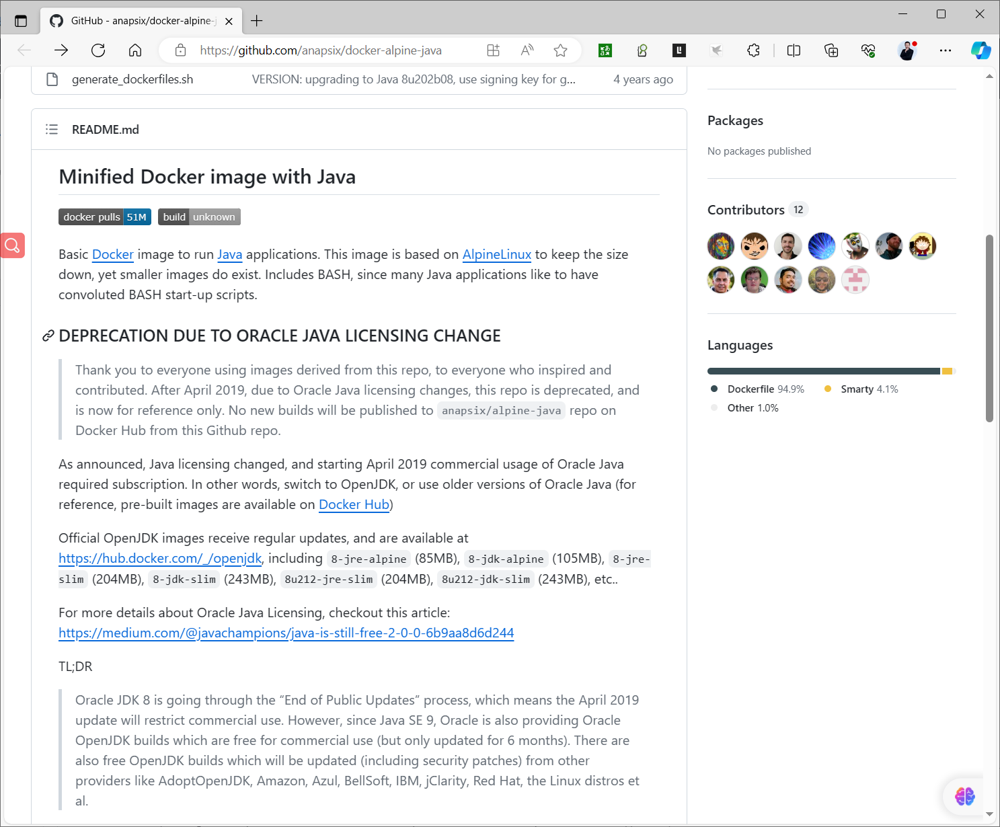

```bash
#https://github.com/anapsix/docker-alpine-
java/blob/master/generate_dockerfiles.sh
#!/bin/bash
set -o pipefail -e
JVM_FLAVORS=(server-jre server-jre_nashorn jdk_nashorn jdk jdk-dcevm)
JCE_FLAVORS=(standard unlimited)
# TEMPLATES (one per flavor)
# Dockerfile.server-jre.tpl
# Dockerfile.jdk.tpl
# Dockerfile.jdk-dcevm.tpl
JAVA_VERSIONS=(
7-80-15
8-92-14
8-102-14
8-111-14
8-121-13-e9e7ea248e2c4826b92b3f075a80e441
8-131-11-d54c1d3a095b4ff2b6607d096fa80163
8-141-15-336fa29ff2bb4ef291e347e091f7f4a7
8-144-01-090f390dda5b47b9b721c7dfaa008135
8-151-12-e758a0de34e24606bca991d704f6dcbf
8-152-16-aa0333dd3019491ca4f6ddbe78cdb6d0
8-162-12-0da788060d494f5095bf8624735fa2f1
8-172-11-a58eab1ec242421181065cdc37240b08
8-181-13-96a7b8442fe848ef90c96a2fad6ed6d1
8-191-12-2787e4a523244c269598db4e85c51e0c
8-192-12-750e1c8617c5452694857ad95c3ee230
8-201-09-42970487e3af4f5aa5bca3f542482c60
8-202-08-1961070e4c9b4e26a04e7f5a083f551e
)
ALPINE_VERSION="3.8"
GLIBC_VERSION="2.29-r0"
GLIBC_REPO="https:\/\/github.com\/sgerrand\/alpine-pkg-glibc"
HOTSWAP_AGENT_VERSION="1.2.0"
gen_dockerfile() {
JVM_PACKAGE="${1}"
DOCKERFILE_TEMPLATE="Dockerfile.${JVM_PACKAGE}.tpl"
DOCKERFILE_TARGET="${JVM_MAJOR}/${JVM_MINOR}b${JVM_BUILD}/${JVM_PACKAGE}/${JAV
A_JCE}/Dockerfile"
DOCKERFILE_TARGET_DIR="$(dirname ${DOCKERFILE_TARGET})"
echo -en "Generating Dockerfile for ${JVM_MAJOR}u${JVM_MINOR}b${JVM_BUILD}
${JVM_PACKAGE} (${JAVA_JCE:-$JCE_FLAVORS} JCE policy).. "
if [ ! -r ${DOCKERFILE_TEMPLATE} ]; then
echo "failed"
echo "Missing Dockerfile template ${DOCKERFILE_TEMPLATE}"
exit 1
fi
# create target dockerfile dir
if [ ! -e ${DOCKERFILE_TARGET_DIR} ]; then
mkdir -p ${DOCKERFILE_TARGET_DIR}
fi
if [[ "${1#*_}" == "nashorn" ]]; then
JVM_PACKAGE="${1%_*}"
fi
if [ "${JVM_PACKAGE}" == "jdk-dcevm" ]; then
JVM_PACKAGE="jdk"
fi
sed "s/%ALPINE_VERSION%/${ALPINE_VERSION}/g;
s/%HOTSWAP_AGENT_VERSION%/${HOTSWAP_AGENT_VERSION}/g;
s/%JVM_MAJOR%/${JVM_MAJOR}/g;
s/%JVM_MINOR%/${JVM_MINOR}/g;
s/%JVM_BUILD%/${JVM_BUILD}/g;
s/%JVM_PACKAGE%/${JVM_PACKAGE}/g;
s/%JVM_URL%/${JVM_URL}/g;
s/%JAVA_JCE%/${JAVA_JCE:-standard}/g;
s/%DCEVM_INSTALLER_URL%/${DCEVM_INSTALLER_URL}/g;
s/%DCEVM_INSTALLER_NAME%/${DCEVM_INSTALLER_NAME}/g;
s/%GLIBC_REPO%/${GLIBC_REPO}/g;
s/%GLIBC_VERSION%/${GLIBC_VERSION}/g" \
${DOCKERFILE_TEMPLATE} > ${DOCKERFILE_TARGET} && \
echo "done" || \
echo "failed"
}
for version in ${JAVA_VERSIONS[@]}; do
JVM_MAJOR=$(echo $version | cut -d- -f1)
JVM_MINOR=$(echo $version | cut -d- -f2)
JVM_BUILD=$(echo $version | cut -d- -f3)
JVM_TEMP=$(echo $version | cut -d- -f4)
if [ "${JVM_MINOR}" -ge 121 ]; then
JVM_URL='http:\/\/download.oracle.com\/otn-
pub\/java\/jdk\/${JAVA_VERSION_MAJOR}u${JAVA_VERSION_MINOR}-
b${JAVA_VERSION_BUILD}\/'${JVM_TEMP}'\/${JAVA_PACKAGE}-${JAVA_VERSION_MAJOR}u${J
AVA_VERSION_MINOR}-linux-x64.tar.gz'
else
JVM_URL='http:\/\/download.oracle.com\/otn-
pub\/java\/jdk\/${JAVA_VERSION_MAJOR}u${JAVA_VERSION_MINOR}-
b${JAVA_VERSION_BUILD}\/${JAVA_PACKAGE}-${JAVA_VERSION_MAJOR}u${JAVA_VERSION_MIN
OR}-linux-x64.tar.gz'
fi
if [ "${JVM_MAJOR}" -eq "7" ]; then
DCEVM_INSTALLER_VERSION=7u79
DCEVM_INSTALLER_URL="https:\\/\\/github.com\\/dcevm\\/dcevm\\/releases\\/downlo
ad\\/full-jdk${DCEVM_INSTALLER_VERSION}%2B8\\/DCEVM-
full-${DCEVM_INSTALLER_VERSION}-installer.jar"
DCEVM_INSTALLER_NAME="DCEVM-full-${DCEVM_INSTALLER_VERSION}-installer.jar"
else
DCEVM_INSTALLER_VERSION=8u112
DCEVM_INSTALLER_URL="https:\\/\\/github.com\\/dcevm\\/dcevm\\/releases\\/downlo
ad\\/light-jdk${DCEVM_INSTALLER_VERSION}%2B8\\/DCEVM-
light-${DCEVM_INSTALLER_VERSION}-installer.jar"
DCEVM_INSTALLER_NAME="DCEVM-light-${DCEVM_INSTALLER_VERSION}-installer.jar"
fi
for JVM_FLAVOR in ${JVM_FLAVORS[@]}; do
if [[ ${JVM_MAJOR} -eq 8 ]]; then
if [[ "${JVM_FLAVOR}" == *_nashorn ]] && [[ ${JVM_MINOR} -lt 192 ]]; then
continue
elif [[ "${JVM_FLAVOR}" == *_nashorn ]] && [[ ${JVM_MINOR} -ge 192 ]];
then
gen_dockerfile $JVM_FLAVOR
else
for JAVA_JCE in ${JCE_FLAVORS[@]}; do
gen_dockerfile $JVM_FLAVOR
done
unset JAVA_JCE
fi
else
[[ "${JVM_FLAVOR}" == *_nashorn ]] && continue || true
gen_dockerfile $JVM_FLAVOR
fi
done
done
echo -n "Generating symlinks for current versions.. "
for JAVA_MAJOR in $(echo "${JAVA_VERSIONS[@]}" | tr ' ' '\n\' | cut -d- -f1 |
uniq); do
latest=$(ls ${JAVA_MAJOR} | sort -n | tail -n1)
cd ${JAVA_MAJOR}
[ -e current ] && rm current || true
ln -s ${latest} current
cd ..
done
echo "done"
```

```dockerfile
#https://github.com/anapsix/docker-alpine-java/blob/master/Dockerfile.jdk.tpl
# AlpineLinux with a glibc-%GLIBC_VERSION% and Oracle Java %JVM_MAJOR%
FROM alpine:%ALPINE_VERSION%
MAINTAINER Anastas Dancha <anapsix@random.io>
# thanks to Vladimir Krivosheev <develar@gmail.com> aka @develar for smaller
image
# and Victor Palma <palma.victor@gmail.com> aka @devx for pointing it out
# Java Version and other ENV
ENV JAVA_VERSION_MAJOR=%JVM_MAJOR% \
JAVA_VERSION_MINOR=%JVM_MINOR% \
JAVA_VERSION_BUILD=%JVM_BUILD% \
JAVA_PACKAGE=%JVM_PACKAGE% \
JAVA_JCE=%JAVA_JCE% \
JAVA_HOME=/opt/jdk \
PATH=${PATH}:/opt/jdk/bin \
GLIBC_REPO=%GLIBC_REPO% \
GLIBC_VERSION=%GLIBC_VERSION% \
LANG=C.UTF-8
# do all in one step
RUN set -ex && \
[[ ${JAVA_VERSION_MAJOR} != 7 ]] || ( echo >&2 'Oracle no longer publishes
JAVA7 packages' && exit 1 ) && \
apk -U upgrade && \
apk add libstdc++ curl ca-certificates bash && \
wget -q -O /etc/apk/keys/sgerrand.rsa.pub https://alpine-
pkgs.sgerrand.com/sgerrand.rsa.pub && \
for pkg in glibc-${GLIBC_VERSION} glibc-bin-${GLIBC_VERSION} glibc-
i18n-${GLIBC_VERSION}; do curl -sSL
${GLIBC_REPO}/releases/download/${GLIBC_VERSION}/${pkg}.apk -o /tmp/${pkg}.apk;
done && \
apk add /tmp/*.apk && \
rm -v /tmp/*.apk && \
( /usr/glibc-compat/bin/localedef --force --inputfile POSIX --charmap UTF-8
C.UTF-8 || true ) && \
echo "export LANG=C.UTF-8" > /etc/profile.d/locale.sh && \
/usr/glibc-compat/sbin/ldconfig /lib /usr/glibc-compat/lib && \
mkdir /opt && \
curl -jksSLH "Cookie: oraclelicense=accept-securebackup-cookie" -o
/tmp/java.tar.gz \
%JVM_URL% && \
JAVA_PACKAGE_SHA256=$(curl -sSL
https://www.oracle.com/webfolder/s/digest/${JAVA_VERSION_MAJOR}u${JAVA_VERSION_M
INOR}checksum.html | grep -E
"${JAVA_PACKAGE}-${JAVA_VERSION_MAJOR}u${JAVA_VERSION_MINOR}-linux-x64\.tar\.gz"
| grep -Eo '(sha256: )[^<]+' | cut -d: -f2 | xargs) && \
echo "${JAVA_PACKAGE_SHA256}  /tmp/java.tar.gz" > /tmp/java.tar.gz.sha256 &&
\
sha256sum -c /tmp/java.tar.gz.sha256 && \
gunzip /tmp/java.tar.gz && \
tar -C /opt -xf /tmp/java.tar && \
ln -s /opt/jdk1.${JAVA_VERSION_MAJOR}.0_${JAVA_VERSION_MINOR} /opt/jdk && \
if [ "${JAVA_JCE}" == "unlimited" ]; then echo "Installing Unlimited JCE
policy" >&2 && \
curl -jksSLH "Cookie: oraclelicense=accept-securebackup-cookie" -o
/tmp/jce_policy-${JAVA_VERSION_MAJOR}.zip \
http://download.oracle.com/otn-
pub/java/jce/${JAVA_VERSION_MAJOR}/jce_policy-${JAVA_VERSION_MAJOR}.zip && \
cd /tmp && unzip /tmp/jce_policy-${JAVA_VERSION_MAJOR}.zip && \
cp -v /tmp/UnlimitedJCEPolicyJDK8/*.jar /opt/jdk/jre/lib/security; \
fi && \
sed -i s/#networkaddress.cache.ttl=-1/networkaddress.cache.ttl=10/
$JAVA_HOME/jre/lib/security/java.security && \
apk del curl glibc-i18n && \
rm -rf /opt/jdk/*src.zip \
/opt/jdk/lib/missioncontrol \
/opt/jdk/lib/visualvm \
/opt/jdk/lib/*javafx* \
/opt/jdk/jre/plugin \
/opt/jdk/jre/bin/javaws \
/opt/jdk/jre/bin/jjs \
/opt/jdk/jre/bin/orbd \
/opt/jdk/jre/bin/pack200 \
/opt/jdk/jre/bin/policytool \
/opt/jdk/jre/bin/rmid \
/opt/jdk/jre/bin/rmiregistry \
/opt/jdk/jre/bin/servertool \
/opt/jdk/jre/bin/tnameserv \
/opt/jdk/jre/bin/unpack200 \
/opt/jdk/jre/lib/javaws.jar \
/opt/jdk/jre/lib/deploy* \
/opt/jdk/jre/lib/desktop \
/opt/jdk/jre/lib/*javafx* \
/opt/jdk/jre/lib/*jfx* \
/opt/jdk/jre/lib/amd64/libdecora_sse.so \
/opt/jdk/jre/lib/amd64/libprism_*.so \
/opt/jdk/jre/lib/amd64/libfxplugins.so \
/opt/jdk/jre/lib/amd64/libglass.so \
/opt/jdk/jre/lib/amd64/libgstreamer-lite.so \
/opt/jdk/jre/lib/amd64/libjavafx*.so \
/opt/jdk/jre/lib/amd64/libjfx*.so \
/opt/jdk/jre/lib/ext/jfxrt.jar \
/opt/jdk/jre/lib/ext/nashorn.jar \
/opt/jdk/jre/lib/oblique-fonts \
/opt/jdk/jre/lib/plugin.jar \
/tmp/* /var/cache/apk/* && \
echo 'hosts: files mdns4_minimal [NOTFOUND=return] dns mdns4' >>
/etc/nsswitch.conf
```

### OpenJDK 镜像

Oracle 官方没有制作 JAVA 镜像,而且还涉及到版权问题,可以使用OpenJDK

```text
#OpenJDK官方镜像,一度不再更新,最近恢复更新
https://hub.docker.com/_/openjdk/
```

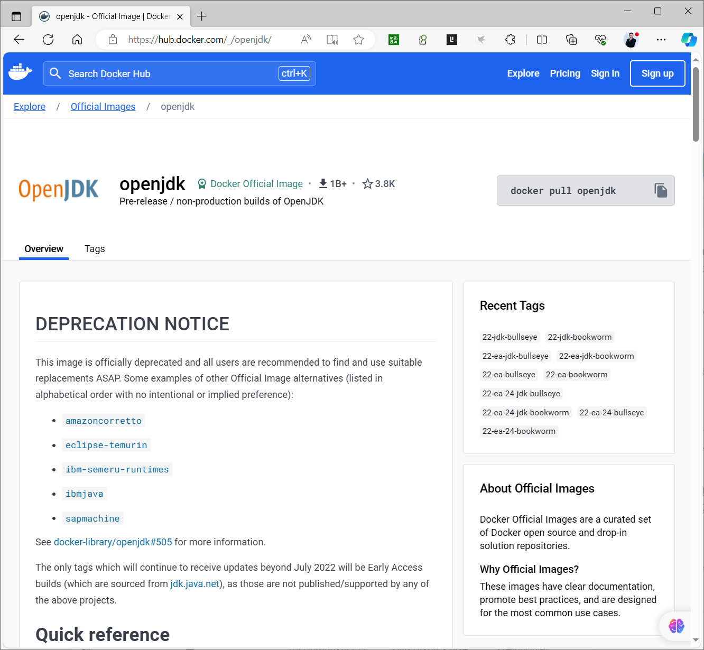

```text
#OpenJDK官方推存镜像
https://hub.docker.com/_/eclipse-temurin
```

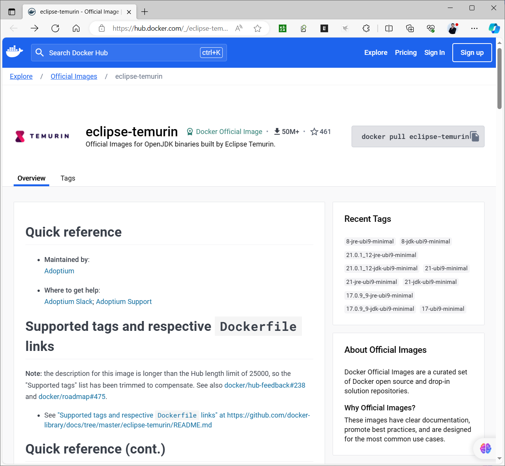

```text
#OpenJDK官方推存镜像
https://hub.docker.com/_/amazoncorretto
```

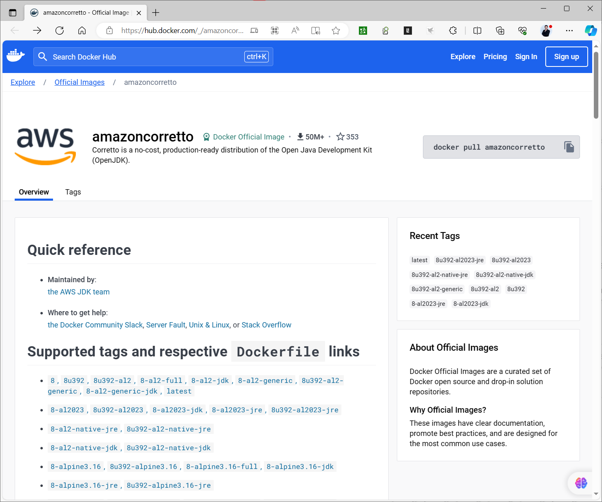

### 基于Openjdk的微服务的JAVA应用镜像

```dockerfile
https://gitee.com/lbtooth/RuoYi-
Cloud/blob/master/docker/ruoyi/gateway/dockerfile
# 基础镜像
FROM  openjdk:8-jre
# author
MAINTAINER ruoyi
# 挂载目录
VOLUME /home/ruoyi
# 创建目录
RUN mkdir -p /home/ruoyi
# 指定路径
WORKDIR /home/ruoyi
# 复制jar文件到路径
COPY ./jar/ruoyi-gateway.jar /home/ruoyi/ruoyi-gateway.jar
# 启动网关服务
ENTRYPOINT ["java","-jar","ruoyi-gateway.jar"]
```

### 多阶段构建

<https://docs.docker.com/build/building/multi-stage/>

多阶段构建可以帮助你在构建阶段使用大型的构建工具和依赖项,但是在最终阶段只包含运行时所需的内容。 利用多阶段构建,可以大大减小镜像的大小,但要注意相关依赖文件都要复制到新构建中才能正常运行容器

多阶段构建比较适用于静态编译的程序，比如：Golang

另外在Dockerfile文件中删除文件，也不会让镜像变小，也可以利用多阶段构建缩小镜像

多阶段构建相关指令

```dockerfile
#第一次构建，执行编译等，用于生成必要的程序
FROM <image> [AS <name>]
构建过程生成结果文件
```

```dockerfile
#第二次构建
FROM <image>
COPY --from=<name>] 前一次构建的路径src 前二次构建的路径dest
COPY --from=0 前一次构建的路径src  前二次构建的路径dest
```

### 范例: 多阶段构建实现 Golang 应用

```bash
[root@ubuntu2404 go-hello]#cat hello.go
package main
import (
"fmt"
"time"
)
func main() {
for {
fmt.Println("hello,world!")
time.Sleep(time.Second)
}
}
```

```bash
[root@ubuntu2404 go-hello]#apt update && apt -y  install golang
[root@ubuntu2404 go-hello]#go build hello.go
[root@ubuntu2404 go-hello]#ls
hello  hello.go
[root@ubuntu2404 go-hello]#file hello
hello: ELF 64-bit LSB executable, x86-64, version 1 (SYSV), statically linked,
Go
BuildID=LLIgFpoIVjN92YNLjFKb/4nE1jz8pZr9uGB1y0Bd2/G90HTVyrHXLJJj3yRS_z/Y_qc7N4ff
MU_yXD85Lc_, with debug_info, not stripped
[root@ubuntu2404 go-hello]#ldd hello
not a dynamic executable
[root@ubuntu2404 go-hello]#./hello
hello,world!
hello,world!
hello,world!
hello,world!
```

范例: 基于传统方式构建Golang应用

```bash
#方法1
[root@ubuntu2004 go-hello]#cat Dockerfile
FROM ubuntu:jammy
COPY sources.list /etc/apt/sources.list
COPY hello.go /opt/
WORKDIR /opt
#RUN apt update && apt -y  install golang && cd /opt &&  go build hello.go
RUN apt update && apt -y  install golang  &&  go build hello.go
CMD ["/opt/hello"]
```

```bash
#方法2
[root@ubuntu2004 go-hello]#cat Dockerfile
FROM golang:1.18-alpine
#FROM  golang:nanoserver
#FROM  golang:bullseye
COPY hello.go /opt
WORKDIR /opt
#RUN cd /opt && go build hello.go
RUN go build hello.go
CMD ["/opt/hello"]
```

范例: 多阶段构建Golang应用

```bash
[root@ubuntu2004 go-hello]#cat hello.go
package main
import (
"fmt"
"time"
)
func main() {
for {
fmt.Println("hello,world!")
time.Sleep(time.Second)
}
}
[root@ubuntu2004 go-hello]#cat build.sh
#!/bin/bash
#
#FileName:          build.sh
#Description:       The test script
docker build -t go-hello:$1 .
#第一次构建
[root@ubuntu2004 go-hello]#cat Dockerfile
FROM golang:1.18-alpine
COPY hello.go /opt
WORKDIR /opt
RUN go build hello.go
CMD "./hello"
[root@ubuntu2004 go-hello]#bash build.sh v1.0
[root@ubuntu2004 go-hello]#docker run --name hello go-hello:v1.0
hello, world
#第二次优化
[root@ubuntu2004 go-hello]#cp Dockerfile Dockerfile-v1.0
[root@ubuntu2004 go-hello]#vim Dockerfile
[root@ubuntu2004 go-hello]#cat Dockerfile
FROM golang:1.18-alpine as builder
COPY hello.go /opt
WORKDIR /opt
RUN go build hello.go
FROM alpine:3.15.0
#FROM scratch
COPY --from=builder /opt/hello /hello
#COPY --from=0 /opt/hello /hello
CMD ["/hello"]
[root@ubuntu2004 go-hello]#bash build.sh v2.0
[root@ubuntu2004 go-hello]#docker run --name hello2 go-hello:v2.0
hello, world
[root@ubuntu2004 go-hello]#docker images go-hello
REPOSITORY   TAG       IMAGE ID       CREATED          SIZE
go-hello     v2.0      9d6b2abc190a   28 seconds ago   7.35MB
go-hello     v1.0      54c7203e3a60   5 minutes ago    330MB
#第三次优化
[root@ubuntu2004 go-hello]#vim Dockerfile
[root@ubuntu2004 go-hello]#cat Dockerfile
FROM golang:1.18-alpine as builder
COPY hello.go /opt
WORKDIR /opt
RUN go build hello.go
#FROM alpine:3.15.0
FROM scratch
COPY --from=builder /opt/hello /hello
#COPY --from=0 /opt/hello /hello
CMD ["/hello"]
[root@ubuntu2004 go-hello]#bash build.sh v3.0
[root@ubuntu2004 go-hello]#docker run --name hello2 go-hello:v3.0
hello, world
#比较三次构建的结果
[root@ubuntu2004 go-hello]#docker images go-hello
REPOSITORY   TAG       IMAGE ID       CREATED          SIZE
go-hello     v3.0      6b12922337d4   4 minutes ago    1.76MB
go-hello     v2.0      9d6b2abc190a   28 seconds ago   7.35MB
go-hello     v1.0      54c7203e3a60   5 minutes ago    330MB
```

### 范例：多阶段构建实现基于Alpine的Nginx的编译安装（重点）

范例1

```bash
[root@ubuntu2204 nginx-alpine-build]#cat Dockerfile
ARG VERSION=3.18.0
FROM alpine:$VERSION
LABEL maintainer="bowenxiaochun <root@bowenxiaochun.com>"
ENV NGINX_VERSION=1.24.0
ENV NGINX_DIR=/apps/nginx
ADD nginx-$NGINX_VERSION.tar.gz /usr/local/src
RUN  sed -i 's/dl-cdn.alpinelinux.org/mirrors.ustc.edu.cn/'
/etc/apk/repositories  && \
apk update && apk --no-cache add gcc make libgcc libc-dev libcurl libc-
utils pcre-dev zlib-dev  libnfs pcre pcre2  net-tools curl pstree wget libevent
libevent-dev iproute2 openssl-dev && \
cd /usr/local/src/nginx-$NGINX_VERSION && \
./configure  --prefix=${NGINX_DIR} --user=nginx --group=nginx --with-
http_ssl_module --with-http_v2_module --with-http_realip_module --with-
http_stub_status_module --with-http_gzip_static_module --with-pcre --with-stream
--with-stream_ssl_module --with-stream_realip_module && \
make && make install && \
rm -rf /usr/local/src/nginx-$NGINX_VERSION
COPY nginx.conf ${NGINX_DIR}/conf/nginx.conf
```

```bash
FROM alpine:$VERSION
ENV NGINX_DIR=/apps/nginx
COPY --from=0 ${NGINX_DIR}/ ${NGINX_DIR}/
RUN  sed -i 's/dl-cdn.alpinelinux.org/mirrors.ustc.edu.cn/'
/etc/apk/repositories \
&& apk update && apk --no-cache add tzdata curl pcre pcre2 \
&& ln -s  /usr/share/zoneinfo/Asia/Shanghai /etc/localtime \
&& ln -sf ${NGINX_DIR}/sbin/nginx  /usr/sbin/nginx \
&& addgroup -g 888 -S nginx \
&& adduser  -u 888 -G nginx -D -S -s /sbin/nologin nginx \
&& chown  -R  nginx:nginx  ${NGINX_DIR}/ \
&& ln -sf /dev/stdout ${NGINX_DIR}/logs/access.log \
&& ln -sf /dev/stderr ${NGINX_DIR}/logs/error.log
EXPOSE 80 443
CMD ["nginx","-g","daemon off;"]
[root@ubuntu2204 nginx-alpine-build]#ls
build.sh  Dockerfile  nginx-1.24.0.tar.gz  nginx.conf
[root@ubuntu2204 nginx-alpine-build]#docker images bowenxiaochun/nginx:1.24.0-
alpine-3.18.0
REPOSITORY           TAG                    IMAGE ID       CREATED
SIZE
bowenxiaochun/nginx   1.24.0-alpine-3.18.0   b87e987ea522   About an hour ago
22.7MB
```

范例：

```bash
[root@ubuntu2204 nginx]#cat Dockerfile
FROM alpine:3.20.3
LABEL author=bowenxiaochun
ADD nginx-1.26.2.tar.gz /usr/local/src/
RUN sed -i 's/dl-cdn.alpinelinux.org/mirrors.ustc.edu.cn/' /etc/apk/repositories
&& apk --no-cache add gcc make  libgcc libc-dev libcurl libc-utils pcre-dev
zlib-dev  libnfs  pcre pcre2 libevent libevent-dev && cd /usr/local/src/nginx-
1.26.2 && ./configure --prefix=/apps/nginx && make && make install && rm -rf
/usr/local/src/nginx-1.26.2
FROM alpine:3.20.3
COPY --from=0 /apps/nginx /apps/nginx
COPY --from=0  /usr/lib/libpcre.so.1  /usr/lib/libpcre.so.1
COPY nginx.conf /apps/nginx/conf/nginx.conf
CMD ["/apps/nginx/sbin/nginx","-g","daemon off;"]
```

### 范例: 多阶段构建 Vue 前端项目

<https://gitee.com/lbtooth/myblog_admin/blob/master/Dockerfile>

```dockerfile
FROM node:14.17.6 AS build
COPY . /opt/vue
WORKDIR /opt/vue
RUN sed -i 's/config.headers/\/\/&/' src/api/request.js
RUN npm install && npm run build
FROM nginx:1.20.1
COPY --from=build /opt/vue/dist /opt/vue/dist
COPY nginx.conf /etc/nginx/nginx.conf
CMD ["nginx", "-g","daemon off;"]
```

### 范例：多阶段构建 Vue 前端项目

```bash
[root@ubuntu2204 ruoyi-ui]#cat Dockerfile
#FROM registry.cn-beijing.aliyuncs.com/bowenxiaochun/node:14.17.6 AS build
FROM registry.cn-beijing.aliyuncs.com/bowenxiaochun/node:16.20-bullseye-slim AS
build
COPY . /opt/vue
WORKDIR /opt/vue
RUN npm install  --registry=https://registry.npmmirror.com && npm run build:prod
```

```dockerfile
FROM registry.cn-beijing.aliyuncs.com/bowenxiaochun/nginx:1.20.0
LABEL maintainer="bowenxiaochun <root@bowenxiaochun.com>"
RUN rm -rf  /usr/share/nginx/html/
COPY --from=build /opt/vue/dist/ /usr/share/nginx/html
```

### 范例: 多阶段构建 JAVA 项目

范例: spring-boot-helloword 项目

```xml
#https://gitee.com/lbtooth/spring-boot-helloworld/raw/main/Dockerfile-
multistages
[root@ubuntu2204 spring-boot-helloworld]#cat Dockerfile-multistages
#FROM adoptopenjdk/openjdk11:alpine-jre
#FROM openjdk:11.0.16
FROM registry.cn-beijing.aliyuncs.com/bowenxiaochun/maven:3.9.9-eclipse-temurin-8-
alpine AS build
COPY .  /data/
WORKDIR /data
RUN sed -i  '/\/mirrors>/i <mirror> \n <id>nexus-aliyun</id> \n  <mirrorOf>*
</mirrorOf> \n <name>Nexus aliyun</name> \n
<url>http://maven.aliyun.com/nexus/content/groups/public</url> \n </mirror> '
/usr/share/maven/conf/settings.xml
RUN  mvn clean package -Dmaven.test.skip=true
#第二阶段构建
FROM registry.cn-beijing.aliyuncs.com/bowenxiaochun/openjdk:8u212-jre-alpine3.9
LABEL maintainer="bowenxiaochun <root@bowenxiaochun.com>"
COPY --from=build /data/target/spring-boot-helloworld-*-SNAPSHOT.jar
/applications/spring-boot-helloworld.jar
#ENTRYPOINT ["/usr/local/openjdk-11/bin/java -jar /applications/spring-boot-
helloworld.jar --server.port=80"]
#CMD ["java","-jar","/applications/spring-boot-helloworld.jar --
server.port=8888"]
CMD ["java","-jar","/applications/spring-boot-helloworld.jar","--
server.port=8888"]
```

范例: RuoYI-vue项目

```bash
[root@ubuntu2404 RuoYi-Vue]#cat Dockerfile-multi-stage
#多阶段构建
#FROM maven:3.9.9-eclipse-temurin-8-alpine as build
FROM registry.cn-beijing.aliyuncs.com/bowenxiaochun/maven:3.9.9-eclipse-temurin-8-
alpine as build
COPY . /RuoYi-Vue
WORKDIR /RuoYi-Vue
RUN mvn clean package -Dmaven.test.skip=true
```

```dockerfile
# 基础镜像
#FROM adoptopenjdk/openjdk11:alpine-jre
#FROM openjdk:11.0.16
#FROM openjdk:11.0.16-jre-slim
#FROM openjdk:8u212-jre-alpine3.9
FROM registry.cn-beijing.aliyuncs.com/bowenxiaochun/openjdk:8u212-jre-alpine3.9
```

```text
# 作者
LABEL MAINTAINER="bowenxiaochun<root@bowenxiaochun.com>"
ENV APP_NAME=ruoyi APP_PATH=/data/ruoyi  APP_PORT=8080
```

```dockerfile
# 挂载目录
VOLUME ${APP_PATH}
# 创建目录
RUN mkdir -p ${APP_PATH}
# 指定路径
WORKDIR  ${APP_PATH}
# 复制jar文件到路径
COPY --from=build /RuoYi-Vue/ruoyi-admin/target/*.jar
${APP_PATH}/${APP_NAME}.jar
#COPY ./target/*.jar ${APP_PATH}/${APP_NAME}.jar
#暴露端口
EXPOSE $APP_PORT
# 启动服务
CMD java -jar ${APP_PATH}/${APP_NAME}.jar --server.port=$APP_PORT
#安装字体相关包，否则无法显示验证码
RUN sed -i 's/dl-cdn.alpinelinux.org/mirrors.aliyun.com/' /etc/apk/repositories
&& apk update && apk  --no-cache add ttf-dejavu fontconfig
```

范例: JAVA项目 spring-boot-2048

```dockerfile
#https://gitee.com/lbtooth/spring-boot-2048/blob/master/Dockerfile
FROM registry.cn-beijing.aliyuncs.com/hub-mirrors/maven:3-jdk-8 AS build
COPY src /usr/src/app/src
COPY pom.xml /usr/src/app
COPY settings.xml /user/src/app/settings.xml
RUN mvn -f /usr/src/app/pom.xml -s /user/src/app/settings.xml clean package -
DskipTests
FROM registry.cn-beijing.aliyuncs.com/hub-mirrors/openjdk:8-jdk-alpine
VOLUME /tmp
ARG JAR_FILE=target/application.jar
COPY --from=build /usr/src/app/${JAR_FILE} app.jar
ENTRYPOINT ["java","-Djava.security.egd=file:/dev/./urandom","-jar","/app.jar"]
```



<nav class="article-end" aria-label="章节导航">
  <a href="{{ '/subjects/Docker/09-building-images-with-docker-commit.html' | relative_url }}">← Previous: Building Images with Docker Commit</a>
  <a href="{{ '/subjects/Docker/' | relative_url }}">Back to Docker Container Technology Index</a>
  <a href="{{ '/subjects/Docker/11-container-data-management.html' | relative_url }}">Next: Container Data Management →</a>
</nav>
