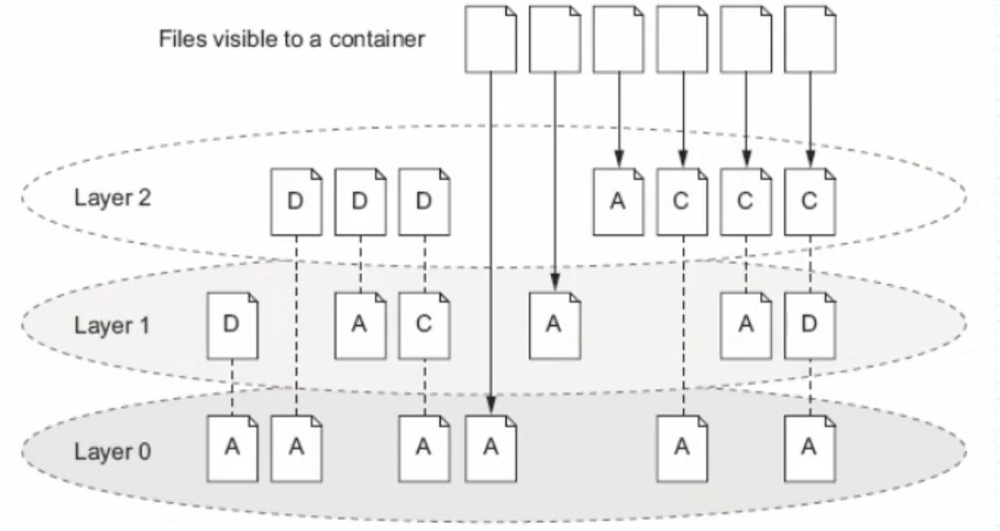
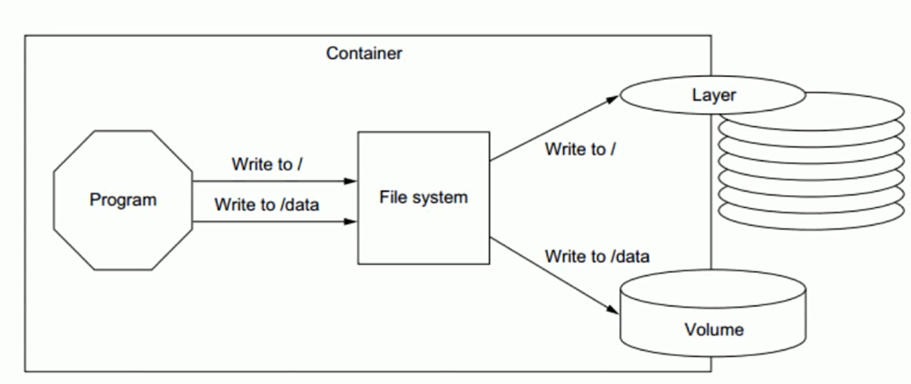
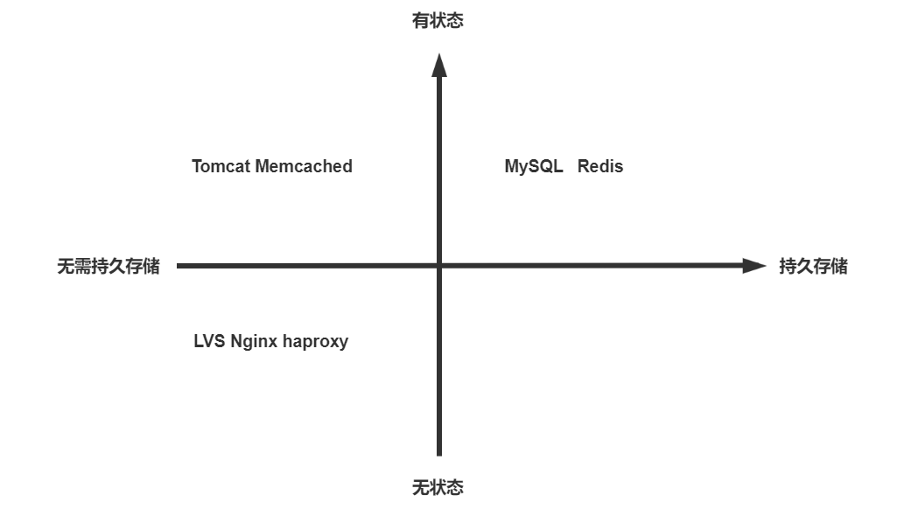
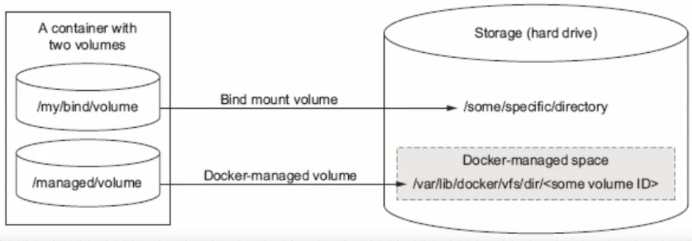

[← 返回Docker 容器技术目录]({{ '/subjects/Docker/' | relative_url }})



# 11 容器的数据管理介绍
## 3 Docker 数据管理



Docker镜像由多个只读层叠加而成，启动容器时，Docker会加载只读镜像层并在镜像栈顶部添加一个读写层

如果运行中的容器修改了现有的一个已经存在的文件，那该文件将会从读写层下面的只读层复制到读写层，该文件的只读版本仍然存在，只是已经被读写层中该文件的副本所隐藏，此即“写时复制(COW copy on write)"机制

如果将正在运行中的容器修改生成了新的数据，那么新产生的数据将会被复制到读写层，进行持久化保存，这个读写层也就是容器的工作目录，也为写时复制(COW) 机制。

COW机制节约空间,但会导致性低下,虽然关闭重启容器,数据不受影响,但会随着容器的删除,其对应的可写层也会随之而删除,即数据也会丢失.如果容器需要持久保存数据,并不影响性能可以用数据卷技术实现

如下图是将对根的数据写入到了容器的可写层，但是把/data 中的数据写入到了一个另外的volume 中用于数据持久化



### 3.1 容器的数据管理介绍

Docker镜像是分层设计的，镜像层是只读的，通过镜像启动的容器添加了一层可读写的文件系统，用户写入的数据都保存在这一层中。

### Docker容器的分层

容器的数据分层目录

LowerDir:  image 镜像层,即镜像本身，只读 UpperDir:  容器的上层,可读写 ,容器变化的数据存放在此处 MergedDir:  容器的文件系统，使用Union FS（联合文件系统）将lowerdir 和 upperdir 合并完成后给容器使用,最终呈现给用户的统一视图 WorkDir:  容器在宿主机的工作目录,挂载后内容会被清空，且在使用过程中其内容用户不可见

范例:  查看指定容器数据分层

```json
[root@ubuntu1804 ~]#docker inspect  12959f2c152f
"GraphDriver": {
"Data": {
"LowerDir":
"/var/lib/docker/overlay2/848d77064091ba3ddd25a10ea6e0065af15ee701fed06f82804cf9
ed58751761-
init/diff:/var/lib/docker/overlay2/4a259e4cc9da105d17075e316c3e1f7c29abd6f7a37c5
c7c29251a7e5f0e7eb3/diff",
"MergedDir":
"/var/lib/docker/overlay2/848d77064091ba3ddd25a10ea6e0065af15ee701fed06f82804cf9
ed58751761/merged",
"UpperDir":
"/var/lib/docker/overlay2/848d77064091ba3ddd25a10ea6e0065af15ee701fed06f82804cf9
ed58751761/diff",
"WorkDir":
"/var/lib/docker/overlay2/848d77064091ba3ddd25a10ea6e0065af15ee701fed06f82804cf9
ed58751761/work"
},
"Name": "overlay2"
[root@ubuntu1804 ~]#ll -i
/var/lib/docker/overlay2/848d77064091ba3ddd25a10ea6e0065af15ee701fed06f82804cf9e
d58751761
total 28
920832 drwx------  5 root root 4096 Jan 31 19:02 ./
917524 drwx------ 53 root root 4096 Jan 31 19:02 ../
920843 drwxr-xr-x  3 root root 4096 Jan 31 19:02 diff/
920846 -rw-r--r--  1 root root   26 Jan 31 19:02 link
920851 -rw-r--r--  1 root root   57 Jan 31 19:02 lower
920818 drwxr-xr-x  1 root root 4096 Jan 31 19:02 merged/
920847 drwx------  3 root root 4096 Jan 31 19:02 work/
```

```bash
[root@ubuntu1804 ~]#tree -d
/var/lib/docker/overlay2/848d77064091ba3ddd25a10ea6e0065af15ee701fed06f82804cf9e
d58751761/
/var/lib/docker/overlay2/848d77064091ba3ddd25a10ea6e0065af15ee701fed06f82804cf9e
d58751761/
├── diff
│   └── root
├── merged
│   ├── bin
│   ├── dev
│   │   ├── pts
│   │   └── shm
│   ├── etc
│   │   ├── apk
│   │   │   ├── keys
│   │   │   └── protected_paths.d
│   │   ├── conf.d
│   │   ├── crontabs
│   │   ├── init.d
│   │   ├── logrotate.d
│   │   ├── modprobe.d
│   │   ├── modules-load.d
│   │   ├── network
│   │   │   ├── if-down.d
│   │   │   ├── if-post-down.d
│   │   │   ├── if-post-up.d
│   │   │   ├── if-pre-down.d
│   │   │   ├── if-pre-up.d
│   │   │   └── if-up.d
│   │   ├── opt
│   │   ├── periodic
│   │   │   ├── 15min
│   │   │   ├── daily
│   │   │   ├── hourly
│   │   │   ├── monthly
│   │   │   └── weekly
│   │   ├── profile.d
│   │   ├── ssl
│   │   │   ├── certs
│   │   │   ├── misc
│   │   │   └── private
│   │   └── sysctl.d
│   ├── home
│   ├── lib
│   │   ├── apk
│   │   │   └── db
│   │   ├── firmware
│   │   └── mdev
│   ├── media
│   │   ├── cdrom
│   │   ├── floppy
│   │   └── usb
│   ├── mnt
│   ├── opt
│   ├── proc
│   ├── root
│   ├── run
│   ├── sbin
│   ├── srv
│   ├── sys
│   ├── tmp
│   ├── usr
│   │   ├── bin
│   │   ├── lib
│   │   │   └── engines-1.1
│   │   ├── local
│   │   │   ├── bin
│   │   │   ├── lib
│   │   │   └── share
│   │   ├── sbin
│   │   └── share
│   │       ├── apk
│   │       │   └── keys
│   │       │       ├── aarch64
│   │       │       ├── armhf
│   │       │       ├── ppc64le
│   │       │       ├── s390x
│   │       │       ├── x86
│   │       │       └── x86_64
│   │       ├── man
│   │       ├── misc
│   │       └── udhcpc
│   └── var
│       ├── cache
│       │   ├── apk
│       │   └── misc
│       ├── empty
│       ├── lib
│       │   ├── apk
│       │   ├── misc
│       │   └── udhcpd
│       ├── local
│       ├── lock
│       │   └── subsys
│       ├── log
│       ├── mail
│       ├── opt
│       ├── run -> /run
│       ├── spool
│       │   ├── cron
│       │   └── mail -> /var/mail
│       └── tmp
└── work
└── work
99 directories
[root@ubuntu1804 ~]#docker run -it  alpine:3.11  sh
/ #  dd if=/dev/zero of=/root/test.img bs=1M count=10
10+0 records in
10+0 records out
/ #
```

```bash
#每个镜像层目录中包含了一个文件link，文件内容则是当前层对应的短标识符，镜像层的内容则存放在diff
目录
[root@ubuntu1804 ~]#find
/var/lib/docker/overlay2/848d77064091ba3ddd25a10ea6e0065af15ee701fed06f82804cf9e
d58751761 -name test.img -ls
920903  10240 -rw-r--r--   1 root     root     10485760 Jan 31 19:02
/var/lib/docker/overlay2/848d77064091ba3ddd25a10ea6e0065af15ee701fed06f82804cf9e
d58751761/merged/root/test.img
920903  10240 -rw-r--r--   1 root     root     10485760 Jan 31 19:02
/var/lib/docker/overlay2/848d77064091ba3ddd25a10ea6e0065af15ee701fed06f82804cf9e
d58751761/diff/root/test.img
[root@ubuntu1804 ~]#mount
overlay on
/var/lib/docker/overlay2/848d77064091ba3ddd25a10ea6e0065af15ee701fed06f82804cf9e
d58751761/merged type overlay
(rw,relatime,lowerdir=/var/lib/docker/overlay2/l/OIRNCV35BGPGWKRWEMCJD5SYUZ:/var
/lib/docker/overlay2/l/VZ7N54CVY2JLDASJAZ6AASRQSJ,upperdir=/var/lib/docker/overl
ay2/848d77064091ba3ddd25a10ea6e0065af15ee701fed06f82804cf9ed58751761/diff,workdi
r=/var/lib/docker/overlay2/848d77064091ba3ddd25a10ea6e0065af15ee701fed06f82804cf
9ed58751761/work)
nsfs on /run/docker/netns/6ce1d74bc9af type nsfs (rw)
[root@ubuntu1804 ~]#tree
/var/lib/docker/overlay2/848d77064091ba3ddd25a10ea6e0065af15ee701fed06f82804cf9e
d58751761/diff/
/var/lib/docker/overlay2/848d77064091ba3ddd25a10ea6e0065af15ee701fed06f82804cf9e
d58751761/diff/
└── root
└── test.img
1 directory, 1 file
[root@ubuntu1804 ~]#ls
/var/lib/docker/overlay2/848d77064091ba3ddd25a10ea6e0065af15ee701fed06f82804cf9e
d58751761/merged/
bin  dev  etc  home  lib  media  mnt  opt  proc  root  run  sbin  srv  sys  tmp
usr  var
[root@ubuntu1804 ~]#docker run -it  alpine:3.11  sh
/ # echo welcome to website >> /etc/issue
/ # cat /etc/issue
Welcome to Alpine Linux 3.11
Kernel \r on an \m (\l)
welcome to website
/ #
[root@ubuntu1804 ~]#tree
/var/lib/docker/overlay2/848d77064091ba3ddd25a10ea6e0065af15ee701fed06f82804cf9e
d58751761/diff/
/var/lib/docker/overlay2/848d77064091ba3ddd25a10ea6e0065af15ee701fed06f82804cf9e
d58751761/diff/
├── etc
│   └── issue
└── root
└── test.img
2 directories, 2 files
#删除容器后，所有容器数据目录都随之而删除
[root@ubuntu1804 ~]#docker rm -f 12959f2c152f
[root@ubuntu1804 ~]#ls
/var/lib/docker/overlay2/848d77064091ba3ddd25a10ea6e0065af15ee701fed06f82804cf9e
d58751761
ls: cannot access
'/var/lib/docker/overlay2/848d77064091ba3ddd25a10ea6e0065af15ee701fed06f82804cf9
ed58751761': No such file or directory
```

### 哪些数据需要持久化

有状态的协议

```text
有状态协议就是就通信双方要记住双方，并且共享一些信息。而无状态协议的通信每次都是独立的，与上一次
的通信没什么关系。
"状态”可以理解为“记忆”，有状态对应有记忆，无状态对应无记忆
```



左侧是无状态的http请求服务，右侧为有状态下层为不需要存储的服务，上层为需要存储的部分服务

### 容器数据持久保存方式（重点）

如果要将写入到容器的数据永久保存，则需要将容器中的数据保存到宿主机的指定目录

Docker 提供了多种方法将宿主机的文件系统挂载到容器内，包括以下几种主要方式：

绑定挂载（Bind Mount）

这种方式可以将指定的宿主机上的任意文件或目录挂载到容器内。与卷不同，绑定挂载依赖于宿主机的文件系统结构。

因此，如果你在 Docker CLI 或 Docker API 中使用绑定挂载，你需要知道宿主机上的文件或目录的具体路径。

另外，由于绑定挂载可以访问宿主机上的任意文件和目录，使用这种方式可能会有一定的安全风险。

卷（Volume）

这是 Docker 推荐的挂载方式。卷是完全由 Docker 管理的文件目录，可以在容器之间共享和重用。在创建卷时，Docker 创建了一个目录在宿主机上，然后将这个目录挂载到容器内。卷的主要优点是你可以使用 Docker CLI 或 Docker API 来备份、迁移或者恢复卷，而无需关心卷在宿主机上的具体位置。

卷分为匿名卷和命名卷

tmpfs 挂载：

此方式并不算一种持久化方案 tmpfs 挂载不与宿主机上的任何文件或目录相关联，而是将一个内存空间的临时文件系统挂载到容器的某个目录下。

这种方式的主要优点是它提供了一个高速且安全的挂载方式，因为 tmpfs 挂载通常驻留在宿主机的内存中，且在容器停止后会被自动删除。

tmpfs 挂载是临时的，只存留在容器宿主机的内存中。当容器停止时，tmpfs 挂载文件路径将被删除，在那里写入的文件不会被持久化。

范例: tmpfs 挂载：

```bash
[root@ubuntu2204 ~]#docker run -d --tmpfs /data --name test registry.cn-
beijing.aliyuncs.com/bowenxiaochun/pod-test:v0.1
[root@ubuntu2204 ~]#docker exec -it test sh
[root@931b40b1ae29 /]# df /data
Filesystem           1K-blocks      Used Available Use% Mounted on
tmpfs                  4046088         0   4046088   0% /data
#宿主机内存空间
[root@ubuntu2204 ~]#free -hh
total        used        free      shared  buff/cache   available
内存：      1.9Gi       401Mi        82Mi       1.0Mi       1.4Gi       1.3Gi
交换：      2.0Gi        20Mi       2.0Gi
[root@931b40b1ae29 /]# dd if=/dev/zero of=/data/test.img bs=1M count=500
conv=sync
100+0 records in
100+0 records out
[root@931b40b1ae29 /]# ls  -lh /data/test.img
-rw-r--r--    1 root     root      500.0M Aug 28 05:52 /data/test.img
#宿主机内存消耗了500M
[root@ubuntu2204 ~]#free -h
total        used        free      shared  buff/cache   available
内存：      1.9Gi       385Mi        65Mi       490Mi       1.4Gi       860Mi
```

```bash
[root@931b40b1ae29 /]# exit
#停止容器重启动
[root@ubuntu2204 ~]#docker stop test
test
##宿主机内存释放前面占用的500M
[root@ubuntu2204 ~]#free -hh
total        used        free      shared  buff/cache   available
内存：      1.9Gi       377Mi       560Mi       0.0Ki       990Mi       1.3Gi
交换：      2.0Gi        21Mi       2.0Gi
[root@ubuntu2204 ~]#docker start test
test
#查看文件已经不存在
[root@ubuntu2204 ~]#docker exec -it test ls /data
[root@ubuntu2204 ~]#
```

Docker的卷（Volume）类型分为两种:

数据卷(Data Volume):  直接将宿主机目录挂载至容器的指定的目录 ，推荐使用此种方式，此方式较常用数据卷容器(Data Volume Container):  间接使用宿主机空间，数据卷容器是将宿主机的目录挂载至一个专门的数据卷容器，然后让其他容器通过数据卷容器读写宿主机的数据 ，此方式不常用





<nav class="article-end" aria-label="章节导航">
  <a href="{{ '/subjects/Docker/10-building-images-with-dockerfile.html' | relative_url }}">← Previous: Building Images with Dockerfile</a>
  <a href="{{ '/subjects/Docker/' | relative_url }}">Back to Docker Container Technology Index</a>
  <a href="{{ '/subjects/Docker/12-data-volumes.html' | relative_url }}">Next: Data Volumes →</a>
</nav>
