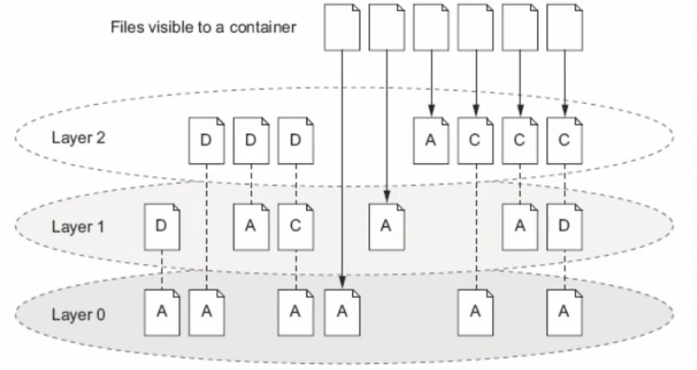
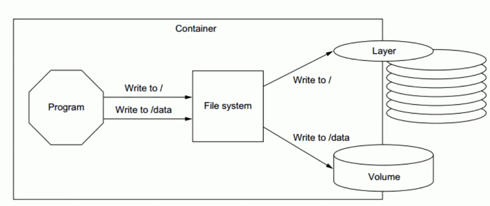
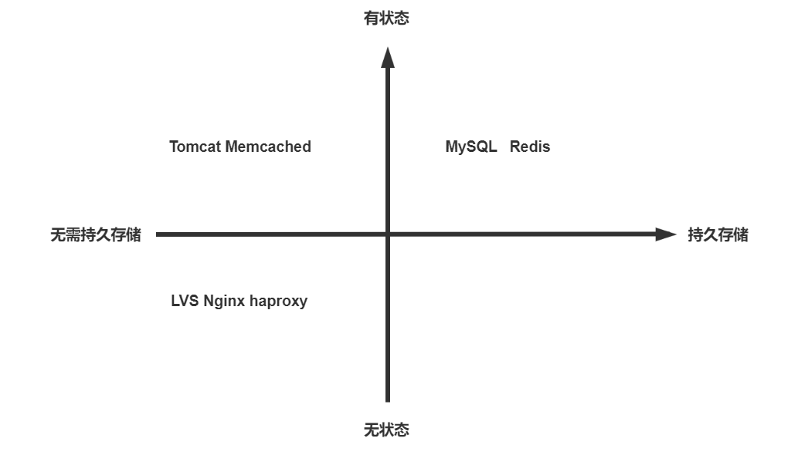
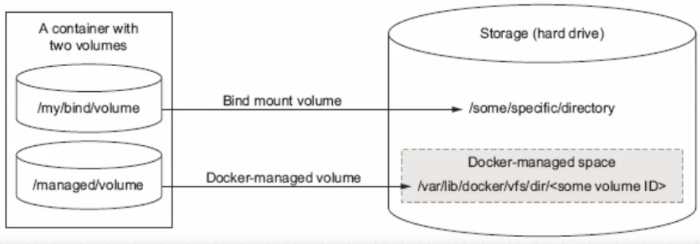

[← 返回 Docker 容器技术目录]({{ '/subjects/Docker/' | relative_url }})



# 11 容器数据管理

## 1. 可写层为什么不是持久化方案

镜像由只读层组成。启动容器时，存储驱动在其上增加容器专属的可写层，容器看到的是合并后的文件系统。修改镜像中已有文件时，相关内容可能通过写时复制（copy-on-write）进入可写层；创建新文件也写在这一层。容器**停止或重启**后，可写层仍属于同一个容器；**删除容器**时，这一层随之移除。因此“在容器里写过文件”不等于“数据已持久化”。





以 Linux 上的 overlay2 为例，`LowerDir` 指向镜像只读层，`UpperDir` 是容器可写层，`MergedDir` 是合并后供容器访问的视图，`WorkDir` 是 overlayfs 内部工作目录。它们是存储驱动内部实现，不应直接在宿主机上修改或删除。

```bash
docker run -d --name layer-demo alpine:3.20 sleep 3600
docker inspect -f '{{json .GraphDriver.Data}}' layer-demo
docker exec layer-demo sh -c 'printf "hello\n" > /tmp/demo.txt'
docker exec layer-demo cat /tmp/demo.txt
```

查看输出时注意 `UpperDir` 和 `MergedDir` 的路径会因主机和容器而异，旧教程中冗长的 overlay2 哈希路径只是一次实验快照。`docker restart layer-demo` 后文件仍在；若随后执行 `docker rm -f layer-demo`，此容器的可写层和文件会被移除。**不要把需要保留的数据写在这里。**写时复制也不意味着所有容器写入都一定低效，性能取决于文件大小、修改模式、存储驱动与底层文件系统；数据库等需要稳定 I/O 的数据应优先使用合适的卷。

## 2. 哪些内容需要独立保存

应用代码和依赖属于镜像，可通过重新构建恢复；数据库文件、用户上传、运行时生成且需要留存的配置或任务状态通常需要独立持久化。HTTP 是无状态协议，但 Web 应用可能把会话、上传和数据库状态放在外部存储；不能仅凭协议是否“无状态”判断是否需要数据卷。



先列出“容器删除并重建后必须还在”的路径，再为每个路径选存储方式、权限和备份策略。卷能让数据脱离容器生命周期，**不等于自动备份**；误删、损坏仍需独立恢复机制。

## 3. 三种挂载的用途

| 挂载方式 | 数据位置与生命周期 | 典型用途 |
| --- | --- | --- |
| 命名卷／匿名卷 | Docker 管理的主机存储；删除容器时通常不会自动删除命名卷 | 数据库、应用数据，便于与容器生命周期分开管理。 |
| 绑定挂载（bind mount） | 指定的宿主机文件或目录 | 开发时挂载代码、明确由主机管理的配置或数据。 |
| tmpfs | 宿主机内存中的临时文件系统 | 不需持久化的临时文件；容器停止后内容消失。 |

绑定挂载依赖宿主机绝对路径，还要考虑权限与可移植性。匿名卷虽可能在删除容器后保留，也容易因名称不可读而变成遗留数据；长期数据通常使用明确的命名卷。旧文把“数据卷”和“数据卷容器”并列为卷的两种类型，容易混淆：命名/匿名卷是现代 Docker 的常用组织方式，`--volumes-from` 是复用另一容器已有挂载的历史用法，并非必需的持久化层。

```bash
docker volume create app-data
docker run --rm --name volume-demo \
  --mount type=volume,source=app-data,target=/data \
  alpine:3.20 sh -c 'echo saved > /data/example.txt'
docker run --rm --mount type=volume,source=app-data,target=/data \
  alpine:3.20 cat /data/example.txt
```

第二个容器仍能读到 `saved`，证明数据属于卷而非前一个容器；后续还要针对 `app-data` 制定备份和清理策略。不要对未知卷执行清理命令。

## 4. tmpfs 不是数据卷备份

`tmpfs` 将容器内路径挂载为临时内存文件系统，容器停止后内容不保留。它适合不需要落盘的短期数据，但会占用内存，不能用来保存上传文件或数据库持久数据。

```bash
docker run -d --name tmpfs-demo \
  --mount type=tmpfs,destination=/data,tmpfs-size=64m \
  alpine:3.20 sleep 3600
docker exec tmpfs-demo sh -c 'echo temporary > /data/example.txt'
docker restart tmpfs-demo
docker exec tmpfs-demo ls -la /data
docker rm -f tmpfs-demo
```

重启后 `/data/example.txt` 不再存在。设置 `tmpfs-size` 可以防止误写占满宿主机内存；实际内存用量仍应通过主机和容器监控查看。



下一篇分别演示绑定挂载与 Docker 卷的创建、读写和权限问题。



<nav class="article-end" aria-label="章节导航">
  <a href="{{ '/subjects/Docker/10-building-images-with-dockerfile.html' | relative_url }}">← 上一篇：Dockerfile 构建镜像</a>
  <a href="{{ '/subjects/Docker/' | relative_url }}">返回 Docker 容器技术目录</a>
  <a href="{{ '/subjects/Docker/12-data-volumes.html' | relative_url }}">下一篇：数据卷 →</a>
</nav>
