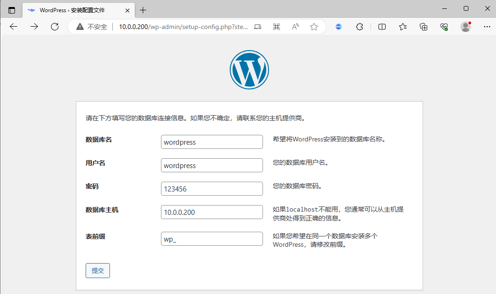

[← 返回 Docker 容器技术目录]({{ '/subjects/Docker/' | relative_url }})



# 12 数据卷与持久化

容器可写层随容器删除而消失。数据库文件、上传内容和需要跨容器复用的站点文件，应放在容器可写层之外。本篇先比较三种挂载方式，再用 Nginx、MySQL 和 WordPress 验证数据究竟保存在哪里。**持久化不等于备份**：卷仍依赖所在主机或存储系统，误删、损坏与主机故障都需要独立的备份方案。

## 三种挂载方式

| 方式 | 写法示例 | 数据位置与适用场景 |
| --- | --- | --- |
| bind mount | `--mount type=bind,src=/srv/site,dst=/usr/share/nginx/html` | 指定宿主机路径；适合已有配置或由宿主机管理的文件 |
| 匿名卷 | `-v /var/www/html` | Docker 分配随机卷名；适合不需要固定名称的运行数据 |
| 命名卷 | `-v db_data:/var/lib/mysql` | Docker 管理且可按名称复用；适合数据库等需要明确生命周期的数据 |

`-v` 是简写，`--mount` 将类型、来源和目标写得更明确。bind mount 的来源是宿主机路径；命名卷的来源是卷名。对 bind mount，`--mount` 在源路径不存在时会报错，能避免误把想挂载的文件创建成目录。相较之下，`-v` 对不存在的宿主机路径可能自动创建目录。

挂载会覆盖容器中该目标路径的视图：bind mount 指向空宿主机目录时，镜像原有目录内容会被遮住；**新建的空命名卷或匿名卷**首次挂载到镜像已有数据的目录时，Docker 通常会把镜像原有数据复制进卷，除非使用 `volume-nocopy`。这两个行为不能混为一谈。

```bash
docker volume create db_data
docker volume ls
docker volume inspect db_data
docker inspect <容器名> --format '{{json .Mounts}}'
```

不要依赖固定的 `/var/lib/docker/volumes/...` 路径直接修改卷数据：Docker 的存储位置随平台和驱动而变。需要检查内容时，可挂载到临时容器，或使用 `docker volume inspect` 查看当前环境的挂载信息。

## 目录 bind mount：两个 Nginx 共用站点

先由宿主机创建目录和首页，再把同一目录只读挂到两个容器。修改宿主机文件后，两处访问都会看到更新；容器内不能写入该目录。共享不是同步复制，两容器看到的是同一份文件。

```bash
mkdir -p /srv/nginx-site
echo '站点版本 1' > /srv/nginx-site/index.html

docker run -d --name site-a -p 8001:80 \
  --mount type=bind,src=/srv/nginx-site,dst=/usr/share/nginx/html,readonly \
  nginx:1.26
docker run -d --name site-b -p 8002:80 \
  --mount type=bind,src=/srv/nginx-site,dst=/usr/share/nginx/html,readonly \
  nginx:1.26

curl http://127.0.0.1:8001/
curl http://127.0.0.1:8002/
echo '站点版本 2' > /srv/nginx-site/index.html
curl http://127.0.0.1:8002/
docker rm -f site-a site-b
cat /srv/nginx-site/index.html
```

最后仍能读到“站点版本 2”，说明删除容器不删除宿主机 bind mount 的文件。配置文件也适合只读挂载，例如 `--mount type=bind,src=/srv/nginx.conf,dst=/etc/nginx/nginx.conf,readonly`；必须预先确认源文件存在、类型正确，且容器进程有读取权限。原资料中把旧版 Tomcat 启动脚本和过时 JVM 参数整体替换进去，容易因版本差异导致启动失败，此处保留“单文件只读挂载”的原理，不建议照搬那些参数。

## 命名卷：MySQL 数据跨容器保存

MySQL 的数据目录位于 `/var/lib/mysql`。先创建命名卷，再用它启动数据库；删除旧容器后，以**同一个卷和兼容的 MySQL 版本**创建新容器，数据库仍在。不要把 MySQL 8 的数据目录直接拿给 MySQL 5.7 启动，版本回退可能损坏数据；原资料在 8.0 与 5.7 间混用同一路径的例子不应照做。

```bash
docker volume create mysql_data
docker run -d --name mysql-demo \
  -e MYSQL_ROOT_PASSWORD='<测试用强密码>' \
  -v mysql_data:/var/lib/mysql \
  mysql:8.0
docker logs mysql-demo --tail 30
docker exec -it mysql-demo mysql -uroot -p
```

在 MySQL 提示符里执行 `CREATE DATABASE dockerdb;`，然后退出。这里用交互式 `-p` 输入密码，避免密码出现在命令行参数中。对于真实部署，也不应把明文环境变量或 `.env` 文件提交到仓库，应选合适的密钥管理方式。

```bash
docker rm -f mysql-demo
docker run -d --name mysql-demo \
  -e MYSQL_ROOT_PASSWORD='<与初始化时一致的密码>' \
  -v mysql_data:/var/lib/mysql \
  mysql:8.0
docker exec -it mysql-demo mysql -uroot -p
```

第二次进入后执行 `SHOW DATABASES;`，应看到 `dockerdb`。在已初始化的数据目录上，`MYSQL_ROOT_PASSWORD` 等初始化环境变量**不会重置原数据库账户**；它们只参与首次初始化。数据卷保留下来，账户数据也随之保留。

## 匿名卷与命名卷的生命周期

匿名卷没有便于记忆的名称，容器删除后可能仍留在卷列表中，容易积累孤儿数据。命名卷则可显式复用。两者都不应被“删除容器就一定删除数据”或“永远不会删除数据”的绝对说法概括：删除命令是否带 `-v`、容器是否用 `--rm`、是否还有其他容器引用卷，都会影响匿名卷清理；命名卷通常需单独删除。

```bash
docker run -d --name anon-web -v /usr/share/nginx/html nginx:1.26
docker inspect anon-web --format '{{json .Mounts}}'
docker rm -f anon-web

docker volume create site_data
docker run -d --name named-web -p 8003:80 -v site_data:/usr/share/nginx/html nginx:1.26
docker volume inspect site_data
docker rm -f named-web
```

在首次挂载空卷时，Nginx 镜像的默认首页通常会复制进卷；再次挂载**同一个**命名卷时，后续内容仍来自该卷。共享可用于静态数据，但多个进程同时写同一卷会产生并发问题，数据库数据目录尤其不能简单交给两个独立数据库实例同时写。

清理时先确认卷内数据是否还需要，再按名称删除。**不要为了清理本例执行“删除所有卷”**，那会误删其他项目数据。

```bash
docker volume ls
docker volume rm site_data
# 只清理确认不再被容器使用的卷时，才考虑 docker volume prune
```

## WordPress 持久化练习

原资料让 WordPress 通过宿主机 IP 连接数据库，实际更直接的做法是让两个容器加入同一用户自定义网络，以服务名解析数据库。下面仅用于理解挂载关系；完整且更易维护的 Compose 方案见第 22 篇。

```bash
docker network create wp-net
docker volume create wp_db
docker volume create wp_files

docker run -d --name wp-db --network wp-net \
  -e MYSQL_ROOT_PASSWORD='<管理员密码>' \
  -e MYSQL_DATABASE=wordpress \
  -e MYSQL_USER=wordpress \
  -e MYSQL_PASSWORD='<应用密码>' \
  -v wp_db:/var/lib/mysql mysql:8.0

docker run -d --name wp-web --network wp-net -p 8080:80 \
  -e WORDPRESS_DB_HOST=wp-db:3306 \
  -e WORDPRESS_DB_NAME=wordpress \
  -e WORDPRESS_DB_USER=wordpress \
  -e WORDPRESS_DB_PASSWORD='<与上面一致的应用密码>' \
  -v wp_files:/var/www/html wordpress:php8.2-apache
```

数据库与 WordPress 文件分别写入 `wp_db`、`wp_files`；只保留其中一个卷并不能完整恢复站点。待数据库完成初始化后访问 `http://localhost:8080/`，再通过 `docker inspect wp-db` 和 `docker inspect wp-web` 查看两类挂载。





<nav class="article-end" aria-label="章节导航">
  <a href="{{ '/subjects/Docker/11-container-data-management.html' | relative_url }}">← 上一篇：容器数据管理</a>
  <a href="{{ '/subjects/Docker/' | relative_url }}">返回 Docker 容器技术目录</a>
  <a href="{{ '/subjects/Docker/13-data-volume-containers.html' | relative_url }}">下一篇：数据卷容器 →</a>
</nav>
