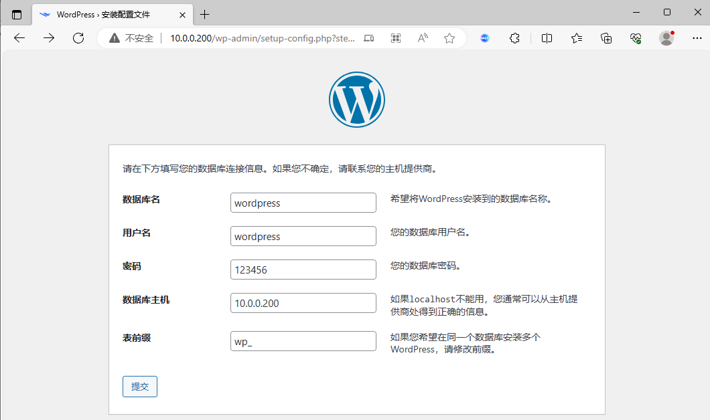

[← 返回Docker 容器技术目录]({{ '/subjects/Docker/' | relative_url }})



# 12 数据卷(data volume)
### 3.2 数据卷(data volume)

### 数据卷特点和使用

数据卷实际上就是宿主机上的目录或者是文件，可以被直接mount到容器当中使用

实际生成环境中，需要针对不同类型的服务、不同类型的数据存储要求做相应的规划，最终保证服务的可扩展性、稳定性以及数据的安全性

### 数据卷使用场景

数据库日志输出静态web页面应用配置文件多容器间目录或文件共享

### 数据卷的特点

数据卷是目录或者文件，并且可以在多个容器之间共同使用,实现容器之间共享和重用对数据卷更改数据在所有容器里面会立即更新。 数据卷的数据可以持久保存，即使删除使用使用该容器卷的容器也不影响。 在容器里面的写入数据不会影响到镜像本身,即数据卷的变化不会影响镜像的更新依赖于宿主机目录，宿主机出问题，上面容器会受影响，当宿主机较多时，不方便统一管理匿名和命名数据卷在容器启动时初始化，如果容器使用的镜像在挂载点包含了数据，会拷贝到新初始化的数据卷中

### 数据卷分类（重点）

启动容器时，可以指定使用数据卷实现容器数据的持久化有三种

指定宿主机目录或文件: 指定宿主机的具体路径和容器路径的挂载关系，此方式不会创建数据卷匿名卷:  不指定数据名称,只指定容器内目录路径充当挂载点,docker自动指定宿主机的路径进行挂载，此方式会创建匿名数据卷,Dockerfile中VOLUME指定的卷即为此种命名卷:  指定数据卷的名称和容器路径的挂载关系，此方式会创建命名数据卷

### 数据卷使用方法

docker run 命令的以下格式可以实现数据卷

```xml
-v, --volume=[host-src:]container-dest[:<options>]
<options>
ro 从容器内对此数据卷是只读，不写此项默认为可读可写
rw 从容器内对此数据卷可读可写,此为默认值
host-src 宿主机目录如果不存在,会自动创建
container-dest 容器目录如果不存在,会自动创建
```

方式1: 绑定挂载（Bind Mount）

```text
#指定宿主机目录或文件格式:
-v <宿主机绝对路径的目录（文件）或者相对路径的文件>:<容器目录或文件>[:ro]  #将宿主机目录挂载容
器目录，两个目录都可自动创建
#注意：如果初始容器中有旧数据，将被宿主机目录覆盖
#注意:如果挂载文件,必须指定文件的相对（以.开头的相对路径）或绝对路径,否则会将目录名或文件名当成
命名卷
```

方式2: 匿名卷

```text
#匿名卷,只指定容器内路径,没有指定宿主机路径信息,宿主机自动生成/var/lib/docker/volumes/<卷
ID>/_data目录,并挂载至容器指定路径
#注意：如果初始容器中有旧数据，将被复制到宿主机数据卷目录
-v <容器内路径>
#示例:
docker run --name nginx -v /etc/nginx nginx
```

方式3: 命名卷

```text
#命名卷将固定的存放在/var/lib/docker/volumes/<卷名>/_data
#注意：如果初始容器中有旧数据，将被复制到宿主机数据卷目录
-v <卷名>:<容器目录路径>
#可以通过以下命令事先创建,如可没有事先创建卷名,docker run时也会自动创建卷
docker volume  create <卷名>
#示例:
docker volume  create vol1  #也可以事先不创建
docker run -d  -p 80:80 --name nginx01 -v vol1:/usr/share/nginx/html  nginx
```

docker rm 的 -v和--rm 选项可以删除容器时，同时删除相关联的匿名卷

```text
-v, --volumes   Remove the volumes associated with the container
```

管理数据卷命令

```text
docker volume COMMAND
Commands:
create      Create a volume
inspect     Display detailed information on one or more volumes
ls          List volumes
prune       Remove all unused local volumes
rm          Remove one or more volumes
```

查看数据卷的挂载关系

```text
docker inspect --format="{{.Mounts}}"  <容器ID>
```

范例: 删除所有数据卷

```bash
[root@ubuntu1804 ~]#docker volume rm `docker volume ls -q`
```

范例：创建命名卷并删除

```bash
[root@ubuntu1804 ~]#docker volume create mysql-vol
mysql-vol
[root@ubuntu1804 ~]#docker volume ls
DRIVER              VOLUME NAME
local               mysql-vol
[root@ubuntu1804 ~]#tree /var/lib/docker/volumes/
/var/lib/docker/volumes/
├── metadata.db
└── mysql-vol
└── _data
2 directories, 1 file
```

```bash
[root@ubuntu1804 ~]#docker volume rm mysql-vol
mysql-vol
[root@ubuntu1804 ~]#docker volume ls
DRIVER              VOLUME NAME
```

范例：删除不再使用的数据卷

```bash
[root@ubuntu1804 ~]#docker volume ls
DRIVER              VOLUME NAME
local
897bd48c5c5e2067627d5c6d10dad17d4793132a638986c16f36820663728ee1
[root@ubuntu1804 ~]#docker volume prune  -f
Deleted Volumes:
897bd48c5c5e2067627d5c6d10dad17d4793132a638986c16f36820663728ee1
Total reclaimed space: 219.5MB
[root@ubuntu1804 ~]#docker volume ls
DRIVER              VOLUME NAME
```

关于匿名数据卷和命名数据卷

```text
命名卷就是有名字的卷，使用 docker volume create <卷名> 形式创建并命名的卷；而匿名卷就是没名
字的卷，一般是 docker run -v /data 这种不指定卷名的时候所产生，或者 Dockerfile 里面的定义
直接使用的。
有名字的卷，在用过一次后，以后挂载容器的时候还可以使用，因为有名字可以指定。所以一般需要保存的数
据使用命名卷保存。
而匿名卷则是随着容器建立而建立，随着容器消亡而淹没于卷列表中（对于 docker run 匿名卷不会被自动
删除）。 因此匿名卷只存放无关紧要的临时数据，随着容器消亡，这些数据将失去存在的意义。
Dockerfile中指定VOLUME为匿名数据卷,其目的只是为了将某个路径确定为卷。
按照最佳实践的要求，不应该在容器存储层内进行数据写入操作，所有写入应该使用卷。如果定制镜像的时
候，就可以确定某些目录会发生频繁大量的读写操作，那么为了避免在运行时由于用户疏忽而忘记指定卷，导
致容器发生存储层写入的问题，就可以在 Dockerfile 中使用 VOLUME 来指定某些目录为匿名卷。这样即
使用户忘记了指定卷，也不会产生不良的后果。
这个设置可以在运行时覆盖。通过 docker run 的 -v 参数或者 docker-compose.yml 的 volumes
指定。使用命名卷的好处是可以复用，其它容器可以通过这个命名数据卷的名字来指定挂载，共享其内容（不
过要注意并发访问的竞争问题）。
比如，Dockerfile 中说 VOLUME /data，那么如果直接 docker run，其 /data 就会被挂载为匿名
卷，向 /data 写入的操作不会写入到容器存储层，而是写入到了匿名卷中。但是如果运行时 docker run
-v mydata:/data，这就覆盖了 /data 的挂载设置，要求将 /data 挂载到名为 mydata 的命名卷中。
所以说 Dockerfile 中的 VOLUME 实际上是一层保险，确保镜像运行可以更好的遵循最佳实践，不向容器
存储层内进行写入操作。
数据卷默认可能会保存于 /var/lib/docker/volumes，不过一般不需要、也不应该访问这个位置。
```

### 实战案例: 目录数据卷

### 在宿主机创建容器所使用的目录

```bash
[root@ubuntu1804 ~]#mkdir /data/testdir
[root@ubuntu1804 ~]#echo  Test page  on host > /data/testdir/index.html
```

### 查看容器相关目录路径

```bash
[root@ubuntu1804 ~]#docker images "*nginx*"
REPOSITORY          TAG                 IMAGE ID            CREATED
SIZE
nginx-ubuntu1804    1.16.1              19efdd23ac87        2 days ago
378MB
nginx-alpine        1.16.1              978a43bbb61d        2 days ago
211MB
[root@ubuntu1804 ~]#docker run -it  --rm  nginx-alpine:1.16.1 sh
/ # cat /apps/nginx/conf/nginx.conf
...
server {
...
location / {
root   /data/nginx/html;  #nginx存放网页文件的路径
index  index.html index.htm;
}
...
/ # cat  /data/nginx/html/index.html
Test Page based nginx-alpine
/ # exit
[root@ubuntu1804 ~]#docker ps -a
CONTAINER ID        IMAGE               COMMAND             CREATED
STATUS              PORTS               NAMES
```

### 引用宿主机的数据卷启动容器

引用同一个数据卷目录，开启多个容器，实现多个容器共享数据

```bash
[root@ubuntu1804 ~]#docker run  -d -v /data/testdir:/data/nginx/html/   -p
8001:80 nginx-alpine:1.16.1
56a5460f584bd2de56040c4a1dff86ad8a9723cfd6bf21ed8a538b9629b0874c
[root@ubuntu1804 ~]#docker run  -d -v /data/testdir:/data/nginx/html/   -p
8002:80 nginx-alpine:1.16.1
e7b5bff6ce56fa51ed6411175c9c9f1fb9bf8e7b1b9471080380b01692f89e58
[root@ubuntu1804 ~]#docker ps
CONTAINER ID        IMAGE                 COMMAND             CREATED
STATUS              PORTS                           NAMES
e7b5bff6ce56        nginx-alpine:1.16.1   "nginx"             6 seconds ago
Up 5 seconds        443/tcp, 0.0.0.0:8002->80/tcp   hungry_robinson
56a5460f584b        nginx-alpine:1.16.1   "nginx"             33 seconds ago
Up 31 seconds       443/tcp, 0.0.0.0:8001->80/tcp   stupefied_dubinsky
[root@ubuntu1804 ~]#curl 127.0.0.1:8001
Test page on host
[root@ubuntu1804 ~]#curl 127.0.0.1:8002
Test page on host
```

### 进入到容器内测试写入数据

进入其中一个容器写入数据，可以其它容器的数据也变化

```bash
[root@ubuntu1804 ~]#docker exec -it e7b5bff6ce56 sh
/ # df
Filesystem           1K-blocks      Used Available Use% Mounted on
overlay               47799020   5294492  40046724  12% /
tmpfs                    65536         0     65536   0% /dev
tmpfs                   492552         0    492552   0% /sys/fs/cgroup
shm                      65536         0     65536   0% /dev/shm
/dev/sda2             47799020   5294492  40046724  12% /etc/resolv.conf
/dev/sda2             47799020   5294492  40046724  12% /etc/hostname
/dev/sda2             47799020   5294492  40046724  12% /etc/hosts
/dev/sda3             19091540   3958732  14139940  22% /data/nginx/html
tmpfs                   492552         0    492552   0% /proc/asound
tmpfs                   492552         0    492552   0% /proc/acpi
tmpfs                    65536         0     65536   0% /proc/kcore
tmpfs                    65536         0     65536   0% /proc/keys
tmpfs                    65536         0     65536   0% /proc/timer_list
tmpfs                    65536         0     65536   0% /proc/sched_debug
tmpfs                   492552         0    492552   0% /proc/scsi
tmpfs                   492552         0    492552   0% /sys/firmware
/ # cat /data/nginx/html/index.html
Test page on host
/ # echo Test page v2 on host > /data/nginx/html/index.html
#进入另一个容器看到数据变化
[root@ubuntu1804 ~]#docker exec -it 56a5460f584b  sh
/ # cat /data/nginx/html/index.html
Test page v2 on host
#访问应用
[root@ubuntu1804 ~]#curl 127.0.0.1:8001
Test page v2 on host
[root@ubuntu1804 ~]#curl 127.0.0.1:8002
Test page v2 on host
```

### 在宿主机修改数据

```bash
[root@ubuntu1804 ~]#echo Test page v3 on host > /data/testdir/index.html
[root@ubuntu1804 ~]#cat /data/testdir/index.html
Test page v3 on host
[root@ubuntu1804 ~]#curl 127.0.0.1:8001
Test page v3 on host
[root@ubuntu1804 ~]#curl 127.0.0.1:8002
Test page v3 on host
[root@ubuntu1804 ~]#docker exec -it e7b5bff6ce56 sh
/ # cat /data/nginx/html/index.html
Test page v3 on host
[root@ubuntu1804 ~]#docker exec -it 56a5460f584b  sh
/ # cat /data/nginx/html/index.html
Test page v3 on host
```

### 只读方法挂载数据卷

默认数据卷为可读可写，加ro选项，可以实现只读挂载，对于不希望容器修改的数据，比如:  配置文件，脚本等，可以用此方式挂载

```bash
[root@ubuntu1804 ~]#docker run  -d -v /data/testdir:/data/nginx/html/:ro   -p
8004:80 nginx-alpine:1.16.1
727d3ecf65c5a79bd9a11033812dc01619c4c45bd25af5155f904016f5f0c45a
[root@ubuntu1804 ~]#docker exec -it 727d3ecf65c5a79bd9 sh
/ # cat /data/nginx/html/index.html
Test page v3 on host
/ # echo Test page v4 on host > /data/nginx/html/index.html
sh: can't create /data/nginx/html/index.html: Read-only file system
/ # cat /data/nginx/html/index.html
```

### 删除容器

删除容器后，宿主机的数据卷还存在，可继续给新的容器使用

```bash
[root@ubuntu1804 ~]#docker ps -a
CONTAINER ID        IMAGE                 COMMAND             CREATED
STATUS              PORTS                           NAMES
e7b5bff6ce56        nginx-alpine:1.16.1   "nginx"             9 minutes ago
Up 9 minutes        443/tcp, 0.0.0.0:8002->80/tcp   hungry_robinson
56a5460f584b        nginx-alpine:1.16.1   "nginx"             9 minutes ago
Up 9 minutes        443/tcp, 0.0.0.0:8001->80/tcp   stupefied_dubinsky
[root@ubuntu1804 ~]#docker rm -f `docker ps -aq`
e7b5bff6ce56
56a5460f584b
[root@ubuntu1804 ~]#cat /data/testdir/index.html
Test page v3 on host
#新建的容器还可以继续使用原有的数据卷
[root@ubuntu1804 ~]#docker run  -d -v /data/testdir:/data/nginx/html/   -p
8003:80 nginx-alpine:1.16.1
ecd016506f6af3f4af61dbd869f8fce5f634ecdc0e3272f9e0402c981acd80a4
[root@ubuntu1804 ~]#curl 127.0.0.1:8003
Test page v3 on host
```

### 安战案例: MySQL使用的数据卷

```bash
[root@ubuntu1804 ~]#docker pull registry.cn-
beijing.aliyuncs.com/bowenxiaochun/mysql:8.0.29-oracle
[root@ubuntu1804 ~]#docker images "mysql*"
REPOSITORY          TAG                 IMAGE ID            CREATED
SIZE
mysql               8.0.29-oracle         b598110d0fff        2 weeks ago
435MB
[root@ubuntu1804 ~]#docker run -d -p 3306:3306 -e MYSQL_ROOT_PASSWORD=123456
mysql:5.7.30
[root@ubuntu1804 ~]#docker ps
CONTAINER ID        IMAGE               COMMAND                  CREATED
STATUS              PORTS                               NAMES
c21ca6f8a7fe        8.0.29-oracle        "docker-entrypoint.s…"   3 minutes ago
Up 3 minutes        0.0.0.0:3306->3306/tcp, 33060/tcp   nifty_banach
[root@ubuntu1804 ~]#docker exec -it c21ca6f8a7fe bash
root@c21ca6f8a7fe:/# cat /etc/issue
Debian GNU/Linux 9 \n \l
```

```text
root@c21ca6f8a7fe:/# cat /etc/mysql/my.cnf
......
!includedir /etc/mysql/conf.d/
!includedir /etc/mysql/mysql.conf.d/
root@c21ca6f8a7fe:/# cat /etc/mysql/mysql.conf.d/mysqld.cnf
[mysqld]
pid-file    = /var/run/mysqld/mysqld.pid
socket      = /var/run/mysqld/mysqld.sock
datadir     = /var/lib/mysql   #数据存放路径
root@c21ca6f8a7fe:/# pstree -p
mysqld(1)-+-{mysqld}(130)
|-{mysqld}(131)
|-{mysqld}(132)
|-{mysqld}(133)
|-{mysqld}(134)
|-{mysqld}(135)
|-{mysqld}(136)
|-{mysqld}(137)
|-{mysqld}(138)
|-{mysqld}(139)
|-{mysqld}(140)
|-{mysqld}(141)
|-{mysqld}(143)
|-{mysqld}(144)
|-{mysqld}(145)
|-{mysqld}(146)
|-{mysqld}(147)
|-{mysqld}(148)
|-{mysqld}(149)
|-{mysqld}(150)
|-{mysqld}(151)
|-{mysqld}(152)
|-{mysqld}(153)
|-{mysqld}(154)
|-{mysqld}(155)
`-{mysqld}(156)
[root@ubuntu1804 ~]#mysql -uroot -p123456 -h127.0.0.1
mysql: [Warning] Using a password on the command line interface can be insecure.
Welcome to the MySQL monitor.  Commands end with ; or \g.
Your MySQL connection id is 2
Server version: 5.7.30 MySQL Community Server (GPL)
Copyright (c) 2000, 2019, Oracle and/or its affiliates. All rights reserved.
Oracle is a registered trademark of Oracle Corporation and/or its
affiliates. Other names may be trademarks of their respective
owners.
Type 'help;' or '\h' for help. Type '\c' to clear the current input statement.
mysql> show databases;
+--------------------+
| Database           |
+--------------------+
| information_schema |
| mysql              |
| performance_schema |
| sys                |
+--------------------+
4 rows in set (0.00 sec)
mysql> create database dockerdb;
Query OK, 1 row affected (0.00 sec)
mysql> show databases;
+--------------------+
| Database           |
+--------------------+
| information_schema |
| dockerdb           |
| mysql              |
| performance_schema |
| sys                |
+--------------------+
5 rows in set (0.01 sec)
mysql>
#删除容器后，再创建新的容器，数据库信息丢失
[root@ubuntu1804 ~]#docker rm -f  c21ca6f8a7fe
c21ca6f8a7fe
[root@ubuntu1804 ~]#docker run -d  --name mysql -p 3306:3306 -e
MYSQL_ROOT_PASSWORD=123456  registry.cn-
beijing.aliyuncs.com/bowenxiaochun/mysql:8.0.29-oracle
f52a50c7f80ee39d9a935a762eacb05db72dcfa5f0d02af8b4f23b5538080b67
[root@ubuntu1804 ~]#mysql -uroot -p123456 -h127.0.0.1
mysql: [Warning] Using a password on the command line interface can be insecure.
Welcome to the MySQL monitor.  Commands end with ; or \g.
Your MySQL connection id is 2
Server version: 5.7.30 MySQL Community Server (GPL)
Copyright (c) 2000, 2019, Oracle and/or its affiliates. All rights reserved.
Oracle is a registered trademark of Oracle Corporation and/or its
affiliates. Other names may be trademarks of their respective
owners.
Type 'help;' or '\h' for help. Type '\c' to clear the current input statement.
mysql> show databases;
+--------------------+
| Database           |
+--------------------+
| information_schema |
| mysql              |
| performance_schema |
| sys                |
+--------------------+
4 rows in set (0.00 sec)
```

```bash
#利用数据卷创建容器
[root@ubuntu1804 ~]#mkdir /data/mysql
[root@ubuntu1804 ~]#docker run -d  --name mysql -p 3306:3306 -v
/data/mysql/:/var/lib/mysql -e MYSQL_ROOT_PASSWORD=123456 registry.cn-
beijing.aliyuncs.com/bowenxiaochun/mysql:8.0.29-oracle
d64ef3f9a64491061132020306fd3e97e1aa361b0fb9f6f644f2a1e3f334119c
[root@ubuntu1804 ~]#mysql -uroot -p123456 -h127.0.0.1
mysql> create database dockerdb;
Query OK, 1 row affected (0.00 sec)
mysql> show databases;
+--------------------+
| Database           |
+--------------------+
| information_schema |
| dockerdb           |
| mysql              |
| performance_schema |
| sys                |
+--------------------+
5 rows in set (0.00 sec)
mysql> exit
#删除容器，数据存放在挂载数据卷中，不会删除
[root@ubuntu1804 ~]#docker rm -fv mysql
mysql
[root@ubuntu1804 ~]#ls /data/mysql/
auto.cnf    ca.pem           client-key.pem  ib_buffer_pool  ib_logfile0  ibtmp1
performance_schema  public_key.pem   server-key.pem
ca-key.pem  client-cert.pem  dockerdb        ibdata1         ib_logfile1  mysql
private_key.pem     server-cert.pem  sys
#重新创建新容器，之前数据还在
[root@ubuntu1804 ~]#docker run -d  --name mysql -p 3306:3306 -v
/data/mysql/:/var/lib/mysql -e MYSQL_ROOT_PASSWORD=123456  mysql:5.7.30
8d6cd0822cc61db30c0401992d2dbfa5c33b525f9aead44c165e0e247c37e5df
[root@ubuntu1804 ~]#mysql -uroot -p123456 -h127.0.0.1
mysql: [Warning] Using a password on the command line interface can be insecure.
Welcome to the MySQL monitor.  Commands end with ; or \g.
Your MySQL connection id is 2
Server version: 5.7.30 MySQL Community Server (GPL)
Copyright (c) 2000, 2019, Oracle and/or its affiliates. All rights reserved.
Oracle is a registered trademark of Oracle Corporation and/or its
affiliates. Other names may be trademarks of their respective
owners.
Type 'help;' or '\h' for help. Type '\c' to clear the current input statement.
mysql> show databases;
+--------------------+
| Database           |
+--------------------+
| information_schema |
| dockerdb           |
| mysql              |
| performance_schema |
| sys                |
+--------------------+
5 rows in set (0.00 sec)
mysql> exit
#指定多个数据卷，创建MySQL
[root@ubuntu1804 ~]#docker run --name mysql-test1 -v /data/mysql:/var/lib/mysql
-e MYSQL_ROOT_PASSWORD=123456 -e MYSQL_DATABASE=wordpress -e MYSQL_USER=wpuser -e
MYSQL_PASSWORD=123456 -d -p 3306:3306 mysql:5.7.30
[root@ubuntu1804 ~]#docker run --name mysql-test2 -v
/root/mysql/:/etc/mysql/conf.d -v /data/mysql2:/var/lib/mysql --env-file=env.list
-d -p 3307:3306 mysql:5.7.30
[root@ubuntu1804 ~]#cat mysql/mysql-test.cnf
[mysqld]
server-id=100
log-bin=mysql-bin
[root@ubuntu1804 ~]#cat env.list
MYSQL_ROOT_PASSWORD=123456
MYSQL_DATABASE=wordpress
MYSQL_USER=wpuser
MYSQL_PASSWORD=wppass
```

### 实战案例: 文件数据卷

文件挂载用于很少更改文件内容的场景，比如: nginx 的配置文件、tomcat的配置文件等。

### 准备相关文件

```bash
[root@ubuntu1804 ~]#mkdir /data/{bin,testapp,logs}
[root@ubuntu1804 ~]#echo testapp v1  > /data/testapp/index.html
[root@ubuntu1804 ~]#cat /data/testapp/index.html
testapp v1
[root@ubuntu1804 ~]#cp /data/dockerfile/web/tomcat/tomcat-base-8.5.50/apache-
tomcat-8.5.50/bin/catalina.sh  /data/bin/
[root@ubuntu1804 ~]#vim /data/bin/catalina.sh
#加下面tomcat的优化参数行
# -----------------------------------------------------------------------------
JAVA_OPTS="-server -Xms4g -Xmx4g -Xss512k -Xmn1g -
XX:CMSInitiatingOccupancyFraction=65 -XX:+UseFastAccessorMethods -
XX:+AggressiveOpts
-XX:+UseBiasedLocking -XX:+DisableExplicitGC -XX:MaxTenuringThreshold=10 -
XX:NewSize=2048M -XX:MaxNewSize=2048M -XX:NewRatio=2 -XX:Pe
rmSize=128m -XX:MaxPermSize=512m -XX:CMSFullGCsBeforeCompaction=5 -
XX:+ExplicitGCInvokesConcurrent -XX:+UseConcMarkSweepGC -XX:+UsePar
NewGC -XX:+CMSParallelRemarkEnabled -XX:+UseCMSCompactAtFullCollection -
XX:LargePageSizeInBytes=128m -XX:+UseFastAccessorMethods"
# OS specific support.  $var _must_ be set to either true or false.
[root@ubuntu1804 ~]#chown 2019:2019 /data/bin/catalina.sh
[root@ubuntu1804 ~]#ll /data/bin/catalina.sh
-rwxr-x--- 1 2019 2019 24324 Jan 31 21:43 /data/bin/catalina.sh*
[root@ubuntu1804 ~]#chown 2019:2019 /data/logs/
```

### 引用文件数据卷启动容器

同时挂载可读可写方式的目录数据卷和只读方式的文件数据卷，实现三个数据卷的挂载，数据，日志和启动脚本

```bash
[root@ubuntu1804 ~]#docker run -d -v
/data/bin/catalina.sh:/apps/tomcat/bin/catalina.sh:ro -v
/data/testapp:/data/tomcat/webapps/testapp   -v /data/logs:/apps/tomcat/logs -p
8080:8080 tomcat-web:app1
55de76261c5e489de9a24d5533fe630d44aa7cce821627f6503a91c041c8f8d3
```

### 验证容器可以访问

```bash
[root@ubuntu1804 ~]#curl 127.0.0.1:8080/testapp/
testapp v1
[root@ubuntu1804 ~]#ls -l /data/logs/
total 36
drwxr-xr-x 2 2019 2019 4096 Jan 31 22:44 ./
drwxr-xr-x 7 root root 4096 Jan 31 22:43 ../
-rw-r----- 1 2019 2019 8336 Jan 31 22:44 catalina.2020-01-31.log
-rw-r----- 1 2019 2019 8808 Jan 31 22:44 catalina.out
-rw-r----- 1 2019 2019    0 Jan 31 22:44 host-manager.2020-01-31.log
-rw-r----- 1 2019 2019    0 Jan 31 22:44 localhost.2020-01-31.log
-rw-r----- 1 2019 2019   76 Jan 31 22:44 localhost_access_log.2020-01-31.txt
-rw-r----- 1 2019 2019    0 Jan 31 22:44 manager.2020-01-31.log
```

### 直接修改宿主机的数据

```bash
#宿主机修改目录数据卷
[root@ubuntu1804 ~]#echo testapp v2 > /data/testapp/index.html
[root@ubuntu1804 ~]#curl 127.0.0.1:8080/testapp/
testapp v2
[root@ubuntu1804 ~]#ll /data/bin/catalina.sh
-rwxr-x--- 1 2019 2019 24324 Jan 31 21:43 /data/bin/catalina.sh*
[root@ubuntu1804 ~]#echo >> /data/bin/catalina.sh
[root@ubuntu1804 ~]#ll /data/bin/catalina.sh
-rwxr-x--- 1 2019 2019 24325 Jan 31 22:21 /data/bin/catalina.sh*
```

### 进入容器修改数据

```bash
[root@ubuntu1804 ~]#docker exec -it 55de76261c5e bash
[root@55de76261c5e /]# netstat -ntl
Active Internet connections (only servers)
Proto Recv-Q Send-Q Local Address           Foreign Address         State
tcp        0      0 127.0.0.1:8005          0.0.0.0:*               LISTEN
tcp        0      0 0.0.0.0:8009            0.0.0.0:*               LISTEN
tcp        0      0 0.0.0.0:8080            0.0.0.0:*               LISTEN
#文件数据卷上的文件为只读
[root@55de76261c5e /]#  echo >> /apps/tomcat/bin/catalina.sh
bash: /apps/tomcat/bin/catalina.sh: Read-only file system
#目录数据卷可读可写
[root@55de76261c5e /]# cat /data/tomcat/webapps/testapp/index.html
testapp v2
[root@55de76261c5e /]# echo testapp v3 > /data/tomcat/webapps/testapp/index.html
[root@55de76261c5e /]# cat /data/tomcat/webapps/testapp/index.html
testapp v3
[root@ubuntu1804 ~]#curl 127.0.0.1:8080/testapp/
testapp v3
```

### 查看容器中挂载和进程信息

```bash
[root@55de76261c5e /]# mount
......
/dev/sda3 on /apps/apache-tomcat-8.5.50/bin/catalina.sh type ext4
(ro,relatime,data=ordered)
/dev/sda3 on /data/tomcat/webapps/testapp type ext4 (rw,relatime,data=ordered)
......
[root@55de76261c5e /]# df
Filesystem     1K-blocks    Used Available Use% Mounted on
overlay         47799020 5295032  40046184  12% /
tmpfs              65536       0     65536   0% /dev
tmpfs             492552       0    492552   0% /sys/fs/cgroup
shm                65536       0     65536   0% /dev/shm
/dev/sda2       47799020 5295032  40046184  12% /etc/hosts
/dev/sda3       19091540 3974908  14123764  22% /data/tomcat/webapps/testapp
tmpfs             492552       0    492552   0% /proc/asound
tmpfs             492552       0    492552   0% /proc/acpi
tmpfs             492552       0    492552   0% /proc/scsi
tmpfs             492552       0    492552   0% /sys/firmware
```

```bash
[root@55de76261c5e /]# ps aux
USER        PID %CPU %MEM    VSZ   RSS TTY      STAT START   TIME COMMAND
root          1  0.0  0.3  15136  3040 ?        Ss   22:09   0:00 /bin/bash
/apps/tomcat/bin/run_tomcat.sh
www          25  0.5 12.7 6253760 125268 ?      Sl   22:09   0:04
/usr/local/jdk/bin/java -Djava.util.logging.config.file=/apps/tomcat
root         26  0.0  0.4  85428  4468 ?        S    22:09   0:00 su - www -c
tail -f /etc/hosts
www          28  0.0  0.0   4416   716 ?        Ss   22:09   0:00 tail -f
/etc/hosts
root         85  0.0  0.4  15800  3980 pts/0    Ss   22:16   0:00 bash
root        109  0.0  0.3  55196  3696 pts/0    R+   22:25   0:00 ps aux
[root@55de76261c5e /]# ps aux|grep java
www          25  0.5 12.7 6253760 125268 ?      Sl   22:09   0:04
/usr/local/jdk/bin/java -
Djava.util.logging.config.file=/apps/tomcat/conf/logging.properties -
Djava.util.logging.manager=org.apache.juli.ClassLoaderLogManager -server -Xms4g
-Xmx4g -Xss512k -Xmn1g -XX:CMSInitiatingOccupancyFraction=65 -
XX:+UseFastAccessorMethods -XX:+AggressiveOpts -XX:+UseBiasedLocking -
XX:+DisableExplicitGC -XX:MaxTenuringThreshold=10 -XX:NewSize=2048M -
XX:MaxNewSize=2048M -XX:NewRatio=2 -XX:PermSize=128m -XX:MaxPermSize=512m -
XX:CMSFullGCsBeforeCompaction=5 -XX:+ExplicitGCInvokesConcurrent -
XX:+UseConcMarkSweepGC -XX:+UseParNewGC -XX:+CMSParallelRemarkEnabled -
XX:+UseCMSCompactAtFullCollection -XX:LargePageSizeInBytes=128m -
XX:+UseFastAccessorMethods -Djdk.tls.ephemeralDHKeySize=2048 -
Djava.protocol.handler.pkgs=org.apache.catalina.webresources -
Dorg.apache.catalina.security.SecurityListener.UMASK=0027 -
Dignore.endorsed.dirs= -classpath
/apps/tomcat/bin/bootstrap.jar:/apps/tomcat/bin/tomcat-juli.jar -
Dcatalina.base=/apps/tomcat -Dcatalina.home=/apps/tomcat -
Djava.io.tmpdir=/apps/tomcat/temp org.apache.catalina.startup.Bootstrap start
root        111  0.0  0.2  12536  2320 pts/0    S+   22:25   0:00 grep --
color=auto java
```

### 实战案例: 匿名数据卷

```xml
[root@ubuntu1804 ~]#docker volume  ls
DRIVER              VOLUME NAME
[root@ubuntu1804 ~]#docker ps -a
CONTAINER ID        IMAGE               COMMAND             CREATED
STATUS              PORTS               NAMES
#利用匿名数据卷创建容器
[root@ubuntu1804 ~]#docker run -d -p 80:80 --name nginx01 -v
/usr/share/nginx/html  nginx
914c622af7ebae68aab0b0075da39534fdb118cd5d4d7adf3054da94eb2a4952
[root@ubuntu1804 ~]#curl  127.0.0.1
<!DOCTYPE html>
<html>
<head>
<title>Welcome to nginx!</title>
<style>
body {
width: 35em;
margin: 0 auto;
font-family: Tahoma, Verdana, Arial, sans-serif;
}
</style>
</head>
<body>
<h1>Welcome to nginx!</h1>
<p>If you see this page, the nginx web server is successfully installed and
working. Further configuration is required.</p>
<p>For online documentation and support please refer to
<a href="http://nginx.org/">nginx.org</a>.<br/>
Commercial support is available at
<a href="http://nginx.com/">nginx.com</a>.</p>
<p><em>Thank you for using nginx.</em></p>
</body>
</html>
#查看自动生成的匿名数据卷
[root@ubuntu1804 ~]#docker volume  ls
DRIVER              VOLUME NAME
local
2a18aff09215e7830c6df56a80e0f8ace9b44f3384d512daf06d75502f8b40fe
```

```json
#查看匿名数据卷的详细信息
[root@ubuntu1804 ~]#docker volume inspect
2a18aff09215e7830c6df56a80e0f8ace9b44f3384d512daf06d75502f8b40fe
[
{
"CreatedAt": "2020-07-21T19:17:07+08:00",
"Driver": "local",
"Labels": null,
"Mountpoint":
"/var/lib/docker/volumes/2a18aff09215e7830c6df56a80e0f8ace9b44f3384d512daf06d755
02f8b40fe/_data",
"Name":
"2a18aff09215e7830c6df56a80e0f8ace9b44f3384d512daf06d75502f8b40fe",
"Options": null,
"Scope": "local"
}
]
[root@ubuntu1804 ~]#docker inspect --format="{{.Mounts}}"  nginx01
[{volume 2a18aff09215e7830c6df56a80e0f8ace9b44f3384d512daf06d75502f8b40fe
/var/lib/docker/volumes/2a18aff09215e7830c6df56a80e0f8ace9b44f3384d512daf06d7550
2f8b40fe/_data /usr/share/nginx/html local  true }]
```

```bash
#查看匿名数据卷的文件
[root@ubuntu1804 ~]#ls
/var/lib/docker/volumes/2a18aff09215e7830c6df56a80e0f8ace9b44f3384d512daf06d7550
2f8b40fe/_data
50x.html  index.html
```

```bash
#修改宿主机中匿名数据卷的文件
[root@ubuntu1804 ~]#echo Anonymous Volume >
/var/lib/docker/volumes/2a18aff09215e7830c6df56a80e0f8ace9b44f3384d512daf06d7550
2f8b40fe/_data/index.html
[root@ubuntu1804 ~]#curl 127.0.0.1
Anonymous Volume
#删除容器不会删除匿名数据卷
[root@ubuntu1804 ~]#docker rm -f  nginx01
nginx01
[root@ubuntu1804 ~]#docker volume  ls
DRIVER              VOLUME NAME
local
2a18aff09215e7830c6df56a80e0f8ace9b44f3384d512daf06d75502f8b40fe
[root@ubuntu1804 ~]#docker run -d -p 80:80 --name nginx01 -v
/usr/share/nginx/html  nginx
40a99ae066cc60aa0ad7d073e46101a15446509acbd7971e677f3cbe6733aa79
[root@ubuntu1804 ~]#cat
/var/lib/docker/volumes/2a18aff09215e7830c6df56a80e0f8ace9b44f3384d512daf06d7550
2f8b40fe/_data/index.html
Anonymous Volume
#删除匿名数据卷
[root@ubuntu1804 ~]#docker volume rm
2a18aff09215e7830c6df56a80e0f8ace9b44f3384d512daf06d75502f8b40fe
2a18aff09215e7830c6df56a80e0f8ace9b44f3384d512daf06d75502f8b40fe
[root@ubuntu1804 ~]#docker volume  ls
DRIVER              VOLUME NAME
```

### 实战案例: 命名数据卷

### 创建命名数据卷

```json
[root@ubuntu1804 ~]#docker volume  create vol1
vol1
[root@ubuntu1804 ~]#docker volume ls
DRIVER              VOLUME NAME
local               vol1
[root@ubuntu1804 ~]#docker inspect vol1
[
{
"CreatedAt": "2020-07-21T18:36:45+08:00",
"Driver": "local",
"Labels": {},
"Mountpoint": "/var/lib/docker/volumes/vol1/_data",
"Name": "vol1",
"Options": {},
"Scope": "local"
}
]
```

### 使用命名数据卷创建容器

```xml
[root@ubuntu1804 ~]#docker run -d  -p 8001:80 --name nginx01 -v
vol1:/usr/share/nginx/html  nginx
2a2ad99de2984521cbce777eae8e482c3e6e55e35ab5f398a35c7986fa39cc99
[root@ubuntu1804 ~]#curl 127.0.0.1:8001
<!DOCTYPE html>
<html>
<head>
<title>Welcome to nginx!</title>
<style>
body {
width: 35em;
margin: 0 auto;
font-family: Tahoma, Verdana, Arial, sans-serif;
}
</style>
</head>
<body>
<h1>Welcome to nginx!</h1>
<p>If you see this page, the nginx web server is successfully installed and
working. Further configuration is required.</p>
<p>For online documentation and support please refer to
<a href="http://nginx.org/">nginx.org</a>.<br/>
Commercial support is available at
<a href="http://nginx.com/">nginx.com</a>.</p>
<p><em>Thank you for using nginx.</em></p>
</body>
</html>
#显示命名数据卷
[root@ubuntu1804 ~]#docker volume ls
DRIVER              VOLUME NAME
local               vol1
#查看命名数据卷详解信息
[root@ubuntu1804 ~]#docker volume inspect vol1
[
{
"CreatedAt": "2020-07-21T18:44:03+08:00",
"Driver": "local",
"Labels": {},
"Mountpoint": "/var/lib/docker/volumes/vol1/_data",
"Name": "vol1",
"Options": {},
"Scope": "local"
}
]
[root@ubuntu1804 ~]#docker inspect --format="{{.Mounts}}"  nginx01
[{volume vol1 /var/lib/docker/volumes/vol1/_data /usr/share/nginx/html local z
true }]
```

```bash
#查看命名数据卷的文件
[root@ubuntu1804 ~]#ls /var/lib/docker/volumes/vol1/_data
50x.html  index.html
#修改宿主机命名数据卷的文件
[root@ubuntu1804 ~]#echo nginx vol1 website >
/var/lib/docker/volumes/vol1/_data/index.html
[root@ubuntu1804 ~]#curl 127.0.0.1:8001
nginx vol1 website
#利用现在的命名数据卷再创建新容器,可以和原有容器共享同一个命名数据卷的数据
[root@ubuntu1804 ~]#docker run -d  -p 8002:80 --name nginx02 -v
vol1:/usr/share/nginx/html  nginx
fb8739438992b7797a3f23dc495d2fd43f513fd793114848171f376c4325675e
[root@ubuntu1804 ~]#curl 127.0.0.1:8002
nginx vol1 website
```

### 创建容器时自动创建命名数据卷

```bash
#创建容器自动创建命名数据卷
[root@ubuntu1804 ~]#docker run -d  -p 8003:80 --name nginx03 -v
vol2:/usr/share/nginx/html  nginx
5d7497c04907babcb2084f8f7a16874223e07965410fd4da14bc2fe993277aed
[root@ubuntu1804 ~]#docker volume ls
DRIVER              VOLUME NAME
local               portainer_data
local               vol1
local               vol2
```

### 删除数据卷

```bash
#删除指定的命名数据卷
[root@ubuntu1804 ~]#docker volume rm vol1
#清理全部不再使用的卷
[root@ubuntu1804 ~]#docker volume  prune -f
```

### 实战案例：实现 wordpress 持久化（练习）

```bash
[root@ubuntu2004 ~]#docker run -p 3306:3306 -e MYSQL_ROOT_PASSWORD=123456 -e
MYSQL_DATABASE=wordpress -e MYSQL_USER=wordpress -e MYSQL_PASSWORD=123456 --name
mysql -d  -v /data/mysql:/var/lib/mysql --restart=always registry.cn-
beijing.aliyuncs.com/bowenxiaochun/mysql:8.0.29-oracle
[root@ubuntu2004 ~]#docker run -d -p 80:80 --name wordpress -v
/data/wordpress:/var/www/html --restart=always  registry.cn-
beijing.aliyuncs.com/bowenxiaochun/wordpress:php8.2-apache
#注意：数据库服务器的地址要输入宿主机的IP，不能是127.0.0.1或localhost
```





<nav class="article-end" aria-label="章节导航">
  <a href="{{ '/subjects/Docker/11-container-data-management.html' | relative_url }}">← Previous: Container Data Management</a>
  <a href="{{ '/subjects/Docker/' | relative_url }}">Back to Docker Container Technology Index</a>
  <a href="{{ '/subjects/Docker/13-data-volume-containers.html' | relative_url }}">Next: Data Volume Containers →</a>
</nav>
