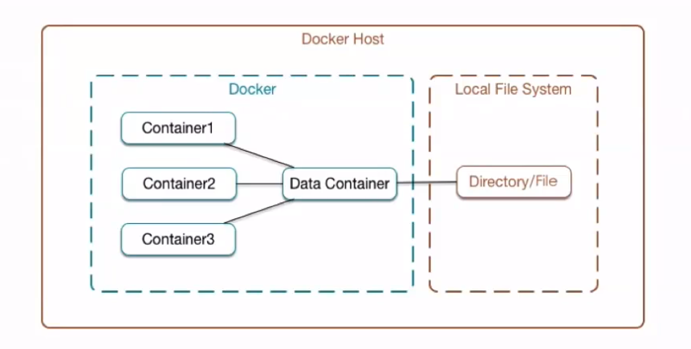
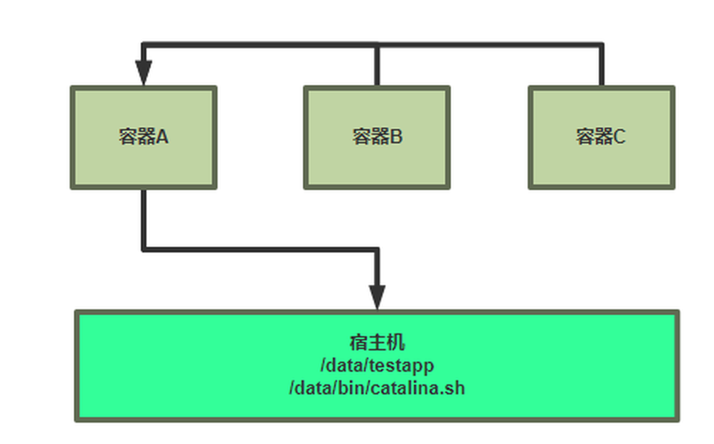

[← 返回 Docker 容器技术目录]({{ '/subjects/Docker/' | relative_url }})



# 13 数据卷容器与 `--volumes-from`

前一篇介绍了 Docker 卷和绑定挂载。多个容器可以**直接挂载同一个命名卷**，无需额外创建“数据卷容器”。`--volumes-from` 是另一种历史用法：新容器复用指定容器的已有挂载。理解它有助于阅读旧部署脚本，但新项目通常直接声明共享卷，更容易看出数据归属。





## 1. 共享的是挂载，不是容器文件系统

`--volumes-from source` 复制的是 `source` 的卷和绑定挂载定义，**不会让目标容器读取 source 的可写层**。如果 source 把宿主机 `/srv/site` 挂到 `/data`，两个目标容器访问的是同一宿主机路径；如果 source 使用命名卷，目标容器访问的是同一个卷。

原文称“Dockerfile 创建匿名卷无法共享”，表述过于绝对：匿名卷也可以通过 `--volumes-from` 复用，只是名称不利于长期管理。source 容器停止后，挂载的数据并不会停止；只要 source 容器对象还存在，仍能用它创建新目标容器。source 被删除后，旧目标容器已有的挂载通常继续有效，但不能再通过该名称引用 source。

## 2. 重现旧式用法

以下以命名卷模拟“卷容器”。`volume-source` 只提供挂载定义，不需要运行应用服务；使用同一卷的容器都能读写 `/data`。

```bash
docker volume create shared-data
docker create --name volume-source \
  --mount type=volume,source=shared-data,target=/data \
  alpine:3.20 sleep 3600

docker run --rm --volumes-from volume-source \
  alpine:3.20 sh -c 'echo version-1 > /data/index.txt'
docker run --rm --volumes-from volume-source \
  alpine:3.20 cat /data/index.txt
```

接下来可以停止（若已启动）`volume-source` 再复用；被引用的是容器的挂载配置，跟它是否正在运行无关。要验证删除 source 的情况，先创建一个会保留的目标容器：

```bash
docker create --name volume-client --volumes-from volume-source \
  alpine:3.20 sleep 3600
docker rm volume-source
docker start volume-client
docker exec volume-client cat /data/index.txt
```

`volume-client` 仍持有挂载。此时不能再执行 `--volumes-from volume-source`，因为该容器名称已不存在；可以引用仍存在的 `volume-client`，但这会形成不必要的容器依赖链。原教程删除 source 后显示的 `pull access denied` 是镜像不存在/不可拉取的错误，不能当作 `--volumes-from` 失败的证据。

## 3. 现代写法更直接

同样的共享需求直接为每个容器指定命名卷即可，不需要 source 容器：

```bash
docker run --rm --mount type=volume,source=shared-data,target=/data \
  alpine:3.20 cat /data/index.txt
docker volume inspect shared-data
```

使用 Docker Compose 时，也可在服务的 `volumes` 中统一声明命名卷。无论哪种方式，多个容器并发写同一个文件都需要应用层协调；共享卷只解决可见性，不自动解决写冲突。容器删除也不等于卷已备份，应为重要数据制定备份、恢复和权限策略。完成实验后，先检查卷中是否仍有需要保留的数据，再决定是否清理。



<nav class="article-end" aria-label="章节导航">
  <a href="{{ '/subjects/Docker/12-data-volumes.html' | relative_url }}">← 上一篇：数据卷</a>
  <a href="{{ '/subjects/Docker/' | relative_url }}">返回 Docker 容器技术目录</a>
  <a href="{{ '/subjects/Docker/14-default-docker-networking.html' | relative_url }}">下一篇：默认网络 →</a>
</nav>
