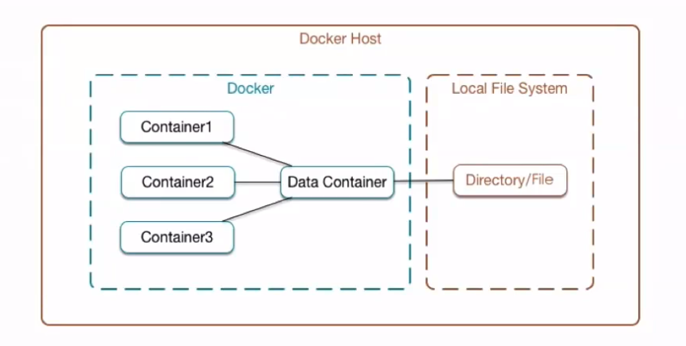
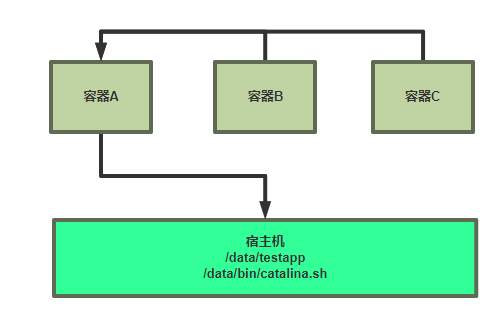

[← Back to Docker Container Technology Index]({{ '/subjects/Docker/' | relative_url }})



# 13 Data Volume Containers
### 3.3 数据卷容器（了解）

### 数据卷容器介绍



在Dockerfile中创建的是匿名数据卷,无法直接实现多个容器之间共享数据

数据卷容器主要的功能是可以让数据在多个docker容器之间共享

如下图所示: 即可以让B容器和C容器都可以访问A容器的内容，即可以实现A，B，C 三个容器之间的数据读写共享。



相当于先要创建一个后台运行的容器作为 Server，用于提供数据卷，这个卷可以为其他容器提供数据存储服务，其他使用此卷的容器作为client端 ，但此方法并不常使用

缺点:  因为依赖一个 Server  的容器存在，所以此 Server 容器出了问题，其它 Client容器都会受影响

注意：即使Server删除，无法创建新的Client容器，但是可以基于已有Client容器，再创建新的其它 Client容器

### 使用数据卷容器

启动容器时，指定使用数据卷容器

docker run 命令的以下选项可以实现数据卷容器，格式如下:

```text
--volumes-from <数据卷容器>     Mount volumes from the specified container(s)
```

### 实战案例: 数据卷容器

### 创建一个数据卷容器 Server

先创建一个挂载宿主机的数据目录的容器，且可以无需启动

范例:  使用之前的镜像创建数据卷容器

```bash
#数据卷容器一般无需映射端口
[root@ubuntu1804 ~]#docker run -d --name volume-server -v
/data/bin/catalina.sh:/apps/tomcat/bin/catalina.sh:ro -v
/data/testapp:/data/tomcat/webapps/testapp   tomcat-web:app1
109a34c5a83b23bc57b16fc8b1e19104d3d522a8c62e1e98d8e69577b01739b5
[root@ubuntu1804 ~]#docker ps
CONTAINER ID        IMAGE               COMMAND                  CREATED
STATUS              PORTS                NAMES
109a34c5a83b        tomcat-web:app1     "/apps/tomcat/bin/ru…"   14 seconds ago
Up 13 seconds       8009/tcp, 8080/tcp   volume-server
```

### 启动多个数据卷容器 Client

```bash
[root@ubuntu1804 ~]#docker run -d --name client1 --volumes-from volume-server -p
8081:8080  tomcat-web:app1
fe6ce0548dfee924cd39a8d86d5ed0e8ce9ea65323742f1336fa3b002c1b4a8c
[root@ubuntu1804 ~]#docker run -d --name client2 --volumes-from volume-server -p
8082:8080  tomcat-web:app1
10397838df9a489d7af2112850d4285bff5c2c262ea05cc9c5fb265af538f2c8
[root@ubuntu1804 ~]#docker ps
CONTAINER ID        IMAGE               COMMAND                  CREATED
STATUS              PORTS                              NAMES
10397838df9a        tomcat-web:app1     "/apps/tomcat/bin/ru…"   30 seconds ago
Up 27 seconds       8009/tcp, 0.0.0.0:8082->8080/tcp   client2
fe6ce0548dfe        tomcat-web:app1     "/apps/tomcat/bin/ru…"   40 seconds ago
Up 38 seconds       8009/tcp, 0.0.0.0:8081->8080/tcp   client1
109a34c5a83b        tomcat-web:app1     "/apps/tomcat/bin/ru…"   2 minutes ago
Up 2 minutes        8009/tcp, 8080/tcp                 volume-server
[root@ubuntu1804 ~]#
```

### 验证访问

```bash
[root@ubuntu1804 ~]#curl 127.0.0.1:8081/testapp/
testapp v3
[root@ubuntu1804 ~]#curl 127.0.0.1:8082/testapp/
testapp v3
```

### 进入容器测试读写

读写权限依赖于源数据卷Server容器

```bash
#进入 Server 容器修改数据
[root@ubuntu1804 ~]#docker exec -it volume-server bash
[root@109a34c5a83b /]# cat /data/tomcat/webapps/testapp/index.html
testapp v3
[root@109a34c5a83b /]# echo testapp v4 > /data/tomcat/webapps/testapp/index.html
[root@109a34c5a83b /]#
[root@ubuntu1804 ~]#curl 127.0.0.1:8081/testapp/
testapp v4
[root@ubuntu1804 ~]#curl 127.0.0.1:8082/testapp/
testapp v4
#进入 Client 容器修改数据
[root@ubuntu1804 ~]#docker exec -it client1 bash
[root@fe6ce0548dfe /]# cat /data/tomcat/webapps/testapp/index.html
testapp v4
[root@fe6ce0548dfe /]# echo testapp v4 > /data/tomcat/webapps/testapp/index.html
[root@fe6ce0548dfe /]# cat /data/tomcat/webapps/testapp/index.html
testapp v5
[root@ubuntu1804 ~]#curl 127.0.0.1:8081/testapp/
testapp v5
[root@ubuntu1804 ~]#curl 127.0.0.1:8082/testapp/
testapp v5
```

### 在宿主机直接修改

```bash
[root@ubuntu1804 ~]#cat /data/testapp/index.html
testapp v5
[root@ubuntu1804 ~]#echo testapp v6 > /data/testapp/index.html
[root@ubuntu1804 ~]#cat /data/testapp/index.html
testapp v6
[root@ubuntu1804 ~]#curl 127.0.0.1:8081/testapp/
testapp v6
[root@ubuntu1804 ~]#curl 127.0.0.1:8082/testapp/
testapp v6
[root@ubuntu1804 ~]#
[root@ubuntu1804 ~]#docker exec -it volume-server bash
[root@109a34c5a83b /]# cat  /data/tomcat/webapps/testapp/index.html
testapp v6
[root@109a34c5a83b /]#
```

### 关闭卷容器Server测试能否启动新容器

关闭卷容器Server，仍然可以创建新的client容器及访问旧的client容器

```bash
[root@ubuntu1804 ~]#docker stop volume-server
volume-server
[root@ubuntu1804 ~]#docker ps
CONTAINER ID        IMAGE               COMMAND                  CREATED
STATUS              PORTS                              NAMES
10397838df9a        tomcat-web:app1     "/apps/tomcat/bin/ru…"   9 minutes ago
Up 9 minutes        8009/tcp, 0.0.0.0:8082->8080/tcp   client2
fe6ce0548dfe        tomcat-web:app1     "/apps/tomcat/bin/ru…"   10 minutes ago
Up 10 minutes       8009/tcp, 0.0.0.0:8081->8080/tcp   client1
[root@ubuntu1804 ~]#docker run -d --name client3 --volumes-from volume-server -p
8083:8080  tomcat-web:app1
458df991688c3dbc69d824f889616e0a7534ce18543c8559162f3609fbb26b53
[root@ubuntu1804 ~]#docker ps  -a
CONTAINER ID        IMAGE               COMMAND                  CREATED
STATUS                            PORTS                              NAMES
458df991688c        tomcat-web:app1     "/apps/tomcat/bin/ru…"   About a minute
ago   Up About a minute                 8009/tcp, 0.0.0.0:8083->8080/tcp
client3
10397838df9a        tomcat-web:app1     "/apps/tomcat/bin/ru…"   11 minutes ago
Up 11 minutes                     8009/tcp, 0.0.0.0:8082->8080/tcp
client2
fe6ce0548dfe        tomcat-web:app1     "/apps/tomcat/bin/ru…"   11 minutes ago
Up 11 minutes                     8009/tcp, 0.0.0.0:8081->8080/tcp
client1
109a34c5a83b        tomcat-web:app1     "/apps/tomcat/bin/ru…"   13 minutes ago
Exited (137) About a minute ago
volume-server
[root@ubuntu1804 ~]#curl 127.0.0.1:8081/testapp/
testapp v6
[root@ubuntu1804 ~]#curl 127.0.0.1:8082/testapp/
testapp v6
[root@ubuntu1804 ~]#curl 127.0.0.1:8083/testapp/
testapp v6
```

### 删除源卷容器Server，访问client和创建新的client容器

删除数据卷容器后，旧的client 容器仍能访问，但无法再创建新的client容器

删除数据卷容器后，旧的client 容器仍能访问，但无法再创建基于数据卷容器的新的client容器,但可以创建基于已创建的Client容器的Client容器

```bash
[root@ubuntu1804 ~]#docker rm -fv volume-server
volume-server
[root@ubuntu1804 ~]#docker ps -a
CONTAINER ID        IMAGE               COMMAND                  CREATED
STATUS              PORTS                              NAMES
458df991688c        tomcat-web:app1     "/apps/tomcat/bin/ru…"   4 minutes ago
Up 4 minutes        8009/tcp, 0.0.0.0:8083->8080/tcp   client3
10397838df9a        tomcat-web:app1     "/apps/tomcat/bin/ru…"   14 minutes ago
Up 14 minutes       8009/tcp, 0.0.0.0:8082->8080/tcp   client2
fe6ce0548dfe        tomcat-web:app1     "/apps/tomcat/bin/ru…"   14 minutes ago
Up 14 minutes       8009/tcp, 0.0.0.0:8081->8080/tcp   client1
```

```bash
[root@ubuntu1804 ~]#docker run -d --name client4 --volumes-from volume-server -p
8084:8080  tomcat-web:app1
Unable to find image 'tomcat-web:app1' locally
docker: Error response from daemon: pull access denied for tomcat-web,
repository does not exist or may require 'docker login': denied: requested
access to the resource is denied.
See 'docker run --help'.
[root@ubuntu1804 ~]#curl 127.0.0.1:8081/testapp/
testapp v6
[root@ubuntu1804 ~]#curl 127.0.0.1:8082/testapp/
testapp v6
[root@ubuntu1804 ~]#curl 127.0.0.1:8083/testapp/
testapp v6
```

### 重新创建容器卷 Server

重新创建容器卷容器后，还可继续创建新client 容器

```bash
[root@ubuntu1804 ~]#docker run -d --name volume-server -v
/data/bin/catalina.sh:/apps/tomcat/bin/catalina.sh:ro -v
/data/testapp:/data/tomcat/webapps/testapp   tomcat-web:app1
ee0dacff6a4531dc8ecc1d416b449e087d8bf27dad2d6a6e515faf10455a1cc0
[root@ubuntu1804 ~]#docker run -d --name client4 --volumes-from volume-server -p
8084:8080  tomcat-web:app1
dcd002fe87887a0c5d1f62b24cd7665e42ee864c975d1a2953c383af0cb65a70
[root@ubuntu1804 ~]#curl 127.0.0.1:8084/testapp/
testapp v6
[root@ubuntu1804 ~]#curl 127.0.0.1:8081/testapp/
testapp v6
[root@ubuntu1804 ~]#curl 127.0.0.1:8082/testapp/
testapp v6
[root@ubuntu1804 ~]#curl 127.0.0.1:8083/testapp/
testapp v6
[root@ubuntu1804 ~]#curl 127.0.0.1:8084/testapp/
testapp v6
```



<nav class="article-end" aria-label="章节导航">
  <a href="{{ '/subjects/Docker/12-data-volumes.html' | relative_url }}">← Previous: Data Volumes</a>
  <a href="{{ '/subjects/Docker/' | relative_url }}">Back to Docker Container Technology Index</a>
  <a href="{{ '/subjects/Docker/14-default-docker-networking.html' | relative_url }}">Next: Default Docker Networking →</a>
</nav>
