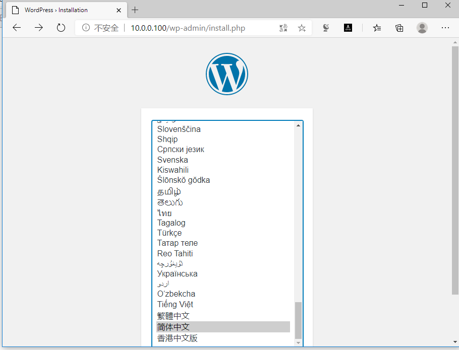
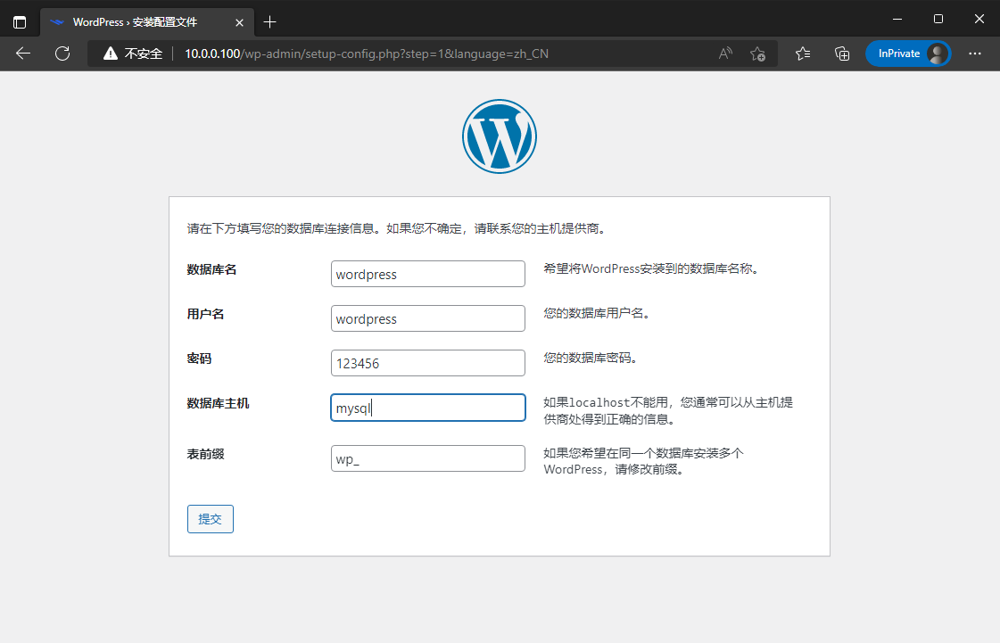

[← Back to Docker Container Technology Index]({{ '/subjects/Docker/' | relative_url }})



# 15 Container Name Networking
### 4.2 容器名称互联（了解）

新建容器时，docker会自动分配容器名称，容器ID和IP地址，导致容器名称，容器ID和IP都不固定，那么如何区分不同的容器，实现和确定目标容器的通信呢？解决方案是给容器起个固定的名称，容器之间通过固定名称实现确定目标的通信

有两种固定名称:

容器名称容器名称的别名

注意:  两种方式都最少需要两个容器才能实现

### 通过容器名称互联

### 容器名称介绍

即在同一个宿主机上的容器之间可以通过自定义的容器名称相互访问，比如:  一个业务前端静态页面是使用nginx，动态页面使用的是tomcat，另外还需要负载均衡调度器，如:  haproxy 对请求调度至nginx 和tomcat的容器，由于容器在启动的时候其内部IP地址是DHCP 随机分配的，而给容器起个固定的名称，则是相对比较固定的，因此比较适用于此场景

注意: 如果被引用的容器地址变化,旧版必须重启当前容器才能生效，新版容器自动更新/etc/hosts的域名解析

只能实现单向的域名解析

### 容器名称实现

docker run 创建容器，可使用--link选项实现容器名称的引用，其本质就是在容器内的/etc/hosts中添加- -link后指定的容器的IP和主机名的对应关系，从而实现名称解析

```text
--link list                                   #Add link to another container
格式:
docker run --name <容器名称>                    #先创建指定名称的容器
docker run --link <目标通信的容器ID或容器名称>     #再创建容器时引用上面容器的名称
```

### 实战案例1: 使用容器名称进行容器间通信

1. 先创建第一个指定容器名称的容器

```bash
[root@ubuntu1804 ~]#docker run -it --name server1 --rm  alpine:3.11 sh
/ # cat /etc/hosts
127.0.0.1   localhost
::1 localhost ip6-localhost ip6-loopback
fe00::0 ip6-localnet
ff00::0 ip6-mcastprefix
ff02::1 ip6-allnodes
ff02::2 ip6-allrouters
172.17.0.2  cdb5173003f5
/ # ip a
1: lo: <LOOPBACK,UP,LOWER_UP> mtu 65536 qdisc noqueue state UNKNOWN qlen 1000
link/loopback 00:00:00:00:00:00 brd 00:00:00:00:00:00
inet 127.0.0.1/8 scope host lo
valid_lft forever preferred_lft forever
150: eth0@if151: <BROADCAST,MULTICAST,UP,LOWER_UP,M-DOWN> mtu 1500 qdisc noqueue
state UP
link/ether 02:42:ac:11:00:02 brd ff:ff:ff:ff:ff:ff
inet 172.17.0.2/16 brd 172.17.255.255 scope global eth0
valid_lft forever preferred_lft forever
/ # ping 172.17.0.2
PING 172.17.0.2 (172.17.0.2): 56 data bytes
64 bytes from 172.17.0.2: seq=0 ttl=64 time=0.038 ms
^C
--- 172.17.0.2 ping statistics ---
1 packets transmitted, 1 packets received, 0% packet loss
round-trip min/avg/max = 0.038/0.038/0.038 ms
/ # ping server1
ping: bad address 'server1'
/ # ping cdb5173003f5
PING cdb5173003f5 (172.17.0.2): 56 data bytes
64 bytes from 172.17.0.2: seq=0 ttl=64 time=0.040 ms
64 bytes from 172.17.0.2: seq=1 ttl=64 time=0.128 ms
^C
--- cdb5173003f5 ping statistics ---
2 packets transmitted, 2 packets received, 0% packet loss
round-trip min/avg/max = 0.040/0.084/0.128 ms
/ #
```

2. 新建第二个容器时引用第一个容器的名称

会自动将第一个主机的名称加入/etc/hosts文件,从而可以利用第一个容器名称进行访问

```bash
[root@ubuntu1804 ~]#docker run -it  --rm --name server2  --link server1
alpine:3.11 sh
/ # env
HOSTNAME=395d8c3392ee
SHLVL=1
HOME=/root
TERM=xterm
SERVER1_NAME=/server2/server1
PATH=/usr/local/sbin:/usr/local/bin:/usr/sbin:/usr/bin:/sbin:/bin
PWD=/
/ # cat /etc/hosts
127.0.0.1   localhost
::1 localhost ip6-localhost ip6-loopback
fe00::0 ip6-localnet
ff00::0 ip6-mcastprefix
ff02::1 ip6-allnodes
ff02::2 ip6-allrouters
172.17.0.2  server1 cdb5173003f5
172.17.0.3  7ca466320980
/ # ping server1
PING server1 (172.17.0.2): 56 data bytes
64 bytes from 172.17.0.2: seq=0 ttl=64 time=0.111 ms
^C
--- server1 ping statistics ---
1 packets transmitted, 1 packets received, 0% packet loss
round-trip min/avg/max = 0.111/0.111/0.111 ms
/ # ping server2
ping: bad address 'server2'
/ # ping 7ca466320980
PING 7ca466320980 (172.17.0.3): 56 data bytes
64 bytes from 172.17.0.3: seq=0 ttl=64 time=0.116 ms
64 bytes from 172.17.0.3: seq=1 ttl=64 time=0.069 ms
^C
--- 7ca466320980 ping statistics ---
2 packets transmitted, 2 packets received, 0% packet loss
round-trip min/avg/max = 0.069/0.092/0.116 ms
/ # ping cdb5173003f5
PING cdb5173003f5 (172.17.0.2): 56 data bytes
64 bytes from 172.17.0.2: seq=0 ttl=64 time=0.072 ms
64 bytes from 172.17.0.2: seq=1 ttl=64 time=0.184 ms
^C
--- cdb5173003f5 ping statistics ---
2 packets transmitted, 2 packets received, 0% packet loss
round-trip min/avg/max = 0.072/0.128/0.184 ms
/ #
[root@ubuntu1804 ~]#docker ps
CONTAINER ID        IMAGE               COMMAND             CREATED
STATUS              PORTS               NAMES
7ca466320980        alpine:3.11         "sh"                24 seconds ago
Up 23 seconds                           server2
cdb5173003f5        alpine:3.11         "sh"                7 minutes ago
Up 7 minutes                            server1
```

### 实战案例2: 实现 wordpress 和 MySQL 两个容器互连

范例：

```text
docker run -d --name mysql -e MYSQL_ROOT_PASSWORD=123456 -e
MYSQL_DATABASE=wordpress -e MYSQL_USER=wordpress -e MYSQL_PASSWORD=123456
registry.cn-beijing.aliyuncs.com/bowenxiaochun/mysql:8.0.29-oracle
#方式1
docker run -p 80:80 --name wordpress --link mysql -d  registry.cn-
beijing.aliyuncs.com/bowenxiaochun/wordpress:php8.2-apache
#方式2
docker run -p 80:80 --name wordpress --link mysql  -e WORDPRESS_DB_HOST=mysql -e
WORDPRESS_DB_NAME=wordpress -e WORDPRESS_DB_USER=wordpress -e
WORDPRESS_DB_PASSWORD=123456  -d  registry.cn-
beijing.aliyuncs.com/bowenxiaochun/wordpress:php8.2-apache
```

范例：

```bash
[root@centos7 ~]#tree lamp_docker/
lamp_docker/
├── env_mysql.list
├── env_wordpress.list
└── mysql
└── mysql_test.cnf
1 directory, 3 files
[root@centos7 ~]#cat lamp_docker/env_mysql.list
MYSQL_ROOT_PASSWORD=123456
MYSQL_DATABASE=wordpress
MYSQL_USER=wpuser
MYSQL_PASSWORD=wppass
[root@centos7 ~]#cat lamp_docker/env_wordpress.list
WORDPRESS_DB_HOST=mysql:3306
WORDPRESS_DB_NAME=wordpress
WORDPRESS_DB_USER=wpuser
WORDPRESS_DB_PASSWORD=wppass
WORDPRESS_TABLE_PREFIX=wp_
[root@centos7 ~]#cat lamp_docker/mysql/mysql_test.cnf
[mysqld]
server-id=100
log-bin=mysql-bin
```

```bash
[root@centos7 ~]#docker run --name mysql -v
/root/lamp_docker/mysql/:/etc/mysql/conf.d -v /data/mysql:/var/lib/mysql --env-
file=/root/lamp_docker/env_mysql.list -d -p 3306:3306 registry.cn-
beijing.aliyuncs.com/bowenxiaochun/mysql:8.0.29-oracle
[root@centos7 ~]#docker run -d   --name wordpress  --link mysql -v
/data/wordpress:/var/www/html/wp-content --env-
file=/root/lamp_docker/env_wordpress.list  -p 80:80 registry.cn-
beijing.aliyuncs.com/bowenxiaochun/wordpress:php8.2-apache
```





### 通过自定义容器别名互联

### 容器别名介绍

自定义的容器名称可能后期会发生变化，那么一旦名称发生变化，容器内程序之间也必须要随之发生变化，比如:程序通过固定的容器名称进行服务调用，但是容器名称发生变化之后再使用之前的名称肯定是无法成功调用，每次都进行更改的话又比较麻烦，因此可以使用自定义别名的方式解决，即容器名称可以随意更改，只要不更改别名即可

### 容器别名实现

命令格式:

```text
docker run --name <容器名称>
#先创建指定名称的容器
docker run --name <容器名称> --link <目标容器名称>:"<容器别名1>  <容器别名2> ..."
#给上面创建的容器起别名,来创建新容器
```

### 实战案例: 使用容器别名

范例:  创建第三个容器，引用前面创建的容器，并起别名

```bash
[root@ubuntu1804 ~]#docker run -it  --rm --name server3  --link server1:server1-
alias  alpine:3.11 sh
/ # env
HOSTNAME=395d8c3392ee
SHLVL=1
HOME=/root
TERM=xterm
SERVER1-ALIAS_NAME=/server3/server1-alias
PATH=/usr/local/sbin:/usr/local/bin:/usr/sbin:/usr/bin:/sbin:/bin
PWD=/
/ # cat /etc/hosts
127.0.0.1   localhost
::1 localhost ip6-localhost ip6-loopback
fe00::0 ip6-localnet
ff00::0 ip6-mcastprefix
ff02::1 ip6-allnodes
ff02::2 ip6-allrouters
172.17.0.2  server1-alias cdb5173003f5 server1
172.17.0.4  d9622c6831f7
/ # ping server1
PING server1 (172.17.0.2): 56 data bytes
64 bytes from 172.17.0.2: seq=0 ttl=64 time=0.101 ms
^C
--- server1 ping statistics ---
1 packets transmitted, 1 packets received, 0% packet loss
round-trip min/avg/max = 0.101/0.101/0.101 ms
/ # ping server1-alias
PING server1-alias (172.17.0.2): 56 data bytes
64 bytes from 172.17.0.2: seq=0 ttl=64 time=0.073 ms
^C
--- server1-alias ping statistics ---
1 packets transmitted, 1 packets received, 0% packet loss
round-trip min/avg/max = 0.073/0.073/0.073 ms
/ #
```

范例:  创建第四个容器，引用前面创建的容器，并起多个别名

```bash
[root@ubuntu1804 ~]#docker run -it  --rm --name server4  --link
server1:"server1-alias1 server1-alias2"  alpine:3.11 sh
/ # cat /etc/hosts
127.0.0.1   localhost
::1 localhost ip6-localhost ip6-loopback
fe00::0 ip6-localnet
ff00::0 ip6-mcastprefix
ff02::1 ip6-allnodes
ff02::2 ip6-allrouters
172.17.0.2  server1-alias1 server1-alias2 cdb5173003f5 server1
172.17.0.5  db3d2f084c05
/ # ping server1
PING server1 (172.17.0.2): 56 data bytes
64 bytes from 172.17.0.2: seq=0 ttl=64 time=0.107 ms
^C
--- server1 ping statistics ---
1 packets transmitted, 1 packets received, 0% packet loss
round-trip min/avg/max = 0.107/0.107/0.107 ms
/ # ping server1-alias1
PING server1-alias1 (172.17.0.2): 56 data bytes
64 bytes from 172.17.0.2: seq=0 ttl=64 time=0.126 ms
^C
--- server1-alias1 ping statistics ---
1 packets transmitted, 1 packets received, 0% packet loss
round-trip min/avg/max = 0.126/0.126/0.126 ms
/ # ping server1-alias2
PING server1-alias2 (172.17.0.2): 56 data bytes
64 bytes from 172.17.0.2: seq=0 ttl=64 time=0.124 ms
^C
--- server1-alias2 ping statistics ---
1 packets transmitted, 1 packets received, 0% packet loss
round-trip min/avg/max = 0.124/0.124/0.124 ms
/ #
```



<nav class="article-end" aria-label="章节导航">
  <a href="{{ '/subjects/Docker/14-default-docker-networking.html' | relative_url }}">← Previous: Default Docker Networking</a>
  <a href="{{ '/subjects/Docker/' | relative_url }}">Back to Docker Container Technology Index</a>
  <a href="{{ '/subjects/Docker/16-docker-network-modes.html' | relative_url }}">Next: Docker Network Modes →</a>
</nav>
