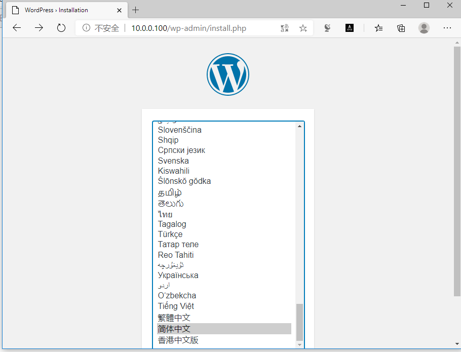
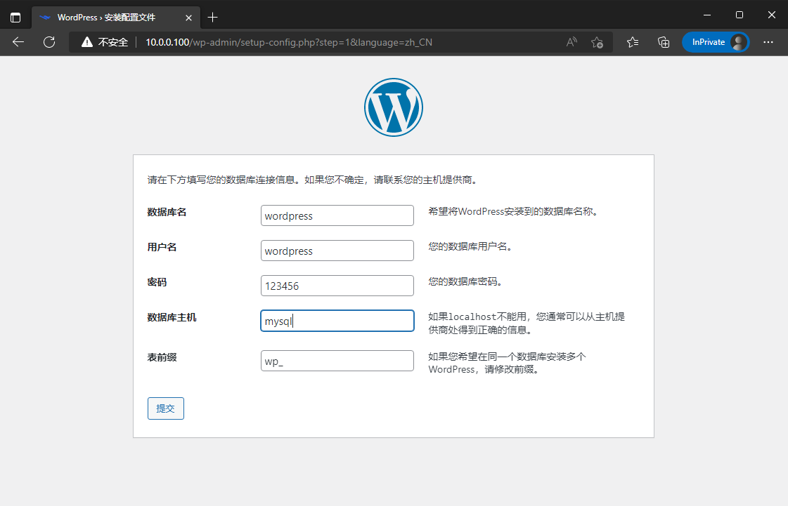

[← 返回 Docker 容器技术目录]({{ '/subjects/Docker/' | relative_url }})



# 15 通过容器名称通信

容器 IP 会随着重建而变化，应用不应把它写死。**推荐方式是在用户自定义网络中通过 Docker 内置 DNS 解析容器名或网络别名**；旧版脚本使用的 `--link` 属于历史兼容机制。两者都能让客户端通过名称找到服务端，但工作原理和适用范围不同。

## 1. 推荐：自定义网络的名称解析

```bash
docker network create app-net
docker run -d --name web --network app-net nginx:stable-alpine
docker run --rm --network app-net alpine:3.20 \
  sh -c 'getent hosts web || ping -c 1 web'
```

在同一用户自定义桥接网络中，Docker DNS 可解析 `web`。用 `docker network inspect app-net` 查看加入网络的容器；容器重建后 IP 可能不同，但只要名称和网络保持一致，客户端仍用 `web` 连接。默认 `bridge` 网络的自动名称解析能力与自定义网络不同，不能把上述结果直接套到默认桥接网络。

若服务的容器名可能变化，可定义稳定的**网络别名**：

```bash
docker network connect --alias backend app-net OTHER_CONTAINER
docker run --rm --network app-net alpine:3.20 ping -c 1 backend
```

别名属于指定网络；不同网络可以有相同别名。同一别名指向多个容器时，DNS 解析可能返回多个地址，但这不等于具备健康检查或可靠负载均衡。应以应用的连接与重试策略处理目标重建。

## 2. 历史用法：`--link`

旧版 `docker run --link server1:server1-alias` 会在**新建客户端容器**中建立目标名称解析和相关信息。它常依赖容器的 `/etc/hosts`，因此是有方向性的：客户端知道服务端，不表示服务端自动知道客户端。原文大量 `ping`、`/etc/hosts` 输出体现了这个机制；不同 Docker 版本对容器重启后信息更新的细节不一，不应依赖它实现现代服务发现。

```bash
docker run -d --name legacy-server alpine:3.20 sleep 3600
docker run --rm --link legacy-server:backend alpine:3.20 \
  sh -c 'cat /etc/hosts; ping -c 1 backend'
```

这里的 `backend` 是客户端看到的别名。旧格式 `--link server1:"alias1 alias2"` 容易与 shell 引号和网络模型纠缠；新项目更适合为容器加入自定义网络并显式设置别名。

## 3. WordPress 与数据库：名称之外还需要数据卷

原案例让 WordPress 用 `--link mysql` 找数据库，却同时演示了明文密码和对外发布 MySQL 3306 端口。两容器在同一自定义网络时，WordPress 可用服务名 `mysql:3306` 连接，数据库端口不必发布到宿主机。数据库文件和 WordPress 上传内容需要各自的持久卷，不能因名称能互通就忽略数据生命周期。

```yaml
services:
  mysql:
    image: mysql:8.0
    environment:
      MYSQL_DATABASE: wordpress
      MYSQL_USER: wordpress
      MYSQL_PASSWORD: ${WORDPRESS_DB_PASSWORD}
      MYSQL_ROOT_PASSWORD: ${MYSQL_ROOT_PASSWORD}
    volumes:
      - mysql-data:/var/lib/mysql
  wordpress:
    image: wordpress:php8.2-apache
    depends_on: [mysql]
    environment:
      WORDPRESS_DB_HOST: mysql:3306
      WORDPRESS_DB_NAME: wordpress
      WORDPRESS_DB_USER: wordpress
      WORDPRESS_DB_PASSWORD: ${WORDPRESS_DB_PASSWORD}
    ports:
      - "127.0.0.1:8080:80"
    volumes:
      - wordpress-data:/var/www/html/wp-content
volumes:
  mysql-data:
  wordpress-data:
```

Compose 会为项目创建网络，服务名本身可用于 DNS 查询；`depends_on` 只控制启动顺序，不保证 MySQL 已经可接受连接，生产部署还需要健康检查或应用重试。密码应通过环境、secret 或其他受控方式注入，不能把旧示例弱密码提交到配置中。





因此，解决“容器名与 IP 会变”的核心是**稳定的网络服务名**，而非把固定 IP 或旧式 `--link` 作为依赖。



<nav class="article-end" aria-label="章节导航">
  <a href="{{ '/subjects/Docker/14-default-docker-networking.html' | relative_url }}">← 上一篇：默认网络</a>
  <a href="{{ '/subjects/Docker/' | relative_url }}">返回 Docker 容器技术目录</a>
  <a href="{{ '/subjects/Docker/16-docker-network-modes.html' | relative_url }}">下一篇：Docker 网络模式 →</a>
</nav>
