[← Back to Docker Container Technology Index]({{ '/subjects/Docker/' | relative_url }})



# 16 Docker Network Modes
### 4.3 Docker 网络连接模式(重点)

### 网络模式介绍

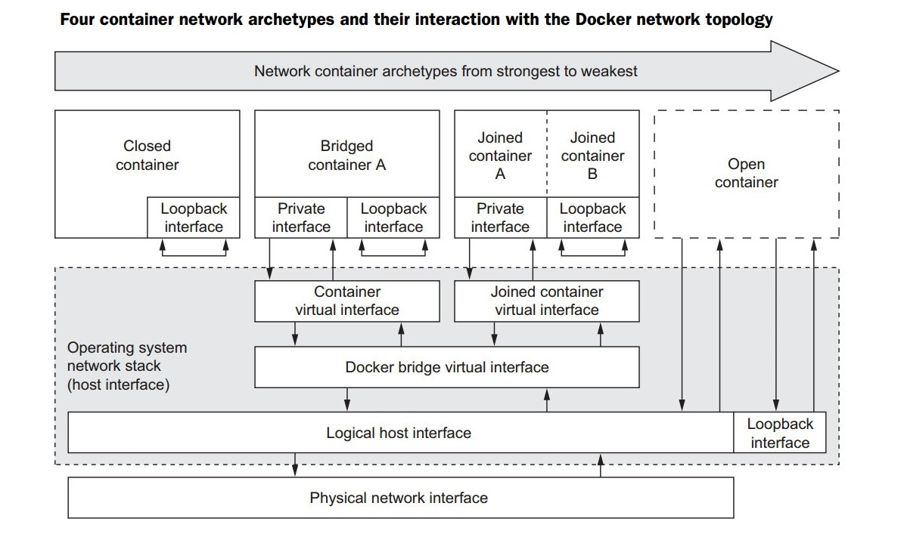

Docker 的网络支持 5 种网络模式:

none host bridge container network-name

范例:  查看默认的网络模式有三个

```bash
[root@ubuntu1804 ~]#docker network ls
NETWORK ID          NAME                DRIVER              SCOPE
fe08e6d23c4c        bridge              bridge              local
cb64aa83626c        host                host                local
10619d45dcd4        none                null                local
```

### 网络模式指定

默认新建的容器使用Bridge模式，创建容器时，docker run 命令使用以下选项指定网络模式

格式

```xml
docker run --network <mode>
docker run --net=<mode>
<mode>:  可是以下值
none
bridge
host
container:<容器名或容器ID>
<自定义网络名称>
```

### Bridge网络模式

### Bridge 网络模式架构（默认模式）

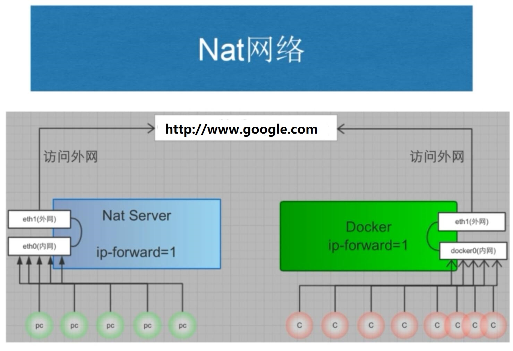

本模式是docker的默认模式，即不指定任何模式就是bridge模式，也是使用比较多的模式，此模式创建的容器会为每一个容器分配自己的网络 IP 等信息，并将容器连接到一个虚拟网桥与外界通信

可以和外部网络之间进行通信，通过SNAT访问外网，使用DNAT可以让容器被外部主机访问，所以此模式也称为NAT模式

此模式宿主机需要启动ip_forward功能

bridge网络模式特点

网络资源隔离:  不同宿主机的容器无法直接通信，各自使用独立网络无需手动配置:  容器默认自动获取172.17.0.0/16的IP地址，此地址可以修改可访问外网:  利用宿主机的物理网卡，SNAT连接外网外部主机无法直接访问容器:  可以通过配置DNAT接受外网的访问低性能较低:  因为可通过NAT，网络转换带来更的损耗端口管理繁琐:  每个容器必须手动指定唯一的端口，容器产生端口冲容

### Bridge 模式的默认设置

范例:  查看bridge模式信息

```json
[root@ubuntu1804 ~]#docker network inspect bridge
[
{
"Name": "bridge",
"Id":
"fe08e6d23c4c9de00bdab479446f136c09537a1551aa62ff2c95f8cfcabd6357",
"Created": "2020-01-31T16:11:32.718471804+08:00",
"Scope": "local",
"Driver": "bridge",
"EnableIPv6": false,
"IPAM": {
"Driver": "default",
"Options": null,
"Config": [
{
"Subnet": "172.17.0.0/16",
"Gateway": "172.17.0.1"
}
]
},
"Internal": false,
"Attachable": false,
"Ingress": false,
"ConfigFrom": {
"Network": ""
},
"ConfigOnly": false,
"Containers": {
"cdb5173003f52033c7c8183994cf763d2a64ff39c431431402fd8dedf4727393":
{
"Name": "server1",
"EndpointID":
"6977fb6f74b75014513c34296f1e23ff0197f81f3209bbf7fcd39ba8e9f54c0d",
"MacAddress": "02:42:ac:11:00:02",
"IPv4Address": "172.17.0.2/16",
"IPv6Address": ""
}
},
"Options": {
"com.docker.network.bridge.default_bridge": "true",
"com.docker.network.bridge.enable_icc": "true",
"com.docker.network.bridge.enable_ip_masquerade": "true",
"com.docker.network.bridge.host_binding_ipv4": "0.0.0.0",
"com.docker.network.bridge.name": "docker0",
"com.docker.network.driver.mtu": "1500"
},
"Labels": {}
}
]
[root@ubuntu1804 ~]#
```

范例:  宿主机的网络状态

```bash
#安装docker后.默认启用ip_forward
[root@ubuntu1804 ~]#cat /proc/sys/net/ipv4/ip_forward
1
[root@ubuntu1804 ~]#iptables -vnL -t nat
Chain PREROUTING (policy ACCEPT 245 packets, 29850 bytes)
pkts bytes target     prot opt in     out     source               destination
11   636 DOCKER     all  --  *      *       0.0.0.0/0            0.0.0.0/0
ADDRTYPE match dst-type LOCAL
Chain INPUT (policy ACCEPT 103 packets, 20705 bytes)
pkts bytes target     prot opt in     out     source               destination
```

```text
Chain OUTPUT (policy ACCEPT 144 packets, 10324 bytes)
pkts bytes target     prot opt in     out     source               destination
0     0 DOCKER     all  --  *      *       0.0.0.0/0           !127.0.0.0/8
ADDRTYPE match dst-type LOCAL
Chain POSTROUTING (policy ACCEPT 158 packets, 11500 bytes)
pkts bytes target     prot opt in     out     source               destination
125  7831 MASQUERADE  all  --  *      !docker0  172.17.0.0/16        0.0.0.0/0
```

```text
Chain DOCKER (2 references)
pkts bytes target     prot opt in     out     source               destination
2   168 RETURN     all  --  docker0 *       0.0.0.0/0            0.0.0.0/0
```

范例:  通过宿主机的物理网卡利用SNAT访问外部网络

```bash
#在另一台主机上建立httpd服务器
[root@centos7 ~]#systemctl is-active httpd
active
#启动容器，默认是bridge网络模式
[root@ubuntu1804 ~]#docker run -it  --rm  alpine:3.11 sh
/ # ip a
1: lo: <LOOPBACK,UP,LOWER_UP> mtu 65536 qdisc noqueue state UNKNOWN qlen 1000
link/loopback 00:00:00:00:00:00 brd 00:00:00:00:00:00
inet 127.0.0.1/8 scope host lo
valid_lft forever preferred_lft forever
166: eth0@if167: <BROADCAST,MULTICAST,UP,LOWER_UP,M-DOWN> mtu 1500 qdisc noqueue
state UP
link/ether 02:42:ac:11:00:02 brd ff:ff:ff:ff:ff:ff
inet 172.17.0.2/16 brd 172.17.255.255 scope global eth0
valid_lft forever preferred_lft forever
#可能访问其它宿主机
/ # ping 10.0.0.7
PING 10.0.0.7 (10.0.0.7): 56 data bytes
64 bytes from 10.0.0.7: seq=0 ttl=63 time=0.764 ms
64 bytes from 10.0.0.7: seq=1 ttl=63 time=1.147 ms
^C
--- 10.0.0.7 ping statistics ---
2 packets transmitted, 2 packets received, 0% packet loss
round-trip min/avg/max = 0.764/0.955/1.147 ms
/ # ping www.baidu.com
PING www.baidu.com (61.135.169.125): 56 data bytes
64 bytes from 61.135.169.125: seq=0 ttl=127 time=5.182 ms
^C
--- www.baidu.com ping statistics ---
1 packets transmitted, 1 packets received, 0% packet loss
round-trip min/avg/max = 5.182/5.182/5.182 ms
/ # traceroute 10.0.0.7
traceroute to 10.0.0.7 (10.0.0.7), 30 hops max, 46 byte packets
1  172.17.0.1 (172.17.0.1)  0.008 ms  0.008 ms  0.007 ms
2  10.0.0.7 (10.0.0.7)  0.255 ms  0.510 ms  0.798 ms
/ # wget -qO - 10.0.0.7
Website on 10.0.0.7
/ # route -n
Kernel IP routing table
Destination     Gateway         Genmask         Flags Metric Ref    Use Iface
0.0.0.0         172.17.0.1      0.0.0.0         UG    0      0        0 eth0
172.17.0.0      0.0.0.0         255.255.0.0     U     0      0        0 eth0
[root@centos7 ~]#curl 127.0.0.1
Website on 10.0.0.7
[root@centos7 ~]#tail  /var/log/httpd/access_log
127.0.0.1 - - [01/Feb/2020:19:31:16 +0800] "GET / HTTP/1.1" 200 20 "-"
"curl/7.29.0"
10.0.0.100 - - [01/Feb/2020:19:31:21 +0800] "GET / HTTP/1.1" 200 20 "-" "Wget"
```

### 修改默认的 Bridge 模式网络配置

有两种方法修改默认的bridge 模式的网络配置，但两种方式只能选一种，否则会导致冲容，docker服务无法启动

范例:  修改Bridge模式默认的网段方法1

```bash
[root@ubuntu1804 ~]#ip a
1: lo: <LOOPBACK,UP,LOWER_UP> mtu 65536 qdisc noqueue state UNKNOWN group
default qlen 1000
link/loopback 00:00:00:00:00:00 brd 00:00:00:00:00:00
inet 127.0.0.1/8 scope host lo
valid_lft forever preferred_lft forever
inet6 ::1/128 scope host
valid_lft forever preferred_lft forever
2: eth0: <BROADCAST,MULTICAST,UP,LOWER_UP> mtu 1500 qdisc fq_codel state UP
group default qlen 1000
link/ether 00:0c:29:6b:54:d3 brd ff:ff:ff:ff:ff:ff
inet 10.0.0.100/24 brd 10.0.0.255 scope global eth0
valid_lft forever preferred_lft forever
inet6 fe80::20c:29ff:fe6b:54d3/64 scope link
valid_lft forever preferred_lft forever
3: docker0: <NO-CARRIER,BROADCAST,MULTICAST,UP> mtu 1500 qdisc noqueue state
DOWN group default
link/ether 02:42:e0:ef:72:05 brd ff:ff:ff:ff:ff:ff
inet 172.17.0.1/16 brd 172.17.255.255 scope global docker0
valid_lft forever preferred_lft forever
inet6 fe80::42:e0ff:feef:7205/64 scope link
valid_lft forever preferred_lft forever
[root@ubuntu1804 ~]#docker run -it --rm  alpine sh
/ # ip a
1: lo: <LOOPBACK,UP,LOWER_UP> mtu 65536 qdisc noqueue state UNKNOWN qlen 1000
link/loopback 00:00:00:00:00:00 brd 00:00:00:00:00:00
inet 127.0.0.1/8 scope host lo
valid_lft forever preferred_lft forever
4: eth0@if5: <BROADCAST,MULTICAST,UP,LOWER_UP,M-DOWN> mtu 1500 qdisc noqueue
state UP
link/ether 02:42:ac:11:00:02 brd ff:ff:ff:ff:ff:ff
inet 172.17.0.2/16 brd 172.17.255.255 scope global eth0
valid_lft forever preferred_lft forever
/ #exit
#修改桥接地址
[root@ubuntu1804 ~]#vim /lib/systemd/system/docker.service
ExecStart=/usr/bin/dockerd -H fd:// --containerd=/run/containerd/containerd.sock
--bip=10.100.0.1/24
[root@ubuntu1804 ~]#systemctl daemon-reload
[root@ubuntu1804 ~]#systemctl restart docker
[root@ubuntu1804 ~]#ip a
1: lo: <LOOPBACK,UP,LOWER_UP> mtu 65536 qdisc noqueue state UNKNOWN group
default qlen 1000
link/loopback 00:00:00:00:00:00 brd 00:00:00:00:00:00
inet 127.0.0.1/8 scope host lo
valid_lft forever preferred_lft forever
inet6 ::1/128 scope host
valid_lft forever preferred_lft forever
2: eth0: <BROADCAST,MULTICAST,UP,LOWER_UP> mtu 1500 qdisc fq_codel state UP
group default qlen 1000
link/ether 00:0c:29:6b:54:d3 brd ff:ff:ff:ff:ff:ff
inet 10.0.0.101/24 brd 10.0.0.255 scope global eth0
valid_lft forever preferred_lft forever
inet6 fe80::20c:29ff:fe6b:54d3/64 scope link
valid_lft forever preferred_lft forever
3: docker0: <NO-CARRIER,BROADCAST,MULTICAST,UP> mtu 1500 qdisc noqueue state
DOWN group default
link/ether 02:42:e0:ef:72:05 brd ff:ff:ff:ff:ff:ff
inet 10.100.0.1/24 brd 10.100.0.255 scope global docker0
valid_lft forever preferred_lft forever
inet6 fe80::42:e0ff:feef:7205/64 scope link
valid_lft forever preferred_lft forever
[root@ubuntu1804 ~]#docker run -it --rm  alpine sh
/ # ip a
1: lo: <LOOPBACK,UP,LOWER_UP> mtu 65536 qdisc noqueue state UNKNOWN qlen 1000
link/loopback 00:00:00:00:00:00 brd 00:00:00:00:00:00
inet 127.0.0.1/8 scope host lo
valid_lft forever preferred_lft forever
179: eth0@if180: <BROADCAST,MULTICAST,UP,LOWER_UP,M-DOWN> mtu 1500 qdisc noqueue
state UP
link/ether 02:42:0a:64:00:02 brd ff:ff:ff:ff:ff:ff
inet 10.100.0.2/24 brd 10.100.0.255 scope global eth0
valid_lft forever preferred_lft forever
/ # exit
[root@ubuntu1804 ~]#docker network inspect bridge
[
{
"Name": "bridge",
"Id":
"ace11446c233d1fef534d9c734bf3ab5524afdbe76934a1a0e64803d03d54f98",
"Created": "2020-02-02T13:23:58.037630754+08:00",
"Scope": "local",
"Driver": "bridge",
"EnableIPv6": false,
"IPAM": {
"Driver": "default",
"Options": null,
"Config": [
{
"Subnet": "10.100.0.0/24",
"Gateway": "10.100.0.1"
}
]
},
"Internal": false,
"Attachable": false,
"Ingress": false,
"ConfigFrom": {
"Network": ""
},
"ConfigOnly": false,
"Containers": {},
"Options": {
"com.docker.network.bridge.default_bridge": "true",
"com.docker.network.bridge.enable_icc": "true",
"com.docker.network.bridge.enable_ip_masquerade": "true",
"com.docker.network.bridge.host_binding_ipv4": "0.0.0.0",
"com.docker.network.bridge.name": "docker0",
"com.docker.network.driver.mtu": "1500"
},
"Labels": {}
}
]
```

范例:  修改Bridge网络配置方法2

```json
[root@ubuntu1804 ~]#vim /etc/docker/daemon.json
{
"hosts": ["tcp://0.0.0.0:2375", "fd://"],
"bip": "192.168.100.100/24",         #分配docker0网卡的IP,24是容器IP的netmask
"fixed-cidr": "192.168.100.128/26", #分配容器IP范围,26不是容器IP的子网掩码,只表示地址
范围
"fixed-cidr-v6": "2001:db8::/64",
"mtu": 1500,
"default-gateway": "192.168.100.200",  #网关必须和bip在同一个网段
"default-gateway-v6": "2001:db8:abcd::89",
"dns": [ "1.1.1.1", "8.8.8.8"]
}
[root@ubuntu1804 ~]#systemctl restart docker
[root@ubuntu1804 ~]#ip a show docker0
3: docker0: <BROADCAST,MULTICAST,UP,LOWER_UP> mtu 1500 qdisc noqueue state UP
group default
link/ether 02:42:23:be:97:75 brd ff:ff:ff:ff:ff:ff
inet 192.168.100.100/24 brd 192.168.100.255 scope global docker0
valid_lft forever preferred_lft forever
inet6 fe80::42:23ff:febe:9775/64 scope link
valid_lft forever preferred_lft forever
```

```bash
[root@ubuntu1804 ~]#docker run -it --name b1 busybox
/ # ip a
1: lo: <LOOPBACK,UP,LOWER_UP> mtu 65536 qdisc noqueue qlen 1000
link/loopback 00:00:00:00:00:00 brd 00:00:00:00:00:00
inet 127.0.0.1/8 scope host lo
valid_lft forever preferred_lft forever
36: eth0@if37: <BROADCAST,MULTICAST,UP,LOWER_UP,M-DOWN> mtu 1500 qdisc noqueue
link/ether 02:42:c0:a8:64:80 brd ff:ff:ff:ff:ff:ff
inet 192.168.100.128/24 brd 192.168.100.255 scope global eth0
valid_lft forever preferred_lft forever
/ # cat /etc/resolv.conf
search bowen.com bowen.org
nameserver 1.1.1.1
nameserver 8.8.8.8
/ # route -n
Kernel IP routing table
Destination     Gateway         Genmask         Flags Metric Ref    Use Iface
0.0.0.0         192.168.100.200 0.0.0.0         UG    0      0        0 eth0
192.168.100.0   0.0.0.0         255.255.255.0   U     0      0        0 eth0
```

```json
[root@ubuntu1804 ~]#docker network inspect bridge
[
{
"Name": "bridge",
"Id":
"381bc2df514b0901e2a7570708aa93a3af05f298f27d4d077b52a8b324fad66c",
"Created": "2020-07-27T21:58:31.419420569+08:00",
"Scope": "local",
"Driver": "bridge",
"EnableIPv6": false,
"IPAM": {
"Driver": "default",
"Options": null,
"Config": [
{
"Subnet": "192.168.100.0/24",
"IPRange": "192.168.100.128/26",
"Gateway": "192.168.100.100",
"AuxiliaryAddresses": {
"DefaultGatewayIPv4": "192.168.100.200"
}
},
{
"Subnet": "2001:db8::/64",
"AuxiliaryAddresses": {
"DefaultGatewayIPv6": "2001:db8:abcd::89"
}
}
]
},
"Internal": false,
"Attachable": false,
"Ingress": false,
"ConfigFrom": {
"Network": ""
},
"ConfigOnly": false,
"Containers": {
"2f16c9f5efc1eefe766f6ae6ba7fcfa3434e8f4876ecdcf48c3343acd9e45b2d":
{
"Name": "b1",
"EndpointID":
"0a0fdf3d786310dca53e04f0734b9f0eeaa79aac147c7a3c69ac8d04444570f3",
"MacAddress": "02:42:c0:a8:64:80",
"IPv4Address": "192.168.100.128/24",
"IPv6Address": ""
}
},
"Options": {
"com.docker.network.bridge.default_bridge": "true",
"com.docker.network.bridge.enable_icc": "true",
"com.docker.network.bridge.enable_ip_masquerade": "true",
"com.docker.network.bridge.host_binding_ipv4": "0.0.0.0",
"com.docker.network.bridge.name": "docker0",
"com.docker.network.driver.mtu": "1500"
},
"Labels": {}
}
]
```

### Host 模式

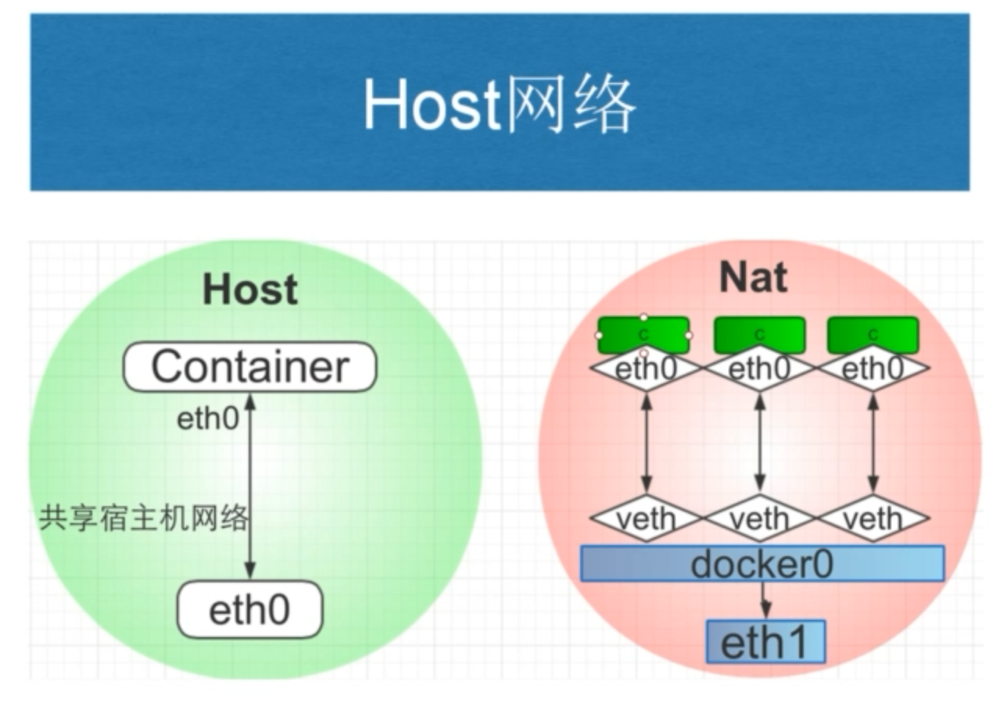

如果指定host模式启动的容器，那么新创建的容器不会创建自己的虚拟网卡，而是直接使用宿主机的网卡和IP地址，因此在容器里面查看到的IP信息就是宿主机的信息，访问容器的时候直接使用宿主机IP+容器端口即可，不过容器内除网络以外的其它资源，如:  文件系统、系统进程等仍然和宿主机保持隔离

此模式由于直接使用宿主机的网络无需转换，网络性能最高，但是各容器内使用的端口不能相同，适用于运行容器端口比较固定的业务

Host 网络模式特点:

使用参数 --network host 指定共享宿主机网络各容器网络无隔离网络性能无损耗网络故障排除相对简单容易产生端口冲突网络资源无法分别统计不支持端口映射

范例:

```bash
#查看宿主机的网络设置
[root@ubuntu1804 ~]#ifconfig
docker0: flags=4099<UP,BROADCAST,MULTICAST>  mtu 1500
inet 172.17.0.1  netmask 255.255.0.0  broadcast 172.17.255.255
inet6 fe80::42:2ff:fe7f:a8c6  prefixlen 64  scopeid 0x20<link>
ether 02:42:02:7f:a8:c6  txqueuelen 0  (Ethernet)
RX packets 63072  bytes 152573158 (152.5 MB)
RX errors 0  dropped 0  overruns 0  frame 0
TX packets 56611  bytes 310696704 (310.6 MB)
TX errors 0  dropped 0 overruns 0  carrier 0  collisions 0
eth0: flags=4163<UP,BROADCAST,RUNNING,MULTICAST>  mtu 1500
inet 10.0.0.100  netmask 255.255.255.0  broadcast 10.0.0.255
inet6 fe80::20c:29ff:fe34:df91  prefixlen 64  scopeid 0x20<link>
ether 00:0c:29:34:df:91  txqueuelen 1000  (Ethernet)
RX packets 2029082  bytes 1200597401 (1.2 GB)
RX errors 0  dropped 0  overruns 0  frame 0
TX packets 7272209  bytes 11576969391 (11.5 GB)
TX errors 0  dropped 0 overruns 0  carrier 0  collisions 0
lo: flags=73<UP,LOOPBACK,RUNNING>  mtu 65536
inet 127.0.0.1  netmask 255.0.0.0
inet6 ::1  prefixlen 128  scopeid 0x10<host>
loop  txqueuelen 1000  (Local Loopback)
RX packets 3533  bytes 320128 (320.1 KB)
RX errors 0  dropped 0  overruns 0  frame 0
TX packets 3533  bytes 320128 (320.1 KB)
TX errors 0  dropped 0 overruns 0  carrier 0  collisions 0
[root@ubuntu1804 ~]#route -n
Kernel IP routing table
Destination     Gateway         Genmask         Flags Metric Ref    Use Iface
0.0.0.0         10.0.0.2        0.0.0.0         UG    0      0        0 eth0
10.0.0.0        0.0.0.0         255.255.255.0   U     0      0        0 eth0
172.17.0.0      0.0.0.0         255.255.0.0     U     0      0        0 docker0
#打开容器前确认宿主机的80/tcp端口没有打开
[root@ubuntu1804 ~]#ss -ntl|grep :80
#创建host模式的容器
[root@ubuntu1804 ~]#docker run -d --network host --name web1 nginx-centos7-
base:1.6.1
41fb5b8e41db26e63579a424df643d1f02e272dc75e76c11f4e313a443187ed1
#创建容器后，宿主机的80/tcp端口打开
[root@ubuntu1804 ~]#ss -ntlp|grep :80
LISTEN   0         128                 0.0.0.0:80               0.0.0.0:*
users:(("nginx",pid=43762,fd=6),("nginx",pid=43737,fd=6))
#进入容器
[root@ubuntu1804 ~]#docker exec -it web1 bash
#进入容器后仍显示宿主机的主机名提示符信息
[root@ubuntu1804 /]# hostname
ubuntu1804.bowen.org
[root@ubuntu1804 /]# ifconfig
docker0: flags=4099<UP,BROADCAST,MULTICAST>  mtu 1500
inet 172.17.0.1  netmask 255.255.0.0  broadcast 172.17.255.255
inet6 fe80::42:2ff:fe7f:a8c6  prefixlen 64  scopeid 0x20<link>
ether 02:42:02:7f:a8:c6  txqueuelen 0  (Ethernet)
RX packets 63072  bytes 152573158 (145.5 MiB)
RX errors 0  dropped 0  overruns 0  frame 0
TX packets 56611  bytes 310696704 (296.3 MiB)
TX errors 0  dropped 0 overruns 0  carrier 0  collisions 0
eth0: flags=4163<UP,BROADCAST,RUNNING,MULTICAST>  mtu 1500
inet 10.0.0.100  netmask 255.255.255.0  broadcast 10.0.0.255
inet6 fe80::20c:29ff:fe34:df91  prefixlen 64  scopeid 0x20<link>
ether 00:0c:29:34:df:91  txqueuelen 1000  (Ethernet)
RX packets 2028984  bytes 1200589212 (1.1 GiB)
RX errors 0  dropped 0  overruns 0  frame 0
TX packets 7272137  bytes 11576960933 (10.7 GiB)
TX errors 0  dropped 0 overruns 0  carrier 0  collisions 0
lo: flags=73<UP,LOOPBACK,RUNNING>  mtu 65536
inet 127.0.0.1  netmask 255.0.0.0
inet6 ::1  prefixlen 128  scopeid 0x10<host>
loop  txqueuelen 1000  (Local Loopback)
RX packets 3533  bytes 320128 (312.6 KiB)
RX errors 0  dropped 0  overruns 0  frame 0
TX packets 3533  bytes 320128 (312.6 KiB)
TX errors 0  dropped 0 overruns 0  carrier 0  collisions 0
[root@ubuntu1804 /]# route -n
Kernel IP routing table
Destination     Gateway         Genmask         Flags Metric Ref    Use Iface
0.0.0.0         10.0.0.2        0.0.0.0         UG    0      0        0 eth0
10.0.0.0        0.0.0.0         255.255.255.0   U     0      0        0 eth0
172.17.0.0      0.0.0.0         255.255.0.0     U     0      0        0 docker0
#从容器访问远程主机
[root@ubuntu1804 /]# curl 10.0.0.7
Website on 10.0.0.7
```

```bash
#查看远程主机的访问日志
[root@centos7 ~]#tail -n1 /var/log/httpd/access_log
10.0.0.100 - - [01/Feb/2020:19:58:06 +0800] "GET / HTTP/1.1" 200 20 "-"
"curl/7.29.0"
#远程主机可以访问容器的web服务
[root@centos7 ~]#curl 10.0.0.100/app/
Test Page in app
```

范例:  host模式下端口映射无法实现

```bash
[root@ubuntu1804 ~]#ss -ntl|grep :81
[root@ubuntu1804 ~]#docker run -d --network host --name web2 -p 81:80  nginx-
centos7-base:1.6.1
WARNING: Published ports are discarded when using host network mode
6b6a910d79d94b188f719bc6ad00c274acd76a4a2929212157cd49b5219d44ae
#host模块下端口映射不成功，但是容器可以启动
[root@ubuntu1804 ~]#docker ps -a
CONTAINER ID        IMAGE                      COMMAND                  CREATED
STATUS                     PORTS               NAMES
6b6a910d79d9        nginx-centos7-base:1.6.1   "/apps/nginx/sbin/ng…"   6
seconds ago        Exited (1) 2 seconds ago                       web2
b27c0fd28b40        nginx-centos7-base:1.6.1   "/apps/nginx/sbin/ng…"   About a
minute ago   Up About a minute                              web1
```

范例:  对比前面host模式的容器和bridge模式的端口映射

```bash
[root@ubuntu1804 ~]#docker port web1
[root@ubuntu1804 ~]#docker port web2
[root@ubuntu1804 ~]#docker run -d --network bridge -p 8001:80 --name web3 nginx-
centos7-base:1.6.1
4095372b9a561704eac98ccef8041a80a2cdc2aa7b57d2798dec1a8dcb00c377
[root@ubuntu1804 ~]#docker port web3
80/tcp -> 0.0.0.0:8001
```

范例：wordpress 工作在host模式下使用--link 访问mysql失败

```text
docker run -d --name mysql -e MYSQL_ROOT_PASSWORD=123456 -e
MYSQL_DATABASE=wordpress -e MYSQL_USER=wordpress -e MYSQL_PASSWORD=123456
registry.cn-beijing.aliyuncs.com/bowenxiaochun/mysql:8.0.29-oracle
#在host 模式下不支持 --link
docker run -d  --net host --link mysql --name wordpress --restart=always
registry.cn-beijing.aliyuncs.com/bowenxiaochun/wordpress:php8.2-apache
#提示
docker: links are only supported for user-defined networks.
See 'docker run --help'.
```

范例：wordpress

```bash
[root@ubuntu2204 ~]#docker run --network host -e MYSQL_ROOT_PASSWORD=123456 -e
MYSQL_DATABASE=wordpress -e MYSQL_USER=wordpress -e MYSQL_PASSWORD=123456 --name
mysql -d  --restart=always registry.cn-
beijing.aliyuncs.com/bowenxiaochun/mysql:8.0.29-oracle
[root@ubuntu2204 ~]#docker run  -d --network host  --name wordpress --
restart=always  registry.cn-beijing.aliyuncs.com/bowenxiaochun/wordpress:php8.2-
apache
#注意：数据库服务器的地址为127.0.0.1或宿主机的IP,但不支持localhost
```

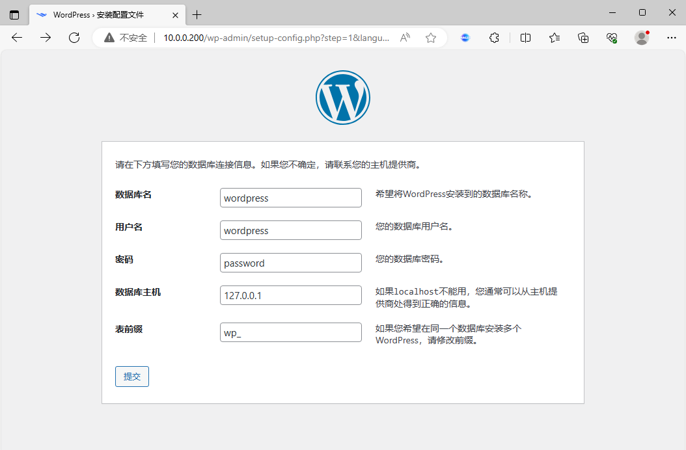

### None 模式

在使用 none 模式后，Docker 容器不会进行任何网络配置，没有网卡、没有IP也没有路由，因此默认无法与外界通信，需要手动添加网卡配置IP等，所以极少使用

none 模式特点

使用参数 --network none 指定默认无网络功能，无法和外部通信无法实现端口映射适用于测试环境

范例:  启动none模式的容器

```bash
[root@ubuntu1804 ~]#docker run -d --network none -p 8001:80 --name web1-none
nginx-centos7-base:1.6.1
5207dcbd0aeea88548819267d3751135e337035475cf3cd63a5e1be6599c0208
[root@ubuntu1804 ~]#docker ps
CONTAINER ID        IMAGE                      COMMAND                  CREATED
STATUS              PORTS               NAMES
5207dcbd0aee        nginx-centos7-base:1.6.1   "/apps/nginx/sbin/ng…"   About a
minute ago   Up About a minute                       web1-none
[root@ubuntu1804 ~]#docker port web1-none
[root@ubuntu1804 ~]#docker exec -it web1-none bash
[root@5207dcbd0aee /]# ifconfig -a
lo: flags=73<UP,LOOPBACK,RUNNING>  mtu 65536
inet 127.0.0.1  netmask 255.0.0.0
loop  txqueuelen 1000  (Local Loopback)
RX packets 0  bytes 0 (0.0 B)
RX errors 0  dropped 0  overruns 0  frame 0
TX packets 0  bytes 0 (0.0 B)
TX errors 0  dropped 0 overruns 0  carrier 0  collisions 0
[root@5207dcbd0aee /]# route -n
Kernel IP routing table
Destination     Gateway         Genmask         Flags Metric Ref    Use Iface
[root@5207dcbd0aee /]# netstat -ntl
Active Internet connections (only servers)
Proto Recv-Q Send-Q Local Address           Foreign Address         State
tcp        0      0 0.0.0.0:80              0.0.0.0:*               LISTEN
[root@5207dcbd0aee /]# ping www.baidu.com
ping: www.baidu.com: Name or service not known
[root@5207dcbd0aee /]# ping 172.17.0.1
connect: Network is unreachable
[root@5207dcbd0aee /]#
```

### Container 模式

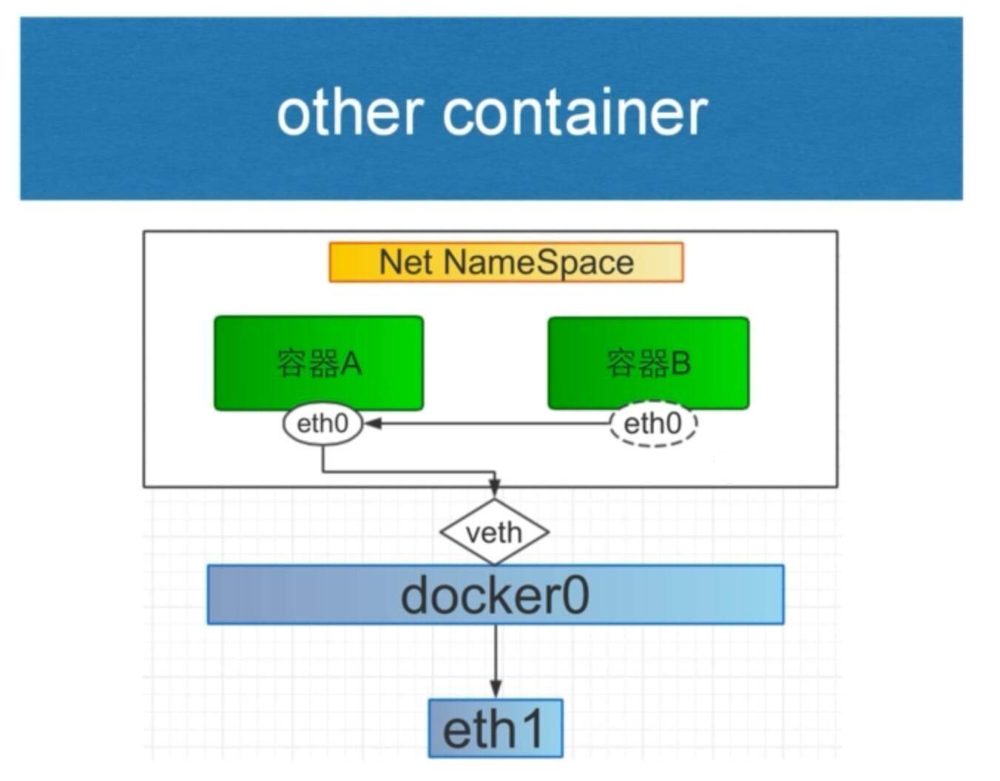

使用此模式创建的容器需指定和一个已经存在的容器共享一个网络，而不是和宿主机共享网络，新创建的容器不会创建自己的网卡也不会配置自己的IP，而是和一个被指定的已经存在的容器共享IP和端口范围，因此这个容器的端口不能和被指定容器的端口冲突，除了网络之外的文件系统、进程信息等仍然保持相互隔离，两个容器的进程可以通过lo网卡进行通信

Container 模式特点

使用参数 –-network container:名称或ID 指定与宿主机网络空间隔离空器间共享网络空间,直接使用对方的网络第一个容器的网络可能是bridge，或none，或者host，而第二个容器模式依赖于第一个容器，它们共享网络如果第一个容器停止，将导致无法创建第二个容器第二个容器可以直接使用127.0.0.1访问第一个容器适合频繁的容器间的网络通信默认不支持端口映射，较少使用

范例： 通过容器模式实现 wordpress

```bash
#方法1
#MySQL提前为wordpress暴露端口
[root@ubuntu2004 ~]#docker run -d  -p 80:80 --name wordpress -v
/data/wordpress:/var/www/html --restart=always registry.cn-
beijing.aliyuncs.com/bowenxiaochun/wordpress:php8.2-apache
[root@ubuntu2004 ~]#docker run --network container:wordpress -e
MYSQL_ROOT_PASSWORD=123456 -e MYSQL_DATABASE=wordpress -e MYSQL_USER=wordpress -e
MYSQL_PASSWORD=123456 --name mysql -d  -v /data/mysql:/var/lib/mysql --
restart=always registry.cn-beijing.aliyuncs.com/bowenxiaochun/mysql:8.0.29-oracle
#方法2
#MySQL提前为wordpress暴露端口
[root@ubuntu2004 ~]#docker run -d  -p 80:80 -e MYSQL_ROOT_PASSWORD=123456 -e
MYSQL_DATABASE=wordpress -e MYSQL_USER=wordpress -e MYSQL_PASSWORD=123456 --name
mysql  --restart=always registry.cn-
beijing.aliyuncs.com/bowenxiaochun/mysql:8.0.29-oracle
[root@ubuntu2004 ~]#docker run -d  --network container:mysql  --name wordpress -
-restart=always  registry.cn-beijing.aliyuncs.com/bowenxiaochun/wordpress:php8.2-
apache
#注意：数据库主机地址为127.0.0.1或wordpress容器的IP，不支持localhost
```

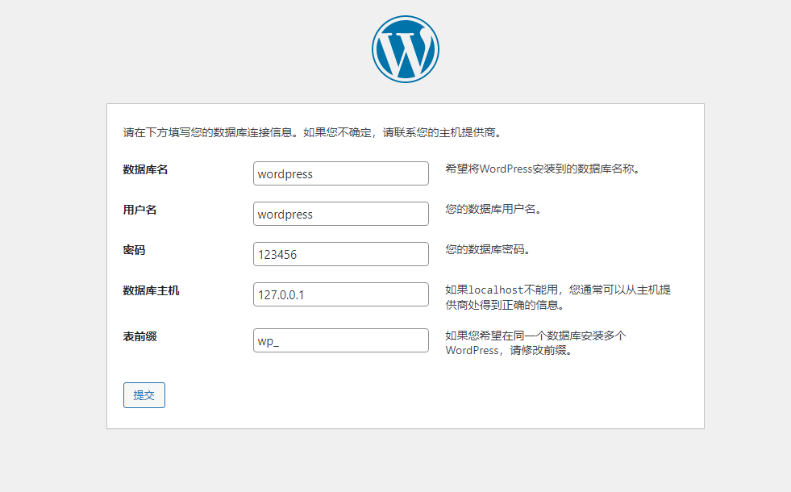

范例：实现LNMP的Wordpress

```bash
#准备配置文件
[root@ubuntu2204 ~]#cat /data/nginx/conf.d/www.bowen.org.conf
server {
listen 80;
server_name www.bowen.org;
root /var/www/html;
index index.php index.html index.htm;
client_max_body_size 100m;
location ~ \.php$ {
root           /var/www/html;
fastcgi_pass   127.0.0.1:9000;
fastcgi_index  index.php;
fastcgi_param  SCRIPT_FILENAME  $document_root$fastcgi_script_name;
include        fastcgi_params;
}
}
```

```bash
[root@ubuntu2204 ~]#docker run -d -p 80:80 --name wordpress -v
/data/www:/var/www/html -v /data/nginx/conf.d/:/apps/nginx/conf/conf.d/
bowenxiaochun/nginx:1.24.0-alpine-3.18.0
[root@ubuntu2204 ~]#docker run --name php-fpm --network container:wordpress -d -
v /data/www:/var/www/html wordpress:6.2.2-php8.0-fpm-alpine
[root@ubuntu2204 ~]#docker run --name mysql --network container:wordpress -e
MYSQL_ROOT_PASSWORD=123456 -e MYSQL_DATABASE=wordpress -e MYSQL_USER=wordpress -e
MYSQL_PASSWORD=123456  -d  -v /data/mysql:/var/lib/mysql --restart=always
registry.cn-beijing.aliyuncs.com/bowenxiaochun/mysql:8.0.29-oracle
#按下面浏览器访问初始化后，可以看到/data/www目录下自动生成文件
[root@ubuntu2204 ~]#ll -d /data/www/
drwxr-xr-x 5 82 82 4096  6月 17 21:20 /data/www//
[root@ubuntu2204 ~]#ll  /data/www/
总计 256
drwxr-xr-x  5   82   82  4096  6月 17 21:20 ./
drwxr-xr-x  7 root root  4096  6月 17 21:17 ../
-rw-r--r--  1   82   82   261  6月 15 16:15 .htaccess
-rw-r--r--  1   82   82   405  2月  6  2020 index.php
-rw-r--r--  1   82   82 19915  1月  1 08:06 license.txt
-rw-r--r--  1   82   82  7402  3月  5 08:52 readme.html
-rw-r--r--  1   82   82  7205  9月 17  2022 wp-activate.php
drwxr-xr-x  9   82   82  4096  5月 20 12:30 wp-admin/
-rw-r--r--  1   82   82   351  2月  6  2020 wp-blog-header.php
-rw-r--r--  1   82   82  2338 11月 10  2021 wp-comments-post.php
-rw-rw-r--  1   82   82  5492  6月 15 16:14 wp-config-docker.php
-rw-rw-rw-  1   82   82  3292  6月 17 21:20 wp-config.php
-rw-r--r--  1   82   82  3013  2月 23 18:38 wp-config-sample.php
drwxr-xr-x  7   82   82  4096  6月 17 21:22 wp-content/
-rw-r--r--  1   82   82  5536 11月 23  2022 wp-cron.php
drwxr-xr-x 28   82   82 16384  5月 20 12:30 wp-includes/
-rw-r--r--  1   82   82  2502 11月 27  2022 wp-links-opml.php
-rw-r--r--  1   82   82  3792  2月 23 18:38 wp-load.php
-rw-r--r--  1   82   82 49330  2月 23 18:38 wp-login.php
-rw-r--r--  1   82   82  8541  2月  3 21:35 wp-mail.php
-rw-r--r--  1   82   82 24993  3月  1 23:05 wp-settings.php
-rw-r--r--  1   82   82 34350  9月 17  2022 wp-signup.php
-rw-r--r--  1   82   82  4889 11月 23  2022 wp-trackback.php
-rw-r--r--  1   82   82  3238 11月 29  2022 xmlrpc.php
```

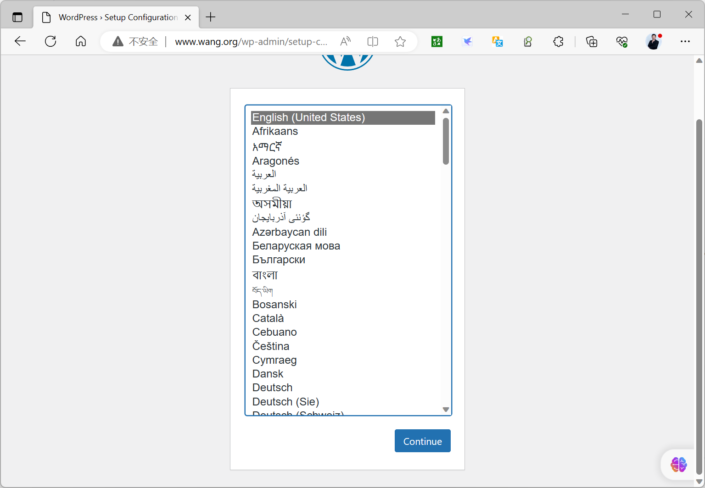

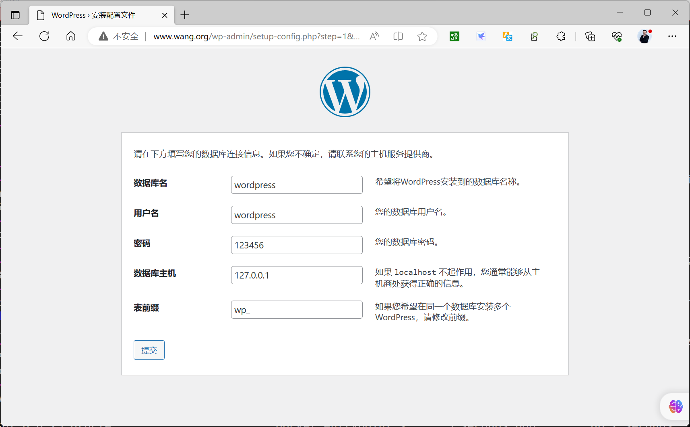

范例: 通过容器模式实现LNP架构

```bash
#准备nginx连接php-fpm的配置文件
[root@ubuntu2004 ~]#cat /data/nginx/conf.d/php.conf
server {
listen 80;
server_name www.bowen.org;
root /usr/share/nginx/html;
index index.php;
location ~ \.php$ {
root           /usr/share/nginx/html;
fastcgi_pass   127.0.0.1:9000;
fastcgi_index  index.php;
fastcgi_param  SCRIPT_FILENAME  $document_root$fastcgi_script_name;
include        fastcgi_params;
}
}
#准备php的测试页文件
[root@ubuntu2004 ~]#cat /data/nginx/html/index.php
<?php
phpinfo();
?>
#启动nginx
[root@ubuntu2004 ~]#docker run -d --name nginx -v
/data/nginx/conf.d/:/etc/nginx/conf.d/ -v /data/nginx/html:/usr/share/nginx/html
-p 80:80 bowenxiaochun/nginx:1.20.0
#启动php-fpm
[root@ubuntu2004 ~]#docker run -d --network container:nginx --name php-fpm -v
/data/nginx/html/:/usr/share/nginx/html php:8.1-fpm
#注意:php:8.1-fpm镜像缺少连接数据库的相关包,无法直接连接MySQL
```

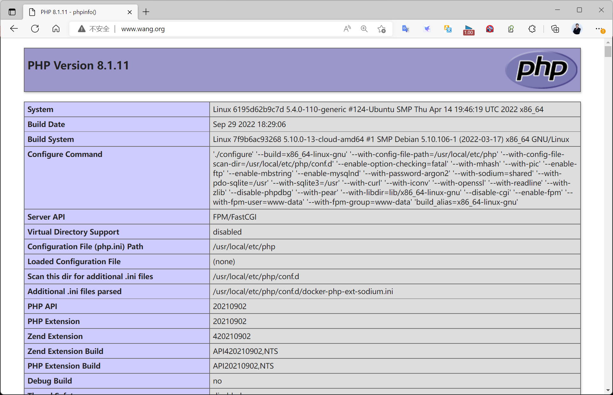

范例:

```bash
#创建第一个容器
[root@ubuntu1804 ~]#docker run -it --name server1 -p 80:80 alpine:3.11 sh
/ # ifconfig
eth0      Link encap:Ethernet  HWaddr 02:42:AC:11:00:02
inet addr:172.17.0.2  Bcast:172.17.255.255  Mask:255.255.0.0
UP BROADCAST RUNNING MULTICAST  MTU:1500  Metric:1
RX packets:9 errors:0 dropped:0 overruns:0 frame:0
TX packets:0 errors:0 dropped:0 overruns:0 carrier:0
collisions:0 txqueuelen:0
RX bytes:766 (766.0 B)  TX bytes:0 (0.0 B)
lo        Link encap:Local Loopback
inet addr:127.0.0.1  Mask:255.0.0.0
UP LOOPBACK RUNNING  MTU:65536  Metric:1
RX packets:0 errors:0 dropped:0 overruns:0 frame:0
TX packets:0 errors:0 dropped:0 overruns:0 carrier:0
collisions:0 txqueuelen:1000
RX bytes:0 (0.0 B)  TX bytes:0 (0.0 B)
/ # netstat -ntl
Active Internet connections (only servers)
Proto Recv-Q Send-Q Local Address           Foreign Address         State
/ #
```

```bash
#在另一个终端执行下面操作
[root@ubuntu1804 ~]#docker ps
CONTAINER ID        IMAGE               COMMAND             CREATED
STATUS              PORTS                NAMES
4d342fac169f        alpine:3.11         "sh"                29 seconds ago
Up 28 seconds       0.0.0.0:80->80/tcp   server1
[root@ubuntu1804 ~]#docker port server1
80/tcp -> 0.0.0.0:80
#无法访问web服务
[root@ubuntu1804 ~]#curl 127.0.0.1/app/
curl: (52) Empty reply from server
#创建第二个容器，基于第一个容器的container的网络模式
[root@ubuntu1804 ~]#docker run -d --name server2 --network container:server1
nginx-centos7-base:1.6.1
7db90f38590ade11e1c833a8b2175810c71b3f222753c5177bb8b05952f08a7b
#可以访问web服务
[root@ubuntu1804 ~]#curl 127.0.0.1/app/
Test Page in app
[root@ubuntu1804 ~]#docker exec -it server2 bash
#和第一个容器共享相同的网络
[root@4d342fac169f /]# ifconfig
eth0: flags=4163<UP,BROADCAST,RUNNING,MULTICAST>  mtu 1500
inet 172.17.0.2  netmask 255.255.0.0  broadcast 172.17.255.255
ether 02:42:ac:11:00:02  txqueuelen 0  (Ethernet)
RX packets 29  bytes 2231 (2.1 KiB)
RX errors 0  dropped 0  overruns 0  frame 0
TX packets 12  bytes 1366 (1.3 KiB)
TX errors 0  dropped 0 overruns 0  carrier 0  collisions 0
lo: flags=73<UP,LOOPBACK,RUNNING>  mtu 65536
inet 127.0.0.1  netmask 255.0.0.0
loop  txqueuelen 1000  (Local Loopback)
RX packets 10  bytes 860 (860.0 B)
RX errors 0  dropped 0  overruns 0  frame 0
TX packets 10  bytes 860 (860.0 B)
TX errors 0  dropped 0 overruns 0  carrier 0  collisions 0
[root@4d342fac169f /]# netstat -ntl
Active Internet connections (only servers)
Proto Recv-Q Send-Q Local Address           Foreign Address         State
tcp        0      0 0.0.0.0:80              0.0.0.0:*               LISTEN
#可访问外网
[root@4d342fac169f /]# ping www.baidu.com
PING www.a.shifen.com (61.135.169.121) 56(84) bytes of data.
64 bytes from 61.135.169.121 (61.135.169.121): icmp_seq=1 ttl=127 time=3.99 ms
64 bytes from 61.135.169.121 (61.135.169.121): icmp_seq=2 ttl=127 time=5.03 ms
^C
--- www.a.shifen.com ping statistics ---
2 packets transmitted, 2 received, 0% packet loss, time 1002ms
rtt min/avg/max/mdev = 3.999/4.514/5.030/0.519 ms
[root@4d342fac169f /]#
```

范例: 第一个容器使用host网络模式,第二个容器与之共享网络

```bash
[root@ubuntu1804 ~]#docker run -d --name c1  --network host  nginx-
centos7.8:v5.0-1.18.0
5a60804f3917d82dfe32db140411cf475f20acce0fe4674d94e4557e1003d8e0
[root@ubuntu1804 ~]#docker run -it  --name c2 --network container:c1
centos7.8:v1.0
[root@ubuntu1804 /]# ip a
1: lo: <LOOPBACK,UP,LOWER_UP> mtu 65536 qdisc noqueue state UNKNOWN group
default qlen 1000
link/loopback 00:00:00:00:00:00 brd 00:00:00:00:00:00
inet 127.0.0.1/8 scope host lo
valid_lft forever preferred_lft forever
inet6 ::1/128 scope host
valid_lft forever preferred_lft forever
2: eth0: <BROADCAST,MULTICAST,UP,LOWER_UP> mtu 1500 qdisc fq_codel state UP
group default qlen 1000
link/ether 00:0c:29:63:8b:ac brd ff:ff:ff:ff:ff:ff
inet 10.0.0.100/24 brd 10.0.0.255 scope global eth0
valid_lft forever preferred_lft forever
inet6 fe80::20c:29ff:fe63:8bac/64 scope link
valid_lft forever preferred_lft forever
3: docker0: <NO-CARRIER,BROADCAST,MULTICAST,UP> mtu 1500 qdisc noqueue state
DOWN group default
link/ether 02:42:24:86:98:fb brd ff:ff:ff:ff:ff:ff
inet 172.17.0.1/16 brd 172.17.255.255 scope global docker0
valid_lft forever preferred_lft forever
inet6 fe80::42:24ff:fe86:98fb/64 scope link
valid_lft forever preferred_lft forever
[root@ubuntu1804 ~]#docker exec -it c1 bash
[root@ubuntu1804 /]# ip a
1: lo: <LOOPBACK,UP,LOWER_UP> mtu 65536 qdisc noqueue state UNKNOWN group
default qlen 1000
link/loopback 00:00:00:00:00:00 brd 00:00:00:00:00:00
inet 127.0.0.1/8 scope host lo
valid_lft forever preferred_lft forever
inet6 ::1/128 scope host
valid_lft forever preferred_lft forever
2: eth0: <BROADCAST,MULTICAST,UP,LOWER_UP> mtu 1500 qdisc fq_codel state UP
group default qlen 1000
link/ether 00:0c:29:63:8b:ac brd ff:ff:ff:ff:ff:ff
inet 10.0.0.100/24 brd 10.0.0.255 scope global eth0
valid_lft forever preferred_lft forever
inet6 fe80::20c:29ff:fe63:8bac/64 scope link
valid_lft forever preferred_lft forever
3: docker0: <NO-CARRIER,BROADCAST,MULTICAST,UP> mtu 1500 qdisc noqueue state
DOWN group default
link/ether 02:42:24:86:98:fb brd ff:ff:ff:ff:ff:ff
inet 172.17.0.1/16 brd 172.17.255.255 scope global docker0
valid_lft forever preferred_lft forever
inet6 fe80::42:24ff:fe86:98fb/64 scope link
valid_lft forever preferred_lft forever
[root@ubuntu1804 /]#
```

范例:第一个容器使用none网络模式,第二个容器与之共享网络

```bash
[root@ubuntu1804 ~]#docker run -d --name c1  --network none  nginx-
centos7.8:v5.0-1.18.0
caf5b57299c8359f21f30b8894c5f8496ff39b44ead6a732056000689cb0c91c
[root@ubuntu1804 ~]#docker run -it  --name c2 --network container:c1
centos7.8:v1.0
[root@caf5b57299c8 /]# ip a
1: lo: <LOOPBACK,UP,LOWER_UP> mtu 65536 qdisc noqueue state UNKNOWN group
default qlen 1000
link/loopback 00:00:00:00:00:00 brd 00:00:00:00:00:00
inet 127.0.0.1/8 scope host lo
valid_lft forever preferred_lft forever
[root@caf5b57299c8 /]#
```

### 自定义网络模式

除了以上的网络模式，也可以自定义网络，使用自定义的网段地址，网关等信息

可以使用自定义网络模式,实现不同集群应用的独立网络管理,而互不影响,而且在网一个网络内,可以直接利用容器名相互访问，非常便利

注意: 自定义网络内的容器可以直接通过容器名进行相互的访问,而无需使用 --link

### 自定义网络实现

```bash
[root@ubuntu1804 ~]#docker network  --help
Usage:  docker network COMMAND
Manage networks
Commands:
connect     Connect a container to a network
create      Create a network
disconnect  Disconnect a container from a network
inspect     Display detailed information on one or more networks
ls          List networks
prune       Remove all unused networks
rm          Remove one or more networks
```

创建自定义网络:

```text
#man docker-network-create
docker network create -d <mode> --subnet <CIDR> --gateway <网关> <自定义网络名称>
#注意mode不支持host和none,默认是bridge模式
-d <mode> 可省略，默认为bridge,支持bridge,overlay，macvlan等driver模式
```

查看自定义网络信息

```text
docker network inspect <自定义网络名称或网络ID>
```

引用自定义网络

```text
docker run --network  <自定义网络名称> <镜像名称>
docker run --net  <自定义网络名称> --ip <指定静态IP> <镜像名称>
#注意：静态IP只支持自定义网络模型
#指定自定义网络中的容器的别名
docker run --network  <自定义网络名称> --network-alias list  <镜像名称>
```

删除自定义网络

```text
doccker network rm <自定义网络名称或网络ID>
```

范例：内置的三个网络无法删除

```bash
[root@ubuntu1804 ~]#docker network rm test-net
test-net
[root@ubuntu1804 ~]#docker network rm none
Error response from daemon: none is a pre-defined network and cannot be removed
[root@ubuntu1804 ~]#docker network rm bridge
Error response from daemon: bridge is a pre-defined network and cannot be
removed
[root@ubuntu1804 ~]#docker network rm host
Error response from daemon: host is a pre-defined network and cannot be removed
```

### 实战案例: 自定义网络

4.3.7.2.1 创建自定义的网络

```json
[root@ubuntu1804 ~]#docker  network create -d bridge --subnet 172.27.0.0/16 --
gateway 172.27.0.1 test-net
c90dee3b7937e007ed31a8d016a9e54c0174d0d26487b154db0aff04d9016d5b
[root@ubuntu1804 ~]#docker network ls
NETWORK ID          NAME                DRIVER              SCOPE
cabde0b33c94        bridge              bridge              local
cb64aa83626c        host                host                local
10619d45dcd4        none                null                local
c90dee3b7937        test-net            bridge              local
[root@ubuntu1804 ~]#docker inspect test-net
[
{
"Name": "test-net",
"Id":
"00ab0f2d29e82d387755e1bea19532dc279fa134a565e496d308ec62f7edf434",
"Created": "2020-07-22T09:59:09.431393706+08:00",
"Scope": "local",
"Driver": "bridge",
"EnableIPv6": false,
"IPAM": {
"Driver": "default",
"Options": {},
"Config": [
{
"Subnet": "172.27.0.0/16",
"Gateway": "172.27.0.1"
}
]
},
"Internal": false,
"Attachable": false,
"Ingress": false,
"ConfigFrom": {
"Network": ""
},
"ConfigOnly": false,
"Containers": {},
"Options": {},
"Labels": {}
}
]
[root@ubuntu1804 ~]#ip a
1: lo: <LOOPBACK,UP,LOWER_UP> mtu 65536 qdisc noqueue state UNKNOWN group
default qlen 1000
link/loopback 00:00:00:00:00:00 brd 00:00:00:00:00:00
inet 127.0.0.1/8 scope host lo
valid_lft forever preferred_lft forever
inet6 ::1/128 scope host
valid_lft forever preferred_lft forever
2: eth0: <BROADCAST,MULTICAST,UP,LOWER_UP> mtu 1500 qdisc fq_codel state UP
group default qlen 1000
link/ether 00:0c:29:34:df:91 brd ff:ff:ff:ff:ff:ff
inet 10.0.0.100/24 brd 10.0.0.255 scope global eth0
valid_lft forever preferred_lft forever
inet6 fe80::20c:29ff:fe34:df91/64 scope link
valid_lft forever preferred_lft forever
3: docker0: <NO-CARRIER,BROADCAST,MULTICAST,UP> mtu 1500 qdisc noqueue state
DOWN group default
link/ether 02:42:9b:31:73:2b brd ff:ff:ff:ff:ff:ff
inet 172.17.0.1/16 brd 172.17.255.255 scope global docker0
valid_lft forever preferred_lft forever
inet6 fe80::42:9bff:fe31:732b/64 scope link
valid_lft forever preferred_lft forever
#新添加了一个虚拟网卡
14: br-c90dee3b7937: <NO-CARRIER,BROADCAST,MULTICAST,UP> mtu 1500 qdisc noqueue
state DOWN group default
link/ether 02:42:58:7c:f0:93 brd ff:ff:ff:ff:ff:ff
inet 172.27.0.1/16 brd 172.27.255.255 scope global br-c90dee3b7937
valid_lft forever preferred_lft forever
inet6 fe80::42:58ff:fe7c:f093/64 scope link
valid_lft forever preferred_lft forever
#新加了一个网桥
[root@ubuntu1804 ~]#brctl show
bridge name bridge id       STP enabled interfaces
br-00ab0f2d29e8     8000.024245e647ec   no
docker0     8000.0242cfd26f0a   no
[root@ubuntu1804 ~]#route -n
Kernel IP routing table
Destination     Gateway         Genmask         Flags Metric Ref    Use Iface
0.0.0.0         10.0.0.2        0.0.0.0         UG    0      0        0 eth0
10.0.0.0        0.0.0.0         255.255.255.0   U     0      0        0 eth0
172.17.0.0      0.0.0.0         255.255.0.0     U     0      0        0 docker0
172.27.0.0      0.0.0.0         255.255.0.0     U     0      0        0 br-
c90dee3b7937
```

4.3.7.2.2 利用自定义的网络创建容器

```bash
[root@ubuntu1804 ~]#docker run -it --rm --network test-net alpine sh
/ # ip a
1: lo: <LOOPBACK,UP,LOWER_UP> mtu 65536 qdisc noqueue state UNKNOWN qlen 1000
link/loopback 00:00:00:00:00:00 brd 00:00:00:00:00:00
inet 127.0.0.1/8 scope host lo
valid_lft forever preferred_lft forever
15: eth0@if16: <BROADCAST,MULTICAST,UP,LOWER_UP,M-DOWN> mtu 1500 qdisc noqueue
state UP
link/ether 02:42:ac:1b:00:02 brd ff:ff:ff:ff:ff:ff
inet 172.27.0.2/16 brd 172.27.255.255 scope global eth0
valid_lft forever preferred_lft forever
/ # / # route -n
Kernel IP routing table
Destination     Gateway         Genmask         Flags Metric Ref    Use Iface
0.0.0.0         172.27.0.1      0.0.0.0         UG    0      0        0 eth0
172.27.0.0      0.0.0.0         255.255.0.0     U     0      0        0 eth0
/ # cat /etc/resolv.conf
search bowen.com bowen.org
nameserver 127.0.0.11
options ndots:0
/ # ping -c1 www.baidu.com
PING www.baidu.com (111.206.223.172): 56 data bytes
64 bytes from 111.206.223.172: seq=0 ttl=127 time=5.053 ms
```

```json
#再开一个新终端窗口查看网络
[root@ubuntu1804 ~]#docker inspect test-net
[
{
"Name": "test-net",
"Id":
"00ab0f2d29e82d387755e1bea19532dc279fa134a565e496d308ec62f7edf434",
"Created": "2020-07-22T09:59:09.431393706+08:00",
"Scope": "local",
"Driver": "bridge",
"EnableIPv6": false,
"IPAM": {
"Driver": "default",
"Options": {},
"Config": [
{
"Subnet": "172.27.0.0/16",
"Gateway": "172.27.0.1"
}
]
},
"Internal": false,
"Attachable": false,
"Ingress": false,
"ConfigFrom": {
"Network": ""
},
"ConfigOnly": false,
#出现此网络中容器的网络信息
"Containers": {
"89e54ed71c111ac7b41a62ce20191707cf53a3a234ba3e25ac11c1a4a6bed7ef":
{
"Name": "frosty_ellis",
"EndpointID":
"cf72bf192df73a8b290d8b18dd8507fef64a1f9480d4d65f74c23258d20dbafb",
"MacAddress": "02:42:ac:1b:00:02",
"IPv4Address": "172.27.0.2/16",
"IPv6Address": ""
}
},
"Options": {},
"Labels": {}
}
]
```

### 实战案例: 自定义网络中的容器之间通信

```bash
[root@ubuntu1804 ~]#docker network ls
NETWORK ID          NAME                DRIVER              SCOPE
c2f770f19400        bridge              bridge              local
220d4008a6a0        host                host                local
adb6f338ff6d        none                null                local
00ab0f2d29e8        test-net            bridge              local
[root@ubuntu1804 ~]#docker run -it --rm --network test-net --name test1  alpine
sh
/ # ip a
1: lo: <LOOPBACK,UP,LOWER_UP> mtu 65536 qdisc noqueue state UNKNOWN qlen 1000
link/loopback 00:00:00:00:00:00 brd 00:00:00:00:00:00
inet 127.0.0.1/8 scope host lo
valid_lft forever preferred_lft forever
23: eth0@if24: <BROADCAST,MULTICAST,UP,LOWER_UP,M-DOWN> mtu 1500 qdisc noqueue
state UP
link/ether 02:42:ac:1b:00:02 brd ff:ff:ff:ff:ff:ff
inet 172.27.0.2/16 brd 172.27.255.255 scope global eth0
valid_lft forever preferred_lft forever
/ # cat /etc/hosts
127.0.0.1   localhost
::1 localhost ip6-localhost ip6-loopback
fe00::0 ip6-localnet
ff00::0 ip6-mcastprefix
ff02::1 ip6-allnodes
ff02::2 ip6-allrouters
172.27.0.2  c3446876a38b
#等后面步骤中容器test2创建好可以再访问
/ # ping -c1 test2
PING test2 (172.27.0.3): 56 data bytes
64 bytes from 172.27.0.3: seq=0 ttl=64 time=0.072 ms
--- test2 ping statistics ---
1 packets transmitted, 1 packets received, 0% packet loss
round-trip min/avg/max = 0.072/0.072/0.072 ms
```

```bash
[root@ubuntu1804 ~]#docker run -it --rm --network test-net --name test2 alpine
/ # ip a
1: lo: <LOOPBACK,UP,LOWER_UP> mtu 65536 qdisc noqueue state UNKNOWN qlen 1000
link/loopback 00:00:00:00:00:00 brd 00:00:00:00:00:00
inet 127.0.0.1/8 scope host lo
valid_lft forever preferred_lft forever
25: eth0@if26: <BROADCAST,MULTICAST,UP,LOWER_UP,M-DOWN> mtu 1500 qdisc noqueue
state UP
link/ether 02:42:ac:1b:00:03 brd ff:ff:ff:ff:ff:ff
inet 172.27.0.3/16 brd 172.27.255.255 scope global eth0
valid_lft forever preferred_lft forever
/ # cat /etc/hosts
127.0.0.1   localhost
::1 localhost ip6-localhost ip6-loopback
fe00::0 ip6-localnet
ff00::0 ip6-mcastprefix
ff02::1 ip6-allnodes
ff02::2 ip6-allrouters
172.27.0.3  305fd14a4b70
/ # ping -c1 test1
PING test1 (172.27.0.2): 56 data bytes
64 bytes from 172.27.0.2: seq=0 ttl=64 time=0.074 ms
--- test1 ping statistics ---
1 packets transmitted, 1 packets received, 0% packet loss
round-trip min/avg/max = 0.074/0.074/0.074 ms
```

结论: 自定义网络中的容器之间可以直接利用容器名进行通信

### 实战案例: 利用自定义网络实现 Wordpress (练习)

范例：

```text
docker  network create -d bridge --subnet 172.37.0.0/16 --gateway 172.37.0.100
wordpress-net
docker run -d  -p 80:80 --network wordpress-net --name wordpress --
restart=always  registry.cn-beijing.aliyuncs.com/bowenxiaochun/wordpress:php8.2-
apache
docker run --network wordpress-net -e MYSQL_ROOT_PASSWORD=123456 -e
MYSQL_DATABASE=wordpress -e MYSQL_USER=wordpress -e MYSQL_PASSWORD=123456 --name
mysql -d   --restart=always registry.cn-
beijing.aliyuncs.com/bowenxiaochun/mysql:8.0.29-oracle
```

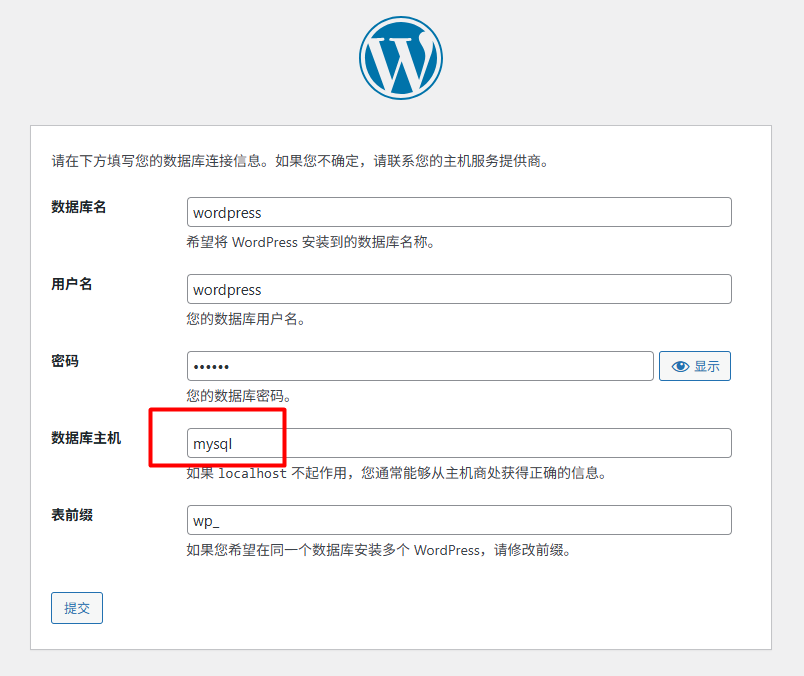

范例

```bash
[root@ubuntu2004 ~]#docker  network create -d bridge --subnet 172.27.0.0/16 --
gateway 172.27.0.1 bridge2
[root@ubuntu2004 ~]#docker run -d  -p 8080:80 --network bridge2 --name
wordpress2 -v /data/wordpress2:/var/www/html --restart=always  registry.cn-
beijing.aliyuncs.com/bowenxiaochun/wordpress:php8.2-apache
[root@ubuntu2004 ~]#docker run --network bridge2 -e MYSQL_ROOT_PASSWORD=123456 -
e MYSQL_DATABASE=wordpress -e MYSQL_USER=wordpress -e MYSQL_PASSWORD=123456 --
name mysql2 -d  -v /data/mysql2:/var/lib/mysql --restart=always mysql:8.0.29-
oracle
#wordpress连接数据库时，数据库主机是容器的名称mysql2
```

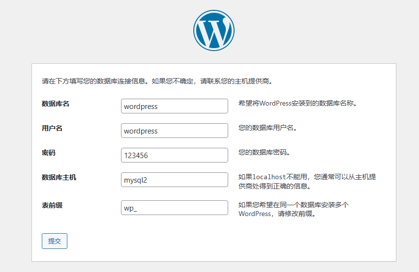

### 实战案例: 利用自定义网络实现 Redis Cluster


4.3.7.5.1 创建自定义网络

```json
[root@ubuntu1804 ~]#docker network create net-redis --subnet 172.18.0.0/16
09b9dded99787835dccc029e16fa2782292d22c3e258f60a1db15d44e7a3bd93
[root@ubuntu1804 ~]#docker inspect net-redis
[
{
"Name": "net-redis",
"Id":
"09b9dded99787835dccc029e16fa2782292d22c3e258f60a1db15d44e7a3bd93",
"Created": "2020-07-22T14:16:43.295465692+08:00",
"Scope": "local",
"Driver": "bridge",
"EnableIPv6": false,
"IPAM": {
"Driver": "default",
"Options": {},
"Config": [
{
"Subnet": "172.18.0.0/16"
}
]
},
"Internal": false,
"Attachable": false,
"Ingress": false,
"ConfigFrom": {
"Network": ""
},
"ConfigOnly": false,
"Containers": {},
"Options": {},
"Labels": {}
}
]
```

4.3.7.5.2 创建6个redis容器配置

```bash
# 通过脚本创建六个redis容器配置
[root@ubuntu1804 ~]#for port in {1..6};do
mkdir -p /data/redis/node-${port}/conf
cat  >> /data/redis/node-${port}/conf/redis.conf << EOF
port 6379
bind 0.0.0.0
masterauth 123456
requirepass 123456
cluster-enabled yes
cluster-config-file nodes.conf
cluster-node-timeout 5000
cluster-announce-ip 172.18.0.1${port}
cluster-announce-port 6379
cluster-announce-bus-port 16379
appendonly yes
EOF
done
[root@ubuntu1804 ~]#tree /data/redis/
/data/redis/
├── node-1
│   └── conf
│       └── redis.conf
├── node-2
│   └── conf
│       └── redis.conf
├── node-3
│   └── conf
│       └── redis.conf
├── node-4
│   └── conf
│       └── redis.conf
├── node-5
│   └── conf
│       └── redis.conf
└── node-6
└── conf
└── redis.conf
12 directories, 6 files
[root@ubuntu1804 ~]#cat /data/redis/node-1/conf/redis.conf
port 6379
bind 0.0.0.0
masterauth 123456
requirepass 123456
cluster-enabled yes
cluster-config-file nodes.conf
cluster-node-timeout 5000
cluster-announce-ip 172.18.0.11
cluster-announce-port 6379
cluster-announce-bus-port 16379
appendonly yes
```

4.3.7.5.3 创建6个 redis 容器

```bash
# 通过脚本运行六个redis容器
[root@ubuntu1804 ~]#for port in {1..6};do
docker run -p 637${port}:6379 -p 1667${port}:16379 --name redis-${port} \
-v /data/redis/node-${port}/data:/data \
-v /data/redis/node-${port}/conf/redis.conf:/etc/redis/redis.conf \
-d --net net-redis --ip 172.18.0.1${port} redis:5.0.9-alpine3.11 redis-
server /etc/redis/redis.conf
done
```

```bash
[root@ubuntu1804 ~]#docker ps
CONTAINER ID        IMAGE                    COMMAND                  CREATED
STATUS              PORTS
NAMES
2525235efae6        redis:5.0.9-alpine3.11   "docker-entrypoint.s…"   23 seconds
ago      Up 21 seconds       0.0.0.0:6376->6379/tcp, 0.0.0.0:16676->16379/tcp
redis-6
bd89dbb445ae        redis:5.0.9-alpine3.11   "docker-entrypoint.s…"   24 seconds
ago      Up 22 seconds       0.0.0.0:6375->6379/tcp, 0.0.0.0:16675->16379/tcp
redis-5
51cb6244d34d        redis:5.0.9-alpine3.11   "docker-entrypoint.s…"   26 seconds
ago      Up 23 seconds       0.0.0.0:6374->6379/tcp, 0.0.0.0:16674->16379/tcp
redis-4
1a49a47eb72d        redis:5.0.9-alpine3.11   "docker-entrypoint.s…"   27 seconds
ago      Up 25 seconds       0.0.0.0:6373->6379/tcp, 0.0.0.0:16673->16379/tcp
redis-3
a03e957680f0        redis:5.0.9-alpine3.11   "docker-entrypoint.s…"   28 seconds
ago      Up 26 seconds       0.0.0.0:6372->6379/tcp, 0.0.0.0:16672->16379/tcp
redis-2
b5332c0cba81        redis:5.0.9-alpine3.11   "docker-entrypoint.s…"   31 seconds
ago      Up 28 seconds       0.0.0.0:6371->6379/tcp, 0.0.0.0:16671->16379/tcp
redis-1
```

4.3.7.5.4 创建 redis cluster

```bash
#连接redis cluster
[root@ubuntu1804 ~]#docker exec -it redis-1 /bin/sh
/data # redis-cli -a 123456
Warning: Using a password with '-a' or '-u' option on the command line interface
may not be safe.
127.0.0.1:6379> exit
#不支持 { } 扩展
/data # echo {1..10}
{1..10}
/data # echo $-
smi
# 创建集群
/data # redis-cli -a 123456 --cluster create 172.18.0.11:6379 172.18.0.12:6379
172.18.0.13:6379 172.18.0.14:6379 172.18.0.15:6379 172.18.0.16:6379 --cluster-
replicas 1
Warning: Using a password with '-a' or '-u' option on the command line interface
may not be safe.
>>> Performing hash slots allocation on 6 nodes...
Master[0] -> Slots 0 - 5460
Master[1] -> Slots 5461 - 10922
Master[2] -> Slots 10923 - 16383
Adding replica 172.18.0.15:6379 to 172.18.0.11:6379
Adding replica 172.18.0.16:6379 to 172.18.0.12:6379
Adding replica 172.18.0.14:6379 to 172.18.0.13:6379
M: 0f9bd0d24495f826702a030703896f7690bebdee 172.18.0.11:6379
slots:[0-5460] (5461 slots) master
M: 9b6ab0b8f75516d6acd9d566d0d349f1fdd29540 172.18.0.12:6379
slots:[5461-10922] (5462 slots) master
M: 599f69b43a3579ec064b1854680c77997c809470 172.18.0.13:6379
slots:[10923-16383] (5461 slots) master
S: c64dfd1bd6c964a3c6425a28f6ab0f0e1bcea1ba 172.18.0.14:6379
replicates 599f69b43a3579ec064b1854680c77997c809470
S: 2f69287f52ec7243a0b894491814d2afe28a46d2 172.18.0.15:6379
replicates 0f9bd0d24495f826702a030703896f7690bebdee
S: 06295ce4884948858cf60243629a595afa461b21 172.18.0.16:6379
replicates 9b6ab0b8f75516d6acd9d566d0d349f1fdd29540
Can I set the above configuration? (type 'yes' to accept): #输入yes
>>> Nodes configuration updated
>>> Assign a different config epoch to each node
>>> Sending CLUSTER MEET messages to join the cluster
Waiting for the cluster to join
....
>>> Performing Cluster Check (using node 172.18.0.11:6379)
M: 0f9bd0d24495f826702a030703896f7690bebdee 172.18.0.11:6379
slots:[0-5460] (5461 slots) master
1 additional replica(s)
S: 2f69287f52ec7243a0b894491814d2afe28a46d2 172.18.0.15:6379
slots: (0 slots) slave
replicates 0f9bd0d24495f826702a030703896f7690bebdee
S: c64dfd1bd6c964a3c6425a28f6ab0f0e1bcea1ba 172.18.0.14:6379
slots: (0 slots) slave
replicates 599f69b43a3579ec064b1854680c77997c809470
M: 9b6ab0b8f75516d6acd9d566d0d349f1fdd29540 172.18.0.12:6379
slots:[5461-10922] (5462 slots) master
1 additional replica(s)
M: 599f69b43a3579ec064b1854680c77997c809470 172.18.0.13:6379
slots:[10923-16383] (5461 slots) master
1 additional replica(s)
S: 06295ce4884948858cf60243629a595afa461b21 172.18.0.16:6379
slots: (0 slots) slave
replicates 9b6ab0b8f75516d6acd9d566d0d349f1fdd29540
[OK] All nodes agree about slots configuration.
>>> Check for open slots...
>>> Check slots coverage...
[OK] All 16384 slots covered.
```

4.3.7.5.5 测试访问 redis cluster

```text
#连接redis cluster
/data # redis-cli  -a 123456 -c
Warning: Using a password with '-a' or '-u' option on the command line interface
may not be safe.
127.0.0.1:6379>  cluster info
cluster_state:ok
cluster_slots_assigned:16384
cluster_slots_ok:16384
cluster_slots_pfail:0
cluster_slots_fail:0
cluster_known_nodes:6
cluster_size:3
cluster_current_epoch:6
cluster_my_epoch:1
cluster_stats_messages_ping_sent:267
cluster_stats_messages_pong_sent:278
cluster_stats_messages_sent:545
cluster_stats_messages_ping_received:273
cluster_stats_messages_pong_received:267
cluster_stats_messages_meet_received:5
cluster_stats_messages_received:545
127.0.0.1:6379> cluster nodes
#看到172.18.0.{11,12,13}为master,172.18.0.{14,15,16}为slave
#以下为master/slave关系
#172.18.0.11<--->172.18.0.15
#172.18.0.12<--->172.18.0.16
#172.18.0.13<--->172.18.0.14
2f69287f52ec7243a0b894491814d2afe28a46d2 172.18.0.15:6379@16379 slave
0f9bd0d24495f826702a030703896f7690bebdee 0 1595404269581 5 connected
0f9bd0d24495f826702a030703896f7690bebdee 172.18.0.11:6379@16379 myself,master -
0 1595404269000 1 connected 0-5460
c64dfd1bd6c964a3c6425a28f6ab0f0e1bcea1ba 172.18.0.14:6379@16379 slave
599f69b43a3579ec064b1854680c77997c809470 0 1595404268000 4 connected
9b6ab0b8f75516d6acd9d566d0d349f1fdd29540 172.18.0.12:6379@16379 master - 0
1595404268976 2 connected 5461-10922
599f69b43a3579ec064b1854680c77997c809470 172.18.0.13:6379@16379 master - 0
1595404269481 3 connected 10923-16383
06295ce4884948858cf60243629a595afa461b21 172.18.0.16:6379@16379 slave
9b6ab0b8f75516d6acd9d566d0d349f1fdd29540 0 1595404268000 6 connected
#添加key到redis-2上
127.0.0.1:6379> set name bowen
-> Redirected to slot [5798] located at 172.18.0.12:6379
OK
#添加key到redis-1上
172.18.0.12:6379> set title cto
-> Redirected to slot [2217] located at 172.18.0.11:6379
OK
172.18.0.11:6379> get name
-> Redirected to slot [5798] located at 172.18.0.12:6379
"bowen"
172.18.0.12:6379> get title
-> Redirected to slot [2217] located at 172.18.0.11:6379
"cto"
```

4.3.7.5.6 测试故障实现 redis cluster 高可用性

```bash
#模拟redis-2故障
[root@ubuntu1804 ~]#docker stop  redis-2
redis-2
#再次查看cluster状态,可以看到redis-2出错
[root@ubuntu1804 ~]#docker exec -it redis-1 /bin/sh
/data # redis-cli -a 123456 --cluster check 127.0.0.1:6379
Warning: Using a password with '-a' or '-u' option on the command line interface
may not be safe.
Could not connect to Redis at 172.18.0.12:6379: Host is unreachable
#查看到 172.18.0.16提升为新的master
172.18.0.16:6379 (06295ce4...) -> 1 keys | 5462 slots | 0 slaves.
172.18.0.13:6379 (599f69b4...) -> 0 keys | 5461 slots | 1 slaves.
172.18.0.15:6379 (2f69287f...) -> 1 keys | 5461 slots | 1 slaves.
[OK] 2 keys in 3 masters.
0.00 keys per slot on average.
>>> Performing Cluster Check (using node 127.0.0.1:6379)
S: 0f9bd0d24495f826702a030703896f7690bebdee 127.0.0.1:6379
slots: (0 slots) slave
replicates 2f69287f52ec7243a0b894491814d2afe28a46d2
M: 06295ce4884948858cf60243629a595afa461b21 172.18.0.16:6379
slots:[5461-10922] (5462 slots) master
M: 599f69b43a3579ec064b1854680c77997c809470 172.18.0.13:6379
slots:[10923-16383] (5461 slots) master
1 additional replica(s)
M: 2f69287f52ec7243a0b894491814d2afe28a46d2 172.18.0.15:6379
slots:[0-5460] (5461 slots) master
1 additional replica(s)
S: c64dfd1bd6c964a3c6425a28f6ab0f0e1bcea1ba 172.18.0.14:6379
slots: (0 slots) slave
replicates 599f69b43a3579ec064b1854680c77997c809470
[OK] All nodes agree about slots configuration.
>>> Check for open slots...
>>> Check slots coverage...
[OK] All 16384 slots covered.
```

```text
/data # redis-cli  -a 123456 -c
Warning: Using a password with '-a' or '-u' option on the command line interface
may not be safe.
127.0.0.1:6379>  cluster nodes
06295ce4884948858cf60243629a595afa461b21 172.18.0.16:6379@16379 master - 0
1595406573128 8 connected 5461-10922
599f69b43a3579ec064b1854680c77997c809470 172.18.0.13:6379@16379 master - 0
1595406572623 3 connected 10923-16383
0f9bd0d24495f826702a030703896f7690bebdee 172.18.0.11:6379@16379 myself,slave
2f69287f52ec7243a0b894491814d2afe28a46d2 0 1595406571000 1 connected
2f69287f52ec7243a0b894491814d2afe28a46d2 172.18.0.15:6379@16379 master - 0
1595406571614 7 connected 0-5460
9b6ab0b8f75516d6acd9d566d0d349f1fdd29540 172.18.0.12:6379@16379 master,fail -
1595404533839 1595404532528 2 connected
c64dfd1bd6c964a3c6425a28f6ab0f0e1bcea1ba 172.18.0.14:6379@16379 slave
599f69b43a3579ec064b1854680c77997c809470 0 1595406572118 4 connected
127.0.0.1:6379> get name
-> Redirected to slot [5798] located at 172.18.0.16:6379
"bowen"
172.18.0.16:6379> get title
-> Redirected to slot [2217] located at 172.18.0.15:6379
"cto"
```

### 自定义网络中容器别名

<https://www.jenkins.io/doc/book/installing/docker/>

范例

```text
docker network create jenkins
docker run \
--name jenkins-docker \
--rm \
--detach \
--privileged \
--network jenkins \
--network-alias docker \
--env DOCKER_TLS_CERTDIR=/certs \
--volume jenkins-docker-certs:/certs/client \
--volume jenkins-data:/var/jenkins_home \
--publish 2376:2376 \
docker:dind \
--storage-driver overlay2
```

```text
docker run \
--name jenkins-blueocean \
--restart=on-failure \
--detach \
--network jenkins \
--env DOCKER_HOST=tcp://docker:2376 \
--env DOCKER_CERT_PATH=/certs/client \
--env DOCKER_TLS_VERIFY=1 \
--publish 8080:8080 \
--publish 50000:50000 \
--volume jenkins-data:/var/jenkins_home \
--volume jenkins-docker-certs:/certs/client:ro \
myjenkins-blueocean:2.426.2-1
```

### 同一个宿主机之间不同网络的容器通信

开两个容器，一个使用自定义网络容器，一个使用默认brideg网络的容器,默认因iptables规则导致无法通信

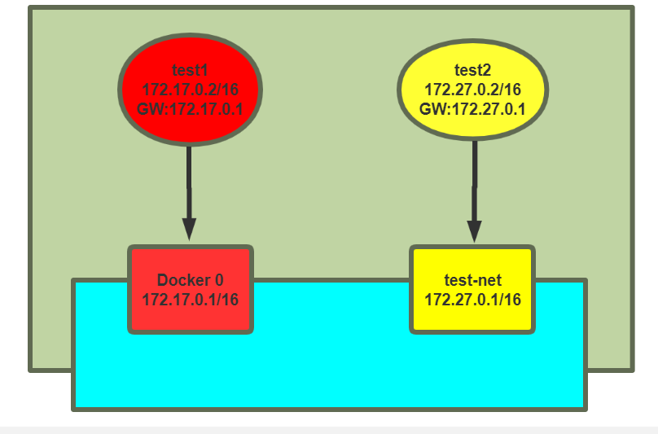

```bash
[root@ubuntu1804 ~]#docker run -it --rm  --name test1 alpine sh
/ # ip a
1: lo: <LOOPBACK,UP,LOWER_UP> mtu 65536 qdisc noqueue state UNKNOWN qlen 1000
link/loopback 00:00:00:00:00:00 brd 00:00:00:00:00:00
inet 127.0.0.1/8 scope host lo
valid_lft forever preferred_lft forever
23: eth0@if24: <BROADCAST,MULTICAST,UP,LOWER_UP,M-DOWN> mtu 1500 qdisc noqueue
state UP
link/ether 02:42:ac:11:00:02 brd ff:ff:ff:ff:ff:ff
inet 172.17.0.2/16 brd 172.17.255.255 scope global eth0
valid_lft forever preferred_lft forever
/ # ping 172.27.0.2    #无法ping通自定义网络容器
PING 172.27.0.2 (172.27.0.2): 56 data bytes
[root@ubuntu1804 ~]#docker run -it --rm --network test-net --name test2 alpine
sh
/ # ip a
1: lo: <LOOPBACK,UP,LOWER_UP> mtu 65536 qdisc noqueue state UNKNOWN qlen 1000
link/loopback 00:00:00:00:00:00 brd 00:00:00:00:00:00
inet 127.0.0.1/8 scope host lo
valid_lft forever preferred_lft forever
21: eth0@if22: <BROADCAST,MULTICAST,UP,LOWER_UP,M-DOWN> mtu 1500 qdisc noqueue
state UP
link/ether 02:42:ac:1b:00:02 brd ff:ff:ff:ff:ff:ff
inet 172.27.0.2/16 brd 172.27.255.255 scope global eth0
valid_lft forever preferred_lft forever
/ # ping 172.17.0.2    #无法ping 通默认的网络容器
PING 172.27.0.2 (172.17.0.2): 56 data bytes
```

### 实战案例 1: 修改iptables实现同一宿主机上的不同网络的容器间通信

```bash
#确认开启ip_forward
[root@ubuntu1804 ~]#cat /proc/sys/net/ipv4/ip_forward
1
#默认网络和自定义网络是两个不同的网桥
[root@ubuntu1804 ~]#brctl  show
bridge name bridge id       STP enabled interfaces
br-c90dee3b7937     8000.0242587cf093   no      veth984a5b4
docker0     8000.02429b31732b   no      veth1a20128
[root@ubuntu1804 ~]#iptables -vnL
Chain INPUT (policy ACCEPT 1241 packets, 87490 bytes)
pkts bytes target     prot opt in     out     source               destination
```

```text
Chain FORWARD (policy DROP 0 packets, 0 bytes)
pkts bytes target     prot opt in     out     source               destination
859 72156 DOCKER-USER  all  --  *      *       0.0.0.0/0            0.0.0.0/0
859 72156 DOCKER-ISOLATION-STAGE-1  all  --  *      *       0.0.0.0/0
0.0.0.0/0
0     0 ACCEPT     all  --  *      br-c90dee3b7937  0.0.0.0/0
0.0.0.0/0            ctstate RELATED,ESTABLISHED
0     0 DOCKER     all  --  *      br-c90dee3b7937  0.0.0.0/0
0.0.0.0/0
0     0 ACCEPT     all  --  br-c90dee3b7937 !br-c90dee3b7937  0.0.0.0/0
0.0.0.0/0
0     0 ACCEPT     all  --  br-c90dee3b7937 br-c90dee3b7937  0.0.0.0/0
0.0.0.0/0
0     0 ACCEPT     all  --  *      docker0  0.0.0.0/0            0.0.0.0/0
ctstate RELATED,ESTABLISHED
0     0 DOCKER     all  --  *      docker0  0.0.0.0/0            0.0.0.0/0
0     0 ACCEPT     all  --  docker0 !docker0  0.0.0.0/0            0.0.0.0/0
0     0 ACCEPT     all  --  docker0 docker0  0.0.0.0/0            0.0.0.0/0
```

```text
Chain OUTPUT (policy ACCEPT 1456 packets, 209K bytes)
pkts bytes target     prot opt in     out     source               destination
```

```text
Chain DOCKER (2 references)
pkts bytes target     prot opt in     out     source               destination
Chain DOCKER-ISOLATION-STAGE-1 (1 references)
pkts bytes target     prot opt in     out     source               destination
289 24276 DOCKER-ISOLATION-STAGE-2  all  --  br-c90dee3b7937 !br-c90dee3b7937
0.0.0.0/0            0.0.0.0/0
570 47880 DOCKER-ISOLATION-STAGE-2  all  --  docker0 !docker0  0.0.0.0/0
0.0.0.0/0
0     0 RETURN     all  --  *      *       0.0.0.0/0            0.0.0.0/0
```

```text
Chain DOCKER-ISOLATION-STAGE-2 (2 references)
pkts bytes target     prot opt in     out     source               destination
570 47880 DROP       all  --  *      br-c90dee3b7937  0.0.0.0/0
0.0.0.0/0
289 24276 DROP       all  --  *      docker0  0.0.0.0/0            0.0.0.0/0
0     0 RETURN     all  --  *      *       0.0.0.0/0            0.0.0.0/0
```

```bash
Chain DOCKER-USER (1 references)
pkts bytes target     prot opt in     out     source               destination
859 72156 RETURN     all  --  *      *       0.0.0.0/0            0.0.0.0/0
[root@ubuntu1804 ~]#
[root@ubuntu1804 ~]#iptables-save
# Generated by iptables-save v1.6.1 on Sun Feb  2 14:33:19 2020
*filter
:INPUT ACCEPT [1283:90246]
:FORWARD DROP [0:0]
:OUTPUT ACCEPT [1489:217126]
:DOCKER - [0:0]
:DOCKER-ISOLATION-STAGE-1 - [0:0]
:DOCKER-ISOLATION-STAGE-2 - [0:0]
:DOCKER-USER - [0:0]
-A FORWARD -j DOCKER-USER
-A FORWARD -j DOCKER-ISOLATION-STAGE-1
-A FORWARD -o br-c90dee3b7937 -m conntrack --ctstate RELATED,ESTABLISHED -j
ACCEPT
-A FORWARD -o br-c90dee3b7937 -j DOCKER
-A FORWARD -i br-c90dee3b7937 ! -o br-c90dee3b7937 -j ACCEPT
-A FORWARD -i br-c90dee3b7937 -o br-c90dee3b7937 -j ACCEPT
-A FORWARD -o docker0 -m conntrack --ctstate RELATED,ESTABLISHED -j ACCEPT
-A FORWARD -o docker0 -j DOCKER
-A FORWARD -i docker0 ! -o docker0 -j ACCEPT
-A FORWARD -i docker0 -o docker0 -j ACCEPT
-A DOCKER-ISOLATION-STAGE-1 -i br-c90dee3b7937 ! -o br-c90dee3b7937 -j DOCKER-
ISOLATION-STAGE-2
-A DOCKER-ISOLATION-STAGE-1 -i docker0 ! -o docker0 -j DOCKER-ISOLATION-STAGE-2
-A DOCKER-ISOLATION-STAGE-1 -j RETURN
-A DOCKER-ISOLATION-STAGE-2 -o br-c90dee3b7937 -j DROP #注意此行规则
-A DOCKER-ISOLATION-STAGE-2 -o docker0 -j DROP   #注意此行规则
-A DOCKER-ISOLATION-STAGE-2 -j RETURN
-A DOCKER-USER -j RETURN
COMMIT
# Completed on Sun Feb  2 14:33:19 2020
# Generated by iptables-save v1.6.1 on Sun Feb  2 14:33:19 2020
*nat
:PREROUTING ACCEPT [887:75032]
:INPUT ACCEPT [6:1028]
:OUTPUT ACCEPT [19:1444]
:POSTROUTING ACCEPT [19:1444]
:DOCKER - [0:0]
-A PREROUTING -m addrtype --dst-type LOCAL -j DOCKER
-A OUTPUT ! -d 127.0.0.0/8 -m addrtype --dst-type LOCAL -j DOCKER
-A POSTROUTING -s 172.27.0.0/16 ! -o br-c90dee3b7937 -j MASQUERADE
-A POSTROUTING -s 172.17.0.0/16 ! -o docker0 -j MASQUERADE
-A DOCKER -i br-c90dee3b7937 -j RETURN
-A DOCKER -i docker0 -j RETURN
COMMIT
# Completed on Sun Feb  2 14:33:19 2020
[root@ubuntu1804 ~]#iptables-save > iptables.rule
[root@ubuntu1804 ~]#vim iptables.rule
#方法1：修改下面两行的规则
-A DOCKER-ISOLATION-STAGE-2 -o br-c90dee3b7937 -j ACCEPT
-A DOCKER-ISOLATION-STAGE-2 -o docker0 -j ACCEPT
#方法2：在FORWARD链第一行添加下面一行
-A FORWARD -j ACCEPT
#方法3：执行下面命令
[root@ubuntu1804 ~]#iptables -I DOCKER-ISOLATION-STAGE-2  -j ACCEPT
[root@ubuntu1804 ~]#iptables-restore < iptables.rule
#再次两个容器之间可以相互通信
/ # ping 172.27.0.2
PING 172.27.0.2 (172.27.0.2): 56 data bytes
64 bytes from 172.27.0.2: seq=896 ttl=63 time=0.502 ms
64 bytes from 172.27.0.2: seq=897 ttl=63 time=0.467 ms
64 bytes from 172.27.0.2: seq=898 ttl=63 time=0.227 ms
/ # ping 172.17.0.2
PING 172.17.0.2 (172.17.0.2): 56 data bytes
64 bytes from 172.17.0.2: seq=0 ttl=63 time=0.163 ms
64 bytes from 172.17.0.2: seq=1 ttl=63 time=0.232 ms
```

### 实战案例 2: 通过解决docker network connect 实现同一个宿主机不同网络的容器间通信

可以使用docker network connect命令实现同一个宿主机不同网络的容器间相互通信

```text
#将CONTAINER连入指定的NETWORK中,使此CONTAINER可以与NETWORK中的其它容器进行通信
docker network connect [OPTIONS] NETWORK CONTAINER
Connect a container to a network
Options:
--alias strings           Add network-scoped alias for the container
--driver-opt strings      driver options for the network
--ip string               IPv4 address (e.g., 172.30.100.104)
--ip6 string              IPv6 address (e.g., 2001:db8::33)
--link list               Add link to another container
--link-local-ip strings   Add a link-local address for the container
#将CONTAINER与指定的NETWORK断开连接,使此CONTAINER可以与CONTAINER中的其它容器进行无法通信
#如果将容器从自定义的网络删除，将加入默认的网络，即docker0网桥中，获取172.17.0.0/16
#如果将容器从默认的网络docker0删除，将加入none网络
docker network disconnect [OPTIONS] NETWORK CONTAINER
Disconnect a container from a network
Options:
-f, --force   Force the container to disconnect from a network
```

4.3.8.2.1 上面案例中test1和test2的容器间默认无法通信

```json
#每个网络中有属于此网络的容器信息
[root@ubuntu1804 ~]#docker network inspect bridge
[
{
"Name": "bridge",
"Id":
"c2f770f19400aa482054a92f2ff6ce54cae2ed45a15c7d98e0959c64dfefd58d",
"Created": "2020-07-22T09:23:20.265208248+08:00",
"Scope": "local",
"Driver": "bridge",
"EnableIPv6": false,
"IPAM": {
"Driver": "default",
"Options": null,
"Config": [
{
"Subnet": "172.17.0.0/16",
"Gateway": "172.17.0.1"
}
]
},
"Internal": false,
"Attachable": false,
"Ingress": false,
"ConfigFrom": {
"Network": ""
},
"ConfigOnly": false,
"Containers": {
"9bc707b1a810c4bab39a4c0ed3ff5867cc45b21fe8ae6737f2a9d0163ed2c7a9":
{
"Name": "test1",
"EndpointID":
"475bba6925c426158b3c523e07b6773c884d404d82e6c19d5e4a41f54f8856c2",
"MacAddress": "02:42:ac:11:00:02",
"IPv4Address": "172.17.0.2/16",
"IPv6Address": ""
}
},
"Options": {
"com.docker.network.bridge.default_bridge": "true",
"com.docker.network.bridge.enable_icc": "true",
"com.docker.network.bridge.enable_ip_masquerade": "true",
"com.docker.network.bridge.host_binding_ipv4": "0.0.0.0",
"com.docker.network.bridge.name": "docker0",
"com.docker.network.driver.mtu": "1500"
},
"Labels": {}
}
]
#每个网络中有属于此网络的容器信息
[root@ubuntu1804 ~]#docker network inspect test-net
[
{
"Name": "test-net",
"Id":
"00ab0f2d29e82d387755e1bea19532dc279fa134a565e496d308ec62f7edf434",
"Created": "2020-07-22T09:59:09.431393706+08:00",
"Scope": "local",
"Driver": "bridge",
"EnableIPv6": false,
"IPAM": {
"Driver": "default",
"Options": {},
"Config": [
{
"Subnet": "172.27.0.0/16",
"Gateway": "172.27.0.1"
}
]
},
"Internal": false,
"Attachable": false,
"Ingress": false,
"ConfigFrom": {
"Network": ""
},
"ConfigOnly": false,
"Containers": {
"c3446876a38b3d7e70ca35429051dea7373643a95689d22f252faedc31f3c427":
{
"Name": "test2",
"EndpointID":
"13fb11baeca7e90abdc9183334315e95df4a55367d3add1472d741a556cb662c",
"MacAddress": "02:42:ac:1b:00:02",
"IPv4Address": "172.27.0.2/16",
"IPv6Address": ""
}
},
"Options": {},
"Labels": {}
}
]
```

4.3.8.2.2 让默认网络中容器test1可以连通自定义网络test-net的容器test2

```json
[root@ubuntu1804 ~]#docker  network create -d bridge --subnet 172.27.0.0/16 --
gateway 172.27.0.1 test-net
[root@ubuntu1804 ~]#docker network connect test-net test1
[root@ubuntu1804 ~]#docker network  inspect test-net
[
{
"Name": "test-net",
"Id":
"00ab0f2d29e82d387755e1bea19532dc279fa134a565e496d308ec62f7edf434",
"Created": "2020-07-22T09:59:09.431393706+08:00",
"Scope": "local",
"Driver": "bridge",
"EnableIPv6": false,
"IPAM": {
"Driver": "default",
"Options": {},
"Config": [
{
"Subnet": "172.27.0.0/16",
"Gateway": "172.27.0.1"
}
]
},
"Internal": false,
"Attachable": false,
"Ingress": false,
"ConfigFrom": {
"Network": ""
},
"ConfigOnly": false,
"Containers": {
"9bc707b1a810c4bab39a4c0ed3ff5867cc45b21fe8ae6737f2a9d0163ed2c7a9":
{
"Name": "test1",
"EndpointID":
"600891a1f0727f0fddcb9c123540d02963a30a54d011554e0dfd1c108ecabdd2",
"MacAddress": "02:42:ac:1b:00:03",
"IPv4Address": "172.27.0.3/16",
"IPv6Address": ""
},
"c3446876a38b3d7e70ca35429051dea7373643a95689d22f252faedc31f3c427":
{
"Name": "test2",
"EndpointID":
"13fb11baeca7e90abdc9183334315e95df4a55367d3add1472d741a556cb662c",
"MacAddress": "02:42:ac:1b:00:02",
"IPv4Address": "172.27.0.2/16",
"IPv6Address": ""
}
},
"Options": {},
"Labels": {}
}
]
#在test1容器中可以看到新添加了一个网卡,并且分配了test-net网络的IP信息
/ # ip a
1: lo: <LOOPBACK,UP,LOWER_UP> mtu 65536 qdisc noqueue state UNKNOWN qlen 1000
link/loopback 00:00:00:00:00:00 brd 00:00:00:00:00:00
inet 127.0.0.1/8 scope host lo
valid_lft forever preferred_lft forever
27: eth0@if28: <BROADCAST,MULTICAST,UP,LOWER_UP,M-DOWN> mtu 1500 qdisc noqueue
state UP
link/ether 02:42:ac:11:00:02 brd ff:ff:ff:ff:ff:ff
inet 172.17.0.2/16 brd 172.17.255.255 scope global eth0
valid_lft forever preferred_lft forever
29: eth1@if30: <BROADCAST,MULTICAST,UP,LOWER_UP,M-DOWN> mtu 1500 qdisc noqueue
state UP
link/ether 02:42:ac:1b:00:03 brd ff:ff:ff:ff:ff:ff
inet 172.27.0.3/16 brd 172.27.255.255 scope global eth1
valid_lft forever preferred_lft forever
#test1可以连接test2容器
/ # ping -c1 172.27.0.2
PING 172.27.0.2 (172.27.0.2): 56 data bytes
64 bytes from 172.27.0.2: seq=0 ttl=64 time=0.100 ms
--- 172.27.0.2 ping statistics ---
1 packets transmitted, 1 packets received, 0% packet loss
round-trip min/avg/max = 0.100/0.100/0.100 ms
```

```text
#在test2容器中没有变化,仍然无法连接test1
/ # ip a
1: lo: <LOOPBACK,UP,LOWER_UP> mtu 65536 qdisc noqueue state UNKNOWN qlen 1000
link/loopback 00:00:00:00:00:00 brd 00:00:00:00:00:00
inet 127.0.0.1/8 scope host lo
valid_lft forever preferred_lft forever
23: eth0@if24: <BROADCAST,MULTICAST,UP,LOWER_UP,M-DOWN> mtu 1500 qdisc noqueue
state UP
link/ether 02:42:ac:1b:00:02 brd ff:ff:ff:ff:ff:ff
inet 172.27.0.2/16 brd 172.27.255.255 scope global eth0
valid_lft forever preferred_lft forever
/ # ping -c1 172.17.0.2
PING 172.17.0.2 (172.17.0.2): 56 data bytes
^C
--- 172.17.0.2 ping statistics ---
1 packets transmitted, 0 packets received, 100% packet loss
```

4.3.8.2.3 让自定义网络中容器test2可以连通默认网络的容器test1

```json
#将自定义网络中的容器test2也加入到默认网络中,使之和默认网络中的容器test1通信
[root@ubuntu1804 ~]#docker network connect bridge test2
[root@ubuntu1804 ~]#docker network  inspect bridge
[
{
"Name": "bridge",
"Id":
"c2f770f19400aa482054a92f2ff6ce54cae2ed45a15c7d98e0959c64dfefd58d",
"Created": "2020-07-22T09:23:20.265208248+08:00",
"Scope": "local",
"Driver": "bridge",
"EnableIPv6": false,
"IPAM": {
"Driver": "default",
"Options": null,
"Config": [
{
"Subnet": "172.17.0.0/16",
"Gateway": "172.17.0.1"
}
]
},
"Internal": false,
"Attachable": false,
"Ingress": false,
"ConfigFrom": {
"Network": ""
},
"ConfigOnly": false,
"Containers": {
"9bc707b1a810c4bab39a4c0ed3ff5867cc45b21fe8ae6737f2a9d0163ed2c7a9":
{
"Name": "test1",
"EndpointID":
"475bba6925c426158b3c523e07b6773c884d404d82e6c19d5e4a41f54f8856c2",
"MacAddress": "02:42:ac:11:00:02",
"IPv4Address": "172.17.0.2/16",
"IPv6Address": ""
},
"c3446876a38b3d7e70ca35429051dea7373643a95689d22f252faedc31f3c427":
{
"Name": "test2",
"EndpointID":
"a049010b37dd5a40c1ff8e8d0b327b70727316dd86b2c69c05231bfd6c985af6",
"MacAddress": "02:42:ac:11:00:03",
"IPv4Address": "172.17.0.3/16",
"IPv6Address": ""
}
},
"Options": {
"com.docker.network.bridge.default_bridge": "true",
"com.docker.network.bridge.enable_icc": "true",
"com.docker.network.bridge.enable_ip_masquerade": "true",
"com.docker.network.bridge.host_binding_ipv4": "0.0.0.0",
"com.docker.network.bridge.name": "docker0",
"com.docker.network.driver.mtu": "1500"
},
"Labels": {}
}
]
```

```text
#确认自定义网络的容器test2中添加了新网卡,并设置默认网络的IP信息
/ # ip a
1: lo: <LOOPBACK,UP,LOWER_UP> mtu 65536 qdisc noqueue state UNKNOWN qlen 1000
link/loopback 00:00:00:00:00:00 brd 00:00:00:00:00:00
inet 127.0.0.1/8 scope host lo
valid_lft forever preferred_lft forever
23: eth0@if24: <BROADCAST,MULTICAST,UP,LOWER_UP,M-DOWN> mtu 1500 qdisc noqueue
state UP
link/ether 02:42:ac:1b:00:02 brd ff:ff:ff:ff:ff:ff
inet 172.27.0.2/16 brd 172.27.255.255 scope global eth0
valid_lft forever preferred_lft forever
31: eth1@if32: <BROADCAST,MULTICAST,UP,LOWER_UP,M-DOWN> mtu 1500 qdisc noqueue
state UP
link/ether 02:42:ac:11:00:03 brd ff:ff:ff:ff:ff:ff
inet 172.17.0.3/16 brd 172.17.255.255 scope global eth1
valid_lft forever preferred_lft forever
```

```text
#test2可以连接test1容器
/ # ping -c1 172.17.0.2
PING 172.17.0.2 (172.17.0.2): 56 data bytes
64 bytes from 172.17.0.2: seq=0 ttl=64 time=0.128 ms
--- 172.17.0.2 ping statistics ---
1 packets transmitted, 1 packets received, 0% packet loss
round-trip min/avg/max = 0.128/0.128/0.128 ms
```

```text
#在test1中可以利用test2容器名通信
/ # ping -c1 test2
PING test2 (172.27.0.2): 56 data bytes
64 bytes from 172.27.0.2: seq=0 ttl=64 time=0.076 ms
#在test2中可以利test1容器名通信
/ # ping -c1 test1
PING test1 (172.27.0.3): 56 data bytes
64 bytes from 172.27.0.3: seq=0 ttl=64 time=0.075 ms
```

4.3.8.2.4 断开不同网络中容器的通信

```bash
#将test1 断开和网络test-net中其它容器的通信
[root@ubuntu1804 ~]#docker network  disconnect test-net test1
#在容器test1中无法和test2通信
/ # ip a
1: lo: <LOOPBACK,UP,LOWER_UP> mtu 65536 qdisc noqueue state UNKNOWN qlen 1000
link/loopback 00:00:00:00:00:00 brd 00:00:00:00:00:00
inet 127.0.0.1/8 scope host lo
valid_lft forever preferred_lft forever
27: eth0@if28: <BROADCAST,MULTICAST,UP,LOWER_UP,M-DOWN> mtu 1500 qdisc noqueue
state UP
link/ether 02:42:ac:11:00:02 brd ff:ff:ff:ff:ff:ff
inet 172.17.0.2/16 brd 172.17.255.255 scope global eth0
valid_lft forever preferred_lft forever
/ # ping  -c1 172.27.0.2
PING 172.27.0.2 (172.27.0.2): 56 data bytes
--- 172.27.0.2 ping statistics ---
1 packets transmitted, 0 packets received, 100% packet loss
#在容器test2中仍能和test1通信
/ # ip a
1: lo: <LOOPBACK,UP,LOWER_UP> mtu 65536 qdisc noqueue state UNKNOWN qlen 1000
link/loopback 00:00:00:00:00:00 brd 00:00:00:00:00:00
inet 127.0.0.1/8 scope host lo
valid_lft forever preferred_lft forever
23: eth0@if24: <BROADCAST,MULTICAST,UP,LOWER_UP,M-DOWN> mtu 1500 qdisc noqueue
state UP
link/ether 02:42:ac:1b:00:02 brd ff:ff:ff:ff:ff:ff
inet 172.27.0.2/16 brd 172.27.255.255 scope global eth0
valid_lft forever preferred_lft forever
31: eth1@if32: <BROADCAST,MULTICAST,UP,LOWER_UP,M-DOWN> mtu 1500 qdisc noqueue
state UP
link/ether 02:42:ac:11:00:03 brd ff:ff:ff:ff:ff:ff
inet 172.17.0.3/16 brd 172.17.255.255 scope global eth1
valid_lft forever preferred_lft forever
/ # ping -c1 172.17.0.2
PING 172.17.0.2 (172.17.0.2): 56 data bytes
64 bytes from 172.17.0.2: seq=0 ttl=64 time=0.085 ms
```

```bash
#将test2 断开和默认网络中其它容器的通信
[root@ubuntu1804 ~]#docker network  disconnect bridge test2
```

```text
#在容器test2中无法和test1通信
/ # ip a
1: lo: <LOOPBACK,UP,LOWER_UP> mtu 65536 qdisc noqueue state UNKNOWN qlen 1000
link/loopback 00:00:00:00:00:00 brd 00:00:00:00:00:00
inet 127.0.0.1/8 scope host lo
valid_lft forever preferred_lft forever
23: eth0@if24: <BROADCAST,MULTICAST,UP,LOWER_UP,M-DOWN> mtu 1500 qdisc noqueue
state UP
link/ether 02:42:ac:1b:00:02 brd ff:ff:ff:ff:ff:ff
inet 172.27.0.2/16 brd 172.27.255.255 scope global eth0
valid_lft forever preferred_lft forever
/ # ping -c1 172.17.0.2
PING 172.17.0.2 (172.17.0.2): 56 data bytes
--- 172.17.0.2 ping statistics ---
1 packets transmitted, 0 packets received, 100% packet loss
```



<nav class="article-end" aria-label="章节导航">
  <a href="{{ '/subjects/Docker/15-container-name-networking.html' | relative_url }}">← Previous: Container Name Networking</a>
  <a href="{{ '/subjects/Docker/' | relative_url }}">Back to Docker Container Technology Index</a>
  <a href="{{ '/subjects/Docker/17-cross-host-container-networking.html' | relative_url }}">Next: Cross-Host Container Networking →</a>
</nav>
