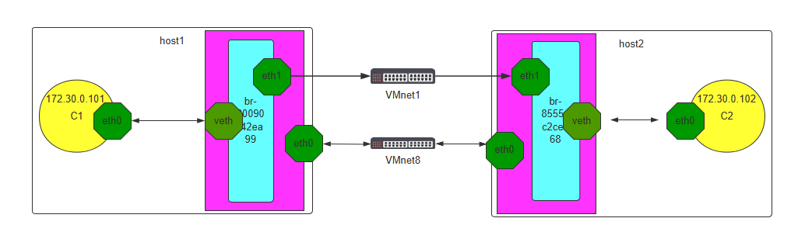
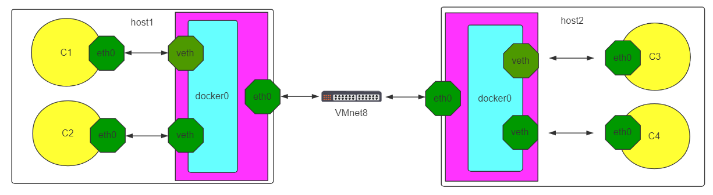
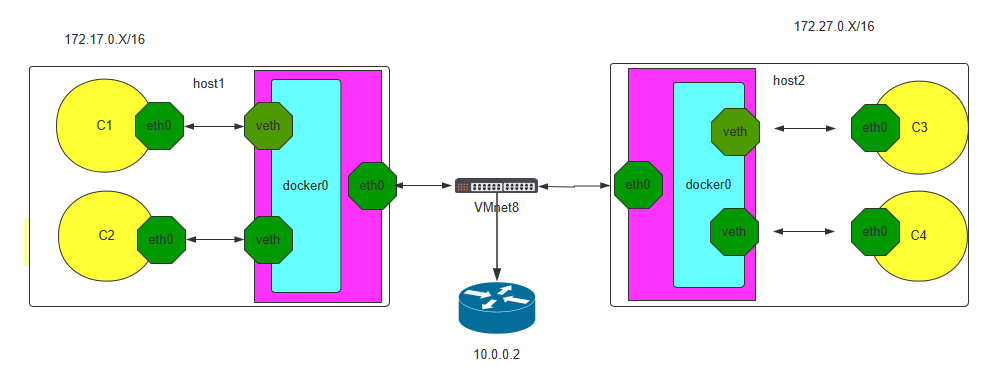

[← Back to Docker Container Technology Index]({{ '/subjects/Docker/' | relative_url }})



# 17 Cross-Host Container Networking
### 4.4 实现跨宿主机的容器之间网络互联（了解）

同一个宿主机之间的各个容器之间是可以直接通信的，但是如果访问到另外一台宿主机的容器，默认是不能通信的

可以通过很多方法实现跨宿主机的容器通信

### 方式1: 利用桥接实现跨宿主机的同一网段二层网络的容器间互联

范例：自定义网络实现跨宿主机的容器间互联



```bash
#第一个主机
[root@ubuntu2204 ~]#docker network create mynet --subnet 172.30.0.0/16
[root@ubuntu2204 ~]#docker run -it --network mynet  --ip 172.30.0.101  --name c1
alpine:3.20.0
#在此主贡添加一个新网卡仅主机模式的eth1
[root@ubuntu2204 ~]#apt -y install bridge-utils
[root@ubuntu2204 ~]#brctl addif br-80090f42ea99 eth1
[root@ubuntu2204 ~]#ip link set eth1 up
```

```bash
#第二个主机
[root@ubuntu2204 ~]#docker network create mynet --subnet 172.30.0.0/16
[root@ubuntu2204 ~]#docker run -it --network mynet  --ip 172.30.0.102  --name c1
alpine:3.20.0
#在此主贡添加一个新网卡仅主机模式的eth1
[root@ubuntu2204 ~]#apt -y install bridge-utils
[root@ubuntu2204 ~]#brctl addif br-8555ec2cee68 eth1
[root@ubuntu2204 ~]#ip link set eth1 up
```



范例2

```bash
#分别将两个宿主机都执行下面操作
[root@ubuntu1804 ~]#apt -y install bridge-utils
[root@ubuntu1804 ~]#brctl addif docker0 eth0
#在两个宿主机上各启动一个容器,需要确保IP不同,相互测试访问
#第一个宿主机的容器
[root@ubuntu1804 ~]#docker run -it --name b1 busybox
/ # hostname -i
172.17.0.2
/ # httpd -h /data/html/ -f -v
[::ffff:172.17.0.3]:42488:response:200
#第二个宿主机的容器
[root@ubuntu1804 ~]#docker run -it --name b2 busybox
/ # hostname -i
172.17.0.3
/#wget-q0 - http://172.17.0.2
httpd website in busybox
```

### 方式2: 利用NAT实现跨主机的不同网段三层网络的容器间互联

### Docker 跨主机互联实现说明



跨主机互联是说A宿主机的容器可以访问B主机上的容器，但是前提是保证各宿主机之间的网络是可以相互通信的，然后各容器才可以通过宿主机访问到对方的容器

实现原理:  是在宿主机做一个网络路由就可以实现A宿主机的容器访问B主机的容器的目的

注意:  此方式只适合小型网络环境，复杂的网络或者大型的网络可以使用其它网络插件比如： Google 开源的 Kubernetes 网络插件Flannel和Calico 进行互联

### 修改各宿主机网段

Docker默认网段是172.17.0.x/24,而且每个宿主机都是一样的，因此要做路由的前提就是各个主机的网络不能一致

4.4.2.2.1 第一个宿主机A上更改网段

```json
#方法1
[root@ubuntu1804 ~]#vim vim /lib/systemd/system/docker.service
ExecStart=/usr/bin/dockerd -H fd:// --containerd=/run/containerd/containerd.sock
--bip=192.168.100.1/24
[root@ubuntu1804 ~]#systemctl daemon-reload ;systemctl restart docker
#方法2
[root@ubuntu1804 ~]#vim /etc/docker/daemon.json
[root@ubuntu1804 ~]#cat /etc/docker/daemon.json
{
"bip": "192.168.100.1/24",
"registry-mirrors": ["https://si7y70hh.mirror.aliyuncs.com"]
}
[root@ubuntu1804 ~]# systemctl restart docker
[root@ubuntu1804 ~]#ip a
1: lo: <LOOPBACK,UP,LOWER_UP> mtu 65536 qdisc noqueue state UNKNOWN group
default qlen 1000
link/loopback 00:00:00:00:00:00 brd 00:00:00:00:00:00
inet 127.0.0.1/8 scope host lo
valid_lft forever preferred_lft forever
inet6 ::1/128 scope host
valid_lft forever preferred_lft forever
2: eth0: <BROADCAST,MULTICAST,UP,LOWER_UP> mtu 1500 qdisc fq_codel state UP
group default qlen 1000
link/ether 00:0c:29:6b:54:d3 brd ff:ff:ff:ff:ff:ff
inet 10.0.0.101/24 brd 10.0.0.255 scope global eth0
valid_lft forever preferred_lft forever
inet6 fe80::20c:29ff:fe6b:54d3/64 scope link
valid_lft forever preferred_lft forever
3: docker0: <NO-CARRIER,BROADCAST,MULTICAST,UP> mtu 1500 qdisc noqueue state
DOWN group default
link/ether 02:42:e0:ef:72:05 brd ff:ff:ff:ff:ff:ff
inet 192.168.100.1/24 brd 192.168.100.255 scope global docker0
valid_lft forever preferred_lft forever
inet6 fe80::42:e0ff:feef:7205/64 scope link
valid_lft forever preferred_lft forever
[root@ubuntu1804 ~]#route -n
Kernel IP routing table
Destination     Gateway         Genmask         Flags Metric Ref    Use Iface
0.0.0.0         10.0.0.2        0.0.0.0         UG    0      0        0 eth0
10.0.0.0        0.0.0.0         255.255.255.0   U     0      0        0 eth0
192.168.100.0   0.0.0.0         255.255.255.0   U     0      0        0 docker0
```

4.4.2.2.2 第二个宿主机B更改网段

```json
[root@ubuntu1804 ~]#vim /etc/docker/daemon.json
{
"bip": "192.168.200.1/24",
"registry-mirrors": ["https://si7y70hh.mirror.aliyuncs.com"]
}
[root@ubuntu1804 ~]#systemctl restart docker
[root@ubuntu1804 ~]#ip a
1: lo: <LOOPBACK,UP,LOWER_UP> mtu 65536 qdisc noqueue state UNKNOWN group
default qlen 1000
link/loopback 00:00:00:00:00:00 brd 00:00:00:00:00:00
inet 127.0.0.1/8 scope host lo
valid_lft forever preferred_lft forever
inet6 ::1/128 scope host
valid_lft forever preferred_lft forever
2: eth0: <BROADCAST,MULTICAST,UP,LOWER_UP> mtu 1500 qdisc fq_codel state UP
group default qlen 1000
link/ether 00:0c:29:01:f3:0c brd ff:ff:ff:ff:ff:ff
inet 10.0.0.102/24 brd 10.0.0.255 scope global eth0
valid_lft forever preferred_lft forever
inet6 fe80::20c:29ff:fe01:f30c/64 scope link
valid_lft forever preferred_lft forever
3: docker0: <NO-CARRIER,BROADCAST,MULTICAST,UP> mtu 1500 qdisc noqueue state
DOWN group default
link/ether 02:42:e8:c0:a4:d8 brd ff:ff:ff:ff:ff:ff
inet 192.168.200.1/24 brd 192.168.200.255 scope global docker0
valid_lft forever preferred_lft forever
inet6 fe80::42:e8ff:fec0:a4d8/64 scope link
valid_lft forever preferred_lft forever
[root@ubuntu1804 ~]#route -n
Kernel IP routing table
Destination     Gateway         Genmask         Flags Metric Ref    Use Iface
0.0.0.0         10.0.0.2        0.0.0.0         UG    0      0        0 eth0
10.0.0.0        0.0.0.0         255.255.255.0   U     0      0        0 eth0
192.168.200.0   0.0.0.0         255.255.255.0   U     0      0        0 docker0
```

### 在两个宿主机分别启动一个容器

第一个宿主机启动容器server1

```bash
[root@ubuntu1804 ~]#docker run -it --name server1 --rm  alpine sh
/ # ip a
1: lo: <LOOPBACK,UP,LOWER_UP> mtu 65536 qdisc noqueue state UNKNOWN qlen 1000
link/loopback 00:00:00:00:00:00 brd 00:00:00:00:00:00
inet 127.0.0.1/8 scope host lo
valid_lft forever preferred_lft forever
16: eth0@if17: <BROADCAST,MULTICAST,UP,LOWER_UP,M-DOWN> mtu 1500 qdisc noqueue
state UP
link/ether 02:42:c0:a8:64:02 brd ff:ff:ff:ff:ff:ff
inet 192.168.100.2/24 brd 192.168.100.255 scope global eth0
valid_lft forever preferred_lft forever
/ # route -n
Kernel IP routing table
Destination     Gateway         Genmask         Flags Metric Ref    Use Iface
0.0.0.0         192.168.100.1   0.0.0.0         UG    0      0        0 eth0
192.168.100.0   0.0.0.0         255.255.255.0   U     0      0        0 eth0
```

第二个宿主机启动容器server2

```bash
[root@ubuntu1804 ~]#docker run -it --name server2 --rm  alpine sh
/ # ip a
1: lo: <LOOPBACK,UP,LOWER_UP> mtu 65536 qdisc noqueue state UNKNOWN qlen 1000
link/loopback 00:00:00:00:00:00 brd 00:00:00:00:00:00
inet 127.0.0.1/8 scope host lo
valid_lft forever preferred_lft forever
8: eth0@if9: <BROADCAST,MULTICAST,UP,LOWER_UP,M-DOWN> mtu 1500 qdisc noqueue
state UP
link/ether 02:42:c0:a8:c8:02 brd ff:ff:ff:ff:ff:ff
inet 192.168.200.2/24 brd 192.168.200.255 scope global eth0
valid_lft forever preferred_lft forever
/ # route -n
Kernel IP routing table
Destination     Gateway         Genmask         Flags Metric Ref    Use Iface
0.0.0.0         192.168.200.1   0.0.0.0         UG    0      0        0 eth0
192.168.200.0   0.0.0.0         255.255.255.0   U     0      0        0 eth0
```

从第一个宿主机的容器server1无法和第二个宿主机的server2相互访问

```bash
[root@ubuntu1804 ~]#docker run -it --name server1 --rm  alpine sh
/ # ip a
1: lo: <LOOPBACK,UP,LOWER_UP> mtu 65536 qdisc noqueue state UNKNOWN qlen 1000
link/loopback 00:00:00:00:00:00 brd 00:00:00:00:00:00
inet 127.0.0.1/8 scope host lo
valid_lft forever preferred_lft forever
14: eth0@if15: <BROADCAST,MULTICAST,UP,LOWER_UP,M-DOWN> mtu 1500 qdisc noqueue
state UP
link/ether 02:42:0a:64:00:02 brd ff:ff:ff:ff:ff:ff
inet 10.100.0.2/16 brd 10.100.255.255 scope global eth0
valid_lft forever preferred_lft forever
/ # ping -c1 192.168.200.2
PING 192.168.200.2 (192.168.200.2): 56 data bytes
--- 192.168.200.2 ping statistics ---
1 packets transmitted, 0 packets received, 100% packet loss
```

### 添加静态路由和iptables规则

在各宿主机添加静态路由，网关指向对方宿主机的IP

4.4.2.4.1 在第一台宿主机添加静态路由和iptables规则

```bash
#添加路由
[root@ubuntu1804 ~]#route add -net 192.168.200.0/24 gw 10.0.0.102
#修改iptables规则
[root@ubuntu1804 ~]#iptables -A FORWARD -s 10.0.0.0/24 -j ACCEPT
#或者修改FORWARD默认规则
[root@ubuntu1804 ~]#iptables -P FORWARD ACCEPT
```

4.4.2.4.2 在第二台宿主机添加静态路由和iptables规则

```bash
#添加路由
[root@ubuntu1804 ~]#route add -net 192.168.100.0/24 gw 10.0.0.101
#修改iptables规则
[root@ubuntu1804 ~]#iptables -A FORWARD -s 10.0.0.0/24 -j ACCEPT
#或者修改FORWARD默认规则
[root@ubuntu1804 ~]#iptables -P FORWARD ACCEPT
```

### 测试跨宿主机之间容器互联

宿主机A的容器server1访问宿主机B容器server2，同时在宿主机B上tcpdump抓包观察

```text
/ # ping -c1 192.168.200.2
PING 192.168.200.2 (192.168.200.2): 56 data bytes
64 bytes from 192.168.200.2: seq=0 ttl=62 time=1.022 ms
--- 192.168.200.2 ping statistics ---
1 packets transmitted, 1 packets received, 0% packet loss
round-trip min/avg/max = 1.022/1.022/1.022 ms
```

```bash
#宿主机B的抓包可以观察到
[root@ubuntu1804 ~]#tcpdump  -i eth0 -nn icmp
tcpdump: verbose output suppressed, use -v or -vv for full protocol decode
listening on eth0, link-type EN10MB (Ethernet), capture size 262144 bytes
16:57:37.912925 IP 10.0.0.101 > 192.168.200.2: ICMP echo request, id 2560, seq
0, length 64
16:57:37.913208 IP 192.168.200.2 > 10.0.0.101: ICMP echo reply, id 2560, seq 0,
length 64
```

宿主机B的容器server2访问宿主机B容器server1，同时在宿主机A上tcpdump抓包观察

```bash
/ # ping -c1 192.168.100.2
PING 192.168.100.2 (192.168.100.2): 56 data bytes
64 bytes from 192.168.100.2: seq=0 ttl=62 time=1.041 ms
--- 192.168.100.2 ping statistics ---
1 packets transmitted, 1 packets received, 0% packet loss
round-trip min/avg/max = 1.041/1.041/1.041 ms
#宿主机A的抓包可以观察到
[root@ubuntu1804 ~]#tcpdump -i eth0 -nn icmp
tcpdump: verbose output suppressed, use -v or -vv for full protocol decode
listening on eth0, link-type EN10MB (Ethernet), capture size 262144 bytes
16:59:11.775784 IP 10.0.0.102 > 192.168.100.2: ICMP echo request, id 2560, seq
0, length 64
16:59:11.776113 IP 192.168.100.2 > 10.0.0.102: ICMP echo reply, id 2560, seq 0,
length 64
```

### 创建第三个容器测试

```bash
#在第二个宿主机B上启动第一个提供web服务的nginx容器server3
#注意无需打开端口映射
[root@ubuntu1804 ~]#docker run  -d --name server3 centos7-nginx:1.6.1
69fc554fd00e4f7880c139283b64f2701feafb91047b217906b188c1f461b699
[root@ubuntu1804 ~]#docker exec -it server3 bash
[root@69fc554fd00e /]# ifconfig
eth0: flags=4163<UP,BROADCAST,RUNNING,MULTICAST>  mtu 1500
inet 192.168.200.3  netmask 255.255.255.0  broadcast 192.168.200.255
ether 02:42:c0:a8:c8:03  txqueuelen 0  (Ethernet)
RX packets 8  bytes 656 (656.0 B)
RX errors 0  dropped 0  overruns 0  frame 0
TX packets 0  bytes 0 (0.0 B)
TX errors 0  dropped 0 overruns 0  carrier 0  collisions 0
lo: flags=73<UP,LOOPBACK,RUNNING>  mtu 65536
inet 127.0.0.1  netmask 255.0.0.0
loop  txqueuelen 1000  (Local Loopback)
RX packets 0  bytes 0 (0.0 B)
RX errors 0  dropped 0  overruns 0  frame 0
TX packets 0  bytes 0 (0.0 B)
TX errors 0  dropped 0 overruns 0  carrier 0  collisions 0
[root@69fc554fd00e /]#
#从server1中访问server3的页面可以成功
/ # ip a
1: lo: <LOOPBACK,UP,LOWER_UP> mtu 65536 qdisc noqueue state UNKNOWN qlen 1000
link/loopback 00:00:00:00:00:00 brd 00:00:00:00:00:00
inet 127.0.0.1/8 scope host lo
valid_lft forever preferred_lft forever
14: eth0@if15: <BROADCAST,MULTICAST,UP,LOWER_UP,M-DOWN> mtu 1500 qdisc noqueue
state UP
link/ether 02:42:0a:64:00:02 brd ff:ff:ff:ff:ff:ff
inet 10.100.0.2/16 brd 10.100.255.255 scope global eth0
valid_lft forever preferred_lft forever
/ # wget -qO - http://192.168.200.3/app
Test Page in app
/ #
#从server3容器观察访问日志，可以看到来自于第一个宿主机，而非server1容器
[root@69fc554fd00e /]# tail -f /apps/nginx/logs/access.log
10.0.0.101 - - [02/Feb/2020:09:02:00 +0000] "GET /app HTTP/1.1" 301 169 "-"
"Wget"
#用tcpdump抓包80/tcp的包，可以观察到以下内容
[root@ubuntu1804 ~]#tcpdump  -i eth0 -nn port 80
tcpdump: verbose output suppressed, use -v or -vv for full protocol decode
listening on eth0, link-type EN10MB (Ethernet), capture size 262144 bytes
17:03:35.885627 IP 10.0.0.101.43578 > 192.168.200.3.80: Flags [S], seq
3672256868, win 29200, options [mss 1460,sackOK,TS val 4161963574 ecr
0,nop,wscale 7], length 0
17:03:35.885768 IP 192.168.200.3.80 > 10.0.0.101.43578: Flags [S.], seq
2298407060, ack 3672256869, win 28960, options [mss 1460,sackOK,TS val
3131173298 ecr 4161963574,nop,wscale 7], length 0
17:03:35.886312 IP 10.0.0.101.43578 > 192.168.200.3.80: Flags [.], ack 1, win
229, options [nop,nop,TS val 4161963575 ecr 3131173298], length 0
17:03:35.886507 IP 10.0.0.101.43578 > 192.168.200.3.80: Flags [P.], seq 1:80,
ack 1, win 229, options [nop,nop,TS val 4161963575 ecr 3131173298], length 79:
HTTP: GET /app HTTP/1.1
17:03:35.886541 IP 192.168.200.3.80 > 10.0.0.101.43578: Flags [.], ack 80, win
227, options [nop,nop,TS val 3131173299 ecr 4161963575], length 0
17:03:35.887179 IP 192.168.200.3.80 > 10.0.0.101.43578: Flags [P.], seq 1:365,
ack 80, win 227, options [nop,nop,TS val 3131173299 ecr 4161963575], length 364:
HTTP: HTTP/1.1 301 Moved Permanently
17:03:35.887222 IP 192.168.200.3.80 > 10.0.0.101.43578: Flags [F.], seq 365, ack
80, win 227, options [nop,nop,TS val 3131173299 ecr 4161963575], length 0
17:03:35.890139 IP 10.0.0.101.43580 > 192.168.200.3.80: Flags [.], ack
1660534352, win 229, options [nop,nop,TS val 4161963579 ecr 3131173301], length
0
17:03:35.890297 IP 10.0.0.101.43580 > 192.168.200.3.80: Flags [P.], seq 0:80,
ack 1, win 229, options [nop,nop,TS val 4161963579 ecr 3131173301], length 80:
HTTP: GET /app/ HTTP/1.1
17:03:35.890327 IP 192.168.200.3.80 > 10.0.0.101.43580: Flags [.], ack 80, win
227, opons [nop,nop,TS val 3131173303 ecr 4161963579], length 0
```



<nav class="article-end" aria-label="章节导航">
  <a href="{{ '/subjects/Docker/16-docker-network-modes.html' | relative_url }}">← Previous: Docker Network Modes</a>
  <a href="{{ '/subjects/Docker/' | relative_url }}">Back to Docker Container Technology Index</a>
  <a href="{{ '/subjects/Docker/18-introduction-to-docker-compose.html' | relative_url }}">Next: Introduction to Docker Compose →</a>
</nav>
