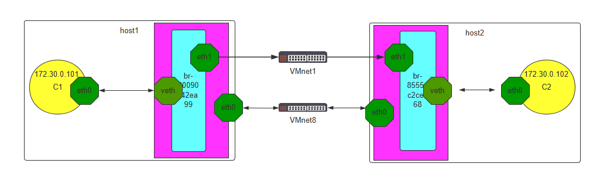
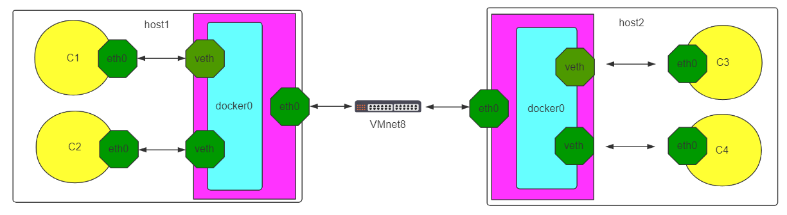
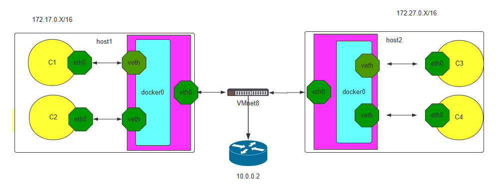

[← 返回 Docker 容器技术目录]({{ '/subjects/Docker/' | relative_url }})



# 17 跨宿主机容器通信

同一 Docker 主机上的容器可通过同一桥接网络通信；**不同主机的默认 bridge 网络彼此独立**。即使两台主机上的容器都得到 `172.17.0.2`，它们也不属于同一个可直接互通的网络。跨主机通信需要明确选择：通过宿主机发布端口访问服务、给不同容器网段配置路由，或使用 Overlay/CNI 等跨主机网络。先确认业务要的是“访问对端服务”，还是“容器 IP 互通”，二者复杂度不同。

## 1. 最简单：访问对端宿主机发布的端口

如果 A 容器只需调用 B 主机上的 Web 服务，通常不必让两个容器网络直接互通。在 B 主机将服务端口发布到**受控的宿主机内网地址**，A 容器访问 `B_HOST_IP:PORT` 即可。对外发布的端口受防火墙和应用认证保护；服务发现可用稳定主机名，不应写死容器 IP。

## 2. 二层桥接：理解原实验，不直接照搬

旧文把两台主机的 Docker bridge 与同一物理/虚拟二层网络相连，使两个容器看似处在同一子网。图示能帮助理解二层广播和地址不冲突的前提：





但原命令 `brctl addif docker0 eth0` 可能把宿主机主网卡并入容器网桥，改变主机连通性，还可能造成 DHCP、广播域与 Docker 规则冲突。只有在专门的隔离虚拟网卡、已规划的二层网络里才能评估此实验；不能对远程管理所依赖的 `eth0` 直接执行。跨主机只创建同名 `docker network` 也不会自动连成一个网络。

## 3. 三层路由：不同子网、双向路径与 NAT

另一条实验路径是在 A、B 分别使用不重叠的容器子网，如 `192.168.100.0/24` 与 `192.168.200.0/24`。两宿主机网络先要互通，然后每端必须有到**对方容器子网**的路由，FORWARD 防火墙要允许所需流量，回程也必须可达。



以下路由只表达“下一跳指向对方宿主机”的关系，主机 IP 属于示例；部署前检查与现有网络是否冲突，切勿在远程生产主机直接改 Docker 默认网段或清空防火墙规则。

```bash
# A 主机：其容器子网为 192.168.100.0/24，B 主机内网 IP 为 10.0.0.102
sudo ip route add 192.168.200.0/24 via 10.0.0.102

# B 主机：其容器子网为 192.168.200.0/24，A 主机内网 IP 为 10.0.0.101
sudo ip route add 192.168.100.0/24 via 10.0.0.101
```

还需核对 `net.ipv4.ip_forward`、Docker 的 NAT/MASQUERADE 与具体防火墙实现。原文用 `iptables -P FORWARD ACCEPT` 全局放行，不能替代按来源、目标和端口制定的规则。旧抓包中目标容器看到 **10.0.0.101** 而不是 A 容器 IP，说明发生了源地址转换；这会影响审计和基于来源 IP 的策略。若希望对端看到真实容器 IP，必须检查并调整 NAT、回程路由和网络边界，而不只是添加两条静态路由。

验证时按“容器 → 本机网关 → 对端宿主机 → 对端容器 → 回程”逐跳排查，使用 `ip route`、`ping`、`curl` 和 `tcpdump`；不要把某次 ping 成功当作所有服务端口与源地址都符合预期。

## 4. Overlay：由网络组件维护跨主机连接

对多主机容器服务，更常见的是由 Docker Swarm Overlay 或 Kubernetes CNI 管理跨主机网络。它们处理节点发现、隧道/路由和网络生命周期，不必为每对宿主机手工维护容器路由。例如在已建立的 Docker Swarm 中创建可供独立容器加入的 Overlay 网络：

```bash
# 管理节点上
docker network create --driver overlay --attachable app-overlay
docker network inspect app-overlay
```

各节点先要加入同一 Swarm；管理端和数据面的所需端口必须按 Docker 文档开放，例如管理流量的 2377/TCP、节点发现的 7946/TCP+UDP 与 VXLAN 的 4789/UDP。使用时还需考虑 MTU、加密、故障域和容器 DNS。Kubernetes 中的 Flannel、Calico 等属于另一套 CNI 方案，不能与 Docker bridge/Swarm 参数混为一谈。

选择方案时优先回答：是否只需公开服务端口、是否需要容器 IP 互访、是否要求看到原始来源 IP，以及由谁维护跨主机网络。这样比机械复制旧教程中的网桥和 iptables 命令更能得到稳定结果。



<nav class="article-end" aria-label="章节导航">
  <a href="{{ '/subjects/Docker/16-docker-network-modes.html' | relative_url }}">← 上一篇：Docker 网络模式</a>
  <a href="{{ '/subjects/Docker/' | relative_url }}">返回 Docker 容器技术目录</a>
  <a href="{{ '/subjects/Docker/18-introduction-to-docker-compose.html' | relative_url }}">下一篇：Docker Compose 简介 →</a>
</nav>
