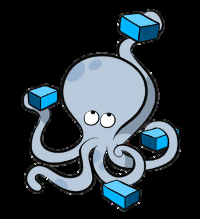

[← 返回Docker 容器技术目录]({{ '/subjects/Docker/' | relative_url }})



# 18 Docker Compose 介绍
## 5 Docker Compose 容器单机编排(了解)

### 5.1 Docker Compose 介绍

当在宿主机启动较多的容器时候，如果仍用手动执行docker run 启动每个容器不仅很麻烦而且因为有依赖关系等导致容易出错，而且无法不方便分类管理

可以使用 docker 单机多容器的编排工具 docker-compose 解决

docker-compose 项目是Docker 官方的开源项目，负责实现对Docker 容器集群的快速编排，可以用它同时管理多个容器

比如:  可以解决容器之间的依赖关系，就像启动一个nginx 前端服务的时候会调用后端的 tomcat，那就得先启动tomcat，但是启动tomcat 容器还需要依赖MySQL数据库，那就还得先启动MySQL，dockercompose 可以用来解决这样的嵌套依赖关系，并且可以替代docker命令对容器进行创建、启动和停止等手工的操作

因此如果说docker命令就像linux的命令，docker-compose.yml 文件就像shell脚本，可以自动的执行容器批量操作，从而实现自动化的容器管理，也或者说docker命令相当于ansible命令，那么docker compose文件，就相当于ansible-playbook的yaml文件

github地址:  https://github.com/docker/compose

官方地址:  https://docs.docker.com/compose/



<nav class="article-end" aria-label="章节导航">
  <a href="{{ '/subjects/Docker/17-cross-host-container-networking.html' | relative_url }}">← Previous: Cross-Host Container Networking</a>
  <a href="{{ '/subjects/Docker/' | relative_url }}">Back to Docker Container Technology Index</a>
  <a href="{{ '/subjects/Docker/19-installation-and-preparation.html' | relative_url }}">Next: Installation and Preparation →</a>
</nav>
