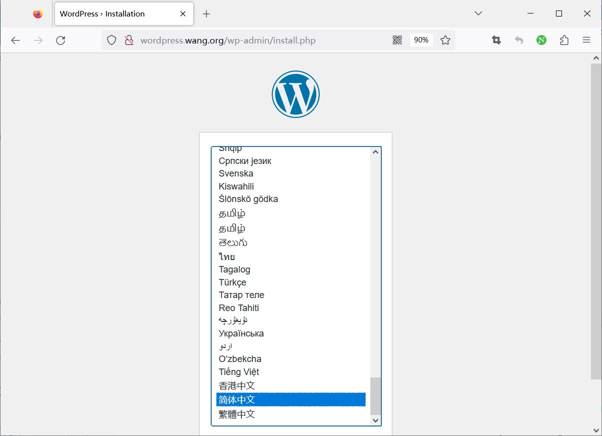
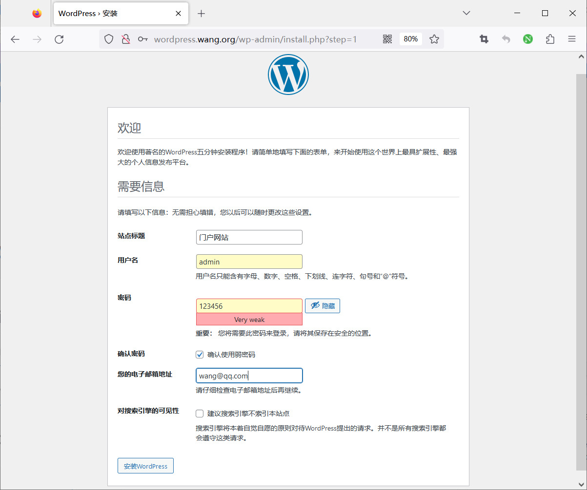
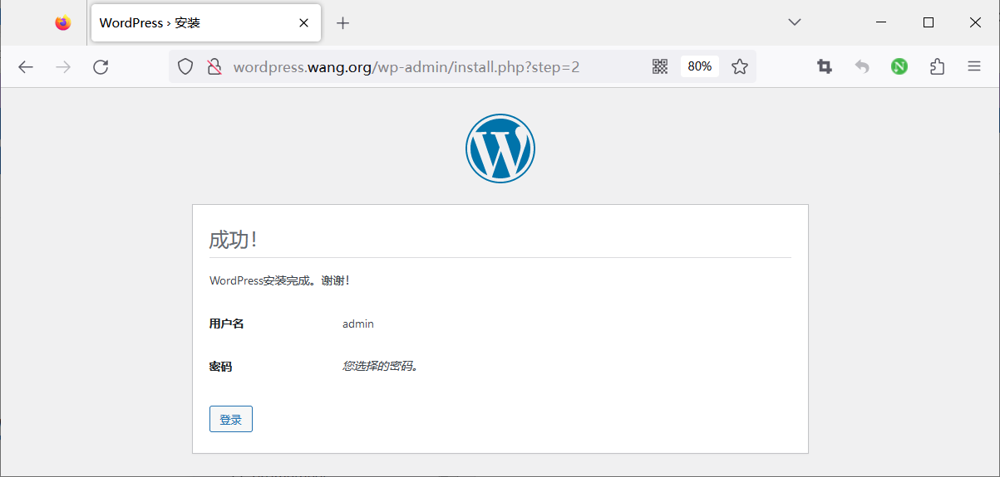
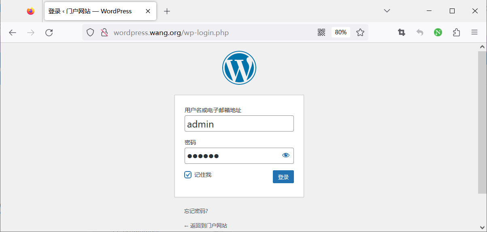
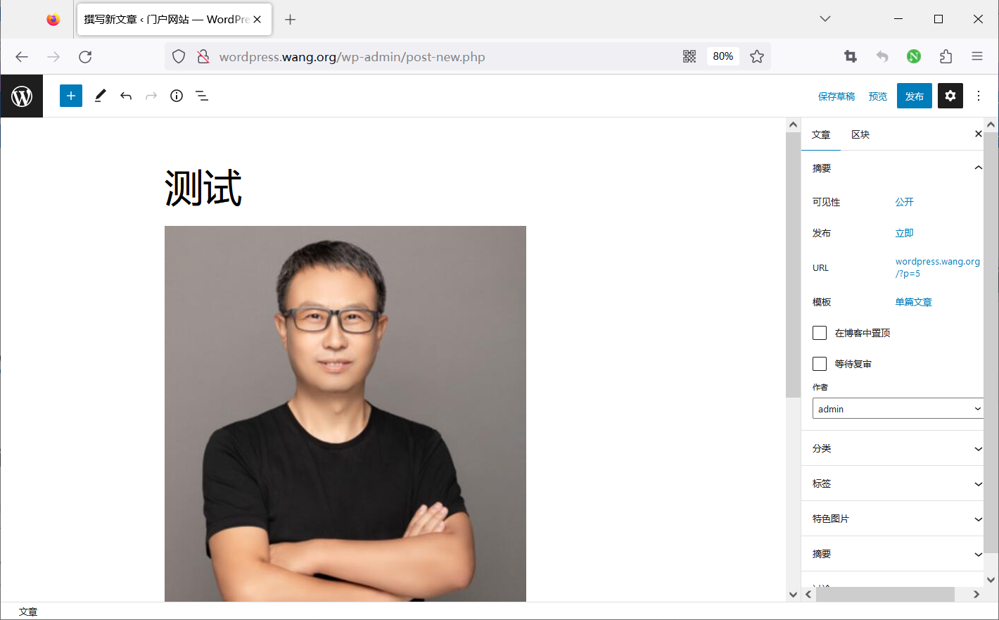
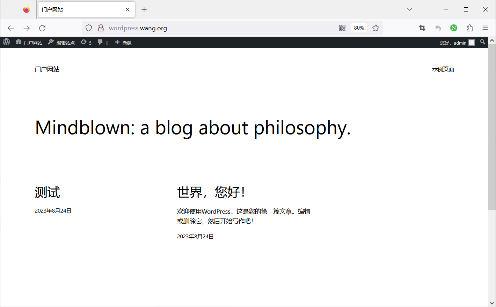

[← 返回 Docker 容器技术目录]({{ '/subjects/Docker/' | relative_url }})



# 22 使用 Compose 部署 WordPress

WordPress 需要 Web 服务、PHP 运行环境和数据库。本篇分别实现两种拓扑：**LNMP** 使用 Nginx + WordPress PHP-FPM + MySQL，**LAMP** 使用自带 Apache 的 WordPress 镜像 + MySQL。两者是可选方案，不应把配置片段混放在同一个 Compose 文件中。先理解各服务的职责，再选择一套运行。

## 方案一：Nginx + PHP-FPM + MySQL

Nginx 负责接收 HTTP 请求和提供静态文件；PHP 请求通过 FastCGI 转给 `wordpress:9000`；WordPress 通过 Compose 网络中的服务名 `db` 连接 MySQL。Nginx 与 WordPress 要共享同一份站点文件，否则 Nginx 找不到 PHP 入口或静态资源。数据库数据、站点文件分别放在持久化卷中。

在空目录下创建 `compose.yaml` 与 `nginx/wordpress.conf`。先创建一个**仅保存在本机**的 `.env` 文件并设置强密码，不要把它提交到仓库：

```dotenv
DB_ROOT_PASSWORD=请替换为独立的高强度数据库管理员密码
DB_PASSWORD=请替换为独立的高强度WordPress数据库密码
```

```yaml
services:
  db:
    image: mysql:8.0
    restart: unless-stopped
    environment:
      MYSQL_ROOT_PASSWORD: ${DB_ROOT_PASSWORD:?请在 .env 中设置 DB_ROOT_PASSWORD}
      MYSQL_DATABASE: wordpress
      MYSQL_USER: wordpress
      MYSQL_PASSWORD: ${DB_PASSWORD:?请在 .env 中设置 DB_PASSWORD}
    volumes:
      - db_data:/var/lib/mysql
    networks:
      - wordpress_net

  wordpress:
    image: wordpress:php8.2-fpm
    restart: unless-stopped
    depends_on:
      - db
    environment:
      WORDPRESS_DB_HOST: db:3306
      WORDPRESS_DB_NAME: wordpress
      WORDPRESS_DB_USER: wordpress
      WORDPRESS_DB_PASSWORD: ${DB_PASSWORD:?请在 .env 中设置 DB_PASSWORD}
    volumes:
      - wp_data:/var/www/html
    networks:
      - wordpress_net

  nginx:
    image: nginx:1.26
    restart: unless-stopped
    depends_on:
      - wordpress
    ports:
      - "8080:80"
    volumes:
      - ./nginx/wordpress.conf:/etc/nginx/conf.d/default.conf:ro
      - wp_data:/var/www/html:ro
    networks:
      - wordpress_net

volumes:
  db_data:
  wp_data:

networks:
  wordpress_net:
```

Nginx 的配置要同时覆盖 WordPress 的固定链接路由与 PHP 入口。以下示例用于本机练习；对外部署还需要 HTTPS、备份和访问控制。

```nginx
server {
    listen 80;
    server_name _;
    root /var/www/html;
    index index.php;
    client_max_body_size 100m;

    location / {
        try_files $uri $uri/ /index.php?$args;
    }

    location ~ \.php$ {
        try_files $uri =404;
        include fastcgi_params;
        fastcgi_pass wordpress:9000;
        fastcgi_param SCRIPT_FILENAME $document_root$fastcgi_script_name;
    }

    location ~ /\. {
        deny all;
    }
}
```

检查 Compose 变量与结构后启动。首次启动时，数据库初始化和 WordPress 写入站点卷需要一些时间；`depends_on` 的普通写法只控制启动顺序，**不保证数据库已经就绪**。若安装页暂时提示数据库连接错误，先查看日志，确认数据库已完成初始化，再刷新页面。

```bash
docker compose config
docker compose up -d
docker compose ps
docker compose logs --tail 80 db wordpress nginx
```

浏览器访问 `http://localhost:8080/`，按安装页选择语言、设置站点标题与管理员账户。若在远程主机运行，把 `localhost` 换成该主机可访问的地址，并放通映射端口。原教程的域名需要提前配置 DNS 或本机 hosts 解析，**域名本身不是部署的前提**。

下面的图片依次展示了初次安装、进入后台和发布文章的过程；界面版本可能与当前 WordPress 不同，但验证点相同：能打开安装页、完成初始化、登录后台并看到新文章。














## 方案二：Apache + PHP + MySQL

如果不需要单独学习 Nginx 与 PHP-FPM 的协作，可改用官方 WordPress Apache 变体。它把 Web 服务和 PHP 放在一个容器里，配置更短。请在**另一个空目录**创建这套 `compose.yaml`，并沿用该目录独立的 `.env`，不要与上面的服务同时占用 8080 端口。

```yaml
services:
  db:
    image: mysql:8.0
    restart: unless-stopped
    environment:
      MYSQL_ROOT_PASSWORD: ${DB_ROOT_PASSWORD:?请设置 DB_ROOT_PASSWORD}
      MYSQL_DATABASE: wordpress
      MYSQL_USER: wordpress
      MYSQL_PASSWORD: ${DB_PASSWORD:?请设置 DB_PASSWORD}
    volumes:
      - db_data:/var/lib/mysql

  wordpress:
    image: wordpress:php8.2-apache
    restart: unless-stopped
    depends_on:
      - db
    ports:
      - "8080:80"
    environment:
      WORDPRESS_DB_HOST: db:3306
      WORDPRESS_DB_NAME: wordpress
      WORDPRESS_DB_USER: wordpress
      WORDPRESS_DB_PASSWORD: ${DB_PASSWORD:?请设置 DB_PASSWORD}
    volumes:
      - wp_data:/var/www/html

volumes:
  db_data:
  wp_data:
```

`docker compose up -d` 后同样访问 `http://localhost:8080/`。两套方案中，WordPress 均通过服务名 `db` 找数据库，且数据库端口无需暴露给宿主机。用 `docker compose ps` 与 `docker compose logs` 核验状态；清理容器时使用 `docker compose down`，这不会删除命名卷。只有明确不再需要站点与数据库数据时才使用 `docker compose down -v`。



<nav class="article-end" aria-label="章节导航">
  <a href="{{ '/subjects/Docker/21-starting-multiple-containers-with-docker-compose.html' | relative_url }}">← 上一篇：Compose 启动多个容器</a>
  <a href="{{ '/subjects/Docker/' | relative_url }}">返回 Docker 容器技术目录</a>
  <a href="{{ '/subjects/Docker/23-deploying-the-spug-operations-platform.html' | relative_url }}">下一篇：部署 Spug 运维平台 →</a>
</nav>
