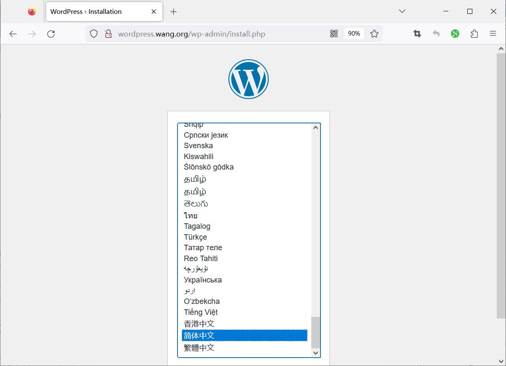
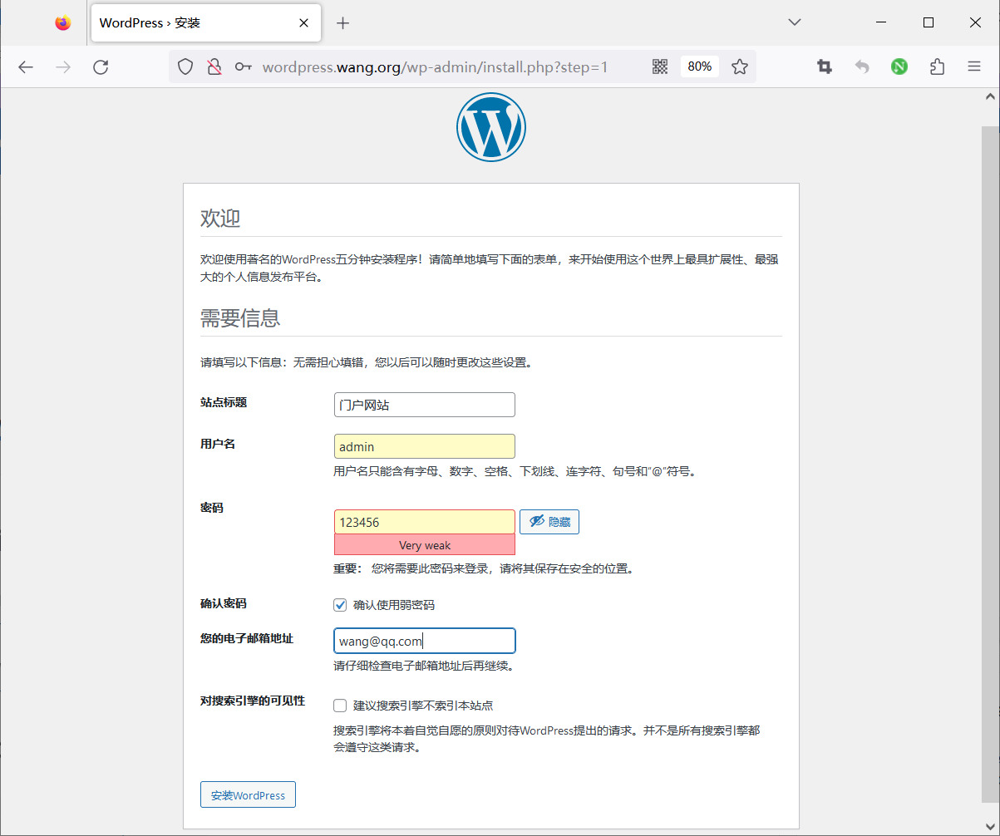
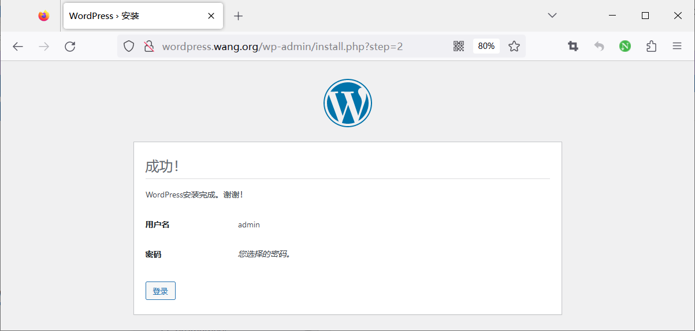
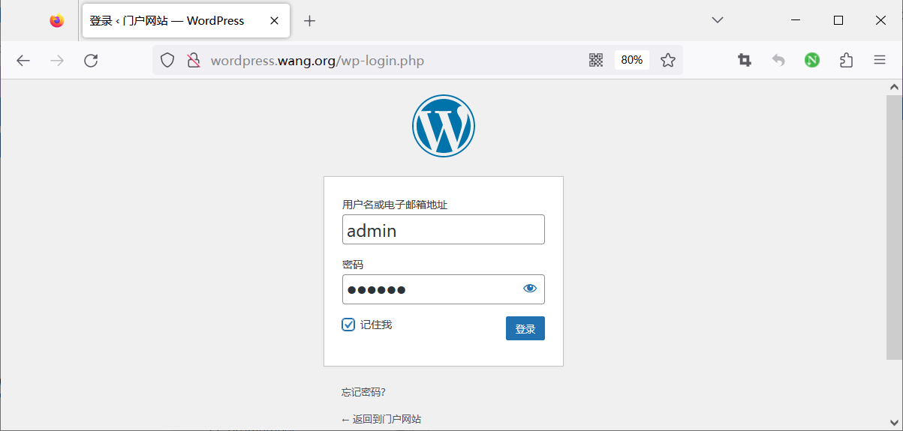

[← 返回Docker 容器技术目录]({{ '/subjects/Docker/' | relative_url }})



# 22 实战案例: 实现 Wordpress 应用
### 5.5 实战案例: 实现 Wordpress 应用

### LNMP 架构

### 安装 Docker Compose 工具和配置

```json
[root@ubuntu2204 ~]#apt update && apt -y install docker-compose
[root@ubuntu2204 ~]#cat > /etc/docker/daemon.json <<EOF
{
"registry-mirrors": ["https://si7y70hh.mirror.aliyuncs.com"]
}
EOF
[root@ubuntu2204 ~]#systemctl restart docker
[root@ubuntu2204 ~]#docker info
.....
Registry Mirrors:
https://si7y70hh.mirror.aliyuncs.com/
Live Restore Enabled: false
```

### 准备相关配置文件

```bash
[root@ubuntu2204 ~]#mkdir -p wordpress/nginx
[root@ubuntu2204 ~]#cd wordpress
[root@ubuntu2204 wordpress]#vim nginx/wordpress.conf
log_format access_json '{"@timestamp":"$time_iso8601",'
'"host":"$server_addr",'
'"clientip":"$remote_addr",'
'"size":$body_bytes_sent,'
'"responsetime":$request_time,'
'"upstreamtime":"$upstream_response_time",'
'"upstreamhost":"$upstream_addr",'
'"http_host":"$host",'
'"uri":"$uri",'
'"domain":"$host",'
'"xff":"$http_x_forwarded_for",'
'"referer":"$http_referer",'
'"tcp_xff":"$proxy_protocol_addr",'
'"http_user_agent":"$http_user_agent",'
'"status":"$status"}';
access_log  /var/log/nginx/access_json.log access_json ;
server {
listen 80;
server_name wordpress.bowen.org;
client_max_body_size 100m;
root /var/www/html;
index index.php;
location / {
try_files $uri $uri/ /index.php?$args;
}
location ~ \.php$ {
root /var/www/html;
fastcgi_index index.php;
fastcgi_pass wordpress:9000;  #指定wordpress的名称
include fastcgi_params;
fastcgi_param SCRIPT_FILENAME $document_root$fastcgi_script_name;
}
}
```

```yaml
[root@ubuntu2204 wordpress]#vim docker-compose.yaml
version: '3.3'
services:
mysql:
#image: mysql:8.0.29-oracle
image: registry.cn-beijing.aliyuncs.com/bowenxiaochun/mysql:8.0.29-oracle
#   ports:
#     - '3306:3306'
volumes:
- /data/wordpress/mysql:/var/lib/mysql
environment:
- MYSQL_ROOT_PASSWORD=123456
- MYSQL_DATABASE=wordpress
- MYSQL_USER=wordpress
- MYSQL_PASSWORD=123456
restart: always
networks:
- wordpress-network
wordpress:
#image: wordpress:6.1-php8.0-fpm
image: registry.cn-beijing.aliyuncs.com/bowenxiaochun/wordpress:6.7.2-php8.1-
fpm
#    ports:
#      - '9000:9000'
volumes:
- /data/wordpress/wordpress:/var/www/html
environment:
- WORDPRESS_DB_HOST=mysql
- WORDPRESS_DB_NAME=wordpress
- WORDPRESS_DB_USER=wordpress
- WORDPRESS_DB_PASSWORD=123456
restart: always
networks:
- wordpress-network
nginx:
#image: nginx:1.24.0
image: registry.cn-beijing.aliyuncs.com/bowenxiaochun/nginx:1.26.0
ports:
- '80:80'
volumes:
- ./nginx/wordpress.conf:/etc/nginx/conf.d/wordpress.conf
- /data/wordpress/nginx:/var/log/nginx/
- /data/wordpress/wordpress:/var/www/html
restart: always
networks:
- wordpress-network
networks:
wordpress-network:
driver: bridge
ipam:
config:
- subnet: 172.30.0.0/16
#所有文件列表
[root@ubuntu2204 wordpress]#tree
.
├── docker-compose.yaml
└── nginx
└── wordpress.conf
1 directory, 2 files
```

### 启动容器

```bash
#提前拉取镜像
[root@ubuntu2204 wordpress]#docker-compose pull
[root@ubuntu2204 wordpress]#docker-compose images
Container         Repository        Tag           Image Id       Size
-----------------------------------------------------------------------------
wordpress_mysql_1       mysql        8.0.29-oracle    33037edcac9b   444 MB
wordpress_nginx_1       nginx        1.24.0           bf09be6b0005   142.2 MB
wordpress_wordpress_1   wordpress    6.1-php8.0-fpm   916d5305bb7c   604.2 MB
#运行
[root@ubuntu2204 wordpress]#docker-compose up
Creating network "wordpress_default" with the default driver
Creating wordpress_mysql_1 ... done
Creating wordpress_wordpress_1 ... done
Creating wordpress_nginx_1     ... done
Attaching to wordpress_mysql_1, wordpress_wordpress_1, wordpress_nginx_1
```

### 测试访问

注意:需要做名称解析

浏览器访问

<http://wordpress.bowen.org>









登录管理后台,发表文章


### LAMP 架构

范例

```yaml
[root@ubuntu2204 wordpress]#cat docker-compose.yaml
version: '3'
services:
mysql:
#image: mysql:8.0.29-oracle
image: registry.cn-beijing.aliyuncs.com/bowenxiaochun/mysql:8.0.29-oracle
container_name: db
restart: always
environment:
- MYSQL_DATABASE=wordpress
- MYSQL_ROOT_PASSWORD=123456
- MYSQL_USER=wordpress
- MYSQL_PASSWORD=123456
volumes:
- /data/wordpress/mysql:/var/lib/mysql
networks:
- wordpress-network
wordpress:
depends_on:
- mysql
#image: wordpress:5.8.3-apache
#image: wordpress:php7.4-apache
image: registry.cn-beijing.aliyuncs.com/bowenxiaochun/wordpress:php8.2-apache
container_name: wordpress
restart: always
ports:
- "8888:80"
environment:
- WORDPRESS_DB_HOST=mysql:3306
- WORDPRESS_DB_USER=wordpress
- WORDPRESS_DB_PASSWORD=123456
- WORDPRESS_DB_NAME=wordpress
volumes:
- /data/wordpress/wordpress:/var/www/html
networks:
- wordpress-network
networks:
wordpress-network:
driver: bridge
ipam:
config:
- subnet: 172.30.0.0/16
[root@ubuntu2204 wordpress]#docker-compose up -d
```

范例

```yaml
version: '3'
services:
db:
#image: mysql:8.0.29-oracle
image: registry.cn-beijing.aliyuncs.com/bowenxiaochun/mysql:8.0.29-oracle
container_name: db
restart: unless-stopped
environment:
- MYSQL_DATABASE=wordpress
- MYSQL_ROOT_PASSWORD=123456
- MYSQL_USER=wordpress
- MYSQL_PASSWORD=123456
volumes:
- dbdata:/var/lib/mysql
networks:
- wordpress-network
wordpress:
depends_on:
- db
#image: wordpress:5.8.3-apache
#image: wordpress:php7.4-apache
image: registry.cn-beijing.aliyuncs.com/bowenxiaochun/wordpress:php8.2-apache
container_name: wordpress
restart: unless-stopped
ports:
- "80:80"
environment:
- WORDPRESS_DB_HOST=db:3306
- WORDPRESS_DB_USER=wordpress
- WORDPRESS_DB_PASSWORD=123456
- WORDPRESS_DB_NAME=wordpress
volumes:
- wordpress:/var/www/html
networks:
- wordpress-network
volumes:
wordpress:
dbdata:
networks:
wordpress-network:
driver: bridge
ipam:
config:
- subnet: 172.30.0.0/16
```

范例:

```yaml
[root@ubuntu2204 wordpess]#cat docker-compose.yaml
name: wordpress
services:
mysql:
networks:
- wordpress-net
container_name: mysql
environment:
- MYSQL_ROOT_PASSWORD=123456
- MYSQL_DATABASE=wordpress
- MYSQL_USER=wordpress
- MYSQL_PASSWORD=123456
#image: mysql:8.0
image: registry.cn-beijing.aliyuncs.com/bowenxiaochun/mysql:8.0.29-oracle
wordpress:
ports:
- 80:80
networks:
- wordpress-net
container_name: wordpress
restart: always
#image: wordpress:php8.2-apache
image: registry.cn-beijing.aliyuncs.com/bowenxiaochun/wordpress:php8.2-
apache
networks:
wordpress-net:
driver: bridge
ipam:
config:
- subnet: 172.30.0.0/16
[root@ubuntu2204 wordpess]#docker compose up -d
[root@ubuntu2204 wordpess]#docker compose ps
NAME        IMAGE                     COMMAND                   SERVICE
CREATED              STATUS              PORTS
mysql       mysql:8.0                 "docker-entrypoint.s…"   mysql       About
a minute ago   Up About a minute   3306/tcp, 33060/tcp
wordpress   wordpress:php8.2-apache   "docker-entrypoint.s…"   wordpress   About
a minute ago   Up About a minute   0.0.0.0:80->80/tcp, :::80->80/tcp
[root@ubuntu2204 ~]#docker network ls
NETWORK ID     NAME                      DRIVER    SCOPE
48c4dac57e1d   bridge                    bridge    local
c515f2d6850c   host                      host      local
62d5512a71ad   none                      null      local
aee9b94a4126   wordpress_wordpress-net   bridge    local
[root@ubuntu2204 wordpess]#docker inspect wordpress_wordpress-net
[
{
"Name": "wordpress_wordpress-net",
"Id":
"aee9b94a41267086550d328b601e0dcdd7497e7e474fa6ff3da6f0bb57972fb3",
"Created": "2024-04-15T12:17:38.719016927+08:00",
"Scope": "local",
"Driver": "bridge",
"EnableIPv6": false,
"IPAM": {
"Driver": "default",
"Options": null,
"Config": [
{
"Subnet": "172.30.0.0/16"
}
]
},
"Internal": false,
"Attachable": false,
"Ingress": false,
"ConfigFrom": {
"Network": ""
},
"ConfigOnly": false,
"Containers": {
"25ff3f03e52a950828697b14a8edde84fd339409c15e4a39c77dabcf7bb87daa":
{
"Name": "wordpress",
"EndpointID":
"2035cce1980f294518124ca3d1a3a51974e3e5b5fccb0702024f0f84b569b11b",
"MacAddress": "02:42:ac:1e:00:03",
"IPv4Address": "172.30.0.3/16",
"IPv6Address": ""
},
"5355244fb88601935d7e9c93d086fcd05544a3fded2062f810d392171592397b":
{
"Name": "mysql",
"EndpointID":
"883dc8e1fa866b9325a3ad9b7b96394ad62347c03bb969ee9ec176c592d49cb6",
"MacAddress": "02:42:ac:1e:00:02",
"IPv4Address": "172.30.0.2/16",
"IPv6Address": ""
}
},
"Options": {},
"Labels": {
"com.docker.compose.network": "wordpress-net",
"com.docker.compose.project": "wordpress",
"com.docker.compose.version": "2.25.0"
}
}
]
```



<nav class="article-end" aria-label="章节导航">
  <a href="{{ '/subjects/Docker/21-starting-multiple-containers-with-docker-compose.html' | relative_url }}">← Previous: Starting Multiple Containers with Docker Compose</a>
  <a href="{{ '/subjects/Docker/' | relative_url }}">Back to Docker Container Technology Index</a>
  <a href="{{ '/subjects/Docker/23-deploying-the-spug-operations-platform.html' | relative_url }}">Next: Practical Examples: 搭建运维平台 Spug →</a>
</nav>
