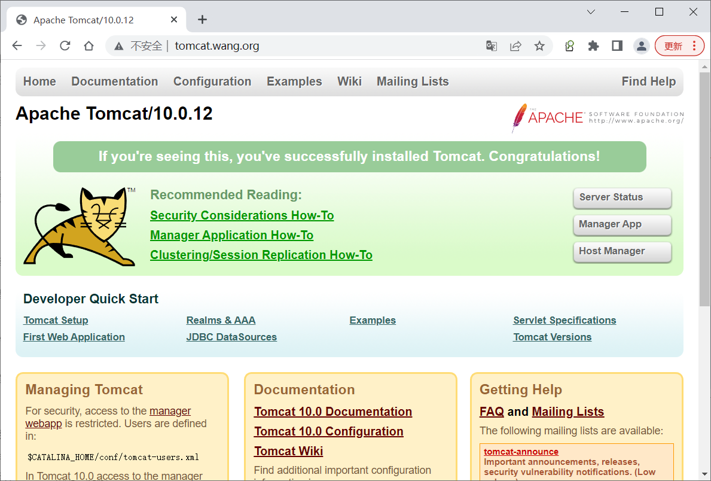

[← 返回 Docker 容器技术目录]({{ '/subjects/Docker/' | relative_url }})



# 24 构建和部署 Tomcat

原案例把 Dockerfile、Compose 配置与终端输出放进同一个 `yaml` 代码块，且缩进和 `META-INF` 路径被硬换行打断。本篇先部署一个可验证的 Web 应用，再解释原案例中的 Manager、持久卷和固定 IP 各自解决什么问题。

## 选择 Tomcat 与 Java 版本

Tomcat 9 使用 `javax.*` Servlet API，Tomcat 10.1 使用 `jakarta.*`；不能仅将镜像标签从 9 改为 10 就假设已有 WAR 可运行。先确认应用的 Servlet 与 JDK 版本，再选择同一系列中经过测试的官方镜像。下面以 Tomcat 10.1/JDK 17 的静态页面演示容器流程；部署旧版 Java EE 应用时应改用与应用兼容的 Tomcat 9 标签。

## 构建最小应用镜像

目录结构如下。这里用静态 `index.html` 验证 Tomcat 部署链路；实际应用可将构建好的 `ROOT.war` 复制到 `/usr/local/tomcat/webapps/ROOT.war`，不要同时保留同名的 `ROOT/` 目录。

```text
tomcat-demo/
├── compose.yaml
└── tomcat/
    ├── Dockerfile
    └── site/
        └── index.html
```

`tomcat/site/index.html`：

```html
<!doctype html>
<html lang="zh-CN"><meta charset="utf-8"><title>Tomcat 测试</title>
<body><h1>Tomcat 已启动</h1></body></html>
```

`tomcat/Dockerfile`：

```dockerfile
FROM tomcat:10.1-jdk17-temurin
RUN mkdir -p /usr/local/tomcat/webapps/ROOT
COPY site/ /usr/local/tomcat/webapps/ROOT/
EXPOSE 8080
```

Tomcat 官方镜像的默认 `webapps` 可能为空，`webapps.dist` 中是示例应用。上面的 Dockerfile 只部署自己的页面，不把 `docs`、`examples`、`manager` 与 `host-manager` 一并开放。若应用需要 WAR，将 `COPY site/ ...` 换成 `COPY ROOT.war /usr/local/tomcat/webapps/ROOT.war`，并删除创建 `ROOT` 目录的 `RUN`。

## 用 Compose 启动

`compose.yaml` 与 Dockerfile 分开保存：

```yaml
services:
  tomcat:
    build:
      context: ./tomcat
      dockerfile: Dockerfile
    image: local/tomcat-demo:1.0
    ports:
      - "127.0.0.1:8080:8080"
    restart: unless-stopped
```

```bash
docker compose config
docker compose up -d --build
docker compose ps
docker compose logs --tail 80 tomcat
curl -fsS http://127.0.0.1:8080/
```

`docker compose config` 应先通过语法检查；`curl` 应返回“Tomcat 已启动”。若服务启动但浏览器显示 404，先检查镜像中的 `webapps/ROOT` 或 WAR 名称，再看 Tomcat 日志。容器名与 Compose 服务名可供同一 Compose 网络中的其他容器解析，通常不需要原案例中手工固定 `172.27.0.100`。对外端口仅绑定回环地址；需要公网访问时，应在前置代理配置 TLS 与访问控制。



## 原案例中的 Manager 与卷

Tomcat Manager 是管理入口，不是部署业务应用的必需组件。若确需它，应显式启用对应 `webapps.dist/manager`、配置专用强凭据与最小角色，并限制允许访问的网络；不要沿用原截图中的 `tomcat/123456`，也不要为“远程能打开”直接删除 `manager/META-INF/context.xml` 的访问限制。Host Manager 具有更高的管理影响范围，应单独评估。配置文件路径里的 `META-INF` 是一个完整目录名，不能像原稿那样从 `META-` 中间断行。

原 Compose 将命名卷挂到整个 `/usr/local/tomcat/webapps`。命名卷首次创建时可能复制镜像里的内容，此后**重建镜像不会自动刷新旧卷里的应用文件**，容易出现“build 成功但仍看到旧页面”。业务应用应优先构建进镜像；需要持久化的上传文件和日志另选独立卷/外部存储，不把应用目录整体覆盖。`docker volume ls` 只能证明卷存在，不能证明应用已更新。

最后用页面响应、日志与一次重建验证：修改 `site/index.html`，运行 `docker compose up -d --build`，再次请求页面应看到新内容。测试完成后 `docker compose down` 会停止并移除容器与项目网络；若配置了命名数据卷，不应随手加 `-v` 删除其业务数据。



<nav class="article-end" aria-label="章节导航">
  <a href="{{ '/subjects/Docker/23-deploying-the-spug-operations-platform.html' | relative_url }}">← 上一篇：实战案例：搭建运维平台 Spug</a>
  <a href="{{ '/subjects/Docker/' | relative_url }}">返回 Docker 容器技术目录</a>
  <a href="{{ '/subjects/Docker/25-deploying-the-ruoyi-microservices-project.html' | relative_url }}">下一篇：实战案例：RuoYI 微服务项目 →</a>
</nav>
