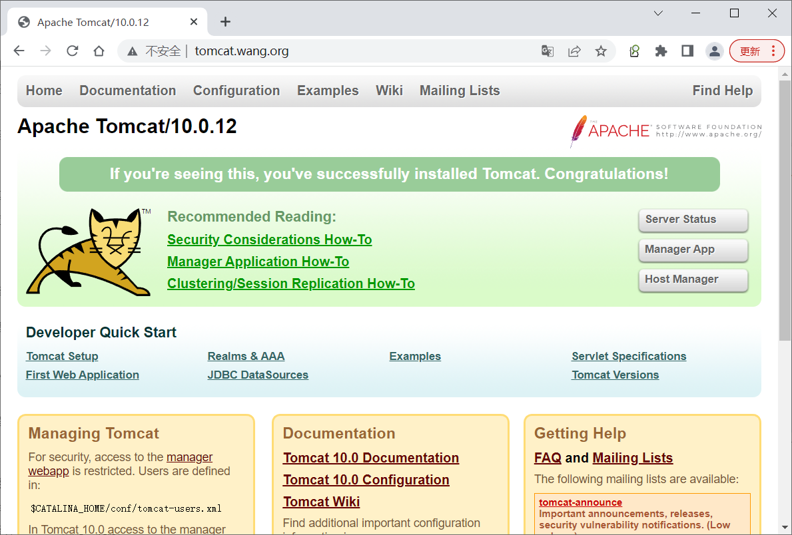
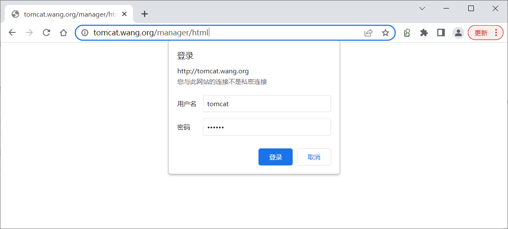
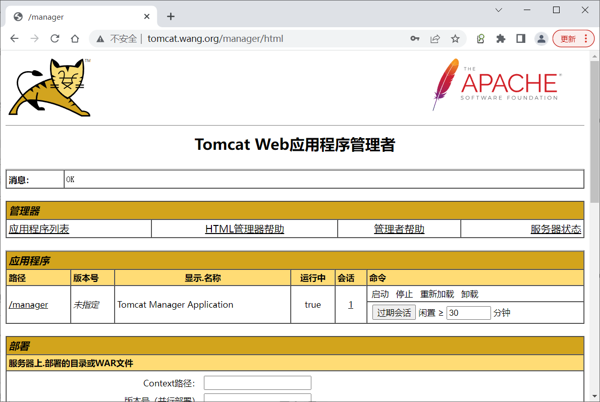
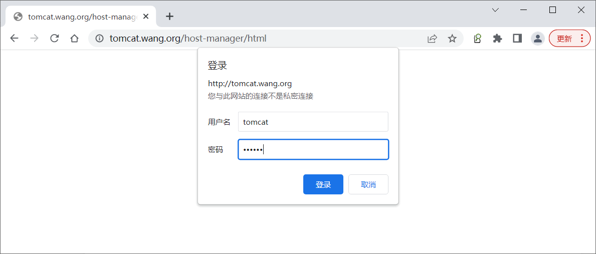
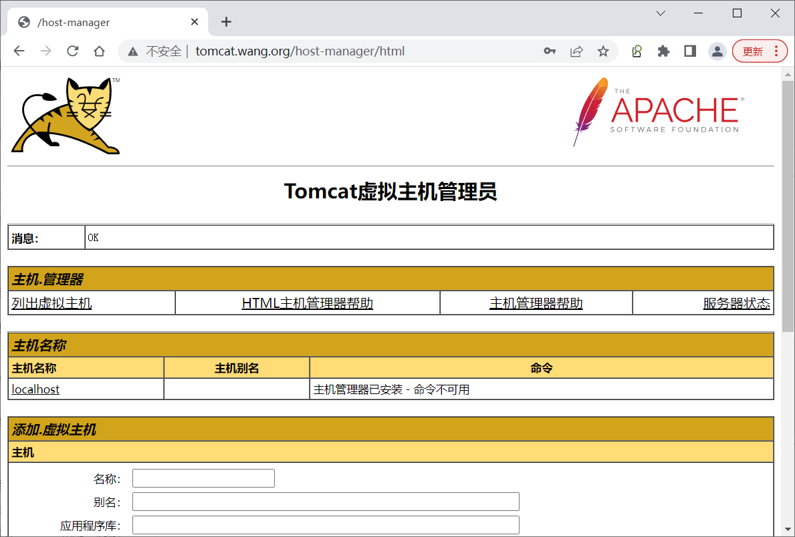

[← Back to Docker Container Technology Index]({{ '/subjects/Docker/' | relative_url }})



# 24 Building and Deploying Tomcat
### 5.7 实战案例: 构建和部署 Tomcat

```yaml
[root@ubuntu2204 tomcat]#ls
docker-compose.yaml  tomcat
[root@ubuntu2204 tomcat]#cat tomcat/
Dockerfile                host-manager-context.xml  manager-context.xml
tomcat-users.xml
[root@ubuntu2204 tomcat]#cat tomcat/Dockerfile
FROM tomcat:jdk11
RUN cd /usr/local/tomcat/webapps.dist && mv *  /usr/local/tomcat/webapps/
COPY ./manager-context.xml /usr/local/tomcat/webapps/manager/META-
INF/context.xml
COPY ./host-manager-context.xml /usr/local/tomcat/webapps/host-manager/META-
INF/context.xml
[root@ubuntu2204 tomcat]#cat docker-compose.yaml
version: '3.6'
volumes:
tomcat_apps: {}
networks:
tomcat_net:
driver: bridge
ipam:
config:
- subnet: 172.27.0.0/24
services:
tomcat:
#image: tomcat:jdk11
image: tomcat:v1.0
build:
context: tomcat
dockerfile: Dockerfile
hostname: tomcat.bowen.org
container_name: tomcat
ports:
- 80:8080
volumes:
- tomcat_apps:/usr/local/tomcat/webapps
- ./tomcat/tomcat-users.xml:/usr/local/tomcat/conf/tomcat-users.xml
networks:
tomcat_net:
ipv4_address: 172.27.0.100
aliases:
- tomcat
- apps
environment:
TZ: Asia/Shanghai
restart: always
```

```bash
#执行构建
[root@ubuntu2204 tomcat]#docker-compose build
Building tomcat
Sending build context to Docker daemon  9.728kB
Step 1/4 : FROM tomcat:jdk11
---> b0e0b0a92cf9
Step 2/4 : RUN cd /usr/local/tomcat/webapps.dist && mv *
/usr/local/tomcat/webapps/
---> Running in 82a39574f96a
Removing intermediate container 82a39574f96a
---> 538aa78d16c6
Step 3/4 : COPY ./manager-context.xml /usr/local/tomcat/webapps/manager/META-
INF/context.xml
---> 299f478e5315
Step 4/4 : COPY ./host-manager-context.xml /usr/local/tomcat/webapps/host-
manager/META-INF/context.xml
---> b59ab6ab47a2
Successfully built b59ab6ab47a2
Successfully tagged tomcat:v1.0
```

```json
[root@ubuntu2204 tomcat]#docker-compose ps
Name        Command       State                  Ports
-----------------------------------------------------------------------
tomcat   catalina.sh run   Up      0.0.0.0:80->8080/tcp,:::80->8080/tcp
[root@ubuntu2204 tomcat]#docker inspect  tomcat
"Networks": {
"tomcat_tomcat_net": {
"IPAMConfig": {
"IPv4Address": "172.27.0.100"
},
"Links": null,
"Aliases": [
"apps",
"tomcat",
"f605940d1d2d",
"tomcat.bowen.org"
],
"NetworkID":
"d018a4247fd4c6884b471f0f067d0d7e3479faed6fb66550faf5f747c1817955",
"EndpointID":
"8be0aa3c3d2e4f6475a3807e91617aa3fc31b271e67848b5f07a2c1e908d2e00",
"Gateway": "172.27.0.1",
"IPAddress": "172.27.0.100",
"IPPrefixLen": 24,
"IPv6Gateway": "",
"GlobalIPv6Address": "",
"GlobalIPv6PrefixLen": 0,
"MacAddress": "02:42:ac:1b:00:64",
"DriverOpts": null
}
}
}
}
]
```

```bash
[root@ubuntu2204 tomcat]#docker network ls
NETWORK ID     NAME                DRIVER    SCOPE
e51355015d91   bridge              bridge    local
80a0551b1d7a   host                host      local
3482005b3bbd   none                null      local
d018a4247fd4   tomcat_tomcat_net   bridge    local
[root@ubuntu2204 tomcat]#docker volume ls
DRIVER    VOLUME NAME
local     tomcat_tomcat_apps
[root@ubuntu2204 tomcat]#ls /var/lib/docker/volumes/
backingFsBlockDev  metadata.db  tomcat_tomcat_apps
[root@ubuntu2204 tomcat]#ls /var/lib/docker/volumes/tomcat_tomcat_apps/_data/
docs  examples  host-manager  manager  ROOT
```

```text
#浏览器访问,输入用户名和密码:tomcat/123456
http://tomcat.bowen.org/
```













<nav class="article-end" aria-label="章节导航">
  <a href="{{ '/subjects/Docker/23-deploying-the-spug-operations-platform.html' | relative_url }}">← Previous: Practical Examples: 搭建运维平台 Spug</a>
  <a href="{{ '/subjects/Docker/' | relative_url }}">Back to Docker Container Technology Index</a>
  <a href="{{ '/subjects/Docker/25-deploying-the-ruoyi-microservices-project.html' | relative_url }}">Next: Practical Examples：RuoYI 微服务项目 →</a>
</nav>
