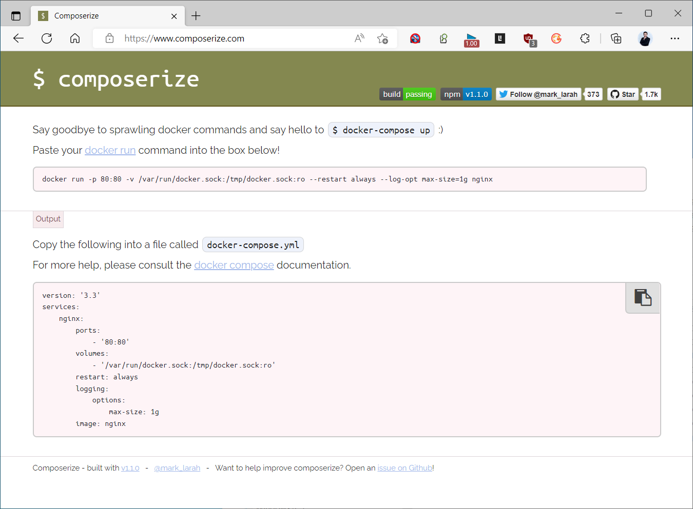
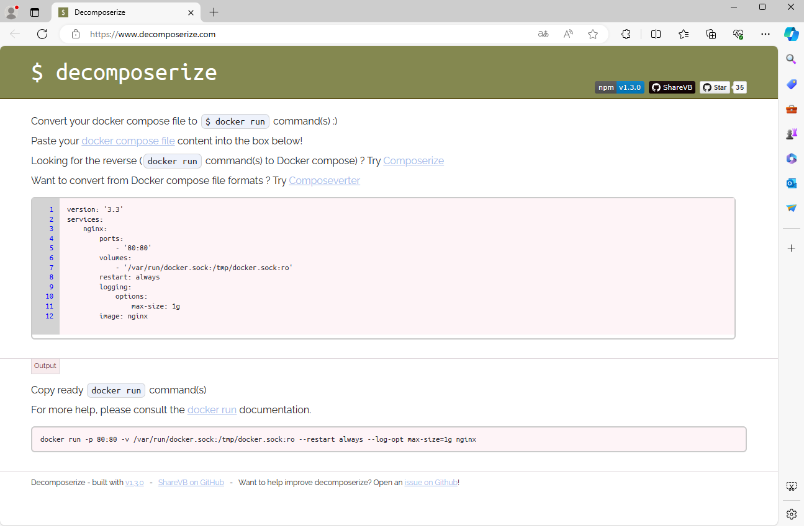

[← Back to Docker Container Technology Index]({{ '/subjects/Docker/' | relative_url }})



# 26 Converting Between Docker Run and Compose
### 5.9 实战案例: docker run 和 Docker Compose 文件相互转换

利用网站将docker 命令自动生成 Docker Compose

<https://www.composerize.com/>



利用网站 Docker Compose 文件转换为 docker run  命令

<https://www.decomposerize.com/>



范例：

```text
docker run -p 80:80 --name wordpress --network wordpress-net  -e
WORDPRESS_DB_HOST=mysql -e WORDPRESS_DB_NAME=wordpress -e
WORDPRESS_DB_USER=wordpress -e WORDPRESS_DB_PASSWORD=123456  -d -v
/data/wordpress:/var/www/html  registry.cn-
beijing.aliyuncs.com/bowenxiaochun/wordpress:php8.2-apache
```

```text
docker run   --name wordpress  -d  -p 8080:80 --network wordpress-net -v
/data/wordpress:/var/www/html --restart=always  registry.cn-
beijing.aliyuncs.com/bowenxiaochun/wordpress:php8.2-apache
docker run --name mysql  -d   --network wordpress-net -e
MYSQL_ROOT_PASSWORD=123456 -e MYSQL_DATABASE=wordpress -e MYSQL_USER=wordpress -
e MYSQL_PASSWORD=123456 -v /data/mysql:/var/lib/mysql --restart=always
registry.cn-beijing.aliyuncs.com/bowenxiaochun/mysql:8.0.29-oracle
```

```yaml
[root@ubuntu2204 wordpress]#cat docker-compose.yml
name: wordpress
services:
mysql:
container_name: mysql
networks:
- wordpress-net
environment:
- MYSQL_ROOT_PASSWORD=123456
- MYSQL_DATABASE=wordpress
- MYSQL_USER=wordpress
- MYSQL_PASSWORD=123456
volumes:
- /data/mysql:/var/lib/mysql
restart: always
image: registry.cn-beijing.aliyuncs.com/bowenxiaochun/mysql:8.0.29-oracle
wordpress:
ports:
- 80:80
container_name: wordpress
networks:
- wordpress-net
environment:
- WORDPRESS_DB_HOST=mysql
- WORDPRESS_DB_NAME=wordpress
- WORDPRESS_DB_USER=wordpress
- WORDPRESS_DB_PASSWORD=123456
volumes:
- /data/wordpress:/var/www/html
image: registry.cn-beijing.aliyuncs.com/bowenxiaochun/wordpress:php8.2-
apache
depends_on:
- mysql
networks:
wordpress-net:
ipam:
driver: default
config:
- subnet: 172.27.0.0/16
#生成自定义网络，网段IP自动分配置
#networks:
#wordpress-net:
```

范例：

```yaml
docker run -d  -p 8080:80 --network bridge2 --name wordpress2 -v
/data/wordpress2:/var/www/html --restart=always  registry.cn-
beijing.aliyuncs.com/bowenxiaochun/wordpress:php8.2-apache
docker run --network bridge2 -e MYSQL_ROOT_PASSWORD=123456 -e
MYSQL_DATABASE=wordpress -e MYSQL_USER=wordpress -e MYSQL_PASSWORD=123456 --name
mysql2 -d  -v /data/mysql2:/var/lib/mysql --restart=always registry.cn-
beijing.aliyuncs.com/bowenxiaochun/mysql:8.0.29-oracle
#利用网站转换为docker-compose.yaml格式文件
[root@ubuntu2204 wordpress]#cat docker-compose.yaml
#version: "3"
name: wordpress
services:
mysql:
networks:
- bridge2
environment:
- MYSQL_ROOT_PASSWORD=123456
- MYSQL_DATABASE=wordpress
- MYSQL_USER=wordpress
- MYSQL_PASSWORD=123456
container_name: mysql2
volumes:
- /data/mysql2:/var/lib/mysql
restart: always
image:registry.cn-beijing.aliyuncs.com/bowenxiaochun/mysql:8.0.29-oracle
wordpress:
ports:
- 8080:80
networks:
- bridge2
container_name: wordpress2
volumes:
- /data/wordpress2:/var/www/html
restart: always
#image: wordpress:php7.4-apache
image: registry.cn-beijing.aliyuncs.com/bowenxiaochun/wordpress:php8.2-
apache
#网络自行修改
networks:
bridge2:
ipam:
driver: default
config:
- subnet: 172.27.0.0/24
```

范例：

```yaml
#docker run -d --name myweb -p 8888:80 -v /data/myweb:/usr/share/nginx/html --
restart always nginx:1.25.2
[root@ubuntu2204 docker-compose]#cat nginx/docker-compose.yaml
version: '3.3'
services:
nginx:
container_name: myweb
ports:
- '8888:80'
volumes:
- '/data/myweb:/usr/share/nginx/html'
restart: always
image: 'nginx:1.25.2'
```

范例：

```yaml
#docker run -d --name myweb2 -p 9999:80 -v myweb:/usr/share/nginx/html --restart
always nginx:1.25.2
[root@ubuntu2204 docker-compose]#cat nginx-volume/docker-compose.yaml
version: '3.3'
services:
nginx:
container_name: myweb2
ports:
- '9999:80'
volumes:
- 'myweb:/usr/share/nginx/html'
restart: always
image: 'nginx:1.25.2'
volumes:
myweb:
```



<nav class="article-end" aria-label="章节导航">
  <a href="{{ '/subjects/Docker/25-deploying-the-ruoyi-microservices-project.html' | relative_url }}">← Previous: Practical Examples：RuoYI 微服务项目</a>
  <a href="{{ '/subjects/Docker/' | relative_url }}">Back to Docker Container Technology Index</a>
  <a href="{{ '/subjects/Docker/27-using-json-configuration-files.html' | relative_url }}">Next: Using JSON Configuration Files →</a>
</nav>
