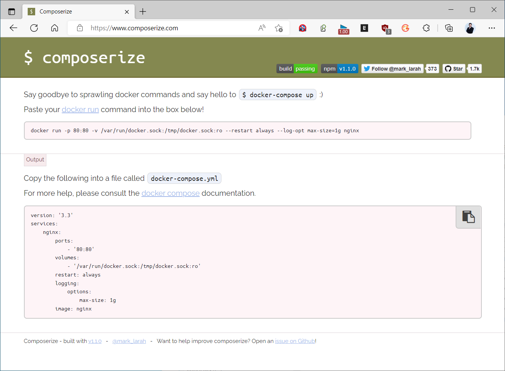

[← 返回 Docker 容器技术目录]({{ '/subjects/Docker/' | relative_url }})



# 26 docker run 与 Compose 配置转换

`docker run` 适合一次性启动单个容器；Compose 把服务、端口、卷、环境变量和网络写成可复用的声明文件。两者可以对应，但不是机械地把命令复制到 YAML：原笔记中的参数被 PDF 换行拆开、YAML 缩进消失，且将数据库密码写成固定明文。下面先做一个单服务转换，再解释多服务的差异。

## 26.1 单服务：从 run 到 Compose

这条命令在本机回环地址发布 Nginx 的 80 端口，并把网页目录挂载到容器中：

```bash
mkdir -p ./site
printf '<h1>Compose 测试</h1>\n' > ./site/index.html
docker run -d --name web-demo --restart unless-stopped \
  -p 127.0.0.1:8080:80 \
  -v "$(pwd)/site:/usr/share/nginx/html:ro" \
  nginx:1.27
```

等价的 `compose.yaml`：

```yaml
services:
  web:
    image: nginx:1.27
    container_name: web-demo
    restart: unless-stopped
    ports:
      - "127.0.0.1:8080:80"
    volumes:
      - ./site:/usr/share/nginx/html:ro
```

两种方式**任选其一启动**，不能同时运行，因为容器名和宿主机端口会冲突。切换前先停止并移除旧的演示容器；上面的 bind mount `./site` 留在宿主机，不会因移除容器而丢失。Compose 相对路径以项目目录为基准，而 `docker run` 示例用 `$(pwd)` 展开绝对路径。

```bash
docker rm -f web-demo     # 仅清理本节演示容器
docker compose config    # 合并并校验 Compose 文件
docker compose up -d
docker compose ps
curl -fsS http://127.0.0.1:8080/
```

`container_name` 只为和原命令逐项对照；通常可省略，交由 Compose 生成名称，便于扩展服务。`version:` 在 Compose v2 中不是必需的；旧转换网站生成的 `version: '3.3'` 并不是现代 Compose 配置的关键。

## 26.2 多服务：WordPress 与 MySQL

原笔记的两条 `docker run` 分别创建 MySQL 与 WordPress，并用 `--network wordpress-net` 让 WordPress 能通过 `mysql` 名称访问数据库。Compose 会为同一项目自动创建网络，所以无需为普通单项目通信手动指定固定网段。数据库数据放命名卷，网页端口只绑定本机以便学习。先在项目目录的受控环境文件中设置 `DB_ROOT_PASSWORD` 和 `DB_PASSWORD`，不要把真实密码放进正文或仓库。

```yaml
services:
  mysql:
    image: mysql:8.0
    environment:
      MYSQL_ROOT_PASSWORD: ${DB_ROOT_PASSWORD:?请设置数据库根密码}
      MYSQL_DATABASE: wordpress
      MYSQL_USER: wordpress
      MYSQL_PASSWORD: ${DB_PASSWORD:?请设置应用数据库密码}
    volumes:
      - mysql_data:/var/lib/mysql
    healthcheck:
      test: ["CMD-SHELL", "mysqladmin ping -h localhost -u root -p\"$$MYSQL_ROOT_PASSWORD\""]
      interval: 10s
      timeout: 5s
      retries: 10
    restart: unless-stopped

  wordpress:
    image: wordpress:php8.2-apache
    depends_on:
      mysql:
        condition: service_healthy
    environment:
      WORDPRESS_DB_HOST: mysql:3306
      WORDPRESS_DB_NAME: wordpress
      WORDPRESS_DB_USER: wordpress
      WORDPRESS_DB_PASSWORD: ${DB_PASSWORD:?请设置应用数据库密码}
    ports:
      - "127.0.0.1:8081:80"
    volumes:
      - wordpress_data:/var/www/html
    restart: unless-stopped

volumes:
  mysql_data:
  wordpress_data:
```

上面的 `mysql` 是**服务名**，在项目网络内可解析；`depends_on` 加健康检查让 WordPress 等数据库就绪，但不代替数据库备份和应用重试。`${DB_PASSWORD:?...}` 是 Compose 变量替换，不是把密码烘进镜像。环境变量仍能通过容器检查被有 Docker 权限的人读到；生产环境应按部署平台使用更严格的秘密管理。

```bash
docker compose config
docker compose up -d
docker compose ps
docker compose logs --tail 60 mysql wordpress
```

从 `http://127.0.0.1:8081/` 完成 WordPress 初始化，并核对其是否能连接 MySQL。已有数据库目录不是空目录时，`MYSQL_*` 初始化变量不会重新创建用户和数据库；切换方式前应备份卷与配置，不能只把 `docker run` 翻译为 Compose 就认为数据已迁移。

## 26.3 在线转换工具的边界

[Composerize](https://www.composerize.com/) 可把 `docker run` 命令转换为 Compose 草稿，[Decomposerize](https://www.decomposerize.com/) 可做反向草稿。它们能帮助识别 `-p`、`-v`、`-e`、`--network`、`--restart` 对应的字段，但**不能替你选择持久化策略、凭据管理、健康检查、端口暴露范围和版本兼容性**。不要把真实密钥或内部地址贴到第三方在线页面；原示例截图甚至包含 Docker socket 挂载，这种配置授予容器很高的宿主机控制能力，不应不经评估直接照搬。



转换后始终用 `docker compose config` 验证语法，逐项对照原命令中的镜像、命令、环境、端口、卷、网络和重启策略，再在测试环境执行 `up` 与应用级验证。反向转换尤其要注意 Compose 的服务发现、多个服务、健康依赖和命名卷无法完整映射到孤立的一条 `docker run` 命令。



<nav class="article-end" aria-label="章节导航">
  <a href="{{ '/subjects/Docker/25-deploying-the-ruoyi-microservices-project.html' | relative_url }}">← 上一篇：实战案例：RuoYI 微服务项目</a>
  <a href="{{ '/subjects/Docker/' | relative_url }}">返回 Docker 容器技术目录</a>
  <a href="{{ '/subjects/Docker/27-using-json-configuration-files.html' | relative_url }}">下一篇：使用 JSON 格式文件 →</a>
</nav>
