[← 返回Docker 容器技术目录]({{ '/subjects/Docker/' | relative_url }})



# 28 官方 Docker 仓库
## 6 Docker 仓库管理

Docker仓库，类似于yum仓库，是用来保存镜像的仓库。

为了方便的管理和使用docker镜像,可以将镜像集中保存至Docker仓库中，将制作好的镜像push到仓库集中保存，在需要镜像时，从仓库中pull镜像即可。

Docker 仓库分为公有云仓库和私有云仓库

公有云仓库:  由互联网公司对外公开的仓库

官方阿里云等第三方仓库

私有云仓库:  组织内部搭建的仓库，一般只为组织内部使用，常使用下面软件搭建仓库

docker registory docker harbor

### 6.1 官方 Docker 仓库

将自制的镜像上传至docker仓库；https://hub.docker.com/

### 注册账户

访问hub.docker.com注册账户，并登录

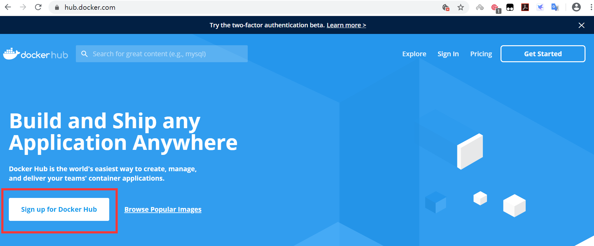

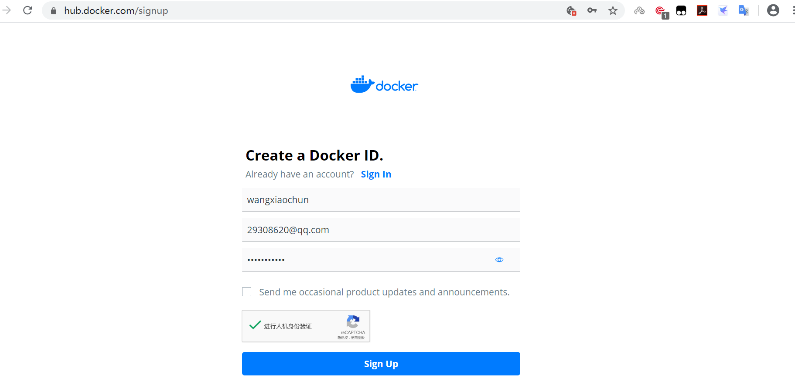

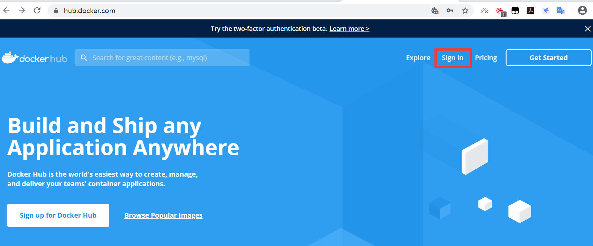

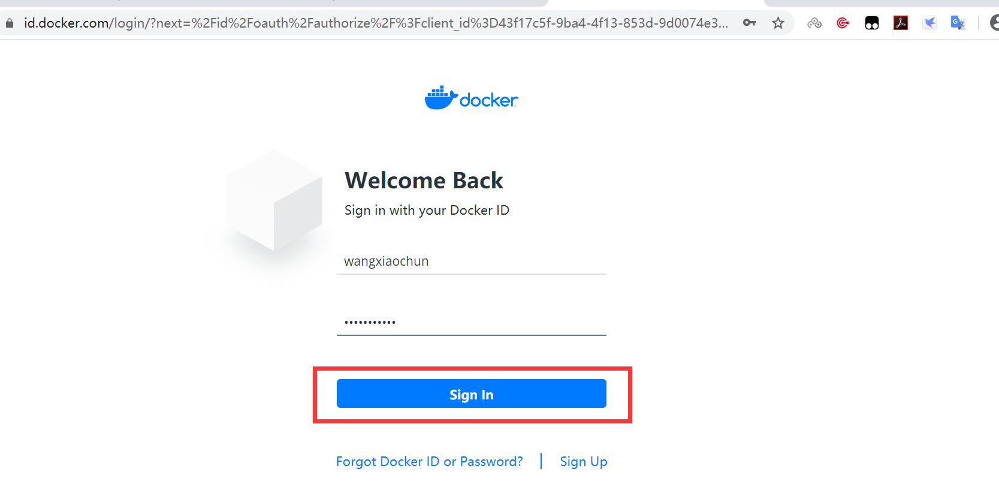

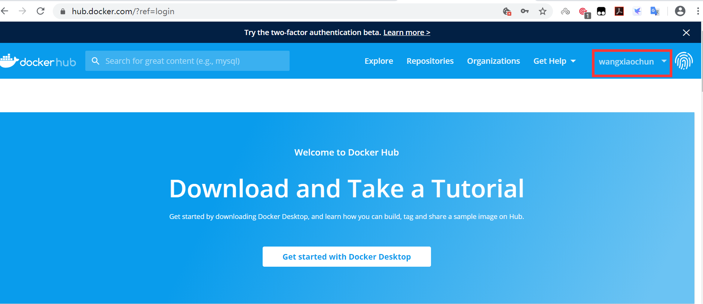

### 使用用户仓库管理镜像

每个注册用户都可以上传和管理自已的镜像

### 用户登录

上传镜像前需要执行docker login命令登录，登录后生成~/.docker/config.json文件保存验证信息

格式

```text
docker login [OPTIONS] [SERVER]
选项:
-p, --password string   Password
--password-stdin    Take the password from stdin
-u, --username string   Username
```

范例:

```bash
#登录docker官方仓库方法1
[root@ubuntu1804 ~]#docker login  -u bowenxiaochun -pP@ssw0rd!  docker.io
WARNING! Using --password via the CLI is insecure. Use --password-stdin.
WARNING! Your password will be stored unencrypted in /root/.docker/config.json.
Configure a credential helper to remove this warning. See
https://docs.docker.com/engine/reference/commandline/login/#credentials-store
Login Succeeded
#登录docker官方仓库方法2
[root@ubuntu1804 ~]#docker login
Login with your Docker ID to push and pull images from Docker Hub. If you don't
have a Docker ID, head over to https://hub.docker.com to create one.
Username: bowenxiaochun
Password:
WARNING! Your password will be stored unencrypted in /root/.docker/config.json.
Configure a credential helper to remove this warning. See
https://docs.docker.com/engine/reference/commandline/login/#credentials-store
Login Succeeded
[root@ubuntu1804 ~]#
#登录成功后,自动生成验证信息,下次会自动登录,而无需手动登录
[root@ubuntu1804 ~]#cat .docker/config.json
{
"auths": {
"https://index.docker.io/v1/": {
"auth": "d2FuZ3hpYW9jaHVuOjEyMzQ1Ng=="
}
},
"HttpHeaders": {
"User-Agent": "Docker-Client/19.03.5 (linux)"
}
}[root@ubuntu1804 ~]#
```

### 给本地镜像打标签

上传本地镜像前必须先给上传的镜像用docker tag 命令打标签

标签格式:   docker.io/用户帐号/镜像名:TAG

范例:

```bash
[root@ubuntu1804 ~]#docker tag alpine:3.11 docker.io/bowenxiaochun/alpine:3.11-v1
[root@ubuntu1804 ~]#docker images
REPOSITORY              TAG                 IMAGE ID            CREATED
SIZE
haproxy-centos7         2.1.2               5eccdb29a058        4 hours ago
428MB
nginx-ubuntu1804        1.16.1              19efdd23ac87        18 hours ago
378MB
nginx-alpine            1.16.1              978a43bbb61d        19 hours ago
211MB
alpine-base             3.11                b162eecf4da9        20 hours ago
182MB
tomcat-web              app2                0e1760fe79a6        40 hours ago
838MB
tomcat-web              app1                76016219a0ca        40 hours ago
838MB
tomcat-base             v8.5.50             8d5395cb72c4        41 hours ago
824MB
centos7-jdk             8u212               e0fe770a7ccd        42 hours ago
809MB
centos7-base            v1                  34ab3afcd3b3        43 hours ago
403MB
alpine                  3.11                e7d92cdc71fe        12 days ago
5.59MB
alpine                  latest              e7d92cdc71fe        12 days ago
5.59MB
bowenxiaochun/alpine     3.11-v1             e7d92cdc71fe        12 days ago
5.59MB
ubuntu                  18.04               ccc6e87d482b        2 weeks ago
64.2MB
ubuntu                  bionic              ccc6e87d482b        2 weeks ago
64.2MB
centos                  centos7.7.1908      08d05d1d5859        2 months ago
204MB
```

### 上传本地镜像至官网

```bash
#如tag省略,将上传指定REPOSITORY的所有版本,如下示例
#[root@ubuntu1804 ~]#docker push docker.io/bowenxiaochun/alpine
[root@ubuntu1804 ~]#docker push docker.io/bowenxiaochun/alpine:3.11-v1
The push refers to repository [docker.io/bowenxiaochun/alpine]
5216338b40a7: Mounted from bowenlinux/alpine-base
3.11-v1: digest:
sha256:ddba4d27a7ffc3f86dd6c2f92041af252a1f23a8e742c90e6e1297bfa1bc0c45 size:
528
```

### 在官网验证上传的镜像

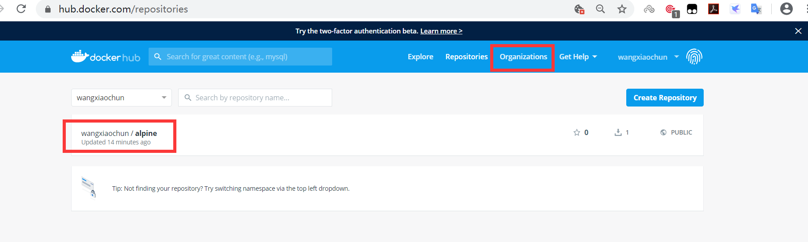

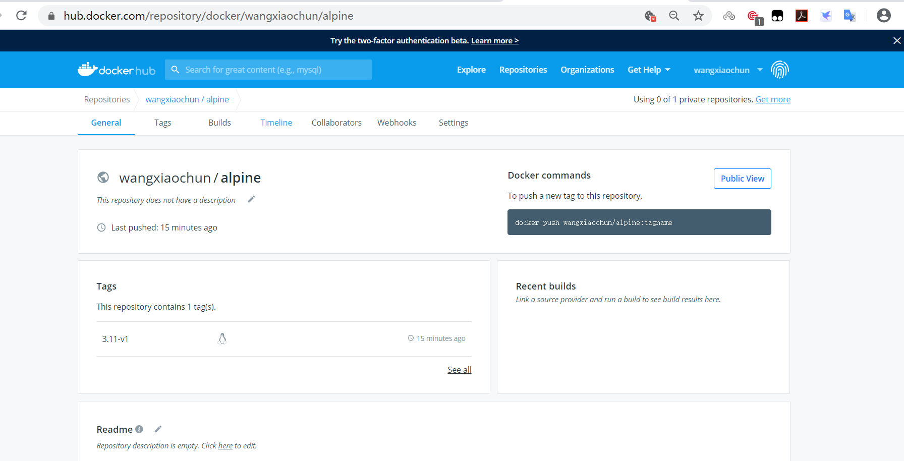

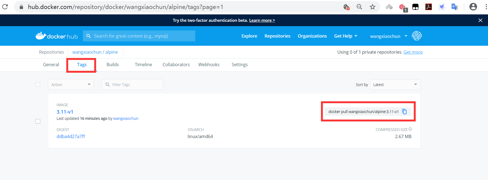

### 下载上传的镜像并创建容器

在另一台主机上下载镜像

```bash
[root@centos7 ~]#docker pull bowenxiaochun/alpine:3.11-v1
3.11-v1: Pulling from bowenxiaochun/alpine
c9b1b535fdd9: Already exists
Digest: sha256:ddba4d27a7ffc3f86dd6c2f92041af252a1f23a8e742c90e6e1297bfa1bc0c45
Status: Downloaded newer image for bowenxiaochun/alpine:3.11-v1
docker.io/bowenxiaochun/alpine:3.11-v1
[root@centos7 ~]#docker images
REPOSITORY              TAG                 IMAGE ID            CREATED
SIZE
bowenxiaochun/alpine     3.11-v1             e7d92cdc71fe        12 days ago
5.59MB
[root@centos7 ~]#docker run -it --rm bowenxiaochun/alpine:3.11-v1 sh
/ # cat /etc/issue
Welcome to Alpine Linux 3.11
Kernel \r on an \m (\l)
/ # du -sh /
5.6M    /
/ # exit
[root@centos7 ~]#
```

### 使用组织管理镜像

组织类似于名称空间，每个组织的名称全网站唯一，一个组织可以有多个用户帐户使用，并且可以指定不同用户对组织内的仓库不同的权限

三种不同权限

Read-only:  Pull and view repository details and builds Read &Write:  Pull, push, and view a repository; view, cancel, retry or trigger builds Admin:  Pull, push, view, edit, and delete a repository; edit build settings; update the repository description

### 创建组织

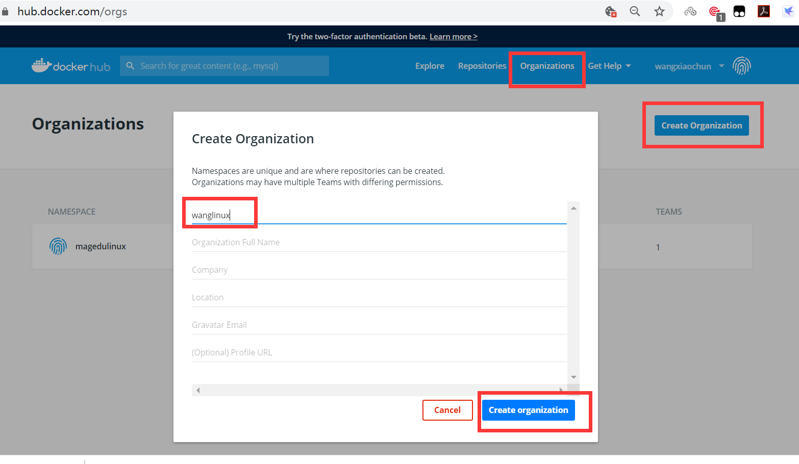

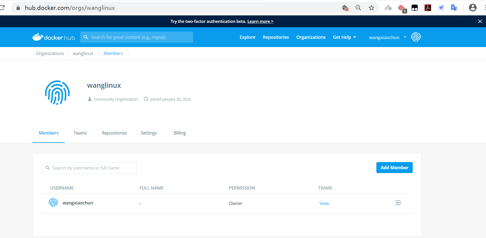

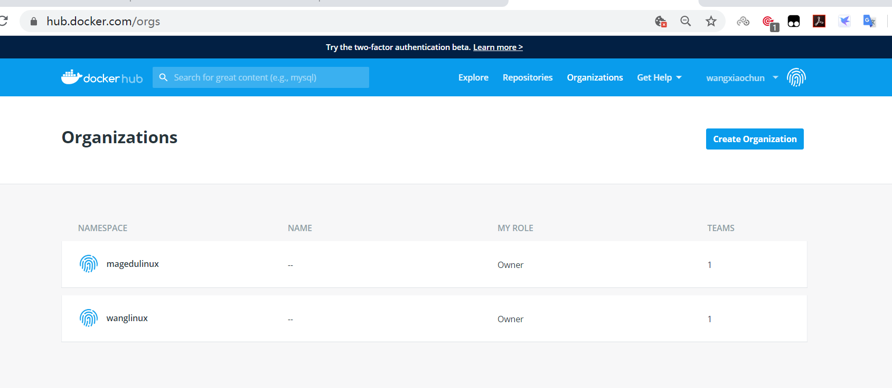

### 创建组织内的团队，并分配权限

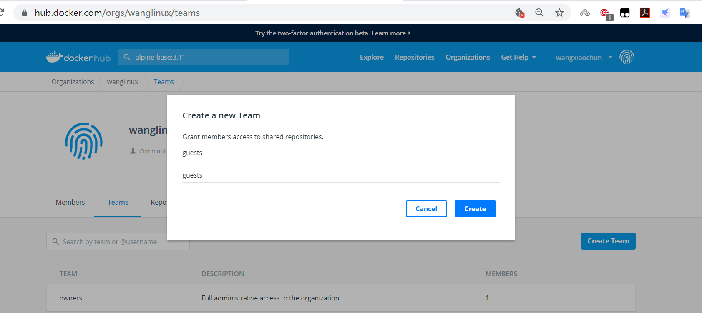

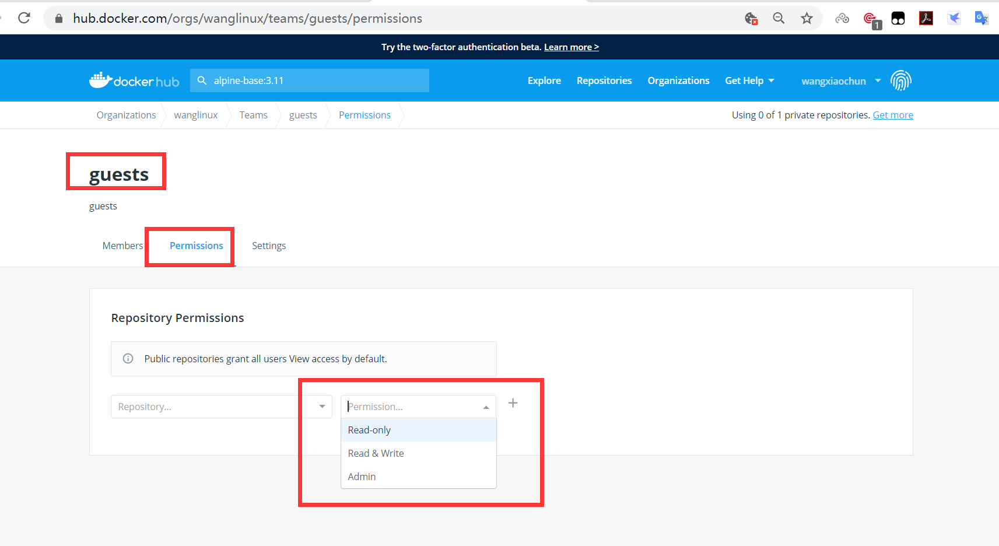

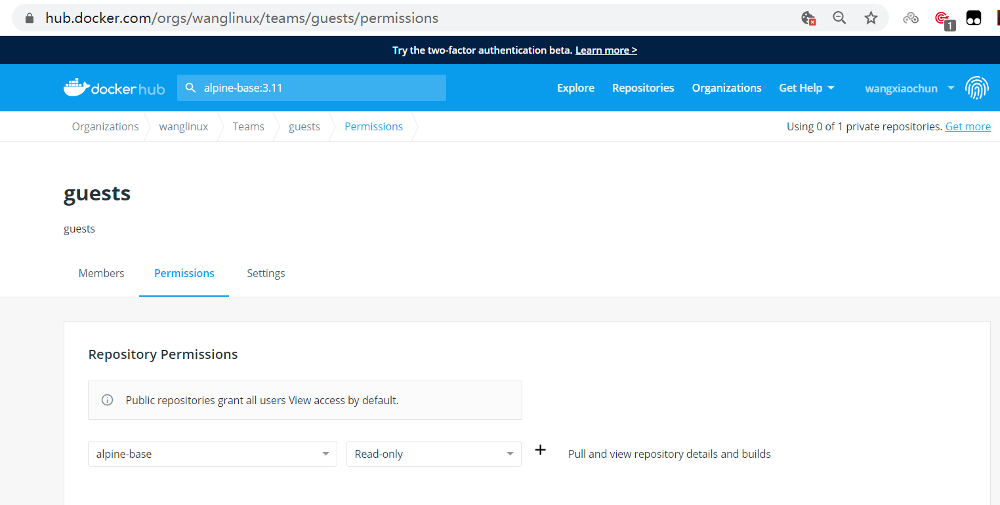

### 上传镜像前登录帐号

```json
[root@ubuntu1804 ~]#docker login docker.io
Login with your Docker ID to push and pull images from Docker Hub. If you don't
have a Docker ID, head over to https://hub.docker.com to create one.
Username: bowenxiaochun
Password:
WARNING! Your password will be stored unencrypted in /root/.docker/config.json.
Configure a credential helper to remove this warning. See
https://docs.docker.com/engine/reference/commandline/login/#credentials-store
Login Succeeded
[root@ubuntu1804 ~]#cat .docker/config.json
{
"auths": {
"https://index.docker.io/v1/": {
"auth": "d2FuZ3hpYW9jaHVuOjEyMzQ1Ng=="
}
},
"HttpHeaders": {
"User-Agent": "Docker-Client/19.03.5 (linux)"
}
}[root@ubuntu1804 ~]#
```

### 给本地镜像打标签

```bash
[root@ubuntu1804 ~]#docker tag alpine-base:3.11 docker.io/bowenlinux/alpine-
base:3.11
[root@ubuntu1804 ~]#docker images
REPOSITORY              TAG                 IMAGE ID            CREATED
SIZE
haproxy-centos7         2.1.2               5eccdb29a058        4 hours ago
428MB
nginx-ubuntu1804        1.16.1              19efdd23ac87        18 hours ago
378MB
nginx-alpine            1.16.1              978a43bbb61d        19 hours ago
211MB
alpine-base             3.11                b162eecf4da9        20 hours ago
182MB
bowenlinux/alpine-base   3.11                b162eecf4da9        20 hours ago
182MB
tomcat-web              app2                0e1760fe79a6        40 hours ago
838MB
tomcat-web              app1                76016219a0ca        40 hours ago
838MB
tomcat-base             v8.5.50             8d5395cb72c4        41 hours ago
824MB
centos7-jdk             8u212               e0fe770a7ccd        42 hours ago
809MB
centos7-base            v1                  34ab3afcd3b3        43 hours ago
403MB
alpine                  3.11                e7d92cdc71fe        12 days ago
5.59MB
alpine                  latest              e7d92cdc71fe        12 days ago
5.59MB
bowenxiaochun/alpine     3.11-v1             e7d92cdc71fe        12 days ago
5.59MB
ubuntu                  18.04               ccc6e87d482b        2 weeks ago
64.2MB
ubuntu                  bionic              ccc6e87d482b        2 weeks ago
64.2MB
centos                  centos7.7.1908      08d05d1d5859        2 months ago
204MB
```

### 上传镜像到指定的组织

```bash
[root@ubuntu1804 ~]#docker push docker.io/bowenlinux/alpine-base:3.11
The push refers to repository [docker.io/bowenlinux/alpine-base]
1783f0912dfb: Pushed
1e5e8d5ab333: Pushed
5216338b40a7: Mounted from library/alpine
3.11: digest:
sha256:7931fed46d377698dacb194d46017c53bc24f2e9ee41e893e6900c07d1153536 size:
947
```

### 在网站看查看上传的镜像

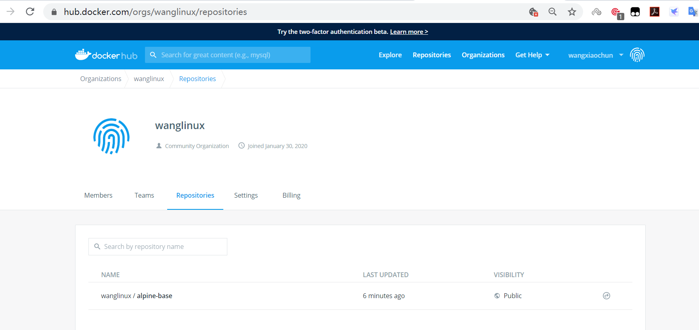

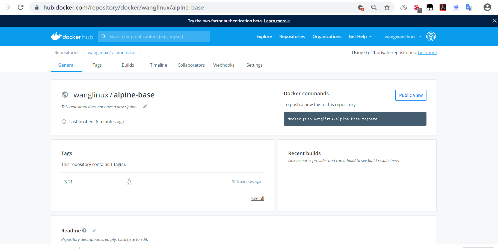

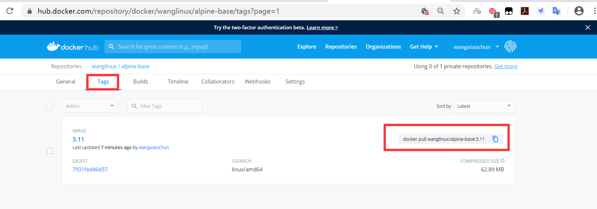

### 下载上传的镜像并运行容器

在另一台主机上下载镜像

```bash
[root@centos7 ~]#docker images
REPOSITORY          TAG                 IMAGE ID            CREATED
SIZE
[root@centos7 ~]#docker pull bowenlinux/alpine-base:3.11
3.11: Pulling from bowenlinux/alpine-base
c9b1b535fdd9: Pull complete
327af1e87fd8: Pull complete
d88818b49372: Pull complete
Digest: sha256:7931fed46d377698dacb194d46017c53bc24f2e9ee41e893e6900c07d1153536
Status: Downloaded newer image for bowenlinux/alpine-base:3.11
docker.io/bowenlinux/alpine-base:3.11
[root@centos7 ~]#docker images
REPOSITORY              TAG                 IMAGE ID            CREATED
SIZE
bowenlinux/alpine-base   3.11                b162eecf4da9        20 hours ago
182MB
[root@centos7 ~]#docker run -it --rm bowenlinux/alpine-base:3.11 sh
/ # cat /etc/issue
Welcome to Alpine Linux 3.11
Kernel \r on an \m (\l)
/ # du -sh /
190.1M  /
/ # exit
[root@centos7 ~]#
```



<nav class="article-end" aria-label="章节导航">
  <a href="{{ '/subjects/Docker/27-using-json-configuration-files.html' | relative_url }}">← Previous: Using JSON Configuration Files</a>
  <a href="{{ '/subjects/Docker/' | relative_url }}">Back to Docker Container Technology Index</a>
  <a href="{{ '/subjects/Docker/29-alibaba-cloud-docker-registry.html' | relative_url }}">Next: Alibaba Cloud Docker Registry →</a>
</nav>
