[← 返回 Docker 容器技术目录]({{ '/subjects/Docker/' | relative_url }})



# 28 官方 Docker Hub 仓库

镜像仓库解决的是**镜像的集中存放与分发**：构建者将镜像推送（push）到仓库，使用者从仓库拉取（pull）。仓库可以位于 Docker Hub、云厂商容器镜像服务，也可以由团队自行部署。本篇先以 Docker Hub 说明命名、登录、推送和拉取的完整链路；后两篇再介绍云厂商仓库与自建 Registry。

## 先认清镜像名称

完整镜像引用通常写成 `[仓库域名/]命名空间/仓库名:标签`。在 Docker Hub 上，域名 `docker.io` 通常可省略。例如 `docker.io/example-user/alpine:3.11-v1` 与 `example-user/alpine:3.11-v1` 指向同一仓库的同一标签。省略标签时默认使用 `latest`，它只是普通标签，不保证一定是最新版本；发布与部署最好显式指定版本或摘要。

个人命名空间属于用户，组织命名空间用于多人协作。镜像是否公开、谁有推送权限，由仓库与组织设置决定，并非由标签决定。

## 注册账户并创建仓库

在 [Docker Hub](https://hub.docker.com/) 注册、登录后，创建个人仓库。仓库名、可见性和命名空间需要与稍后 `docker tag` 使用的路径一致。下面保留了原教程的界面截图；页面布局可能已变化，以当前界面上的同名功能为准。

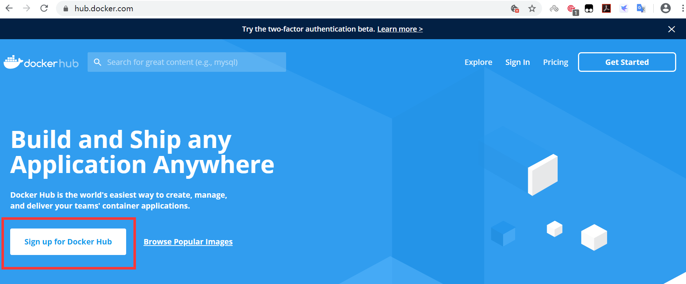

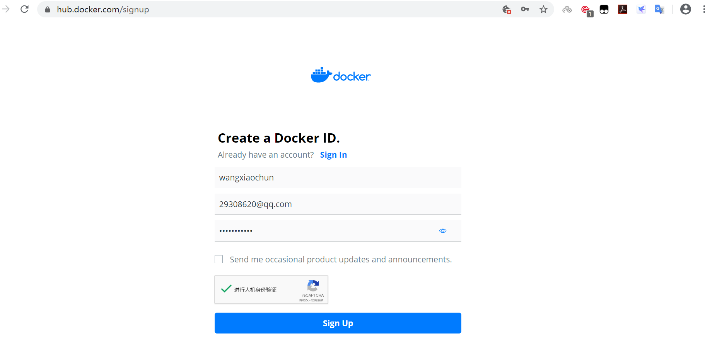

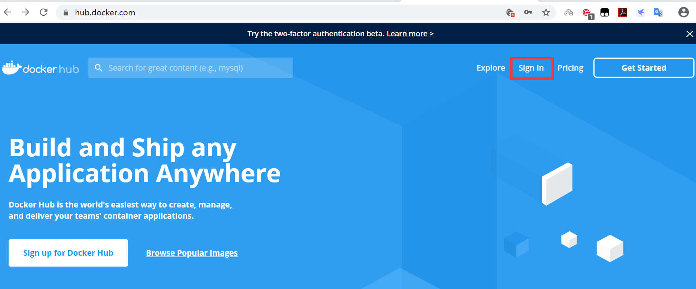

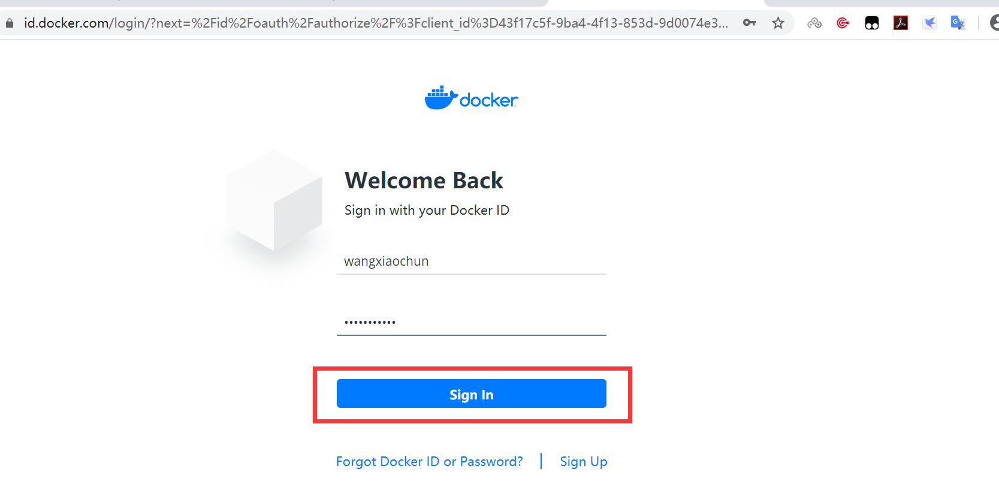

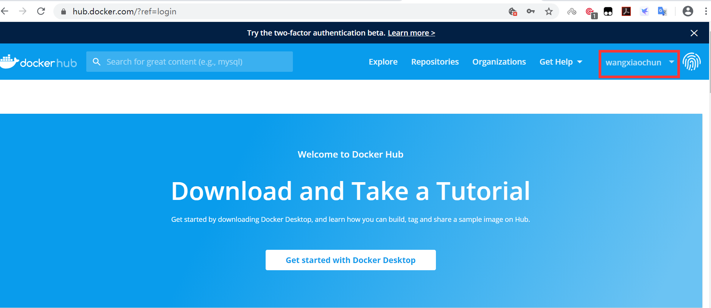

## 登录、打标签与推送

先登录，再把本地镜像标记为目标仓库地址。交互式 `docker login` 会提示输入用户名和凭据；在脚本中应通过 `--password-stdin` 传入访问令牌，不要把密码写在命令行或提交到仓库。Docker 的登录信息默认保存在用户目录的 `~/.docker/config.json`，若未配置凭据助手，应特别保护这个文件。

```bash
docker login docker.io
docker image ls
docker tag alpine:3.11 docker.io/example-user/alpine:3.11-v1
docker push docker.io/example-user/alpine:3.11-v1
```

`docker tag` 只增加一条本地名称引用，不会复制镜像层。首次推送会上传目标仓库尚未拥有的层；后续推送若看到 `Layer already exists` 或 `Mounted from`，表示服务端复用了已有层。推送完成后，可在仓库页面核对标签及镜像摘要（digest）。

**注意：** `docker push example-user/alpine` 未指定标签时，并不是“一次推送所有版本”；它会使用默认的 `latest` 标签。要发布多个版本，应逐个推送，或使用支持的 `--all-tags` 选项。

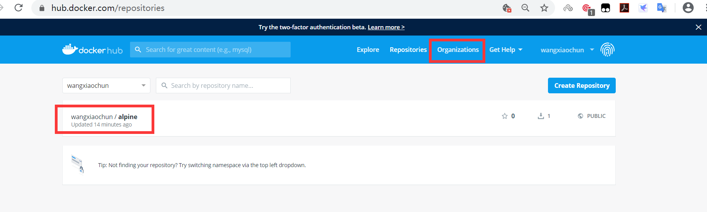

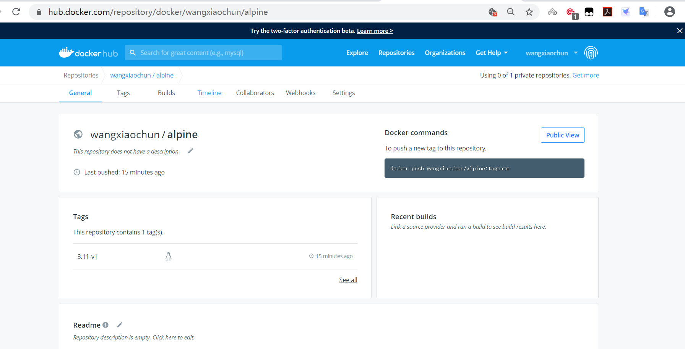

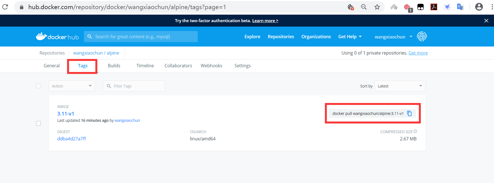

## 在另一台主机验证

公开仓库的镜像一般无需登录即可拉取；私有仓库则需要相应的读取权限。用与推送时**完全一致的标签**拉取，再运行容器验证，这比只看本机 `docker images` 更能证明分发链路可用。

```bash
docker pull docker.io/example-user/alpine:3.11-v1
docker image inspect docker.io/example-user/alpine:3.11-v1 --format '{{.Id}}'
docker run --rm docker.io/example-user/alpine:3.11-v1 cat /etc/alpine-release
```

若推送后又覆盖了同名标签，可通过 `docker pull ...@sha256:<摘要>` 精确定位不可变内容；生产部署尤其适合记录摘要。

## 组织仓库与权限

多人维护镜像时，可创建组织，将成员加入团队，再按仓库授予读取、写入或管理权限。团队成员仍使用自己的账户登录，推送路径则变为 `docker.io/example-org/仓库名:标签`。操作顺序是：创建组织与仓库 → 配置团队权限 → 登录 → 打标签 → 推送 → 从另一台主机拉取验证。

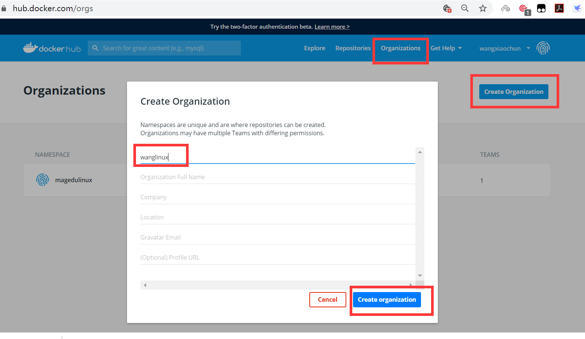

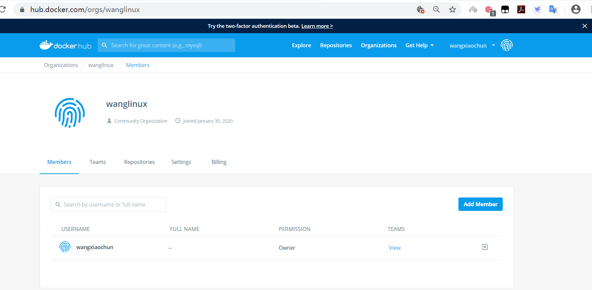

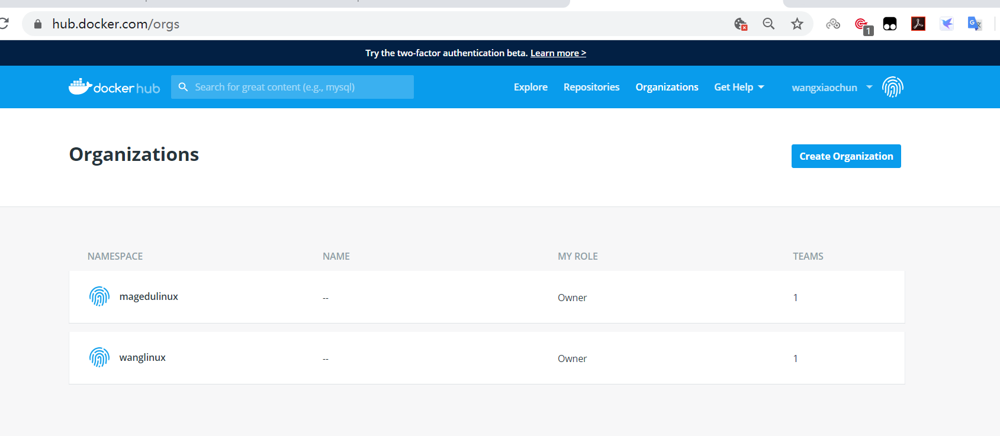

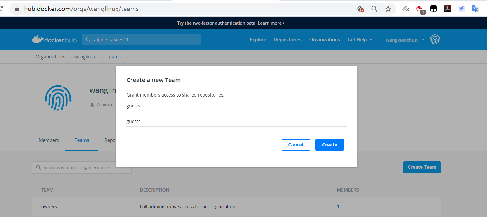

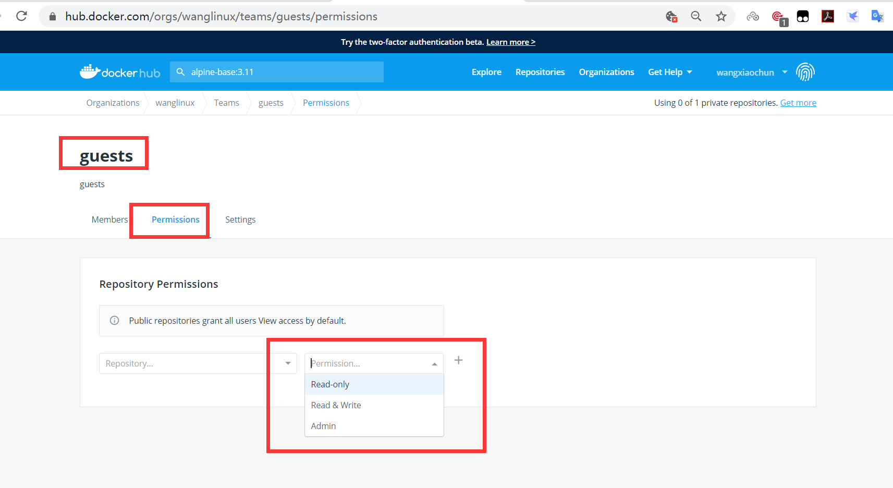

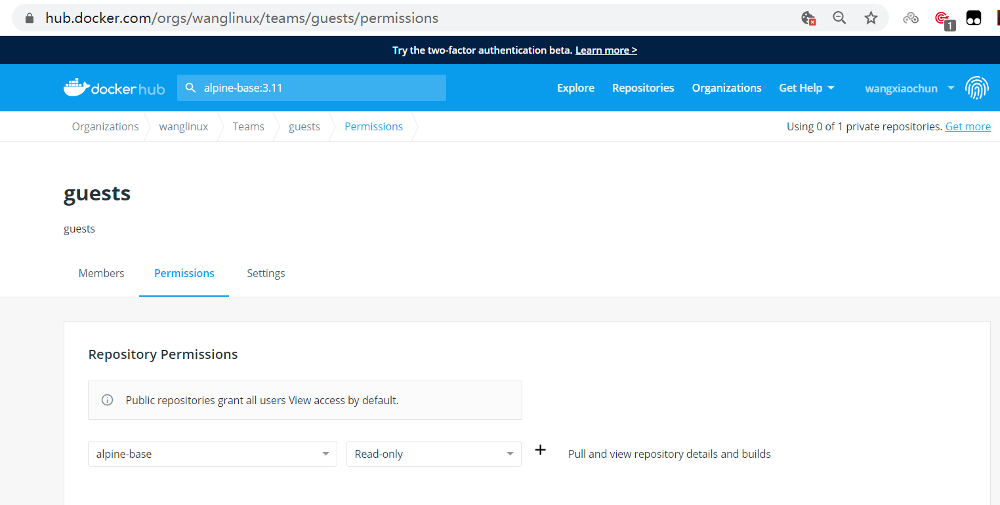

```bash
docker tag alpine:3.11 docker.io/example-org/alpine-base:3.11
docker push docker.io/example-org/alpine-base:3.11
docker pull docker.io/example-org/alpine-base:3.11
```

这里的推送成功取决于登录账户是否对 `example-org/alpine-base` 具有写入权限。遇到 `denied`，先检查命名空间、仓库可见性和团队授权，不要误认为本地镜像损坏。

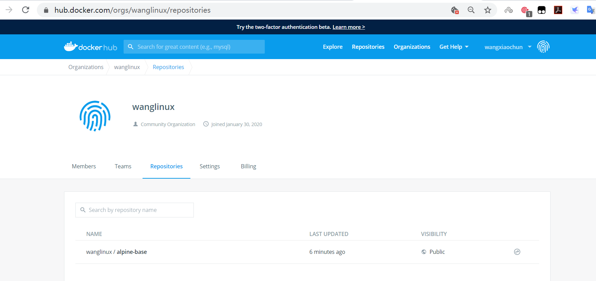

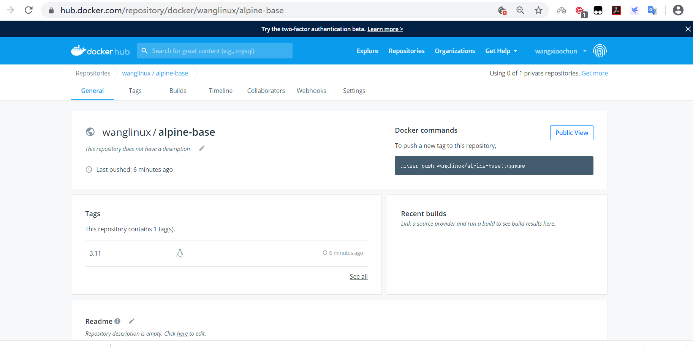

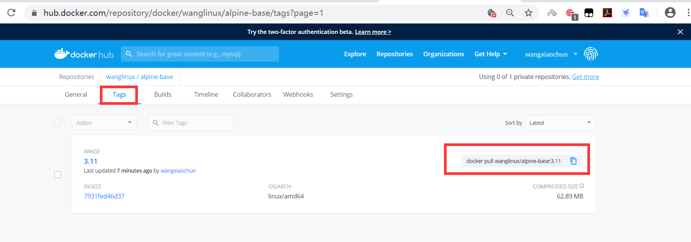



<nav class="article-end" aria-label="章节导航">
  <a href="{{ '/subjects/Docker/27-using-json-configuration-files.html' | relative_url }}">← 上一篇：使用 JSON 配置文件</a>
  <a href="{{ '/subjects/Docker/' | relative_url }}">返回 Docker 容器技术目录</a>
  <a href="{{ '/subjects/Docker/29-alibaba-cloud-docker-registry.html' | relative_url }}">下一篇：阿里云 Docker 仓库 →</a>
</nav>
