[← Back to Docker Container Technology Index]({{ '/subjects/Docker/' | relative_url }})



# 29 Alibaba Cloud Docker Registry
### 6.2 阿里云Docker仓库

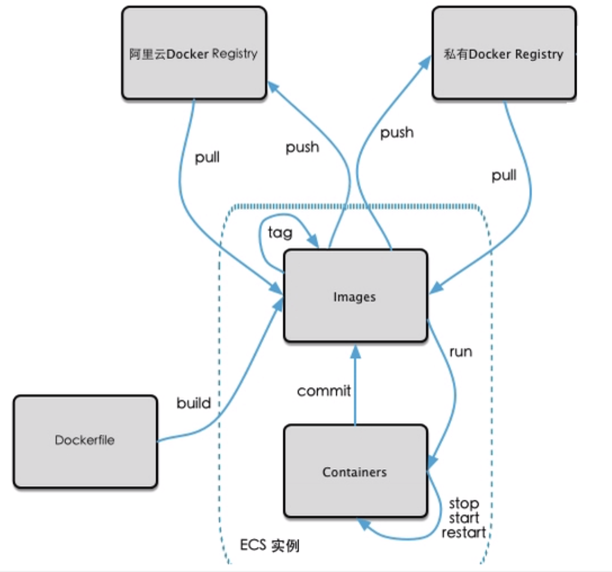

### 注册和登录阿里云仓库

用浏览器访问http://cr.console.aliyun.com，输入注册的用户信息登录网站

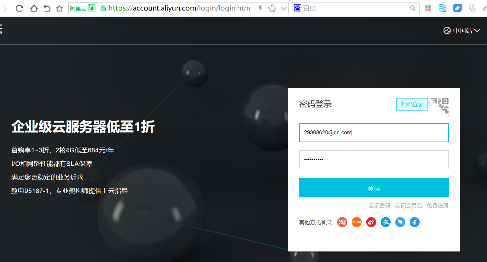

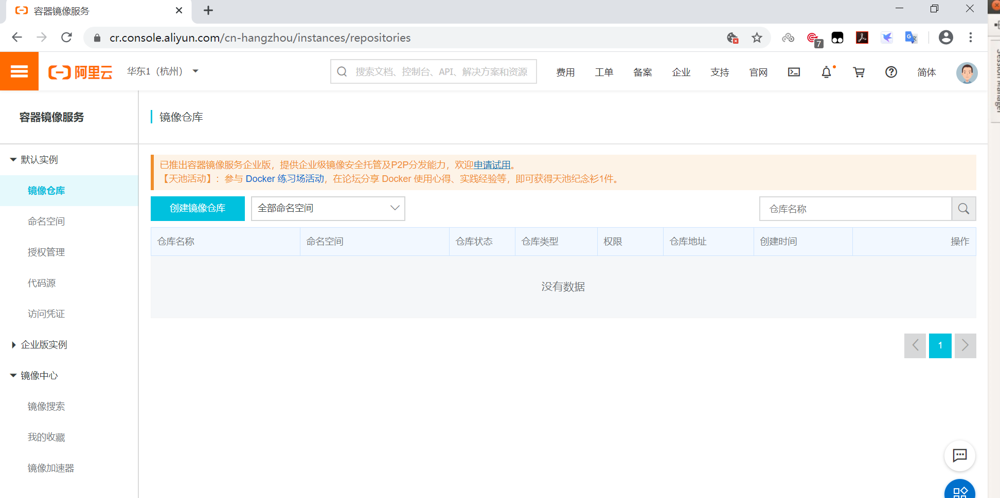

### 设置仓库专用管理密码

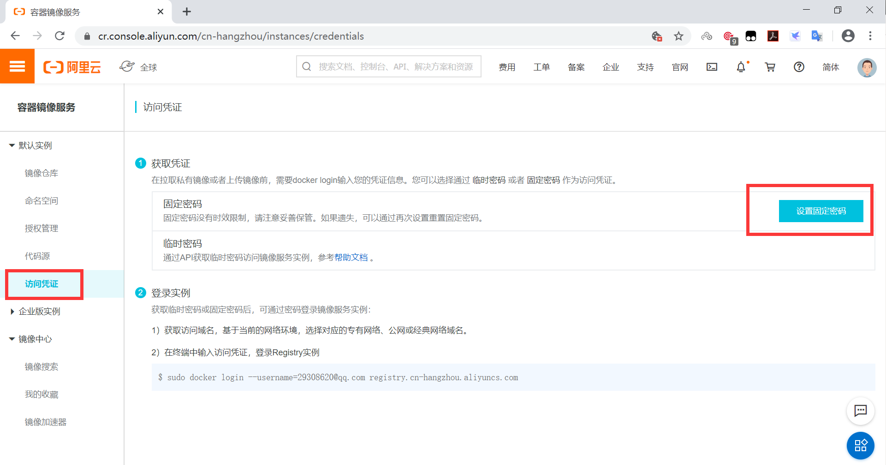

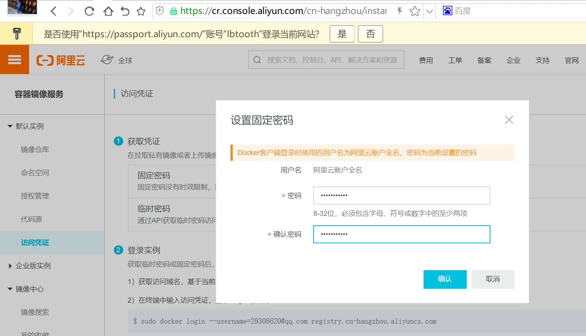

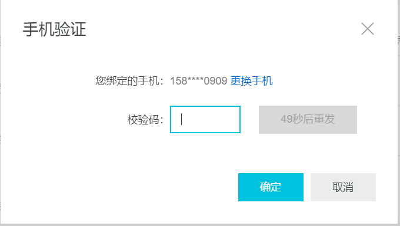

### 创建仓库

此步可不事先执行，docker push 时可以自动创建私有仓库

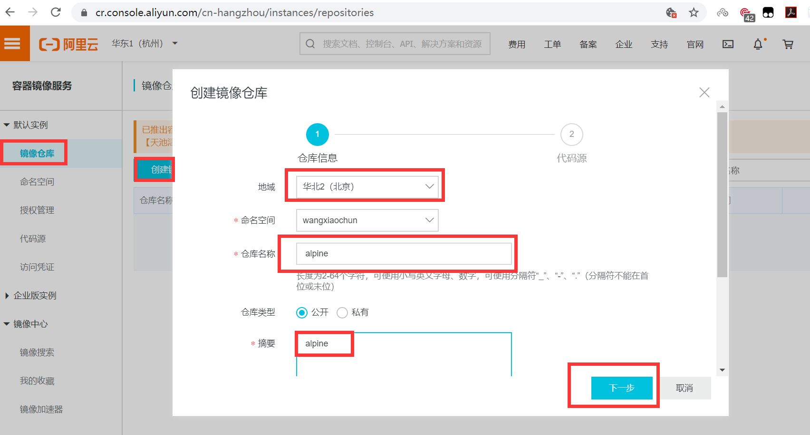

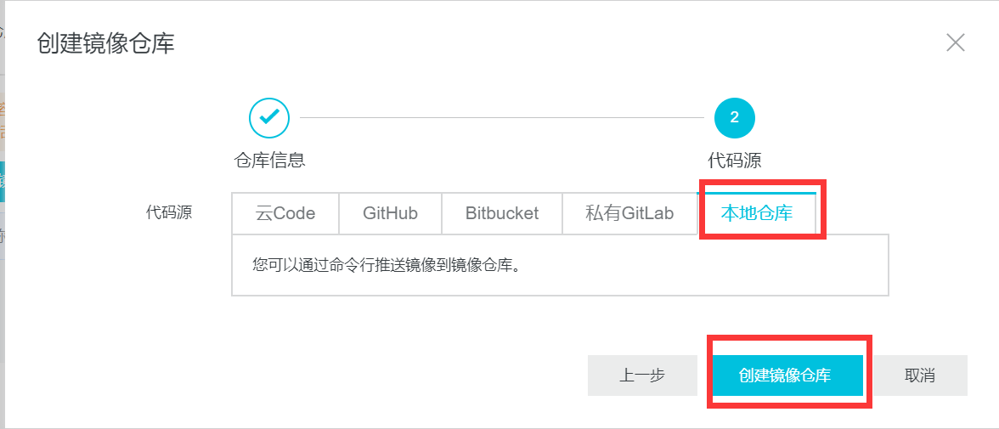

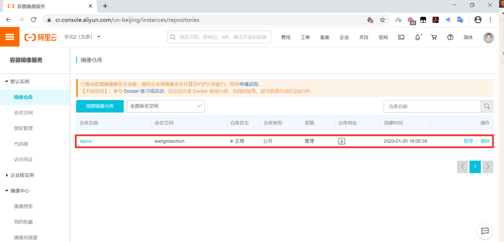

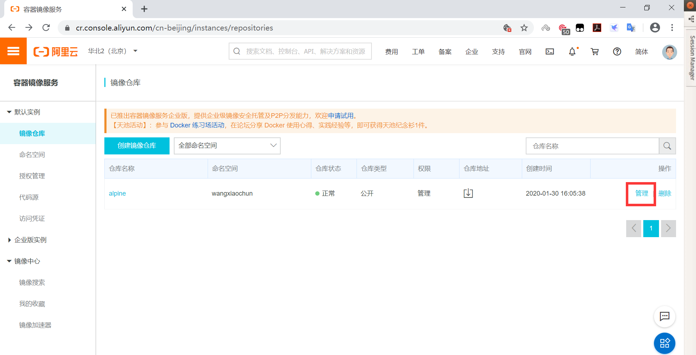

查看仓库的路径用于上传镜像使用

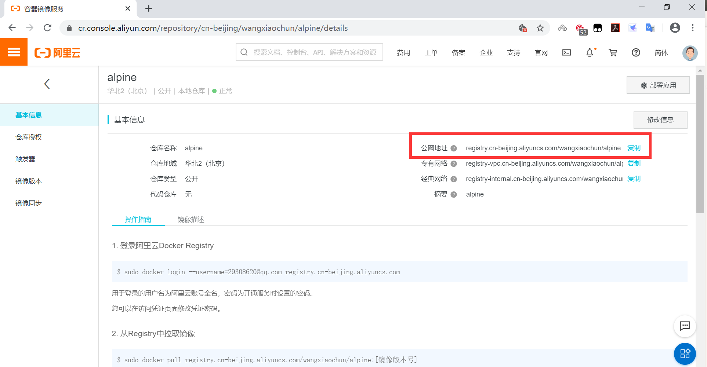

### 上传镜像前先登录阿里云

```json
#用前面设置的专用仓库管理密码登录
[root@ubuntu1804 ~]#docker login --username=29308620@qq.com registry.cn-
beijing.aliyuncs.com
Password:
WARNING! Your password will be stored unencrypted in /root/.docker/config.json.
Configure a credential helper to remove this warning. See
https://docs.docker.com/engine/reference/commandline/login/#credentials-store
Login Succeeded
#登录密码保存在~/.docker/config.json文件中，下次将不会需要再输入密码登录
[root@ubuntu1804 ~]#cat .docker/config.json
{
"auths": {
"https://index.docker.io/v1/": {
"auth": "d2FuZ3hpYW9jaHVuOjEyMzQ1Ng=="
},
"registry.cn-beijing.aliyuncs.com": {
"auth": "MjkzMDg2MjBAcXEuY29tOjEyMzQ1Ngo="
}
},
"HttpHeaders": {
"User-Agent": "Docker-Client/19.03.5 (linux)"
}
}[root@ubuntu1804 ~]#
```

### 给上传的镜像打标签

```bash
[root@ubuntu1804 ~]#docker tag alpine-base:3.11 registry.cn-
beijing.aliyuncs.com/bowenxiaochun/alpine:3.11-v1
[root@ubuntu1804 ~]#docker tag centos7-base:v1 registry.cn-
beijing.aliyuncs.com/bowenxiaochun/centos7-base:v1
[root@ubuntu1804 ~]#docker images
REPOSITORY                                                   TAG
IMAGE ID            CREATED             SIZE
haproxy-centos7                                              2.1.2
5eccdb29a058        6 hours ago         428MB
nginx-ubuntu1804                                             1.16.1
19efdd23ac87        21 hours ago        378MB
nginx-alpine                                                 1.16.1
978a43bbb61d        22 hours ago        211MB
alpine-base                                                  3.11
b162eecf4da9        23 hours ago        182MB
bowenlinux/alpine-base                                        3.11
b162eecf4da9        23 hours ago        182MB
registry.cn-beijing.aliyuncs.com/bowenxiaochun/alpine         3.11-v1
b162eecf4da9        23 hours ago        182MB
tomcat-web                                                   app2
0e1760fe79a6        43 hours ago        838MB
tomcat-web                                                   app1
76016219a0ca        43 hours ago        838MB
tomcat-base                                                  v8.5.50
8d5395cb72c4        44 hours ago        824MB
centos7-jdk                                                  8u212
e0fe770a7ccd        45 hours ago        809MB
centos7-base                                                 v1
34ab3afcd3b3        46 hours ago        403MB
registry.cn-beijing.aliyuncs.com/bowenxiaochun/centos7-base   v1
34ab3afcd3b3        46 hours ago        403MB
alpine                                                       3.11
e7d92cdc71fe        12 days ago         5.59MB
alpine                                                       latest
e7d92cdc71fe        12 days ago         5.59MB
bowenxiaochun/alpine                                          3.11-v1
e7d92cdc71fe        12 days ago         5.59MB
ubuntu                                                       18.04
ccc6e87d482b        2 weeks ago         64.2MB
ubuntu                                                       bionic
ccc6e87d482b        2 weeks ago         64.2MB
centos                                                       centos7.7.1908
08d05d1d5859        2 months ago        204MB
```

### 上传镜像至阿里云

```bash
[root@ubuntu1804 ~]# docker push registry.cn-
beijing.aliyuncs.com/bowenxiaochun/alpine:3.11-v1
The push refers to repository [registry.cn-
beijing.aliyuncs.com/bowenxiaochun/alpine]
1783f0912dfb: Pushed
1e5e8d5ab333: Pushed
5216338b40a7: Pushed
3.11-v1: digest:
sha256:7931fed46d377698dacb194d46017c53bc24f2e9ee41e893e6900c07d1153536 size:
947
[root@ubuntu1804 ~]#docker push registry.cn-
beijing.aliyuncs.com/bowenxiaochun/centos7-base:v1
The push refers to repository [registry.cn-
beijing.aliyuncs.com/bowenxiaochun/centos7-base]
2073413aebd6: Pushed
6ec9af97c369: Pushed
034f282942cd: Pushed
v1: digest:
sha256:02cd943f2569c7c55f08a979fd9661f1fd7893c424bca7b343188654ba63d98d size:
949
```

### 在网站查看上传的镜像

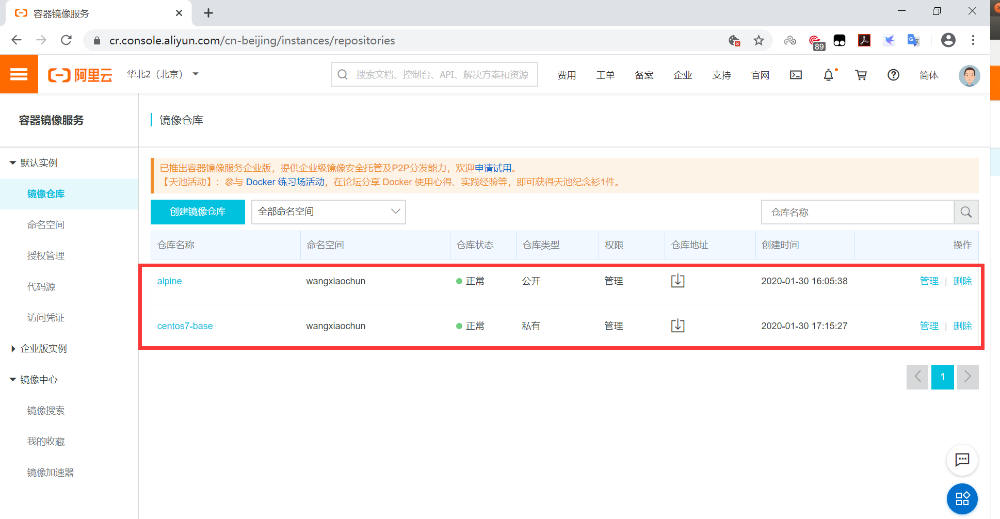

### 从另一台主机上下载刚上传的镜像并运行容器

```bash
[root@centos7 ~]#docker images
REPOSITORY          TAG                 IMAGE ID            CREATED
SIZE
[root@centos7 ~]# docker pull registry.cn-
beijing.aliyuncs.com/bowenxiaochun/alpine:3.11-v1
3.11-v1: Pulling from bowenxiaochun/alpine
c9b1b535fdd9: Pull complete
327af1e87fd8: Pull complete
d88818b49372: Pull complete
Digest: sha256:7931fed46d377698dacb194d46017c53bc24f2e9ee41e893e6900c07d1153536
Status: Downloaded newer image for registry.cn-
beijing.aliyuncs.com/bowenxiaochun/alpine:3.11-v1
registry.cn-beijing.aliyuncs.com/bowenxiaochun/alpine:3.11-v1
[root@centos7 ~]#docker images
REPOSITORY                                             TAG                 IMAGE
ID            CREATED             SIZE
registry.cn-beijing.aliyuncs.com/bowenxiaochun/alpine   3.11-v1
b162eecf4da9        22 hours ago        182MB
[root@centos7 ~]#docker run -it --rm b162eecf4da9 sh
/ # cat /etc/issue
Welcome to Alpine Linux 3.11
Kernel \r on an \m (\l)
/ # du -sh /
190.1M  /
/ # exit
[root@centos7 ~]#docker ps -a
CONTAINER ID        IMAGE               COMMAND             CREATED
STATUS              PORTS               NAMES
[root@centos7 ~]#
#上传的centos7-base:v1为私有镜像，需要登录才能下载
[root@centos7 ~]#docker pull registry.cn-
beijing.aliyuncs.com/bowenxiaochun/centos7-base:v1
Error response from daemon: pull access denied for registry.cn-
beijing.aliyuncs.com/bowenxiaochun/centos7-base, repository does not exist or may
require 'docker login': denied: requested access to the resource is denied
[root@centos7 ~]#docker login registry.cn-beijing.aliyuncs.com
Username: lbtooth
Password:
WARNING! Your password will be stored unencrypted in /root/.docker/config.json.
Configure a credential helper to remove this warning. See
https://docs.docker.com/engine/reference/commandline/login/#credentials-store
Login Succeeded
[root@centos7 ~]#cat .docker/config.json
{
"auths": {
"registry.cn-beijing.aliyuncs.com": {
"auth": "MjkzMDg2MjBAcXEuY29tOjEyMzQ1Ngo="
}
},
"HttpHeaders": {
"User-Agent": "Docker-Client/19.03.5 (linux)"
}
}[root@centos7 ~]#
[root@centos7 ~]#docker pull registry.cn-
beijing.aliyuncs.com/bowenxiaochun/centos7-base:v1
v1: Pulling from bowenxiaochun/centos7-base
f34b00c7da20: Pull complete
544476d462f7: Pull complete
39345915aa1b: Pull complete
Digest: sha256:02cd943f2569c7c55f08a979fd9661f1fd7893c424bca7b343188654ba63d98d
Status: Downloaded newer image for registry.cn-
beijing.aliyuncs.com/bowenxiaochun/centos7-base:v1
registry.cn-beijing.aliyuncs.com/bowenxiaochun/centos7-base:v1
[root@centos7 ~]#docker images
REPOSITORY                                                   TAG
IMAGE ID            CREATED             SIZE
registry.cn-beijing.aliyuncs.com/bowenxiaochun/alpine         3.11-v1
b162eecf4da9        23 hours ago        182MB
registry.cn-beijing.aliyuncs.com/bowenxiaochun/centos7-base   v1
34ab3afcd3b3        46 hours ago        403MB
[root@centos7 ~]#
```



<nav class="article-end" aria-label="章节导航">
  <a href="{{ '/subjects/Docker/28-official-docker-hub.html' | relative_url }}">← Previous: Official Docker Hub</a>
  <a href="{{ '/subjects/Docker/' | relative_url }}">Back to Docker Container Technology Index</a>
  <a href="{{ '/subjects/Docker/30-private-docker-registry.html' | relative_url }}">Next: Private Docker Registry →</a>
</nav>
