[← 返回 Docker 容器技术目录]({{ '/subjects/Docker/' | relative_url }})



# 29 阿里云容器镜像仓库

上一节把镜像推送到 Docker Hub。本节换成阿里云容器镜像服务（ACR），核心流程仍然是**确定仓库地址 → 登录 → 打标签 → 推送 → 从另一台主机拉取**。不同之处在于仓库域名包含地域，命名空间与仓库需要在相应实例中配置；实际地址应以控制台给出的“镜像仓库地址”为准。

## 准备实例、命名空间和仓库

登录 [容器镜像服务控制台](https://cr.console.aliyun.com/)，选择实例和地域，再创建命名空间、镜像仓库并设置可见性。不要仅凭本地 `docker push` 成功与否判断仓库已自动创建：实例类型和控制台配置会影响是否允许自动建仓，可靠做法是先在控制台确认目标仓库存在。

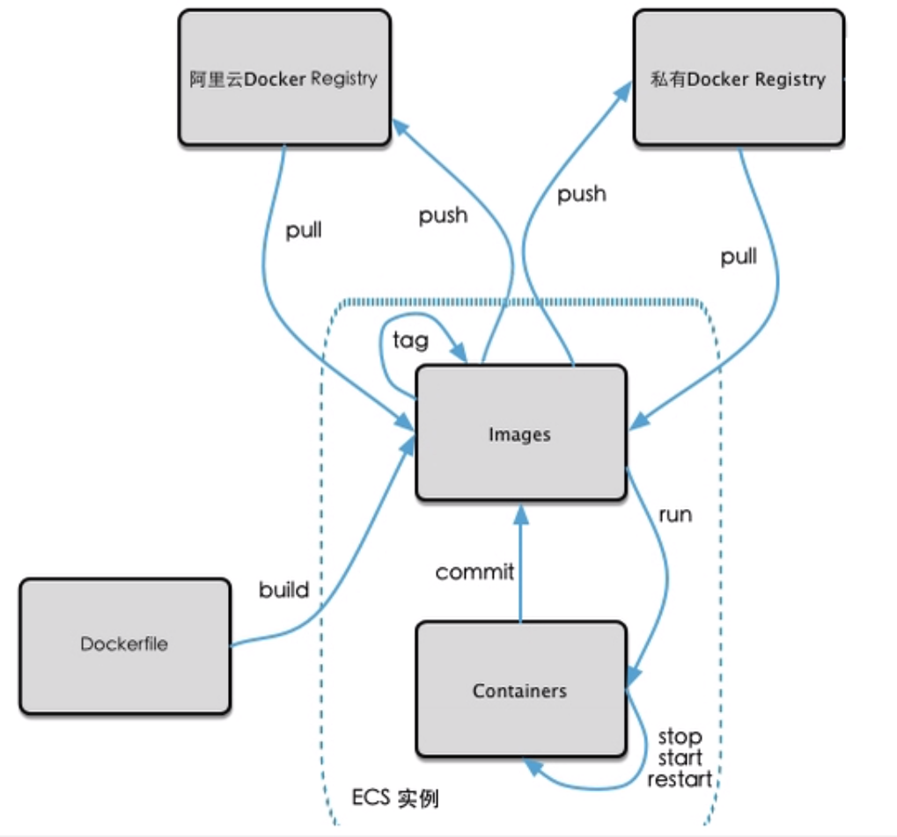

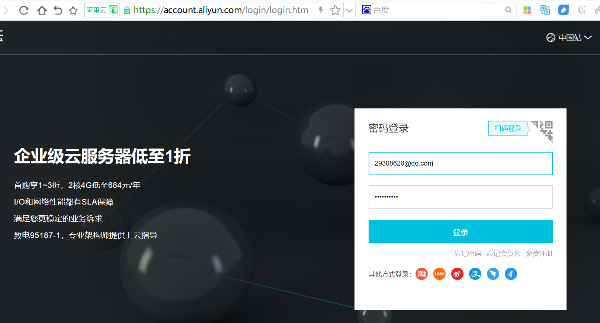

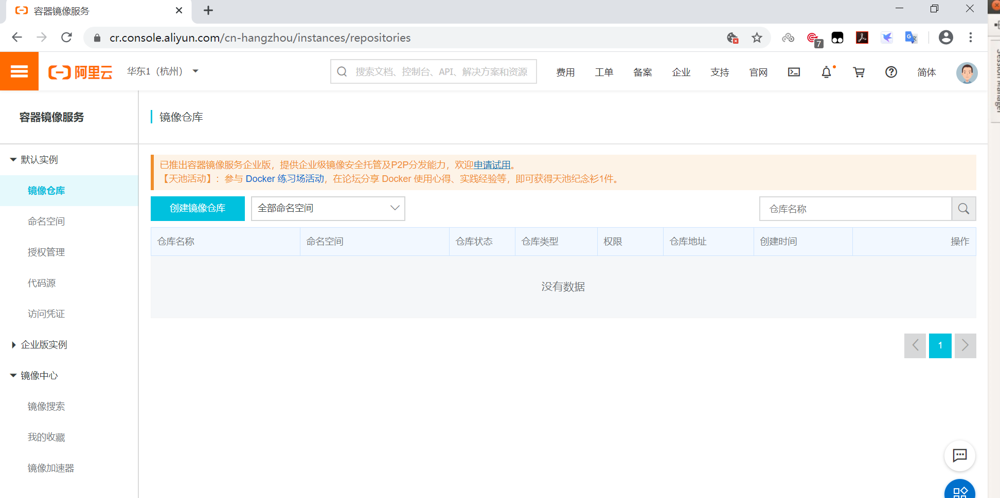

登录 Docker 客户端前，先按控制台指引设置镜像仓库访问凭据。该凭据与阿里云控制台登录密码并非同一概念；使用访问令牌或专用密码时，应遵循账户当前提供的凭据方式。以下截图展示的是原教程界面，控件位置可能变化。

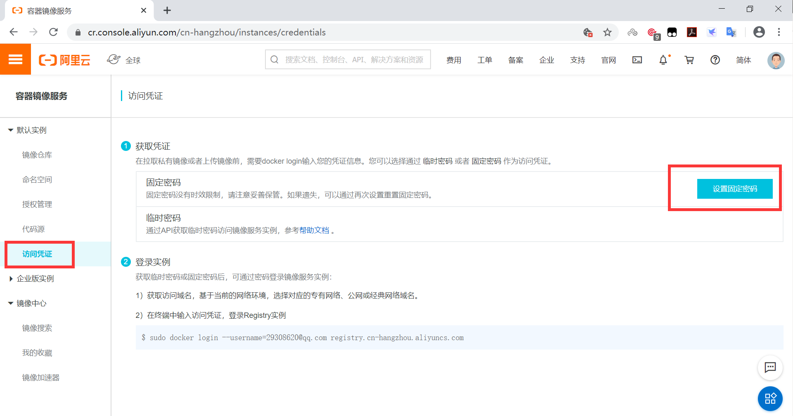

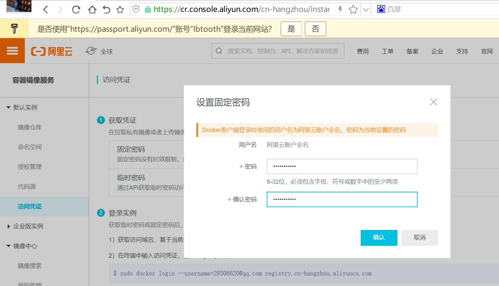

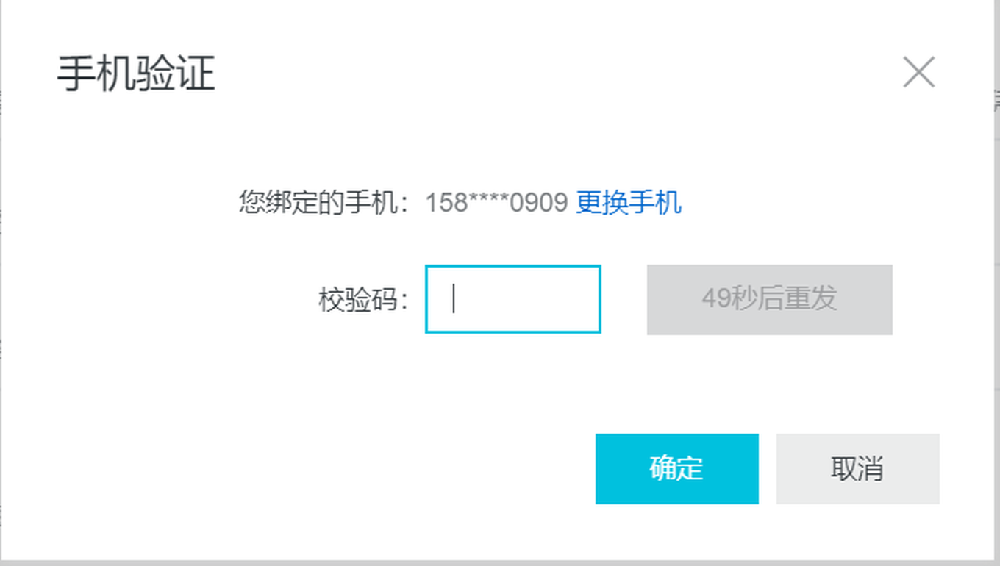

创建仓库时，记录“地域域名／命名空间／仓库名”。例如：

```text
registry.cn-beijing.aliyuncs.com/example-namespace/alpine:3.11-v1
└───────── 仓库域名 ─────────┘ └─ 命名空间 ─┘ └仓库┘ └标签┘
```

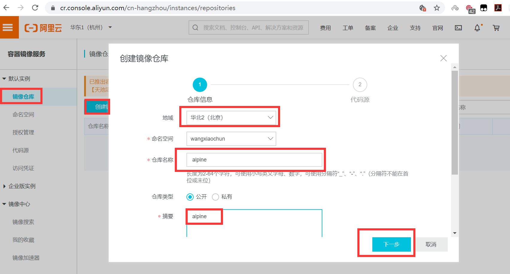

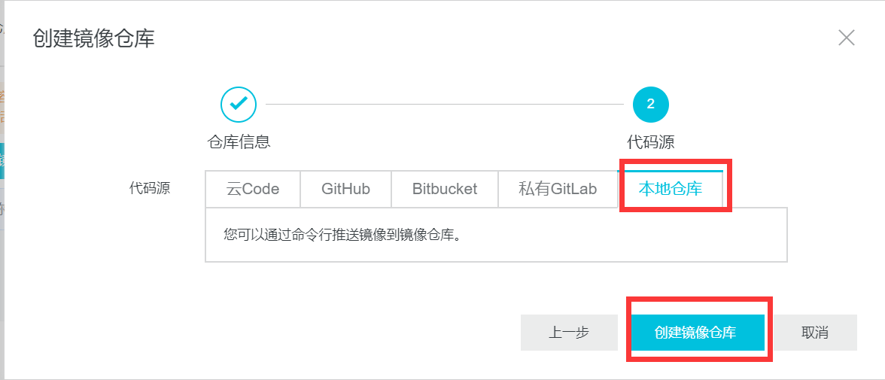

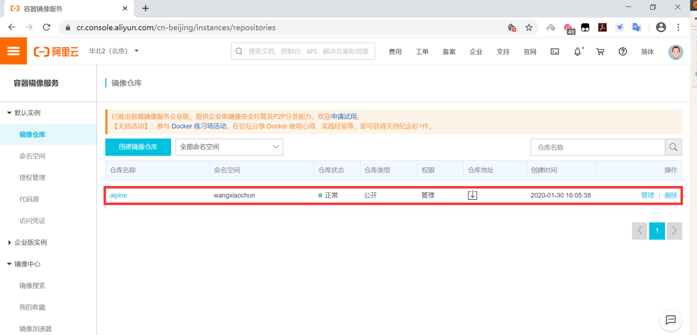

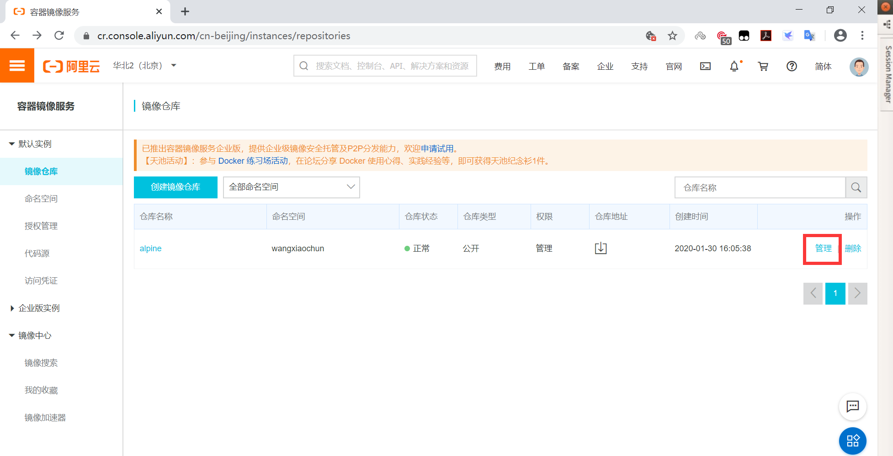

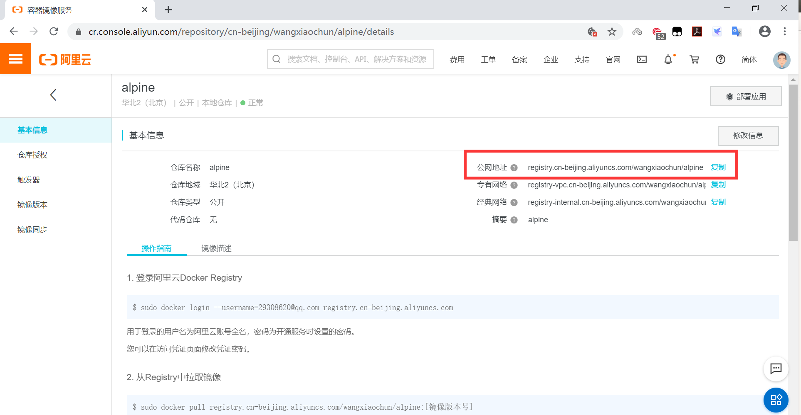

## 登录、打标签、推送

将下列示例中的域名、命名空间和账户替换为控制台实际值。**地域域名必须完整写在同一行**，原始资料因排版而折断的 `registry.cn-beijing.aliyuncs.com` 不能直接照抄成两行命令。

```bash
docker login --username <账户名> registry.cn-beijing.aliyuncs.com
docker tag alpine:3.11 registry.cn-beijing.aliyuncs.com/example-namespace/alpine:3.11-v1
docker push registry.cn-beijing.aliyuncs.com/example-namespace/alpine:3.11-v1
```

交互式登录会提示输入仓库访问凭据。不要把密码放进 `-p` 参数或把 `~/.docker/config.json` 复制到项目中；后者可能包含可还原的认证信息。推送后到控制台核对标签、更新时间和摘要，确认镜像已落在**正确地域、正确命名空间**。

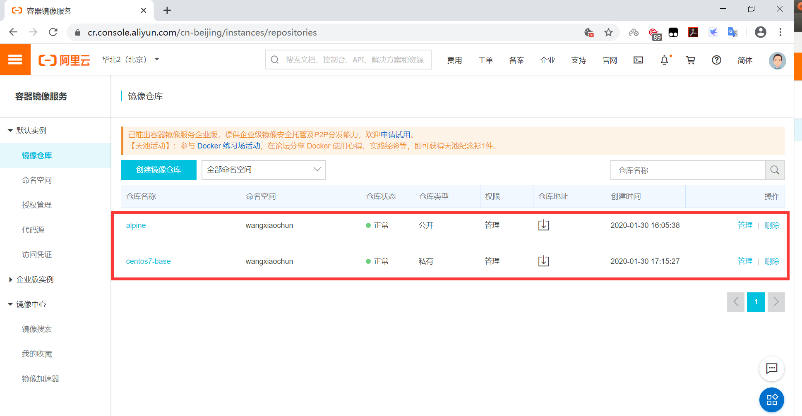

## 在另一台主机拉取并运行

公开仓库可以按其访问规则直接拉取；私有仓库须先使用具备读取权限的凭据登录。不要把“拉取失败”直接归因为网络问题：`denied` 通常先查仓库路径、可见性与权限，连接超时才检查域名解析和网络。

```bash
docker login --username <账户名> registry.cn-beijing.aliyuncs.com
docker pull registry.cn-beijing.aliyuncs.com/example-namespace/alpine:3.11-v1
docker run --rm registry.cn-beijing.aliyuncs.com/example-namespace/alpine:3.11-v1 cat /etc/alpine-release
```

拉取后还可以运行 `docker image inspect <完整镜像名>` 查看镜像 ID 与摘要。若是跨环境部署，建议记录不可变的摘要，而不是只依赖可能被覆盖的标签。至此，云端仓库完成了从上传到另一台主机使用的闭环。



<nav class="article-end" aria-label="章节导航">
  <a href="{{ '/subjects/Docker/28-official-docker-hub.html' | relative_url }}">← 上一篇：官方 Docker Hub 仓库</a>
  <a href="{{ '/subjects/Docker/' | relative_url }}">返回 Docker 容器技术目录</a>
  <a href="{{ '/subjects/Docker/30-private-docker-registry.html' | relative_url }}">下一篇：自建 Docker Registry →</a>
</nav>
