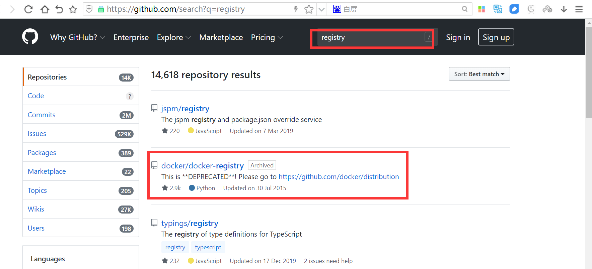
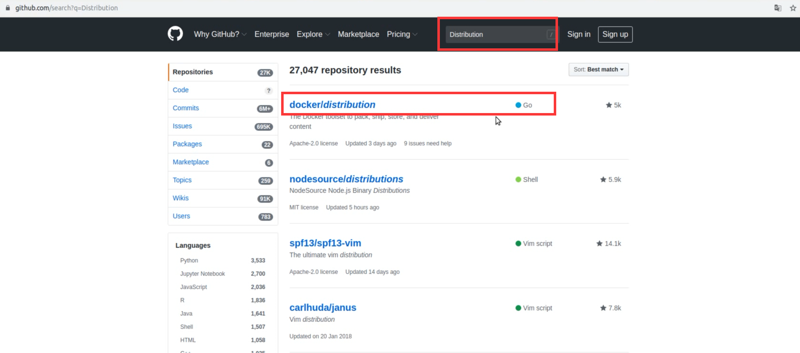

[← 返回 Docker 容器技术目录]({{ '/subjects/Docker/' | relative_url }})



# 30 自建单机 Docker Registry

Docker Registry 是实现镜像存储与分发的服务端。客户端仍通过 `docker login`、`docker push` 和 `docker pull` 操作，只是镜像名称中的仓库域名改为自建服务地址。单机 Registry 适合小规模场景或学习验证；需要图形管理、多项目权限、审计与高可用时，可继续阅读下一篇 Harbor。

原始资料记录了早期 Registry 版本演进。今天部署时应以 [Distribution 项目](https://github.com/distribution/distribution) 和所选镜像版本的文档为准，不要把早期版本的删除能力、存储布局或客户端兼容性直接套用到当前版本。镜像删除也不等于磁盘空间立即回收，后续仍须按文档处理垃圾回收。





## 环境与部署思路

下面沿用原教程的三台主机：`10.0.0.100` 提供 Registry，`10.0.0.101` 推送镜像，`10.0.0.102` 拉取镜像。示例使用 HTTP 说明客户端如何访问自建仓库，**只适用于隔离的测试网络**；跨网络或正式环境应配置可信 TLS、访问控制和持久化存储，并避免把 5000 端口直接暴露到公网。

Registry 本身无须预先创建每个镜像仓库。真正必须提前准备的是数据目录、认证文件和客户端对仓库地址的信任配置。

## 在仓库主机启动 Registry

先创建持久化目录和 bcrypt 格式的密码文件。这里用交互方式输入密码，避免把明文写进命令历史；`htpasswd -c` 只在首次创建文件时使用，追加其他用户时去掉 `-c`。

```bash
sudo mkdir -p /srv/registry/data /srv/registry/auth
sudo apt-get update
sudo apt-get install -y apache2-utils
sudo htpasswd -Bbc /srv/registry/auth/htpasswd example-user

docker pull registry:2
docker run -d --name registry --restart unless-stopped \
  -p 5000:5000 \
  -v /srv/registry/data:/var/lib/registry \
  -v /srv/registry/auth:/auth:ro \
  -e REGISTRY_AUTH=htpasswd \
  -e REGISTRY_AUTH_HTPASSWD_REALM="Registry Realm" \
  -e REGISTRY_AUTH_HTPASSWD_PATH=/auth/htpasswd \
  registry:2
```

`/var/lib/registry` 是镜像层数据的持久化位置；若只保存于容器可写层，删除容器会使数据丢失。生产中还应固定镜像版本或摘要，并对数据目录做备份。

```bash
docker ps --filter name=registry
docker logs registry --tail 50
curl -i http://127.0.0.1:5000/v2/
```

未带凭据的 `/v2/` 请求返回 **401 Unauthorized**，通常说明服务已响应且正在要求认证；连接拒绝或超时才表示服务、端口或网络仍需排查。

## 在推送端配置并上传

Docker 默认优先使用 HTTPS 连接非本地仓库。若测试 Registry 只有 HTTP，应在**每台要访问它的客户端主机**的 `/etc/docker/daemon.json` 中加入地址和端口，而不是把 `--insecure-registry` 手工拼到系统自带的 service 文件中。若现有 JSON 已有其他配置，应合并字段，不要整文件覆盖。

```json
{
  "insecure-registries": ["10.0.0.100:5000"]
}
```

```bash
sudo systemctl restart docker
docker info | grep -A 4 'Insecure Registries'
docker login 10.0.0.100:5000
docker tag centos7-base:v1 10.0.0.100:5000/centos7-base:v1
docker push 10.0.0.100:5000/centos7-base:v1
```

登录时使用先前创建的用户和密码。推送成功后记录输出中的 `sha256` 摘要；`docker images` 仅显示本地标签，不足以证明仓库端已接收镜像。

## 在拉取端验证

在 `10.0.0.102` 上同样配置 `insecure-registries` 并重启 Docker，然后登录、拉取和运行。这样可检验仓库端存储、网络与认证的整条链路。

```bash
docker login 10.0.0.100:5000
docker pull 10.0.0.100:5000/centos7-base:v1
docker image inspect 10.0.0.100:5000/centos7-base:v1 --format '{{.Id}}'
docker run --rm 10.0.0.100:5000/centos7-base:v1 cat /etc/redhat-release
```

如果返回 `unauthorized`，先核对凭据和仓库路径；如果 Docker 报 HTTPS/HTTP 协议不匹配，检查拉取端的 daemon 配置是否生效；如果连接超时，检查监听地址、防火墙和两台主机间的连通性。测试结束后，若不再使用 HTTP 仓库，应移除客户端的 `insecure-registries` 项并重启 Docker。



<nav class="article-end" aria-label="章节导航">
  <a href="{{ '/subjects/Docker/29-alibaba-cloud-docker-registry.html' | relative_url }}">← 上一篇：阿里云容器镜像仓库</a>
  <a href="{{ '/subjects/Docker/' | relative_url }}">返回 Docker 容器技术目录</a>
  <a href="{{ '/subjects/Docker/31-distributed-harbor-registry.html' | relative_url }}">下一篇：Harbor 镜像仓库 →</a>
</nav>
