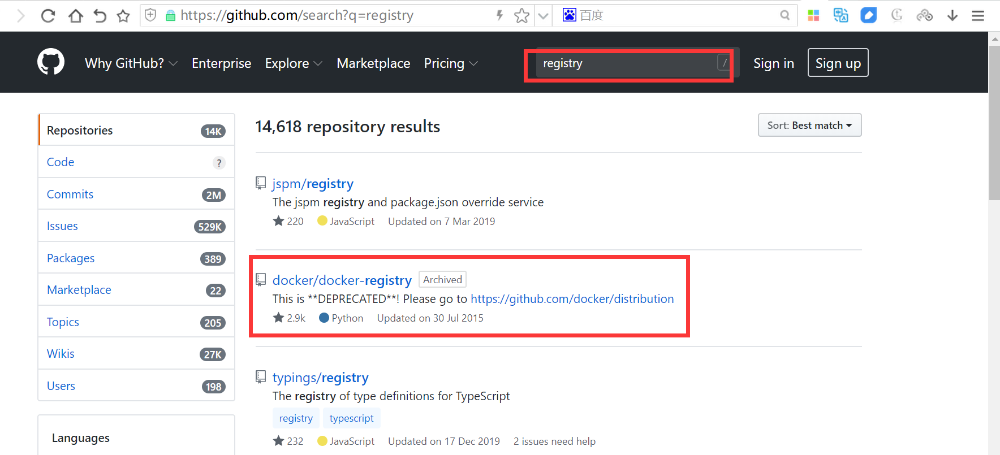
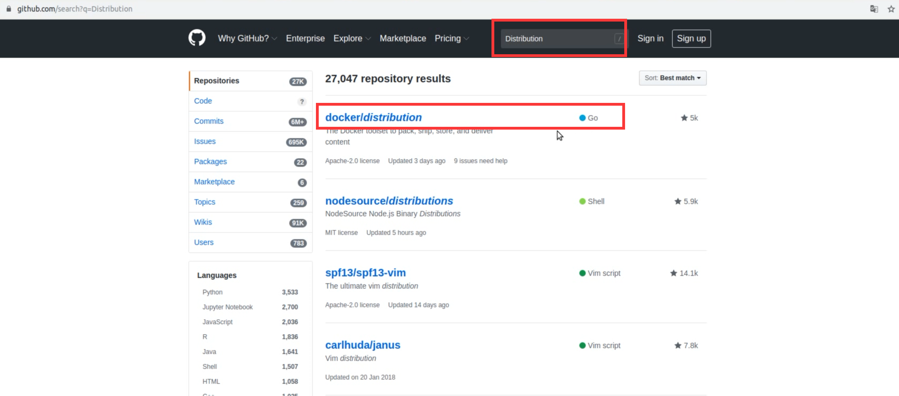

[← 返回Docker 容器技术目录]({{ '/subjects/Docker/' | relative_url }})



# 30 私有云单机仓库 Docker Registry （了解）
### 6.3 私有云单机仓库 Docker Registry （了解）

### Docker Registry 介绍

Docker Registry 作为Docker的核心组件之一负责单主机的镜像内容的存储与分发，客户端的docker pull以及push命令都将直接与registry进行交互,最初版本的registry 由Python实现，由于设计初期在安全性，性能以及API的设计上有着诸多的缺陷，该版本在0.9之后停止了开发，由新项目distribution（新的docker register被称为Distribution）来重新设计并开发下一代registry，新的项目由go语言开发，所有的API，底层存储方式，系统架构都进行了全面的重新设计已解决上一代registry中存在的问题，2016 年4月份registry 2.0正式发布，docker 1.6版本开始支持registry 2.0，而八月份随着docker 1.8 发布， docker hub正式启用2.1版本registry全面替代之前版本 registry，新版registry对镜像存储格式进行了重新设计并和旧版不兼容，docker 1.5和之前的版本无法读取2.0的镜像，另外，Registry 2.4版本之后支持了回收站机制，也就是可以删除镜像了，在2.4版本之前是无法支持删除镜像的，所以如果你要使用最好是大于Registry 2.4版本的

官方文档地址:  https://docs.docker.com/registry/

官方github 地址:  https://github.com/docker/distribution

官方部署文档:  https://github.com/docker/docker.github.io/blob/master/registry/deploying.md





以下介绍通过官方提供的docker registry 镜像来简单搭建本地私有仓库环境

环境:  三台主机

10.0.0.100:  充当registry仓库服务器

10.0.0.101:  上传镜像

10.0.0.102:  下载镜像

### 下载 docker registry 镜像

```bash
[root@ubuntu1804 ~]#docker pull registry:2.7.1
[root@ubuntu1804 ~]#docker images
REPOSITORY          TAG                 IMAGE ID            CREATED
SIZE
registry            2.7.1               708bc6af7e5e        6 days ago
25.8MB
```

### 搭建单机仓库

### 创建授权用户密码使用目录

```bash
[root@ubuntu1804 ~]#mkdir -p  /etc/docker/auth
```

### 创建授权的registry用户和密码

创建registry用户，用于上传和下载镜像

```bash
[root@ubuntu1804 ~]#apt -y install apache2-utils
[root@ubuntu1804 ~]#htpasswd -Bbn bowen 123456 > /etc/docker/auth/registry
[root@ubuntu1804 ~]#cat /etc/docker/auth/registry
bowen:$2y$05$nlRIIYEUBTSLdN2PkzodUue4ry7X/UyscpkkEufTDhEdI8nsyJMR6
#旧版本可以按下面方法生成用户和密码文件
[root@ubuntu1804 ~]#docker run --entrypoint htpasswd registry:2.7.1 -Bbn bowen
123456 > /etc/docker/auth/registry
```

### 启动docker registry 容器

```bash
[root@ubuntu1804 ~]# docker run -d -p 5000:5000 --restart=always --name registry
-v /etc/docker/auth:/auth -e "REGISTRY_AUTH=htpasswd" -e
"REGISTRY_AUTH_HTPASSWD_REALM=Registry Realm" -e
REGISTRY_AUTH_HTPASSWD_PATH=/auth/registry registry:2.7.1
998f970dd8ca6b98002f20ae27330fe607ca78f35bedcc8a6180688e48a907a7
```

### 验证端口和容器

```bash
[root@ubuntu1804 ~]#docker ps
CONTAINER ID        IMAGE               COMMAND                  CREATED
STATUS              PORTS                    NAMES
998f970dd8ca        registry:2.7.1      "/entrypoint.sh /etc…"   About a minute
ago   Up About a minute   0.0.0.0:5000->5000/tcp   registry
[root@ubuntu1804 ~]#ss -ntl
State    Recv-Q   Send-Q      Local Address:Port     Peer Address:Port
LISTEN   0        64                0.0.0.0:2049          0.0.0.0:*
LISTEN   0        128               0.0.0.0:48131         0.0.0.0:*
LISTEN   0        128               0.0.0.0:33835         0.0.0.0:*
LISTEN   0        128               0.0.0.0:58029         0.0.0.0:*
LISTEN   0        128               0.0.0.0:111           0.0.0.0:*
LISTEN   0        128         127.0.0.53%lo:53            0.0.0.0:*
LISTEN   0        128               0.0.0.0:22            0.0.0.0:*
LISTEN   0        64                0.0.0.0:46429         0.0.0.0:*
LISTEN   0        128             127.0.0.1:6014          0.0.0.0:*
LISTEN   0        64                   [::]:2049             [::]:*
LISTEN   0        128                     *:5000                *:*
LISTEN   0        128                  [::]:39471            [::]:*
LISTEN   0        128                  [::]:111              [::]:*
LISTEN   0        64                   [::]:43601            [::]:*
LISTEN   0        128                  [::]:56725            [::]:*
LISTEN   0        128                  [::]:22               [::]:*
LISTEN   0        128                  [::]:57881            [::]:*
LISTEN   0        128                 [::1]:6014             [::]:*
```

### 登录仓库

### 直接登录报错

```bash
#docker login 默认使用https登录,而docker registry为http,所以默认登录失败
[root@ubuntu1804 ~]#docker login 10.0.0.100:5000
Username: bowen
Password:
Error response from daemon: Get https://10.0.0.100:5000/v2/: dial tcp
10.0.0.100:5000: connect: connection refused
```

### 将registry仓库服务器地址加入service 单元文件

官方文档:

<https://docs.docker.com/registry/insecure/>

范例:

```json
#修改配置让docker login支持http协议
#方法1
[root@ubuntu1804 ~]#vim /lib/systemd/system/docker.service
[root@ubuntu1804 ~]#grep ExecStart /lib/systemd/system/docker.service
ExecStart=/usr/bin/dockerd -H fd:// --containerd=/run/containerd/containerd.sock
--insecure-registry 10.0.0.100:5000
#方法：修改下面文件
[root@ubuntu1804 ~]#vim  /etc/docker/daemon.json
{
"registry-mirrors": ["https://si7y70hh.mirror.aliyuncs.com"],
"insecure-registries": ["10.0.0.100:5000"]
}
```

```bash
[root@ubuntu1804 ~]#systemctl daemon-reload
[root@ubuntu1804 ~]#systemctl restart docker
[root@ubuntu1804 ~]#ps aux|grep dockerd
root       2092  1.3  8.4 757088 83056 ?        Ssl  19:19   0:00
/usr/bin/dockerd -H fd:// --containerd=/run/containerd/containerd.sock --
insecure-registry 10.0.0.100:5000
root       2233  0.0  0.1  14428  1012 pts/0    S+   19:20   0:00 grep --
color=auto dockerd
```

### 再次登录验证成功

在10.0.0.101主机上执行下面登录

```bash
[root@ubuntu1804 ~]#docker login 10.0.0.100:5000
Username: bowen
Password:
WARNING! Your password will be stored unencrypted in /root/.docker/config.json.
Configure a credential helper to remove this warning. See
https://docs.docker.com/engine/reference/commandline/login/#credentials-store
Login Succeeded
[root@ubuntu1804 ~]#
```

### 打标签并上传镜像

在10.0.0.101主机上执行打标签上传

```bash
[root@ubuntu1804 ~]#docker tag centos7-base:v1 10.0.0.100:5000/centos7-base:v1
[root@ubuntu1804 ~]#docker push 10.0.0.100:5000/centos7-base:v1
The push refers to repository [10.0.0.100:5000/centos7-base]
2073413aebd6: Pushed
6ec9af97c369: Pushed
034f282942cd: Pushed
v1: digest:
sha256:02cd943f2569c7c55f08a979fd9661f1fd7893c424bca7b343188654ba63d98d size:
949
```

### 下载镜像并启动容器

在10.0.0.102主机上下载镜像并启动容器

### 先修改docker的service 文件

```bash
[root@ubuntu1804 ~]#vim /lib/systemd/system/docker.service
[root@ubuntu1804 ~]#grep ExecStart /lib/systemd/system/docker.service
ExecStart=/usr/bin/dockerd -H fd:// --containerd=/run/containerd/containerd.sock
--insecure-registry 10.0.0.100:5000
[root@ubuntu1804 ~]#systemctl daemon-reload
[root@ubuntu1804 ~]#systemctl restart docker
```

### 登录registry仓库服务器

```bash
[root@ubuntu1804 ~]#docker login 10.0.0.100:5000
Username: bowen
Password:
WARNING! Your password will be stored unencrypted in /root/.docker/config.json.
Configure a credential helper to remove this warning. See
https://docs.docker.com/engine/reference/commandline/login/#credentials-store
Login Succeeded
```

### 下载镜像并启动容器

```bash
[root@ubuntu1804 ~]#docker images
REPOSITORY          TAG                 IMAGE ID            CREATED
SIZE
[root@ubuntu1804 ~]#docker pull  10.0.0.100:5000/centos7-base:v1
v1: Pulling from centos7-base
f34b00c7da20: Pull complete
544476d462f7: Pull complete
39345915aa1b: Pull complete
Digest: sha256:02cd943f2569c7c55f08a979fd9661f1fd7893c424bca7b343188654ba63d98d
Status: Downloaded newer image for 10.0.0.100:5000/centos7-base:v1
10.0.0.100:5000/centos7-base:v1
[root@ubuntu1804 ~]#docker images
REPOSITORY                     TAG                 IMAGE ID            CREATED
SIZE
10.0.0.100:5000/centos7-base   v1                  34ab3afcd3b3        2 days
ago          403MB
[root@ubuntu1804 ~]#docker run -it --rm  34ab3afcd3b3 bash
[root@2bcb26b1b568 /]# cat /etc/redhat-release
CentOS Linux release 7.7.1908 (Core)
[root@2bcb26b1b568 /]# exit
exit
[root@ubuntu1804 ~]#docker ps
CONTAINER ID        IMAGE               COMMAND             CREATED
STATUS              PORTS               NAMES
[root@ubuntu1804 ~]#
```



<nav class="article-end" aria-label="章节导航">
  <a href="{{ '/subjects/Docker/29-alibaba-cloud-docker-registry.html' | relative_url }}">← Previous: Alibaba Cloud Docker Registry</a>
  <a href="{{ '/subjects/Docker/' | relative_url }}">Back to Docker Container Technology Index</a>
  <a href="{{ '/subjects/Docker/31-distributed-harbor-registry.html' | relative_url }}">Next: Distributed Harbor Registry →</a>
</nav>
