[← Back to Docker Container Technology Index]({{ '/subjects/Docker/' | relative_url }})



# 31 Distributed Harbor Registry
### 6.4 Docker 之分布式仓库 Harbor （重点）

### Harbor 介绍和架构

### Harbor 介绍


Harbor (港口,海港) 是一个用于存储和分发Docker镜像的企业级Registry服务器，由VMware开源，其通过添加一些企业必需的功能特性，例如安全、标识和管理等，扩展了开源 Docker Distribution。

作为一个企业级私有Registry服务器，Harbor 提供了更好的性能和安全。提升用户使用Registry构建和运行环境传输镜像的效率。Harbor支持安装在多个Registry节点的镜像资源复制，镜像全部保存在私有 Registry 中， 确保数据和知识产权在公司内部网络中管控，另外，Harbor也提供了高级的安全特性，诸如用户管理，访问控制和活动审计等

vmware 官方开源服务:  https://vmware.github.io/

harbor 官方github 地址:  https://github.com/vmware/harbor

harbor 官方网址:  https://goharbor.io/

harbor 官方文档:  https://goharbor.io/docs/

github文档: https://github.com/goharbor/harbor/tree/master/docs

### Harbor 功能官方介绍

基于角色的访问控制:  用户与Docker镜像仓库通过“项目”进行组织管理，一个用户可以对多个镜像仓库在同一命名空间（project）里有不同的权限镜像复制:  镜像可在多个Registry实例中复制（同步）。尤其适合于负载均衡，高可用，混合云和多云的场景图形化用户界面:  用户可以通过浏览器来浏览，检索当前Docker镜像仓库，管理项目和命名空间 AD/LDAP 支:  Harbor可以集成企业内部已有的AD/LDAP，用于鉴权认证管理审计管理:  所有针对镜像仓库的操作都可以被记录追溯，用于审计管理国际化:  已拥有英文、中文、德文、日文和俄文的本地化版本。更多的语言将会添加进来 RESTful API:  提供给管理员对于Harbor更多的操控, 使得与其它管理软件集成变得更容易部署简单:  提供在线和离线两种安装工具， 也可以安装到vSphere平台(OVA方式)虚拟设备

### Harbor 组成

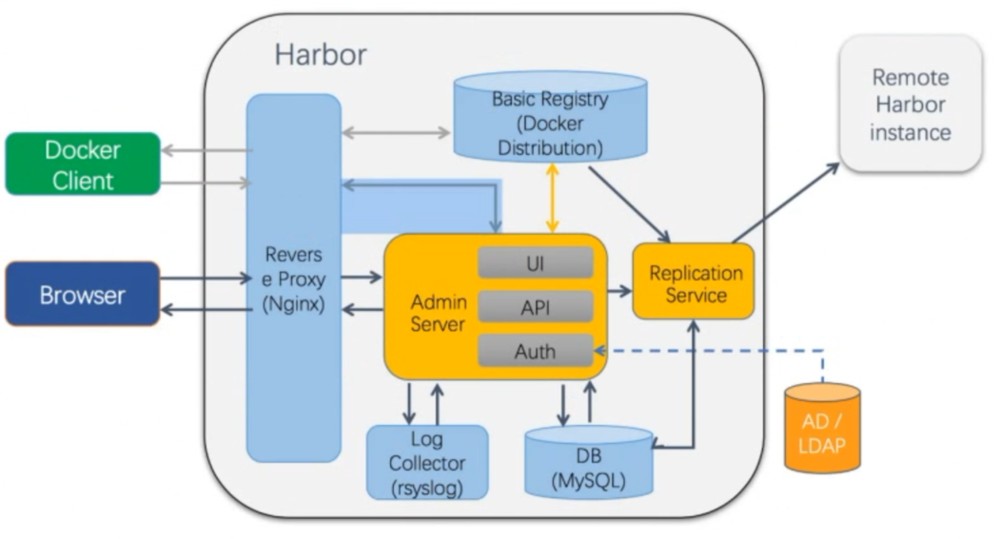

```bash
#harbor是由很多容器组成实现完整功能
[root@ubuntu1804 ~]#docker ps -a
CONTAINER ID        IMAGE                                    COMMAND
CREATED              STATUS                        PORTS
NAMES
4ec3c3885407        goharbor/nginx-photon:v1.7.6             "nginx -g 'daemon
of…"   About a minute ago   Up About a minute (healthy)   0.0.0.0:80->80/tcp,
0.0.0.0:443->443/tcp, 0.0.0.0:4443->4443/tcp   nginx
5707b4ac41d8        goharbor/harbor-portal:v1.7.6            "nginx -g 'daemon
of…"   About a minute ago   Up About a minute (healthy)   80/tcp
harbor-portal
0ed230b9b714        goharbor/harbor-jobservice:v1.7.6        "/harbor/start.sh"
About a minute ago   Up About a minute
harbor-jobservice
fec659188349        goharbor/harbor-core:v1.7.6              "/harbor/start.sh"
About a minute ago   Up About a minute (healthy)
harbor-core
910d14c1d7f7        goharbor/harbor-adminserver:v1.7.6       "/harbor/start.sh"
2 minutes ago        Up About a minute (healthy)
harbor-adminserver
4348f503aa0e        goharbor/harbor-db:v1.7.6                "/entrypoint.sh
post…"   2 minutes ago        Up About a minute (healthy)   5432/tcp
harbor-db
beff6886f0f1        goharbor/harbor-registryctl:v1.7.6       "/harbor/start.sh"
2 minutes ago        Up About a minute (healthy)
registryctl
428c99d274bf        goharbor/registry-photon:v2.6.2-v1.7.6   "/entrypoint.sh
/etc…"   2 minutes ago        Up About a minute (healthy)   5000/tcp
registry
775b4026fa4e        goharbor/redis-photon:v1.7.6             "docker-
entrypoint.s…"   2 minutes ago        Up About a minute             6379/tcp
redis
c6f44e2034c6        goharbor/harbor-log:v1.7.6               "/bin/sh -c
/usr/loc…"   2 minutes ago        Up 2 minutes (healthy)
```

Proxy:  对应启动组件nginx。它是一个nginx反向代理，代理Notary client（镜像认证）、Docker client（镜像上传下载等）和浏览器的访问请求（Core Service）给后端的各服务

UI（Core Service）:  对应启动组件harbor-ui。底层数据存储使用mysql数据库，主要提供了四个子功能:

UI:  一个web管理页面ui API:  Harbor暴露的API服务 Auth:  用户认证服务，decode后的token中的用户信息在这里进行认证；auth后端可以接 db、ldap、uaa三种认证实现 Token服务（上图中未体现）:  负责根据用户在每个project中的role来为每一个docker push/pull命令发布一个token，如果从docker client发送给registry的请求没有带token， registry会重定向请求到token服务创建token

Registry:  对应启动组件registry。负责存储镜像文件，和处理镜像的pull/push命令。Harbor对镜像进行强制的访问控制，Registry会将客户端的每个pull、push请求转发到token服务来获取有效的token

Admin Service:  对应启动组件harbor-adminserver。是系统的配置管理中心附带检查存储用量， ui和jobserver启动时候需要加载adminserver的配置

Job Sevice:  对应启动组件harbor-jobservice。负责镜像复制工作的，他和registry通信，从一个 registry pull镜像然后push到另一个registry，并记录job_log

Log Collector:  对应启动组件harbor-log。日志汇总组件，通过docker的log-driver把日志汇总到一起

DB:  对应启动组件harbor-db，负责存储project、 user、 role、replication、image_scan、 access等的metadata数据

### 安装 Harbor

下载地址:  https://github.com/vmware/harbor/releases

安装文档:

<https://goharbor.io/docs/2.12.0/install-config/>

<https://github.com/goharbor/harbor/blob/master/docs/install-config/_index.md>

<https://goharbor.io/docs/2.10.0/install-config/>

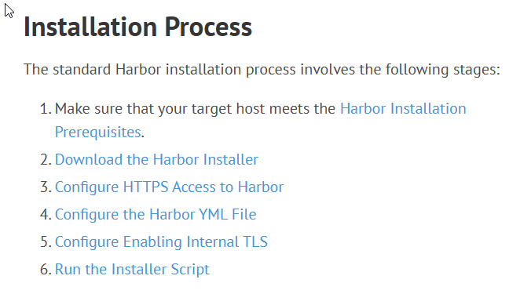

环境要求：Harbor docs | Harbor Installation Prerequisites (goharbor.io)

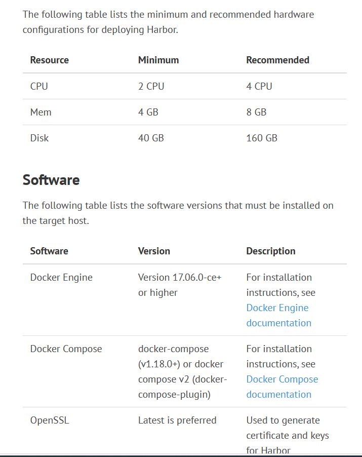

环境准备:  共四台主机

两台主机harbor服务器，地址:  10.0.0.101|102 两台主机harbor客户端上传和下载镜像

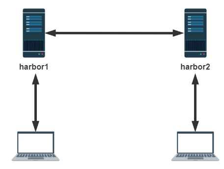

### 安装 docker

```bash
[root@ubuntu1804 ~]#cat install_docker_for_ubuntu1804.sh
COLOR="echo -e \\033[1;31m"
END="\033[m"
DOCKER_VERSION="5:19.03.5~3-0~ubuntu-bionic"
install_docker(){
apt update
apt  -y install apt-transport-https ca-certificates curl software-properties-
common
curl -fsSL https://mirrors.aliyun.com/docker-ce/linux/ubuntu/gpg | sudo apt-key
add -
add-apt-repository "deb [arch=amd64] https://mirrors.aliyun.com/docker-
ce/linux/ubuntu $(lsb_release -cs) stable"
apt update
${COLOR}"Docker有以下版本"${END}
apt-cache madison docker-ce
${COLOR}"5秒后即将安装: docker-"${DOCKER_VERSION}" 版本....."${END}
${COLOR}"如果想安装其它Docker版本，请按ctrl+c键退出，修改版本再执行"${END}
sleep 5
apt -y  install docker-ce=${DOCKER_VERSION} docker-ce-cli=${DOCKER_VERSION}
mkdir -p /etc/docker
tee /etc/docker/daemon.json <<-'EOF'
{
"registry-mirrors": ["https://si7y70hh.mirror.aliyuncs.com"]
}
EOF
systemctl daemon-reload
systemctl enable --now docker
docker version && ${COLOR}"Docker 安装成功"${END} ||  ${COLOR}"Docker 安装失
败"${END}
}
dpkg -s docker-ce &> /dev/null && ${COLOR}"Docker已安装"${END} || install_docker
[root@ubuntu1804 ~]#bash install_docker_for_ubuntu1804.sh
[root@ubuntu1804 ~]#docker version
Client: Docker Engine - Community
Version:           19.03.5
API version:       1.40
Go version:        go1.12.12
Git commit:        633a0ea838
Built:             Wed Nov 13 07:29:52 2019
OS/Arch:           linux/amd64
Experimental:      false
Server: Docker Engine - Community
Engine:
Version:          19.03.5
API version:      1.40 (minimum version 1.12)
Go version:       go1.12.12
Git commit:       633a0ea838
Built:            Wed Nov 13 07:28:22 2019
OS/Arch:          linux/amd64
Experimental:     false
containerd:
Version:          1.2.10
GitCommit:        b34a5c8af56e510852c35414db4c1f4fa6172339
runc:
Version:          1.0.0-rc8+dev
GitCommit:        3e425f80a8c931f88e6d94a8c831b9d5aa481657
docker-init:
Version:          0.18.0
GitCommit:        fec3683
```

### 先安装docker compose

```bash
#docker compose 必须先于harbor安装，否则会报以下错误
[root@ubuntu1804 ~]#/usr/local/harbor/install.sh
[Step 0]: checking installation environment ...
Note: docker version: 19.03.5
```

✖ Need to install docker-compose(1.7.1+) by yourself first and run this script

```bash
again
[root@ubuntu1804 ~]#
```

安装 docker compose 方法

```bash
#方法1:  通过pip安装，版本较新docker_compose-1.25.3，推荐使用
[root@ubuntu1804 ~]#apt -y install python-pip
[root@ubuntu1804 ~]#pip install docker-compose
[root@ubuntu1804 ~]#docker-compose --version
docker-compose version 1.25.3, build unknown
#方法2:  直接从github下载安装对应版本
#参看说明:  https://github.com/docker/compose/releases
curl -L https://github.com/docker/compose/releases/download/1.25.3/docker-
compose-`uname -s`-`uname -m` -o /usr/bin/docker-compose
chmod +x /usr/bin/docker-compose
#方法3:  内置仓库直接安装，版本较旧docker-compose-1.17.1-2
[root@ubuntu1804 ~]#apt -y install docker-compose
[root@ubuntu1804 ~]#docker-compose --version
docker-compose version 1.17.1, build unknown
```

范例：Ubuntu24.04内置仓库安装docker和 docker-compose

```bash
[root@ubuntu2404 ~]#apt update && apt install -y  docker.io docker-compose
python3-pip
[root@ubuntu2404 ~]#docker-compose version
docker-compose version 1.29.2, build unknown
docker-py version: 5.0.3
CPython version: 3.12.3
OpenSSL version: OpenSSL 3.0.13 30 Jan 2024
```

### 下载Harbor安装包并解压缩

<https://github.com/goharbor/harbor/releases>

以下使用 harbor 稳定版本1.7.6 安装包

方法1:  下载离线完整安装包,推荐使用

```bash
[root@ubuntu2204 ~]#wget
https://github.com/goharbor/harbor/releases/download/v2.7.1/harbor-offline-
installer-v2.7.1.tgz
[root@ubuntu1804 ~]#wget
https://github.com/goharbor/harbor/releases/download/v2.5.2/harbor-offline-
installer-v2.5.2.tgz
[root@ubuntu1804 ~]#wget https://storage.googleapis.com/harbor-releases/release-
1.7.0/harbor-offline-installer-v1.7.6.tgz
```

方法2:  下载在线安装包 ,比较慢，不是很推荐

```bash
[root@ubuntu1804 ~]#wget https://storage.googleapis.com/harbor-releases/release-
1.7.0/harbor-online-installer-v1.7.6.tgz
```

```bash
[root@ubuntu1804 ~]#ls -lh harbor-o*
-rw-r--r-- 1 root root 568M Sep 18 13:24 harbor-offline-installer-v1.7.6.tgz
-rw-r--r-- 1 root root 275K Sep 18 13:37 harbor-online-installer-v1.7.6.tgz
```

解压缩离线包

```bash
[root@ubuntu1804 ~]#tar xvf harbor-offline-installer-v1.7.6.tgz  -C /usr/local/
[root@harbor1 harbor]#ls
common.sh  harbor.v2.9.1.tar.gz  harbor.yml.tmpl  install.sh  LICENSE  prepare
```

### 编辑 harbor 配置文件

最新文档: https://github.com/goharbor/harbor/blob/master/docs/install-config/configure-yml-file.md

```bash
#新版配置文件为yml格式
[root@ubuntu2004~]#mv /usr/local/harbor/harbor.yml.tmpl
/usr/local/harbor/harbor.yml
[root@ubuntu2004 ~]#vim /usr/local/harbor/harbor.yml
#旧版配置文件为文本格式
[root@ubuntu1804 ~]#vim /usr/local/harbor/harbor.cfg
```

```text
#只需要修改下面两行
hostname = 10.0.0.101          #修改此行,指向当前主机IP 或 FQDN,建议配置IP
harbor_admin_password = 123456 #修改此行指定harbor登录用户admin的密码,默认用户/密
码:admin/Harbor12345
data_volume: /data/harbor      #建议修改数据目录路径，使用大容量的高速磁盘，默认为/data
#如果不使用https，还需要将下面行注释掉
#https:
#  port: 443
#  certificate: /your/certificate/path
#  private_key: /your/private/key/path
```

```text
#可选项
ui_url_protocol = http #默认即可,如果修改为https,需要指定下面证书路径
ssl_cert = /data/cert/server.crt #默认即可,https时，需指定下面证书文件路径
ss_cert_key = /data/cert/server.key   #默认即可,https时，需指定下面私钥文件路径
```

### 运行 harbor 安装脚本

安装脚本选项

```text
--with-trivy:
Trivy 是一个由 Aqua Security 开发的开源漏洞扫描器，用于检测容器镜像（如 Docker 镜像）中的已
知漏洞。
使用 --with-trivy 选项，你将在 Harbor 中启用 Trivy 的集成。这意味着你可以在 Harbor 中直接
扫描你的镜像以查找潜在的漏洞。
#新版下面选项废弃
--with-chartmuseum:
Chartmuseum 是一个用于存储和分发 Helm 包的轻量级 Helm Chart 仓库。Helm 是一个 Kubernetes
的包管理器，用于定义、安装和升级 Kubernetes 应用程序。
使用 --with-chartmuseum 选项，你将在 Harbor 中启用 Chartmuseum 的集成。这样，你就可以在
Harbor 中存储、管理和分发 Helm Charts 了。
#注意，harbor从2.8.0开始已经不支持chartmuseum
--with-notary:
Notary 是一个用于对 Docker 镜像进行签名和验证的工具，以确保镜像的完整性和来源。
使用 --with-notary 选项，你将在 Harbor 中启用 Notary 的集成。这样，你可以使用 Notary 来对
你的镜像进行签名，并使用 Harbor 的验证功能来确保只有经过签名的镜像才能被推送到仓库或从仓库中拉
取。
```

范例：

```text
#先安装python
root@ubuntu1804 ~]#apt -y install python
#查看安装选项
root@ubuntu1804 ~]#/usr/local/harbor/install.sh -h
Note: Please set hostname and other necessary attributes in harbor.yml first. DO
NOT use localhost or 127.0.0.1 for hostname, because Harbor needs to be accessed
by external clients.
Please set --with-trivy if needs enable Trivy in Harbor.
Please do NOT set --with-chartmuseum, as chartmusuem has been deprecated and
removed.
Please do NOT set --with-notary, as notary has been deprecated and removed.
#安装docker harbor并开启chart仓库
root@ubuntu1804 ~]#/usr/local/harbor/install.sh  --with-chartmuseum
#安装docker harbor
root@ubuntu1804 ~]#/usr/local/harbor/install.sh
[Step 0]: checking installation environment ...
Note: docker version: 19.03.5
Note: docker-compose version: 1.25.3
[Step 1]: loading Harbor images ...
......
[Step 4]: starting Harbor ...
Creating network "harbor_harbor" with the default driver
Creating harbor-log ... done
Creating registryctl        ... done
Creating harbor-db          ... done
Creating redis              ... done
Creating registry           ... done
Creating harbor-adminserver ... done
Creating harbor-core        ... done
Creating harbor-jobservice  ... done
Creating harbor-portal      ... done
Creating nginx              ... done
```

✔ ----Harbor has been installed and started successfully.----

```bash
Now you should be able to visit the admin portal at http://10.0.0.101.
For more details, please visit https://github.com/goharbor/harbor .
#安装harbor后会自动开启很多相关容器
[root@ubuntu1804 ~]#docker ps
CONTAINER ID        IMAGE                                    COMMAND
CREATED             STATUS                    PORTS
NAMES
1b47a3eeedd2        goharbor/nginx-photon:v1.7.6             "nginx -g 'daemon
of…"   14 minutes ago      Up 14 minutes (healthy)   0.0.0.0:80->80/tcp,
0.0.0.0:443->443/tcp, 0.0.0.0:4443->4443/tcp   nginx
5f3a0a0db734        goharbor/harbor-portal:v1.7.6            "nginx -g 'daemon
of…"   14 minutes ago      Up 14 minutes (healthy)   80/tcp
harbor-portal
8e4265efe8ee        goharbor/harbor-jobservice:v1.7.6        "/harbor/start.sh"
14 minutes ago      Up 14 minutes
harbor-jobservice
d1a048525d79        goharbor/harbor-core:v1.7.6              "/harbor/start.sh"
14 minutes ago      Up 14 minutes (healthy)
harbor-core
4a989eb92af1        goharbor/harbor-adminserver:v1.7.6       "/harbor/start.sh"
14 minutes ago      Up 14 minutes (healthy)
harbor-adminserver
c875d3959c56        goharbor/registry-photon:v2.6.2-v1.7.6   "/entrypoint.sh
/etc…"   14 minutes ago      Up 14 minutes (healthy)   5000/tcp
registry
2a963125a0e6        goharbor/redis-photon:v1.7.6             "docker-
entrypoint.s…"   14 minutes ago      Up 14 minutes             6379/tcp
redis
a0751df44d68        goharbor/harbor-registryctl:v1.7.6       "/harbor/start.sh"
14 minutes ago      Up 14 minutes (healthy)
registryctl
b0ef6ed0d46b        goharbor/harbor-db:v1.7.6                "/entrypoint.sh
post…"   14 minutes ago      Up 14 minutes (healthy)   5432/tcp
harbor-db
8e667c6ccbc1        goharbor/harbor-log:v1.7.6               "/bin/sh -c
/usr/loc…"   14 minutes ago      Up 14 minutes (healthy)   127.0.0.1:1514-
>10514/tcp                                          harbor-log
[root@ubuntu1804 ~]#
```

### 实现开机自动启动 harbor

旧版 Harbor 开机不会自动启动，可以创建 service 文件实现

新版 Harbor 默认开机自动，比如：harbor-v2.9.1

6.4.2.6.1 方法1: 通过service文件实现

```bash
[root@harbor ~]#vim /lib/systemd/system/harbor.service
[Unit]
Description=Harbor
After=docker.service systemd-networkd.service systemd-resolved.service
Requires=docker.service
Documentation=http://github.com/vmware/harbor
[Service]
Type=simple
Restart=on-failure
RestartSec=5
ExecStart=/usr/bin/docker-compose -f  /usr/local/harbor/docker-compose.yml up
ExecStop=/usr/bin/docker-compose -f /usr/local/harbor/docker-compose.yml down
[Install]
WantedBy=multi-user.target
```

```bash
[root@harbor ~]#systemctl daemon-reload
[root@harbor ~]#systemctl enable harbor
```

6.4.2.6.2 方法2: 通过 rc.local 实现

```bash
[root@harbor ~]#cat /etc/rc.local
#!/bin/bash
cd /usr/local/harbor
/usr/bin/docker-compose up
[root@harbor ~]#chmod +x /etc/rc.local
```

### 修改 docker-compose.yaml文件解决地址冲突(可选)

如果自定义网络地址冲突,可以修改如下文件

```bash
[root@harbor ~]#vim /usr/local/harbor/docker-compose.yml
networks:
harbor:          #添加如下面内容
ipam:
driver: default
config:
- subnet: 172.27.0.0/16
[root@harbor ~]#cd /usr/local/harbor/
[root@harbor harbor]#docker-compose down;docker-compose up -d
```

### 登录 harbor 主机网站

用浏览器访问:  http://10.0.0.101/

用户名:  admin 密码:  即前面harbor.cfg中指定的密码

新版界面

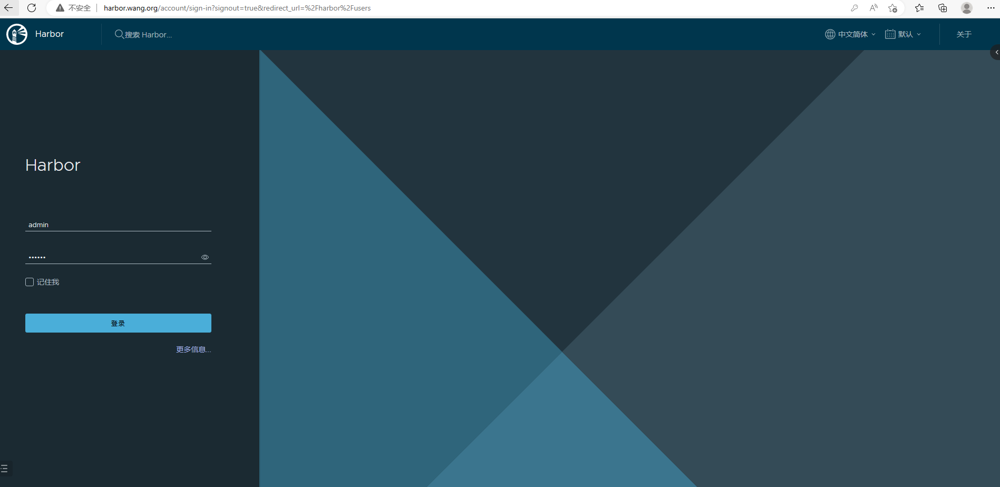

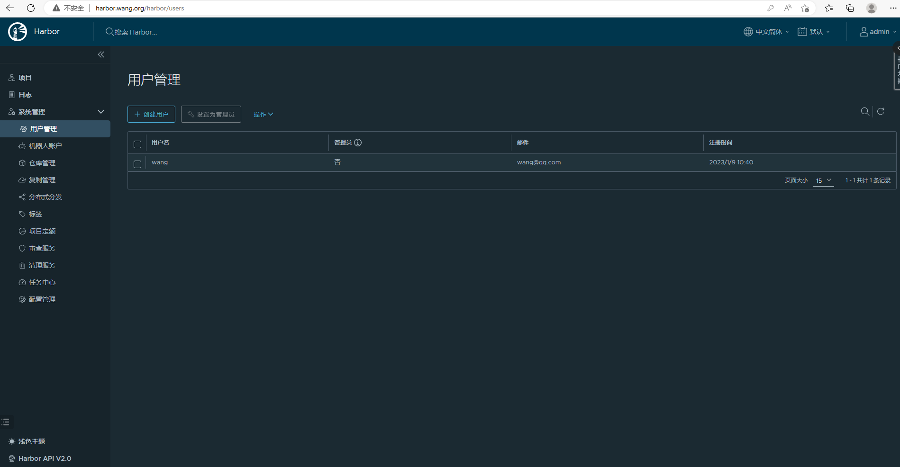

旧版界面

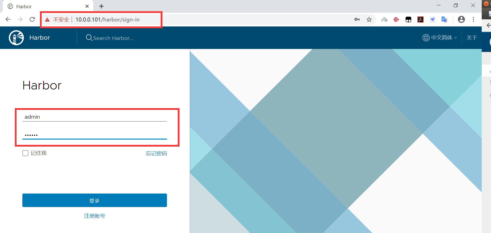

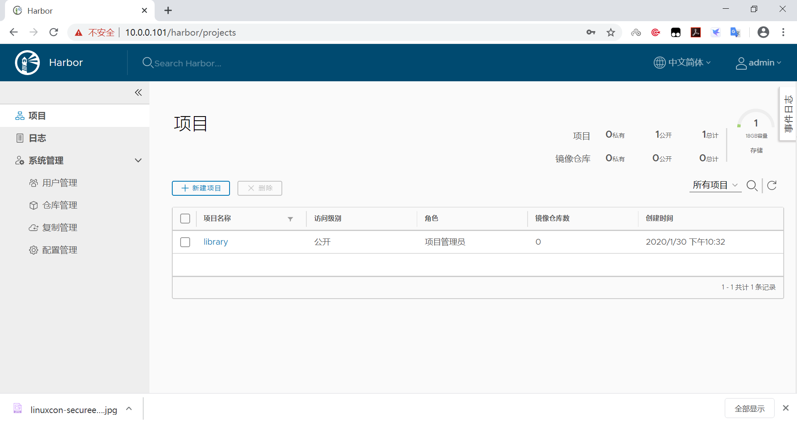

### 实战案例: 一键安装Harbor脚本

6.4.2.7.1 安装harbor 1.7.6

```bash
[root@ubuntu1804 ~]#cat install_harbor_for_ubuntu1804.sh
#!/bin/bash
#Description: Install harbor on ubuntu1804
COLOR="echo -e \E[1;31m"
END="\E[m"
DOCKER_VERSION="5:19.03.5~3-0~ubuntu-bionic"
HARBOR_VERSION=1.7.6
IPADDR=`hostname -I|awk '{print $1}'`
HARBOR_ADMIN_PASSWORD=123456
install_docker(){
${COLOR}"开始安装 Docker....."${END}
sleep 1
apt update
apt  -y install apt-transport-https ca-certificates curl software-properties-
common
curl -fsSL https://mirrors.tuna.tsinghua.edu.cn/docker-ce/linux/ubuntu/gpg |
sudo apt-key add -
add-apt-repository "deb [arch=amd64]
https://mirrors.tuna.tsinghua.edu.cn/docker-ce/linux/ubuntu $(lsb_release -cs)
stable"
apt update
${COLOR}"Docker有以下版本:"${END}
sleep 2
apt-cache madison docker-ce
${COLOR}"5秒后即将安装: docker-"${DOCKER_VERSION}" 版本....."${END}
${COLOR}"如果想安装其它Docker版本，请按ctrl+c键退出，修改版本再执行"${END}
sleep 5
apt -y  install docker-ce=${DOCKER_VERSION} docker-ce-cli=${DOCKER_VERSION}
mkdir -p /etc/docker
tee /etc/docker/daemon.json <<-'EOF'
{
"registry-mirrors": ["https://si7y70hh.mirror.aliyuncs.com"]
}
EOF
systemctl daemon-reload
systemctl restart docker
docker version && ${COLOR}"Docker 安装完成"${END} ||  ${COLOR}"Docker 安装失
败"${END}
}
install_docker_compose(){
${COLOR}"开始安装 Docker compose....."${END}
sleep 1
curl -L https://github.com/docker/compose/releases/download/1.25.3/docker-
compose-`uname -s`-`uname -m` -o /usr/bin/docker-compose
chmod +x /usr/bin/docker-compose
docker-compose --version &&  ${COLOR}"Docker Compose 安装完成"${END} ||
${COLOR}"Docker compose 安装失败"${END}
}
install_harbor(){
${COLOR}"开始安装 Harbor....."${END}
sleep 1
wget https://storage.googleapis.com/harbor-releases/release-1.7.0/harbor-offline-
installer-v${HARBOR_VERSION}.tgz
mkdir /apps
tar xvf harbor-offline-installer-v${HARBOR_VERSION}.tgz  -C /apps/
sed -i.bak -e 's/^hostname =.*/hostname = '$IPADDR'/' -e
's/^harbor_admin_password =.*/harbor_admin_password = '$HARBOR_ADMIN_PASSWORD'/'
/usr/local/harbor/harbor.cfg
apt -y install python
/usr/local/harbor/install.sh && ${COLOR}"Harbor 安装完成"${END} ||
${COLOR}"Harbor 安装失败"${END}
}
harbor_service (){
cat > /lib/systemd/system/harbor.service <<EOF
[Unit]
Description=Harbor
After=docker.service systemd-networkd.service systemd-resolved.service
Requires=docker.service
Documentation=http://github.com/vmware/harbor
[Service]
Type=simple
Restart=on-failure
RestartSec=5
ExecStart=/usr/bin/docker-compose -f  /usr/local/harbor/docker-compose.yml up
ExecStop=/usr/bin/docker-compose -f /usr/local/harbor/docker-compose.yml down
[Install]
WantedBy=multi-user.target
EOF
systemctl daemon-reload
systemctl enable  harbor &>/dev/null ||  ${COLOR}"Harbor已配置为开机自动启动"${END}
}
dpkg -s docker-ce &> /dev/null && ${COLOR}"Docker已安装"${END} || install_docker
docker-compose --version &> /dev/null && ${COLOR}"Docker Compose已安装"${END} ||
install_docker_compose
install_harbor
harbor_service
```

6.4.2.7.2 安装harbor 1.10.4

```bash
[root@ubuntu1804 ~]#cat install_harbor1.10.4_for_ubuntu1804.sh
#!/bin/bash
#
#FileName：          install_harbor1.10.4_for_ubuntu1804.sh
#Description：       The test script
COLOR="echo -e \\033[1;31m"
END="\033[m"
DOCKER_VERSION="5:19.03.14~3-0~ubuntu-bionic"
IPADDR=`hostname -I|awk '{print $1}'`
HARBOR_ADMIN_PASSWORD=123456
DOCKER_COMPOSE_VERSION=1.27.4
HARBOR_VERSION=1.10.4
install_docker(){
dpkg -s docker-ce &> /dev/null && ${COLOR}"Docker已安装，退出"${END} && exit
apt update
apt-get -y install apt-transport-https ca-certificates curl software-properties-
common
curl -fsSL https://mirrors.tuna.tsinghua.edu.cn/docker-ce/linux/ubuntu/gpg |
sudo apt-key add -
add-apt-repository "deb [arch=amd64]
https://mirrors.tuna.tsinghua.edu.cn/docker-ce/linux/ubuntu $(lsb_release -cs)
stable"
apt update
${COLOR}"Docker有以下版本"${END}
apt-cache madison docker-ce
${COLOR}"5秒后即将安装: docker-"${DOCKER_VERSION}" 版本....."${END}
${COLOR}"如果想安装其它Docker版本，请按ctrl+c键退出，修改版本再执行"${END}
sleep 5
apt -y install docker-ce=${DOCKER_VERSION} docker-ce-cli=${DOCKER_VERSION}
mkdir -p /etc/docker
tee /etc/docker/daemon.json <<-'EOF'
{
"registry-mirrors": ["https://hzw5xiv7.mirror.aliyuncs.com"]
}
EOF
systemctl daemon-reload
systemctl enable --now docker
docker version && ${COLOR}"Docker 安装成功"${END} || ${COLOR}"Docker 安装失
败"${END}
}
install_docker_compose(){
${COLOR}"开始安装 Docker compose....."${END}
sleep 1
mv /root/docker-compose-Linux-x86_64-${DOCKER_COMPOSE_VERSION} /usr/bin/docker-
compose
chmod +x /usr/bin/docker-compose
docker-compose --version &&  ${COLOR}"Docker Compose 安装完成"${END} ||
${COLOR}"Docker compose 安装失败"${END}
}
install_harbor(){
${COLOR}"开始安装 Harbor....."${END}
sleep 1
ls /apps &> /dev/null || mkdir /apps
tar -xvf /root/harbor-offline-installer-v${HARBOR_VERSION}.tgz -C /apps/
sed -i.bak -e 's/^hostname: .*/hostname: '''$IPADDR'''/' -e
's/^harbor_admin_password: .*/harbor_admin_password:
'''$HARBOR_ADMIN_PASSWORD'''/' -e 's/^https:/#https:/' -e 's/  port: 443/
#port: 443/' -e 's@  certificate: /your/certificate/path@  #certificate:
/your/certificate/path@' -e 's@  private_key: /your/private/key/path@
#private_key: /your/private/key/path@' /usr/local/harbor/harbor.yml
apt -y install python
/usr/local/harbor/install.sh && ${COLOR}"Harbor 安装完成"${END} ||
${COLOR}"Harbor 安装失败"${END}
}
harbor_service (){
cat > /lib/systemd/system/harbor.service <<EOF
[Unit]
Description=Harbor
After=docker.service systemd-networkd.service systemd-resolved.service
Requires=docker.service
Documentation=http://github.com/vmware/harbor
[Service]
Type=simple
Restart=on-failure
RestartSec=5
ExecStart=/usr/bin/docker-compose -f /usr/local/harbor/docker-compose.yml up
ExecStop=/usr/bin/docker-compose -f /usr/local/harbor/docker-compose.yml down
[Install]
WantedBy=multi-user.target
EOF
systemctl daemon-reload
systemctl enable harbor &>/dev/null && ${COLOR}"Harbor已配置为开机自动启动"${END}
}
dpkg -s docker-ce &> /dev/null && ${COLOR}"Docker已安装"${END} || install_docker
docker-compose --version &> /dev/null && ${COLOR}"Docker Compose已安装"${END} ||
install_docker_compose
install_harbor
harbor_service
```

### 使用单主机 Harbor

### 建立项目

harbor上必须先建立项目，才能上传镜像

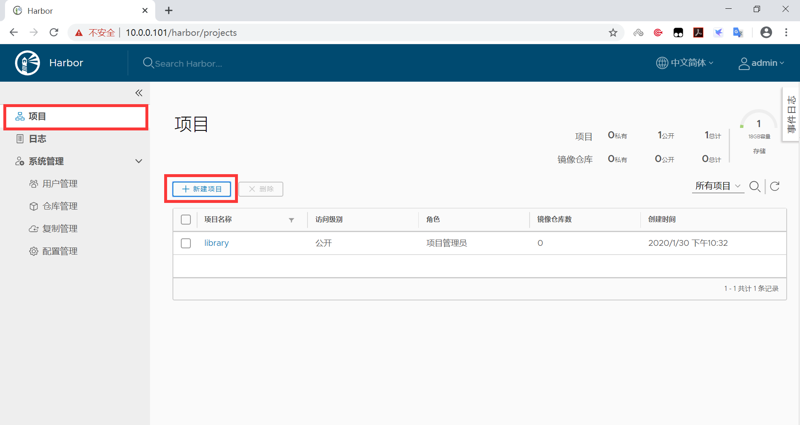

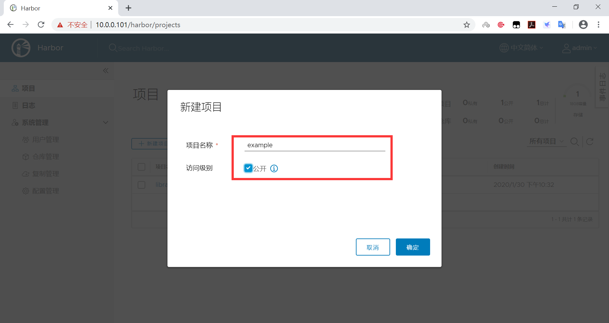

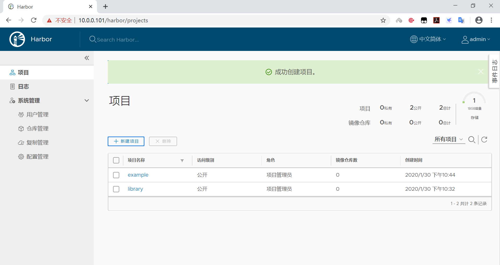

### 创建用户和项目授权

用户角色

项目管理员：可以创建和删除项目维护人员：可以上传，删除镜像，但无法删除项目开发者：可以上传镜像，但无法删除镜像访客，受限访客：无法上传镜像

创建用户

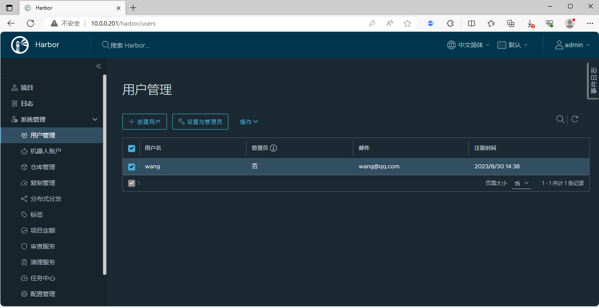

在项目内对用户授权，注意：至少是开发者以上才能上传镜像

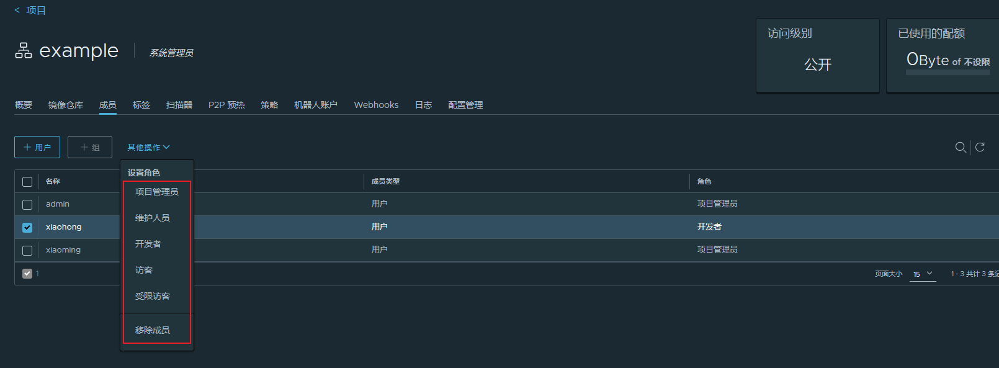

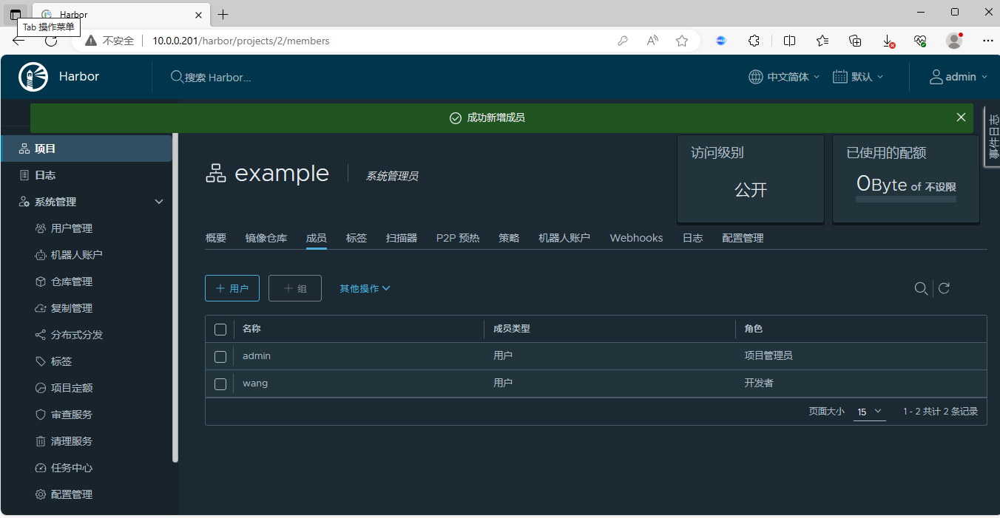

### 命令行登录 Harbor

```json
#方法1
[root@ubuntu1804 ~]#vim /lib/systemd/system/docker.service
ExecStart=/usr/bin/dockerd -H fd:// --containerd=/run/containerd/containerd.sock
--insecure-registry 10.0.0.101 --insecure-registry 10.0.0.102
#方法2
[root@ubuntu1804 ~]#vim  /etc/docker/daemon.json
{
"registry-mirrors": ["https://si7y70hh.mirror.aliyuncs.com"],
"insecure-registries": ["10.0.0.101:80"，"10.0.0.102:80"]  #说明: ":80"可省略
}
[root@ubuntu1804 ~]#systemctl daemon-reload
[root@ubuntu1804 ~]#systemctl restart docker
#非交互登录
[root@ubuntu1804 ~]#docker login -u admin -p 123456 10.0.0.101
[root@ubuntu1804 ~]#echo 123456 | docker login -u admin --password-stdin
10.0.0.101
#交互登录
[root@ubuntu1804 ~]#docker login 10.0.0.101
Username: admin
Password:
WARNING! Your password will be stored unencrypted in /root/.docker/config.json.
Configure a credential helper to remove this warning. See
https://docs.docker.com/engine/reference/commandline/login/#credentials-store
Login Succeeded
#查看进程是否添加上面设置
[root@ubuntu1804 ~]#ps aux|grep dockerd
root      17347  7.8  9.6 839272 94784 ?        Ssl  22:54   0:15
/usr/bin/dockerd -H fd:// --containerd=/run/containerd/containerd.sock --
insecure-registry 10.0.0.101 --insecure-registry 10.0.0.102
root      17630  0.0  0.1  14428  1008 pts/4    S+   22:57   0:00 grep --
color=auto dockerd
[root@ubuntu1804 ~]#cat .docker/config.json
{
"auths": {
"10.0.0.101": {
"auth": "YWRtaW46MTIzNDU2"
},
"https://index.docker.io/v1/": {
"auth": "d2FuZ3hpYW9jaHVuOjEyMzQ1Ng=="
},
"registry.cn-beijing.aliyuncs.com": {
"auth": "MjkzMDg2MjBAcXEuY29tOjEyMzQ1Ngo="
}
},
"HttpHeaders": {
"User-Agent": "Docker-Client/19.03.5 (linux)"
}
}
```

### 给本地镜像打标签并上传到 Harbor

修改 images 的名称，不修改成指定格式无法将镜像上传到 harbor 仓库

格式为:

```text
Harbor主机IP/项目名/image名:版本
```

上传的镜像默认存放在Harbor的 /data/registry/ 目录中

范例:

```bash
#上传镜像前，必须先登录harbor
[root@ubuntu1804 ~]#docker login 10.0.0.101
Username: admin
Password:
WARNING! Your password will be stored unencrypted in /root/.docker/config.json.
Configure a credential helper to remove this warning. See
https://docs.docker.com/engine/reference/commandline/login/#credentials-store
Login Succeeded
[root@ubuntu1804 ~]#docker tag alpine-base:3.11 10.0.0.101/example/alpine-
base:3.11
[root@ubuntu1804 ~]#docker push 10.0.0.101/example/alpine-base:3.11
#注意:远程连接时,当前docker客户端的用户需要先login到harbor上才能上传镜像,而非10.0.0.100上的
用户登录
[root@ubuntu2204 ~]#docker login -u admin -p 123456 harbor.bowen.org
[root@ubuntu2204 ~]#docker -H ssh://root@10.0.0.100 push
harbor.bowen.org/example/alpine-base:3.11
```

访问harbor网站验证上传镜像成功

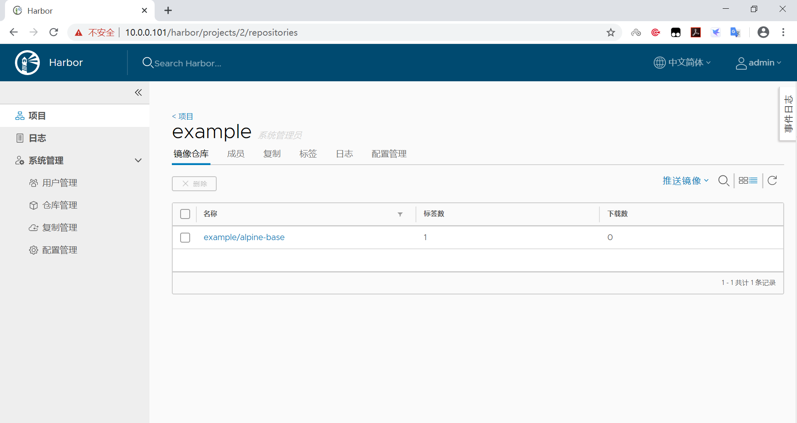

范例:  如果不事先建立项目，上传镜像失败

```bash
[root@ubuntu1804 ~]#docker tag centos7-base:v1 10.0.0.101/example2/centos7-
base:v1
[root@ubuntu1804 ~]#docker push 10.0.0.101/example2/centos7-base:v1
The push refers to repository [10.0.0.101/example2/centos7-base]
2073413aebd6: Preparing
6ec9af97c369: Preparing
034f282942cd: Preparing
denied: requested access to the resource is denied
[root@ubuntu1804 ~]#docker tag centos7-base:v1 10.0.0.101/example/centos7-
base:v1
[root@ubuntu1804 ~]#docker push 10.0.0.101/example/centos7-base:v1
The push refers to repository [10.0.0.101/example/centos7-base]
2073413aebd6: Pushed
6ec9af97c369: Pushed
034f282942cd: Pushed
v1: digest:
sha256:02cd943f2569c7c55f08a979fd9661f1fd7893c424bca7b343188654ba63d98d size:
949
```

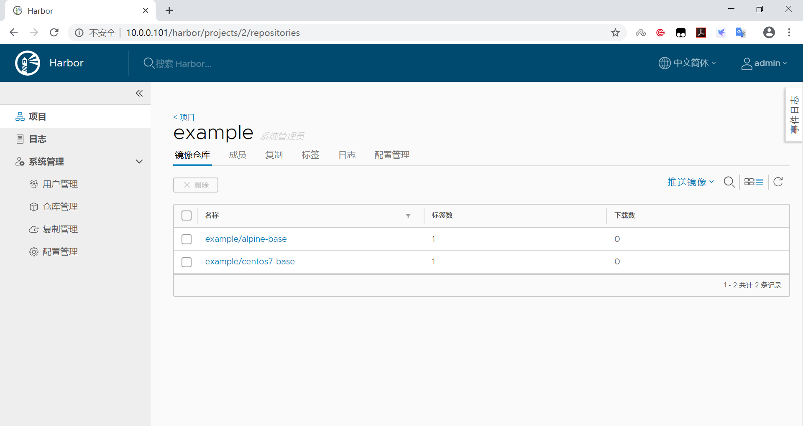

可以看到操作的日志记录

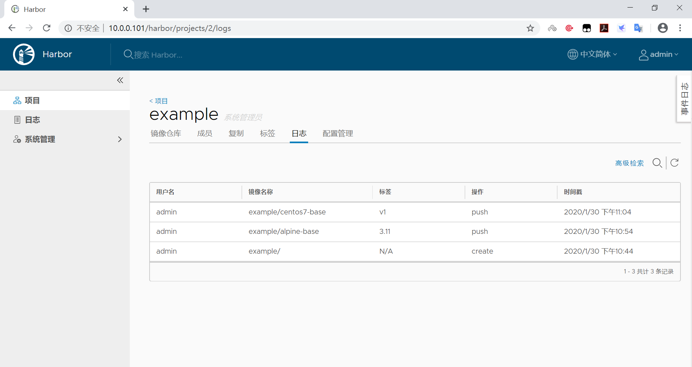

### 下载 Harbor 的镜像

在10.0.0.103的CentOS 7 的主机上无需登录，即可下载镜像

下载前必须修改docker的service 文件，加入harbor服务器的地址才可以下载

范例:  修改docker的service文件

```json
[root@centos7 ~]#docker pull 10.0.0.101/example/centos7-base:v1
Error response from daemon: Get https://10.0.0.101/v2/: dial tcp 10.0.0.101:443:
connect: connection refused
#方法1
[root@ubuntu1804 ~]#vim /lib/systemd/system/docker.service
ExecStart=/usr/bin/dockerd -H fd:// --containerd=/run/containerd/containerd.sock
--insecure-registry 10.0.0.101 --insecure-registry 10.0.0.102
#方法2
[root@ubuntu1804 ~]#vim/etc/docker/daemon.json
{
"insecure-registries": ["10.0.0.101", "10.0.0.102"]
}
[root@centos7 ~]#systemctl daemon-reload
[root@centos7 ~]#systemctl restart docker
[root@centos7 ~]#docker images
REPOSITORY          TAG                 IMAGE ID            CREATED
SIZE
```

范例:  从harbor下载镜像

```bash
[root@centos7 ~]#docker pull 10.0.0.101/example/centos7-base:v1
v1: Pulling from example/centos7-base
f34b00c7da20: Pull complete
544476d462f7: Pull complete
39345915aa1b: Pull complete
Digest: sha256:02cd943f2569c7c55f08a979fd9661f1fd7893c424bca7b343188654ba63d98d
Status: Downloaded newer image for 10.0.0.101/example/centos7-base:v1
10.0.0.101/example/centos7-base:v1
[root@centos7 ~]#docker images
REPOSITORY                        TAG                 IMAGE ID            CREATED
SIZE
10.0.0.101/example/centos7-base   v1                  34ab3afcd3b3        2 days
ago          403MB
```

### 创建自动打标签上传镜像脚本

```bash
#在10.0.0.100上修改以前的build.sh脚本
[root@ubuntu1804 ~]#cd /data/dockerfile/web/nginx/1.16.1-alpine/
[root@ubuntu1804 1.16.1-alpine]#vim build.sh
[root@ubuntu1804 1.16.1-alpine]#cat build.sh
#!/bin/bash
TAG=$1
docker build -t 10.0.0.101/example/nginx-alpine:1.16.1-${TAG} .
docker push 10.0.0.101/example/nginx-alpine:1.16.1-${TAG}
docker rmi -f 10.0.0.101/example/nginx-alpine:1.16.1-${TAG}
[root@ubuntu1804 1.16.1-alpine]#bash build.sh v1
```

登录harbor网站验证脚本上传镜像成功

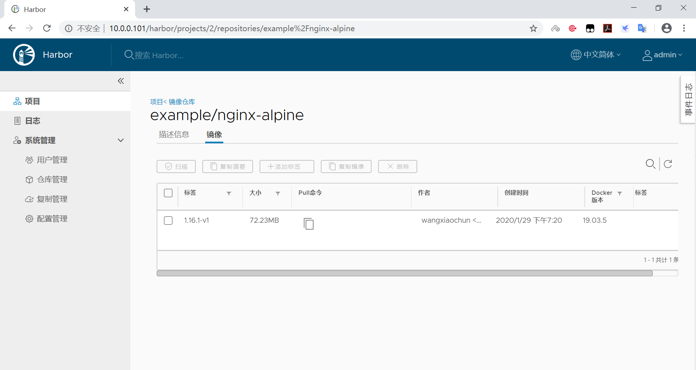

### 修改 Harbor 配置

后期如果修改harbor配置，比如:  修改IP地址等，可执行以下步骤生效

方法1:

```bash
[root@ubuntu1804 ~]#cd /usr/local/harbor/
[root@ubuntu1804 harbor]#docker-compose stop
Stopping nginx              ... done
Stopping harbor-portal      ... done
Stopping harbor-jobservice  ... done
Stopping harbor-core        ... done
Stopping harbor-adminserver ... done
Stopping harbor-db          ... done
Stopping registryctl        ... done
Stopping registry           ... done
Stopping redis              ... done
Stopping harbor-log         ...
#所有相关容器都退出
[root@ubuntu1804 harbor]#docker ps  -a
CONTAINER ID        IMAGE                                    COMMAND
CREATED             STATUS                        PORTS               NAMES
4ec3c3885407        goharbor/nginx-photon:v1.7.6             "nginx -g 'daemon
of…"   32 minutes ago      Exited (0) 51 seconds ago
nginx
5707b4ac41d8        goharbor/harbor-portal:v1.7.6            "nginx -g 'daemon
of…"   32 minutes ago      Exited (0) 50 seconds ago
harbor-portal
0ed230b9b714        goharbor/harbor-jobservice:v1.7.6        "/harbor/start.sh"
32 minutes ago      Exited (137) 41 seconds ago
harbor-jobservice
fec659188349        goharbor/harbor-core:v1.7.6              "/harbor/start.sh"
32 minutes ago      Exited (137) 30 seconds ago
harbor-core
910d14c1d7f7        goharbor/harbor-adminserver:v1.7.6       "/harbor/start.sh"
32 minutes ago      Exited (137) 20 seconds ago
harbor-adminserver
4348f503aa0e        goharbor/harbor-db:v1.7.6                "/entrypoint.sh
post…"   32 minutes ago      Exited (255) 48 seconds ago
harbor-db
beff6886f0f1        goharbor/harbor-registryctl:v1.7.6       "/harbor/start.sh"
32 minutes ago      Exited (137) 41 seconds ago
registryctl
428c99d274bf        goharbor/registry-photon:v2.6.2-v1.7.6   "/entrypoint.sh
/etc…"   32 minutes ago      Exited (137) 20 seconds ago
registry
775b4026fa4e        goharbor/redis-photon:v1.7.6             "docker-
entrypoint.s…"   32 minutes ago      Exited (137) 30 seconds ago
redis
c6f44e2034c6        goharbor/harbor-log:v1.7.6               "/bin/sh -c
/usr/loc…"   32 minutes ago      Exited (137) 9 seconds ago
harbor-log
#修改harbor配置
[root@ubuntu1804 harbor]#vim harbor.cfg
#更新配置
[root@ubuntu1804 ~]#/usr/local/harbor/prepare
Clearing the configuration file: /usr/local/harbor/common/config/db/env
Clearing the configuration file:
/usr/local/harbor/common/config/core/private_key.pem
Clearing the configuration file: /usr/local/harbor/common/config/core/env
Clearing the configuration file: /usr/local/harbor/common/config/core/app.conf
Clearing the configuration file: /usr/local/harbor/common/config/adminserver/env
Clearing the configuration file: /usr/local/harbor/common/config/registryctl/env
Clearing the configuration file:
/usr/local/harbor/common/config/registryctl/config.yml
Clearing the configuration file:
/usr/local/harbor/common/config/registry/root.crt
Clearing the configuration file:
/usr/local/harbor/common/config/registry/config.yml
Clearing the configuration file:
/usr/local/harbor/common/config/log/logrotate.conf
Clearing the configuration file:
/usr/local/harbor/common/config/nginx/nginx.conf
Clearing the configuration file: /usr/local/harbor/common/config/jobservice/env
Clearing the configuration file:
/usr/local/harbor/common/config/jobservice/config.yml
loaded secret from file: /data/secretkey
Generated configuration file: /usr/local/harbor/common/config/nginx/nginx.conf
Generated configuration file: /usr/local/harbor/common/config/adminserver/env
Generated configuration file: /usr/local/harbor/common/config/core/env
Generated configuration file:
/usr/local/harbor/common/config/registry/config.yml
Generated configuration file: /usr/local/harbor/common/config/db/env
Generated configuration file: /usr/local/harbor/common/config/jobservice/env
Generated configuration file:
/usr/local/harbor/common/config/jobservice/config.yml
Generated configuration file: /usr/local/harbor/common/config/log/logrotate.conf
Generated configuration file: /usr/local/harbor/common/config/registryctl/env
Generated configuration file: /usr/local/harbor/common/config/core/app.conf
Generated certificate, key file:
/usr/local/harbor/common/config/core/private_key.pem, cert file:
/usr/local/harbor/common/config/registry/root.crt
The configuration files are ready, please use docker-compose to start the
service.
#重新启动docker compose
[root@ubuntu1804 harbor]#docker-compose  start
Starting log         ... done
Starting postgresql  ... done
Starting redis       ... done
Starting adminserver ... done
Starting registry    ... done
Starting core        ... done
Starting jobservice  ... done
Starting portal      ... done
Starting proxy       ... done
Starting registryctl ... done
#相关容器自动启动
[root@ubuntu1804 harbor]#docker ps
CONTAINER ID        IMAGE                                    COMMAND
CREATED             STATUS                             PORTS
NAMES
4ec3c3885407        goharbor/nginx-photon:v1.7.6             "nginx -g 'daemon
of…"   34 minutes ago      Up 9 seconds (health: starting)    0.0.0.0:80-
>80/tcp, 0.0.0.0:443->443/tcp, 0.0.0.0:4443->4443/tcp   nginx
5707b4ac41d8        goharbor/harbor-portal:v1.7.6            "nginx -g 'daemon
of…"   34 minutes ago      Up 9 seconds (health: starting)    80/tcp
harbor-portal
0ed230b9b714        goharbor/harbor-jobservice:v1.7.6        "/harbor/start.sh"
34 minutes ago      Up 10 seconds
harbor-jobservice
fec659188349        goharbor/harbor-core:v1.7.6              "/harbor/start.sh"
34 minutes ago      Up 11 seconds (health: starting)
harbor-core
910d14c1d7f7        goharbor/harbor-adminserver:v1.7.6       "/harbor/start.sh"
34 minutes ago      Up 14 seconds (health: starting)
harbor-adminserver
4348f503aa0e        goharbor/harbor-db:v1.7.6                "/entrypoint.sh
post…"   34 minutes ago      Up 13 seconds (health: starting)   5432/tcp
harbor-db
beff6886f0f1        goharbor/harbor-registryctl:v1.7.6       "/harbor/start.sh"
34 minutes ago      Up 12 seconds (health: starting)
registryctl
428c99d274bf        goharbor/registry-photon:v2.6.2-v1.7.6   "/entrypoint.sh
/etc…"   34 minutes ago      Up 13 seconds (health: starting)   5000/tcp
registry
775b4026fa4e        goharbor/redis-photon:v1.7.6             "docker-
entrypoint.s…"   34 minutes ago      Up 11 seconds                      6379/tcp
redis
c6f44e2034c6        goharbor/harbor-log:v1.7.6               "/bin/sh -c
/usr/loc…"   34 minutes ago      Up 16 seconds (health: starting)
127.0.0.1:1514->10514/tcp                                          harbor-log
[root@ubuntu1804 harbor]#
```

方法2:

```bash
[root@ubuntu1804 ~]#/usr/local/harbor/install.sh
```

### 实现 Harbor 高可用

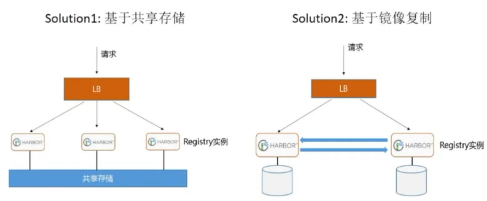

Harbor支持基于策略的Docker镜像复制功能，这类似于MySQL的主从同步，其可以实现不同的数据中心、不同的运行环境之间同步镜像，并提供友好的管理界面，大大简化了实际运维中的镜像管理工作， 已经有用很多互联网公司使用harbor搭建内网docker仓库的案例，并且还有实现了双向复制功能

### 安装第二台 harbor主机

参考6.4.2的过程，在第二台主机上安装部署好harbor，并登录系统

注意: 新版harbor.yml，旧版 harbor.cfg中配置 hostname = 10.0.0.102

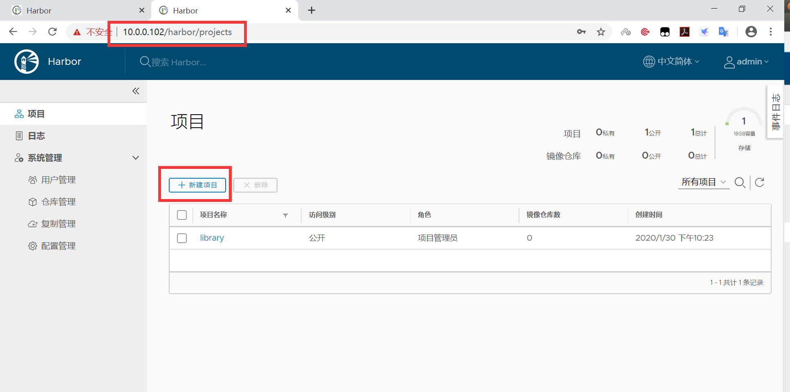

### 在源harbor上仓库管理中新建目标实现到目标harbor服务器的单向复制

参考第一台harbor服务器的项目名称，在第二台harbor服务器上新建与之同名的项目，此步可以不执行，首次同步时会自动生成

哪台harbor是源主机,就先在此主机上新建目标

参考第一台主机信息,新建复制（同步）目标信息,将第一台主机设为复制的目标

将第一台harbor设为复制的目标服务器，即实现Harbor2 到 harbor1 的单向复制

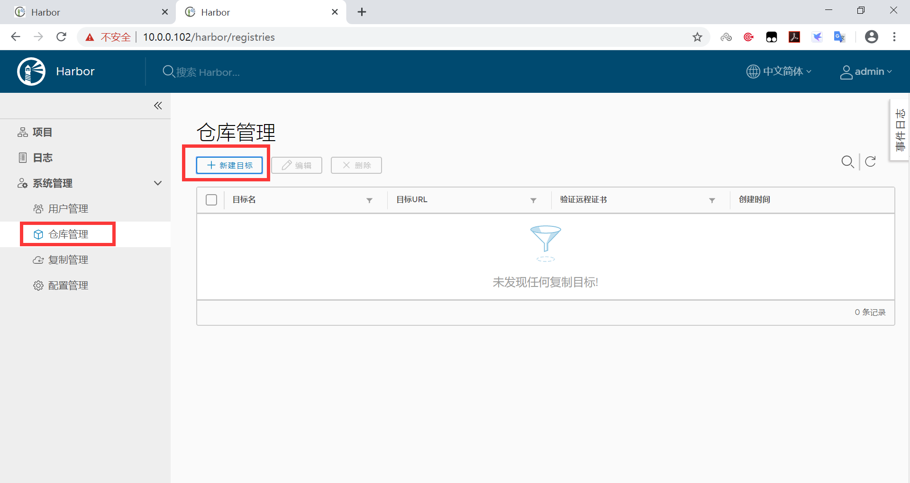

输入第一台harbor服务器上的主机10.0.0.101,目标名example（不是项目名，随意定义）和用户信息及密码admin

注意：需要使用admin用户，如果使用开发者用户，无法实现镜像的删除同步

新版界面

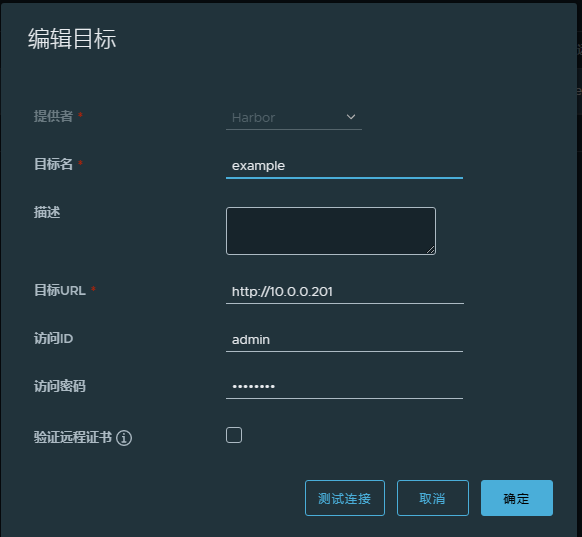

旧版界面

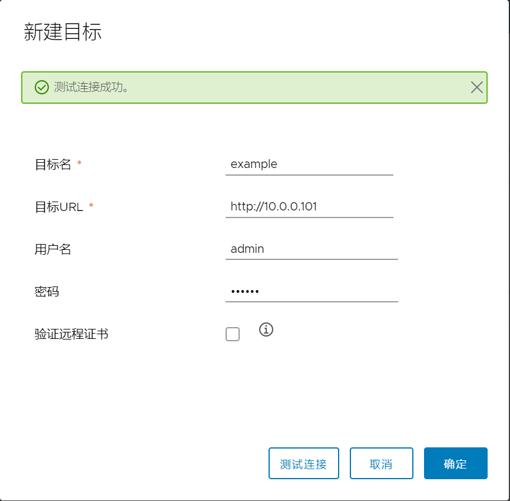

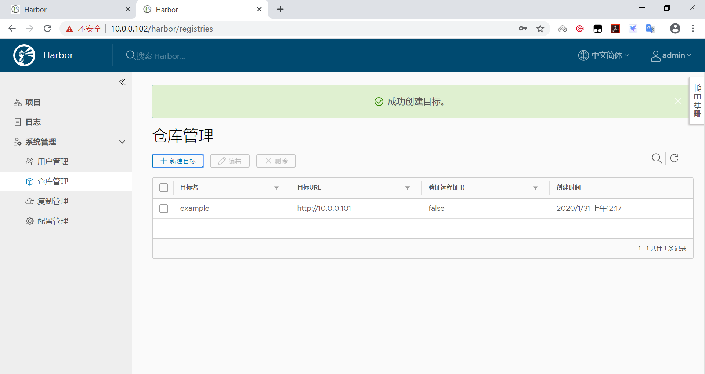

### 在源harbor上新建复制规则实现到目标harbor的单向复制

在第二台harbor上建立复制的目标主机,将第二台harbor上面的镜像复制到第一台harbor上

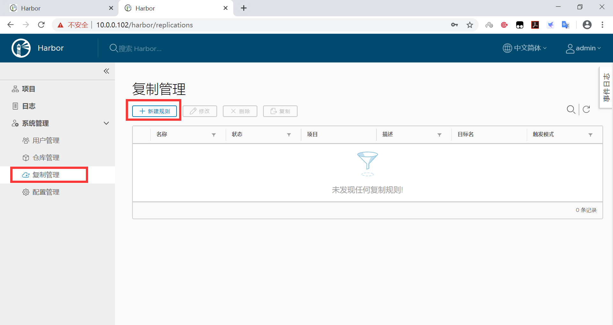

较新版本触发模式支持：手动，定时和事件驱动（自动）

新版界面

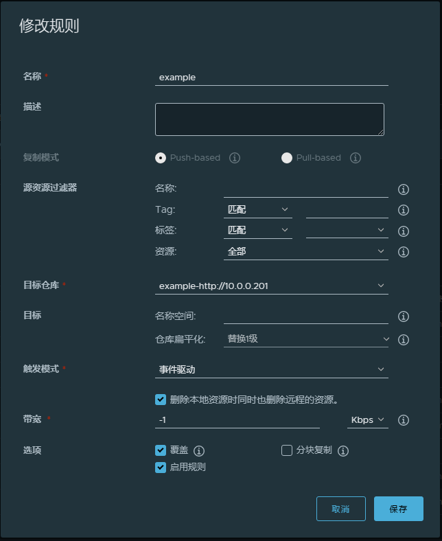

旧版界面

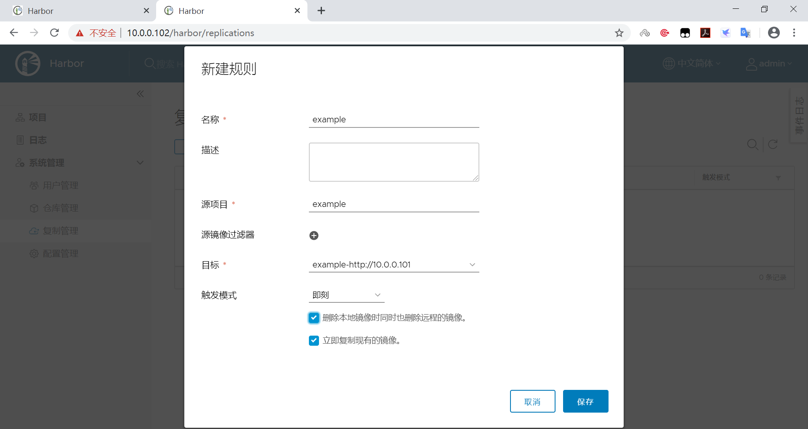

### 在源harbor上仓库管理中手动执行复制实现初始的同步

注意：首次只能手动执行复制才能实现全量同步，上传镜像会导致只会触发增量同步

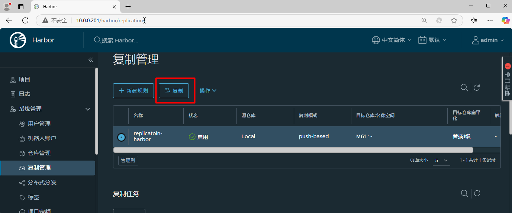

### 在目标harbor主机上重复上面操作

以上操作，只是实现了从第二台harbor主机10.0.0.102到第一台harbor主机10.0.101的单向同步

在第一台harbor上再执行下面操作，才实现双向同步

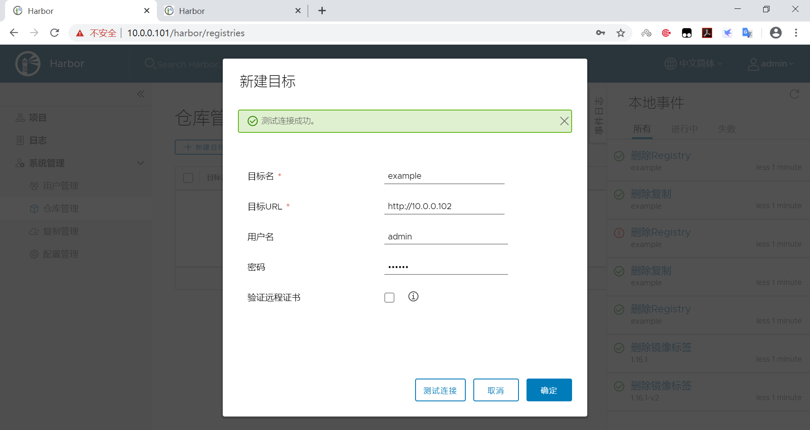

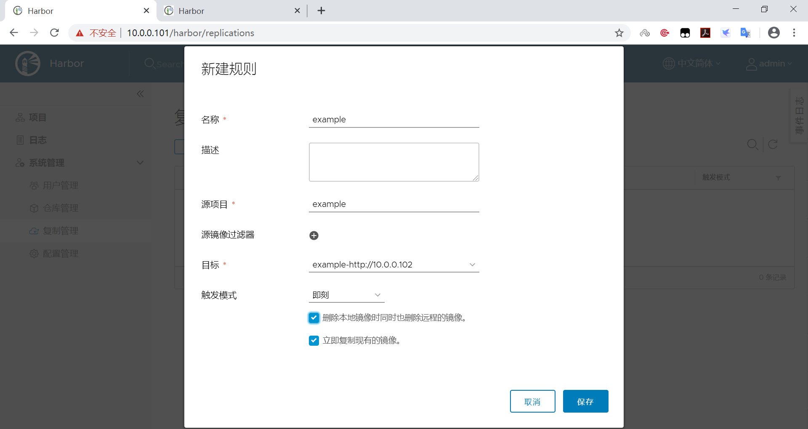

### 确认同步成功

在第二台harbor主机上可以查看到从第一台主机同步过来的镜像

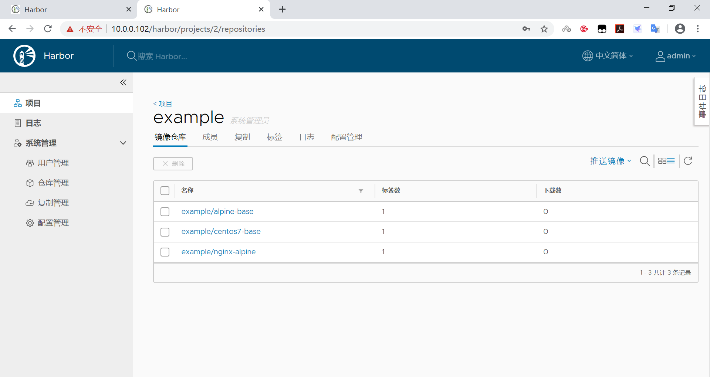

也可以查看到同步日志

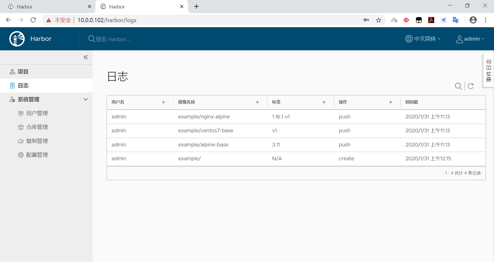

### 上传镜像观察是否可以双高同步

```bash
[root@ubuntu1804 ~]#docker tag tomcat-web:app1 10.0.0.101/example/tomcat-
web:app1
[root@ubuntu1804 ~]#docker push 10.0.0.101/example/tomcat-web:app1
[root@ubuntu1804 ~]#docker tag tomcat-web:app2 10.0.0.102/example/tomcat-
web:app2
[root@ubuntu1804 ~]#docker push 10.0.0.102/example/tomcat-web:app2
```

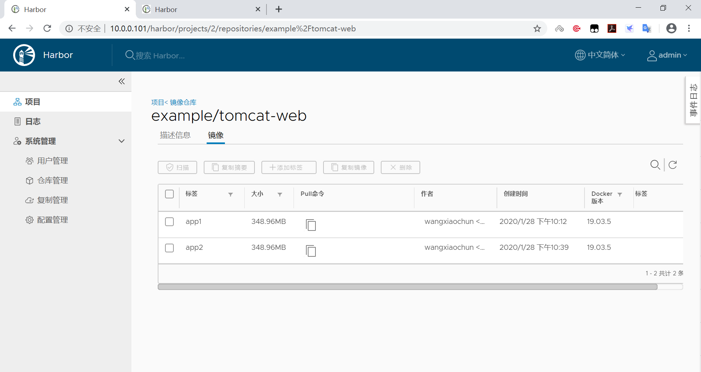

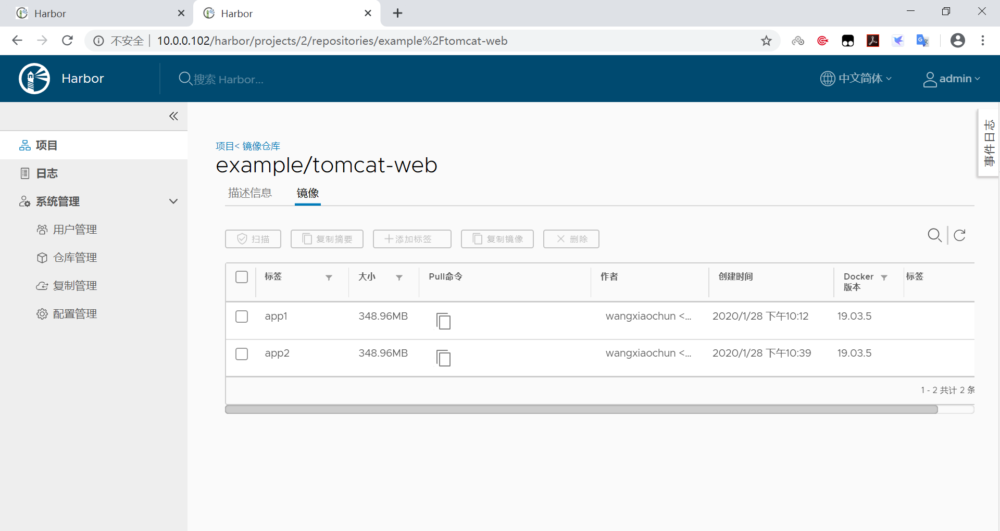

### 删除镜像观察是否可自动同步

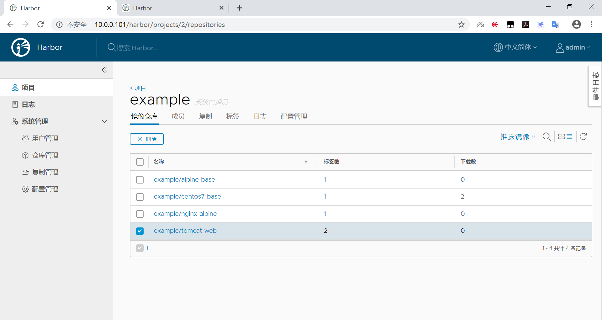

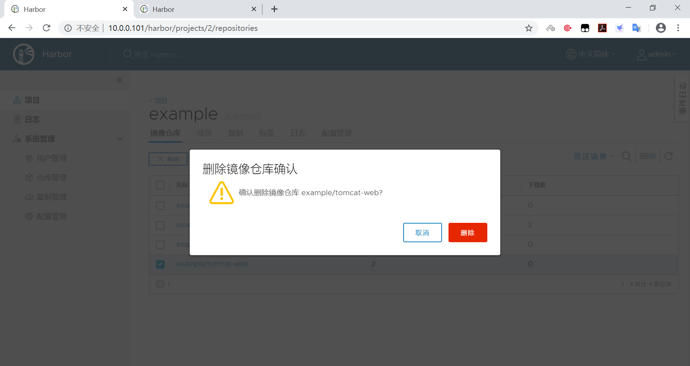

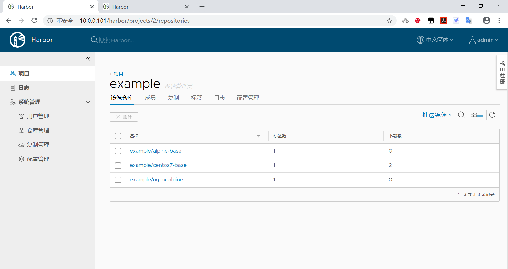

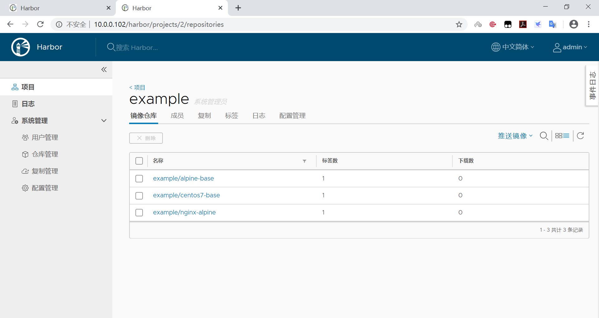

### 配置 Nginx 做为反向代理

范例：基于容器Nginx反向代理

```bash
[root@ubuntu2204 harbor]#cat harbor.bowen.org.conf
upstream harbor {
#ip_hash;
hash $remote_addr;
server 10.0.0.201:80;
server 10.0.0.202:80;
}
```

```bash
server {
server_name harbor.bowen.org;
client_max_body_size 10g;
location / {
proxy_pass http://harbor;
}
}
#官方镜像
[root@ubuntu2204 harbor]#docker run  --name myharbor -d -p 80:80 --
restart=always -v ./harbor.bowen.org.conf:/etc/nginx/conf.d/harbor.bowen.org.conf
nginx:1.24
[root@ubuntu2204 harbor]#docker run  --name myharbor -d -p 80:80 --
restart=always -v ./harbor.bowen.org.conf:/etc/nginx/conf.d/harbor.bowen.org.conf
registry.cn-beijing.aliyuncs.com/bowenxiaochun/nginx:1.24
#定制镜像
[root@ubuntu2204 harbor]#docker run  --name myharbor -d -p 80:80 --
restart=always -v
./harbor.bowen.org.conf:/apps/nginx/conf/conf.d/harbor.bowen.org.conf nginx:1.24
```

范例：包安装Nginx实现反向代理

```bash
#配置Nginx反向代理
[root@ubuntu2004 ~]#cat /etc/nginx/conf.d/harbor.bowen.org.conf
upstream harbor {
#ip_hash;
hash $remote_addr;
server harbor1.bowen.org:80;
server harbor2.bowen.org:80;
}
server {
listen 80;
server_name harbor.bowen.org;
client_max_body_size 10g;
location / {
proxy_pass http://harbor;
}
}
```

```json
#客户端docker配置
[root@rocky8 ~]#cat /etc/docker/daemon.json
{
"registry-mirrors": ["https://si7y70hh.mirror.aliyuncs.com"],
"insecure-registries": ["harbor.bowen.org"]
}
[root@rocky8 ~]#systemctl restart docker
#客户端docker配置名称解析
[root@rocky8 ~]#vim /etc/hosts
10.0.0.100 harbor.bowen.org
#如果harbor配置中的hostname: 指定harbor1.bowen.org和harbor2.bowen.org名称，还需要加下面解
析
10.0.0.101 harbor1.bowen.org
10.0.0.102 harbor2.bowen.org
```

### 基于HTTPS

```bash
[root@ubuntu2204 conf.d]#cat harbor.bowen.org.conf
upstream harbor {
hash $remote_addr;
server 10.0.0.201:80;
server 10.0.0.202:80;
}
```

```bash
server {
listen 80;
server_name harbor.bowen.org;
rewrite (.*) https://$server_name$1;
}
server {
listen 443 ssl;
server_name harbor.bowen.org;
ssl_certificate     /etc/nginx/conf.d/harbor.bowen.org.pem;
ssl_certificate_key /etc/nginx/conf.d/harbor.bowen.org.key;
client_max_body_size 10g;
location / {
proxy_pass http://harbor;
}
}
#错误1：需要额外的v3.ext的内容
[root@ubuntu2204 ~]#docker login harbor.bowen.org -u bowen -p Magedu123
WARNING! Using --password via the CLI is insecure. Use --password-stdin.
Error response from daemon: Get "https://harbor.bowen.org/v2/": tls: failed to
verify certificate: x509: certificate relies on legacy Common Name field, use
SANs instead
#错误2：证书不信任导致
[root@ubuntu2204 ~]#docker login harbor.bowen.org -u bowen -p Magedu123
WARNING! Using --password via the CLI is insecure. Use --password-stdin.
Error response from daemon: Get "https://harbor.bowen.org/v2/": tls: failed to
verify certificate: x509: certificate signed by unknown authority
#说明
/etc/nginx/conf.d/harbor.bowen.org.pem是由harbor.bowen.org.crt 和ca.crt合并生成
harbor.bowen.org.crt 生成参考6.4.5.1.1
#错误1的解决方法
cat > v3.ext <<-EOF
authorityKeyIdentifier=keyid,issuer
basicConstraints=CA:FALSE
keyUsage = digitalSignature, nonRepudiation, keyEncipherment, dataEncipherment
extendedKeyUsage = serverAuth
subjectAltName = @alt_names
[alt_names]
DNS.1=harbor.bowen.org
EOF
openssl x509 -req -sha512 -days 3650     -extfile v3.ext     -CA ca.crt -CAkey
ca.key -CAcreateserial     -in harbor.bowen.org.csr     -out harbor.bowen.org.cr
cat harbor.bowen.org.crt ca.crt > harbor.bowen.org.pem
#错误2的解决方法：在docker 客户端生成目录和放证书文件实现信任
[root@ubuntu2204 ~]#mkdir /etc/docker/certs.d/harbor.bowen.org -p
[root@ubuntu2204 ~]#scp harbor.bowen.org:/srv/harbor.bowen.org.crt
/etc/docker/certs.d/harbor.bowen.org
```

### Harbor 安全 Https 配置

基于安全考虑,生产建议采用 https 代替 http

### 新版实现实现 Harbor 的 Https 认证

新版2.5.0的Https实现方法出现了一些变化

官方文档:

<https://goharbor.io/docs/2.12.0/install-config/configure-https/>

<https://goharbor.io/docs/2.10.0/install-config/configure-https/>

<https://goharbor.io/docs/2.9.0/install-config/configure-https/>

<https://goharbor.io/docs/2.8.0/install-config/configure-https/>

<https://goharbor.io/docs/2.7.0/install-config/configure-https/>

<https://goharbor.io/docs/2.6.0/install-config/configure-https/>

<https://goharbor.io/docs/2.5.0/install-config/configure-https/>

6.4.5.1.1 生成 Harbor 服务器证书

```text
#创建证书相关数据的目录
mkdir -p /data/harbor/certs
cd /data/harbor/certs
#生成ca的私钥
openssl genrsa -out ca.key 4096
#生成ca的自签名证书
openssl req -x509 -new -nodes -sha512 -days 3650 \
-subj "/C=CN/ST=Beijing/L=Beijing/O=example/OU=Personal/CN=ca.bowen.org" \
-key ca.key \
-out ca.crt
#生成harbor主机的私钥
openssl genrsa -out harbor.bowen.org.key 4096
#生成harbor主机的证书申请，注意：CN的名称一定是访问harbor的主机域名
openssl req -sha512 -new \
-subj "/C=CN/ST=Beijing/L=Beijing/O=example/OU=Personal/CN=harbor.bowen.org"
\
-key harbor.bowen.org.key \
-out harbor.bowen.org.csr
#创建x509 v3 扩展文件(新版新增加的要求)
cat > v3.ext <<-EOF
authorityKeyIdentifier=keyid,issuer
basicConstraints=CA:FALSE
keyUsage = digitalSignature, nonRepudiation, keyEncipherment, dataEncipherment
extendedKeyUsage = serverAuth
subjectAltName = @alt_names
[alt_names]
DNS.1=harbor.bowen.org      #此处必须和和harbor的网站名称一致
DNS.2=bowen                 #可选
DNS.3=bowen.org             #可选
EOF
#给harbor主机颁发证书
openssl x509 -req -sha512 -days 3650 \
-extfile v3.ext \
-CA ca.crt -CAkey ca.key -CAcreateserial \
-in harbor.bowen.org.csr \
-out harbor.bowen.org.crt
[root@ubuntu2204 conf.d]#openssl  x509 -in harbor.bowen.org.crt -noout -text
Certificate:
Data:
Version: 3 (0x2)
Serial Number:
57:bd:fc:13:1e:55:e9:d4:af:79:bf:35:14:aa:94:83:26:11:3b:cc
Signature Algorithm: sha512WithRSAEncryption
Issuer: O = bowen, CN = ca.bowen.org
Validity
Not Before: Jan 26 07:52:58 2024 GMT
Not After : Jan 23 07:52:58 2034 GMT
Subject: C = CN, ST = henan, L = zhengzhou, O = bowen, CN =
harbor.bowen.org
Subject Public Key Info:
Public Key Algorithm: rsaEncryption
Public-Key: (2048 bit)
Modulus:
00:d6:db:6c:ea:70:75:59:00:d0:35:89:60:31:8e:
b3:15:67:71:0b:e1:99:a0:69:0f:e2:ca:3c:8c:e8:
2f:6f:6f:85:97:3f:a5:9e:08:a4:d5:4e:10:78:b2:
b5:05:3a:29:23:c4:8c:25:60:93:3a:b0:c8:16:52:
75:94:9f:d3:25:3c:3f:5b:8e:25:77:45:bc:5d:92:
8a:0e:a1:a5:c9:cb:e1:69:79:d2:97:86:dd:19:92:
e9:73:59:09:70:4d:8b:b9:d1:59:d4:f5:58:97:69:
47:60:18:c7:dc:e4:8b:c0:7e:82:fe:39:85:0c:54:
21:39:2c:db:ac:15:d5:bd:70:79:82:97:13:c8:04:
08:1e:08:be:6b:fb:8c:a1:e6:9a:79:b0:3d:ae:1a:
bd:d9:57:fc:54:aa:96:b7:de:a2:e4:5d:47:0f:5e:
a7:6c:4c:3d:08:9b:4d:fb:b6:40:5f:4a:fd:64:06:
c9:5f:cf:5b:ae:e5:96:60:2a:74:36:cc:28:db:11:
16:29:19:87:9f:90:b5:86:9e:63:e9:46:a0:11:32:
5f:64:74:b6:aa:8f:c1:5c:55:bf:ef:e1:77:98:38:
7c:7f:5a:f0:7a:86:85:2d:ec:e4:12:96:a0:92:e6:
9e:6e:3e:21:9e:17:8a:8d:54:b3:a4:c7:6a:31:16:
25:5d
Exponent: 65537 (0x10001)
#############################V3相关信息###########################
X509v3 extensions:
X509v3 Authority Key Identifier:
35:73:B0:87:A1:B3:21:32:B9:FA:C4:A2:82:21:AD:1C:9C:FC:10:5F
X509v3 Basic Constraints:
CA:FALSE
X509v3 Key Usage:
Digital Signature, Non Repudiation, Key Encipherment, Data
Encipherment
X509v3 Extended Key Usage:
TLS Web Server Authentication
X509v3 Subject Alternative Name:
DNS:harbor.bowen.org
X509v3 Subject Key Identifier:
E3:82:97:0F:C4:B9:A4:3F:9C:87:A3:3B:63:19:42:05:BE:3E:2B:73
Signature Algorithm: sha512WithRSAEncryption
Signature Value:
0e:5f:ca:eb:3a:94:db:6a:64:1f:90:13:71:fe:95:a6:f1:a1:
7f:cb:07:2f:25:c4:da:24:f3:82:a0:50:76:9b:f9:15:e0:98:
bc:b0:9c:d5:12:67:83:ca:9e:01:a9:5e:e5:37:63:18:07:a7:
54:a1:cd:ea:66:08:c9:a9:27:1a:23:cd:a8:13:18:89:9d:69:
14:12:3f:1c:55:b0:f6:36:01:ae:81:d2:e3:59:a5:6c:46:15:
3f:8c:51:54:cc:1e:c9:c6:17:cb:a5:13:82:12:d4:c4:d9:a3:
7e:05:7e:fa:a7:58:5c:fe:6f:56:f5:17:16:f8:2c:2d:90:ed:
17:c3:9a:e5:35:7f:d4:02:56:5a:f3:98:21:79:70:db:1e:4b:
d8:be:4f:bd:4b:50:c5:5e:46:3e:2b:a0:2b:2a:80:b6:e4:94:
5e:4b:13:ee:cc:a8:58:a6:37:87:c2:20:2c:ac:7c:2d:43:1f:
bc:0b:07:f1:ff:1a:af:fd:c7:02:a5:d4:f1:ab:09:ab:e1:69:
50:73:e9:be:6a:0e:2c:ed:24:42:d3:a7:55:49:a8:8e:04:40:
83:fa:16:8e:8d:04:19:3c:1b:18:77:d5:0a:6e:9d:8e:5e:09:
61:6f:19:6c:ae:d3:d4:ab:db:e6:8f:e5:26:19:76:19:bb:f2:
43:5e:f8:84
```

```bash
#最终文件列表如下
ca.crt  ca.key  ca.srl  harbor.bowen.org.crt  harbor.bowen.org.csr
harbor.bowen.org.key  v3.ext
#新版的最终文件列表如下
[root@ubuntu2204 certs]#ls
ca.crt  ca.key  harbor.bowen.org.crt  harbor.bowen.org.csr  harbor.bowen.org.key
v3.ext
```

注意: 如果不生成创建x509 v3 扩展文件,会出现下面提示错误

```text
docker login harbor.bowen.org
Username: admin
Password:
Error response from daemon: Get "https://harbor.bowen.org/v2/": x509: certificate
relies on legacy Common Name field, use SANs or temporarily enable Common Name
matching with GODEBUG=x509ignoreCN=0
```

6.4.5.1.2 配置 Harbor 服务器使用证书

```text
mkdir -p /data/harbor/certs/
cp harbor.bowen.org.crt harbor.bowen.org.key /data/harbor/certs/
vim /usr/local/harbor/harbor.yml
......
hostname: harbor.bowen.org #注意：此行必须是网站的域名，而且harbor主机的/etc/hosts可以不
解析此域名，不能是IP地址，否则登录时会报如下错误
Error response from daemon: Get "https://harbor.bowen.org/v2/": Get
"https://10.0.0.203/service/token?
account=admin&client_id=docker&offline_token=true&service=harbor-registry":
x509: cannot validate certificate for 10.0.0.203 because it doesn't contain any
IP SANs
# https related config
https:
# https port for harbor, default is 443
port: 443
# The path of cert and key files for nginx
certificate: /data/harbor/certs/harbor.bowen.org.crt
private_key: /data/harbor/certs/harbor.bowen.org.key
......
#使上面的配置生效
cd /usr/local/harbor/
./prepare
docker-compose down -v
docker-compose up -d
```

输入下面 http 链接自动跳转到 https

<http://harbor.bowen.org>

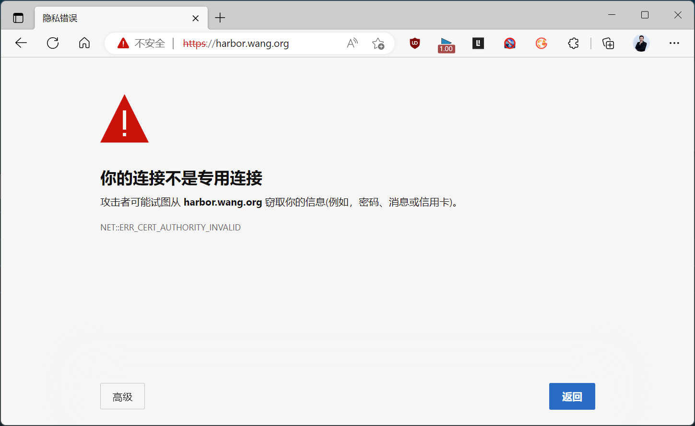

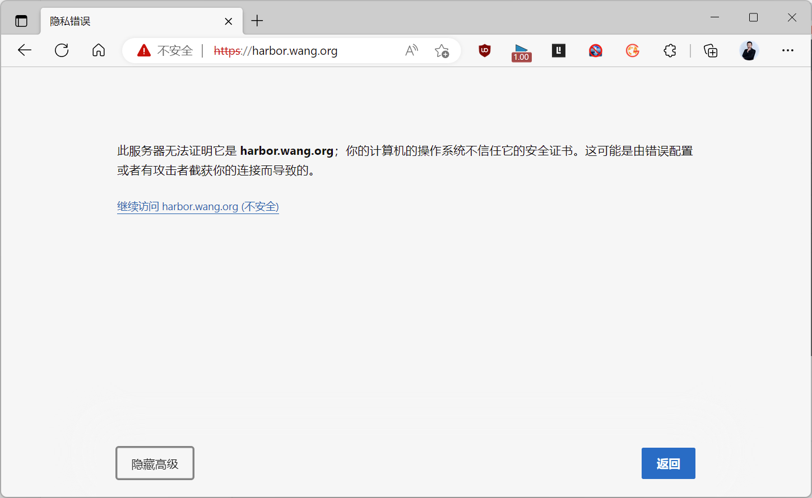

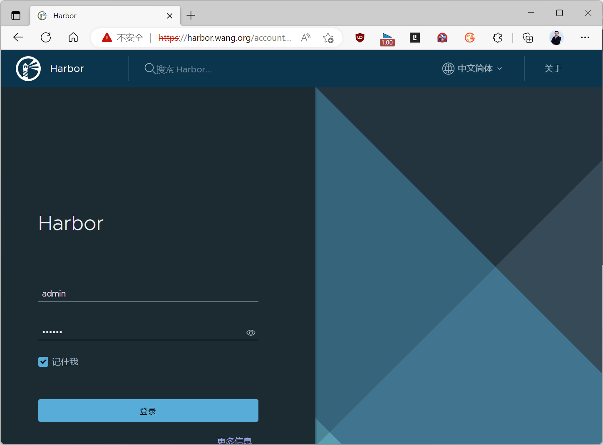

6.4.5.2.3 配置 Docker 客户端使用证书文件

方法1：

```text
#此步可选
#转换harbor的crt证书文件为cert后缀,docker识别crt文件为CA证书,cert为客户端证书
openssl x509 -inform PEM -in harbor.bowen.org.crt -out harbor.bowen.org.cert
#或者
cp -a harbor.bowen.org.crt  harbor.bowen.org.cert
#比较两个文件的不同
md5sum harbor.bowen.org.crt harbor.bowen.org.cert
#创建和harbor服务器同名的目录
mkdir -pv /etc/docker/certs.d/harbor.bowen.org/
#如果使用containerd运行时
mkdir -pv /etc/containerd/certs.d/harbor.bowen.org/
#在docker客户端使用上面的证书文件
#注意:官方介绍需要同时复制harbor.bowen.org.key ca.crt,实际不需要
cp harbor.bowen.org.cert或harbor.bowen.org.crt  harbor.bowen.org.key ca.crt
/etc/docker/certs.d/harbor.bowen.org/
#注意:实际只需要拷贝下面一个文件即可
cp harbor.bowen.org.crt /etc/docker/certs.d/harbor.bowen.org/
#无需重启服务，Docker客户即可上传下载镜像
#新版如果无法登录,需重启docker服务
systemctl restart docker
```

注意：

```text
#如果不在Harbor服务器上利用Docker访问自身Harbor的话，Harbor服务器的docker配置可以不修改，只
需要在每个需要访问Harbor服务器Docker客户端上配置证书文件即可，官方文档如下说明不准确
```

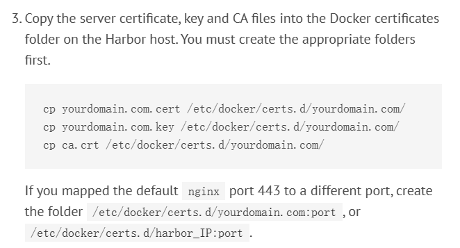

方法2：让docker信任你自已私有CA的证书

```text
#将私有CA的证书加入到每个docker主机的上信任证书CA列表中
#在Harbor服务器执行
#Ubuntu
cat /data/harbor/certs/ca.crt >> /etc/ssl/certs/ca-certificates.crt
#红帽系统
cat /data/harbor/certs/ca.crt >> /etc/pki/tls/certs/ca-bundle.crt
#将上面的文件复制到所有docker主机覆盖原文件
#并将所有docker主机的docker服务重启生效
systemctl restart docker.service
```

6.4.5.2.4 Docker 客户端登录Harbor

```json
#在docker客户端登录harbor服务器,注意:此时无需再配置insecure-registries项即可登录
docker login harbor.bowen.org
Username: admin
Password:
WARNING! Your password will be stored unencrypted in /root/.docker/config.json.
Configure a credential helper to remove this warning. See
https://docs.docker.com/engine/reference/commandline/login/#credentials-store
Login Succeeded
#登录成功后,自动保存登录信息,注意:auth对应的密码使用base64编码,可以还原明文密码
cat ~/.docker/config.json
{
"auths": {
"harbor.bowen.org": {
"auth": "AHFGDFADD434aXhr"
}
}
}
```

6.4.5.2.5 Docker 客户端测试推送和拉取镜像

登录harbor 查看推送命令

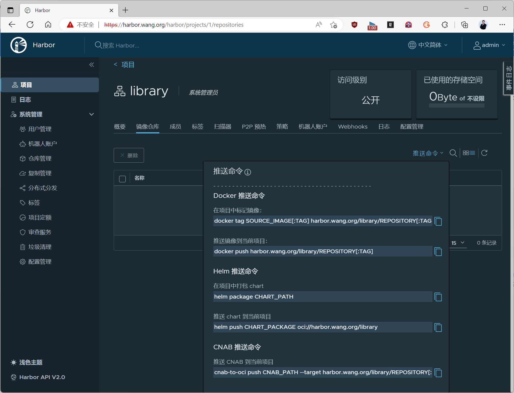

```text
docker push bowenxiaochun/busybox:1.30.0
docker tag bowenxiaochun/busybox:1.30.0 harbor.bowen.org/library/busybox:1.30.0
docker push harbor.bowen.org/library/busybox:1.30.0
```

验证推送是否成功

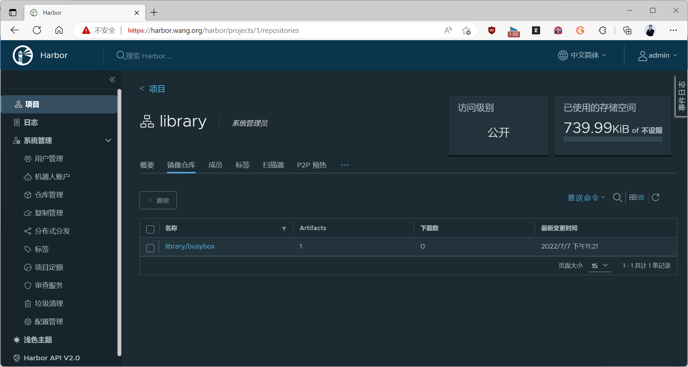

验证拉取

```text
docker pull  harbor.bowen.org/library/busybox:1.30.0
```

### 旧版实现 Harbor 的 Https 认证

旧版harbor默认使用http,为了安全，可以使用https

6.4.5.2.1 实现Harbor 的 https 认证

```bash
#安装docker
[root@ubuntu1804 ~]#bash install_docker_for_ubuntu1804.sh
#安装docker compose
[root@ubuntu1804 ~]#curl -L
https://github.com/docker/compose/releases/download/1.25.3/docker-compose-`uname
-s`-`uname -m` -o /usr/local/bin/docker-compose
[root@ubuntu1804 ~]#chmod +x /usr/local/bin/docker-compose
[root@ubuntu1804 ~]#docker-compose  --version
docker-compose version 1.25.3, build d4d1b42b
```

```bash
#下载harbor离线安装包且解压缩
[root@ubuntu1804 ~]#wget https://storage.googleapis.com/harbor-releases/release-
1.7.0/harbor-offline-installer-v1.7.6.tgz
[root@ubuntu1804 ~]#mkdir /apps
[root@ubuntu1804 ~]#tar xvf harbor-offline-installer-v1.7.6.tgz  -C /apps/
#生成私钥和证书
[root@ubuntu1804 ~]#touch /root/.rnd
[root@ubuntu1804 ~]#mkdir /usr/local/harbor/certs/
[root@ubuntu1804 ~]#cd /usr/local/harbor/certs/
#生成CA证书
[root@ubuntu1804 certs]#openssl req  -newkey rsa:4096 -nodes -sha256 -keyout
ca.key -x509  -subj "/CN=ca.bowen.org" -days 365 -out ca.crt
#生成harbor主机的证书申请
[root@ubuntu1804 certs]#openssl req  -newkey rsa:4096 -nodes -sha256 -subj
"/CN=harbor.bowen.org" -keyout harbor.bowen.org.key -out harbor.bowen.org.csr
#给harbor主机颁发证书
[root@ubuntu1804 certs]#openssl x509 -req -in harbor.bowen.org.csr -CA ca.crt -
CAkey ca.key -CAcreateserial  -out harbor.bowen.org.crt
[root@ubuntu1804 ~]#tree /usr/local/harbor/certs
/usr/local/harbor/certs
├── ca.crt
├── ca.key
├── ca.srl
├── harbor.bowen.org.crt
├── harbor.bowen.org.csr
└── harbor.bowen.org.key
0 directories, 6 files
[root@ubuntu1804 ~]#vim /usr/local/harbor/harbor.cfg
hostname = harbor.bowen.org #此项必须指定证书的域名，而不能使用IP
ui_url_protocol = https
ssl_cert = /usr/local/harbor/certs/harbor.bowen.org.crt
ssl_cert_key = /usr/local/harbor/certs/harbor.bowen.org.key
harbor_admin_password = 123456
[root@ubuntu1804 ~]#apt -y install python
[root@ubuntu1804 ~]#/usr/local/harbor/install.sh
```

6.4.5.2.2 用https方式访问harbor网站

修改/etc/hosts文件

```text
10.0.0.103 harbor.bowen.org
```

打开浏览器，访问http://harbor.bowen.org ,可以看到以下界面

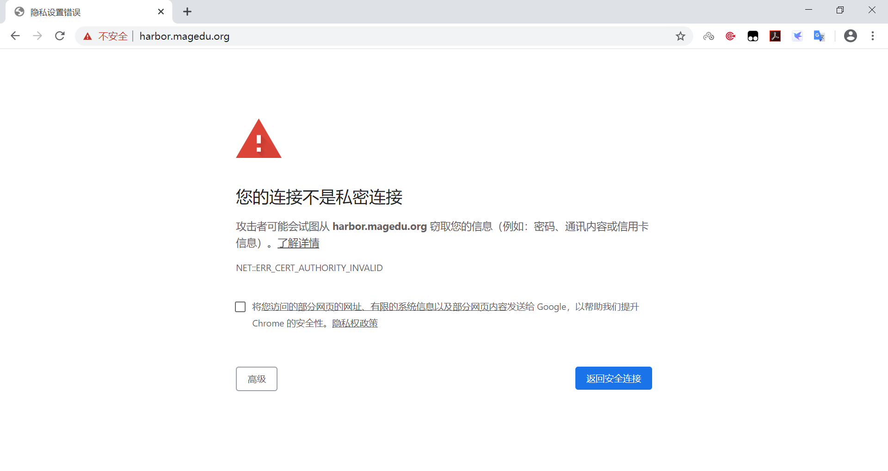

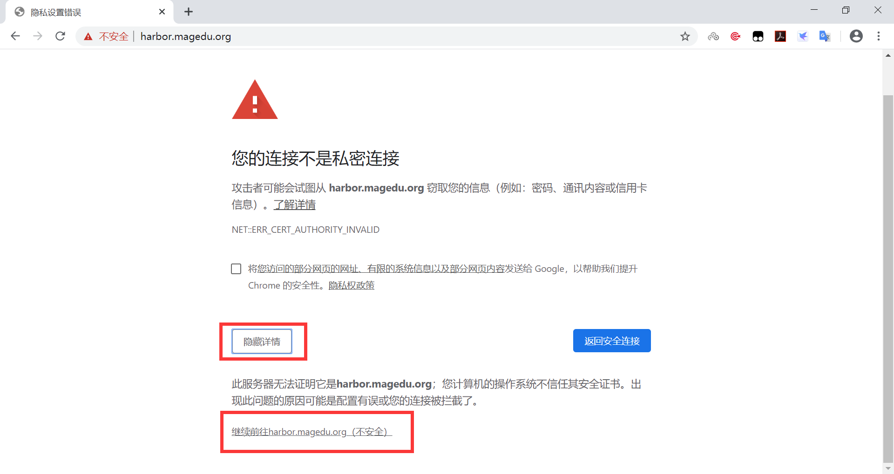

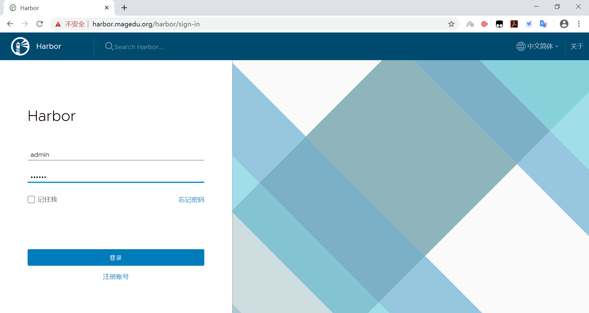

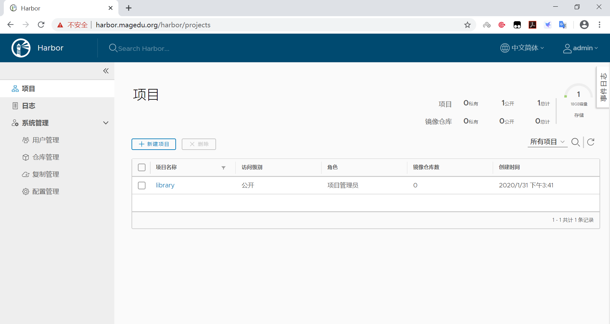

查看证书

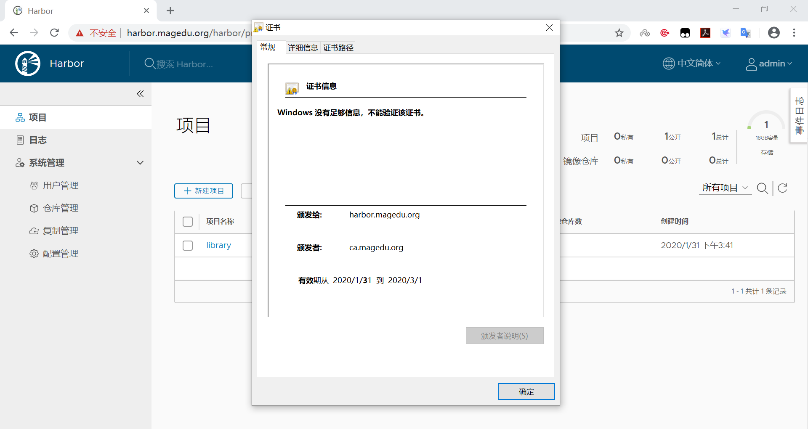

6.4.5.2.3 在harbor网站新建项目

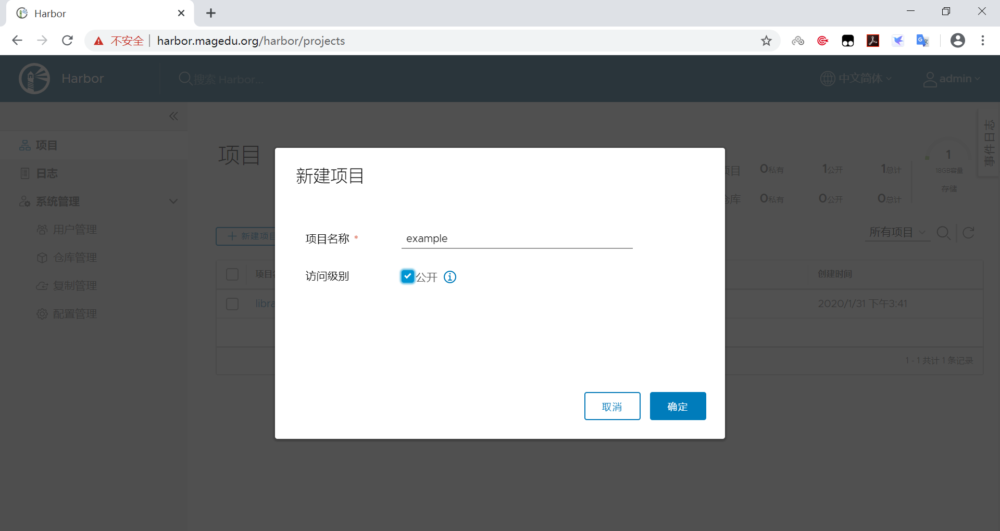

6.4.5.2.4 在客户端下载CA的证书

直接登录和上传下载镜像会报错

```bash
[root@ubuntu1804 ~]#vim /etc/hosts
10.0.0.103 harbor.bowen.org
#没有证书验证，直接登录失败
[root@ubuntu1804 ~]#docker login harbor.bowen.org
Username: admin
Password:
Error response from daemon: Get https://harbor.bowen.org/v2/: x509: certificate
signed by unknown authority
```

在客户端下载ca的证书

```bash
[root@ubuntu1804 ~]#mkdir -pv /etc/docker/certs.d/harbor.bowen.org/
[root@ubuntu1804 ~]#scp -r harbor.bowen.org:/apps/harbor/certs/ca.crt
/etc/docker/certs.d/harbor.bowen.org/
[root@ubuntu1804 ~]#tree /etc/docker/certs.d/
/etc/docker/certs.d/
└── harbor.bowen.org
└── ca.crt
1 directory, 1 file
#上面证书配置无需重启服务即生效
```

6.4.5.2.5 从客户端上传镜像

```bash
#先登录系统
[root@ubuntu1804 ~]#docker login harbor.bowen.org
Username: admin
Password:
WARNING! Your password will be stored unencrypted in /root/.docker/config.json.
Configure a credential helper to remove this warning. See
https://docs.docker.com/engine/reference/commandline/login/#credentials-store
Login Succeeded
#上传镜像
[root@ubuntu1804 ~]#docker tag alpine:3.11  harbor.bowen.org/example/alpine:3.11
[root@ubuntu1804 ~]#docker push harbor.bowen.org/example/alpine:3.11
The push refers to repository [harbor.bowen.org/example/alpine]
5216338b40a7: Pushed
3.11: digest:
sha256:ddba4d27a7ffc3f86dd6c2f92041af252a1f23a8e742c90e6e1297bfa1bc0c45 size:
528
```

在harbor网站上验证上传的镜像


6.4.5.2.6 在客户端下载镜像

```bash
[root@centos7 ~]#vim /etc/hosts
10.0.0.103 harbor.bowen.org
[root@centos7 ~]#docker pull  harbor.bowen.org/example/alpine:3.11
Error response from daemon: Get https://harbor.bowen.org/v2/: x509: certificate
signed by unknown authority
[root@centos7 ~]#mkdir -pv /etc/docker/certs.d/harbor.bowen.org/
[root@centos7 ~]#scp -r harbor.bowen.org:/apps/harbor/certs/ca.crt
/etc/docker/certs.d/harbor.bowen.org/
[root@centos7 ~]#tree /etc/docker/certs.d/
/etc/docker/certs.d/
└── harbor.bowen.org
└── ca.crt
1 directory, 1 file
[root@centos7 ~]#docker images
REPOSITORY          TAG                 IMAGE ID            CREATED
SIZE
[root@centos7 ~]#docker pull  harbor.bowen.org/example/alpine:3.11
3.11: Pulling from example/alpine
c9b1b535fdd9: Pull complete
Digest: sha256:ddba4d27a7ffc3f86dd6c2f92041af252a1f23a8e742c90e6e1297bfa1bc0c45
Status: Downloaded newer image for harbor.bowen.org/example/alpine:3.11
harbor.bowen.org/example/alpine:3.11
[root@centos7 ~]#docker images
REPOSITORY                         TAG                 IMAGE ID
CREATED             SIZE
harbor.bowen.org/example/alpine   3.11                e7d92cdc71fe        13 days
ago         5.59MB
```



<nav class="article-end" aria-label="章节导航">
  <a href="{{ '/subjects/Docker/30-private-docker-registry.html' | relative_url }}">← Previous: Private Docker Registry</a>
  <a href="{{ '/subjects/Docker/' | relative_url }}">Back to Docker Container Technology Index</a>
  <a href="{{ '/subjects/Docker/32-docker-resource-limits.html' | relative_url }}">Next: Docker Resource Limits →</a>
</nav>
