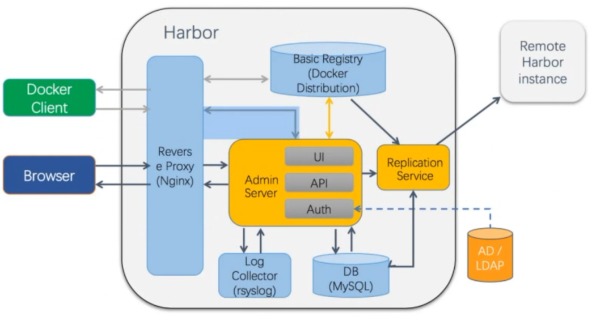

[← 返回 Docker 目录]({{ '/subjects/Docker/' | relative_url }})



# 31 Harbor 镜像仓库

Harbor 是带项目、角色权限、审计、复制等能力的 OCI 镜像仓库。它解决的是“如何在组织内管理和分发镜像”，不等于仅运行一个 `registry:2` 容器。原笔记混用了 Harbor 1.7、1.10 与 2.x 的组件名、安装文件和 HTTPS 步骤；版本之间不能直接拼接。本章以当前 Harbor 2.x 的概念组织，具体参数和安装包仍以所选版本的 [官方文档](https://goharbor.io/docs/) 为准。

## 31.1 架构与数据边界

客户端经入口代理访问 Harbor Core、Registry 等服务。Core 处理认证与 API，Registry 负责镜像清单和层的上传下载，Job Service 执行复制、扫描、垃圾回收等后台任务，数据库保存项目、用户和制品元数据，Redis 支持缓存和任务协调。版本不同还可能包含 Portal、Trivy 等组件。旧版 `harbor-ui`、`adminserver`、MySQL 等名称不应直接套到 2.x。



镜像二进制数据与元数据应分别纳入备份：只复制 registry 目录而不备份数据库，不能完整恢复项目权限、标签和任务状态。存储可使用本地持久化或所选版本支持的外部对象存储；多节点 Harbor 还需要共享/外置的状态服务。

## 31.2 单机安装前的检查

先准备受支持的 Linux、Docker Engine、Docker Compose 插件、稳定的 DNS 名称、持久化磁盘与 HTTPS 证书。不要直接使用旧文档中的 Harbor 1.7.6 安装包或未经审查的一键安装脚本。下载选定版本的离线/在线安装包时核对发布页、架构和校验值；离线包包含安装所需镜像，适合网络受限环境，但体积更大。

```bash
docker version
docker compose version
getent hosts harbor.example.com
df -h /data
# 从所选版本的官方 Release 下载并校验安装包后：
tar -xzf harbor-offline-installer-VERSION.tgz
cd harbor
cp harbor.yml.tmpl harbor.yml
```

复制模板后编辑 `harbor.yml` 的核心字段（示意，具体模板可能变化）：

```yaml
hostname: harbor.example.com
https:
  port: 443
  certificate: /etc/harbor/tls/harbor.crt
  private_key: /etc/harbor/tls/harbor.key
harbor_admin_password: CHANGE_ME_BEFORE_INSTALL
data_volume: /data
```

`hostname` 必须与客户端访问域名及证书 SAN 匹配。安装前设置强随机管理员密码；不要把真实密码提交到仓库或放进文章。根据部署要求还要配置外部 URL、代理、扫描组件和存储后端。先确认 `80/443` 端口、数据目录权限和证书私钥权限，再执行：

```bash
sudo ./prepare
sudo ./install.sh
docker compose ps
curl -I https://harbor.example.com/
```

`prepare` 与 `install.sh` 的使用以对应安装包文档为准；升级或改配置前备份 `harbor.yml` 和数据。不要直接编辑生成的 `docker-compose.yml` 来“修复”地址冲突，下一次 `prepare` 可能覆盖它；应从模板支持的配置项、宿主机端口和 Docker 网段规划上解决。

## 31.3 项目、权限与镜像流转

在 Web 界面先创建项目，例如 `team`，再按职责授予成员角色。能否推送取决于**项目权限**，仅有 Harbor 账号不够。公共项目允许匿名拉取，私有项目需鉴权；生产项目一般保持私有。自动化流水线应使用范围受限的机器人账号/令牌，不要共用管理员账号。

```bash
docker login harbor.example.com
docker tag nginx:1.27 harbor.example.com/team/nginx:1.27
docker push harbor.example.com/team/nginx:1.27
docker pull harbor.example.com/team/nginx:1.27
```

完整镜像名是 `仓库域名/项目/制品名:标签`。登录凭据可通过交互方式或 `--password-stdin` 输入，不要直接写成 `docker login -p 明文`。上传后在 Harbor 检查 digest、tag、推送者和扫描结果；下载时核对 tag/digest 与本地架构。旧文档通过修改 Docker daemon 参数添加 `insecure-registry` 才能拉取 HTTP Harbor，这是历史实验做法；正式部署优先 HTTPS。

## 31.4 HTTPS 与客户端信任

Harbor 对外证书应由可信 CA 签发，包含访问域名的 SAN。仅有 Common Name 的旧证书可能被现代客户端拒绝。若使用私有 CA，在每台 Docker 客户端安装 CA 证书并按系统方式更新信任；Docker 的专用目录一般为 `/etc/docker/certs.d/harbor.example.com/ca.crt`（如带非默认端口，目录名还要包含端口）。之后重启/重新尝试客户端连接并检查证书链。

```bash
openssl s_client -connect harbor.example.com:443 \
  -servername harbor.example.com -showcerts </dev/null
docker login harbor.example.com
```

不要通过关闭证书校验来掩盖名称、CA 或过期问题。若前置 Nginx/负载均衡器终止 TLS，要保证 Host、转发协议和 Harbor 的 `external_url` 一致，避免网页跳转到错误地址或 Docker push 失败。

## 31.5 复制与真正的高可用

在源 Harbor 添加目标 Registry endpoint，配置复制规则的项目范围、方向和触发方式，再执行首次同步并查看 Job Service 任务日志。规则可以是事件驱动、计划或手动，具体选项以版本为准；初次全量同步不要假定仅上传一次新镜像就能补齐历史数据。推送/删除/覆盖 tag 的行为需要分别验证，**不能默认删除必然在目标端同步**。

两台 Harbor 相互配置复制属于**两套独立仓库的数据复制**，不是一个共享状态的双活 Harbor 集群。双向复制还可能造成标签冲突、循环或权限不一致；应明确主写入口、冲突策略与延迟容忍度。把两台独立 Harbor 直接放在轮询负载均衡之后也不等于高可用：客户端的一次上传可能跨节点，而两端数据和认证状态尚未同步。

真正的多实例高可用需要按官方 HA 方案规划负载均衡、共享对象存储或共享存储、外部数据库与 Redis、统一配置和健康检查，并在不同故障域部署。切换演练要覆盖登录、推送、拉取、项目权限、复制任务和恢复时间，而不只是首页可以打开。

## 31.6 维护与故障排查

1. **登录失败**：核对 DNS、证书链、系统时间、Harbor 用户状态和项目角色，再看 Core 日志。
2. **能登录但推送失败**：核对完整镜像名、项目是否存在、角色权限、磁盘空间及 Registry/入口代理日志。
3. **复制积压**：检查 endpoint 可达性、目标项目权限、Job Service 任务状态、制品大小和网络吞吐。
4. **升级前**：备份数据库、镜像存储、配置、证书与密钥，确认版本升级路径；维护窗口内执行，升级后抽样验证 pull/push。
5. **空间回收**：删除 tag/制品后不一定立即释放底层层数据；按 Harbor 版本文档安排垃圾回收并确认无并发风险，不要直接删除 `/data/registry` 文件。

这样把单机安装、镜像交付、证书信任、跨站复制和真正高可用分开理解，避免把旧版脚本中的成功提示误当成整个仓库服务已可靠运行。



<nav class="article-end" aria-label="章节导航">
  <a href="{{ '/subjects/Docker/30-private-docker-registry.html' | relative_url }}">← 上一章：私有 Docker Registry</a>
  <a href="{{ '/subjects/Docker/' | relative_url }}">返回 Docker 目录</a>
  <a href="{{ '/subjects/Docker/32-docker-resource-limits.html' | relative_url }}">下一章：Docker 资源限制 →</a>
</nav>
