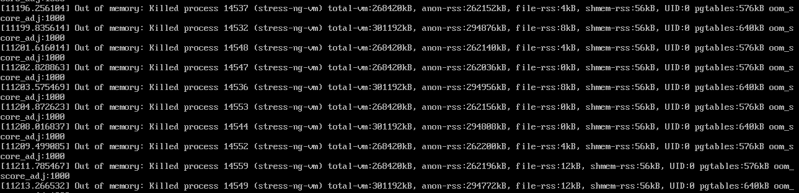

[← 返回Docker 容器技术目录]({{ '/subjects/Docker/' | relative_url }})



# 32 Docker 资源限制
## 7 Docker 的资源限制

### 7.1 Docker 资源限制

### 7.1 为什么需要设置资源边界

容器共享宿主机内核。未设置限制时，容器中的进程通常会与其他进程竞争 CPU、内存等资源；一个失控进程可能影响同机服务。Docker 将 `docker run` 的资源参数转化为内核 cgroup 限制，但实际可用功能取决于内核、cgroup v1/v2、Docker 版本和宿主机配置。参考[Docker 资源限制文档](https://docs.docker.com/engine/containers/resource_constraints/)。

| 目标 | 常用参数 | 后续章节 |
| --- | --- | --- |
| 限制内存上限 | `--memory`、`--memory-swap` | 第 34 篇。 |
| 控制 CPU 使用量 | `--cpus`、`--cpu-shares`、`--cpuset-cpus` | 第 35 篇。 |
| 指定可见 GPU | `--gpus` | 第 36 篇；它不是显存硬配额。 |

`docker info` 输出末尾若有 `No swap limit support` 等警告，应先确认当前 cgroup 模式与系统发行版文档。旧资料给出的 Ubuntu 18.04 GRUB 参数只适用于特定环境；不应为消除一条警告就覆盖现有引导参数并立即重启生产主机。

### OOM：主机与容器的两个层次



当容器达到自身内存限制时，可能触发 cgroup 范围内的 OOM；当整个宿主机内存不足时，也可能发生主机级 OOM。二者影响范围不同，排查时要结合容器退出状态、内核日志和当前内存水位。OOM 不等同于“内存泄漏”，也不能把任何进程退出都归因于 OOM。

内核选择牺牲进程时会参考 `oom_score` 和 `oom_score_adj` 等信息，但分数并不是简单的“RSS ÷ 总内存 × 1000”公式。`oom_score_adj` 越高，进程通常越容易被选中；将服务设为极端负值，或随意使用 `--oom-kill-disable`，可能把压力转移给宿主机其他重要进程。

排障时可按以下顺序检查：

```bash
docker inspect --format '{{.State.OOMKilled}} {{.State.ExitCode}}' CONTAINER
docker stats --no-stream CONTAINER
journalctl -k --since '30 minutes ago' | grep -i -E 'oom|killed process'
```

将 `CONTAINER` 换成实际容器名。`OOMKilled=true` 是重要证据，但仍需核对内核日志和应用日志；监控应关注持续内存增长、交换活动及重启频率。第 33 篇用可控压力工具模拟负载，再分别观察内存与 CPU 限制。



<nav class="article-end" aria-label="章节导航">
  <a href="{{ '/subjects/Docker/31-distributed-harbor-registry.html' | relative_url }}">← 上一篇：Harbor 镜像仓库</a>
  <a href="{{ '/subjects/Docker/' | relative_url }}">返回 Docker 容器技术目录</a>
  <a href="{{ '/subjects/Docker/33-load-testing-with-stress-ng.html' | relative_url }}">下一篇：Stress-ng 压力测试工具 →</a>
</nav>
