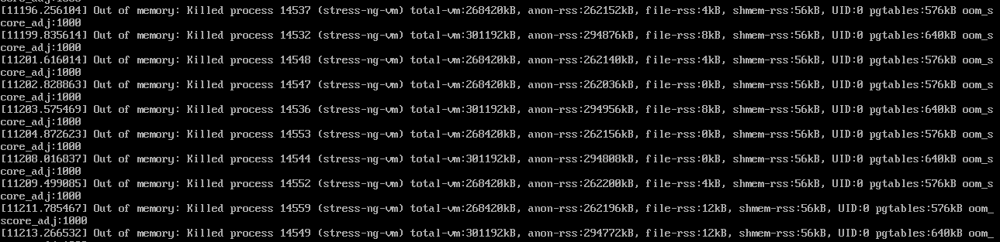

[← 返回Docker 容器技术目录]({{ '/subjects/Docker/' | relative_url }})



# 32 Docker 资源限制
## 7 Docker 的资源限制

### 7.1 Docker 资源限制

### 容器资源限制介绍

官方文档:

<https://docs.docker.com/config/containers/resource_constraints/>

默认情况下，容器没有资源的使用限制，可以使用主机内核调度程序允许的尽可能多的资源

Docker 提供了控制容器使用资源的方法,可以限制容器使用多少内存或 CPU等， 在docker run 命令的运行时配置标志实现资源限制功能。

其中许多功能都要求宿主机的内核支持，要检查是否支持这些功能，可以使用docker info 命令 ，如果内核中的某项特性可能会在输出结尾处看到警告， 如下所示:

```text
WARNING: No swap limit support  #没有启用 swap 限制功能会出现此提示警报
```

可通过修改内核参数消除以上警告官方文档:  https://docs.docker.com/install/linux/linux-postinstall/#your-kernel-does-not-support-c group-swap-limit-capabilities

范例:  修改内核参数消除以上警告

```bash
[root@ubuntu1804 ~]#docker info
Client:
Debug Mode: false
Server:
Containers: 0
Running: 0
Paused: 0
Stopped: 0
Images: 1
Server Version: 19.03.5
Storage Driver: overlay2
Backing Filesystem: extfs
Supports d_type: true
Native Overlay Diff: true
Logging Driver: json-file
Cgroup Driver: cgroupfs       #新版为systemd
Plugins:
Volume: local
Network: bridge host ipvlan macvlan null overlay
Log: awslogs fluentd gcplogs gelf journald json-file local logentries splunk
syslog
Swarm: inactive
Runtimes: runc
Default Runtime: runc
Init Binary: docker-init
containerd version: b34a5c8af56e510852c35414db4c1f4fa6172339
runc version: 3e425f80a8c931f88e6d94a8c831b9d5aa481657
init version: fec3683
Security Options:
apparmor
seccomp
Profile: default
Kernel Version: 4.15.0-29-generic
Operating System: Ubuntu 18.04.1 LTS
OSType: linux
Architecture: x86_64
CPUs: 1
Total Memory: 962MiB
Name: ubuntu1804.bowen.org
ID: 4LUN:CS4Y:SGYQ:ZAXU:M7C5:JYSB:ZFTO:JZ6D:CD7Q:TOVD:JBFS:AQM3
Docker Root Dir: /var/lib/docker
Debug Mode: false
Registry: https://index.docker.io/v1/
Labels:
Experimental: false
Insecure Registries:
10.0.0.102
127.0.0.0/8
Registry Mirrors:
https://si7y70hh.mirror.aliyuncs.com/
Live Restore Enabled: false
WARNING: No swap limit support
#修改内核参数
[root@ubuntu1804 ~]#vim /etc/default/grub
GRUB_CMDLINE_LINUX="cgroup_enable=memory net.ifnames=0 swapaccount=1"
[root@ubuntu1804 ~]#update-grub
[root@ubuntu1804 ~]#reboot
[root@ubuntu1804 ~]#docker info
Client:
Debug Mode: false
Server:
Containers: 0
Running: 0
Paused: 0
Stopped: 0
Images: 1
Server Version: 19.03.5
Storage Driver: overlay2
Backing Filesystem: extfs
Supports d_type: true
Native Overlay Diff: true
Logging Driver: json-file
Cgroup Driver: cgroupfs
Plugins:
Volume: local
Network: bridge host ipvlan macvlan null overlay
Log: awslogs fluentd gcplogs gelf journald json-file local logentries splunk
syslog
Swarm: inactive
Runtimes: runc
Default Runtime: runc
Init Binary: docker-init
containerd version: b34a5c8af56e510852c35414db4c1f4fa6172339
runc version: 3e425f80a8c931f88e6d94a8c831b9d5aa481657
init version: fec3683
Security Options:
apparmor
seccomp
Profile: default
Kernel Version: 4.15.0-29-generic
Operating System: Ubuntu 18.04.1 LTS
OSType: linux
Architecture: x86_64
CPUs: 1
Total Memory: 962MiB
Name: ubuntu1804.bowen.org
ID: 4LUN:CS4Y:SGYQ:ZAXU:M7C5:JYSB:ZFTO:JZ6D:CD7Q:TOVD:JBFS:AQM3
Docker Root Dir: /var/lib/docker
Debug Mode: false
Registry: https://index.docker.io/v1/
Labels:
Experimental: false
Insecure Registries:
10.0.0.102
127.0.0.0/8
Registry Mirrors:
https://si7y70hh.mirror.aliyuncs.com/
Live Restore Enabled: false
[root@ubuntu1804 ~]#
```

### OOM （Out of Memory Exception）

对于 Linux 主机，如果没有足够的内存来执行其他重要的系统任务，将会抛出OOM (Out of Memory Exception,内存溢出、内存泄漏、内存异常 )，随后系统会开始杀死进程以释放内存， 凡是运行在宿主机的进程都有可能被 kill ，包括 Dockerd和其它的应用程序， 如果重要的系统进程被 Kill，会导致和该进程相关的服务全部宕机。通常越消耗内存比较大的应用越容易被kill，比如:  MySQL数据库，Java程序等

范例:  OOM发生后的日志信息



产生 OOM 异常时， Dockerd尝试通过调整 Docker 守护程序上的 OOM 优先级来减轻这些风险，以便它比系统上的其他进程更不可能被杀死但是每个容器 的 OOM 优先级并未调整， 这使得单个容器被杀死的可能性比 Docker守护程序或其他系统进程被杀死的可能性更大，不推荐通过在守护程序或容器上手动设置-- oom -score-adj为极端负数，或通过在容器上设置 -- oom-kill-disable来绕过这些安全措施

OOM 优先级机制:

linux会为每个进程计算一个分数，最终将分数最高的kill

```text
/proc/PID/oom_score_adj
#范围为 -1000 到 1000，值越高容易被宿主机 kill掉，如果将该值设置为 -1000 ，则进程永远不会被
宿主机 kernel kill
/proc/PID/oom_adj
#该设置参数是为了和旧版本的 Linux 内核兼容的旧接口文件，范围为 -17 到+15 ，会被线性映射到
oom_score_adj，取值越高越容易被干掉，如果是 -17 ， 则表示不能被 kill， root可读写，
/proc/PID/oom_score
#这个值是系统综合进程的内存消耗量，只读文件，取值范围0 –- 1000，0代表never kill，1000代表
aways kill，值越大，进程被选中的概率越大。
#oom_score = 占用消耗内存/总内存 *1000
#内存消耗=常驻内存RSS + 进程页面 +交换内存
#总内存=总的物理内存 +交换分区
#消耗内存越多得分越高，容易被宿主机 kernel 强制杀死
#当内存紧张的时候，内核通过 oom = oom_score + oom_score_adj 计算出分数最高的进程，向其发送
关闭信号
```

范例:  查看OOM相关值

```bash
[root@ubuntu2404 ~]#cat /proc/*/oom_score_adj |sort -nr|uniq
100
0
-250
-500
-900
-998
-999
-1000
```

```bash
#按内存排序
[root@ubuntu1804 ~]#top
top - 20:15:38 up  5:53,  3 users,  load average: 0.00, 0.00, 0.00
Tasks: 191 total,   1 running, 116 sleeping,   0 stopped,   0 zombie
%Cpu(s):  0.0 us,  0.3 sy,  0.0 ni, 99.7 id,  0.0 wa,  0.0 hi,  0.0 si,  0.0 st
KiB Mem :   985104 total,   310592 free,   448296 used,   226216 buff/cache
KiB Swap:  1951740 total,  1892860 free,    58880 used.   384680 avail Mem
PID USER      PR  NI    VIRT    RES    SHR S %CPU %MEM     TIME+ COMMAND
19674 2019      20   0 2241656  94684  12452 S  0.0  9.6   0:16.05 java
19675 2019      20   0 2235512  74816  12440 S  0.0  7.6   0:14.89 java
19860 99        20   0  183212  67748    960 S  0.0  6.9   0:01.15 haproxy
4969 root      20   0  937880  49352  12612 S  0.0  5.0   0:46.07 dockerd
2981 root      20   0  793072  13552   1808 S  0.0  1.4   0:13.78 containerd
500 root      19  -1   78560   7552   7112 S  0.0  0.8   0:01.45 systemd-
journal
798 root      20   0  170416   6604   4084 S  0.0  0.7   0:00.77 networkd-
dispat
1 root      20   0   78036   6200   4416 S  0.0  0.6   0:05.39 systemd
1011 root      20   0   24548   5496   3012 S  0.0  0.6   0:01.62 bash
852 root      10 -10   25880   5264   4036 S  0.0  0.5   0:00.00 iscsid
815 root      20   0  548292   4624   1224 S  0.0  0.5   0:01.89 snapd
19586 root      20   0  109104   4532   3768 S  0.0  0.5   0:00.29 containerd-
shim
19779 root      20   0  405532   4224   2828 S  0.0  0.4   0:00.01 docker-proxy
19784 root      20   0  107696   4204   3652 S  0.0  0.4   0:00.29 containerd-
shim
19424 root      20   0  109104   4084   3416 S  0.0  0.4   0:00.27 containerd-
shim
20064 root      20   0   44076   4036   3360 R  0.7  0.4   0:00.20 top
19768 root      20   0  405532   4024   2644 S  0.0  0.4   0:00.01 docker-proxy
19423 root      20   0  109104   3792   3064 S  0.0  0.4   0:00.31 containerd-
shim
490 root      20   0  193112   3316   2864 S  0.0  0.3   0:26.20 vmtoolsd
7108 root      20   0  105688   3204   2504 S  0.0  0.3   0:00.11 sshd
[root@ubuntu1804 ~]#cat /proc/19674/oom_adj
0
[root@ubuntu1804 ~]#cat /proc/19674/oom_score
32
[root@ubuntu1804 ~]#cat /proc/19674/oom_score_adj
0
[root@ubuntu1804 ~]#cat /proc/7108/oom_adj
0
[root@ubuntu1804 ~]#cat /proc/7108/oom_score
1
[root@ubuntu1804 ~]#cat /proc/7108/oom_score_adj
0
#docker服务进程的OOM默认值
[root@ubuntu1804 ~]#cat /proc/`pidof dockerd`/oom_adj
-8
[root@ubuntu1804 ~]#cat /proc/`pidof dockerd`/oom_score
0
[root@ubuntu1804 ~]#cat /proc/`pidof dockerd`/oom_score_adj
-500
```



<nav class="article-end" aria-label="章节导航">
  <a href="{{ '/subjects/Docker/31-distributed-harbor-registry.html' | relative_url }}">← Previous: Distributed Harbor Registry</a>
  <a href="{{ '/subjects/Docker/' | relative_url }}">Back to Docker Container Technology Index</a>
  <a href="{{ '/subjects/Docker/33-load-testing-with-stress-ng.html' | relative_url }}">Next: Load Testing with Stress-ng →</a>
</nav>
