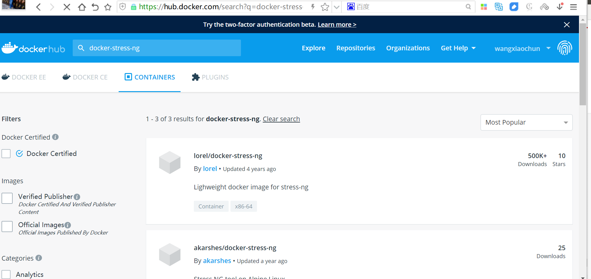

[← 返回Docker 容器技术目录]({{ '/subjects/Docker/' | relative_url }})



# 33 Stress-ng 压力测试工具
### 7.2 Stress-ng 压力测试工具

### 7.2 工具用途与使用边界

`stress-ng` 可以生成 CPU、内存和 I/O 等不同类型的压力，适合验证资源限制与监控指标。它不是业务基准测试：其结果只能说明特定压力模型下系统的表现，不能直接推算真实应用吞吐。所有示例均设定 `--timeout`，先在测试环境运行，并观察宿主机剩余资源。


参考：[stress-ng 项目](https://github.com/ColinIanKing/stress-ng)、[Ubuntu 文档](https://wiki.ubuntu.com/Kernel/Reference/stress-ng)。



### 安装与准备测试镜像

Ubuntu/Debian 可通过软件包安装：

```bash
sudo apt-get update
sudo apt-get install -y stress-ng
stress-ng --version
stress-ng --help
```

如果要在 Docker 中复现后续内存与 CPU 示例，可以在空目录创建 `Dockerfile.stress`，构建自己的小型测试镜像。原资料引用的旧第三方镜像使用过时清单格式，不宜作为教程依赖。

```dockerfile
FROM ubuntu:24.04
RUN apt-get update && apt-get install -y --no-install-recommends stress-ng \
    && rm -rf /var/lib/apt/lists/*
ENTRYPOINT ["stress-ng"]
```

```bash
docker build -f Dockerfile.stress -t local/stress-ng:demo .
```

### 常用压力参数

| 参数 | 作用 | 示例 |
| --- | --- | --- |
| `--cpu N` | 启动 N 个 CPU 压力 worker。 | `--cpu 2` |
| `--vm N` | 启动 N 个内存压力 worker。 | `--vm 1` |
| `--vm-bytes SIZE` | 指定每个内存 worker 处理的数据量。 | `--vm-bytes 128M` |
| `--timeout T` | 到时自动结束，避免无限运行。 | `--timeout 10s` |
| `--metrics-brief` | 结束后输出简要统计。 | 与上述参数组合。 |

先运行一个受限的 CPU 测试，再在另一个终端观察：

```bash
docker run --rm --name stress-demo --cpus=1 \
  local/stress-ng:demo --cpu 2 --timeout 20s --metrics-brief
docker stats --no-stream stress-demo
```

第二条命令须在容器仍运行时执行。Docker 统计中的 CPU 百分比按可用核数解释，在多核主机上可能超过 100%。内存测试见下一篇；不要在没有 `--memory` 限制的容器中用多个 `--vm` worker 压满宿主机。



<nav class="article-end" aria-label="章节导航">
  <a href="{{ '/subjects/Docker/32-docker-resource-limits.html' | relative_url }}">← 上一篇：Docker 资源限制</a>
  <a href="{{ '/subjects/Docker/' | relative_url }}">返回 Docker 容器技术目录</a>
  <a href="{{ '/subjects/Docker/34-container-memory-limits.html' | relative_url }}">下一篇：容器的内存限制 →</a>
</nav>
