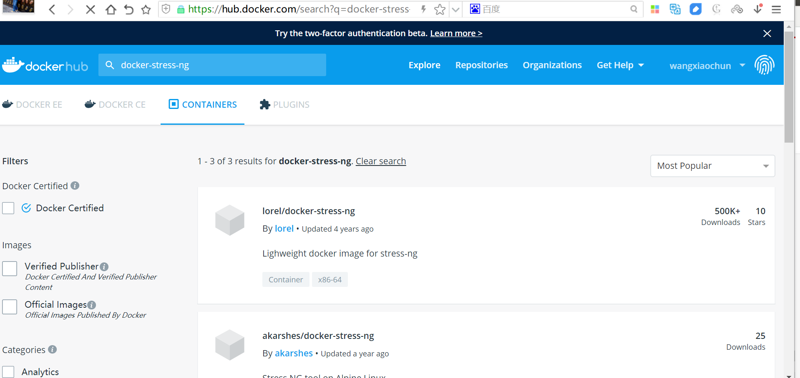

[← 返回Docker 容器技术目录]({{ '/subjects/Docker/' | relative_url }})



# 33 Stress-ng 压力测试工具
### 7.2 Stress-ng 压力测试工具

### Stress-ng 工具介绍


stress-ng 是一个压力测试工具，可以通过软件仓库进行安装，也提供了docker版本的容器

官方链接：https://kernel.ubuntu.com/~cking/stress-ng/

官方文档：https://wiki.ubuntu.com/Kernel/Reference/stress-ng



### Stress-ng 安装

范例:  软件包方式安装

```bash
[root@centos7 ~]#yum -y install stress-ng
[root@ubuntu2404 ~]#apt update &&  apt -y install stress-ng
[root@ubuntu2404 ~]#stress-ng/noble,noble 0.17.06-1build1 amd64
[root@ubuntu1804 ~]#apt update &&  apt -y install stress-ng
```

范例:  容器方式安装

```bash
[root@ubuntu1804 ~]#docker pull registry.cn-
beijing.aliyuncs.com/bowenxiaochun/stress-ng
[root@ubuntu1804 ~]#docker pull lorel/docker-stress-ng
Using default tag: latest
latest: Pulling from lorel/docker-stress-ng
Image docker.io/lorel/docker-stress-ng:latest uses outdated schema1 manifest
format. Please upgrade to a schema2 image for better future compatibility. More
information at https://docs.docker.com/registry/spec/deprecated-schema-v1/
c52e3ed763ff: Pull complete
a3ed95caeb02: Pull complete
7f831269c70e: Pull complete
Digest: sha256:c8776b750869e274b340f8e8eb9a7d8fb2472edd5b25ff5b7d55728bca681322
Status: Downloaded newer image for lorel/docker-stress-ng:latest
docker.io/lorel/docker-stress-ng:latest
[root@ubuntu1804 ~]#docker images
REPOSITORY               TAG                 IMAGE ID            CREATED
SIZE
lorel/docker-stress-ng   latest              1ae56ccafe55        3 years ago
8.1MB
```

### Stress-ng 使用

范例:  查看帮助

```bash
[root@ubuntu1804 ~]#docker run -it --rm registry.cn-
beijing.aliyuncs.com/bowenxiaochun/stress-ng
[root@ubuntu1804 ~]#docker run -it --rm lorel/docker-stress-ng
stress-ng, version 0.03.11
Usage: stress-ng [OPTION [ARG]]
--h,  --help             show help
--affinity N       start N workers that rapidly change CPU affinity
--affinity-ops N   stop when N affinity bogo operations completed
--affinity-rand    change affinity randomly rather than sequentially
--aio N            start N workers that issue async I/O requests
--aio-ops N        stop when N bogo async I/O requests completed
--aio-requests N   number of async I/O requests per worker
-a N, --all N            start N workers of each stress test
-b N, --backoff N        wait of N microseconds before work starts
-B N, --bigheap N        start N workers that grow the heap using calloc()
--bigheap-ops N    stop when N bogo bigheap operations completed
--bigheap-growth N grow heap by N bytes per iteration
--brk N            start N workers performing rapid brk calls
--brk-ops N        stop when N brk bogo operations completed
--brk-notouch      don't touch (page in) new data segment page
--bsearch          start N workers that exercise a binary search
--bsearch-ops      stop when N binary search bogo operations completed
--bsearch-size     number of 32 bit integers to bsearch
-C N, --cache N          start N CPU cache thrashing workers
--cache-ops N      stop when N cache bogo operations completed (x86 only)
--cache-flush      flush cache after every memory write (x86 only)
--cache-fence      serialize stores
--class name       specify a class of stressors, use with --sequential
--chmod N          start N workers thrashing chmod file mode bits
--chmod-ops N      stop chmod workers after N bogo operations
-c N, --cpu N            start N workers spinning on sqrt(rand())
--cpu-ops N        stop when N cpu bogo operations completed
-l P, --cpu-load P       load CPU by P %%, 0=sleep, 100=full load (see -c)
--cpu-method m     specify stress cpu method m, default is all
-D N, --dentry N         start N dentry thrashing processes
--dentry-ops N     stop when N dentry bogo operations completed
--dentry-order O   specify dentry unlink order (reverse, forward, stride)
--dentries N       create N dentries per iteration
--dir N            start N directory thrashing processes
--dir-ops N        stop when N directory bogo operations completed
-n,   --dry-run          do not run
--dup N            start N workers exercising dup/close
--dup-ops N        stop when N dup/close bogo operations completed
--epoll N          start N workers doing epoll handled socket activity
--epoll-ops N      stop when N epoll bogo operations completed
--epoll-port P     use socket ports P upwards
--epoll-domain D   specify socket domain, default is unix
--eventfd N        start N workers stressing eventfd read/writes
--eventfd-ops N    stop eventfd workers after N bogo operations
--fault N          start N workers producing page faults
--fault-ops N      stop when N page fault bogo operations completed
--fifo N           start N workers exercising fifo I/O
--fifo-ops N       stop when N fifo bogo operations completed
--fifo-readers N   number of fifo reader processes to start
--flock N          start N workers locking a single file
--flock-ops N      stop when N flock bogo operations completed
-f N, --fork N           start N workers spinning on fork() and exit()
--fork-ops N       stop when N fork bogo operations completed
--fork-max P       create P processes per iteration, default is 1
--fstat N          start N workers exercising fstat on files
--fstat-ops N      stop when N fstat bogo operations completed
--fstat-dir path   fstat files in the specified directory
--futex N          start N workers exercising a fast mutex
--futex-ops N      stop when N fast mutex bogo operations completed
--get N            start N workers exercising the get*() system calls
--get-ops N        stop when N get bogo operations completed
-d N, --hdd N            start N workers spinning on write()/unlink()
--hdd-ops N        stop when N hdd bogo operations completed
--hdd-bytes N      write N bytes per hdd worker (default is 1GB)
--hdd-direct       minimize cache effects of the I/O
--hdd-dsync        equivalent to a write followed by fdatasync
--hdd-noatime      do not update the file last access time
--hdd-sync         equivalent to a write followed by fsync
--hdd-write-size N set the default write size to N bytes
--hsearch          start N workers that exercise a hash table search
--hsearch-ops      stop when N hash search bogo operations completed
--hsearch-size     number of integers to insert into hash table
--inotify N        start N workers exercising inotify events
--inotify-ops N    stop inotify workers after N bogo operations
-i N, --io N             start N workers spinning on sync()
--io-ops N         stop when N io bogo operations completed
--ionice-class C   specify ionice class (idle, besteffort, realtime)
--ionice-level L   specify ionice level (0 max, 7 min)
-k,   --keep-name        keep stress process names to be 'stress-ng'
--kill N           start N workers killing with SIGUSR1
--kill-ops N       stop when N kill bogo operations completed
--lease N          start N workers holding and breaking a lease
--lease-ops N      stop when N lease bogo operations completed
--lease-breakers N number of lease breaking processes to start
--link N           start N workers creating hard links
--link-ops N       stop when N link bogo operations completed
--lsearch          start N workers that exercise a linear search
--lsearch-ops      stop when N linear search bogo operations completed
--lsearch-size     number of 32 bit integers to lsearch
-M,   --metrics          print pseudo metrics of activity
--metrics-brief    enable metrics and only show non-zero results
--memcpy N         start N workers performing memory copies
--memcpy-ops N     stop when N memcpy bogo operations completed
--mmap N           start N workers stressing mmap and munmap
--mmap-ops N       stop when N mmap bogo operations completed
--mmap-async       using asynchronous msyncs for file based mmap
--mmap-bytes N     mmap and munmap N bytes for each stress iteration
--mmap-file        mmap onto a file using synchronous msyncs
--mmap-mprotect    enable mmap mprotect stressing
--msg N            start N workers passing messages using System V
messages
--msg-ops N        stop msg workers after N bogo messages completed
--mq N             start N workers passing messages using POSIX messages
--mq-ops N         stop mq workers after N bogo messages completed
--mq-size N        specify the size of the POSIX message queue
--nice N           start N workers that randomly re-adjust nice levels
--nice-ops N       stop when N nice bogo operations completed
--no-madvise       don't use random madvise options for each mmap
--null N           start N workers writing to /dev/null
--null-ops N       stop when N /dev/null bogo write operations completed
-o,   --open N           start N workers exercising open/close
--open-ops N       stop when N open/close bogo operations completed
-p N, --pipe N           start N workers exercising pipe I/O
--pipe-ops N       stop when N pipe I/O bogo operations completed
-P N, --poll N           start N workers exercising zero timeout polling
--poll-ops N       stop when N poll bogo operations completed
--procfs N         start N workers reading portions of /proc
--procfs-ops N     stop procfs workers after N bogo read operations
--pthread N        start N workers that create multiple threads
--pthread-ops N    stop pthread workers after N bogo threads created
--pthread-max P    create P threads at a time by each worker
-Q,   --qsort N          start N workers exercising qsort on 32 bit random
integers
--qsort-ops N      stop when N qsort bogo operations completed
--qsort-size N     number of 32 bit integers to sort
-q,   --quiet            quiet output
-r,   --random N         start N random workers
--rdrand N         start N workers exercising rdrand instruction (x86
only)
--rdrand-ops N     stop when N rdrand bogo operations completed
-R,   --rename N         start N workers exercising file renames
--rename-ops N     stop when N rename bogo operations completed
--sched type       set scheduler type
--sched-prio N     set scheduler priority level N
--seek N           start N workers performing random seek r/w IO
--seek-ops N       stop when N seek bogo operations completed
--seek-size N      length of file to do random I/O upon
--sem N            start N workers doing semaphore operations
--sem-ops N        stop when N semaphore bogo operations completed
--sem-procs N      number of processes to start per worker
--sendfile N       start N workers exercising sendfile
--sendfile-ops N   stop after N bogo sendfile operations
--sendfile-size N  size of data to be sent with sendfile
--sequential N     run all stressors one by one, invoking N of them
--sigfd N          start N workers reading signals via signalfd reads
--sigfd-ops N      stop when N bogo signalfd reads completed
--sigfpe N         start N workers generating floating point math faults
--sigfpe-ops N     stop when N bogo floating point math faults completed
--sigsegv N        start N workers generating segmentation faults
--sigsegv-ops N    stop when N bogo segmentation faults completed
-S N, --sock N           start N workers doing socket activity
--sock-ops N       stop when N socket bogo operations completed
--sock-port P      use socket ports P to P + number of workers - 1
--sock-domain D    specify socket domain, default is ipv4
--stack N          start N workers generating stack overflows
--stack-ops N      stop when N bogo stack overflows completed
-s N, --switch N         start N workers doing rapid context switches
--switch-ops N     stop when N context switch bogo operations completed
--symlink N        start N workers creating symbolic links
--symlink-ops N    stop when N symbolic link bogo operations completed
--sysinfo N        start N workers reading system information
--sysinfo-ops N    stop when sysinfo bogo operations completed
-t N, --timeout N        timeout after N seconds
-T N, --timer N          start N workers producing timer events
--timer-ops N      stop when N timer bogo events completed
--timer-freq F     run timer(s) at F Hz, range 1000 to 1000000000
--tsearch          start N workers that exercise a tree search
--tsearch-ops      stop when N tree search bogo operations completed
--tsearch-size     number of 32 bit integers to tsearch
--times            show run time summary at end of the run
-u N, --urandom N        start N workers reading /dev/urandom
--urandom-ops N    stop when N urandom bogo read operations completed
--utime N          start N workers updating file timestamps
--utime-ops N      stop after N utime bogo operations completed
--utime-fsync      force utime meta data sync to the file system
-v,   --verbose          verbose output
--verify           verify results (not available on all tests)
-V,   --version          show version
-m N, --vm N             start N workers spinning on anonymous mmap
--vm-bytes N       allocate N bytes per vm worker (default 256MB)
--vm-hang N        sleep N seconds before freeing memory
--vm-keep          redirty memory instead of reallocating
--vm-ops N         stop when N vm bogo operations completed
--vm-locked        lock the pages of the mapped region into memory
--vm-method m      specify stress vm method m, default is all
--vm-populate      populate (prefault) page tables for a mapping
--wait N           start N workers waiting on child being stop/resumed
--wait-ops N       stop when N bogo wait operations completed
--zero N           start N workers reading /dev/zero
--zero-ops N       stop when N /dev/zero bogo read operations completed
Example: stress-ng --cpu 8 --io 4 --vm 2 --vm-bytes 128M --fork 4 --timeout 10s
Note: Sizes can be suffixed with B,K,M,G and times with s,m,h,d,y
```



<nav class="article-end" aria-label="章节导航">
  <a href="{{ '/subjects/Docker/32-docker-resource-limits.html' | relative_url }}">← Previous: Docker Resource Limits</a>
  <a href="{{ '/subjects/Docker/' | relative_url }}">Back to Docker Container Technology Index</a>
  <a href="{{ '/subjects/Docker/34-container-memory-limits.html' | relative_url }}">Next: Container Memory Limits →</a>
</nav>
