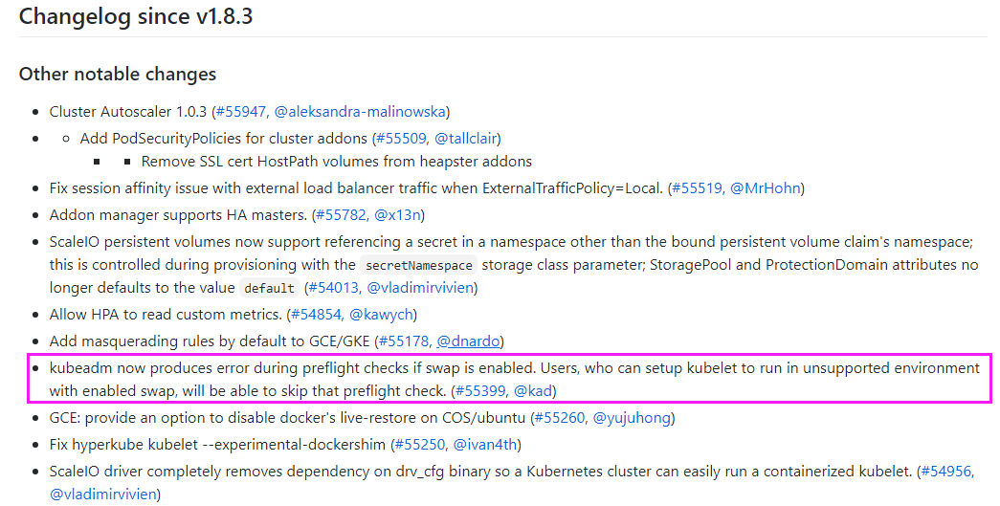

[← 返回Docker 容器技术目录]({{ '/subjects/Docker/' | relative_url }})



# 34 容器的内存限制
### 7.3 容器的内存限制

Docker 可通过 cgroup 给容器设置内存上限，也能配置内存预留和 swap 行为。阅读参数时先区分**硬上限**与**资源紧张时的软目标**；不要把 `docker stats` 中一瞬间的数值当作整个生命周期的最大值。参考 [Docker 资源限制文档](https://docs.docker.com/engine/containers/resource_constraints/)。

### 7.3.1 常用选项

| 参数 | 含义 | 注意 |
| --- | --- | --- |
| `--memory` / `-m` | 容器可使用的内存硬上限。 | 计入范围由 cgroup 模式决定，不只是进程 RSS。 |
| `--memory-reservation` | 资源紧张时希望容器回收至的软目标。 | 不是严格上限，应低于 `--memory`。 |
| `--memory-swap` | 同时指定 `--memory` 时，表示内存与 swap 的总上限。 | 若与 `--memory` 相等，通常表示不允许额外使用 swap。 |
| `--memory-swappiness` | 调整匿名页换出的倾向。 | 不是“内存用到 N% 后开始 swap”的阈值。 |

`--memory-swap=1g --memory=300m` 表示总上限约 1 GiB，其中额外 swap 额度约 700 MiB，前提是宿主机启用了相应支持。`--memory-swap=0` 通常等同未设置；未设置时的行为取决于 Docker、内核和宿主机配置。容器中的 `free` 可能显示宿主机视角，确认容器限制应结合 `docker inspect`、`docker stats` 与 cgroup 文件，而非只看 `free`。

旧资料的 `--kernel-memory` 和 `--oom-kill-disable` 示例依赖旧内核实现，当前环境可能不支持。禁用 OOM 处理还可能让宿主机承受更严重的内存压力，本教程不把它作为常规调优手段。Kubernetes 的 swap 策略也随版本与配置变化，不能用早期版本的安装预检结论代替当前 Docker 行为。



### 7.3.2 用压力工具验证硬上限

以下测试使用上一节构建的 `local/stress-ng:demo`，在测试机执行。通过 `--memory-swap=256m` 排除额外 swap 干扰；故意让 worker 申请超过上限的内存，以观察 OOM 行为：

```bash
docker run --name mem-test --memory=256m --memory-swap=256m \
  local/stress-ng:demo --vm 1 --vm-bytes 300M --vm-keep --timeout 15s

docker inspect --format '{{.State.OOMKilled}} {{.State.ExitCode}}' mem-test
docker logs --tail=30 mem-test
docker rm mem-test
```

需要查看瞬时内存占用时，在容器仍运行的另一个终端执行 `docker stats --no-stream mem-test`；退出后，`docker inspect` 和日志更有参考价值。实际是否触发 OOM 取决于 stress-ng 版本、内存分配方式与内核回收行为，不能只根据某次退出码作一般结论。若测试宿主机内存不足，应缩小工作量，避免影响其他服务。

### 7.3.3 查看 cgroup 限制与排障

在 cgroup v2 系统中可查 `memory.max`、`memory.current` 与 `memory.events`；cgroup v1 的文件名和路径不同。Docker 的 cgroup 目录也会随驱动与发行版变化，不应复制旧示例中写死的容器 ID 路径。优先使用：

```bash
docker inspect --format '{{.HostConfig.Memory}} {{.HostConfig.MemorySwap}}' mem-test
docker stats --no-stream mem-test
```

上述检查应在执行 `docker rm mem-test` 前完成。必要时再结合 `docker inspect` 中的进程 PID 和宿主机 cgroup 布局定位文件。若发现 `OOMKilled=true`，检查工作集、缓存、swap、应用日志和内核 OOM 日志；调大上限前先判断是正常峰值还是持续增长。



<nav class="article-end" aria-label="章节导航">
  <a href="{{ '/subjects/Docker/33-load-testing-with-stress-ng.html' | relative_url }}">← 上一篇：Stress-ng 压力测试工具</a>
  <a href="{{ '/subjects/Docker/' | relative_url }}">返回 Docker 容器技术目录</a>
  <a href="{{ '/subjects/Docker/35-container-cpu-limits.html' | relative_url }}">下一篇：容器的 CPU 限制 →</a>
</nav>
