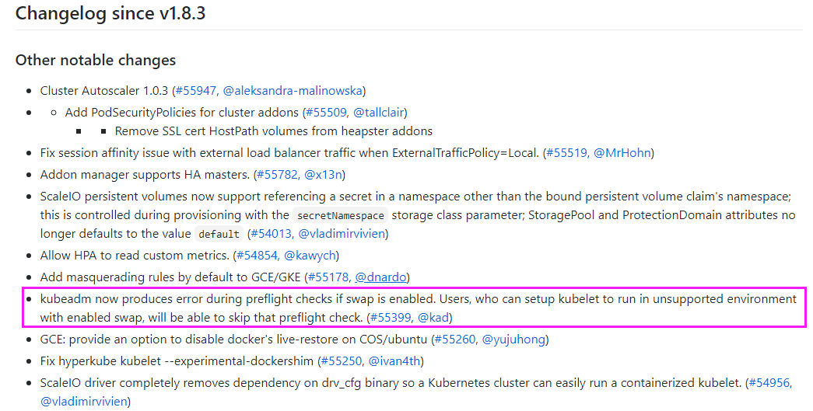

[← Back to Docker Container Technology Index]({{ '/subjects/Docker/' | relative_url }})



# 34 Container Memory Limits
### 7.3 容器的内存限制

Docker 可以强制执行硬性内存限制，即只允许容器使用给定的内存大小。

Docker 也可以执行非硬性内存限制，即容器可以使用尽可能多的内存，除非内核检测到主机上的内存不够用了

### 内存相关选项

官文文档: https://docs.docker.com/config/containers/resource_constraints/

docker run 运行容器使用以下设置大部分的选项取正整数，跟着一个后缀b ，k ， m ，g ，，表示字节，千字节，兆字节或千兆字节

选项描述

-m ，--memory= 容器可以使用的最大物理内存量RSS，硬限制，此选项最小允许值为

4m （4 MB），此项较常用

--memory-swap 允许此容器交换到磁盘的内存量,必须先用-m 对内存限制才可以使用,详

细说明如下

设置容器使用交换分区的倾向性，值越高表示越倾向于使用swap分区，范围为0-100，0为能不用就不用，100为能用就用，N表示内存使

--memory-swappiness

用率达到N%时，就会使用swap空间

允许指定小于 --memory 的软限制 ，当 Docker 检测到主机上的争用或内存不足时会激活该限制，如果使-- memory-reservation，则必须将

--memory-

其设置为低于 --memory 才能使其优先生效。 因为它是软限制，所以

```text
reservation
```

不能保证容器不超过限制

容器可以使用的最大内核内存量，最小为 4m，由于内核内存与用户空间内存隔离，因此无法与用户空间内存直接交换，因此内核内存不足的

--kernel-memory

容器可能会阻塞宿主机资源，这会对主机和其他容器或者其他服务进程产生影响，因此不建议设置内核内存大小

新内核不再支持，默认情况下，如果发生内存不足（OOM）错误，则内核将终止容器中的进程。要更改此行为，请使用该--oom-killdisable 选项。建议仅在设置了该-m/--memory 选项的容器上禁用

--oom-kill-disable

OOM。如果-m 未设置该标志，则主机可能会用完内存，内核可能需要终止主机系统的进程以释放内存

范例:

```bash
[root@ubuntu1804 ~]#docker run -e MYSQL_ROOT_PASSWORD=123456 -it --rm -m 1g --
oom-kill-disable mysql:5.7.30
2020-02-04 13:11:54+00:00 [Note] [Entrypoint]: Entrypoint script for MySQL
Server 5.7.29-1debian9 started.
2020-02-04 13:11:54+00:00 [Note] [Entrypoint]: Switching to dedicated user
'mysql'
2020-02-04 13:11:54+00:00 [Note] [Entrypoint]: Entrypoint script for MySQL
Server 5.7.29-1debian9 started.
2020-02-04 13:11:54+00:00 [Note] [Entrypoint]: Initializing database files
......
Version: '5.7.29'  socket: '/var/run/mysqld/mysqld.sock'  port: 3306  MySQL
Community Server (GPL)
#ubuntu2204和ubuntu2404内核不支持--oom-kill-disable
[root@ubuntu2204 ~]#docker run --rm --name test -m 256m --oom-kill-disable
registry.cn-beijing.aliyuncs.com/bowenxiaochun/stress-ng --vm 2
WARNING: Your kernel does not support OomKillDisable. OomKillDisable discarded.
[root@ubuntu2404 ~]#docker run --rm --name test -m 256m --oom-kill-disable
registry.cn-beijing.aliyuncs.com/bowenxiaochun/stress-ng --vm 2
Status: Downloaded newer image for registry.cn-
beijing.aliyuncs.com/bowenxiaochun/stress-ng:latest
WARNING: Your kernel does not support OomKillDisable. OomKillDisable discarded.
```

范例:

```bash
[root@ubuntu1804 ~]#sysctl  -a |grep swappiness
sysctl: reading key "net.ipv6.conf.all.stable_secret"
sysctl: reading key "net.ipv6.conf.default.stable_secret"
sysctl: reading key "net.ipv6.conf.docker0.stable_secret"
sysctl: reading key "net.ipv6.conf.eth0.stable_secret"
sysctl: reading key "net.ipv6.conf.lo.stable_secret"
vm.swappiness = 60
```

### Swap 限制

kubernets 对swap的要求

K8s 1.8.3更新日志:

宿主机开启交换分区，会在安装之前的预检查环节提示相应错误信息:   https://github.com/kubernete s/kubernetes/blob/release-1.8/CHANGELOG-1.8.md



docker run 命令可以使用--memory-swap 选项控制swap的使用

```text
--memory-swap #只有在设置了 --memory 后才会有意义。使用 Swap,可以让容器将超出限制部分的内存
置换到磁盘上，WARNING:  经常将内存交换到磁盘的应用程序会降低性能
```

不同的--memory-swap 设置会产生不同的效果:

--memory-

-- memory 功能

swap

正数S 正数M 容器可用内存总空间为S,其中ram为M,swap为 S-M,若S=M,则无

可用swap资源

0 正数M 相当于未设置swap(unset)

unset 正数M 若主机(Docker Host) 启用于swap , 则容器的可用swap 为2*M

-1 正数M 若主机(Docker Host)启用了swap ,则容器可使用最大至主机上所

有swap空间

```text
-memory-swap #值为正数， 那么--memory 和--memory-swap 都必须要设置，--memory-swap 表示
你能使用的内存和 swap 分区大小的总和，例如:   --memory=300m, --memory-swap=1g, 那么该容
器能够使用 300m 物理内存和 700m swap，即--memory 是实际物理内存大小值不变，而 swap 的实际大
小计算方式为(--memory-swap)-(--memory)=容器可用 swap
--memory-swap #如果设置为 0，则忽略该设置，并将该值视为未设置，即未设置交换分区
--memory-swap #如果等于--memory 的值，并且--memory 设置为正整数，容器无权访问 swap
-memory-swap #如果未设置，如果宿主机开启了 swap，则实际容器的swap 值最大为 2x( --
memory)，即两倍于物理内存大小，例如，如果--memory="300m"与--memory-swap没有设置，该容器可
以使用300m总的内存和600m交撒空间,但是并不准确(在容器中使用free 命令所看到的 swap 空间并不精
确，毕竟每个容器都可以看到具体大小，宿主机的 swap 是有上限的，而且不是所有容器看到的累计大小)
--memory-swap #如果设置为-1，如果宿主机开启了 swap，则容器可以使用主机上 swap 的最大空间
```

注意:  在容器中执行free命令看到的是宿主机的内存和swap使用，而非容器自身的swap使用情况

范例:  在容器中查看内存

```bash
[root@ubuntu1804 ~]#free
total        used        free      shared  buff/cache   available
Mem:        3049484      278484     1352932       10384     1418068     2598932
Swap:       1951740           0     1951740
[root@ubuntu1804 ~]#docker run -it --rm -m 2G centos:centos7.7.1908 bash
[root@f5d387b5022f /]# free
total        used        free      shared  buff/cache   available
Mem:        3049484      310312     1320884       10544     1418288     2566872
Swap:       1951740           0     1951740
[root@f5d387b5022f /]#
```

### 使用 stress-ng 测试内存限制

假如一个容器未做内存使用限制，则该容器可以利用到系统内存最大空间，默认创建的容器没有做内存资源限制。

范例:  默认一个workers 分配256M内存，2个即占512M内存

```bash
[root@ubuntu1804 ~]#docker run --name c1 -it --rm registry.cn-
beijing.aliyuncs.com/bowenxiaochun/stress-ng --vm 2
stress-ng: info: [1] defaulting to a 86400 second run per stressor
stress-ng: info: [1] dispatching hogs: 2 vm
#因上一个命令是前台执行，下面在另一个终端窗口中执行，可以看到占用512M左右内存
[root@ubuntu1804 ~]#docker stats
CONTAINER ID        NAME                CPU %               MEM USAGE / LIMIT
MEM %               NET I/O             BLOCK I/O           PIDS
fd184869ff7e        c1                  91.00%              524.3MiB / 962MiB
54.50%              766B / 0B           860kB / 0B          5
```

范例:  指定内存最大值

```bash
[root@ubuntu1804 ~]#docker run --name c1 -it --rm -m 300m registry.cn-
beijing.aliyuncs.com/bowenxiaochun/stress-ng --vm 2
WARNING: Your kernel does not support swap limit capabilities or the cgroup is
not mounted. Memory limited without swap.
stress-ng: info: [1] defaulting to a 86400 second run per stressor
stress-ng: info: [1] dispatching hogs: 2 vm
[root@ubuntu1804 ~]#vim /etc/default/grub
GRUB_CMDLINE_LINUX="cgroup_enable=memory swapaccount=1  net.ifnames=0"
[root@ubuntu1804 ~]#update-grub
Generating grub configuration file ...
Found linux image: /boot/vmlinuz-4.15.0-29-generic
Found initrd image: /boot/initrd.img-4.15.0-29-generic
done
[root@ubuntu1804 ~]#reboot
[root@ubuntu1804 ~]#docker run --name c1 -it --rm -m 300m registry.cn-
beijing.aliyuncs.com/bowenxiaochun/stress-ng --vm 2
stress-ng: info: [1] defaulting to a 86400 second run per stressor
stress-ng: info: [1] dispatching hogs: 2 vm
#在另一个终端窗口执行
[root@ubuntu1804 ~]#docker stats --no-stream
CONTAINER ID        NAME                CPU %               MEM USAGE / LIMIT
MEM %               NET I/O             BLOCK I/O           PIDS
6a93f6b22034        c1                  27.06%              297.2MiB / 300MiB
99.07%              1.45kB / 0B         4.98GB / 5.44GB     5
```

范例:

```bash
[root@ubuntu1804 ~]#docker run --name c2 -it --rm  registry.cn-
beijing.aliyuncs.com/bowenxiaochun/stress-ng --vm 4
stress-ng: info: [1] defaulting to a 86400 second run per stressor
stress-ng: info: [1] dispatching hogs: 4 vm
#一次性查看资源使用情况
[root@ubuntu1804 ~]#docker stats --no-stream
CONTAINER ID        NAME                CPU %               MEM USAGE / LIMIT
MEM %               NET I/O             BLOCK I/O           PIDS
fd5fff3c04f7        c2                  21.20%              591.1MiB / 962MiB
61.45%              1.31kB / 0B         1.07GB / 46.6MB     9
[root@ubuntu1804 ~]#
```

范例:  容器占用内存造成OOM

```bash
[root@ubuntu1804 ~]#docker run -it --rm --name c1  registry.cn-
beijing.aliyuncs.com/bowenxiaochun/stress-ng --vm 6
stress-ng: info: [1] defaulting to a 86400 second run per stressor
stress-ng: info: [1] dispatching hogs: 6 vm
#另一个终端窗中同时执行下面命令
[root@ubuntu1804 ~]#docker run  -it --rm  --name c2 registry.cn-
beijing.aliyuncs.com/bowenxiaochun/stress-ng --vm 6
stress-ng: info: [1] defaulting to a 86400 second run per stressor
stress-ng: info: [1] dispatching hogs: 6 vm
```

```bash
[root@ubuntu1804 ~]#docker stats
CONTAINER ID        NAME                CPU %               MEM USAGE / LIMIT
MEM %               NET I/O             BLOCK I/O           PIDS
f33cebf5b55d        c2                  --                  -- / --
--                  --                  --                  --
b14b597c5a4f        cool_banach         --                  -- / --
--                  --                  --                  --
#观察日志出现OOM现象
[root@ubuntu1804 ~]#tail  /var/log/syslog
Feb  4 22:59:40 ubuntu1804 kernel: [  785.928835] [ 2575]     0  2575    67104
39218   544768    22906          1000 stress-ng-vm
Feb  4 22:59:40 ubuntu1804 kernel: [  785.928836] [ 2594]     0  2594    67104
37503   409600     7725          1000 stress-ng-vm
Feb  4 22:59:40 ubuntu1804 kernel: [  785.928837] [ 2601]     0  2601    67104
38815   438272     9779          1000 stress-ng-vm
Feb  4 22:59:40 ubuntu1804 kernel: [  785.928838] [ 2602]     0  2602     1568
861    49152        0          1000 stress-ng-vm
Feb  4 22:59:40 ubuntu1804 kernel: [  785.928839] [ 2610]     0  2610     1568
861    49152        0          1000 stress-ng-vm
Feb  4 22:59:40 ubuntu1804 kernel: [  785.928840] [ 2614]     0  2614     1157
174    53248        0             0 update-motd-hwe
Feb  4 22:59:40 ubuntu1804 kernel: [  785.928841] [ 2615]     0  2615     3100
15    61440        0             0 apt-config
Feb  4 22:59:40 ubuntu1804 kernel: [  785.928842] Out of memory: Kill process
2570 (stress-ng-vm) score 1090 or sacrifice child
Feb  4 22:59:40 ubuntu1804 kernel: [  785.929493] Killed process 2570 (stress-
ng-vm) total-vm:268416kB, anon-rss:170352kB, file-rss:632kB, shmem-rss:28kB
Feb  4 22:59:40 ubuntu1804 kernel: [  786.018319] oom_reaper: reaped process
2570 (stress-ng-vm), now anon-rss:0kB, file-rss:0kB, shmem-rss:28kB
```

范例:  查看内存限制

```bash
#启动两个工作进程，每个工作进程最大允许使用内存 256M，且宿主机不限制当前容器最大内存
[root@ubuntu1804 ~]#docker run  -it --name c1 --rm  registry.cn-
beijing.aliyuncs.com/bowenxiaochun/stress-ng --vm 2
stress-ng: info: [1] defaulting to a 86400 second run per stressor
stress-ng: info: [1] dispatching hogs: 2 vm
[root@ubuntu1804 ~]#docker ps -a
CONTAINER ID        IMAGE                    COMMAND                  CREATED
STATUS              PORTS               NAMES
13e46172e1ae        lorel/docker-stress-ng   "/usr/bin/stress-ng …"   24 seconds
ago      Up 22 seconds                           gallant_moore
```

```bash
#新内核路径
[root@ubuntu2404 ~]#ls /sys/fs/cgroup/system.slice/docker-
626ce0a32220bdf146ff46191b8d6f24affc07f676d9766c73cca0c13452634e.scope/
cgroup.controllers      cpu.idle                         cpu.stat.local
hugetlb.2MB.current       memory.current       memory.stat
pids.current
cgroup.events           cpu.max                          cpu.uclamp.max
hugetlb.2MB.events        memory.events        memory.swap.current
pids.events
cgroup.freeze           cpu.max.burst                    cpu.uclamp.min
hugetlb.2MB.events.local  memory.events.local  memory.swap.events      pids.max
cgroup.kill             cpu.pressure                     cpu.weight
hugetlb.2MB.max           memory.high          memory.swap.high        pids.peak
cgroup.max.depth        cpuset.cpus                      cpu.weight.nice
hugetlb.2MB.numa_stat     memory.low           memory.swap.max
[root@ubuntu2404 ~]#cat /sys/fs/cgroup/system.slice/docker-
626ce0a32220bdf146ff46191b8d6f24affc07f676d9766c73cca0c13452634e.scope/memory.ma
x
#旧内核路径：Ubuntu22.04新版不支持,Rocky8和Ubuntu18.04支持
[root@ubuntu1804 ~]#ls /sys/fs/cgroup/memory/docker/
13e46172e1ae8593569f05a3bebc7b41b7839da44369d43b29102661364ac2cd
memory.kmem.tcp.limit_in_bytes      memory.numa_stat
cgroup.clone_children
memory.kmem.tcp.max_usage_in_bytes  memory.oom_control
cgroup.event_control
memory.kmem.tcp.usage_in_bytes      memory.pressure_level
cgroup.procs
memory.kmem.usage_in_bytes          memory.soft_limit_in_bytes
memory.failcnt
memory.limit_in_bytes               memory.stat
memory.force_empty
memory.max_usage_in_bytes           memory.swappiness
memory.kmem.failcnt
memory.memsw.failcnt                memory.usage_in_bytes
memory.kmem.limit_in_bytes
memory.memsw.limit_in_bytes         memory.use_hierarchy
memory.kmem.max_usage_in_bytes
memory.memsw.max_usage_in_bytes     notify_on_release
memory.kmem.slabinfo
memory.memsw.usage_in_bytes         tasks
memory.kmem.tcp.failcnt
memory.move_charge_at_immigrate
```

范例:  内存限制200m

```bash
#宿主机限制容器最大内存使用:
[root@ubuntu1804 ~]#docker run  -it --rm  --name c1 -m 200M registry.cn-
beijing.aliyuncs.com/bowenxiaochun/stress-ng --vm 2 --vm-bytes 256M
stress-ng: info: [1] defaulting to a 86400 second run per stressor
stress-ng: info: [1] dispatching hogs: 2 vm
[root@ubuntu1804 ~]#docker stats --no-stream
CONTAINER ID        NAME                CPU %               MEM USAGE / LIMIT
MEM %               NET I/O             BLOCK I/O           PIDS
f69729b2acc1        sleepy_haibt        85.71%              198MiB / 200MiB
98.98%              1.05kB / 0B         697MB / 60.4GB      5
[root@ubuntu1804 ~]#
```

```bash
[root@ubuntu1804 ~]#docker stats --no-stream
CONTAINER ID        NAME                CPU %               MEM USAGE / LIMIT
MEM %               NET I/O             BLOCK I/O           PIDS
f69729b2acc1        sleepy_haibt        76.69%              297.9MiB / 300MiB
99.31%              1.05kB / 0B         1.11GB / 89.1GB     5
```

范例:  内存大小软限制

```bash
[root@ubuntu1804 ~]#docker run -it --rm  -m 256m --memory-reservation 128m --
name c1 registry.cn-beijing.aliyuncs.com/bowenxiaochun/stress-ng --vm 2 --vm-bytes
256M
stress-ng: info: [1] defaulting to a 86400 second run per stressor
stress-ng: info: [1] dispatching hogs: 2 vm
[root@ubuntu1804 ~]#docker stats --no-stream
CONTAINER ID        NAME                CPU %               MEM USAGE / LIMIT
MEM %               NET I/O             BLOCK I/O           PIDS
aeb38acde581        c1           72.45%              253.9MiB / 256MiB   99.20%
976B / 0B           9.47GB / 39.4GB     5
```

关闭OOM 机制:

```bash
# docker run -it --rm  -m 256m --oom-kill-disable --name c1  registry.cn-
beijing.aliyuncs.com/bowenxiaochun/stress-ng --vm 2 --vm-bytes 256M
# cat /sys/fs/cgroup/memory/docker/容器 ID/memory.oom_control
oom_kill_disable 1
under_oom 1
oom_kill 0
```



<nav class="article-end" aria-label="章节导航">
  <a href="{{ '/subjects/Docker/33-load-testing-with-stress-ng.html' | relative_url }}">← Previous: Load Testing with Stress-ng</a>
  <a href="{{ '/subjects/Docker/' | relative_url }}">Back to Docker Container Technology Index</a>
  <a href="{{ '/subjects/Docker/35-container-cpu-limits.html' | relative_url }}">Next: Container CPU Limits →</a>
</nav>
