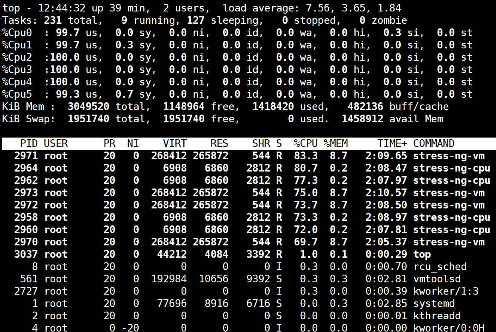
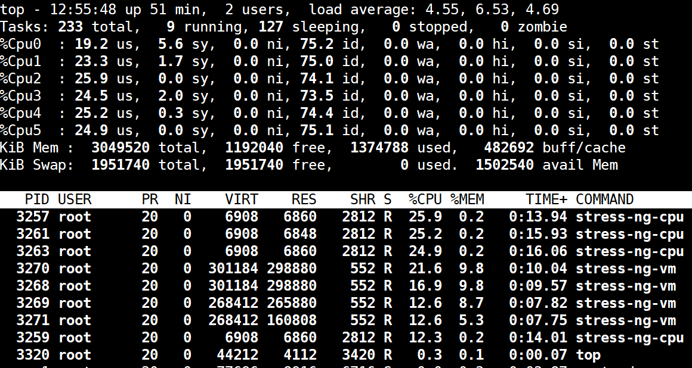
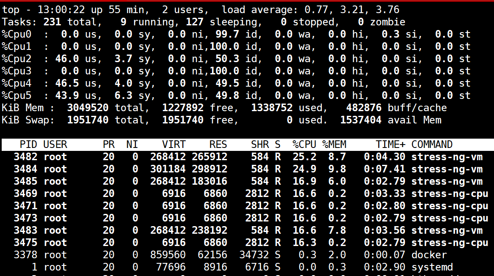

[← 返回Docker 容器技术目录]({{ '/subjects/Docker/' | relative_url }})



# 35 容器的 CPU 限制
### 7.4 容器的 CPU 限制

### 7.4.1 CPU 时间如何分配

宿主机可以把多个可运行进程安排到同一 CPU 核心上执行。Docker 的 CPU 参数作用于容器的 cgroup，影响可用 CPU 时间或允许运行的核心集合。早期资料用 CFS 解释调度；具体内核调度实现会演进，但理解“硬配额、核心绑定、竞争时权重”这三种控制方式更重要。参考 [Docker 资源限制文档](https://docs.docker.com/engine/containers/resource_constraints/)。

| 参数 | 控制方式 | 例子 |
| --- | --- | --- |
| `--cpus=1.5` | 限制总 CPU 时间，约等于 1.5 个逻辑核心的持续计算能力。 | 任务可在多个核之间调度，不是固定占用 1.5 个物理核心。 |
| `--cpuset-cpus=2,4-5` | 只允许在指定的逻辑 CPU 上调度。 | 需确认宿主机确有这些 CPU 编号。 |
| `--cpu-shares=512` | 竞争发生时的相对权重。 | 空闲时不是硬上限；与其他容器的权重一起决定份额。 |
| `--cpu-period` 与 `--cpu-quota` | 更底层的周期与配额控制。 | 常见默认周期是 100000 微秒；多数场景优先用 `--cpus`。 |

CPU 密集型任务会持续争取处理器时间；I/O 密集型任务更多时间在等待网络或磁盘。判断瓶颈时应结合吞吐、延迟和 `docker stats`，不能只看 CPU 百分比。对于多核主机，Docker 统计值可能超过 100%；约 150% 可理解为观察窗口内消耗约 1.5 个逻辑核心的计算时间。

### 7.4.2 用 stress-ng 比较硬限制

使用第 33 篇构建的测试镜像，先运行无 CPU 限制的测试，再用 `--cpus` 设定上限。两次实验应在同一主机、相似空闲负载下比较：

```bash
docker run --rm --name cpu-open \
  local/stress-ng:demo --cpu 4 --timeout 20s --metrics-brief

docker run --rm --name cpu-limited --cpus=1.5 \
  local/stress-ng:demo --cpu 4 --timeout 20s --metrics-brief
```

在容器运行期间从另一终端执行 `docker stats --no-stream cpu-open` 或 `docker stats --no-stream cpu-limited`。即使 `--cpu 4` 创建四个 worker，后者总 CPU 使用量仍会受到容器配额限制；具体统计值受采样窗口影响，不会每次恰好等于 150%。





### 7.4.3 核心绑定与相对权重

```bash
# 仅允许在宿主机逻辑 CPU 2、4、5 上运行，仍限制总 CPU 时间
docker run --rm --cpus=1.5 --cpuset-cpus=2,4-5 \
  local/stress-ng:demo --cpu 4 --timeout 20s
```

`--cpuset-cpus` 限定可调度位置，`--cpus` 限定总时间，两者可以组合，但不是互相替代。不要默认“0 号 CPU 必须避免”，应以宿主机拓扑和实际负载决定绑定策略。



如果两个容器都持续争抢 CPU，可分别用 `--cpu-shares=1024` 与 `--cpu-shares=512` 观察相对份额。只有在资源竞争时，权重差异才明显；它并不承诺绝对 2:1 的吞吐，也不能阻止其他主机进程消耗 CPU。需要稳定上限时使用 `--cpus`，需要亲和性时再考虑 `--cpuset-cpus`。



<nav class="article-end" aria-label="章节导航">
  <a href="{{ '/subjects/Docker/34-container-memory-limits.html' | relative_url }}">← 上一篇：容器的内存限制</a>
  <a href="{{ '/subjects/Docker/' | relative_url }}">返回 Docker 容器技术目录</a>
  <a href="{{ '/subjects/Docker/36-container-gpu-limits.html' | relative_url }}">下一篇：容器的 GPU 限制 （了解） →</a>
</nav>
