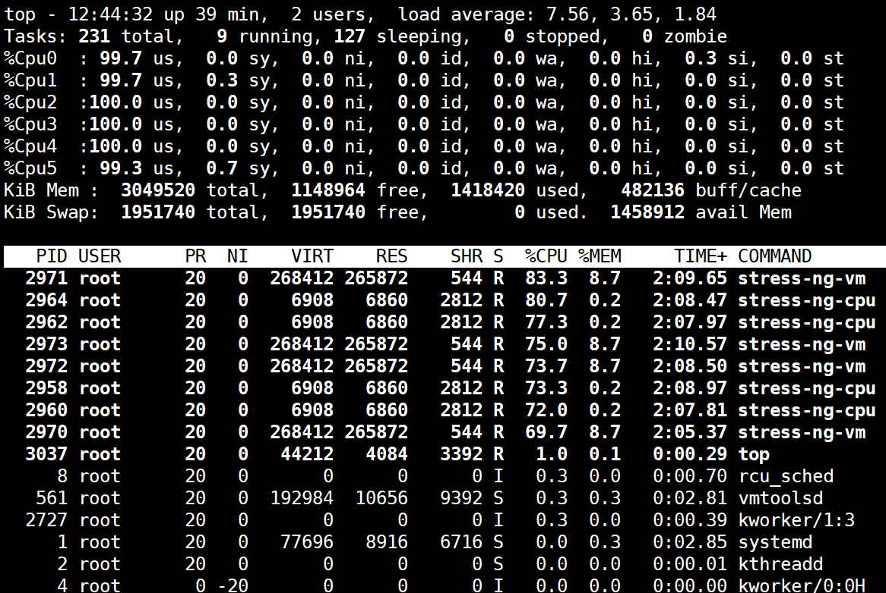
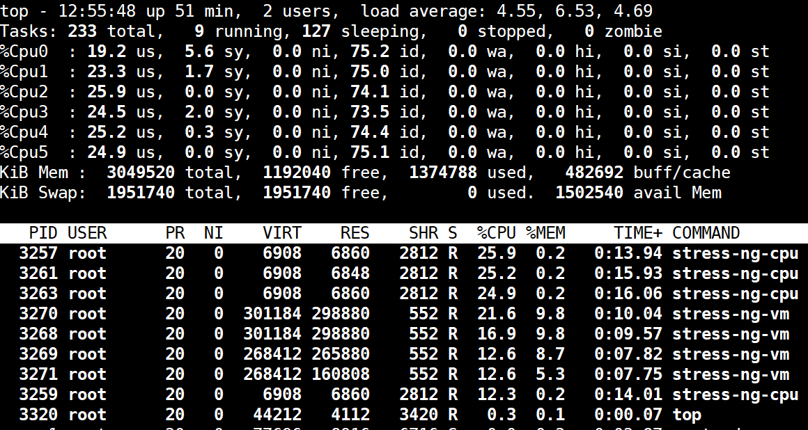
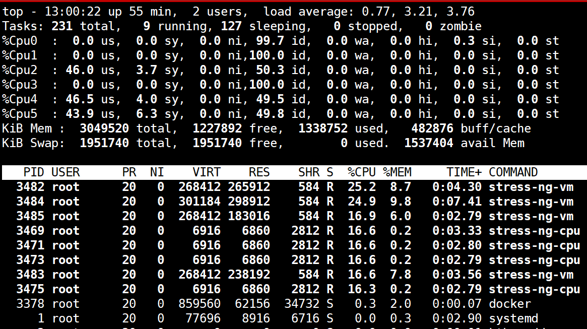

[← Back to Docker Container Technology Index]({{ '/subjects/Docker/' | relative_url }})



# 35 Container CPU Limits
### 7.4 容器的 CPU 限制

### 容器的 CPU 限制介绍

官方文档说明:  https://docs.docker.com/config/containers/resource_constraints/

一个宿主机，有几十个核心的CPU，但是宿主机上可以同时运行成百上千个不同的进程用以处理不同的任务，多进程共用一个 CPU 的核心为可压缩资源，即一个核心的 CPU 可以通过调度而运行多个进程， 但是同一个单位时间内只能有一个进程在 CPU 上运行，那么这么多的进程怎么在 CPU 上执行和调度的呢？

Linux kernel 进程的调度基于CFS(Completely Fair Scheduler)，完全公平调度

服务器资源密集型

CPU 密集型的场景:  计算密集型任务的特点是要进行大量的计算，消耗CPU 资源，比如计算圆周率、数据处理、对视频进行高清解码等等，全靠CPU 的运算能力。 IO 密集型的场景:  涉及到网络、磁盘IO 的任务都是IO 密集型任务，这类任务的特点是 CPU 消耗很少，任务的大部分时间都在等待 IO 操作完成（因为 IO 的速度远远低于 CPU 和内存的速度），比如 Web 应用，高并发，数据量大的动态网站来说，数据库应该为IO 密集型

CFS原理

cfs定义了进程调度的新模型，它给cfs_rq（cfs的run queue）中的每一个进程安排一个虚拟时钟 vruntime。如果一个进程得以执行，随着时间的增长，其vruntime将不断增大。没有得到执行的进程 vruntime不变, 而调度器总是选择vruntime跑得最慢的那个进程来执行。这就是所谓的“完全公平”。为了区别不同优先级的进程，优先级高的进程vruntime增长得慢，以至于它可能得到更多的运行机会。 CFS的意义在于， 在一个混杂着大量计算型进程和IO交互进程的系统中，CFS调度器相对其它调度器在对待IO交互进程要更加友善和公平。

### 配置默认的 CFS 调度程序

默认情况下，每个容器对主机的CPU周期的访问都是不受限制的。可以设置各种约束，以限制给定容器对主机CPU周期的访问。大多数用户使用并配置 默认的CFS调度程序。在Docker 1.13及更高版本中，还可以配置 realtime scheduler。

CFS是用于常规Linux进程的Linux内核CPU调度程序。通过几个运行时标志,可以配置对容器拥有的CPU 资源的访问量。使用这些设置时，Docker会在主机上修改容器cgroup的设置。

选项描述

指定一个容器可以使用多少个可用的CPU核心资源。例如，如果主机有两个 CPU，如果设置了--cpus="1.5" ，则可以保证容器最多使用1.5个的CPU(如果是4核CPU，那么还可以是4核心上每核用一点，但是总计是1.5核心的CPU)。这相当于设置--cpu-period="100000" 和--cpu-quota="150000" 。此设置可在

--cpus=

Docker 1.13及更高版本中可用，目的是替代--cpu-period和--cpu-quota两个参数，从而使配置更简单，但是最大不能超出宿主机的CPU总核心数(在操作系统看到的CPU超线程后的数值)，此项较常用

过时选项,指定CPU CFS调度程序周期，必须与--cpu-quota 一起使用 。默认为

--cpu-

100微秒。大多数用户不会更改默认设置。如果使用Docker 1.13或更高版本，

```text
period=
```

请改用--cpus

--cpu-quota= 过时选项,在容器上添加 CPU CFS 配额，计算方式为 cpu-quota / cpu-period的

结果值，docker1.13 及以上版本通常使用--cpus 设置此值

用于指定容器运行的 CPU 编号，也就是所谓的CPU绑定。如果一个或多个 CPU，则容器可以使用逗号分隔的列表或用连字符分隔的CPU范围。第一个CPU

--cpuset-

的编号为0。有效值可能是0-3 （使用第一，第二，第三和第四CPU）或

```text
cpus
```

1,3 （使用第二和第四CPU）

用于设置 cfs 中调度的相对最大比例权重,cpu-share 的值越高的容器，将会分得更多的时间片(宿主机多核 CPU 总数为 100%，假如容器 A 为1024，容器 B 为 2048，那么容器 B 将最大是容器 A 的可用 CPU 的两倍 )，默认的时间片

--cpu-shares

1024，最大 262144。这是一个软限制。注意:进程数要多个CPU的核数才能看到效果，此值不能设置太小

### 使用 Stress-ng 测试 CPU配置

范例:  查看 stress-n 关于cpu的帮助

```bash
[root@ubuntu1804 ~]#docker run -it --rm  --name c1  registry.cn-
beijing.aliyuncs.com/bowenxiaochun/stress-ng  |grep cpu
-c N, --cpu N            start N workers spinning on sqrt(rand())
--cpu-ops N        stop when N cpu bogo operations completed
-l P, --cpu-load P       load CPU by P %%, 0=sleep, 100=full load (see -c)
--cpu-method m     specify stress cpu method m, default is all
Example: stress-ng --cpu 8 --io 4 --vm 2 --vm-bytes 128M --fork 4 --timeout 10s
[root@ubuntu1804 ~]#
```

范例:  不限制容器CPU

```bash
[root@ubuntu1804 ~]#lscpu |grep CPU
CPU op-mode(s):      32-bit, 64-bit
CPU(s):              6
On-line CPU(s) list: 0-5
CPU family:          6
Model name:          Intel(R) Core(TM) i7-4710HQ CPU @ 2.50GHz
CPU MHz:             2494.236
NUMA node0 CPU(s):   0-5
#占用4个CPU资源.但只是平均的使用CPU资源
[root@ubuntu1804 ~]#docker run -it --rm  --name c1 registry.cn-
beijing.aliyuncs.com/bowenxiaochun/stress-ng  --cpu 4
stress-ng: info: [1] defaulting to a 86400 second run per stressor
stress-ng: info: [1] dispatching hogs: 4 cpu, 4 vm
[root@ubuntu1804 ~]#docker stats --no-stream
CONTAINER ID        NAME                CPU %               MEM USAGE / LIMIT
MEM %               NET I/O             BLOCK I/O           PIDS
818a85e1da2f        frosty_taussig      595.57%             1.037GiB / 2.908GiB
35.64%              1.12kB / 0B         0B / 0B             13
[root@ubuntu1804 ~]#cat
/sys/fs/cgroup/cpuset/docker/818a85e1da2f9a4ef297178a9dc09b338b2308108195ad8d419
7a1c47febcbff/cpuset.cpus
0-5
[root@ubuntu1804 ~]#top
```



范例:  限制使用CPU

```bash
[root@ubuntu1804 ~]#docker run -it --rm  --name c1 --cpus 1.5  registry.cn-
beijing.aliyuncs.com/bowenxiaochun/stress-ng  --cpu 4
stress-ng: info: [1] defaulting to a 86400 second run per stressor
stress-ng: info: [1] dispatching hogs: 4 cpu, 4 vm
```

```bash
[root@ubuntu1804 ~]#docker stats --no-stream
CONTAINER ID        NAME                CPU %               MEM USAGE / LIMIT
MEM %               NET I/O             BLOCK I/O           PIDS
9f8b2e693113        busy_hodgkin        147.71%             786.8MiB / 2.908GiB
26.42%              836B / 0B           0B / 0B             13
[root@ubuntu1804 ~]#top
```



范例:  限制CPU

```bash
[root@ubuntu1804 ~]#docker run -it --rm  --name c1 --cpu-quota 2000 --cpu-period
1000  registry.cn-beijing.aliyuncs.com/bowenxiaochun/stress-ng  --cpu 4
stress-ng: info: [1] defaulting to a 86400 second run per stressor
stress-ng: info: [1] dispatching hogs: 4 cpu, 4 vm
[root@ubuntu1804 ~]#docker stats --no-stream
CONTAINER ID        NAME                     CPU %               MEM USAGE /
LIMIT     MEM %               NET I/O             BLOCK I/O           PIDS
bd949bb6698e        affectionate_chebyshev   185.03%             1.037GiB /
2.908GiB   35.64%              836B / 0B           0B / 0B             13
[root@ubuntu1804 ~]#
```

范例:  绑定CPU

```bash
#一般不建议绑在0号CPU上，因0号CPU一般会较忙
[root@ubuntu1804 ~]#docker run -it --rm  --name c1 --cpus 1.5  --cpuset-cpus
2,4-5 registry.cn-beijing.aliyuncs.com/bowenxiaochun/stress-ng  --cpu 4
stress-ng: info: [1] defaulting to a 86400 second run per stressor
stress-ng: info: [1] dispatching hogs: 4 cpu, 4 vm
[root@ubuntu1804 ~]#ps axo pid,cmd,psr |grep stress
1964 /usr/bin/stress-ng --cpu 4    2
1996 /usr/bin/stress-ng --cpu 4    5
1997 /usr/bin/stress-ng --cpu 4    2
1998 /usr/bin/stress-ng --cpu 4    4
1999 /usr/bin/stress-ng --cpu 4    2
2002 grep --color=auto stress      1
```

```bash
[root@ubuntu1804 ~]#docker stats --no-stream
CONTAINER ID        NAME                CPU %               MEM USAGE / LIMIT
MEM %               NET I/O             BLOCK I/O           PIDS
585879094e73        hungry_albattani    154.35%             1.099GiB / 2.908GiB
37.79%              906B / 0B           0B / 0B             13
#新内核
[root@ubuntu2404 ~]#cat /sys/fs/cgroup/system.slice/docker-
c4d74dc02b25cc2ef2ded238c36e1fb801129f623835b4104b3f2274a4a2adcb.scope/cpu.weigh
t
79
```



范例:  多个容器的CPU利用率比例

```bash
#同时开两个容器
[root@ubuntu1804 ~]#docker run -it --rm  --name c1 --cpu-shares 1000
registry.cn-beijing.aliyuncs.com/bowenxiaochun/stress-ng  --cpu 4
stress-ng: info: [1] defaulting to a 86400 second run per stressor
stress-ng: info: [1] dispatching hogs: 4 cpu, 4 vm
[root@ubuntu1804 ~]#docker run -it --rm  --name c2 --cpu-shares 500 registry.cn-
beijing.aliyuncs.com/bowenxiaochun/stress-ng  --cpu 4
stress-ng: info: [1] defaulting to a 86400 second run per stressor
stress-ng: info: [1] dispatching hogs: 4 cpu, 4 vm
#注意:进程数要多于CPU的核数才能看到效果,如果两个容器使用的CPU总数不超过CPU实际的核心数，两个容
器都显示400%
[root@ubuntu1804 ~]#docker stats --no-stream
CONTAINER ID        NAME                CPU %               MEM USAGE / LIMIT
MEM %               NET I/O             BLOCK I/O           PIDS
a1d4c6e6802d        c2                  195.88%             925.3MiB / 2.908GiB
31.07%              726B / 0B           0B / 0B             13
d5944104aff4        c1                  398.20%             1.036GiB / 2.908GiB
35.64%              906B / 0B           0B / 0B             13
[root@ubuntu1804 ~]#
```

```bash
#再打开新的容器，cpu分配比例会动态调整
[root@ubuntu1804 ~]#docker run -it --rm  --name c3 --cpu-shares 2000
registry.cn-beijing.aliyuncs.com/bowenxiaochun/stress-ng  --cpu 4
[root@ubuntu1804 ~]#docker stats --no-stream
CONTAINER ID        NAME                CPU %               MEM USAGE / LIMIT
MEM %               NET I/O             BLOCK I/O           PIDS
c2d54818e1fe        c3                  360.15%             664.5MiB / 2.908GiB
22.31%              726B / 0B           1.64GB / 150MB      13
a1d4c6e6802d        c2                  82.94%              845.2MiB / 2.908GiB
28.38%              936B / 0B           103MB / 4.54MB      13
d5944104aff4        c1                  181.18%             930.1MiB / 2.908GiB
31.23%              1.12kB / 0B         303MB / 19.8MB      13
```



<nav class="article-end" aria-label="章节导航">
  <a href="{{ '/subjects/Docker/34-container-memory-limits.html' | relative_url }}">← Previous: Container Memory Limits</a>
  <a href="{{ '/subjects/Docker/' | relative_url }}">Back to Docker Container Technology Index</a>
  <a href="{{ '/subjects/Docker/36-container-gpu-limits.html' | relative_url }}">Next: Container GPU Limits →</a>
</nav>
