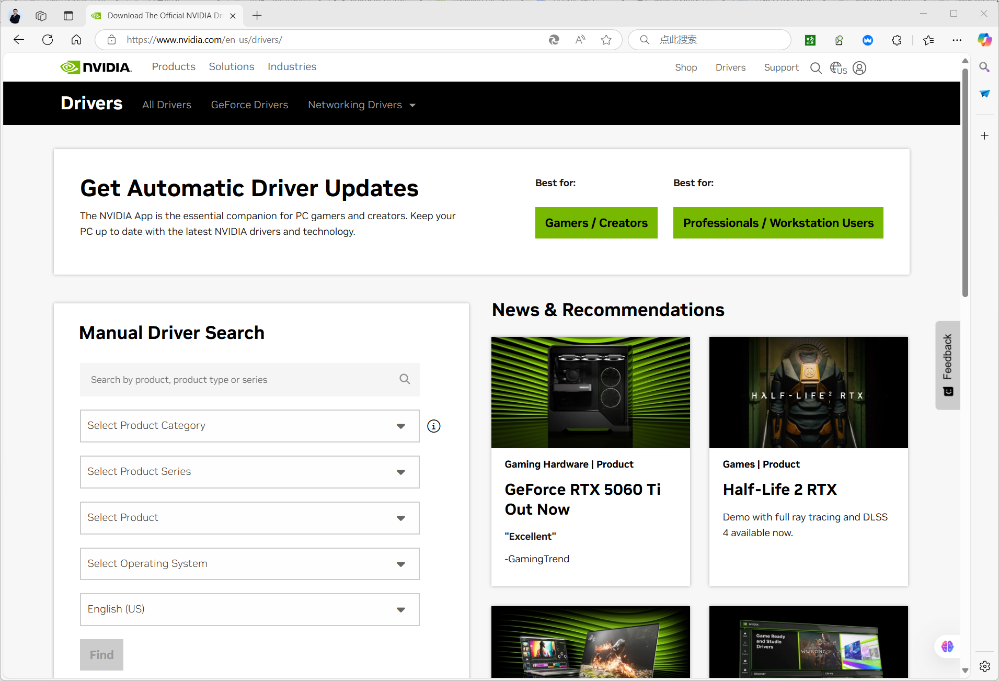
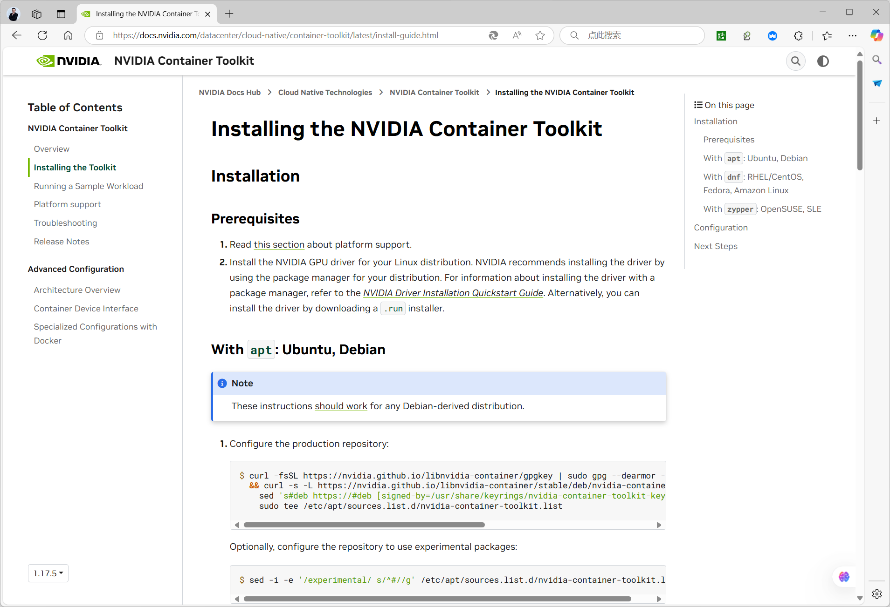

[← Back to Docker Container Technology Index]({{ '/subjects/Docker/' | relative_url }})



# 36 Container GPU Limits
### 7.5 容器的 GPU 限制 （了解）

<https://docs.docker.com/engine/containers/resource_constraints/#gpu>

### 使用 NVIDIA GPU 先决条件

访问官方NVIDIA 驱动程序页面下载并安装正确的驱动程序。一旦你有完成。

验证您的 GPU 是否正在运行且可访问。

<https://www.nvidia.com/Download/index.aspx>



安装 nvidia-container-toolkit

关注官方 NVIDIA Container Toolkit安装说明.

<https://docs.nvidia.com/datacenter/cloud-native/container-toolkit/latest/install-guide.html>



### 使用 GPU

### 公开 GPU 以供使用

在启动容器以访问 GPU 资源时包含标志。指定要使用的 GPU 数量。 例如：--gpus

```bash
$ docker run -it --rm --gpus all ubuntu nvidia-smi
```

公开所有可用的 GPU 并返回类似于以下内容的结果：

```text
解释+----------------------------------------------------------------------------
---+
| NVIDIA-SMI 384.130                Driver Version: 384.130                 |
|-------------------------------+----------------------+------------------------
+
| GPU  Name        Persistence-M| Bus-Id        Disp.A | Volatile Uncorr. ECC
|
| Fan  Temp  Perf  Pwr:Usage/Cap|         Memory-Usage | GPU-Util  Compute M.
|
|===============================+======================+========================
|
|   0  GRID K520        Off  | 00000000:00:03.0 Off |                  N/A
|
| N/A   36C P0    39W / 125W |      0MiB /  4036MiB |      0%   Default |
+-------------------------------+----------------------+------------------------
+
+-------------------------------------------------------------------------------
+
| Processes:                                                       GPU Memory
|
|  GPU      PID   Type   Process name                           Usage   |
|===============================================================================
|
|  No running processes found
|
+-------------------------------------------------------------------------------
+
```

### 使用该选项指定 GPU。 例如：device

```bash
$ docker run -it --rm --gpus device=GPU-3a23c669-1f69-c64e-cf85-44e9b07e7a2a
ubuntu nvidia-smi
```

公开该特定 GPU

```bash
$ docker run -it --rm --gpus '"device=0,2"' ubuntu nvidia-smi
```

公开第一个和第三个 GPU。注意:NVIDIA GPU 只能由运行单个引擎的系统访问。

### 设置 NVIDIA 功能

您可以手动设置功能。例如，在 Ubuntu 上，您可以运行 以后：

```bash
$ docker run --gpus 'all,capabilities=utility' --rm ubuntu nvidia-smi
```

这将启用驱动程序功能，该功能将工具utility``nvidia-smi 添加到容器中

功能以及其他配置可以通过环境变量在镜像中设置。

有关有效变量的更多信息，请参阅nvidia-container-toolkit （英伟达容器工具包）文档。 可以在 Dockerfile 中设置这些变量。

您还可以使用 CUDA 映像来自动设置这些变量。请参阅 官方CUDA 映像NGC 目录页面。



<nav class="article-end" aria-label="章节导航">
  <a href="{{ '/subjects/Docker/35-container-cpu-limits.html' | relative_url }}">← Previous: Container CPU Limits</a>
  <a href="{{ '/subjects/Docker/' | relative_url }}">Back to Docker Container Technology Index</a>
  <a href="{{ '/subjects/Docker/37-common-interview-questions.html' | relative_url }}">Next: Common Interview Questions →</a>
</nav>
