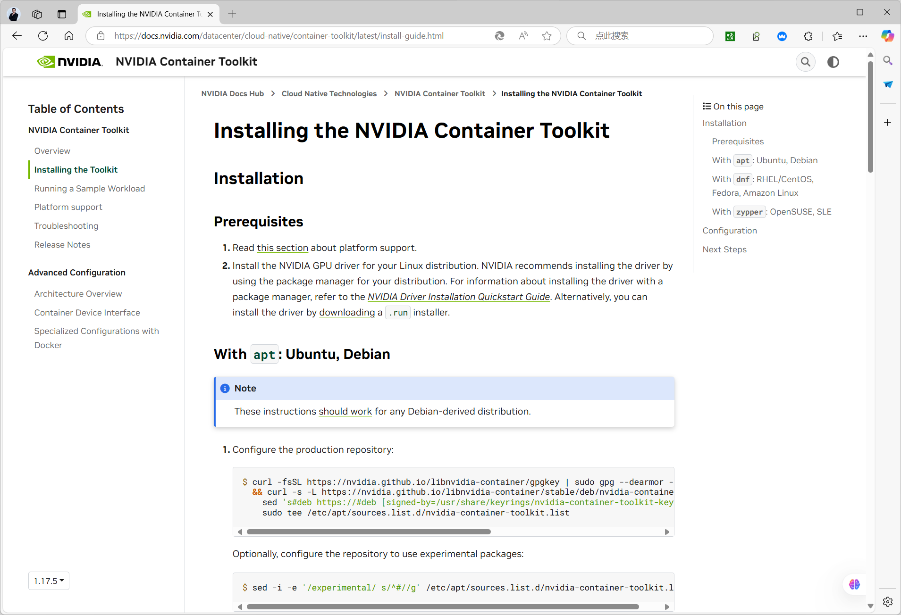

[← 返回Docker 容器技术目录]({{ '/subjects/Docker/' | relative_url }})



# 36 容器的 GPU 限制 （了解）
### 7.5 容器的 GPU 限制 （了解）

Docker 的 `--gpus` 参数用于**选择容器可见的 GPU 设备**，并不自动为每个容器设定 GPU 显存或计算量的硬上限。需要资源配额与多租户隔离时，应另行评估硬件分区、驱动功能或编排平台能力。

参考：[Docker GPU 文档](https://docs.docker.com/engine/containers/resource_constraints/#gpu)、[NVIDIA Container Toolkit 安装说明](https://docs.nvidia.com/datacenter/cloud-native/container-toolkit/latest/install-guide.html)。

### 1. 准备宿主机

先在宿主机安装与硬件和系统兼容的 NVIDIA 驱动，用 `nvidia-smi` 验证 GPU 可见；然后按 NVIDIA 官方说明安装 `nvidia-container-toolkit`。工具包安装完成后配置 Docker 运行时：

```bash
nvidia-smi
sudo nvidia-ctk runtime configure --runtime=docker
sudo systemctl restart docker
```

重启 Docker 可能影响现有容器，应在维护窗口操作。不要只安装 CUDA 镜像就认为容器能访问 GPU：宿主机驱动和运行时配置也必须正常。




### 2. 选择 GPU 并验证

下面命令以 Bash 为例；CUDA 镜像标签应按所需 CUDA 版本和宿主机驱动兼容性选择：

```bash
# 所有可用 GPU
docker run --rm --gpus all nvidia/cuda:12.4.1-base-ubuntu22.04 nvidia-smi

# 任意一块 GPU
docker run --rm --gpus 1 nvidia/cuda:12.4.1-base-ubuntu22.04 nvidia-smi

# 指定第 0、2 块 GPU（Bash 的引号形式）
docker run --rm --gpus '"device=0,2"' \
  nvidia/cuda:12.4.1-base-ubuntu22.04 nvidia-smi
```

也可以通过 GPU UUID 选择特定设备。`nvidia-smi` 输出中的 GPU 数量应与命令选择一致；若报找不到运行时或设备，应分别检查宿主机驱动、Toolkit 配置、Docker 重启结果及镜像与驱动的兼容性。GPU 编号可能因硬件变化而改变，长期部署可考虑使用 UUID。

### 3. 驱动能力与后续限制

`utility` 能力用于 `nvidia-smi` 等管理工具；实际计算应用通常还需要 `compute`。可通过 NVIDIA 运行时的能力配置或相关环境变量控制暴露的驱动功能，具体取值以所用 Toolkit 版本文档为准。GPU 设备选择与 GPU 资源配额是两回事：即使指定 `--gpus 1`，同一 GPU 上的显存竞争仍需在应用和平台层面监控。



<nav class="article-end" aria-label="章节导航">
  <a href="{{ '/subjects/Docker/35-container-cpu-limits.html' | relative_url }}">← 上一篇：容器的 CPU 限制</a>
  <a href="{{ '/subjects/Docker/' | relative_url }}">返回 Docker 容器技术目录</a>
  <a href="{{ '/subjects/Docker/37-common-interview-questions.html' | relative_url }}">下一篇：常见面试题 →</a>
</nav>
